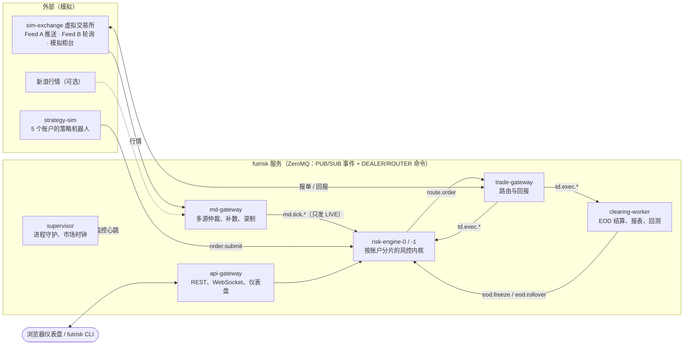
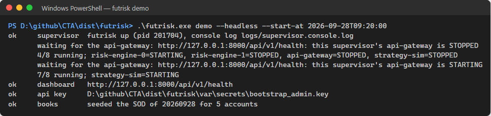
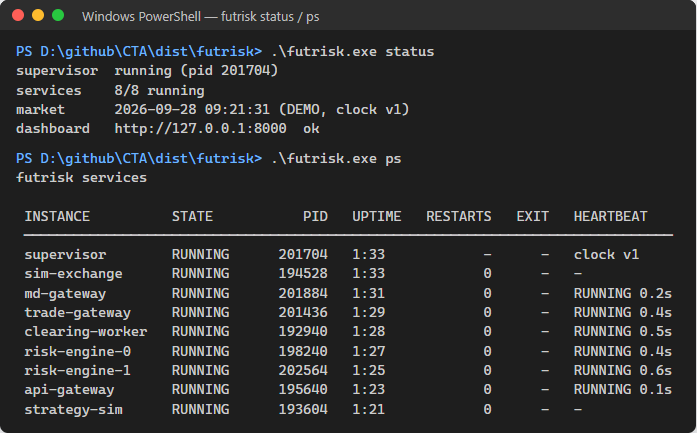
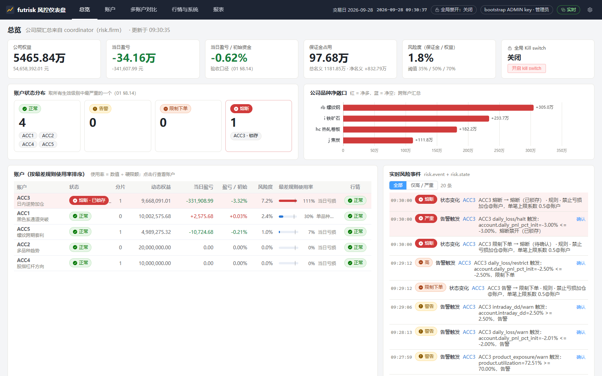
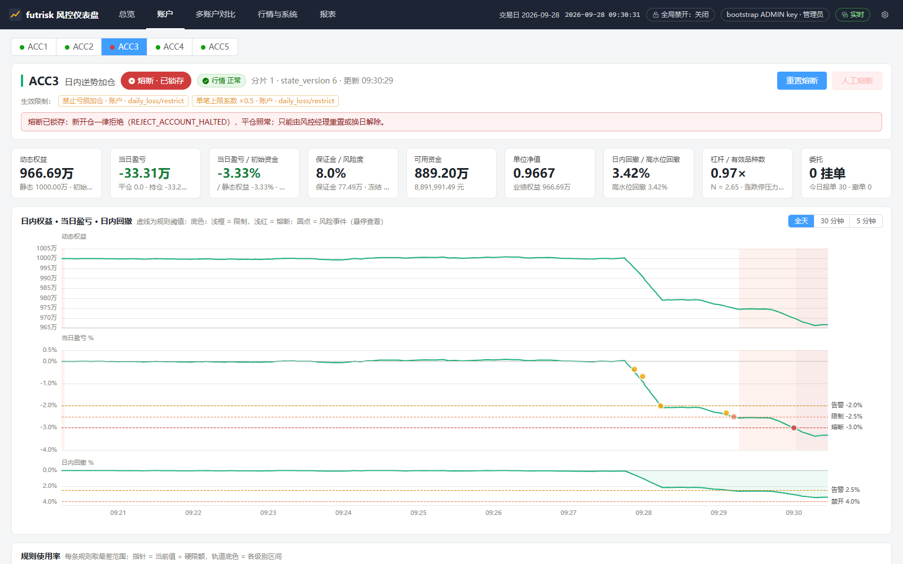
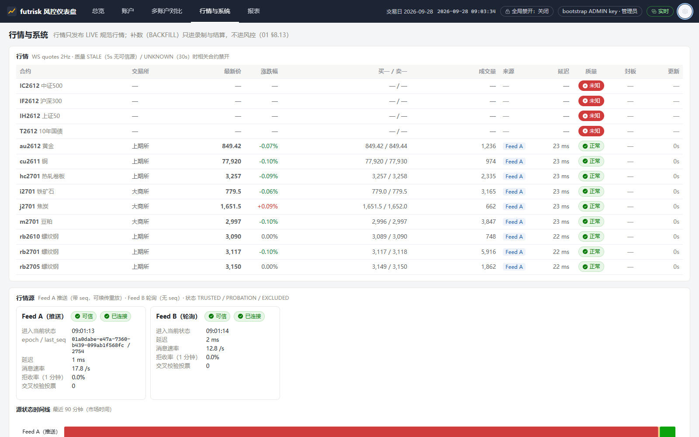

# futrisk：多品种期货交易风控与清算系统

futrisk 为多个 CTA 策略账户提供统一的盘中风控和盘后清算，覆盖上期所、大商所、中金所的 12 个品种。它接入两路异构的模拟行情（外加可选的新浪真实行情），行情中断后按序号补齐且不产生重复或错误的风险信号；持仓只由成交推导，每个账户独立核算，可按账户、品种等维度查询；盘中实时计算资金和持仓两个维度的风险指标，越线时告警、限制下单或熔断——某账户当日亏损达到初始资金的 3% 时立即禁止开仓，确认后锁存；每日收盘后逐日盯市，完成盈亏结算和保证金核算，生成 HTML 风控日报和 CTP 风格结算单。另外提供历史回测、Vue 3 实时仪表盘、配置热加载和多账户对比视图。系统由 6 个服务（风控按账户分成 2 个分片）经 ZeroMQ 总线通信，自带虚拟交易所和策略机器人，一条命令即可在一台 Windows 机器上拉起全部 9 个进程（supervisor 和它拉起的 8 个子进程）。


*这张图回答：系统由哪些进程组成、它们之间的主要消息方向；所有委托都必须经过 risk-engine。详见 01 §5（[架构说明](docs/01-architecture.md)）。*

## 环境要求

| 项 | 要求 |
|---|---|
| 操作系统 | Windows 10 / 11 x64；docker 方式也可以在 Linux 上运行 |
| Python | 3.12（仅源码方式需要；exe 已内置运行时） |
| Poetry | 2.x（仅源码方式） |
| Node.js | 20.19 以上。**源码方式必须用它构建一次仪表盘**：构建产物 `src/futrisk/web_static/dist/` 不在版本库中（`.gitignore` 的 `dist/` 规则）；exe 包和 docker 镜像在构建时已经包含 |
| Docker | Docker Desktop，或 Docker Engine + compose v2（仅 docker 方式） |
| 端口 | `127.0.0.1` 上的 7001–7004、7101–7602 中的 14 个和 8000（07 §2.4，[使用说明](docs/07-user-guide.md)） |
| 时钟 | 本机时钟要与 NTP 同步（Windows Time 服务在运行）；`futrisk doctor` 的 `clock sync` 一项会检查 |

## 快速开始

### 方式一：exe（不需要安装 Python）

在 zip 所在目录打开 PowerShell：

```powershell
(Get-FileHash .\futrisk-win64-0.1.0.zip -Algorithm SHA256).Hash -eq (Get-Content .\futrisk-win64-0.1.0.zip.sha256).Split(' ')[0]   # 应为 True
Expand-Archive .\futrisk-win64-0.1.0.zip -DestinationPath D:\futrisk-demo
D:\futrisk-demo\futrisk\futrisk.exe doctor                              # 环境检查，不应有 FAIL
D:\futrisk-demo\futrisk\futrisk.exe demo                                # 拉起全部进程、首日建账、打开仪表盘
Get-Content D:\futrisk-demo\futrisk\var\secrets\bootstrap_admin.key     # 另开窗口：取 API key
```

### 方式二：源码（Python 3.12、Poetry 2.x、Node.js 20.19 以上）

```powershell
poetry install                           # 在仓库下创建 .venv
cd web; npm.cmd ci; npm.cmd run build; cd ..   # 构建仪表盘（必需：构建产物不在版本库中；PowerShell 中写 npm.cmd，见 07 §2.2.2）
.venv\Scripts\futrisk doctor
.venv\Scripts\futrisk demo
Get-Content var\secrets\bootstrap_admin.key
```

### 方式三：docker compose

```powershell
docker compose -f deploy/compose.yml up -d --build                     # 首次构建要几分钟
docker compose -f deploy/compose.yml ps                                 # 9 个常驻容器
docker compose -f deploy/compose.yml exec api-gateway cat /var/lib/futrisk/secrets/bootstrap_admin.key
docker compose -f deploy/compose.yml exec api-gateway futrisk status
docker compose -f deploy/compose.yml down                               # 停止；数据卷保留，加 -v 全部删除
```

仪表盘地址 **http://127.0.0.1:8000**：首次打开时在弹出的设置对话框中粘贴 bootstrap ADMIN key。`futrisk demo` 拉起的系统随它的窗口存亡：按 Ctrl-C 或关闭窗口都会停止全部服务；`futrisk demo --headless` 让系统留在后台运行，用 `futrisk down` 停止。docker 方式用 `docker compose` 启停和重启（`restart <服务>`），CLI 在 api-gateway 容器中执行。

第一次运行时注意：

- 排练和演示用一个新的 home，并指定开始时的市场时间：`futrisk demo --home D:\futrisk-demo\rehearsal --headless --start-at 2026-09-28T09:20:00`。演示的市场时钟只向前走，停机期间也随墙钟前进，隔几个小时再启动可能已经收盘：用 `futrisk clock jump --to next-open` 跳到下一个交易时段。
- `futrisk doctor` 的 `clock sync` 为 WARN 多半是 Windows Time 服务没有运行：以管理员身份执行 `net start w32time` 和 `w32tm /resync`。宿主机时钟不准时，docker 部署会出现一段时间戳超前的行情拒收（08 §3.3，[部署运维](docs/08-deployment.md)）。
- 端口被占用、另一套系统在运行、杀毒软件拦截、中文路径和控制台乱码，见 07 §2.2.5 和第 7 章（[使用说明](docs/07-user-guide.md)）。

常用命令：

```powershell
futrisk status                  # 健康摘要
futrisk ps                      # 进程列表
futrisk accounts                # 账户总览
futrisk positions -g product    # 按品种汇总持仓
futrisk logs risk-engine-1 -f   # 查看日志
futrisk doctor                  # 环境检查（端口、时区、时钟同步、SQLite 等）
```

命令写成 `futrisk ...`：exe 方式用 `futrisk.exe` 的完整路径，源码方式用 `.venv\Scripts\futrisk`，docker 方式在前面加 `docker compose -f deploy/compose.yml exec api-gateway`。分步说明和第一次运行的常见问题见 07 §2（[使用说明](docs/07-user-guide.md)）。

## 演示流程

| 演示内容 | 命令 | 看什么 |
|---|---|---|
| 熔断验收场景 | `futrisk demo --scenario breaker` | 等 ACC3 建满持仓后启动剧本，约 2 分钟内 ACC3 依次触发 −2% 告警、−2.5% 限制下单、−3% 熔断，每级只告警一次；`futrisk risk events -a ACC3` |
| 熔断后禁开、可平 | `futrisk order place -a ACC3 -i rb2701 --side buy --offset open -q 1 --type market` | 开仓被拒 `REJECT_ACCOUNT_HALTED`；同样的平仓单（`--side sell --offset close-today`）照常成交 |
| 风控进程崩溃 | `futrisk kill risk-engine-1` | 期间下单失败（失效即安全）；supervisor 按退避（首次 1s）重新拉起，熔断仍然锁存，告警不重复 |
| 行情源中断 | `futrisk scenario run feed_outage` | Feed A 断开 20s，Feed B 无缝接续；恢复后按序号补齐缺口（重复 0 条），补数不进风控 |
| 盘后清算 | `futrisk clock jump --to 15:29` | 市场时钟跳到收盘后，15:30 自动 EOD；`futrisk settle show`、`futrisk report daily --open` |
| 回测 | `futrisk backtest run breaker_synthetic` | 同一个风控内核回放合成剧本，16 项检查全部通过；报告在 `<home>\backtests\` |

约 8 分钟的完整现场演示脚本（含备用方案）见 07 §6（[使用说明](docs/07-user-guide.md)）；仪表盘各页的截图放在 `docs/screenshots/`，逐页说明见 07 §3。

## 运行截图

以下截图取自 2026-10-08 在本机运行的系统（exe，演示模式，`futrisk demo --headless --start-at 2026-09-28T09:20:00`，之后运行 `breaker` 剧本）。仪表盘各页的逐页说明见 07 §3，启动的每一步见 07 §2（[使用说明](docs/07-user-guide.md)）。


*`futrisk demo`：拉起 supervisor 和 8 个服务实例，等 api-gateway 就绪后首日建账。*


*`futrisk status` 与 `futrisk ps`：8 个实例全部 RUNNING，心跳正常。*


*总览页，`breaker` 剧本之后：ACC3 熔断并锁存，右侧是依次出现的告警、限制和熔断事件。*


*ACC3 的账户页：当日盈亏依次穿过 −2%、−2.5%、−3% 三条线，限制和熔断期间分别为浅橙、浅红底色。*


*行情与系统页的上半部分（同样启动的另一次运行，市场时间 09:27，已跨过 09:25 的中金所集合竞价）：各合约的行情和质量，两路行情源都可信、拒收率为 0。*

## 测试

| 类型 | 命令 | 说明 |
|---|---|---|
| 单元测试（快速） | `.venv\Scripts\python -m pytest tests/unit -m "not slow"` | 不含多进程、网络回环等慢测试 |
| 单元测试（全部） | `.venv\Scripts\python -m pytest tests\unit\<目录> --timeout 300`，按目录分别运行 | 含慢测试；按目录运行的原因见 06 §8 |
| 清算黄金用例 | `.venv\Scripts\python -m pytest tests/golden` | 多日手算案例逐分比对（`tests/golden/CASES.md`） |
| 性质测试 | `.venv\Scripts\python -m pytest tests/property` | hypothesis：资金恒等式、逐日盯市 = 逐笔对冲等 |
| 端到端验收 | `.venv\Scripts\python -m pytest -m e2e tests/e2e -v` | 真实启动整套系统，自动走完熔断、kill、行情中断、EOD，需要几分钟 |
| 代码规范 | `.venv\Scripts\ruff check src tests scripts`；`.venv\Scripts\mypy src` | — |
| 仪表盘 | 在 `web\` 下 `npm.cmd ci`、`npm.cmd run test` | vitest |
| 文档 | `.venv\Scripts\python scripts\check_docs.py`；`.venv\Scripts\python scripts\gen_config_reference.py --check` | 文档交叉校验；配置参考是否与代码一致 |

最近一次执行的用例数、用时和覆盖率见 06 §7（[测试方案与报告](docs/06-test-plan.md)）。

## 构建 exe

```powershell
powershell -NoProfile -ExecutionPolicy Bypass -File scripts\build_exe.ps1
```

依次构建仪表盘（需要 Node.js 20.19 以上；`-SkipWeb` 跳过并使用已有的构建产物）、用 PyInstaller 打包为 `dist\futrisk\`、做 17 项冒烟测试（包括在临时 home 中拉起整套系统和中文路径测试），全部通过后生成 `dist\futrisk-win64-0.1.0.zip` 和 `.sha256`。参数和产物说明见 08 §2（[部署运维](docs/08-deployment.md)）。

## 文档

题目原文（`task.md`）不随公开仓库发布；需求的整理和解读见 01 §1 与 09。

| 文档 | 内容 |
|---|---|
| [docs/README.md](docs/README.md) | 文档规范与索引 |
| [01-architecture.md](docs/01-architecture.md) | 整体架构：服务拆分、运行时视图、部署、横切概念、架构决策、质量场景、技术债 |
| [02-communication-protocol.md](docs/02-communication-protocol.md) | 通信协议：总线、主题、命令、消息、外部接口、REST、错误码 |
| [03-database-schema.md](docs/03-database-schema.md) | 数据库设计与字段说明 |
| [04-risk-rules.md](docs/04-risk-rules.md) | 风控指标、阈值与理由 |
| [05-clearing.md](docs/05-clearing.md) | 清算规则、公式出处与手算示例 |
| [06-test-plan.md](docs/06-test-plan.md) | 测试方案与测试报告：需求追踪、故障注入矩阵、端到端验收、执行结果与覆盖率 |
| [07-user-guide.md](docs/07-user-guide.md) | 使用说明：三种运行方式的启动步骤、仪表盘、CLI、日常操作、演示脚本、故障排除 |
| [08-deployment.md](docs/08-deployment.md) | 部署、运维与生产差距：exe 构建、docker compose、日志、备份恢复、配置版本、技术债 |
| [09-design-decisions.md](docs/09-design-decisions.md) | 需求理解与设计决策 |
| [10-backtest-analysis.md](docs/10-backtest-analysis.md) | 回测方法、结果与规则有效性分析 |
| [11-config-reference.md](docs/11-config-reference.md) | 配置参考（由 pydantic 模型生成） |
| [12-code-walkthrough.md](docs/12-code-walkthrough.md) | 代码导读 |
| [13-benchmarks.md](docs/13-benchmarks.md) | 性能基准：方法、结果与未达标项分析（基准工具在完整版 `v0.1-full` 中） |

`docs/screenshots/` 是仪表盘和命令行的截图，`docs/backtests/` 是回测报告的副本（自包含 HTML）。

## 目录结构

```text
src/futrisk/          Python 包（代码导读见 docs/12）
  core/               纯领域内核：持仓、账本、指标、规则、状态机、事前检查、结算
  services/           6 个服务：md_gateway、risk_engine、trade_gateway、clearing、api_gateway、supervisor
  messages/ bus/ db/ runtime/   消息契约、ZeroMQ 总线、SQLite 访问层、服务运行时
  common/             配置模型、交易日历、时钟、路径、日志
  sim/                虚拟交易所（exchange）和策略机器人（bots）
  client/             策略 SDK
  backtest/           回测
  cli/  main.py       命令行
  web_static/dist/    构建好的仪表盘（由 web/ 构建生成，不在版本库中）
web/                  仪表盘源码（Vue 3 + TypeScript）
config/               默认配置（首次启动时复制到 <home>/config）
data/hist/            回测用的历史数据
tests/                unit、golden、property、e2e
scripts/              build_exe.ps1、record_forever.ps1、check_docs.py、gen_config_reference.py 等
deploy/               Dockerfile、compose.yml、init_config.py、seed_books.py、config/services.yaml（docker 档位）
packaging/            PyInstaller spec
docs/                 设计与使用文档
```
