# futrisk 整体架构说明

| 项 | 内容 |
|---|---|
| 文档编号 | FR-SSDD-01 |
| 版本 | v1.0 |
| 状态 | 实现对齐 |
| 日期 | 2026-10-08 |
| 适用范围 | futrisk 全部服务与外部模拟组件 |
| 对应标准 | GB/T 8567-2006 系统/子系统设计说明（SSDD）；章节结构采用 arc42 v9；视图采用 C4 模型 |
| 关联文档 | [README](README.md)（规范）· [02 通信协议](02-communication-protocol.md) · [03 数据库设计](03-database-schema.md) · [09 需求理解与设计决策](09-design-decisions.md) · 其余文档见 README 的文档索引 |

> 本文说明系统的全貌：目标、边界、如何拆分服务、运行时如何协作、如何部署，以及贯穿各服务的设计概念。主题、命令、消息字段、表结构等接口与数据定义以 [02](02-communication-protocol.md) 和 [03](03-database-schema.md) 为准，本文只引用，不重复定义。
>
> **本文描述已实现的系统**（v1.0 按 2026-10-08 的代码逐节核对）：以代码为准（`src/futrisk/`、`config/`、`deploy/`、`packaging/`、`web/`），实现细节的说明在 `src/futrisk/core/ENGINE.md` 和 `src/futrisk/bus/README.md`。代码是精简版：完整版保留为 git 标签 `v0.1-full`，精简时删除的功能不再在本文中描述，只在修订记录和第 9 章中保留决策记录。设计过但尚未实现的部分逐处标明"未实现"，并列入第 11 章的技术债。性能数字分为两类：设计目标，以及标注了测量条件的实测值；实测值取自完整版代码冻结后的一次完整 `futrisk bench`（2026-09-26；精简版删除了基准工具；除 2026-10-07 重写的 md-gateway 外，被测代码没有变化），方法和全部数字见 13 文档。测试的执行结果见 06 文档。

## 目录
1. [引言与目标](#1-引言与目标)
2. [约束](#2-约束)
3. [上下文与范围](#3-上下文与范围)
4. [解决方案策略](#4-解决方案策略)
5. [构建块视图](#5-构建块视图)
6. [运行时视图](#6-运行时视图)
7. [部署视图](#7-部署视图)
8. [横切概念](#8-横切概念)
9. [架构决策](#9-架构决策)
10. [质量需求](#10-质量需求)
11. [风险与技术债](#11-风险与技术债)
12. [术语表](#12-术语表)
- [附录 A 需求可追踪性](#附录-a-需求可追踪性)
- [附录 B 修订记录](#附录-b-修订记录)

---

## 1. 引言与目标

### 1.1 需求概览
量化团队管理多个期货策略账户，交易品种覆盖上期所（SHFE）、大商所（DCE）和中金所（CFFEX）。futrisk 为这些账户提供统一的风控与清算：

| 功能域 | 要求（来自 task.md） | 本系统的做法 |
|---|---|---|
| 行情接入 | 至少 2 个行情源；实时或准实时；中断恢复后补全缺失数据，且不产生重复或错误的风险信号 | 两路异构模拟源（Feed A 推送 / Feed B 轮询）同时在线；新浪真实行情已有适配器和录制工具（运行时默认关闭）；多源仲裁、按序号补数、LIVE/BACKFILL 分流（§8.13） |
| 持仓管理 | 记录开平仓；按账户、按品种查询；多账户分别汇总、独立核算 | 由成交事件推导持仓，每个 lot 区分今仓和昨仓；每个账户一个独立账本；读模型支持多维查询（§5.3.1） |
| 盘中风控 | 资金维度和持仓维度的指标；触发时告警、限制下单或熔断；验收场景为单日浮亏达到初始资金的 3% 时自动熔断，阻止该账户继续开仓 | 声明式规则 + 告警状态机 + 四种动作；熔断时立即禁开，确认后锁存（§8.14） |
| 盘后清算 | 逐日盯市（盈亏结算、保证金核算）；风控日报 | clearing-worker 按跨服务流程（saga）结算，全程 Decimal；日报用 HTML 格式（§6.6、§8.15） |
| 附加项 | 回测、可视化仪表盘、配置化、多账户对比视图 | 四项都在本期范围内：回测（§8.16），仪表盘与多账户对比视图（§5.3.5），配置化（§8.9） |

### 1.2 质量目标（前五位）

| 优先级 | 质量目标 | 具体含义 | 验证方式 |
|---|---|---|---|
| 1 | **清算正确性** | 逐日盯市、手续费、保证金（含单向大边）与手算黄金用例逐分一致；同时用"交易所公式"做第二道独立校验 | 黄金用例、属性测试、对账检查（§8.15） |
| 2 | **失效即安全** | 风控不可用就不允许交易；行情不可信时对应合约禁开；成交流有缺口或结算未完成时禁开；熔断状态在任何重启后都不丢失 | 服务级故障矩阵（§10.2） |
| 3 | **容错与一致性** | 任一服务崩溃都不丢成交、不重复告警；行情中断恢复后数据补齐，且不产生错误信号 | 故障注入测试、幂等键（§8.4） |
| 4 | **实时性与吞吐** | 跨进程 tick→规则判定 p99 ≤ 3ms；进程内事前检查 p50 ≤ 50µs、p99 ≤ 250µs；下单往返 p99 ≤ 2ms；总线吞吐 ≥ 10 万条/s；risk-engine 冷启动恢复（1 万笔成交）< 3s。以上都是设计目标；实测值见 §10.2 和 13 文档：总线、接入、事前检查、冷启动达标（接入测的是 2026-10-07 重写之前的 md-gateway），tick→判定和下单往返的 p99 未达标 | 完整版的 `futrisk bench`（§8.12、13 文档） |
| 5 | **可配置、可扩展** | 规则、阈值、品种参数都在配置里，改动无需改代码；指标、动作、数据源、经纪商可以通过注册表或适配器扩展；风控可按账户分片横向扩展 | 配置热加载、分片演示 |

### 1.3 利益相关方

| 角色 | 关注点 |
|---|---|
| 风控经理 | 实时风险状态、熔断与重置、多账户对比、风控日报 |
| 交易员 / 策略研究员 | 下单被拒的原因（拒单码）、持仓和盈亏查询、限额余量 |
| 清算 / 运营 | 结算单、对账结果、结算价来源、出入金 |
| 运维 | 服务健康、故障恢复、日志、部署 |
| 评审方（机试面试官） | 架构合理性、容错能力、清算正确性、配置化、附加项 |
| 开发者 | 模块边界、接口契约、可测试性 |

### 1.4 对模糊需求的解读
task.md 的"设计说明"留了 6 处设计空间，另有几处措辞需要先确定含义。下表给出本系统的解读和出处，完整论证见 [09 需求理解与设计决策](09-design-decisions.md)。

| 需求中的表述 | 本系统的解读 | 理由 | 详见 |
|---|---|---|---|
| 设计说明 1：行情数据的格式与更新频率 | 内部统一为 CTP 风格的 L1 快照 `Tick`；Feed A 每 500ms 推送，Feed B 每 1s 轮询，新浪默认每 1.5s 轮询 | 与国内期货 L1 行情每秒 2 笔快照的节奏一致；将来换成 CTP 只需替换适配器 | §8.13；02 §7.1、§9.1–9.3 |
| 设计说明 2：风控指标与阈值 | 资金、持仓、合规三个维度的规则，四级动作；阈值由日波动率、涨跌停幅度、产品预警线等推导 | 每个阈值的理由见 §8.14 默认阈值表 | §8.14 |
| 设计说明 3：持仓的来源与更新 | 持仓只由成交推导（事件溯源），起点是日初快照；定时与柜台持仓对账，不一致时禁开并补拉成交，差异以柜台为准查清 | 可以重放、可以审计；与生产中"柜台是权威"的做法一致 | §8.1；02 §8.7 |
| 设计说明 4："熔断"的实现 | 首次越线立即禁开，并撤销挂着的开仓单；确认后锁存，只允许减仓；只能由风控经理审计重置或换日解除；任何重启后都保持 | 既不放过真实的亏损，也不让在确认之前就被纠正的坏点锁死账户 | §8.14、§6.3、ADR-007 |
| 设计说明 5：并发模型与性能 | 按故障域拆成 6 个进程；风控核心是单写者，按账户分片；给出延迟和吞吐目标，并用基准测试验证 | 绕开 GIL，隔离故障，扩展路径清楚 | §5、§8.12、§10.2 |
| 设计说明 6：生产级系统还应具备的能力 | 列出能力清单，逐项标明本期交付、部分交付，还是列为技术债 | — | §8.17 |
| "单日浮亏达到预设阈值（如初始资金的 3%）" | 默认按昨结起算的当日盯市总盈亏（已实现 + 浮动 − 手续费）除以初始资金；配置可以切换为纯浮亏口径 | 纯浮亏可以通过平掉亏损仓"归零"，从而绕过熔断 | §8.14、ADR-008 |
| "阻止该账户继续开仓" | 事前检查拒绝新的开仓单，同时撤销该账户挂着的开仓单；平仓不受熔断限制，只需通过可平量等基本检查 | 挂单成交同样是继续开仓；禁止平仓则会让风险无法降低 | §8.14；02 §11.2 |
| "接入至少 2 个行情源" | 至少两条相互独立的分发链路，并对同一合约交叉校验：运行时为 Feed A + Feed B 两路异构模拟源；新浪是第三个源，已实现适配器（默认关闭）和真实 tick 录制工具，用于真实性对照。由 sim-exchange 转发新浪价格的 live 档未实现（TD-12） | 行情最终都来自交易所，冗余的意义在于分发链路互为备份；模拟源 7×24 可演示、可注入故障 | §8.13 |
| "交付一个可以上线的系统" | 按生产标准设计失效即安全、幂等、审计、恢复和权限；本期不做的列为技术债，并给出方案 | — | §8.5、§8.17、§11 |

---

## 2. 约束

| 类型 | 约束 | 影响 |
|---|---|---|
| 技术 | Python 3.12 全栈（Poetry 管理依赖）；前端用 Vue 3 | 靠多进程绕开 GIL；热点服务以后可以单独用 C++ 重写 |
| 技术 | 开发和演示在 Windows 11 上进行，同时要能用 docker 在 Linux 上部署 | 进程管理、事件循环、编码、路径等都要兼容 Windows（§8.12）；交付两种形态：Windows 一个文件夹的 exe（§7.1）和 docker compose（§7.2） |
| 技术 | 不对接真实交易所：行情用模拟源加新浪，成交用模拟撮合 | 通过适配器隔离，生产环境换成 CTP 时不改动核心 |
| 技术 | 单机交付，不依赖需要单独部署的中间件服务 | 选用无 broker 的 ZeroMQ，存储选 SQLite（ADR-003、ADR-010） |
| 组织 | 一周工期；需要提交可执行文件，并现场演示和答辩 | 优先保证 MUST 项；提供一键演示和固定随机种子 |
| 组织 | 允许使用开源库和 AI 编程助手 | — |
| 约定 | 沿用用户现有项目的习惯：src 布局、Typer、pydantic、dataclass、工厂注入、`@register_*` 注册、loguru、pytest；代码用英文，文档用中文 | 降低答辩成本 |
| 业务 | 品种参数（保证金率、手续费、涨跌停、交易时段）以交易所最新公告为准，配置中给出的是示例值 | 参数带生效日期；自动刷新脚本没有实现，手工维护（TD-04） |

---

## 3. 上下文与范围

### 3.1 业务上下文（C4 L1 系统上下文）

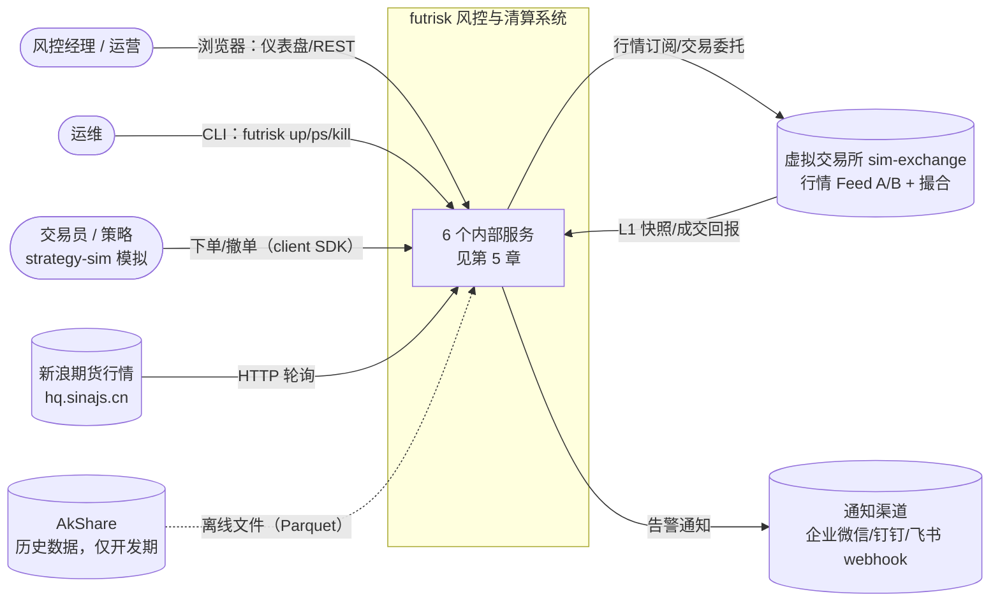
*这张图回答：系统与谁交互、边界在哪里。*

| 外部参与者 | 交互 | 说明 |
|---|---|---|
| 风控经理 / 运营 | 仪表盘（WS 实时推送）、REST | 查询、重置熔断、kill switch、结算、日报 |
| 交易员 / 策略 | client SDK → risk-engine 下单接口 | 演示时由 strategy-sim 扮演。**所有订单必须经过风控** |
| 虚拟交易所 sim-exchange | Feed A（WS）、Feed B（REST）、SimBroker 交易接口（ZMQ）、控制接口（HTTP） | 模拟交易所和期货公司柜台；生产环境换成 CTP 行情和交易前置 |
| 新浪期货行情 | HTTP 轮询 | 真实行情源：md-gateway 的新浪适配器（`feeds.yaml` 中默认关闭）和 `futrisk data record` 录制工具（真实 tick 写入 `<home>/ticks/raw/<td>/sina/`，作为真实行情样本） |
| AkShare | 开发期脚本 | `scripts/fetch_hist.py` 在单独的 `.venv-data` 环境中拉取历史日线、分钟线和交易所官方的逐合约数据，写入 `data/hist/` 下的 Parquet 文件和 `manifest.json`；不进入运行时，也不打进 exe。品种参数（`products.yaml`）手工维护（TD-04） |
| 通知渠道 | webhook | 默认渠道为 `log`（只写日志）；在环境变量中给出 webhook 地址后，发往企业微信、钉钉或飞书 |

### 3.2 技术上下文

| 接口 | 两端 | 协议/编码 | 定义位置 |
|---|---|---|---|
| IF-EXT-01 Feed A | sim-exchange → md-gateway | WebSocket + JSON，带 seq、续传、重放 | 02 §9.1 |
| IF-EXT-02 Feed B | md-gateway → sim-exchange | HTTP GET 轮询 + JSON（厂商风格） | 02 §9.2 |
| IF-EXT-03 新浪行情 | md-gateway → hq.sinajs.cn | HTTP GET + GB18030（GBK 的超集）文本 | 02 §9.3 |
| IF-EXT-04 SimBroker 交易接口 | trade-gateway ↔ sim-exchange | ZeroMQ DEALER/ROUTER + JSON，语义仿 CTP | 02 §9.4 |
| IF-EXT-05 模拟控制接口 | api-gateway / CLI → sim-exchange | HTTP + JSON | 02 §9.5 |
| IF-EXT-06 REST API | 浏览器/脚本 → api-gateway | HTTP + JSON（OpenAPI 3.1） | 02 §9.6 |
| IF-EXT-07 WebSocket 推送 | api-gateway → 浏览器 | WebSocket + JSON | 02 §9.7 |
| IF-EXT-08 告警 webhook | api-gateway → 通知渠道 | HTTP POST + JSON | 02 §9.8 |
| IF-BUS 内部总线 | 服务之间 | ZeroMQ PUB/SUB + DEALER/ROUTER，msgpack 编码 | 02 §4~§8 |

范围之外：真实交易所和 CTP 的连接（只预留适配器接口）、交割、DCE 组合保证金、订单簿级撮合、多机主备的自动切换、由 sim-exchange 转发新浪价格的 live 档（第 11 章列为技术债）。

---

## 4. 解决方案策略

| 目标 / 难点 | 策略 | 详见 |
|---|---|---|
| 故障隔离、多核并行 | **按故障域拆成 6 个服务**，由 supervisor 守护，崩溃后自动重启 | §5.1、ADR-002 |
| 事前检查与成交之间的一致性 | **一致性域不拆**：持仓、资金、风控状态、事前检查放在同一个单写者（risk-engine）里；横向扩展靠按账户分片 | §5.2、ADR-002 |
| 服务间通信 | **ZeroMQ 无 broker 总线**：PUB/SUB 发布事件，DEALER/ROUTER 传命令；主题带序号，跳号时用快照或重放补齐（Clone 模式）；关键事实先落库再发布（outbox） | §8.4、ADR-003/005 |
| 实盘与回测结果一致 | **同步内核 + 服务外壳**：`EngineCore.handle(event) → effects` 纯同步、可确定重现；回测和单测用进程内总线 | §5.3.1、ADR-004 |
| 行情多源与补数 | 以累计成交量作跨源共享时钟（`order_key`、水位、指纹）；**补数永远不进风控**；两个可信源在同一成交量上价格不一致时只记事件、不投票、不按优先级取舍，后到的状态不发布，先到的状态保持水位 | §8.13、ADR-006、ADR-019 |
| 风险信号不重复、不误报 | 告警状态机（确认、滞回、冷却、锁存）+ 幂等 `alert_key` + 行情质量门控 | §8.14、ADR-007、ADR-022 |
| "单日浮亏 3%"不被绕过 | 按昨结起算的**当日盯市总盈亏**（已实现 + 浮动 − 手续费）计算 | §8.14、ADR-008 |
| 清算精确 | 清算账本用 Decimal；每服务一库，事务里写 outbox；用两道独立校验 | §8.3、§8.15、ADR-009/010 |
| 可配置 | YAML + pydantic 校验；规则声明式；热加载采用两阶段提交，只能重启生效的改动停机后离线提交 | §6.7、§8.9 |
| 崩溃后不带着可疑状态运行 | **崩溃即重启**：提交失败或内核异常后，进程先"毒化"自己，此后不再发出任何副作用，退出后由 supervisor 从持久化状态重启 | §8.6、ADR-020 |
| 可演示 | 虚拟交易所支持故障注入和场景剧本；一个 exe 一键拉起全部服务；仪表盘可以现场 kill 服务 | §7.1 |
| 两种部署形态 | exe：supervisor 管理进程和市场时钟；docker compose：每个服务一个容器，由编排管理进程，supervisor 只管市场时钟 | §7.1、§7.2、ADR-021 |

---

## 5. 构建块视图

### 5.1 第 1 层：整体白盒（C4 L2 容器图）

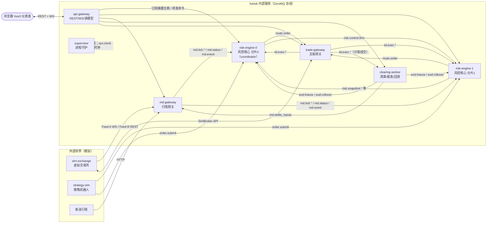
*这张图回答：系统由哪些可独立部署的进程组成，它们之间的主要通信方向。完整的订阅关系见 02 §4.1。*

下表是已实现的职责。

| 服务 | 职责（已实现） | 状态归属（写库） | 扩展方式 |
|---|---|---|---|
| **md-gateway** | 多源接入（Feed A、Feed B，新浪可选）、归一化、校验（时段、涨跌停、网格、同源单调与未来时间戳防线）、Feed A 序号与补数、数据源可信状态（观察期、人工排除并跨重启保持）、按合约仲裁（水位持久化、交叉校验）；发布 LIVE 行情、`md.status`（质量 = LIVE 流是否跟得上市场）和 `md.event`；缺口台账（含全部源中断时的 `all:` 缺口）；录制原始 tick；从规范 tick 计算结算价输入；EOD 后的日常维护（§5.3.2、§8.13） | `md.db`、tick Parquet | 按交易所或数据源拆成多个实例 |
| **risk-engine**（分片） | 持仓、资金账本、指标、规则、告警状态机、四种动作；**订单唯一入口**（事前检查）；委托路由、撤单与 `CANCEL_PENDING` 超时复核、熔断撤单守护；重启恢复与预热；EOD 冻结、换日、临时快照、多日追赶；分片 0 兼任 coordinator，汇总公司层指标。风控业务逻辑在同步内核 `EngineCore` 中；外壳负责启动编排、成交流缺口处理、历史查询和启动期间 `eod.*` 命令的暂存（§5.3.1） | `risk-{shard}.db` | 按账户分片 |
| **trade-gateway** | 对接经纪商（SimBroker；生产环境为 CTP，只预留接口）；拒绝过期路由（记为 `EXPIRED`），为从没收到过的委托写墓碑；执行 kill switch（纵深防御，状态持久化）；柜台重同步期间暂存新委托；撤单请求持久化、重同步后补发；回报先落库再发布到 `td.exec`；断线后按序号补回报；柜台持仓查询；成交摘要与成交导入 | `td.db` | 每个柜台连接一个实例 |
| **clearing-worker** | EOD 调度与结算流程（saga，按交易日顺序逐日结算）；记录每个交易日生效的配置版本；结算价确定；逐日盯市；结算单；对账；生成日初快照（SOD）并推送给各分片；风控日报；回测作业（进程池） | `clearing.db`、报表文件、回测输出 | 作业并行（进程池） |
| **api-gateway** | REST/WS；RBAC 与接口安全（请求体上限、认证失败限流、WS 限额、报表沙箱下载）；读模型（CQRS）；命令转发；kill switch 期望状态的持久化、扇出与补发；webhook 通知；配置两阶段提交的协调者；演示时钟跳转的编排；托管仪表盘静态文件 | `api.db` | **单实例**：它是 `api.db` 的唯一写者，也是通知去重和配置版本分配的唯一来源。要开多副本，需要先把通知和配置协调拆给一个选主实例，并把库迁到 PostgreSQL（TD-05） |
| **supervisor** | 市场时钟的唯一所有者（`sys.clock`）；按依赖顺序启动；端口预检；按进程树核实心跳；崩溃后指数退避重启，5 分钟内失败 5 次即放弃；有序停机；记录进程事件；home 身份校验。docker 部署时以"只管时钟"模式运行，不管理任何进程（§5.3.6） | `supervisor.db` | 生产环境换成 systemd/K8s |
| sim-exchange（外部） | 价格引擎；Feed A/B；撮合和交易回报；故障注入；场景剧本；控制接口 | 内存 + `sim.db`（模拟柜台的委托、成交、持仓、序号，以及价格引擎的当日累计状态，重启不丢，03 §4.7） | — |
| strategy-sim（外部） | 5 个策略机器人（ACC1~ACC5，§7.1），通过 client SDK 订阅行情、下单、撤单（只撤自己下的单）；支持熔断演示的场景模式 | 无 | — |

### 5.2 拆分理由
1. **故障域隔离**：行情解析、报表生成、仪表盘推送中任何一个崩溃或卡死，都不会拖垮事前风控这条关键路径；supervisor 会自动拉起挂掉的服务。
2. **延迟隔离**：每个服务一个进程，各占一个核，互不争抢 GIL。仪表盘的 JSON 序列化和结算的 CPU 负载不会进入风控进程。
3. **一致性域不拆**：持仓、资金、风控状态、事前检查必须在同一个单写者里。
   - 如果拆成持仓服务、风控服务、订单服务，事前检查读到的持仓和保证金会与成交回报赛跑，就可能出现"同一份保证金被两笔单子同时占用"，只能靠分布式锁或事务补偿来解决。
   - 所以横向扩展靠**按账户分片**：每个分片是独立的单写者；公司层限额由 coordinator 分片汇总，触发时广播 `risk.control.firm`。
4. **订单唯一入口**：trade-gateway 只接受身份为 `risk-engine-*` 的 DEALER 发来的 `route.*` 命令，任何订单都绕不过风控（02 §4.11）。本期的 DEALER 身份由连接方自报，只能防止配置错误和误用；要防止同一主机上的恶意进程冒充，必须启用 ZeroMQ CURVE（TD-02）。
5. **演进路径**：
   - md-gateway 和 trade-gateway 可以单独用 C++ 重写，消息契约是 msgpack，与语言无关；
   - 需要全公司持久事件流时，加一个 Kafka 桥接服务做归档即可，热路径不变。

### 5.3 第 2 层：各服务内部组件（C4 L3）

#### 5.3.1 risk-engine

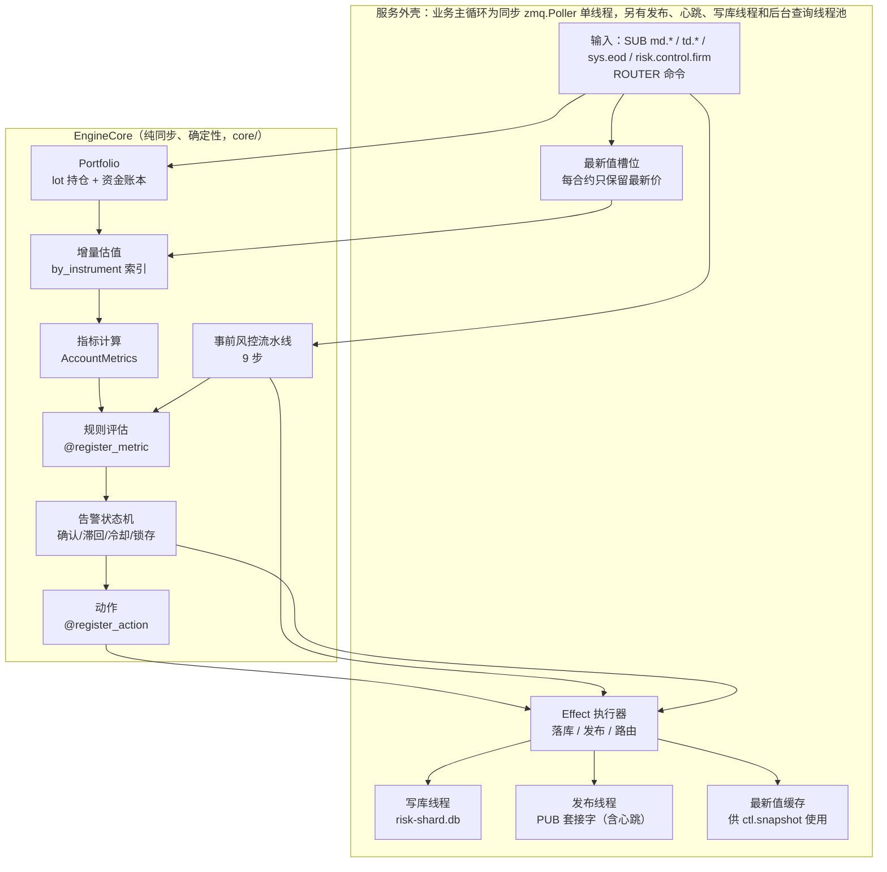
*这张图回答：风控核心内部怎样把"事件"变成"动作"，I/O 为什么都在外壳里。*

- **线程模型**（02 §8.1）：
  - **业务主循环**：单线程，每一轮依次处理：运行时的系统消息（对端心跳等）→ 行情（tick 只写入每合约一个的最新值槽位，`md.status` 立即应用）→ coordinator 收到的分片快照和 `sys.eod` → FACT（执行回报等）→ 外部应答 → 命令（每轮最多 256 条）→ 把槽位中的最新价应用到估值 → 评估脏账户 → 内核定时器 → 外壳定时器。脏账户集中在一轮的后段评估，所以追数时会自然合并；下单前和内核定时器也会先评估当时的脏账户。
  - **发布线程**：独占 PUB，发布消息和心跳；心跳由单独的心跳线程每秒生成，交给发布线程发出，里面带 `loop_lag_ms` 和启动阶段（`detail.phase`），所以主循环卡住时心跳照发，由 supervisor 按 `loop_lag_ms` 判断卡死（§5.3.6）。
  - **写库线程**：独占写连接；读用单独的只读连接，另有一个后台 checkpoint 线程（§8.10）。
  - **后台线程池**（2 个线程）：历史查询、`ctl.replay`、配置 prepare 的校验和日常维护在这里执行，不占主循环。
  - **对外请求一律异步**：重放、快照、日初快照、查询都不会阻塞主循环，所以慢操作不会导致心跳丢失、被误判为死掉。
  - **成组提交**：一批处理（一次取出的 FACT、外部应答、命令或定时器）产生的全部 `Effect` 中，落库行、outbox 消息和 FACT 游标合并成**一个**写库事务（其中任一项是关键事务时整个事务 `synchronous=FULL`），主循环等它提交；提交之后才按顺序发出路由、撤单、查询请求，发布最新值消息，回复命令。脏账户评估和内核定时器各自单独提交。所以任何一个对外可见的效果，都以它的数据已经落库为前提。
- **EngineCore**：输入事件，输出 `Effect` 列表（落库、发布、路由、撤单、确认、请求、回复），本身不做 I/O，不读系统时间，不生成随机 ID（时钟和 ID 生成器都是注入的）。同样的输入加同样的时钟和 ID，得到完全相同的 Effect 列表（有测试保证）。实盘外壳、回测循环和单测都复用同一个内核。外壳与内核之间的执行契约见 `src/futrisk/core/ENGINE.md`。
- **崩溃即重启**（毒化闩）：写库提交失败、处理命令时内核抛出异常，或者对端回调出错时，外壳先置位"毒化"标志：从这一刻起，不再发出任何路由、发布或回复；提交失败那一批的命令回 `UNAVAILABLE`，引发异常的那条命令回 `INTERNAL`，之后排队的命令一律回 `UNAVAILABLE`（下单回 `REJECT_SYSTEM_NOT_READY`）；然后以退出码 1 退出，数据库按非正常关闭处理，由 supervisor 从持久化状态重启（§8.6）。其他路径上的内核异常（应用 FACT、应答回调、评估、定时器）放弃这批还没提交的效果，同样以退出码 1 退出。
- **启动阶段**（心跳 `detail.phase`）：等市场时钟（CLOCK）→ 取日初快照（SOD，只在库中还没有日初快照时）→ 补齐当日成交（CATCHUP）→ 预热（WARMUP：禁开，平仓照常，等柜台持仓对账和新鲜的 LIVE 行情）→ `RUNNING`，见 §6.5。启动期间收到的 `eod.*` 命令最多暂存 25s。
- **事前风控流水线**：静态校验 → 系统状态 → 价格 → 账户状态与限制 → 节流 → 持仓 → 资金 → what-if 预估 → 自成交。第一个失败的检查即拒单，并返回对应拒单码（02 §11.2）。平仓单跳过行情质量、kill switch、账户限制、资金和 what-if 检查，所以熔断、禁开、临时快照期间都能减仓；行情质量不是 OK 时，平仓单也跳过胖手指检查（陈旧的标记价不能挡住减仓），但涨跌停检查照做。交易时段已结束、trade-gateway 不可用、EOD 冻结（`EOD_FROZEN`）时平仓单同样被拒，节流、可平量和自成交检查对平仓单照做。what-if 只估算"当前持仓 + 本单"，不计入同账户已报未成的开仓单（已知缺陷，08 §5.2）。
- **持仓模型**：`Position(account, instrument, direction)` 下挂 `Lot`，并维护数量、今仓数量和成本的累计值，事前检查的可平量和开仓成交的处理与 lot 数量无关（O(1)）；平仓成交要逐个消耗 lot。今仓的成本基准是开仓价，昨仓的成本基准是昨结算价。lot 消耗顺序与计费规则按交易所配置（§8.15）。
- **历史查询**：当前交易日的查询由内核从内存回答；`risk.query.metrics` 和其他交易日的委托、成交、告警、出入金、减仓计划，由外壳直接查 `risk-{shard}.db` 回答。
- **coordinator**：分片 0 另外订阅其他分片的 `risk.snapshot.*`，每秒计算一次公司层指标并发布 `risk.firm`，并评估公司级规则（`firm`、`firm/product`、`firm/sector` 范围，与账户规则共用同一个状态机；确认按收到的分片快照计数，公司级的 `LIQUIDATE` 级别不生成减仓计划）。实现要点：
  - 每个分片每秒至少重发一次每个账户的快照作为保活；分片的新鲜度按分片单独判断（5s 内收到过它的快照或心跳）；只有持仓不为零的账户才会拉低公司层的行情质量；
  - 公司级规则引起的 kill switch 和限制，以**完整状态**的形式发布到 `risk.control.firm`：一条 `RULE_STATE` 事实就携带规则层的全部状态（kill switch 是否开启、生效中的全部公司级限制），消费方整体替换自己的规则层。所以只拿到最新一条事实，也能恢复规则层的完整状态（02 §7.6）；
  - 人工 kill switch 由 api-gateway 直接下发到每个分片和 trade-gateway。两种来源分开记录，**任一来源开启即生效**，一种来源关不掉另一种来源开启的 kill switch。kill switch 只拒绝新的开仓单，不撤销已经挂着的单；
  - 默认的 `risk_rules.yaml` 没有配置公司级规则：coordinator 照常汇总和发布 `risk.firm`，公司级规则通过配置加入后生效；
  - 已知限制（TD-14）：公司层的高水位只保存在内存里，重启后从当天重新开始；公司级的锁存没有人工解除命令（`risk.reset` 按账户），只能等换日解除。

#### 5.3.2 md-gateway

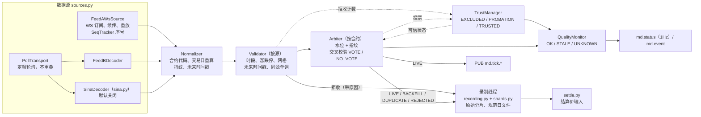
*这张图回答：多源行情如何变成一路可信的 LIVE 行情，补数和被拒收的数据流向哪里。*

- **流水线**（`pipeline.py`）：每个收到的状态都按"（Feed A 先过序号跟踪）→ 归一化 → 校验 → 仲裁"处理一次，结果是四种模式之一：`LIVE` 发布到 `md.tick.{instrument_id}`，这是行情进入 risk-engine 的唯一路径；`LIVE`、`BACKFILL`、`DUPLICATE`、`REJECTED` 都写入录制，拒收的带原因码（02 §11.3）；轮询记录和订阅快照中，此刻不在交易时段、仍是上一交易日、或者本时段还没有更新过（交易所时间在所有时段之外且不晚于接收时刻）的直接跳过，不录制、不计数。经过校验的状态（跳过的状态和被接受的订阅快照除外）都计入该源的拒收率统计；价格、网格、同源顺序、格式和未来时间戳类的拒收另发 `BAD_TICK`（按源、合约、原因每 10s 最多一条），时段和交易日类的拒收只计数；交叉校验的不一致发 `MD_INTEGRITY`（按合约和处理方式每 10s 最多一条）。规则和参数见 §8.13。
- **线程**：asyncio 单事件循环，负责数据源、流水线和一个 50ms 的定时器：每 100ms 评估一次可信状态、全部源中断缺口和行情质量，每 0.2s 把缓冲的原始行交给录制线程，约每秒落盘一次水位，每秒发布 `md.status`、落盘续传游标；录制线程（单线程池）写 Parquet 分片、合并规范日文件、计算结算价输入；写库线程独占 `md.db`。
- **持久化**（03 §4.1）：水位连同最后一个 LIVE 状态的指纹按 `watermark_flush_s`（默认 1s）落盘；Feed A 的续传游标只在对应的原始行已经写进关闭的分片之后才推进；人工 `md.source.set` 写成一条 `SOURCE_STATE` 事件，启动时据此恢复钉住状态；未关闭的中断（`MD_DOWN`）重启后从 `md_events` 恢复，不重复、不遗漏告警；上次运行留下的未关闭 Feed A 序号缺口，在第一次续传之后结清。
- **命令**（02 §6.2）：`md.settle_inputs`（先把缓冲的原始行落盘、合并规范日文件，再计算结算价输入，按版本存入 `settle_inputs`）、`md.events`、`md.sources`、`md.source.set`（按 `command_id` 幂等，必须写明操作者和原因）。
- **服务状态**：交易时段内至少有一个 TRUSTED 源，或者正在休市时为 `RUNNING`；进入过 `RUNNING` 之后，交易时段内没有任何 TRUSTED 源时为 `DEGRADED`。
- **配置热加载**：运行时只应用 `feeds.yaml` 的 `arbitration` 参数；`feed_a`、`feed_b`、`sina` 的任何改动、`products.yaml` 和交易日历的改动都在 prepare 阶段否决，要求重启（§6.7）。
- **日常维护**：`sys.eod` 进入 DONE 之后做 checkpoint、`VACUUM INTO` 备份（保留 20 份），并按保留期清理（`md_events` 90 天、outbox 7 天、原始 tick 30 天、规范日文件 365 天，03 §8）。
- `futrisk data record` 复用同一套数据源、归一化、校验和仲裁模块，不接总线（§8.13）。

#### 5.3.3 trade-gateway
- **BrokerAdapter 接口**：目前实现了 `SimBrokerAdapter`（连接 sim-exchange，柜台状态由 sim 持久化，02 §9.4）；`CtpBrokerAdapter` 只预留了接口，没有实现。接口包括报单、撤单、查委托、查成交、查持仓。
- **回报落库**（`TradeGatewayCore`）：一条实时回报在**一个**事务里写入柜台回报流水（按 `(trading_day, broker_seq)` 去重）、委托状态、成交（按成交键去重）、补回报游标和 `td.exec.{account_id}` 的 outbox 行，提交后再发布（事实优先）；重同步补回的回报每 200 条合并成一个事务。比已存最新状态更旧的委托回报被忽略。没有 `client_order_id` 的成交（柜台强平等外部成交）标记为 `origin=EXTERNAL`；`td.import_trades`（ADMIN，按 `command_id` 幂等）可以导入柜台导出的成交，导入的成交一律记为 `EXTERNAL`。
- **Resync**：每次登录、发现 `broker_seq` 跳号、柜台心跳显示有尾部缺口、换日时（以及补回报缓冲溢出、实时回报丢失时），按交易日先查委托、再查成交，从 `last_broker_seq + 1` 补回报；成交按 `(trading_day, exchange, trade_id, direction)` 去重。一次重同步最多缓冲 5 万条回报、追赶 30 个交易日。登录时发现柜台的序号落后于本地（柜台重置了序号），拒绝一切路由并显示 `DEGRADED`，直到换日。
- **路由保护**：
  - 进入事务之前：`route.*` 只接受 `risk-engine-*` 发来的请求（总线白名单，其他调用方回 `FORBIDDEN`）；市场时钟还没就绪时回 `UNAVAILABLE`；字段不合法时回 `BAD_REQUEST`；
  - 在一个写库事务内依次检查：已有同一 `client_order_id` 的路由记录时，直接返回它的状态（`duplicate=true`），绝不重复报单；有墓碑时拒绝（`ROUTE_LOST`）；超过 `expire_ns` 的路由不报出，记为 `EXPIRED`（`ROUTE_EXPIRED`），防止几分钟前通过风控的委托在账户熔断之后才被执行；kill switch 生效时（人工标志 OR 规则标志）开仓路由记为 `EXPIRED`（`ROUTE_KILL_SWITCH`）；柜台不可用时记为 `REJECTED`（`REJECT_GATEWAY_UNAVAILABLE`）；否则记为 `RECEIVED` 并报出。之后同一委托再来，只会拿到这条记录的状态；
  - trade-gateway 自己持久化 kill switch 状态，作为纵深防御（02 §6.4）：人工标志和 `RULE_STATE` 中的规则标志任一开启即拒绝开仓；`RULE_STATE` 中的公司级限制只作为审计副本保存，trade-gateway 不执行它们；
  - 柜台正在重同步时，新委托先落库暂存（应答 `RECEIVED`），重同步完成后再报出；暂存期间过期或 kill switch 开启的，不再报出；
  - 断线或重启时已经报出、但柜台还没回报的委托（重启时还有暂存的 `RECEIVED` 委托）记为 `UNKNOWN`；下一次重同步后仍没有回报的，关闭为 `REJECTED`（原因 `BROKER_DISCONNECTED`），其中有撤单请求的关闭为 `CANCELED`（原因 `BROKER_ORDER_NOT_FOUND`），**绝不自动重发**；
  - risk-engine 用 `route.resolve` 确认 `UNKNOWN` 委托，或者熔断时撤销还没有路由到的委托（`route.cancel`）时，trade-gateway 为从没收到过的委托写墓碑（`route_tombstones`），迟到的路由一律拒绝。
- **撤单持久化**：接受 `route.cancel` 时，与幂等记录在同一个写库任务中记下撤单请求，无论柜台是否可达都应答 `CANCEL_PENDING`；柜台不可达、正在重同步或者还没拿到柜台委托编号时，等重同步完成或该委托的下一条回报再补发，直到委托结束。柜台在报出回报之前就回"委托不存在"时，视为委托还没到柜台，收到它的第一条回报后再补发。只有柜台明确拒绝撤单（委托已结束或不存在），才以一条重述当前状态的回报结束这次撤单。
- **日常维护**：`sys.eod` 进入 DONE 之后做 checkpoint、`VACUUM INTO` 备份和按保留期清理（03 §8）。

#### 5.3.4 clearing-worker
- **EodSaga**：结算流程的每一步都以 `(交易日, 版本)` 为幂等键，各步骤见 §6.6。另外负责首日建账（`settle.seed_sod`）和官方结算价导入（`settle.import_official`）。EOD 由调度器在市场时间到达 `eod_start_at`（默认 15:30）时启动，也可以用 `settle.run` 手动触发（02 §6.5、§8.4）；无论哪种方式，该交易日的全部交易时段都必须已经结束（含 T 合约 15:15 收盘）。调度器每次只启动"日初快照所在交易日"的那一次结算；停机或时钟跳转跳过了几个交易日时，按交易日顺序逐日补结算，前一日没有进入 ROLLED 之前，后一日不会开始。调度器不重试已经 FAILED 的结算，要由操作员处理后用 `settle.run` 重跑。
- **每个交易日生效的配置**：clearing-worker 记下它见过的每个配置版本，以及该版本的品种参数和交易日历从哪个交易日开始生效（热加载提交的从下一交易日生效；clearing-worker 停机期间离线提交的，从它重启时的当前交易日生效，02 §7.10）。一次结算在 BEGIN 时钉住当天生效的配置版本，第 4、5 步只用这个版本，所以结算过程中提交新配置不会改变正在进行的结算。
- **结算计算**：第 4 步在服务进程内（按交易日加锁）确定结算价（`clearing/prices.py`）；第 5 步调用 `core/` 中的纯函数库 `core.settle_day`：手续费 → 逐日盯市 → 保证金（含单向大边）→ 资金 → 下一日的日初快照（SOD）→ 对账检查。`settle_day` 在 `spawn` 方式的进程池中运行（工作进程意外退出时重试一次），回测调用同一份代码（§8.16）。
- **Reports**：用 Jinja2 + matplotlib 在进程池中生成风控日报（`risk_daily.html`）、每个账户的 CTP 风格结算单（文本和 CSV）和 `settlement.json`。报表按当前生效的配置取规则阈值，不用这次结算钉住的版本。日报的章节和数据来源如下：

  | 日报章节 | 内容 | 数据来源 |
  |---|---|---|
  | 表头 | 交易日（含上一晚夜盘）、结算版本与触发方式、配置版本与哈希、各步骤时间、全部合约的结算价及其方法、来源和输入质量 | `eod_runs`、`settlement_prices` |
  | 摘要 | 关键数字，外加自动生成的要点句（如"ACC3 10:32:15 于 −3.02% 熔断，拒绝 7 笔开仓"）；对账检查数和非 PASS 的检查项 | 结算结果、`recon_checks` + `risk.query.alerts`、`risk.query.orders`、`md.events`、`svc.history` |
  | 资金表（CTP 口径） | 上日结存、出入金、平仓盈亏、盯市盈亏、手续费、客户权益、保证金、可用资金、风险度、净值、距高水位回撤、历史最大回撤 | `account_settlements`（含历史各日） |
  | 盈亏与敞口 | 按账户 × 品种、按板块拆分；总/净敞口、杠杆、前 5 品种、板块集中度、跨账户网格、保证金分组（单向大边） | `position_settlements`、`margin_groups` |
  | 限额使用 | 日终值、盘中峰值、突破次数（当日该规则 `ALERT_RAISED` 的次数） | 结算结果 + `risk.query.metrics`（`rule_util`）+ `risk.query.alerts` |
  | 事件与动作 | 告警、熔断、重置、被拒委托 | `risk.query.alerts`、`risk.query.orders` |
  | 数据质量 | 各数据源可用率（估算：从当日最早开盘到最晚收盘的时间窗内扣除数据源处于 EXCLUDED 的时长，时间窗包含午休和夜盘与日盘之间的间隔）、中断次数、补数条数、无法恢复的缺口、坏点数 | `md.events` |
  | 系统运行 | 服务重启次数和可用率（估算：同一时间窗内扣除进程不在运行状态的时长，不反映心跳层面的降级） | `svc.history` |
  | 图表 | 盘中小多图（当日盈亏比例与熔断线）、60 日净值与回撤 | `risk.query.metrics`，以及历史的 `account_settlements` |
  | 压力测试 | 日终持仓按板块线性冲击 ±3% / ±5% 的盈亏；持仓不止一个板块时另给全部板块同时冲击的结果 | `position_settlements` |

  拉取某一类可选数据失败时（例如对应服务不可用），该章节显示为空表并注明原因，日报照常生成。
- **Backtest**：回测作业（`InprocBus` + `EngineCore`）在同一个进程池中运行，每个作业再为各实验方案开自己的 `spawn` 进程池，输出写入 `<home>/backtests/<run_id>/`（§8.16）。
- **本地副本**：订阅 `td.exec.*`（只保存其中的成交）和 `risk.cash.*`，在本地保存成交与出入金副本，结算时不依赖别的服务的库；重放窗口过期时用领域查询修补副本。
- **日常维护**：`sys.eod` 进入 DONE 之后做 checkpoint、`VACUUM INTO` 备份（保留最近 20 个交易日）和按保留期清理（03 §8）。

#### 5.3.5 api-gateway
- **启动顺序**：先绑定 HTTP 端口（端口被占用时，进程在看起来"活着"、写出 bootstrap key 之前就启动失败）→ 启动运行时，等 `sys.clock` 最多 5s（等不到也继续）→ 打开 `api.db` → 同步 API key → 建立读模型订阅 → 恢复两阶段提交和 kill switch 的未完成状态 → 通知订阅，补发上次没发完的通知 → 启动 WS 推送和 uvicorn。读模型快照到齐、其他实例（含 supervisor）都在线时为 RUNNING；快照已到齐、但启动满 2s 时仍有实例不在线，或者启动满 10s 时快照仍没到齐，为 DEGRADED。
- **ReadModel**：订阅各类摘要主题，维护内存中的最新状态（CQRS 的查询侧）。启动时向各服务发 `ctl.snapshot` 重建状态；某个分片的心跳进入 RUNNING、换了新的化身或者从 DEGRADED 恢复时，再用 `risk.query.accounts` 补齐该分片的账户视图，补齐之前这些账户显示为"陈旧"。另有一个修复循环：FACT 主题出现缺口时，委托用 `risk.query.orders`、告警用 `risk.query.alerts` 补齐，`risk.state.*` 等其他主题重新取 `ctl.snapshot`；每秒发布的最新值主题（`md.status`、`td.status`、`risk.firm`）在发布方在线时 30s 没有消息，也重新取 `ctl.snapshot`。
- **CommandRouter**：按账户找到所属分片，把命令转发到对应服务的 ROUTER（按账户路由、扇出或广播）。权限检查不在这里：REST 由路由依赖和请求前置中间件检查（在读取请求体之前先核对 key），WS 由 WsHub 检查（§8.8）。
- **KillSwitchManager**：人工 kill switch 只有一个"期望状态"，在下发**之前**连同每个目标（各分片和 trade-gateway）的确认状态一起持久化；新命令取代所有未完成的重试；只重试可重试的错误（每 2s 一次，每个目标最多 30 次），而且每次都带当前的期望状态和同一个 `command_id`；某个目标最终失败时记 CRITICAL 日志并通知；api-gateway 重启后，把期望状态重新推给没有确认的目标。
- **WsHub**：按主题订阅、节流推送；每个客户端一个有界队列，状态类数据只保留最新值，事件类数据积压超过 1000 帧时让客户端重新同步（限额见 §8.8）。
- **Notifier**（02 §9.8）：
  - 来源：`risk.event`（`notify.min_severity`，默认 HIGH 及以上；同一告警的解除、确认、重置只在它的触发已经通知过时才通知）；`md.event` 中的 `MD_DOWN`（HIGH）、交叉校验投票（`MD_INTEGRITY` 且 `detail.action = VOTE`，HIGH；`NO_VOTE` 不通知）和 `GAP_UNRECOVERABLE`（WARNING，`min_severity` 只作用于 `risk.event`）；`sys.eod` 的 FAILED（CRITICAL）和 WARN 事件；`sys.service` 中进入 FAILED 的实例（启动失败、放弃重启；正在运行的进程崩溃记为 EXITED，不通知）；api-gateway 自己的 kill switch 下发失败和配置不收敛；
  - 去重：按 `(notify_key, channel)`；每条事实的通知记录与消费游标在同一个事务里写入，所以重放不会产生重复的通知记录。发送在提交之后进行（最多重试 3 次），进程在发出 webhook 与标记已发送之间崩溃时，重启后会再发一次（至少一次）；
  - 限流：每个 webhook 渠道一个令牌桶（每分钟 20 条，突发 20，写在代码中），`log` 渠道不限流；首次消费时已经超过 1 小时（市场时间）的积压事件、以及某个渠道排队超过 100 条之后的非 CRITICAL 通知被抑制，第一次抑制 30s 后合并成一条摘要发送。**CRITICAL 通知永远不被抑制**（严重度 CRITICAL、动作为 `CIRCUIT_BREAK`、EOD 失败、服务失败、kill switch 下发失败、配置不收敛，以及摘要本身），只排队等待发送。
- **ConfigCoordinator**：以两阶段提交的方式协调配置热加载（§6.7），**先持久化提交决定**，再下发 commit；参与者可以通过 api-gateway 的 ROUTER（`config.decision`）查询决定；提交后 30s 内各实例心跳没有报告新版本时标为 FAILED 并发 CRITICAL 通知。
- **ClockJumpOrchestrator**：演示模式下的时钟跳转（02 §8.8）分五步：暂停 sim-exchange → supervisor 跳转时钟（`svc.clock`）→ 把新的偏移和版本推给 sim-exchange（最多试 3 次）→ 等各服务心跳报告新的时钟版本（最多 5s，超时只记警告并继续）→ 恢复 sim-exchange。第 3 步失败时 sim-exchange 保持暂停并返回错误，绝不让它在旧偏移上运行；`svc.clock` 超时时，在 6s 内观察 `sys.clock` 判断跳转是否已经发生。
- **总线端点**：PUB 7501 只发心跳；ROUTER 7502 接收 `ctl.*` 和 `config.decision`。
- **静态托管**：托管 Vue 仪表盘的 5 个页面：总览、账户、多账户对比、行情与系统、报表。

#### 5.3.6 supervisor
- **ProcessManager**：按依赖顺序拉起子进程（§6.8）；子进程在新进程组中运行，并通过 `--parent-pid` 监视父进程，父进程退出时自动退出。每次拉起之前先检查该实例的端口：端口还被同一实例上一次的进程树占着时先回收它，被别的进程占用时本次启动直接失败，并报出占用者的 pid 和进程名。
- **HealthMonitor**：订阅 `sys.heartbeat.*`。**只承认本次拉起的进程及其子进程发出的心跳**（按心跳中的 pid 核对；心跳带 `detail.home_id` 时还要等于本 home 的身份），另一个 home 中占用同一端口的服务发出的心跳一律忽略。以下情况会触发重启（02 §4.8）：
  - 进程退出：立即发现；
  - 连续 3 个周期丢失心跳（`HEARTBEAT_LOST`）：说明进程挂起或者不再发心跳；
  - 连续 2 个心跳的 `loop_lag_ms` 都超过 `hang_threshold_ms`（30s，`LOOP_HANG`）：说明主循环卡死。
  - 同步服务（risk-engine、trade-gateway）的心跳由独立线程发送，慢操作只会抬高 `loop_lag_ms`，不会触发重启；asyncio 服务的心跳由事件循环中的定时任务发送，事件循环阻塞超过 3 个心跳周期就按丢失心跳处理（§8.12）。主循环卡顿之后，对端还有一个心跳周期的宽限，不会立即被判为下线。
  - sim-exchange 和 strategy-sim 不发总线心跳：sim-exchange 靠进程存活、`GET /v1/health` 返回 200 且健康端口由它自己的进程树持有来判断；strategy-sim 靠进程存活。
- **RestartPolicy**：指数退避重启（1s→2s→4s…，上限 30s；稳定运行 60s 后重置退避计数和放弃窗口）。**5 分钟内失败 5 次即放弃**（原因 `GAVE_UP`），该实例停在 FAILED，直到人工 `svc.start` 或 `svc.restart`；演示用的 `svc.kill`（`KILLED_BY_DEMO`）不计入失败次数。`svc.kill` 和 `svc.clock` 只在演示模式下可用，其他模式回 `PRECONDITION_FAILED`。
- **事件记录**：进程状态变化写入 `supervisor.db`，并发布 `sys.service`，供日报的"系统运行"章节使用。supervisor 自己崩溃后重启时，为上次留下的未结束记录补记"退出"（原因 `SUPERVISOR_RESTART`）。
- **ClockKeeper**：维护市场时钟的模式和偏移，持久化在 `supervisor.db` 中，每次变化和每 5s 发布一次 `sys.clock`；演示模式下执行时钟跳转（§8.2、02 §8.8）。
- **home 身份**：每个 home 有一个稳定的 `home_id`（`<home>/home_id`，可以用环境变量 `FUTRISK_HOME_ID=<id>` 覆盖）。`svc.ps` 的应答、`ctl.ping` 的应答、心跳和 api-gateway 的 `/health` 都带上它；CLI 和 supervisor 在操作一个进程之前先核对，不会误操作另一个 home 中恰好占用同一端口的进程（§8.8）。
- **环境变量白名单**：`svc.start` / `svc.restart` 可以为实例设置环境变量，但只接受白名单中的名字（目前只有 strategy-sim 的 `FUTRISK_BOTS_*` 中的模式、随机种子和账户三项），不接受任何在配置中保存机密的名字；变量名随每条进程事件记录。
- **只管时钟模式**（`futrisk up --clock-only`；`futrisk svc supervisor` 没有这个参数，改用环境变量 `FUTRISK_SUPERVISOR_CLOCK_ONLY=1`）：不拉起、不管理任何进程，只维护市场时钟（`sys.clock`、`svc.clock`），回答 `svc.ps`（没有条目）、`svc.history` 和 `ctl.*`，并做 `supervisor.db` 的日常维护；对单个实例的 `svc.start/stop/restart/kill` 一律回 `PRECONDITION_FAILED`（`svc.stop *` 停止 supervisor 自己，`svc.start *`、`svc.restart *` 回成功但什么也不做）。docker compose 部署用这种模式，进程交给容器的重启策略管理（§7.2）。
- **配置**：supervisor 和它的 ClockKeeper 在启动时读取 `services.yaml` 的 `supervisor` 段和 `app.yaml` 的 `mode`、`demo`，不处理配置提交：这些改动可以通过热加载提交，但要到 supervisor 下一次启动才生效，期间它的心跳已经报告新的配置版本（§6.7）。

### 5.4 代码结构映射

| 目录 | 构建块 |
|---|---|
| `src/futrisk/core/` | 纯领域层：品种、手续费、保证金、lot、账本、盈亏、指标、规则、状态机、事前检查、动作、公司层汇总、EOD 摘要、`EngineCore`，以及结算（结算价、逐日盯市、生成下一日 SOD）。clearing-worker 和回测共用；内核与外壳的契约见 `core/ENGINE.md` |
| `src/futrisk/messages/` | msgspec 消息契约（带版本），主题命名，错误码 |
| `src/futrisk/bus/` | 发布/订阅、FACT 跳号补齐、Clone 快照、发布方化身判断、请求-应答与白名单、`InprocBus`；使用说明见 `bus/README.md` |
| `src/futrisk/db/` | `Database`（WAL、单写线程、后台 checkpoint）、outbox、幂等记录、FACT 游标、迁移 |
| `src/futrisk/runtime/` | 两种服务运行时（同步 Poller / asyncio）：配置加载、心跳、对端存活、`ctl.*`、两阶段提交参与方（`config2pc.py`）、跟随 `sys.clock` 的市场时钟（`clock_sync.py`）、GC 策略（`gcpolicy.py`）、父进程看护、优雅停机 |
| `src/futrisk/services/{md_gateway,risk_engine,trade_gateway,clearing,api_gateway,supervisor}/` | 各服务外壳；md-gateway 的数据源、归一化、校验、仲裁和录制模块也被 `futrisk data record` 复用（原来的独立包 `marketdata/` 已并入 md-gateway） |
| `src/futrisk/backtest/` | 回测（复用 core） |
| `src/futrisk/sim/` | 虚拟交易所（`sim/exchange`）、策略机器人（`sim/bots`） |
| `src/futrisk/client/` | 策略 SDK |
| `src/futrisk/cli/`、`main.py` | Typer 命令行：运维、演示、查询、数据、配置、回测等子命令；`cli/lifecycle.py` 提供录制工具的单实例锁、防休眠和停止信号处理 |
| `src/futrisk/common/` | 配置模型与加载、路径、日志、时钟、交易日历 |
| `web/` → `src/futrisk/web_static/dist/` | Vue3 仪表盘源码 → 构建产物（由 api-gateway 托管） |
| `config/` | 默认配置（打包进 exe，首次启动时复制到 `<home>/config`） |
| `packaging/`、`scripts/build_exe.ps1` | PyInstaller spec 与 exe 构建、冒烟测试脚本（§7.1） |
| `deploy/` | Dockerfile、compose、docker 档位的 `services.yaml` 与两个一次性脚本：建配置版本 1（`init_config.py`）、首日建账（`seed_books.py`）（§7.2） |
| `scripts/` | 开发期工具：历史数据拉取（`fetch_hist.py`，AkShare）、交易日历生成（`gen_calendar.py`）、配置参考生成（`gen_config_reference.py`）、文档校验（`check_docs.py`）、录制守护（`record_forever.ps1`） |
| `data/hist/` | 回测用的历史数据（日线、分钟线、官方逐合约数据）与 `manifest.json`，数据来源见 `data/hist/SOURCES.md` |
| `tests/` | 单元、黄金用例、属性测试、多进程集成测试、端到端验收（§8.11） |

---

## 6. 运行时视图

### 6.1 R1 行情从数据源到风控判定

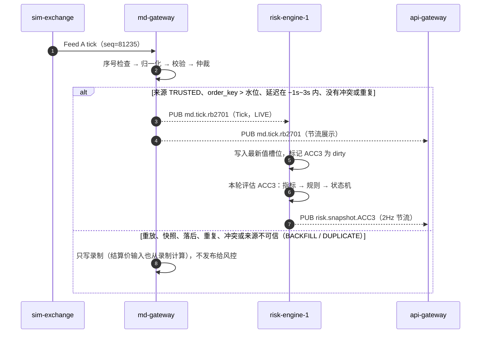
*这张图回答：一个 tick 怎样变成风控判定（延迟目标见 QS-07），为什么补数不会触发信号。*

- risk-engine 只从 `md.tick.*` 收 LIVE 行情，并以 `md.status` 为行情质量的唯一依据；从 `ctl.snapshot` 拿到的行情只更新标记价，不改变质量，也不算新的市场状态。
- 消费方仍识别 `FLAG_WM_RESET` 标志（02 §5，保留给水位回退的情形）；当前的 md-gateway 从不回退水位，所以从不设置它。

### 6.2 R2 下单与事前风控

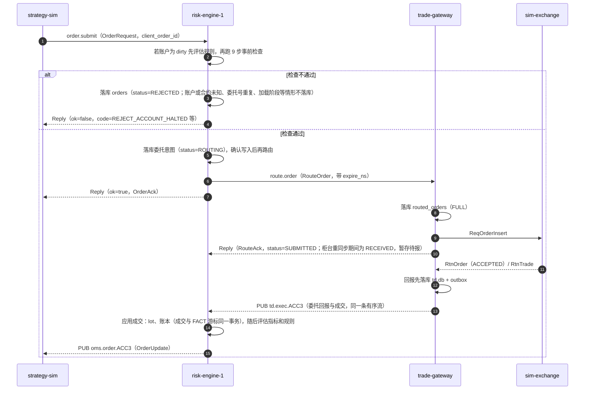
*这张图回答：为什么风控是订单的唯一入口，哪些数据要先落库。*

- risk-engine 给 `order.submit` 回复"已受理"的时机，是委托意图已经落库（与同一批命令的其他写入一起成组提交）、已经发出路由之后，不会等交易网关确认。后续状态统一通过 `oms.order.{account_id}` 推送。
- **路由的有效期**：`route.order` 在 `expire_ns`（默认为通过风控之后 2s，`route_ttl_ms`）之前可以用同一个 `client_order_id` 重试；trade-gateway 按主键去重，不会重复报单。柜台正在重同步时，trade-gateway 先暂存委托并应答 `RECEIVED`，重同步完成后再报出，但绝不在 `expire_ns` 之后报出。
- **过期之后**：委托转为 `UNKNOWN`，改用 `route.resolve` 确认。trade-gateway 收到过的，返回当前状态；从没收到过的，写墓碑并返回 `EXPIRED`，之后迟到的同一委托一律拒绝（状态机见 02 §8.3）。只读的 `td.query.orders` 不会产生墓碑。
- **禁止**换一个新的 `client_order_id` 自动重发同一意图。`client_order_id` 永久唯一：跨交易日重复使用也返回 `REJECT_DUPLICATE_ORDER_ID`。
- **撤单**：`CANCEL_PENDING` 的委托在最后一次发送撤单 5s 后（之后每发一次翻倍，最多 60s）用 `route.resolve` 复核；柜台上仍在工作的，换一个新的 `command_id` 重发撤单；发满 5 次仍撤不掉，记一条不阻塞开仓的 `ORDER_STATE_CONFLICT` 对账异常并告警（账户已熔断且是开仓单时为 HIGH），重试继续（02 §8.3）。

### 6.3 R3 熔断触发、锁存与人工重置

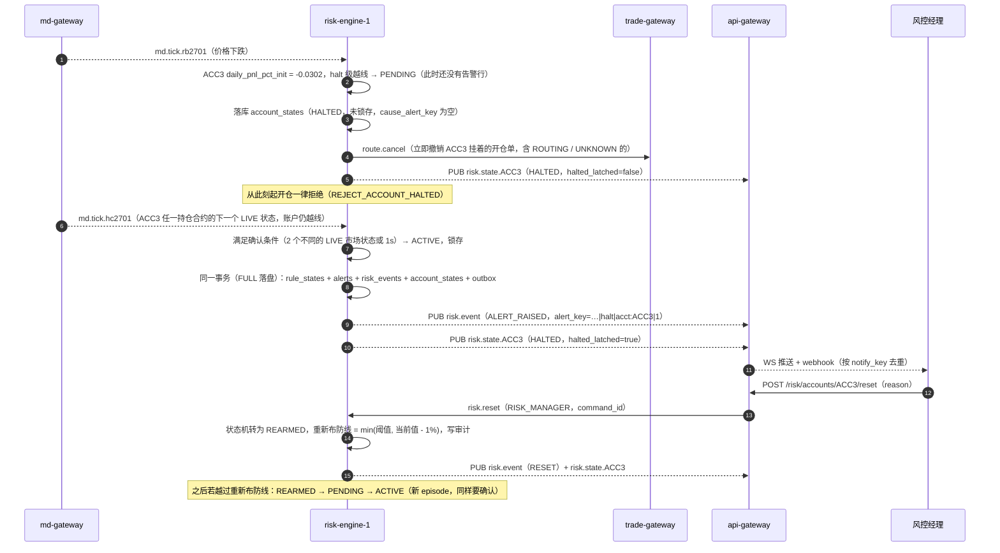
*这张图回答：达到 3% 时怎样做到"立即禁开、只告警一次"，以及锁存后如何受控解除。*

- **熔断撤单守护**：账户处于 HALTED 期间，任何重新变为工作状态的开仓单（撤单被柜台拒绝后回退、从柜台补建的委托、`route.resolve` 或路由应答发现它仍在工作、重启恢复）都会被再次撤销；撤单被拒后第一次重撤立即进行，之后按 5s、10s……60s 退避。kill switch 和 `BLOCK_OPEN` 类限制只拒绝新开仓，不撤已挂的单。
- **人工熔断**：`risk.halt` 立即锁存一个保留的状态机 `manual_halt`，与规则锁存用同一套持久化和恢复机制；`risk.reset` 同时解除人工熔断和规则锁存（可以按规则和级别过滤），人工熔断的状态机回到 OK，规则的锁存级别进入 REARMED。
- **确认的边界**：第二个市场状态可以来自该账户的任一持仓合约，坏点所在合约的标记价在它自己的下一笔行情到来之前保持坏值；所以一个落在涨跌停以内的坏点，只要另一个持仓合约随后有新行情（或 1s 内没有被纠正），就会被确认并锁存，需要人工 `risk.reset`。反过来，亏损在阈值附近来回时，每次回到阈值内都立即撤销 PENDING，账户在 HALTED 和其他状态之间反复切换而不锁存（已知缺陷，08 §5.2）。

验收用例的构造（QS-03 / QS-04）：
- **内核级**（`tests/unit/engine/test_engine_acceptance.py`）：ACC3 初始资金 1000 万，持有当日开仓的 rb/hc/i 多头、没有平仓，所以没有已实现盈亏，两种口径只差当日手续费。"当日盯市总盈亏"口径的用例让标记价依次越过 −2%、−2.5%、−3%，纯浮亏（`floating_only`）口径的用例直接走到 −3%，两种口径**都会**触发熔断。同一文件还覆盖：单个坏状态在确认前回到阈值内时撤销 HALTED、只按时间（1s）确认、质量门控、熔断期间平仓照常、重启恢复后状态一致且告警不重复。
- **多进程端到端**（`tests/e2e/test_e2e_acceptance.py`，8 个真实进程，`futrisk demo --scenario breaker --headless`）：ACC3 的策略机器人在场景模式下持有约 0.78 倍权益的 rb/hc/i 多头，下跌中按 0.5% 一档加仓（最多 8 档，每档 6.25%）。`breaker` 剧本让黑色板块分三段线性下跌（默认 −2.5%、−0.48%、−0.88%，每段 30s 下跌、30s 保持，各段起点相隔 60s，可按变量覆盖），使 ACC3 依次越过：
  1. −2%：告警；
  2. −2.5%：`RESTRICT`（单笔上限系数 0.5，且禁止在亏损品种上加仓，加仓单被拒 `REJECT_ADD_TO_LOSER`）；
  3. −3%：熔断。

  测试断言：三个级别按顺序各告警一次；熔断后开仓单返回 `REJECT_ACCOUNT_HALTED`，测试经 REST 下的 1 手平仓单成交；`futrisk kill risk-engine-1` 之后 supervisor 把它拉起，HALTED 仍然保持，告警键不重复，仍是第 1 个 episode（QS-04）。熔断锁存后，机器人定期发 1 手的开仓试探单（都被拒），并一次性平掉每个持仓的 10%（平仓单成交）。

### 6.4 R4 Feed A 中断、故障切换与补数

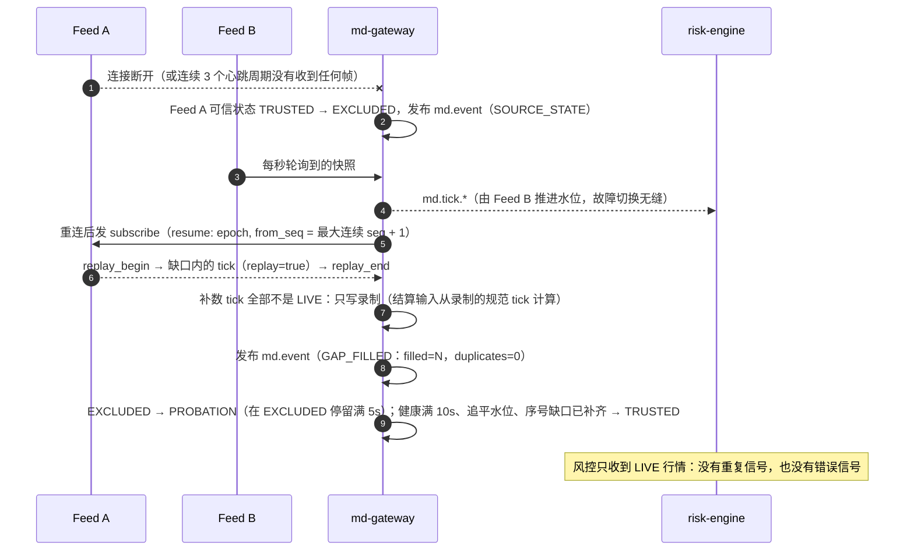
*这张图回答：中断恢复时如何补齐缺失数据，又不产生重复或错误的风险信号（task.md 的明确要求）。*

- **续传游标**：进程内重连用内存中的连续序号；落盘的游标只在对应的原始 tick 分片写盘之后推进，所以 md-gateway 自己重启后续传，不会漏掉已确认却没有写盘的数据。
- **sim-exchange 重启**（Feed A 的 epoch 变化）：sim-exchange 回 `EPOCH_CHANGED` 并发新快照，环形缓冲中还在的部分作为补数重放，旧 epoch 的尾部记为 `GAP_UNRECOVERABLE`；该源在旧 epoch 下的同源顺序参照被清除。续传点已经被挤出环形缓冲（`SEQ_EVICTED`）时，挤出的部分记为 `GAP_UNRECOVERABLE`，其余照常补数。
- **所有源都中断时**：合约质量先变为 STALE（5s），再变为 UNKNOWN（30s）；缺口台账开一个 `all:{from_ns}` 缺口，重新有可信源时关闭（由 Feed A 恢复且期间没有序号丢失则为 FILLED，否则为 UNRECOVERABLE）。相关指标的状态机保持不动（既不升级也不降级），这些合约禁止开仓，但允许平仓；每个合约每次中断只告警一条 `MD_DOWN`。详见 §8.13。
- 端到端验证：`tests/e2e/test_e2e_acceptance.py`（Feed A 断开 20s，断言 LIVE 行情不回退、不重复，缺口以 0 条重复补齐）；服务级测试：`tests/unit/md_gateway/test_mdg_integration.py`、`test_mdg_resilience.py`（用真实 sim-exchange 覆盖跳号、重复、乱序、epoch 变化、全部源中断、重启续传等场景）。

### 6.5 R5 risk-engine 崩溃与恢复

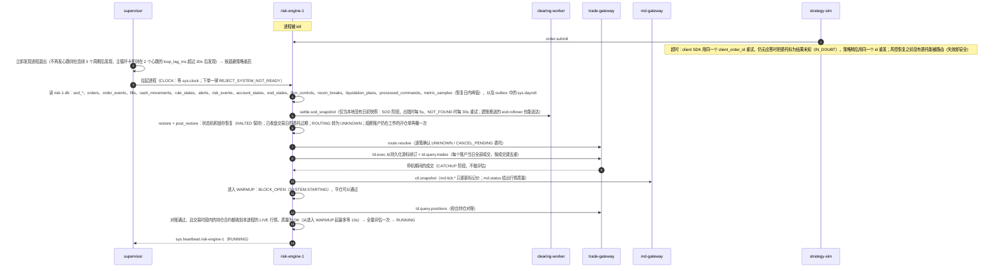
*这张图回答：重启为什么不会丢成交、不会重复告警、不会让熔断失效。*

- 恢复之后的评估是确定性的：同样的持久化状态得到同样的状态迁移、episode 和 `alert_key`，告警表按 `alert_key` 幂等，所以不会重复告警（ENGINE.md §8）。
- 超过等待时间（10s）仍没有新鲜行情时照样进入 RUNNING；`md.status` 报告质量不是 OK 的合约，开仓仍被事前检查挡住（失效即安全）。预热阶段的柜台持仓对账连续两次不一致时，转为对账异常（禁开），预热同样结束。
- 实测：risk-engine 带 1 万笔当日成交冷启动到 RUNNING，3 次的中位数 1.75s、最慢 1.78s，被硬杀后重启 1.77s（2026-09-26，开发笔记本，git 标签 `v0.1-full` 上的 `futrisk bench recovery`，13 §3），目标 < 3s（QS-11）。

### 6.6 R6 盘后清算流程（EOD saga）

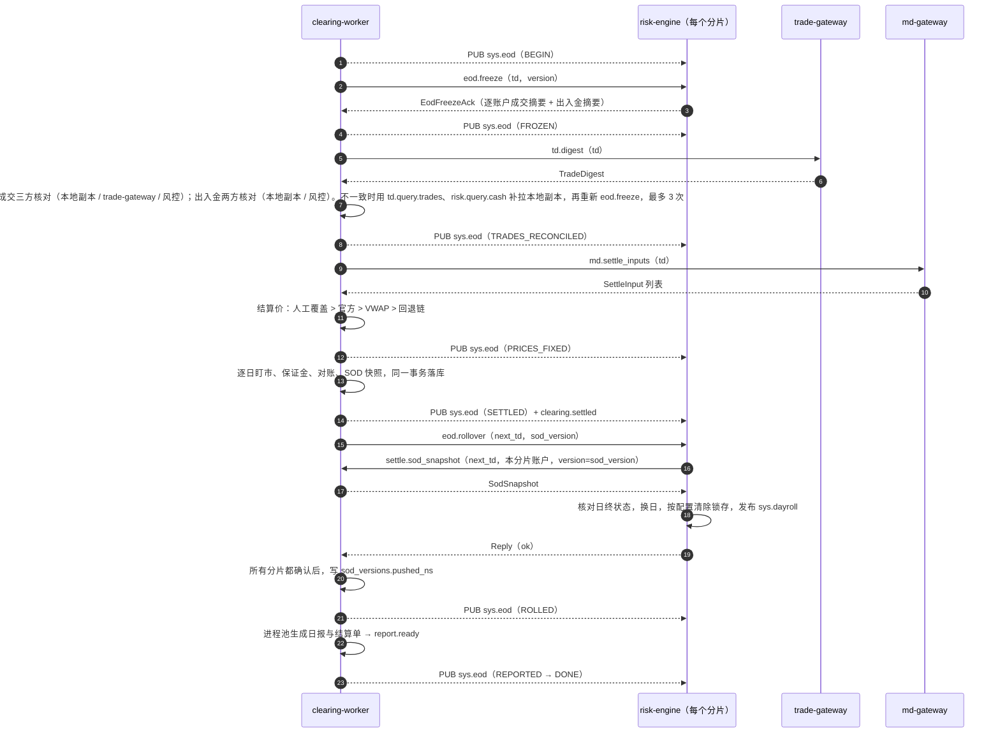
*这张图回答：结算如何在多个服务之间保证完整、可重跑、失败时安全。*

- 每一步都以 `(trading_day, version)` 为幂等键；clearing-worker 重启后从最近一个已完成的步骤继续执行。
- **钉住**：一次结算在各步骤中把关键输入写进运行记录并在后续步骤中复用，恢复执行时也不会变：BEGIN 钉住日初快照版本和当天生效的配置版本；第 3 步钉住逐账户的成交与出入金摘要；第 4 步钉住决定好的结算价。
- **核对**（第 3 步，`clearing/digests.py`；摘要算法见 02 §7.5、§7.7）：`EodFreezeAck` 同时带回本分片每个账户的成交摘要和出入金摘要。
  - **成交：三方核对**。逐账户比较三份摘要的条数、手数之和与 SHA-256：clearing-worker 的本地副本（订阅 `td.exec.*` 得到）、trade-gateway 的 `td.digest`、各分片 `EodFreezeAck` 中的成交摘要；三者一致才通过（`TRADE_DIGEST`）。
  - **出入金：两方核对**。逐账户比较本地副本（订阅 `risk.cash.*` 得到）与各分片 `EodFreezeAck` 中的出入金摘要：条数和净额（入金减出金）都相同才通过（`CASH_DIGEST`）。trade-gateway 不经手出入金，不参与这项核对。
  - **不一致时**：本地成交副本与 trade-gateway 不一致的账户用 `td.query.trades` 补拉，出入金不一致的账户向所属分片用 `risk.query.cash` 补拉，然后重新 `eod.freeze` 取最新摘要再比较；每次结算最多重新冻结 3 次（第 5 步的回退也计入），仍不一致时本次结算进入 FAILED，不一致的检查项写入 `recon_checks`。冻结时分片仍有挂单的，记一条 `TRADE_DIGEST` 的 WARN。
  - 出入金记入哪个交易日，由 risk-engine 按自己的 EOD 状态判定（§8.15），所以不会出现冻结前后都没有被结算的出入金。
- **回退**：第 5 步开始计算前，以及提交结算结果时，各比较一次本地副本与钉住的摘要；有新的成交或出入金进入副本时，回退到 FROZEN 重新核对（计入重新冻结的次数），不会用一份与摘要不符的副本结算。
- **结算价输入**：第 4 步请求 `md.settle_inputs` 时，md-gateway 先把原始 tick 落盘并合并出规范 tick，再从中计算。md-gateway 给出的昨结算与日初快照不一致时，以日初快照为准，并在 PRICES_FIXED 的 `sys.eod` 事件中附一条 `PRE_SETTLE_MISMATCH` 警告。md-gateway 不可用时，只有当每个需要结算价的合约（有持仓或当日有成交）都有人工覆盖价或官方结算价，第 4 步才继续，否则本次结算进入 FAILED。
- **换日取快照**：risk-engine 按 `eod.rollover` 中的 `sod_version` 取快照，不依赖这个版本是否已经标记为推送，所以不会与 `pushed_ns` 互相等待。不指定版本的请求只用于没有本地快照的重启场景（02 §6.5）。推送以交易日为单位、从旧到新依次完成；某个分片暂时没有确认时，在它的心跳恢复时以及定时补推，直到确认为止。
- **失败与告警**：SETTLED 之前任何一步无法恢复的错误，都会使本次结算进入 FAILED 并发布 `sys.eod`（FAILED），由 api-gateway 推送告警并发送 webhook（02 §9.8）。**SETTLED 之后结算结果已经有效，本次运行不会再失败**：之后出现异常时 clearing-worker 停止并由 supervisor 重启，从最近完成的步骤继续；推送没完成发 WARN；报表生成失败只记在 REPORTED 步骤的 `detail.errors` 中并写日志，不发 WARN、不通知，对已经 DONE 的版本再发 `settle.run` 会重新生成报表。WARN 事件不改变阶段，种类有：`LATE_FACT`（结算之后才到达本地副本的成交或出入金，结算中不含它，由操作员决定是否用新版本重算）、`OFFICIAL_PRICE_DIFF`（导入的官方结算价与已用价格不同）、`PUSH_INCOMPLETE`（某个分片重试后仍没有确认换日）和 `PRE_SETTLE_MISMATCH`（见上，随 PRICES_FIXED 事件发布）。
- **多日追赶**：停机或时钟跳转跳过了几个交易日时，clearing-worker 按交易日顺序逐日结算，第 D+1 日的结算要等第 D 日进入 ROLLED 才开始。已经转入临时日初快照、站在更晚交易日上的分片，对较早交易日的正式快照回复 `CATCH_UP`（只记录这份正式快照，不改变当前状态），对自己所在交易日的快照回复 `REBASE`（重新定基）。risk-engine 要求这条链连续：前一日的正式快照没有到之前，拒绝后一日的换日（"settle {day} first"）。
- **临时日初快照**：risk-engine 没收到 `eod.rollover` 时，在非交易时段保持 `EOD_FROZEN`。**下一个交易日的第一个交易时段开始时，只要生效的日初快照仍属于上一交易日**（没有收到 `eod.rollover`，甚至连 `eod.freeze` 都没有收到，例如 clearing-worker 一直不可用），它就转入临时日初快照（`PROVISIONAL`）：
  - 触发时先自行冻结上一交易日（`EOD_FROZEN`，这段时间平仓也被拒，`REJECT_EOD_IN_PROGRESS`），向 md-gateway 请求 `md.settle_inputs`（最多 30s），拿到应答或请求失败后构建临时快照并换日；
  - 风控状态照常换日：状态机归零，锁存按配置解除，尚未确认的减仓计划作废；之后的重新定基不会再换一次日；
  - clearing-worker 恢复后继续 saga，这时收到的 `eod.freeze` 只返回摘要，不改变交易模式，平仓照常；
  - 自己把今仓转为昨仓，按临时结算价定基（优先用 `md.settle_inputs` 的 VWAP，其次是上一交易日最后的标记价，最后是昨结算）；
  - 所有账户禁开（`SYSTEM:EOD_NOT_SETTLED`），**平仓照常**；
  - 风控经理可以用 `eod.force_unfreeze` 审计放行；
  - 正式快照到达后，重新定基（重放当日成交），见 02 §8.4。
- **换日后重新结算**：已经换日之后，如果又生成了新的结算版本（`settle.run` 带 `force_new_version`，只允许在原版本已经 DONE、并且更晚的交易日还没有未失败的结算时），各分片已经在交易下一个交易日，所以第 2 步不再冻结它们；第 3 步成交只与 trade-gateway 两方核对（不一致即 FAILED），成交和出入金再与原版本钉住的摘要比较，差异记为 WARN；第 6 步推送新版本，各分片执行重新定基。
- **日常维护**：`sys.eod` 进入 DONE 之后，各服务做 checkpoint、`VACUUM INTO` 备份和按保留期清理，清理分成小批量的短事务（03 §8）。risk-engine 只在没有交易时段开着、也没有交易时段即将开始时做维护，否则推迟；其他服务收到 DONE 就做。正常日程下 DONE 在收盘之后，补结算时 DONE 可能落在下一个交易时段内。

### 6.7 R7 配置热加载（两阶段提交）

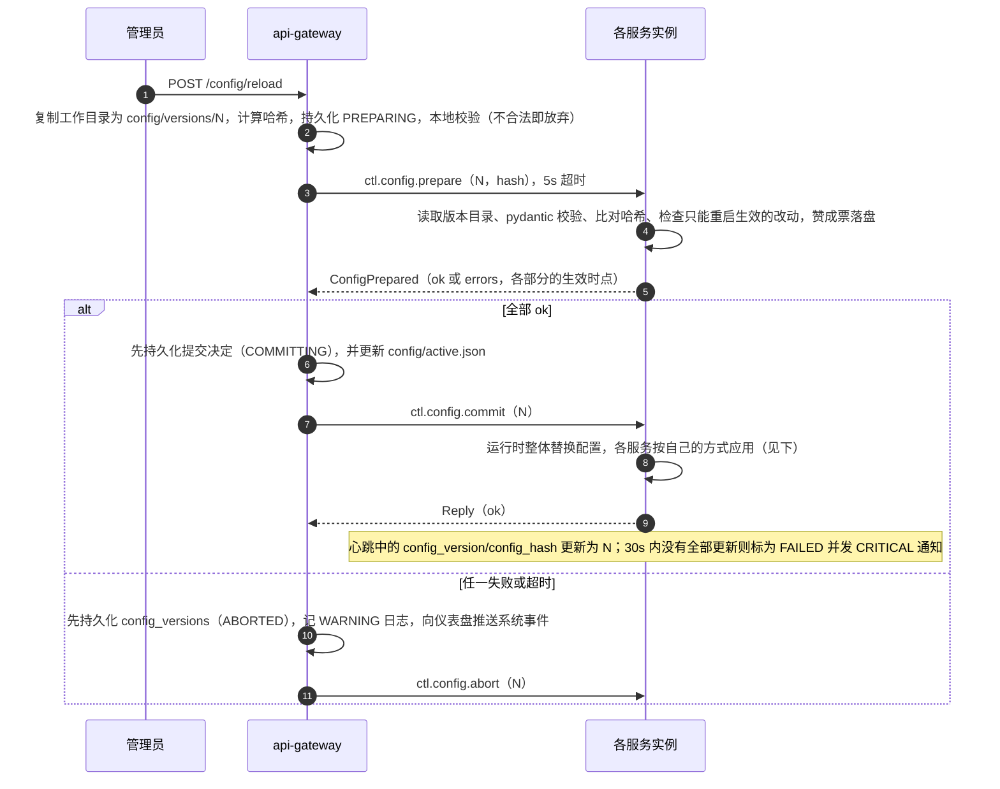
*这张图回答：怎样保证所有服务要么都用新配置，要么都用旧配置。*

- **不可变快照**：配置先复制成不可变的版本快照 `config/versions/{N}/`，各服务启动时只加载 `config/active.json` 指向的版本，所以工作目录中被拒绝的修改不会在重启时被误加载。
- **参与者不自行放弃**：参与者投了赞成票之后，禁止自行放弃；赞成票持久化在 `<home>/run/config-2pc/{instance}.json`，60s 内没有收到决定或者重启后，用 `config.decision` 查询决定。决定为 `COMMITTING`、`COMMITTED` 或 `FAILED` 时提交（`FAILED` 表示已经决定提交，只是有实例没有收敛），为 `ABORTED` 时放弃。
- **协调者重启**：api-gateway 重启后，最新一个状态为 `COMMITTING` 的版本重新发送 commit（`active.json` 还指向更旧的版本时先改过来），更早的 `COMMITTING` 版本已被取代，只标为 `COMMITTED`；状态为 `PREPARING` 的版本先持久化为 `ABORTED` 再下发放弃（02 §8.5）。
- **收敛检查**：提交之后，各实例的心跳要在 30s 内报告新的（或更新的）配置版本和哈希，期间每 5s 向落后的实例补发 commit；仍未收敛的版本标为 `FAILED` 并发 CRITICAL 通知。`active.json` 已经指向新版本，落后的实例重启后自然收敛。
- **各部分的生效时点**（按改动的配置文件计算，`runtime/config2pc.py`）：`risk_rules`、`accounts` 标为立即生效；`products`（保证金、手续费、涨跌停、交易时段）和交易日历标为**下一交易日生效**，`active.json` 记下生效的交易日；其他文件标为立即生效。运行时在提交时整体替换内存中的配置，真正怎样生效由各服务决定：
  - risk-engine：重新编译并替换规则（锁存的处理见下）；`accounts.yaml` 只在进程启动时读入；品种参数和日历在进程内是固定的，新版本暂存，到**下一次进程启动时**才生效（TD-09）；
  - clearing-worker：记入配置历史，结算某个交易日时用当天生效的版本（§5.3.4）；
  - md-gateway：只应用 `feeds.yaml` 的 `arbitration` 参数，否决 `products.yaml` 和交易日历的任何改动（见下一条）；
  - supervisor：在启动时读取 `services.yaml` 的 `supervisor` 段和 `app.yaml` 的 `mode`、`demo`，不处理提交，这些改动要到它下一次启动才生效（§5.3.6）；`app.yaml` 的日志设置也只在各进程启动时应用。
- **只能重启生效的改动**在 prepare 阶段否决：所有参与方都否决端点和总线参数（`services.yaml`）以及数据源地址（`feeds.yaml` 中的 URL）的改动；md-gateway 还否决 `feeds.yaml` 中仲裁参数以外的任何改动、`products.yaml` 和交易日历的改动；risk-engine 还否决改变本分片所拥有账户的 `accounts.yaml` 改动，以及无法编译或用了未注册指标的规则。prepare 发给 `services.yaml` 中的每个实例，任何一方否决都使整轮放弃。所以在默认部署中，品种参数和交易日历的改动**不能热加载**，要停机后离线提交：`futrisk down`，修改 `<home>/config`，`futrisk config commit`（校验工作目录并把它提交为新的生效版本；本 home 的 supervisor 仍在运行时拒绝执行，除非加 `--force`），再 `futrisk up`。应当在 EOD 完成之后、下一交易日第一个交易时段开始之前做，新参数从下一交易日起同时用于风控和结算（否决规则的完整列表和操作步骤见 11 §1.3）。
- **热加载与锁存**：规则或级别被删除、停用时，已锁存的级别保留原来的规则，直到 `risk.reset` 或换日，并写审计（§8.14）；修改一个仍然存在的已锁存级别时，状态机直接采用新定义，但锁存标志不变：只改阈值或 `latch` 时熔断仍然锁存；把动作从 `CIRCUIT_BREAK` 改成其他动作（例如 `ALERT`）时，账户状态按新动作推导，熔断立即失效，账户改由其余生效的级别决定状态（例如亏损仍低于 −2.5% 时为限制下单），也不写审计（已知缺陷，08 §5.2 KD-19）。

### 6.8 R8 启动与停机顺序

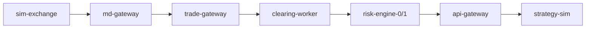
*这张图回答：服务按什么依赖顺序启动。*

- **启动**：
  - 顺序由 `services.yaml` 的 `supervisor.startup_order` 给出；clearing-worker 排在 risk-engine 之前，因为 risk-engine 可能需要从它那里取日初快照；
  - 每一步只等上一个进程**活着**（收到它本身发出的第一个心跳，状态不限），**不等它进入 `RUNNING`**。这样即使行情源在启动时中断，其他服务也能照常启动；某个实例启动失败时交给重启策略处理，最多阻塞后续实例 `liveness_timeout_s`（20s）再多 1s；
  - 各服务先等市场时钟（`sys.clock`），能否交易由它们各自的就绪条件决定（02 §8.6）。
- **停机**：按相反顺序进行，supervisor 最后退出。
  1. supervisor 先向各服务发 `ctl.shutdown`（只发给心跳证明确实活着、由它自己的进程树发出心跳的总线服务，请求超时 2s），服务收到后进入 `STOPPING`，拒绝一切新委托（平仓也不例外：服务即将退出，无法跟踪后续回报），返回 `REJECT_SYSTEM_NOT_READY`；sim-exchange 和 strategy-sim 不在总线上，直接从下面第 3 步开始；
  2. 服务排空队列，落盘，执行 checkpoint，然后退出；
  3. 超过 `shutdown_grace_s`（10s）未退出的服务，发送 CTRL_BREAK（总线服务再等最多 5s，外部组件再等一个 `shutdown_grace_s`）；
  4. 仍未退出的，依次 terminate（等 2s）、kill；比子进程活得更久的孙进程（进程池的工作进程）一并回收。
- docker compose 部署时由容器编排按依赖（`depends_on` 与健康检查）启停，见 §7.2。

---

## 7. 部署视图

### 7.1 D1 单机演示部署（Windows，一个 exe）

- **打包形态**：PyInstaller 一个文件夹（one-folder）的控制台程序 `dist\futrisk\futrisk.exe`，一个 exe 带全部服务子命令，supervisor 用 `futrisk.exe svc <name>` 拉起每个子进程。前端构建产物、日报模板、机器人默认参数和整套默认配置作为数据文件打进包内；`data\hist\`（回测用的历史数据）放在 exe 旁边。开发工具和开发期数据工具（pytest、hypothesis、ruff、mypy、AkShare、polars）不打包。构建脚本在构建和打包两步分别打印输出目录与 zip 的大小。
- **构建**：`scripts/build_exe.ps1` 分 4 步：
  1. 构建前端（`npm ci`、`npm run build`）；
  2. PyInstaller 全新构建（`packaging/futrisk.spec`）；
  3. 冒烟测试：每项都用独立的临时 home 和空闲的回环端口，不干扰已经在默认端口上运行的系统。共 17 项检查，全部通过才进入下一步：
     - `version`、`config validate`、`doctor --json`（时区库、仪表盘、pyzmq、SQLite、非 ASCII 路径都必须 PASS）；
     - 单独运行 `svc api-gateway`：`/api/v1/health` 返回 200、`/` 返回仪表盘及其脚本资源、父进程结束后干净退出；
     - `backtest run breaker_synthetic`（验证进程池能在 exe 中重新进入，并且回测清单记录了 exe 的代码哈希）；
     - `up --headless` 运行约 60s：`ps` 显示全部实例 RUNNING、`demo --headless` 建账成功、`status` 健康、`down` 之后没有残留进程；
     - 把整个 dist 目录复制到含中文字符的路径下，再做 `version`、`config validate`、`doctor --json` 和 api-gateway 的 3 项检查；
  4. 生成 `dist\futrisk-win64-<version>.zip` 和 `.sha256`。任一冒烟测试失败都不生成 zip。
- **运行**：`futrisk demo` 一键拉起下表中的全部进程、首次运行时建账并打开仪表盘，仪表盘地址为 `http://127.0.0.1:8000`。`--scenario breaker` 在 ACC3 的持仓达到约 0.7 倍权益后启动熔断剧本；`--headless` 不开浏览器，完成后按结果返回退出码；`--start-at` 指定首次启动时的市场时间。运维命令为 `futrisk up | ps | status | logs | kill | down`，其余查询和操作命令（`positions`、`accounts`、`order`、`risk`、`settle`、`report`、`fault`、`scenario`、`shock`、`clock`、`doctor`、`backtest`、`data`、`config`）经 REST 调用 api-gateway，或者在本机直接运行（`doctor`、`backtest`、`data`、`config`）。安装、运行和演示的详细步骤见项目根目录的 README 和 07 使用说明。
- **首次启动**：api-gateway 生成 bootstrap ADMIN key（§8.8）；supervisor 按 `demo.start_at` 设定市场时钟（§8.2）；risk-engine 取不到日初快照（`NOT_FOUND`），停在"取日初快照"阶段，每 30s 重试一次；`futrisk demo` 先核对 api-gateway 的 `home_id`，再用 bootstrap key 按 `accounts.yaml` 调用建账（`settle.seed_sod`），clearing-worker 随即把快照推给各分片（`eod.rollover`），各分片加载后完成启动（02 §8.6）。
- **已知限制**：只支持从源码目录、exe 或 docker 镜像运行；把包装成 wheel 安装到 site-packages 后找不到默认配置，历史数据目录也要在回测配置中另行指定（TD-11）。

| 进程 | 启动命令 | 端点（默认，见 `config/services.yaml`） |
|---|---|---|
| supervisor | `futrisk up`（或 `futrisk demo`） | PUB `tcp://127.0.0.1:7601`，ROUTER `:7602` |
| sim-exchange | `futrisk svc sim-exchange` | Feed A `ws://127.0.0.1:7001/feed`；Feed B `http://127.0.0.1:7002/v1/quotes`；交易 ZMQ `tcp://127.0.0.1:7003`；控制 `http://127.0.0.1:7004/control` |
| md-gateway | `futrisk svc md-gateway` | PUB `:7101`，ROUTER `:7102` |
| trade-gateway | `futrisk svc trade-gateway` | PUB `:7201`，ROUTER `:7202` |
| risk-engine-0 | `futrisk svc risk-engine --shard 0` | PUB `:7301`，ROUTER `:7302` |
| risk-engine-1 | `futrisk svc risk-engine --shard 1` | PUB `:7311`，ROUTER `:7312` |
| clearing-worker | `futrisk svc clearing-worker` | PUB `:7401`，ROUTER `:7402` |
| api-gateway | `futrisk svc api-gateway` | HTTP `http://127.0.0.1:8000`（`/api/v1`、`/ws`、`/`）；PUB `:7501`，ROUTER `:7502` |
| strategy-sim | `futrisk svc strategy-sim` | 只作客户端，不监听端口 |

演示环境的账户（`config/accounts.yaml`）和策略机器人（`src/futrisk/sim/bots/bots.yaml`）：

| 分片 | 账户 | 初始资金 | 品种 | 策略风格 |
|---|---|---|---|---|
| risk-engine-0（coordinator） | ACC1 | 1000 万 | rb、hc、i、j | 黑色系通道突破 |
| risk-engine-0（coordinator） | ACC2 | 2000 万 | rb、cu、au、m、IF、T | 多品种趋势 |
| risk-engine-1 | ACC3 | 1000 万 | rb、hc、i | 日内逆势加仓（熔断演示的主角）：约 0.78 倍权益的多头，下跌中分档加仓 |
| risk-engine-1 | ACC4 | 1000 万 | IF、IC | 股指杠杆方向（杠杆 0.3~0.55 倍） |
| risk-engine-1 | ACC5 | 500 万 | rb | rb2701/rb2705 跨期套利（始终双向持仓，演示单向大边） |

机器人的默认仓位在正常运行时不触发任何告警，只有一个有意保留的例外：ACC4 信号很强时 IF、IC 各持 2 手，单品种敞口使用率约 0.88，超过 0.7 的告警线。

模拟合约（`config/sim.yaml`）：rb2610、rb2701、rb2705、hc2701、cu2611、au2612、i2701、j2701、m2701、IF2612、IH2612、IC2612、T2612，共 13 个。rb2610 是近月合约，用于演示单向大边的退出和较高的保证金率；股指选 12 月合约，是为了避开 10 月合约 2026-10-16 到期对演示的影响。

运行时数据目录 `<home>`：exe 默认为 `<exe 目录>\var`，不可写时退到 `%LOCALAPPDATA%\futrisk`；源码运行时默认为仓库下的 `var\`；也可以用 `--home` 或环境变量 `FUTRISK_HOME=<目录>` 指定：

```
<home>/
  home_id                 本 home 的身份（§5.3.6、§8.8）
  config/                 配置的工作目录（首次启动时从包内默认配置复制过来）
  config/versions/<N>/    不可变的配置版本快照；config/active.json 指向当前生效的版本
  run/config-2pc/         两阶段提交中各实例已持久化的赞成票
  db/                     md.db  td.db  risk-0.db  risk-1.db  clearing.db  api.db  supervisor.db  sim.db
  backup/<td>/            每日 EOD 之后的库备份（03 §8）
  ticks/raw/<td>/<source>/     原始 tick 分片（Parquet）
  ticks/canonical/<td>.parquet 日终合并后的去重 tick
  ticks/wire/<td>/sina/        新浪原始 HTTP 应答的归档（排查用）
  ticks/spill/<td>/<source>/   原始分片写不进去时的备用目录
  ticks/.recorder.lock         futrisk data record 的单实例锁
  reports/<td>/           风控日报、结算单
  backtests/<run_id>/     回测输出
  secrets/                bootstrap ADMIN key（只有当前用户可读）
  logs/<instance>_<YYYYMMDD>.log
```

### 7.2 D2 docker-compose 部署

`deploy/compose.yml` + `deploy/Dockerfile`（已实现）：

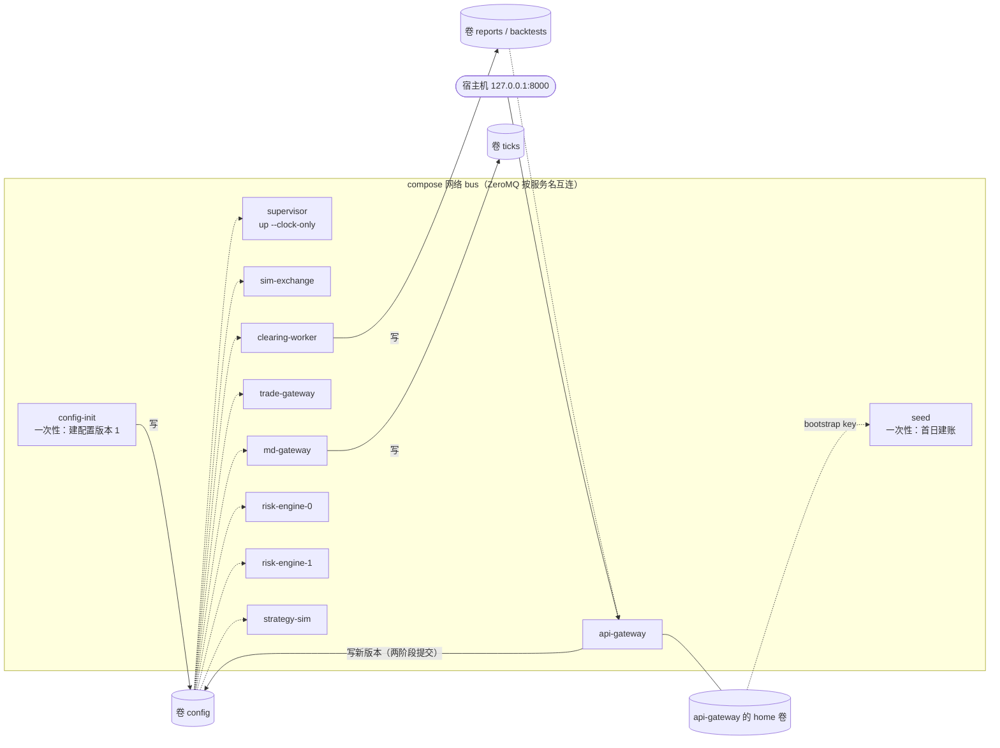
*这张图回答：docker 部署中有哪些容器，哪些文件在容器之间共享，谁写谁读（实线为写，虚线为只读挂载）。*

- **一个镜像**：多阶段构建（Node 构建前端；按 `poetry.lock` 导出依赖；运行镜像基于 `python:3.12-slim`，装中文字体供报表图表使用）。以非 root 用户运行；保留仓库目录结构并以可编辑方式安装，因为默认配置和历史数据按源码目录定位（TD-11）。每个服务一个容器，容器命令即 `futrisk svc <name>`；`tini` 作为 1 号进程转发 SIGTERM（优雅停机）并回收进程池的子进程。
- **进程管理交给编排**：各容器 `restart: unless-stopped`，按 `depends_on` 和健康检查启动（supervisor、sim-exchange、api-gateway 有健康检查）。supervisor 以"只管时钟"模式运行（§5.3.6），只维护市场时钟，`svc.start/stop/restart/kill` 回 `PRECONDITION_FAILED`；所以 docker 部署下没有 `futrisk kill` 和仪表盘上的"kill 服务"故障演示，重启某个服务用 `docker compose restart <service>`。
- **市场时钟**：各服务启动时从 supervisor 取 `sys.clock`；sim-exchange 启动时没有 `--clock-offset-ns`，就向 supervisor 取当前时钟，60s 内取不到则以退出码 1 退出，由重启策略重试（等待时间可用 `FUTRISK_SIM_CLOCK_WAIT_S=<秒>` 调整），绝不在一个与其他服务不同的时钟上运行。时钟状态保存在 supervisor 的卷中，重启后继续随墙钟前进。
- **网络**：各服务在 `bus` 网络上按 `deploy/config/services.yaml`（`docker` 档位，把 `127.0.0.1` 换成服务名）绑定和连接 ZeroMQ 端点；只有 api-gateway 的 HTTP 端口映射到宿主机的回环地址。
- **home 与身份**：每个服务的 `<home>`（数据库、日志、备份）放在各自的具名卷里（每服务一库）。所有容器设置同一个 `FUTRISK_HOME_ID=futrisk-compose`（可覆盖），使 CLI 和 supervisor 把这些分开的 home 认作同一个部署。
- **文件级共享**（代码确实需要的全部共享，不止报表下载）：
  - `config`：所有服务的 `<home>/config`。config-init 创建版本 1；api-gateway 作为两阶段提交的协调者在这里写新版本，各参与方从自己的 home 加载 `config/versions/<N>`；其他服务只读挂载；
  - `reports`、`backtests`：clearing-worker 写，api-gateway 只读，用来下载报表和回测结果；
  - 一次性的 seed 容器只读挂载 api-gateway 的 home 卷，读取其中的 bootstrap ADMIN key，然后通过 REST 建账（没有单独的 secrets 卷）。
- 这些共享目录与 03 DB-01 列出的一致；exe 部署中所有服务共用一个 home，这些共享是隐含的。`ticks` 是 md-gateway 自己的卷（便于把录制的 tick 拷出来），不与其他容器共享。除了总线、各自的库和上面列出的共享之外，服务之间没有其他隐藏耦合。

### 7.3 D3 生产部署建议（不在本期交付范围）

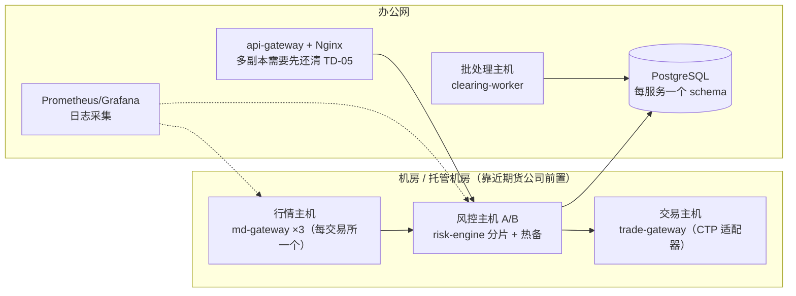
*这张图回答：生产环境中这些服务如何落到主机上，扩展点在哪里。*

- 跨主机通信启用 ZeroMQ CURVE 加密和白名单。
- risk-engine 采用"主备 + 租约"：主机故障时，由备机接管分片（已列为技术债）。
- 如果需要全公司层面的事件归档，加一个总线到 Kafka 的桥接服务。

---

## 8. 横切概念

### 8.1 领域模型

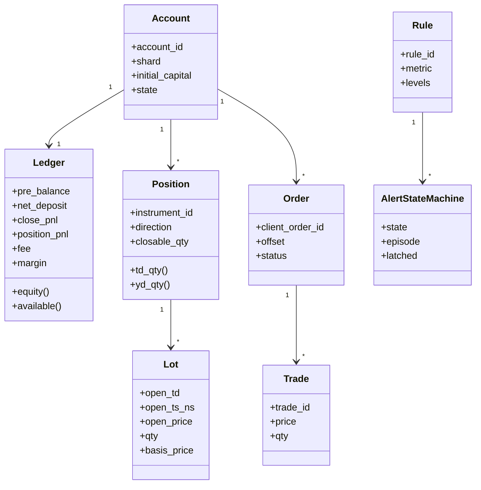
*这张图回答：核心领域对象之间是什么关系。*

- 持仓只能由日初快照加上成交推导，不能直接修改（事件溯源）。本系统是影子账本：risk-engine 每 5 分钟经 trade-gateway 查询柜台持仓（`td.query.positions`）比对，不一致时禁开并补拉当日成交；持仓从不直接用柜台数据覆盖，差异**以柜台为准**查清（02 §8.7）。
- 品种参数（乘数、最小变动价位、保证金率、手续费、涨跌停、交易时段、结算价方法、板块）来自 `config/products.yaml`，带生效日期，属于配置数据，不入库。

### 8.2 交易日与时间
- **交易日归属**由交易所日历驱动：
  - 20:00 以后的时间戳归下一交易日；
  - 00:00–03:00 归"前一自然日的下一交易日"，所以周五夜盘和周六凌晨都归周一；
  - 长假前一晚没有夜盘，这时开盘集合竞价改在 08:55–09:00。
- **交易时段**按品种模板配置（含集合竞价）：rb/hc/i/j/m 夜盘 21:00–23:00，cu 到 01:00，au 到 02:30；CFFEX 没有夜盘，IF 在 09:30–15:00 交易，T 收盘到 15:15。
- **时钟**：`Clock` 协议有三个实现：`SystemClock`（本机时间）、`SimClock`（测试和回测用，手动推进）和 `MarketClock`（本机时间加上 `sys.clock` 下发的偏移，即市场时间）。内核只从事件时间戳或注入的 Clock 取时间，ruff 的 banned-api 规则禁止内核调用 `datetime.now` / `time.time` 等读取系统时间的函数。
- **Windows 精度问题**：Python 3.12 在 Windows 上的 `time.time()` / `time.monotonic()` 精度只有约 15.6ms，所以 `recv_ns` 用 `perf_counter_ns` 推算，所有延迟统计也都用 `perf_counter_ns`。
- **市场时钟**：
  - **两种时间**：市场时间决定交易日、交易时段、夜盘归属、结算价的时间窗、EOD 调度和临时快照的触发；单调时间用于心跳、超时、陈旧判定的计时和延迟统计。行情的 `recv_ns` 按市场时间记录，才能与交易所时间戳比较；
  - **生产模式**：市场时间就是本机时间，主机需要做时钟同步（§8.17）；
  - **演示模式**：与生产模式使用**同一份**交易日历和交易时段，不设"永远开市"的特殊日历。市场时间 = 本机时间 + 全系统共享的偏移；偏移由 supervisor 维护并通过 `sys.clock` 下发（每次变化时和每 5s 一次），首次启动时按 `app.yaml` 的 `demo.start_at` 计算（默认为下一个交易日的 08:58，即开盘前 2 分钟），之后持久化在 `supervisor.db`，重启后继续随墙钟前进，只会向前走。sim-exchange 由 supervisor 拉起时从命令行拿到偏移；单独启动时（docker）向 supervisor 取当前时钟（§7.2）；
  - **快进**：`POST /demo/clock`（CLI：`futrisk clock jump --to 09:30|next-open|pre-close|<时刻>`）把市场时间跳到当日收盘前（`demo.pre_close_at`，默认 14:58）、下一个窗口开始前（所有品种的交易时段和集合竞价窗口中最近的一个，提前 `demo.lead_s`，默认 120s）或者指定时刻，只能向前跳。跳转时先暂停 sim-exchange，等各服务确认新的时钟版本（最多 5s，超时只记警告）后再恢复（§5.3.5、02 §8.8）。所以夜盘归属、结算价时间窗、`eod_start_at` 的 EOD 调度、下一交易日开盘时的临时快照，在演示中都按生产规则判定。
- **本机时钟的精度与跳变**：`SystemClock` 以启动时的墙钟为锚点、用 `perf_counter_ns` 推进，每 60s 重新对齐一次墙钟，并保证读数不回退。父进程看护用 psutil 的进程身份判断，不受墙钟跳变影响。

### 8.3 数值精度

| 场景 | 类型 | 规则 |
|---|---|---|
| 行情价格、盘中估值、风控比率 | float64 | 与 CTP 一致；阈值比较直接比较浮点数，不加容差 |
| 清算账本（盈亏、手续费、保证金、权益） | `Decimal` | 价格用 `Decimal(str(px))` 精确转换；金额按 ROUND_HALF_UP 量化到 0.01 元；手续费逐笔取整 |
| 结算价 | `Decimal` | 取整方式按交易所配置：SHFE 向下取整到 tick（`FLOOR_TICK`，官方样本 218/218 个合约日吻合，见 §8.15），DCE、CFFEX 四舍五入到 tick（`ROUND_TICK`） |
| 数据库和消息 | 十进制字符串（`DecStr`）/ float | 见 02 §4.3 和 03 §3 |

### 8.4 一致性、幂等与 outbox
- **单写者**：每个库只有一个写者线程；risk-engine 的业务状态只由一个线程修改，因此不需要锁。
- **事务性 outbox**：事实类消息（成交、告警、状态变化、结算完成等）和业务数据写在**同一个事务**里，提交后再发布；重放时直接读 outbox（03 §4.0）。
- **幂等键**：

| 对象 | 幂等键 |
|---|---|
| 委托 | `client_order_id`（UUIDv7，由客户端生成） |
| 成交 | `(trading_day, exchange, trade_id, direction)` |
| 告警 | `alert_key = {td}\|{rule_id}\|{level}\|{scope_key}\|{episode}` |
| 出入金 | `movement_id` |
| 命令 | `command_id` |
| 结算 | `(trading_day, account_id, version)` |
| 日初快照 | `(trading_day, version)` |

- **重复处理**：收到重复的命令时，返回第一次的处理结果，并带上 `duplicate=true`（02 §4.7）。判断"是否同一请求"的哈希全系统只有一个算法：只忽略请求**顶层**的时间字段（发送时刻、请求时刻等），嵌套数据（例如导入的成交）保留时间字段；同一个幂等键配上不同内容，返回 `CONFLICT`。
- **委托号永久唯一**：`client_order_id` 在任何交易日都不能重复使用。
- **序号不回退**：FACT 主题的序号由永不清理的计数表 `outbox_topics` 分配，outbox 按保留期清理之后，序号也不会回退。每个库有一个流 ID：默认 `NORMAL` 的库在非正常关闭且主机重启过（断电、系统崩溃）之后自动重新生成；从备份恢复时要调用库函数 `regenerate_stream_id` 重新生成（没有现成的恢复命令，步骤见 08 §4.4）。订阅方看到新的流 ID，就知道序号可能已经回退，并重新核对（03 §4.0、02 §8.2）。
- **序号**：每个主题的序号 `seq` 按 `(src, topic)` 计数。事实流的序号持久化，重启后继续递增；最新值流的序号随 `epoch` 重置（02 §4.5）。
- **以心跳为准判断发布方的化身**：发布方当前的 `epoch` 和流 ID 以它自己的心跳宣布的为准，不比较 UUIDv7 的大小（Windows 对时可能让墙钟回退，新进程的 ID 反而更小）。订阅方看到心跳宣布了新的 epoch 就重新拉快照，看到新的流 ID 就走流变化的处理（重放或领域查询核对）；已被取代的旧进程残留在套接字里的心跳和消息一律丢弃（`src/futrisk/bus/README.md`）。

### 8.5 失效即安全（fail-safe）

| 失效情况 | 系统反应 | 恢复条件 |
|---|---|---|
| risk-engine 不可用 | 下单得不到应答：client SDK 用同一个 `client_order_id` 重试，之后把委托标为结果未知，由策略用同一个 id 重发（不会重复报单）；不存在绕过风控的通道，风控恢复之前没有委托能被路由 | 重启恢复后进入 RUNNING |
| risk-engine 写库提交失败或内核异常 | 毒化闩置位：不再发出任何路由、发布和回复；提交失败那一批的命令回 `UNAVAILABLE`，引发异常的命令回 `INTERNAL`，之后排队的命令回 `UNAVAILABLE` / `REJECT_SYSTEM_NOT_READY`；进程以退出码 1 退出（§8.6） | supervisor 重启，从持久化状态恢复 |
| 某合约所有行情源中断 | 合约质量 STALE → UNKNOWN；该合约禁开，平仓允许；涉及它的品种、板块范围的规则状态机保持不动；账户范围的规则只在非 OK 持仓占总名义超过 `quality_stale_tolerance`（0.10）时保持不动，否则按最后已知的标记价照常评估；账户超过 50% 的敞口为 UNKNOWN 时，整个账户禁开（`SYSTEM:MD_UNKNOWN`） | `md.status` 报告该合约恢复 OK |
| 最后一个可信源连着但不再出新行情（只发心跳，或者轮询每次返回同一份快照而服务器时间照常前进），也没有其他源出示更新的状态 | **不会降级**：合约质量保持 OK，只发 `MD_QUIET`；风控按不再更新的标记价估值，开仓不受质量检查限制（已知缺陷，08 §5.2；§8.13） | 有源送来新状态 |
| 两个可信源在同一成交量上价格不一致 | 记 `MD_INTEGRITY`（不投票、不按优先级取舍）；后到的状态不发布，先到的状态保持水位 | 下一笔成交推进水位（§8.13） |
| md-gateway 心跳丢失 | risk-engine 把所有合约视为 STALE（已经是 UNKNOWN 的保持 UNKNOWN），开仓被逐合约的质量检查挡住，持有合约的账户范围规则保持不动；`md.status` 不能清除这个状态，只有心跳恢复才能 | 心跳恢复，并完成重新同步 |
| 成交流（`td.exec`）出现缺口 | 用 `ctl.replay` 补齐；重放失败期间受影响账户禁开（`REJECT_ACCOUNT_BLOCKED`，原因 `FILL_GAP`）。重放窗口已过期（另记一条不阻断开仓的对账异常 `REPLAY_EXPIRED`）或发布方换了流时，改用 `td.query.trades` 和 `td.query.orders` 补齐，补齐期间同样禁开；无法解码的事实记阻断开仓的对账异常 | 重放成功，或领域查询补齐；阻断开仓的对账异常要人工处理 |
| trade-gateway 不可用 | 新委托被拒（`REJECT_GATEWAY_UNAVAILABLE`，平仓同样被拒）；在途委托标为 `UNKNOWN`，待查询确认 | 心跳恢复后重新同步 |
| 下一交易日的第一个交易时段已开始，仍未换日（EOD 未完成，或者连 `eod.freeze` 都没有收到） | 先自行冻结（`EOD_FROZEN`，平仓也被拒），取到临时结算价输入（最多 30s）后转入临时日初快照（`PROVISIONAL`），风控状态照常换日：所有账户禁开，**平仓照常** | 正式快照到达后重新定基，或经审计强制放行（`eod.force_unfreeze`） |
| 启动或重启中 | 加载阶段（持仓还没重建）拒绝一切委托；预热阶段禁开，**平仓照常** | 对账完成，且行情新鲜 |
| 与柜台的持仓对账不一致 | 每 5 分钟比对一次（跳过有挂单的合约和 5s 内刚有成交的账户）；连续两次不一致时产生对账异常（`RECON_BREAK` 事件），账户禁开（平仓照常），同时自动补拉当日成交。持仓从不用柜台数据直接覆盖 | 账户没有挂单、5s 内没有成交且比对一致时自动关闭（`RESYNCED`），或经 `risk.recon.resolve` 人工处理（02 §8.7）。自动关闭会同时关闭该账户其他原因（如无法解码的事实）的持仓不一致异常（已知缺陷，08 §5.2） |
| 路由过期或丢失 | trade-gateway 不报出过期的路由，记为 `EXPIRED`；委托转为 `UNKNOWN` 后用 `route.resolve` 确认（从没收到过的写墓碑），冻结保证金得以释放 | `route.resolve` 确认 |
| 撤单迟迟不生效 | `CANCEL_PENDING` 按 5s 起、翻倍至 60s 的间隔复核并重发；5 次后记对账异常并告警；熔断账户的开仓单一旦重新工作就再撤一次 | 柜台回报委托结束 |
| coordinator（分片 0）下线 | 其他分片保持最后一次已知的公司级控制，只记 WARNING 日志（不产生风险事件）；人工 kill switch 照样可以直接下发到每个分片 | coordinator 恢复 |
| 某个 kill switch 目标没有确认 | api-gateway 持久化期望状态，按间隔用同一个 `command_id` 重发；重试用尽则 CRITICAL 告警；api-gateway 重启后把期望状态补发给没有确认的目标 | 目标确认 |
| 换日推送没有完成 | 结算结果已经有效；没有确认的分片保持 EOD 冻结或进入临时日初快照（只能平仓），clearing-worker 在该分片心跳恢复时和定时补推，并发 WARN | 分片确认换日 |
| 某个服务反复崩溃 | 指数退避重启；5 分钟内失败 5 次即放弃（`GAVE_UP`）并通知，该服务停在 FAILED；它负责的环节按本表对应的行保持禁开 | 人工排查后 `svc.start` / `svc.restart` |

### 8.6 错误处理与重试
- **错误分类**：
  - 业务拒绝（拒单码），直接返回，不重试；
  - 可重试错误（`TIMEOUT`、`UNAVAILABLE`、`BUSY`、`RISK_BUSY`），按指数退避加抖动重试（总线客户端默认 100ms × 2ⁿ 加 0~50ms 抖动，最多重试 3 次），重试时必须带同一个幂等键；
  - 不可重试错误（`BAD_REQUEST`、`FORBIDDEN`、`VERSION_UNSUPPORTED`）。完整错误码见 02 §11。
- **外部数据源**：
  - WebSocket 断线后退避重连（`feeds.yaml` 的 `reconnect_backoff_ms`，默认 0.2s、0.5s、1s、2s、5s，之后保持 5s，带 ±20% 抖动）；
  - HTTP 轮询设置短超时（Feed B 连接 1s、读取 0.8s；新浪连接 3s、读取 1.2s），轮询之间不重叠：一次轮询超时占用了后面的轮询时刻时，跳过这些时刻，不补发；新浪遇到 HTTP 403/429 时把间隔逐次加倍（最长 60s），网络错误从第二次起加倍（最长 5s）；
  - 解析失败的记录直接拒收并计数，拒收率过高时排除该源。
- **崩溃即重启**：服务内部出现未预期的异常时，记录日志后退出，由 supervisor 重启，而不是带着可疑状态继续运行。所有恢复逻辑都建立在持久化状态和幂等键之上。已实现的具体做法：
  - **risk-engine 的毒化闩**：写库提交失败（`PersistFailed`，一个不会被框架吞掉的 `BaseException`）、处理命令时内核抛出异常或对端回调出错时，先置位毒化标志，再退出。从置位那一刻起，没有任何 Effect 离开进程；提交失败那一批命令回 `UNAVAILABLE`（可重试：它们什么都没有落库），引发异常的那条命令回 `INTERNAL`，之后排队的命令同样被拒；其他路径上的内核异常放弃尚未提交的效果后退出；数据库按非正常关闭（`clean_shutdown=0`）处理（§5.3.1）；
  - **asyncio 服务的写链**：有序写库任务中有一个失败后，之后的写入全部拒绝（`WriteChainBroken`），服务以退出码 1 退出，所以一条没有落库的 FACT 会在重启后重新应用，而不是被跳过；FACT 回调、订阅处理和写库任务一律同步执行，写成 `async` 会直接报错；
  - **同步服务**：主循环出现异常时调用 `rt.fatal(...)`，以退出码 1 退出，数据库按非正常关闭处理。
- **主循环卡顿不误判对端下线**：判定对端下线之前，先把卡顿期间已经到达的心跳处理掉；卡顿超过对端超时时间后，再给一个心跳周期的宽限。卡顿次数计入 `loop_stalls` 并写日志。

### 8.7 可观测性
- **日志**：loguru 输出 JSON Lines，每个服务实例一个文件 `<home>/logs/{instance}_{YYYYMMDD}.log`，开启 `enqueue=True`。字段包括 `ts`（北京时间）、`level`、`instance`、`trading_day`、`corr_id`（关联 `client_order_id` / `alert_key` / `command_id`）、`event`、`module`，以及可选的 `detail` 和 `exception`。审计事件同时写入数据库的审计表。supervisor 另外把每个子进程的控制台输出写到 `<instance>.console.log`（超过 10MB 轮换一代）。
  - **滚动与保留**：在北京时间零点滚动，单个文件超过 100MB 时再切分；旧文件压缩，默认保留 30 天（`app.yaml` 的 `logging`，03 §8）。文件名中的日期取本机时区的日期，本机不在东八区时可能与滚动日期差一天；
  - **级别**：`app.yaml` 的 `logging.level`（默认 INFO），所有进程用同一个级别，在进程启动时生效；md-gateway 不逐笔记录行情，行情明细在 tick 录制文件中；
  - **查看**：`futrisk logs <instance>` 直接读取本地日志文件，不经过总线。
- **心跳**：每个服务每秒发一次。risk-engine 和 trade-gateway 的心跳不经过业务主循环，由独立的心跳线程生成、发布线程发送；asyncio 服务由事件循环中的定时任务发送（02 §4.8）。内容包括状态、配置版本、队列深度、消息速率、延迟 p50/p99 摘要、主循环滞后 `loop_lag_ms`，以及各 FACT 主题的最新序号 `fact_heads`（02 §7.9）；`detail` 中还带 `home_id`、risk-engine 的启动阶段、supervisor 是否处于只管时钟模式。仪表盘的"行情与系统"页据此展示服务拓扑和健康状况。
- **状态查询**：`futrisk status` 汇总 supervisor、各服务、市场时钟和仪表盘的健康状况，不健康时退出码为 1（进程处于 RUNNING 即算健康，心跳报告 DEGRADED 的服务不算不健康）；`futrisk doctor` 检查本机环境（时区库、端口、pyzmq、SQLite、非 ASCII 路径、api-gateway 是否属于本 home 等）。
- **指标采样**：risk-engine 每秒写一次账户指标样本，供日内曲线和日报使用。
- **基准测试**：完整版（git 标签 `v0.1-full`）的 `futrisk bench` 记录机器信息（CPU、系统、Python、pyzmq、电源计划）和运行期间的 CPU 负载；精简版删除了这个工具，测量结果保留在 13 文档。

### 8.8 安全
- **网络**：演示环境只绑定 127.0.0.1；docker 部署只把 api-gateway 的 HTTP 端口映射到宿主机的回环地址。生产环境应当启用 ZeroMQ CURVE 并设置白名单（TD-02）。
- **RBAC**：REST 和 WS 使用 API key，每个 key 对应一个角色：VIEWER / TRADER / RISK_MANAGER / ADMIN（权限矩阵见 02 §9.6）。重置熔断、kill switch 需要 RISK_MANAGER；出入金、配置、结算需要 ADMIN；TRADER 和 RISK_MANAGER 互不包含。
- **审计**：所有人工干预都记录操作者、角色、原因，以及操作前后的状态。
- **防绕过**：trade-gateway 只接受来自 risk-engine 身份的路由请求；总线上的敏感命令都有调用方白名单（02 §4.11）。身份由 DEALER 自报，CURVE 启用之前只能防误用，不能防冒充（本文 §5.2）。
- **key 的管理**：
  - 只保存 key 的 SHA-256；具名 key 的明文从 `app.yaml` 指定的环境变量读取。短于 16 个字符的 key、与另一个具名 key 明文相同的 key 一律停用；无法启用的具名 ADMIN key 记 ERROR 并显示在 `/system/status`，同时重新启用 bootstrap key 作为恢复手段；
  - **首个 key**：一个可用的具名 ADMIN key 都没有时，api-gateway 生成 bootstrap ADMIN key，写入 `<home>/secrets/bootstrap_admin.key`。写入**之前**先把目录和文件的权限限制为只有当前用户可访问（Windows 用 ACL），日志里只写文件路径，不写 key；配置了具名 ADMIN key 之后自动停用并删除文件（02 §9.6）；
  - 认证失败按客户端地址限流（突发 30 次，每秒恢复 2 次）：超过之后直接回 `429`，不再校验 key；
  - key 被撤销、停用或过期时，WS 会话在 5s 内被关闭。
- **home 身份校验**：CLI 在把 bootstrap key 发给 api-gateway 之前，先确认 `/health` 返回的 `home_id` 属于本 home；supervisor 只承认自己拉起的进程树发出的心跳；CLI 对另一个 home 的 supervisor 拒绝操作。这样同一台机器上的两套系统即使端口冲突，也不会互相误操作、泄露 key。
- **请求体上限**：REST 请求体默认最大 1MiB，成交导入和建账为 32MiB；超过时在读取之前就回 `413`。
- **WS 限额**：每次操作最多 100 个主题、每个会话最多 500 个订阅、单条消息最大 64KiB（超过以 1009 关闭）；每个会话最多积压 8MiB、发送超时 10s，超过即以 1013 关闭；控制帧积压超过 64 个以 1008 关闭；鉴权超时 5s（以 4401 关闭）。
- **报表下载沙箱**：报表和回测结果只能从 `reports/`、`backtests/` 目录下载（解析后的路径必须位于这两个目录之内，拒绝路径穿越），HTML 报表以 `Content-Security-Policy: sandbox` 和 `X-Content-Type-Options: nosniff` 返回，其中的脚本不能在仪表盘的源下执行。
- **机密信息**：webhook URL 从环境变量读取，API key 只存哈希，都不写入日志；进程事件只记录环境变量的名字。
- **容器**：docker 镜像以非 root 用户运行。

### 8.9 配置管理
- **配置文件**：`app.yaml`、`services.yaml`、`products.yaml`、`accounts.yaml`（含分片归属）、`risk_rules.yaml`、`feeds.yaml`、`sim.yaml`、`scenarios/*.yaml`、`backtest/*.yaml`、`calendar/trading_days.csv`。策略机器人的参数默认打包在 `src/futrisk/sim/bots/bots.yaml`，也可以放进配置版本中覆盖。字段级参考见 11 文档（由 pydantic 模型生成）。
- **校验**：全部由 pydantic 模型校验（多余字段报错）。`futrisk config validate|show` 校验配置、打印校验后的配置（默认针对包内的默认配置，`--dir` 指定目录，`--home` 指定该 home 的工作目录 `<home>/config`），`futrisk config schema` 导出各配置文件的 JSON Schema；`futrisk config commit` 在系统停止时把 `<home>/config` 工作目录离线提交为新的生效版本（§6.7）。账户 ID 限定为 1~32 个字母、数字、下划线或连字符，因为它会出现在总线主题和报表文件名中。
- **热加载**：采用两阶段提交（§6.7），针对的是不可变的版本快照 `config/versions/{N}/`。风控阈值立即生效。保证金和手续费等品种参数以及交易日历在设计上**按下一交易日生效**（与交易所公告的生效方式一致），但在默认部署中 md-gateway 在 prepare 阶段否决这类改动，整轮热加载随之放弃；这类改动要停机后用 `futrisk config commit` 离线提交（§6.7、TD-09）。
- **启动加载**：服务启动时只加载 `config/active.json` 指向的**已提交版本**，所以工作目录里被拒绝的修改，不会在重启时被误加载；这个版本天然就是 last-known-good。
- **品种规则**（`products.yaml`）的主要结构如下。清算的正确性依赖这些字段；数值是示例值，以交易所公告为准：

```yaml
exchanges:            # 交易所级规则（01 §8.15）
  SHFE:  {explicit_close_today: true,  close_style: FIFO, close_today_fee_rule: LOT_MATCH,
          settle_rounding: FLOOR_TICK, settle_fallback: [MEDIAN, LIMIT, PRE_SETTLE],
          big_side: SAME_PRODUCT, big_side_exit: LAST_TRADE_DAY_MINUS_5,
          cancel_limit: 500, large_cancel: {count: 50, min_qty: 300}, self_trade_limit: 5}
  DCE:   {explicit_close_today: false, close_style: FIFO, close_today_fee_rule: INTRADAY_BOTH_LEGS,
          settle_rounding: ROUND_TICK, settle_fallback: [MEDIAN, LIMIT, PRE_SETTLE], big_side: NONE, ...}
  CFFEX: {explicit_close_today: false, close_style: TODAY_FIRST,   # 先平当日新开仓：lot 消耗顺序与计费规则一致
          close_today_fee_rule: SAME_DAY_OPENS_FIRST,
          settle_rounding: ROUND_TICK, settle_fallback: [HOURLY, FULLDAY, BENCHMARK, PRE_SETTLE],
          big_side: GROUPS, big_side_exit: PHYSICAL_DELIVERY_MONTH_MINUS_1, ...}
products:
  rb:
    exchange: SHFE
    sector: black
    multiplier: 10
    tick_size: "1"
    limit_pct: "0.05"
    settle_method: VWAP_FULL_DAY
    big_side_group: "SHFE:rb"
    sessions: [night_2100_2300, day_commodity]
    fees:              # 按合约月份匹配，带生效日期
      - {months: [1, 5, 10], effective_from: "20260101", type: rate,
         open: "0.0001", close_yd: "0.0001", close_today_mult: "1"}
      - {months: other, effective_from: "20260101", type: rate,
         open: "0.00002", close_yd: "0.00002", close_today_mult: "1"}
    margin:            # 公司保证金率 = 交易所费率 + 经纪商加收；按合约的与 "*" 的同时生效时取较高者
      - {contracts: "*", effective_from: "20260101", exchange_rate: "0.07", broker_add: "0.01"}
      - {contracts: [rb2610], effective_from: "20260901", exchange_rate: "0.10", broker_add: "0.01"}
    max_order_qty: {LIMIT: 500, MARKET: 30}
  i:
    exchange: DCE
    limit_pct: "0.06"
    limit_schedule:    # 按交易日生效的涨跌停幅度（节前调整）
      - {effective_from: "20260930", pct: "0.08"}
    ...
```

- **风控规则**（`risk_rules.yaml`）的结构与 02 §7.6 的 `RuleDef` 一一对应。下面摘录已提交的默认配置中的日亏损、单位净值和集中度规则，阈值即本文 §8.14 的默认值：

```yaml
rules:
  - id: daily_loss
    metric: account.daily_pnl_pct_init   # floating_only 口径：改为 account.floating_pnl_pct_init
    op: "<="
    scope: account          # 可取 account、account/product、account/sector、firm 等，展开成 scope_key（02 §7.3）
    hysteresis: 0.2         # 解除线 = 阈值 × (1 − 0.2)；默认值也是 0.2
    cooldown_s: 60          # 只作用于 ALERT 级别
    pretrade: true          # 参与事前的 what-if 检查
    levels:
      - {name: warn,     threshold: -0.020, action: ALERT}
      - {name: restrict, threshold: -0.025, action: RESTRICT,
         params: {max_order_factor: 0.5, no_add_to_losers: true}}
      - {name: halt,     threshold: -0.030, action: CIRCUIT_BREAK, latch: true,
         confirm: {states: 2, ms: 1000}, rearm: {extra: 0.01}}
      - {name: derisk,   threshold: -0.050, action: LIQUIDATE, params: {step: 0.5}}   # 只生成计划，不自动执行
    overrides: {}           # 按账户覆盖，例如 {ACC2: {halt: {threshold: -0.040}}}
  - id: nav_floor
    metric: account.nav
    op: "<="
    hysteresis: 0.02        # 净值是 1 附近的水平量：默认的 0.2 会把解除线放到 1.08/1.02，0.02 得到 0.918/0.867
    levels:
      - {name: warn,   threshold: 0.90, action: ALERT}
      - {name: derisk, threshold: 0.85, action: LIQUIDATE, params: {step: 0.5}}
  - id: concentration
    metric: account.effective_n
    op: "<"
    hysteresis: 0.1         # 解除线 5.5 / 3.3
    min_gross_pct: 0.5      # 总名义敞口不到权益的 50% 时不评估（小账本不算集中度风险）
    levels:
      - {name: warn,     threshold: 5, action: ALERT, confirm: {states: 0, ms: 30000}}     # 只按时间确认
      - {name: restrict, threshold: 3, action: RESTRICT, params: {block_open_largest_product: true},
         confirm: {states: 0, ms: 30000}}
    overrides:              # 按投资授权覆盖（§8.14）
      ACC3: {warn: {threshold: 2.0}, restrict: {threshold: 1.5}}
      ACC4: {warn: {threshold: 1.5}, restrict: {threshold: 1.0}}
      ACC5: {warn: {threshold: 1.0}, restrict: {threshold: 1.0}}
```

规则级的默认值：`hysteresis` 0.2、`cooldown_s` 60、`hold_ms` 3000（回到解除线外须保持 3s 才解除）、`reset_on_day_roll` true；级别的 `confirm` 默认为 1 个状态（立即确认），熔断级别默认为 2 个状态或 1s；`confirm.states: 0` 表示只按时间确认（此时 `confirm.ms` 必须大于 0）；`latch` 只允许用于 `CIRCUIT_BREAK` 和 `LIQUIDATE`。这几条约束在编译规则时检查（risk-engine 启动时，以及热加载的 prepare 阶段），违反时启动失败或热加载被否决；`futrisk config validate` 和离线 `futrisk config commit` 只做 pydantic 校验，查不出这类错误，也查不出未注册的指标名；级别的 `params`（如 `max_order_factor`、`step`）在任何阶段都不校验键名和类型（已知缺陷，08 §5.2）。

### 8.10 持久化与数据生命周期
- **每服务一库**（SQLite WAL，经 SQLAlchemy Core 访问；生产环境换成 PostgreSQL，每个服务一个 schema）。服务之间只通过总线交换数据，**禁止跨服务直接读写对方的库**。
- **tick**：写入 Parquet 分片，日终合并去重。
- **落盘策略**（03 DB-03）：高频写入所在的 md、risk 库默认 `synchronous=NORMAL`（委托意图、已应用的成交、行情水位和事件），进程崩溃不丢数据，只有断电或系统崩溃时可能丢失最后几条，可以从 trade-gateway 和柜台补回；risk 库中锁存熔断、kill switch、出入金、EOD 冻结与换日等关键事务在提交时逐次落盘（该事务临时切换为 `FULL`）；td、clearing、api、supervisor 库整库用 `FULL`。主机非正常重启后，默认 `NORMAL` 的库重新生成流 ID，订阅方据此重新核对（03 DB-11）。
- **后台 checkpoint**（已实现，所有服务库的默认方式；sim.db 仍用 SQLite 的自动 checkpoint）：写库连接关闭 SQLite 的自动 checkpoint（它会在某次提交里停顿 3~10ms），改由单独的连接每 50ms 做一次 `wal_checkpoint(PASSIVE)`，不阻塞写者，落盘级别与写库连接相同，持久性不变；持续高负载下 PASSIVE 追不上、WAL 超过 128MB 时，做一次短暂的 `wal_checkpoint(RESTART)`，并用 `journal_size_limit` 把 WAL 文件缩回。
- **热路径的写入**：outbox 追加和 FACT 游标更新用预编译的 sqlite3 语句执行，与业务行在同一个事务中；下单往返基准中 risk.db 提交 p50 0.36ms、p99 0.83ms（`NORMAL`，13 §3）。
- **日常维护**：`sys.eod` 进入 DONE 之后，各服务做 checkpoint、`VACUUM INTO` 备份和小批量的保留期清理（03 §8）。只有 risk-engine 把维护推迟到交易时段之外，其他服务收到 DONE 就做（本文 §6.6；已知缺陷，08 §5.2）。
- **迁移**：每个库的迁移写在各服务 `schema.py` 的 `MIGRATIONS` 中（api、clearing 库的版本 1 是内联的 SQL，其余库的版本 1 由表定义生成，以结构指纹作校验和），之后的结构变更只追加新的迁移；已应用的迁移校验和不符时服务拒绝启动。枚举值的增加也要走各服务的迁移，因为表上有 `CHECK` 约束（03 §9）。md.db 在 2026-10-07 的 md-gateway 精简中重新基线为版本 1：更早版本创建的 md.db 校验和不符，md-gateway 拒绝启动，升级时要先移走旧的 md.db（其中是水位、续传游标、行情事件、缺口台账和结算价输入）。
- 表结构、保留期、备份与迁移方式见 03。

### 8.11 可测试性与代码规范
- **确定性**：`InprocBus` + `SimClock` + `EngineCore` 可以在单进程内确定性地重现实盘逻辑。
- **测试层次**（`tests/`，测试方案与报告见 06 文档）：
  - 黄金用例（`tests/golden/`）：3 组多日清算案例和若干交易所规则用例（CFFEX 平今 FAQ、DCE 日内两腿、SHFE 向下取整、封板回退），已用 Decimal 手算复核；
  - 属性测试（hypothesis，固定种子）：清算侧（`tests/property/`）覆盖逐日盯市累计 = 逐笔对冲累计、交易所公式、资金恒等式、持仓守恒、账户相互独立、手续费、盘中账本收敛到结算结果、单向大边，每条性质 200 例；风控内核侧（`tests/unit/engine/`）覆盖状态机不变量（1000 例）、带随机重启的价格路径、增量估值等于全量重建、what-if 快路径等于全量计算；
  - 单元与服务级测试（`tests/unit/<包>/`）：总线、数据库、运行时、各服务外壳，以及 md-gateway、risk-engine、supervisor 用真实子进程或真实 sim-exchange 做的故障场景（跳号、重复、乱序、epoch 变化、全部源中断、硬 kill 后恢复等）。计划中的单独 `tests/fault/` 目录没有建立，这些场景分布在各服务的测试文件中；
  - 多进程端到端验收（`tests/e2e/test_e2e_acceptance.py`，用时见 06 文档）：一次拉起 8 个真实进程，依次验证熔断三级告警、熔断期间开仓被拒而平仓成交、kill risk-engine 后熔断保持且告警不重复、Feed A 断开 20s 的切换与补数、EOD 自动结算与报表。
- **代码规范**：
  - ruff 负责 lint 和格式化，其中 banned-api 规则禁止内核读取系统时间、使用未注入的随机数和随机 UUID（`core/` 不在豁免名单中；I/O 的隔离靠 Effect 契约和代码评审保证）；
  - mypy：`core/`、`messages/`、`bus/` 按 strict 模式检查，其余模块按默认模式；
  - 覆盖率目标：core、risk-engine、clearing-worker、md-gateway、bus 不低于 85%（实测值见 06 文档）；
  - 注释：公共类和函数写英文 docstring；公式、交易所细则、阈值等领域规则用中文注释，并注明对应的文档章节，例如 `# 01 §8.15：CFFEX 先平当日新开仓`；
  - 提交前运行 ruff、mypy、pytest；文档按里程碑同步，每个里程碑结束前运行 `python scripts/check_docs.py`，结果必须为 0 个问题（README §3.6）。

### 8.12 性能与扩展
- **延迟预算**（本机，设计估算；实测见下一条）：

  | 环节 | 预计耗时 |
  |---|---|
  | 解码与校验 | ≈30µs |
  | ZeroMQ 一跳 | ≈30–80µs |
  | 应用行情并评估规则 | ≈50–500µs |
  | 事前检查 | ≈50µs |

- **实测值**（2026-09-26 完整版代码冻结后的一次完整 `futrisk bench`；除 md-gateway 外被测代码与精简版相同；开发笔记本 AMD Ryzen 7 7735H、Windows 11、Python 3.12，其他程序约占 13% CPU；方法与分析见 13）：

  | 项目 | 实测 | 目标 | 说明 |
  |---|---|---|---|
  | 总线吞吐（一对发布者和订阅者，TCP 回环） | 25.7 万条/秒，丢失 0 条 | ≥ 10 万条/秒 | 达标 |
  | md-gateway 接入（Feed A 帧 → 解码、归一化、校验、仲裁、录制交接 → 发布） | 1.44 万条/秒 | ≥ 1 万条/秒 | 达标；测的是 2026-10-07 重写之前的 md-gateway，重写后没有复测，`tests/unit/md_gateway/test_mdg_throughput.py` 只检查数量级（≥ 1500 条/秒） |
  | 进程内事前检查（开仓单，11 条规则、5 个账户） | p50 31µs，p99 63µs | p50 ≤ 50µs，p99 ≤ 250µs | 达标 |
  | risk-engine 冷启动恢复（库中 1 万笔当日成交，到 RUNNING） | 3 次的中位数 1.75s、最慢 1.78s | < 3s | 达标 |
  | 跨进程 tick → 规则判定（50 个账户 × 20 个合约，每秒 1000 条） | p50 0.71ms，p99 6.1ms | p99 ≤ 3ms | **未达标**：尾部来自单线程主循环中的排队（13 §4） |
  | 下单往返（客户端 → risk-engine 事前检查并落库 → trade-gateway 受理） | p50 1.2ms，p99 7.6ms | p99 ≤ 2ms | **未达标**：尾部来自偶发的慢提交和测试环境（13 §4） |
  | 写库提交（`NORMAL`） | p50 0.36ms，p99 0.83ms | — | 下单往返测量期间 risk-engine 自己的统计 |

- **负载**：演示约 30~40 条行情/秒；全市场 CTP L1 约 1600 条/秒。
- **扩展顺序**：risk-engine 分片 → md-gateway 按交易所拆分 → 热点服务用 C++ 重写 → api-gateway 开多副本（需要先把通知和配置协调拆给选主实例，见 TD-05）。
- **各服务的并发模型**：

  | 服务 | 并发模型 | 说明 |
  |---|---|---|
  | md-gateway | asyncio 单事件循环（Selector 事件循环）+ 写库线程 + 录制线程（Parquet 分片、规范日文件、结算价输入） | I/O 密集 |
  | risk-engine | 同步 Poller 业务主循环 + 发布线程 + 心跳线程 + 写库线程 + 后台查询线程池；对外请求全部异步；每批处理成组提交 | 单写者，无锁（02 §8.1） |
  | trade-gateway | 同步 Poller 主循环 + 发布线程 + 心跳线程 + 写库线程 | 回报先落库再发布 |
  | clearing-worker | asyncio（命令、调度、saga）+ 写库线程 + `spawn` 进程池（结算、报表、回测） | CPU 重活与总线处理隔离 |
  | api-gateway | asyncio（uvicorn 单 worker，运行在服务运行时的同一个事件循环中）+ 写库线程 | 单实例 |
  | supervisor | asyncio + 写库线程；子进程用 `subprocess.Popen` 加轮询管理（Windows 的 Selector 事件循环不支持 asyncio 子进程），每个子进程一个线程转存控制台输出 | — |
  | sim-exchange | asyncio（行情推送、REST、控制接口）+ 交易接口的 ROUTER 独立 I/O 线程 + 写库线程（`sim.db`） | 外部模拟组件 |
  | strategy-sim | asyncio（client SDK） | 外部模拟组件 |

  asyncio 服务的心跳由事件循环中的定时任务发送，所以这些服务**禁止**在事件循环中执行阻塞操作，阻塞工作一律交给线程池或进程池。
- **Windows 注意事项**：
  - `zmq.asyncio` 需要 Selector 事件循环；
  - 服务间一律使用 tcp 回环；
  - 读写文件一律显式指定 UTF-8；
  - PyInstaller 打包时要显式导入所有注册插件，并把 libzmq 打进去。

### 8.13 行情容错模型（已实现）
**数据源与选择理由**：

| 数据源 | 形态 | 角色 | 理由 |
|---|---|---|---|
| Feed A（模拟，CTP 风格） | WebSocket 推送：价格引擎每 500ms 走一步，只推送有变化的合约；带 seq 和 epoch，可续传、可重放 | 实时源 | 字段对齐 CTP 的 `CThostFtdcDepthMarketDataField`，生产环境换成 CTP 只需替换适配器；500ms 与国内期货 L1 行情每秒 2 笔快照的节奏一致；7×24 可演示、可复现、可注入故障 |
| Feed B（模拟，厂商风格） | REST 每秒轮询，字段格式不同，没有 seq，不能重放 | 异构备份源 | 验证归一化层；传输、格式和故障方式都与 Feed A 不同，用来检验故障切换和交叉校验；每秒一次，模拟厂商接口常见的限频 |
| 新浪 hq.sinajs.cn | HTTP 轮询，默认 1.5s（最短 1s），GB18030 文本，时间戳只到秒 | 可选的真实源（md-gateway 适配器，`feeds.yaml` 中默认关闭）；真实 tick 录制（`futrisk data record`） | 免账号、价格真实；但没有 SLA、没有 seq、只在交易时段有数据，所以不单独当主源 |
| AkShare | 批量拉取 | 历史数据 | 只在开发期使用（`scripts/fetch_hist.py`），生成回测数据 `data/hist/` |

- **运行档位**：
  - `sim` 档（已实现，默认）：用 Feed A + Feed B，价格由 sim-exchange 的价格引擎生成；此时关闭新浪，因为两边的价格不是同一个市场，交叉校验会不停报错。
  - `live` 档（**未实现**，TD-12）：设想由 sim-exchange 的 `SinaRelay` 转发新浪的真实价格，使三路源描述同一个市场。md-gateway 的新浪适配器本身已经实现（`sina.py` 的 `SinaDecoder`：解析、按秒级时间戳处理、只在成交量增加时推进 LIVE），在真实行情的部署中打开 `feeds.yaml` 的开关即可作为第三个源。
  - **真实 tick 录制**：`futrisk data record` 独立于服务运行，不接总线。它跑的就是 md-gateway 的轮询传输、`SinaDecoder`、校验和仲裁模块，新浪是唯一的源，并且始终视为可信；每个收到的状态连同模式和拒收原因写入 `<home>/ticks/raw/<td>/sina/`，此刻不在交易时段、仍是上一交易日或本时段还没有更新过的快照直接跳过，不录制；原始 HTTP 应答默认另存到 `ticks/wire/<td>/sina/` 备查（`--no-wire` 关闭）。分片每 5s 滚动一次；同一时刻只允许一个录制进程（`ticks/.recorder.lock`）；写不进去时改写备用目录（`ticks/spill/`，其次是系统临时目录下的 `futrisk-spill`）；交易所时间比接收时刻晚 120s 以上的记录拒收（本机时钟偏慢的信号）。`futrisk data summary` 按模式统计录到的行数，`futrisk data sina-probe` 抓取一次，检查连通性和格式。录下的真实行情作为数据样本保存（精简版删除了用它回放的 C 层回测）。
- **为什么两路模拟源算作两个行情源**：行情最终都来自交易所，生产环境的冗余体现在分发链路上：不同的前置、厂商和协议，故障相互独立。Feed A 和 Feed B 就是两条这样的链路，传输方式（推送与轮询）、数据格式、有没有序号和重放、故障注入点都不同；任何一路断开、延迟、乱序或者发来坏数据，另一路都能顶上，并参与交叉校验。两者共用上游 sim-exchange，这相当于交易所本身出了问题，此时走"全部数据源中断"的路径（§6.4、QS-06）：相关合约标记为 STALE/UNKNOWN，并且禁开。新浪是唯一与 sim-exchange 上游无关的源，但在 `sim` 档中不能与模拟价格交叉校验。
- **价格引擎**（`sim/exchange/engine.py`）：各品种之间用 Cholesky 分解生成相关的 GBM 加跳跃过程（市场相关 0.2、板块内 0.6、同品种不同月份 0.95），价格按 tick 对齐，受涨跌停约束，并生成累计成交量、成交额和持仓量，价格只随成交变动；以配置的昨结算价为初值；每个交易日第 k 步的随机数只由（种子、交易日、k）决定，保证演示可复现。只有处于连续交易时段的合约才产生新状态；每一步先写入 `sim.db` 再发布，所以 sim-exchange 重启后当日累计成交量仍然单调。
- **共享时钟**：交易日内的累计成交量来自交易所，只增不减，并且各源一致。据此定义：
  - `order_key = (trading_day, volume, exch_ts_ns)`，每个合约维护一个水位 `wm`；
  - 指纹 `fingerprint` 按快照的关键字段计算（不含时间戳，规范化规则见 02 §7.1），用于跨源去重；成交量相同时，各源的最新价必须完全一致。
- **校验（按源，依次进行，第一个失败即拒收）**：

  | 步骤 | 规则 | 结果 |
  |---|---|---|
  | 跳过 | 轮询记录（Feed B、新浪）和订阅快照中：此刻不在交易时段（窗口结束后有 5s 宽限）、或者还是上一交易日状态的合约；以及合约此刻已经开市，但交易所时间落在该交易日所有交易时段和集合竞价窗口之外、且不晚于接收时刻的记录（本时段还没有更新过的旧快照，例如 CFFEX 09:25 集合竞价时仍带着开盘前时间的快照） | 不校验、不录制、不计入拒收率 |
  | 归一化 | 代码按交易所原始大小写映射，未知品种拒收；缺少昨结算价拒收；北京时间转成 UTC 纳秒；按交易日历在交易所时间上**重算** `trading_day`（夜盘归下一交易日），源给的交易日只做核对（Feed A 必须一致，Feed B 不得早于重算值），不符即拒收；修正 DCE 夜盘 `ActionDay` 的 CTP 惯例；无效价格置空，缺少涨跌停价时按昨结算和当天生效的幅度向内取整推算；时间戳比接收时刻晚 120s 以上即拒收 | `MD_REJECT_MALFORMED`、`MD_REJECT_TRADING_DAY`、`MD_REJECT_FUTURE_TS` |
  | 时段 | 交易所时间必须落在该交易日的某个交易时段或集合竞价窗口内（窗口结束后有 60s 宽限，保留收盘快照）。不满足的 Feed A 推送状态、以及交易所时间晚于接收时刻的记录拒收；轮询记录和快照的旧时间按上一行跳过 | `MD_REJECT_OUT_OF_SESSION` |
  | 涨跌停与网格 | 最新价在涨跌停内且落在 tick 网格上 | `MD_REJECT_PRICE_LIMIT`、`MD_REJECT_OFF_TICK` |
  | 未来时间戳 | 交易所时间比接收时刻晚 1s 以上（允许的时钟偏差） | 拒收（`MD_REJECT_FUTURE_TS`）：永远不会成为 LIVE，也不会成为后续状态的参照 |
  | 同源顺序 | 与同一源最近一个被接受的实时状态比较（重放和快照只录制，不参与；Feed A 按 seq，轮询源按交易所时间判断先后）：同一交易日内成交量、成交额、时间戳不减；**价格只能随成交变动** | `MD_REJECT_NON_MONOTONIC`、`MD_REJECT_PRICE_WITHOUT_TRADE` |

  拒收的记录照样录制，并标明原因；校验没有隔离、等待确认之类的中间状态，被拒收的记录也不会成为后续状态的参照。涨跌停以内的价格跳变不是坏点（它可能就是市场），由风控侧的多状态确认把关（§8.14）。
- **仲裁（按合约）**：
  1. **交叉校验**：不同源在同一 `(trading_day, volume)` 上的最新价必须完全一致，不一致记 `MD_INTEGRITY`：
     - 一方 TRUSTED、另一方不是：对不可信的一方投票（`detail.action = VOTE`）；新来的不可信状态直接拒收（`MD_REJECT_INTEGRITY`）；
     - **两方都是 TRUSTED**：此时无法判断谁错，**不投票，更不按优先级取舍**：只记事件（`detail.action = NO_VOTE`），后到的状态按 BACKFILL 处理，先到的状态保持水位，下一笔成交自然推进；
     - 两方都不可信：同样只记 `NO_VOTE` 事件。

     `feeds.yaml` 中各源的 `priority` 只用于规范日文件的去重排序，从不用来判定冲突中的输家。
  2. **去重**：见过的指纹在原始记录中标为 `DUPLICATE`；只有与最后一个 LIVE 状态的指纹相同、或者同一状态已经以更晚的时间出现过时，才阻止它成为 LIVE。所以报价回到先前的状态（A→B→A，例如封板、开板、再封板）会再次发布。
  3. **LIVE 的条件**：同时满足以下几条才算 LIVE，其余一律不进风控（BACKFILL 或 `DUPLICATE`）：
     - 不是重放数据，也不是订阅快照；
     - 来源为 TRUSTED，且该状态没有在同一成交量上与另一个源发生 `NO_VOTE` 冲突；
     - `order_key > wm`；
     - **双向延迟**：−1s ≤ 接收时刻 − 交易所时间 ≤ 3s（`live_max_latency_ms`）；
     - 时间戳只到秒的源（新浪）还要求成交量增加。

     **非 LIVE 的状态只写入录制（结算价输入从录制的规范 tick 计算），永远不进 risk-engine。**
- **可信状态与参数**（默认值在 `feeds.yaml` 的 `arbitration`；实现常量在 `md_gateway/params.py`）：

  | 规则 | 默认参数 |
  |---|---|
  | 初始状态 | 启动时每个源都是 EXCLUDED（尚未连接）；第一次进入观察期不受停留时间限制 |
  | 排除（TRUSTED 或 PROBATION → EXCLUDED，立即生效） | 断线（Feed A：WebSocket 断开，或者连续 3 个心跳周期没有收到任何帧）；Feed B / 新浪连续 3 次轮询失败；最近 1 分钟拒收率超过 5%（至少 20 个样本，按源计数）；5 分钟内被交叉校验投票 2 次；人工 `md.source.set` 排除（钉住，跨重启保持） |
  | 进入观察（EXCLUDED → PROBATION） | 重新连上且健康、拒收率正常、没有被人工排除，并已在 EXCLUDED 停留满 5s |
  | 恢复可信（PROBATION → TRUSTED） | 健康满 10s；追平水位（Feed A：最近 2s 内送达的每个合约落后水位不超过 1s；轮询源：最近 3 个轮询周期内送达的合约落后不超过 2 个轮询周期；这段时间内一个合约都没有送达的不算追平；休市时视为已追平）；Feed A 没有未补齐的序号缺口 |
  | 防抖 | 升级前每个状态至少停留 5s（排除永远立即生效） |
  | 乱序缓冲（Feed A） | 最多 32 条或 100ms；仍有缺口时在连接内发 `replay` 补洞（每次 5s 超时，最多 3 次，仍不成功就重连）；心跳中的 `head_seq` 连续 2 次超过已收到的序号，视为尾部缺口 |
  | 陈旧判定 | 见下一条"行情质量" |
  | 水位持久化 | 每个合约的水位（连同最后一个 LIVE 状态的指纹）每 `watermark_flush_s`（1s）写入 md.db；重启后先加载水位，只有 `order_key` 更大的状态才能发布为 LIVE（03 §4.1） |

- **行情质量 = LIVE 流是否跟得上市场**（不是"有没有源在线"）。一个合约处于"覆盖"状态，要同时满足：
  - 它的 LIVE 流是当前的：没有任何已连接的源（无论是否可信）出示过带新信息、交易所时间比水位新 5s 以上的状态；
  - 至少一个 TRUSTED 源正在及时地（传输延迟不超过 3s）提供它：Feed A 没有超过 5s 的未补序号缺口；轮询源只算最近一次成功轮询中被接受的记录，且这次轮询不早于 3 个轮询周期（至少 3s）之前。

  只在连续交易时段内、按市场时间判定，开盘后有 30s 宽限，用单调时钟计时：没有覆盖满 5s 标 STALE，满 30s 标 UNKNOWN；LIVE 流落后于市场时，按落后的时长立即计入；恢复覆盖立即回到 OK（改善从不延迟）。每个合约每次中断只告警一条 `MD_DOWN`，恢复时发 `MD_RECOVERED`，未关闭的中断重启后从 `md_events` 恢复；启动后 30s 内不告警；从没有观察到的合约不发事件，质量保持 UNKNOWN（风控侧禁开）。有覆盖但 5s 没有成交（例如封板）只发 `MD_QUIET`，每分钟最多一条。质量通过每秒一次的 `md.status` 发布，是 risk-engine 判断行情质量的唯一依据（§6.1）。

  **边界**：判定"LIVE 流落后"要靠另一个已连接的源出示更新的状态。最后一个可信源连着但不再出新行情（Feed A 只发心跳、`head_seq` 不前进，或者轮询每次返回同一份快照而服务器时间照常前进），又没有第二个源时，合约一直处于覆盖状态，质量保持 OK，只发 `MD_QUIET`（已知缺陷，08 §5.2）。能识别出来的情形：Feed A 心跳中的 `head_seq` 前进却收不到 tick（尾部缺口），以及轮询应答的服务器时间停住（传输延迟超过 3s）。
- **缺口台账**：Feed A 的序号缺口按 `feed_a:{epoch}:{from_seq}-{to_seq}` 记账，补齐则 `GAP_FILLED`，环形缓冲中已经没有的部分记 `GAP_UNRECOVERABLE`；交易时段内**所有可信源都丢失**时开一个 `all:{from_ns}` 时间窗缺口，重新有可信源时关闭（由 Feed A 恢复且期间没有序号丢失则为 FILLED，否则为 UNRECOVERABLE）；某个轮询源连续失败到被排除时开 `feed_b:` / `sina:` 缺口，轮询恢复时以 UNRECOVERABLE 关闭（轮询源不能重放，其他源可能已经覆盖了这段时间）。时间窗缺口的起止是接收时间（市场时间），因为不是每个合约都知道缺口前最后一个状态的交易所时间。上次运行留下的未关闭 Feed A 缺口，在第一次续传后结清：期间没有序号丢失记 FILLED，否则记 UNRECOVERABLE（02 §7.1、03 §4.1）。
- **结算价输入**（`settle.py`）：`md.settle_inputs` 从当日规范 tick（LIVE 与 BACKFILL 合并去重）的累计值计算：全日成交量与成交额（全日 VWAP）；CFFEX 的最后一小时窗口值（窗口前的边界状态缺失、离窗口起点太远、来自补数，或窗口末端还没有状态时标 `APPROX`）；CFFEX 逐小时分段的成交量与成交额（逐小时回溯的回退链用）；最后 5 分钟全部封板时的封板方向；相关成交量为 0 时标 `NO_TRADE`。只用得到后续状态印证的状态，中途的缺口不影响累计值。结果按版本存入 `settle_inputs`，数值不变时沿用原版本（§6.6）。
- **故障切换**：因为推进水位的是最新的那个可信源，所以故障切换是瞬时的；切回则由观察期把关。
- **坏点防线**（依次经过）：
  1. 交易时段、涨跌停、tick 网格；
  2. 未来时间戳拒收；
  3. 同源单调，价格只能随成交变动；
  4. 成交量相同的状态交叉比对最新价；两个可信源冲突时只记事件、不发布后到的状态；
  5. 风控侧还要多个不同的 LIVE 市场状态确认，坏点才可能锁存熔断（§8.14）。

### 8.14 风控模型（已实现；阈值推导见 04 文档，回测验证见 10 文档）
- **指标**（名称通过 `@register_metric` 注册，定义见 02 §7.6）：
  - 资金维度：动态权益；单位净值 = 业绩权益 ÷ 初始资金；**当日盈亏 = 动态权益 − 静态权益**（静态权益 = 上日结存 + 当日净入金，已经包含出入金，不能再扣一次），分别除以初始资金（`daily_pnl_pct_init`，**验收口径**）和静态权益；日内回撤与距高水位回撤（都按扣除累计净入金后的业绩权益计算，出入金不会被当成盈亏，02 §7.6）；风险度；可用资金。
  - 持仓维度：单品种净名义/总名义敞口占权益比例，以及单品种使用率 `product.utilization` = 净名义占比 ÷（3% ÷ 涨跌停幅度）；有效品种数 N = 1/HHI（按各品种净名义的绝对值计算，空仓时不适用）；板块净名义占比；杠杆 = 总名义 ÷ 权益；涨跌停压力 = Σ|品种净名义| × 涨跌停幅度 ÷ 权益。
  - 合规维度：`compliance_util` = max（当日开仓手数 ÷ 每日开仓上限，撤单次数 ÷ 撤单上限，大额撤单次数 ÷ 上限，自成交次数 ÷ 上限，持仓 ÷ 限仓，报单令牌桶的使用率），上限按交易所和品种配置。
  - 指标的行情质量：品种、板块范围取所涉合约中最差的一个；账户范围在非 OK 持仓的名义占总名义不超过 `quality_stale_tolerance`（默认 0.10）时按 OK 处理（用最后已知的标记价），超过时取最差的一个；md-gateway 心跳丢失时所有合约按 STALE 计。日内权益峰值只在账户质量为 OK 时推进。
- **四种动作**：
  - `ALERT`：只告警；
  - `RESTRICT`（限制下单）：单笔上限系数、禁止在亏损品种加仓、敞口上限系数，或者在账户/品种/板块/合约范围内禁开，以及"最大品种禁开"（净名义绝对值最大的品种，任何方向的开仓都拒绝）。**不锁存**，指标恢复后自动解除；
  - `CIRCUIT_BREAK`（熔断）：首次越线立即进入 HALTED：禁开，并撤销挂着的开仓单（包括还在路由中和状态未知的）；确认后锁存，只允许减仓；只能由人工重置或换日解除；
  - `LIQUIDATE`：生成减仓计划（先减亏损的持仓，每个持仓减 ⌈`step` × 可平量⌉ 手、至少 1 手，SHFE 先平昨再平今，建议价为对手价加减 N 跳，N 默认 2），由风控经理确认或取消；公司级规则的 `LIQUIDATE` 级别不生成计划。**不自动下单**：确认只记录决定，之后由风控经理按计划手工下平仓单，熔断和禁开期间平仓照常可以下；自动分批执行列为技术债（TD-08）。
- **"单日浮亏 3%"的口径**：按昨结起算的当日盯市总盈亏（已实现 + 浮动 − 手续费）计算。纯浮亏会在平掉亏损仓后"归零"，从而绕过熔断；按开仓价计算的浮亏，又会把前几天的盈亏混进当天。配置中保留 `floating_only` 选项，改用 02 §7.6 的 `floating_pnl_pct_init`。
- **默认阈值**（`config/risk_rules.yaml`）：

  以下阈值是设计判断，不是监管要求；都可以在 `risk_rules.yaml` 中按账户覆盖。

  | 规则 | 告警 | 限制下单 / 禁开 | 熔断 / 硬动作 | 理由 |
  |---|---|---|---|---|
  | 当日盈亏 / 初始资金 | −2% | −2.5% 限制下单（单笔上限减半、禁止在亏损品种加仓） | −3% 熔断；−5% 生成减仓计划 | CTA 账户年化波动约 10%~15%，日波动 σ 约 0.6%~0.95%，−3% 相当于 3~5σ，正常波动很少触及；−2% 和 −2.5% 两级留出预警和减速的空间；−5% 属于极端情况，只生成减仓计划，由人确认 |
  | 日内回撤 | 2.5% | 4% 禁开 | — | 抓日内利润的大幅回吐：即使当日仍然盈利，回吐 4% 也说明行情或策略出现了异常 |
  | 距高水位回撤 | 8% | 12% 敞口上限减半；15% 禁开 | — | 与资管产品常见的回撤控制线对齐，逐级降低敞口 |
  | 单位净值 | 0.90 | — | 0.85 生成减仓计划 | 对应产品合同中常见的预警线和止损线（示例值，按账户覆盖）。它衡量相对初始资金的累计表现，与距高水位回撤互补：账户曾经大幅盈利时，高水位回撤先触发；净值一直在 1 附近时，由净值线兜底 |
  | 风险度（公司保证金口径） | 35% | 50% 禁开 | 70% 生成减仓计划 | 期货账户风险度通常控制在 30%~50%；节前保证金上调会让同样持仓的风险度明显上升：`products.yaml` 中 DCE i、m 的节前条目把交易所费率由 8%、7% 调到 10%（配置的生效日为 20260930；大商所通知是自 2026-09-29 结算时起，配置晚了一个交易日，见 08 §5.2），按实际收取的公司费率（交易所费率 + 经纪商加收 1%）计算，风险度分别上升 22.2% 和 37.5%（只看交易所费率是 25% 和 42.9%），告警线与禁开线之间要留出这段缓冲；70% 已经接近追保 |
  | 单品种净名义 / 权益 | 使用率 0.7 | 使用率 1.0，即上限 = 3% ÷ 涨跌停幅度，超过则该品种禁开 | — | 保证单个品种走一个不利的涨跌停，亏损也不超过权益的 3%，不会单独打穿熔断线。例如 rb 涨跌停 5%，上限为 60%；IF 涨跌停 10%，上限为 30% |
  | 有效品种数 N | < 5 | < 3 时禁止在最大品种上加仓 | — | CTA 的分散化通常要求至少约 5 个相互独立的头寸；少于 3 个时，风险高度集中在一两个品种上。总名义敞口不到权益的 50% 时不评估；只按时间确认（30s）；按投资授权覆盖，见下文 |
  | 板块净名义 / 权益 | 80% | 120% 该板块禁开 | — | 同一板块内的品种高度相关（如 rb、hc、i、j），要按一个整体控制 |
  | 杠杆 | 3× | 4× 禁开 | — | CTA 常见的总名义杠杆为 1~3 倍 |
  | 涨跌停压力 | 10% | 15% 禁开 | — | 所有持仓同时走一个不利涨跌停时的亏损占权益的比例；封板时仓位出不去，只能在事前控制 |
  | 合规项 | 阈值的 80% 告警（`compliance` 规则） | 100% 时由事前检查拒单：每日开仓手数、撤单与大额撤单次数、限仓；会与本账户反向挂单成交的委托一律拒绝（自成交，不设次数门槛） | — | 交易所对开仓手数、撤单次数、自成交和限仓的规定是硬约束 |
  | 行情质量 | 合约离开 OK 时发 `MD_DOWN`（每次中断一条） | 该合约质量不是 OK（STALE 或 UNKNOWN）时禁开；账户超过 50% 的敞口为 UNKNOWN 时整个账户禁开 | — | 失效即安全（§8.5）；平仓不受影响 |

  带 `pretrade: true`（参与事前 what-if）的规则：当日盈亏、风险度、单品种敞口、杠杆。事前检查的其他参数：胖手指为偏离标记价超过 max（50 跳，标记价的 3%）、保证金加手续费不得超过可用资金的 95%、报单令牌桶每秒 20 张（突发 40）、路由有效期 2s。what-if 只检查参与事前检查、会禁开的级别，只拒绝"越线并且使指标变差"的委托；它按当前持仓加本单估算，不计入在途的开仓单；`risk.reset` 之后仍按级别的原阈值判断，不用重新布防线（两项都是已知缺陷，08 §5.2）。
- **实现中确定的调整**（都写在 `risk_rules.yaml` 中，并附有理由）：
  - **按规则设置滞回**：单位净值是 1 附近的水平量，默认的相对滞回 0.2 会把解除线放到 1.08 / 1.02，所以用 0.02（解除线 0.918 / 0.867）；有效品种数用 0.1（解除线 5.5 / 3.3）；其余规则用默认的 0.2。
  - **最小总敞口门槛** `min_gross_pct`：有效品种数只在总名义敞口不低于权益的 50% 时评估，低于门槛时视为"不适用"（未越线，状态机按正常路径解除；这与行情质量不是 OK 时状态机保持不动是两回事）；事前 what-if 按下单之后的总敞口判断。
  - **只按时间确认**（`confirm.states: 0`）：有效品种数的两个级别都要持续 30s 才确认。多品种建仓时，最先成交的一两笔会让 N 在几秒内等于 1，按状态数确认会误报。
  - **按投资授权覆盖集中度**：全公司 N ≥ 5 的要求针对分散化的 CTA 账户。ACC3 按授权只做三个黑色品种，ACC4 只做两个股指，ACC5 只做一组 rb 跨期套利（N 天然为 1），所以它们的下限按授权设置：ACC3 告警 2.0 / 限制 1.5，ACC4 1.5 / 1.0，ACC5 1.0 / 1.0。这些账户仍受板块、单品种敞口和当日盈亏等规则约束。
- **告警状态机**：每个 `(规则, 级别, 范围)` 一个实例，第一次越线时才创建，状态持久化在 `rule_states` 中（03 §4.3）。

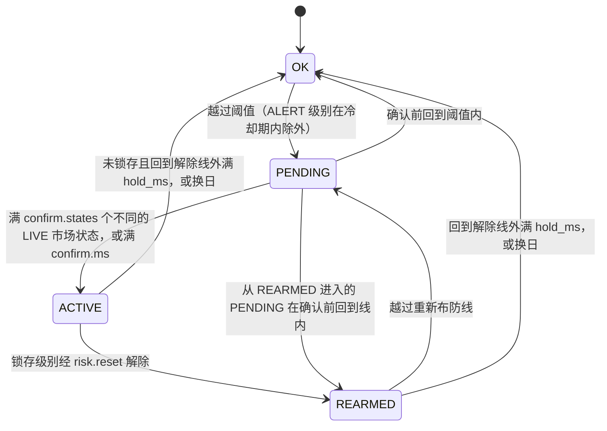
*这张图回答：一个风控规则级别在什么条件下触发、确认、解除和重新布防。*

  - **解除线**：阈值 × (1 − hysteresis)，取越线方向的内侧，`hysteresis` 按规则配置；离开 ACTIVE 需要连续 `hold_ms`（默认 3s）处在解除线外；
  - **确认**：`confirm.states` 计数的是**不同的 LIVE 市场状态**：只有该账户**持仓合约**的新 LIVE tick 才算一个新状态（任一持仓合约都算，不要求是造成越线的那个合约，见 §6.3 的确认边界），成交、出入金、快照行情和只有挂单的合约的行情都只触发重新评估，不计数；`confirm.states: 0` 表示只按时间确认。熔断级别默认为 2 个状态或 1s，其他级别默认为 1，即立即确认；
  - **熔断级别在 PENDING 期间**：账户立即进入 HALTED（尚未锁存）：禁开，并撤销挂着的开仓单。确认前回到阈值内，就撤销 HALTED；已经撤掉的开仓单不会自动恢复，由策略决定是否重下。这样从越线那一刻起，账户就不会再有新的开仓成交，只有与撤单同时到达柜台的成交除外，它们照常入账。PENDING 阶段还没有告警行，账户状态变化中的 `cause_alert_key` 为空；
  - **冷却只作用于 `ALERT` 级别**：告警回到 OK 后，`cooldown_s` 之内同一级别不会再次触发，但同一规则、同一范围的更高级别越线时不受冷却限制。`RESTRICT`、`CIRCUIT_BREAK`、`LIQUIDATE` 级别每次重新越线都立即重新生效（新的 episode，一条 `ALERT_RAISED`）：对它们用冷却，等于在冷却期内关掉限制（fail-open）；
  - **REARMED**：重新布防线 = min(阈值, 重置时的值 − extra)，按越线方向取；再次越线时**同样要经过 PENDING 和确认**；
  - **episode**：每次进入 ACTIVE 加 1，写进 `alert_key`，所以同一交易日多次触发不会互相覆盖；每个 episode 只有一条 `ALERT_RAISED`；
  - **质量门控**：规则范围的行情质量不是 OK 时（账户范围按上面的容忍度判定），状态机保持不动，既不升级也不降级；正在进行的解除保持计时清零，不能跨越行情不可信的时段。确认和冷却按绝对时间计时，门控期间照样流逝，所以门控之前已经 PENDING 的熔断级别，只要仍然越线并且已满 `confirm.ms`，在质量恢复后的第一次评估（包括定时复核）就会确认，不再等新的行情状态。门控期间即使亏损越过熔断线，也不会熔断、告警或生成减仓计划，开仓只靠事前检查拦截（已知缺陷，08 §5.2）；
  - **补数区间**：设计中"只在补数区间内出现的越线写 `RETRO_BREACH` 审计记录"的影子评估（SHOULD）**未实现**（TD-13）；补数本来就不进风控，这一项只影响事后审计；
  - **热加载**：阈值在下一次评估时生效；规则或级别被删除、停用时，未锁存的状态机被丢弃（生效中的告警以 `ALERT_CLEARED` 关闭，限制解除），**已锁存的级别保留原来的规则**，HALTED 和告警都保持，直到 `risk.reset` 或换日，并写一条审计；修改一个仍然存在的已锁存级别时，状态机直接采用新定义而锁存标志不变：只改阈值或 `latch` 时仍然锁存，把动作从 `CIRCUIT_BREAK` 改掉时熔断立即失效，也不写审计（已知缺陷，§6.7、08 §5.2 KD-19）；
  - **换日**：所有实例归零，episode 从头计数；锁存按 `reset_on_day_roll`（默认为 true）解除，为 false 时锁存延续到新交易日，作为新交易日的第 1 个 episode；告警状态改为 `ROLLED`；待确认的减仓计划作废。
- **账户状态的聚合**：账户状态取所有生效级别中最严重的一个。
  - 映射关系：`ALERT` → WARNING；`RESTRICT`、系统限制（`SYSTEM:*`）、公司级限制和 kill switch → RESTRICTED；`CIRCUIT_BREAK`（PENDING 或 ACTIVE）和人工熔断 → HALTED（PENDING 时 `halted_latched=false`）；`LIQUIDATE` 不单独改变账户状态；
  - 升级立即生效，降级随状态机解除自动发生；
  - 已锁存的 HALTED 只能由 `risk.reset` 或换日解除；
  - 账户状态变化的 `cause_alert_key` 取最严重的生效级别（`CIRCUIT_BREAK` > `RESTRICT` > `ALERT` > `LIQUIDATE`，同类再按级别序号）。
- **熔断的执行保障**（02 §8.3）：
  - **撤单守护**：账户处于 HALTED 期间，重新变为工作状态的开仓单一律再撤（§6.3）；
  - **撤单复核**：`CANCEL_PENDING` 超过 5s（每发一次翻倍，最多 60s）仍无结果，用 `route.resolve` 复核后换新的 `command_id` 重发；发满 5 次记对账异常并告警，重试继续；
  - **收盘过期**：已收盘交易日的当日有效单在换日时以 `SESSION_CLOSE` 撤销并确认；柜台仍报告其在工作时记一条不阻塞开仓的对账异常；
  - kill switch 和 `BLOCK_OPEN` 类限制只拒绝新开仓，不撤已挂的单。

### 8.15 清算模型（已实现；公式出处与手算示例见 05 文档）
- **计算库**：结算是 `core/` 中的纯函数库（`core.settle_day`），全程 `Decimal`；clearing-worker 在进程池中调用它，回测调用同一份代码。
- **逐日盯市**：
  - 平仓盈亏：平今 = (平仓价 − 开仓价) × 乘数 × 手数 × 方向；平昨 = (平仓价 − 昨结算) × 乘数 × 手数 × 方向；
  - 持仓盈亏：今仓 = (今结算 − 开仓价) × …；昨仓 = (今结算 − 昨结算) × …
- **资金**：
  - 期末结存 = 期初结存 + 出入金 + 平仓盈亏 + 持仓盯市盈亏 − 手续费；客户权益 = 期末结存；
  - 保证金 = Σ 结算价 × 乘数 × 手数 × 公司保证金率（交易所费率 + 经纪商加收）；某个合约同时有按合约配置和按 `"*"` 配置的保证金率生效时，**取较高者**（与交易所的做法一致，例如节前对所有合约上调时，也会抬高本来就单独设了较高费率的合约）；
  - 可用资金：结算时 = 权益 − 保证金（当日有效的挂单在收盘时已经撤销，结算不计挂单冻结）；盘中（risk-engine 的实时账本）= 权益 − 保证金 − 挂单冻结的保证金与手续费；风险度 = 保证金 ÷ 权益。
- **第二道校验**：交易所公式与开平标志无关，按 `[Σ(卖价−S)·卖量 + Σ(S−买价)·买量 + (P−S)·(昨空−昨多)] × 乘数` 计算，结果必须等于"平仓 + 持仓"之和。
- **对账检查**（每次结算都做，结果写入 `recon_checks`，03 §4.4）：资金恒等式（`EQUITY_IDENTITY`）、持仓恒等式（`POSITION_IDENTITY`）、交易所公式（`EXCH_FORMULA`）、盘中账本与结算结果（`INTRADAY_VS_SETTLE`）、各账户合计等于公司汇总（`FIRM_SUM`）、多日逐日盯市累计等于逐笔对冲累计（`MTM_VS_FIFO`），以及 EOD 的成交摘要和出入金摘要（`TRADE_DIGEST`、`CASH_DIGEST`）。资金恒等式和公司汇总检查用的是彼此独立的数据来源，不是同一组数字的重复相加。任一检查为 FAIL，本次结算进入 FAILED，不换日；例外是 `INTRADAY_VS_SETTLE`，它只给 PASS 或 WARN，分片不应答时跳过；两项摘要检查要在重新冻结的次数用完之后才记 FAIL（§6.6）。资金恒等式和公司汇总把按持仓取整到分的盈亏与未取整的交易所公式结果精确比较，导入的官方结算价不在 tick 网格上（乘出来不是整分）时会误报 FAIL（已知缺陷，08 §5.2）。
- **开平与计费**：
  - SHFE 区分平今和平昨：今仓只能用 `CLOSE_TODAY` 平，普通 `CLOSE` 按平昨处理（CTP 语义）。代码对 INE 采用同样的规则，但默认的 `products.yaml` 中没有 INE 的条目；
  - CFFEX 按"先平当日新开仓"判定是否收平今手续费，lot 的消耗顺序也配置为先平今仓（`close_style: TODAY_FIRST`），两者一致；
  - DCE 部分品种（如 j）当日开当日平时，两腿都按日内费率收取。DCE 平仓按先开先平消耗 lot（先平昨仓），所以只有**实际被消耗掉的今仓**算日内：例如有 2 手昨仓时买开 5 手、卖平 3 手，平仓消耗 2 手昨仓和 1 手今仓，只有 1 手平仓和 1 手开仓按日内费率收取。盘中先按开仓费率预提，平仓消耗今仓时补提差额，所以盘中累计与日终精确值只差逐笔取整；
  - lot 的消耗顺序（CloseStyle）与计费规则分开配置。
- **涨跌停**：按昨结算 × (1 ± 幅度) 向内取整到 tick；幅度可以按交易日生效（`limit_schedule`，例如 DCE i、m 从 20260930 起由 6% 调到 8%），sim-exchange、md-gateway 和 risk-engine 用同一个规则计算。
- **结算价**：
  - **方法**：SHFE/DCE 取全日（含夜盘）VWAP；CFFEX 股指取 14:00–15:00 的 VWAP，T 取 14:15–15:15。
  - **无成交时的回退链**（按交易所配置）：
    - SHFE/DCE：买一、卖一、昨结算三者取中位数 → 封板时取涨跌停价 → 昨结算；
    - CFFEX：逐小时向前回溯（当日最后一笔成交落在第一个交易小时内时直接用全日 VWAP）→ 全日 VWAP → 昨结算加上基准合约结算价的**涨跌点数**（基准合约今结算 − 昨结算），限制在涨跌停之内再取整到 tick → 昨结算。按中金所结算细则第四十三条，基准合约是当日有成交、离交割月最近的合约；实现按同一规则选取：同品种中当日有成交、交割月最早、并且本次结算已经定价的合约（`clearing/prices.py`）。
  - **取整**：
    - SHFE 向下取整到 tick：2026-09-18~09-24 的官方样本中，有成交的 rb/hc/cu/au 共 218 个合约日，结算价全部等于"全日 VWAP 向下取整到 tick"，四舍五入只能复现其中 114 个（`data/hist/SOURCES.md`）；
    - CFFEX 取到 tick：同期的官方样本（140 个合约日）中，结算价都落在 tick 网格上（到期合约的交割结算价除外）。日线数据复现不了最后一小时 VWAP，取整方向尚不能确定，按四舍五入实现；
    - DCE 默认四舍五入到 tick，尚未核实（RK-10）。
  - **优先级**：人工覆盖 > 官方结算价（`settle.import_official`）> 按方法计算 > 回退链。官方价在第 4 步确定结算价之后才导入的，不改变这次结算；与已用价格不同时发 `OFFICIAL_PRICE_DIFF` WARN，要用新版本重新结算（`settle.run` 带 `force_new_version`）才生效。
- **单向大边**：
  - SHFE：同一品种按**保证金金额**取较大一边，合约在最后交易日前第 5 个交易日收盘后退出单向大边；
  - CFFEX：同品种和跨品种（股指组、国债组）都适用；实物交割的国债期货在交割月前一个交易日收盘后退出，股指期货不退出；
  - DCE：不实现。
- **出入金记入哪个交易日**：由 risk-engine 按自身的 EOD 状态判定，当前交易日冻结之前记入当日；冻结之后、换日之前记入下一交易日；换日之后（即使新交易日还没开盘）记入换日后的当前交易日。所以一笔出入金既不会在 EOD 前后两边都落空，也不会被顺延到再下一个交易日。经纪商的截止时间一般是 17:00，所以生产环境**应当**把 EOD 调度安排在 17:00 之后，让两者对齐。

### 8.16 回测与规则有效性验证（已实现；方法、结果与结论见 10 文档）
- **同一个内核**：回测（`src/futrisk/backtest/`）用 `InprocBus` 加同一个 `EngineCore` 和同一个结算库回放历史数据，风控规则、事前检查和结算的代码与实盘相同，不启动任何服务。与实盘不同的地方：撮合由进程内的模拟交易网关完成（按价格点全部成交，没有部分成交）；内核的周期定时器（快照、指标采样、柜台对账）关闭；`block_open` 方案只启用日亏损规则。每次运行写一份清单（manifest），记录配置哈希、数据哈希（逐个文件核对 `data/hist/manifest.json`）、随机种子、git SHA（没有 git 时记 nogit；exe 中记可执行文件的哈希）和代码哈希，并标明运行期间代码是否被改动，保证结果可复现。每个方案（D 层为每个剧本的每个方案）是一次独立的回放，在 `spawn` 进程池中并行，结果与进程数无关。
- **逐日循环**：每个交易日依次执行：
  1. `EngineCore` 用当日的 SOD 换日：状态机归零，锁存按配置解除；
  2. 按时间顺序回放当日行情，策略的委托走同一条事前检查，由进程内的模拟交易网关撮合；A 层用下文"日内路径"合成的价格点，D 层用剧本给定的价格；
  3. 收盘后确定结算价：A 层用官方结算价；D 层按 §8.15 的方法从回放的数据中计算；
  4. 调用结算库，得到当日的结算结果和下一日的 SOD，然后进入下一个交易日。
- **数据分层**：
  - A：2015-01-05 至 2026-09-24 共 2852 个交易日的逐合约日线（`data/hist/daily/`）：SHFE、CFFEX 的结算价来自交易所；DCE 主力合约的结算价来自新浪（每个品种约 204~207 天只能估算），非主力合约的结算价按（最高价 + 最低价）÷ 2 取整到 tick 估算，用到估算值的账户日单独标出；
  - D：合成的剧本，正确结果已知，可以精确断言（`config/backtest/breaker_synthetic.yaml` 覆盖验收场景的全部断言）。
- **日内路径**（A 层）：按"开盘价靠近哪个极值就先走哪个"合成开 → 近端极值 → 远端极值 → 收，同一时段的合约同时到达各自的极值；一段的涨跌幅较大时加密价格点，保证亏损逐步越过阈值。一个日线对应多条可能的路径，所以 A 层的结果是"在这个路径模型下"的结论。
- **配对实验**：同一份数据、同样的策略，只换规则：`no_rules`（不启用规则）对比 `block_open`（生产的日亏损规则：限制下单加熔断禁开，题目要求的动作）。策略是一个在每个行情状态上计算的双均线（`dual_ma`，占位策略），按初始资金定仓位，所以两个方案的差值只来自规则。统计各方案的收益、最大回撤、最差单日、各级别的触发天数和被拒的开仓，以及规则生效日当天和次日两个方案的盈亏之差。
- **规模**：默认配置 `default` 回放 A 层全期（2852 个交易日）的 5 个账户、两个方案；用时见 10 文档。
- **对账**：每个交易日做结算库的五项检查（资金恒等式、持仓恒等式、交易所公式、公司汇总、逐日盯市与逐笔对冲）和成交摘要（内核冻结时的摘要对比模拟交易网关，只比条数和 SHA-256），不一致只计数，回放继续。实盘中的"盘中账本与结算结果对比"在回测中没有做。
- **精简说明**：完整版（git 标签 `v0.1-full`）还有 B 层分钟线、C 层自录 tick、随机路径集合、安慰剂与减仓档位、压力窗口、阈值扫描和自助法置信区间；精简版为控制代码规模删除了这些，只保留回答题目所需的"历史回放 + 规则对比 + 验收剧本"。

### 8.17 生产级能力清单
回答 task.md "设计说明"第 6 问：一个生产级风控系统还应具备哪些能力。状态的含义："本期交付"指已经实现并有测试；"部分交付"指只实现其中一部分；"设计"指已写入设计，由部署环境保证；"技术债"指本期不做，但已给出方案，见第 11 章。逐项论证见 09 文档。

| 能力 | 本期状态 | 说明 |
|---|---|---|
| 事前风控不可绕过 | 本期交付 | 所有委托必须经过 risk-engine；trade-gateway 只接受 risk-engine 的路由，并独立执行 kill switch（§5.3.3）。调用方身份在 CURVE 启用之前是自报的（TD-02） |
| 失效即安全 | 本期交付 | 风控、行情、成交流、结算任一环节不可用，都转为禁开；下单链路可用时平仓照常（§8.5）。已知例外：最后一个行情源连着却不出新行情时不会降级（08 §5.2） |
| 崩溃即重启 | 本期交付 | 提交失败或内核异常后毒化进程，不带着可疑状态继续运行（§8.6） |
| 熔断、kill switch 与公司级限制 | 本期交付 | 账户级熔断和公司级控制，任何重启后都保持；删除或停用规则、只改阈值的热加载都不解除锁存，把已锁存级别的动作从 `CIRCUIT_BREAK` 改掉会使熔断失效（已知缺陷，08 §5.2 KD-19；§6.7、§8.14）；公司级规则的机制已实现，默认配置中没有启用（§5.3.1） |
| 不丢事实、不重复处理 | 本期交付 | outbox、序号补齐、幂等键（§8.4） |
| 以柜台为准的对账 | 本期交付 | 盘中每 5 分钟对一次持仓（连续两次不一致才判为异常）；EOD 时成交做三方核对（本地副本、trade-gateway、风控），出入金做两方核对（本地副本、风控）（02 §8.7、§8.4；本文 §6.6） |
| 审计与权限 | 本期交付 | 人工操作全部记录操作者、角色、原因和前后状态；API key 加四种角色；请求体、WS、认证失败都有限额（§8.8） |
| 配置变更管控 | 本期交付 | 不可变版本快照、两阶段提交、审计（§6.7）；品种参数和交易日历不能热加载，要停机后离线提交（TD-09） |
| 备份与恢复 | 本期交付 | 每日 `VACUUM INTO` 备份和恢复流程（03 §8）。成交、委托等事实的 RPO 为 0，因为可以从柜台和 outbox 补回；单个服务崩溃后秒级自动重启（risk-engine 带 1 万笔成交的冷启动中位数 1.75s、最慢 1.78s，13 §3）；整机从备份恢复为分钟级（未实测） |
| 多环境隔离 | 本期交付 | home 身份校验：同一台机器上的两套系统互不误操作（§5.3.6、§8.8） |
| 性能基线 | 部分交付 | 延迟和吞吐目标写进质量场景，完整版的 `futrisk bench` 记录测量条件并判定是否达标，结果保留在 13 文档（§8.12、§10.2）；负载下的 tick→判定和下单往返尚未达标 |
| 可观测性 | 部分交付 | 已有心跳指标、结构化日志、`status` / `doctor` 命令、仪表盘和 webhook；生产环境还应接入指标平台和告警平台（TD-07） |
| 部署 | 本期交付 | Windows exe（带 17 项冒烟测试的构建脚本）和 docker compose（§7.1、§7.2）；生产环境的主机布局见 §7.3 |
| 时钟同步 | 设计 | 业务时间一律取交易所时间戳；生产主机应当用 NTP/PTP 同步，并监控本地接收时间与交易所时间的偏差。时间戳晚于接收时刻 1s 以上、或延迟超过 3s 的行情本来就不算 LIVE（§8.13） |
| 高可用 | 技术债 | 风控主备 + 租约切换（TD-01） |
| 传输加密与身份认证 | 技术债 | ZeroMQ CURVE、HTTPS（TD-02） |
| 双人复核 | 技术债 | 熔断重置、kill switch 关闭、结算价覆盖应当由第二人批准后才执行（TD-06） |
| 真实交易所接入 | 技术债 | CTP 行情与交易适配器只预留了接口（§3.2） |
| 强制减仓的自动执行 | 技术债 | 本期只生成减仓计划并由风控经理确认，确认后手工下平仓单（TD-08） |
| 补数区间的事后审计 | 技术债 | `RETRO_BREACH` 影子评估未实现（TD-13） |
| 大结果集查询 | 技术债 | 查询应答没有分页（TD-10） |
| 交割、组合保证金 | 不在范围 | TD-03 |

---

## 9. 架构决策

以下为 MADR 格式的摘要；如需展开，再拆成 `docs/adr/` 下的独立文件。"状态"一列标明决策是否仍然有效；被修订的决策保留原决策的记录。精简版删除的功能（性能基准工具、研究级回测、md-gateway 的价格尖刺隔离和 1 分钟 K 线等）没有对应的 ADR，删除记录见附录 B。

| 编号 | 决策 | 背景 | 后果 / 备选 | 状态 |
|---|---|---|---|---|
| ADR-001 | 采用 Python 3.12 全栈 | 一周工期；清算和报表生态完善；用户熟悉 | 性能靠多进程和基准测试保证；否决了 C++ 全栈（风险高）和 Java（本机没有 JDK） | 有效；基准工具 `futrisk bench` 只在 `v0.1-full` 中（13） |
| ADR-002 | 按故障域拆成 6 个服务，一致性域不拆，风控按账户分片 | 单体存在故障域耦合、GIL 干扰，无法独立扩展 | 多了进程管理和消息契约的成本；否决了更细的微服务拆分（会引入分布式一致性竞态） | 有效 |
| ADR-003 | 使用无 broker 的 ZeroMQ + msgspec/msgpack | 需要低延迟、无单点、能打进 exe | 投递可靠性需要自己用 seq、快照、重放和 outbox 实现；否决 Kafka（太重）、Redis Streams（需要单独部署）、NATS（国内生态弱） | 有效 |
| ADR-004 | 同步内核 + 服务外壳 | 实盘和回测需要结果一致，并且方便测试 | 内核禁止 I/O 和系统时间；外壳负责执行 Effect | 有效 |
| ADR-005 | 事务性 outbox，事实流可以重放 | PUB/SUB 会丢消息；事实不能丢 | 每个有事实流的服务都有 outbox 表，序号由永不清理的计数表分配，库带流 ID；订阅方要处理跳号、尾部缺口和流 ID 变化 | 有效 |
| ADR-006 | 以累计成交量作共享时钟，LIVE/BACKFILL 分流 | 部分数据源没有 seq；补数不能触发信号 | 录制和风控走两条路径；新浪数据只有在成交量增加时才能推进 LIVE | 有效 |
| ADR-007 | 熔断：立即禁开并撤销开仓挂单，确认后锁存 | 既要做到"达到阈值即禁开"，又不能让单个坏点锁死账户 | 增加了 HALTED 的待确认子状态；待确认被撤销时，已经撤掉的挂单不会恢复；可以把确认条件配置成 1，变成立即锁存。确认的第二个状态可以来自任一持仓合约，所以只有在确认之前被纠正的坏点才不会锁存（§6.3、08 §5.2） | 有效；确认的局限见 §6.3 |
| ADR-008 | 日亏损按昨结起算的盯市总盈亏计算 | 纯浮亏可以被绕过 | 与经纪商看到的口径一致；保留 `floating_only` 选项 | 有效 |
| ADR-009 | 清算用 Decimal，盘中用 float | 清算要精确，前台要速度 | 用对账测试兜底两种口径的一致性 | 有效 |
| ADR-010 | 每服务一库，使用 SQLite WAL（可迁移到 PostgreSQL） | 零运维；库的归属清晰 | 跨库没有外键，改用逻辑引用加对账（03 §6） | 有效 |
| ADR-011 | 数据源：两路异构模拟源 + 新浪 | 7×24 可演示、可以注入故障；同时也要有真实数据 | 模拟源的字段对齐 CTP；新浪实现为可选的第三个源（默认关闭）和真实 tick 的录制来源；由 sim-exchange 转发新浪价格的 live 档未实现（TD-12） | 有效 |
| ADR-012 | 仪表盘用 Vue3 SPA + CQRS 读模型 | 需要实时推送，且与后端解耦 | 运行方不需要 Node。api-gateway 的读模型可以随时重建，但通知和配置协调是有状态的，所以本期只运行单实例（TD-05） | 有效 |
| ADR-013 | 自研轻量 supervisor | 单机演示，需要一键拉起和崩溃自动重启 | 生产环境换成 systemd 或 K8s；docker 部署中只管市场时钟（ADR-021） | 有效 |
| ADR-014 | 委托回报和成交合并为每个账户一条有序流 `td.exec.{account_id}` | 两者分开发布时，终态回报可能先于成交到达 | 消除乱序；clearing-worker 只取其中的成交 | 有效 |
| ADR-015 | EOD 未完成时使用临时日初快照（只能平仓），正式快照到达后重新定基 | 既要失效即安全，又不能让账户在新交易日无法减仓 | 需要实现重新定基（重放当日成交）；换日后重新结算也复用这套机制 | 有效 |
| ADR-016 | 配置采用不可变的版本快照，外加持久化提交决定的两阶段提交 | 原地修改文件、参与者超时自行放弃，都会导致各服务配置不一致 | 启动时只加载已提交的版本；参与者通过 `config.decision` 查询决定；只能重启生效的改动在 prepare 阶段被否决，要停机后用 `futrisk config commit` 离线提交，默认部署中品种参数和交易日历只能这样修改（§6.7、TD-09） | 有效 |
| ADR-017 | 演示模式用"本机时间 + 共享偏移"的市场时钟，与生产共用同一份交易日历 | "永远开市"的日历与交易时段、夜盘归属、结算价时间窗、临时快照触发等规则冲突 | 需要 `sys.clock` 和一套"暂停、跳转、恢复"的流程（02 §8.8）；换来的是演示与生产走同一套时段逻辑 | 有效 |
| ADR-018 | 高频写入用 `synchronous=NORMAL`，关键事务逐次落盘 | 下单往返的延迟目标容不下每条委托都 fsync | 断电时可能丢失最后几条高频写入，靠 trade-gateway 和柜台补回；主机非正常重启后重新生成流 ID，订阅方重新核对（03 DB-03、DB-11） | 有效 |
| ADR-019 | 两个可信源在同一成交量上价格不一致时只记 `MD_INTEGRITY`，**不投票、不按优先级取舍**；后到的状态不发布，先到的状态保持水位 | 两个源都可信时无法判断谁错；按优先级取舍会让一个出错的高优先级源把正确的源排除掉，错误价格直接进入风控 | 冲突只影响同一成交量上的那个状态，下一笔成交自然推进水位；代价是先到的错误价格可能已经发布，由风控侧的多状态确认把关（§8.13、§8.14） | 有效（2026-10-07 修订）。原决策（v0.6~v0.7）：两个可信源冲突时暂停该合约的 LIVE（冲突保持），质量降为 STALE、禁开，等第三个源、同源自相矛盾或更高成交量上重新一致来裁决；随 md-gateway 精简废止 |
| ADR-020 | 崩溃即重启：写库提交失败或内核异常后，risk-engine 先毒化自己，再退出重启 | 提交失败之后内存状态与库已经不一致；继续运行可能发出没有落库依据的路由、发布或回复 | 失败那一批命令回可重试的 `UNAVAILABLE`，此后不再有任何副作用；依赖 supervisor 快速重启和确定性恢复（§8.6） | 有效 |
| ADR-021 | docker 部署时进程交给容器编排，supervisor 以"只管时钟"模式运行 | 容器里再套一层进程管理，会与编排的重启策略冲突；市场时钟又必须只有一个所有者 | docker 中没有 `svc.*` 进程控制（回 `PRECONDITION_FAILED`），用 `docker compose restart`；各容器共享一个 home 身份；sim-exchange 启动时向 supervisor 取时钟，取不到就退出重试（§7.2） | 有效 |
| ADR-022 | 冷却只作用于 `ALERT` 级别 | 对限制下单、熔断、减仓级别使用冷却，等于在冷却期内关掉限制（fail-open） | 限制类级别每次重新越线都立即重新生效，产生新的 episode；告警级别在冷却期内不重复告警，升级不受冷却限制（§8.14） | 有效 |
| ADR-023 | 行情质量 = LIVE 流是否跟得上市场，而不是"有没有可信源在线" | 一个停止更新的可信源仍然"在线"，合约会一直显示 OK，而市场已经在其他源上变化了 | 任何已连接的源（包括不可信的）出示比水位新 5s 以上的新信息，就判为 LIVE 流落后，按落后时长计时降级；宁可多降级（保守）（§8.13）。没有任何源出示更新的状态时无从判断：最后一个源连着却不出新行情，质量仍保持 OK（08 §5.2） | 有效；没有第二个源时的边界见 §8.13 |
| ADR-024 | 公司级规则层以完整状态的事实（`RULE_STATE`）发布 | `ctl.snapshot` 对每个主题只保留最新一条消息；增量式的控制消息无法只凭最新一条恢复 | 消费方收到后整体替换自己的规则层，最新一条事实就足以恢复；人工 kill switch 仍用单独的开关消息，两种来源互不覆盖（§5.3.1、02 §7.6） | 有效 |

---

## 10. 质量需求

### 10.1 质量树概览

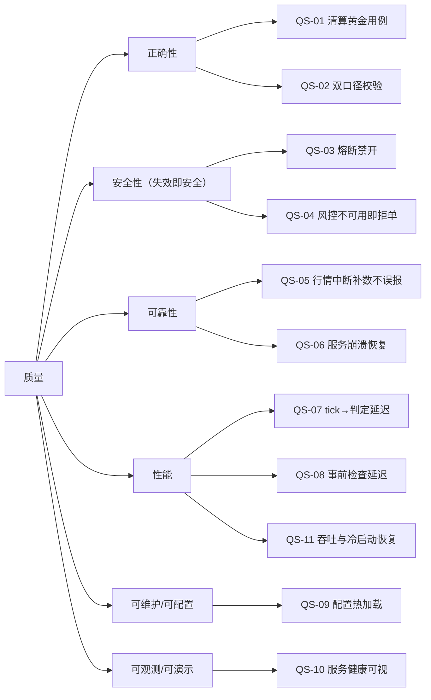
*这张图回答：各项质量目标如何分解成可以验证的场景。*

### 10.2 质量场景

"度量"一列是设计目标，保持不变；"实测 / 验证"一列给出验证它的测试，或者带测量条件的实测值。性能数字来自 2026-09-26 在 git 标签 `v0.1-full`（除 2026-10-07 重写的 md-gateway 外，被测代码与精简版相同）上的一次完整 `futrisk bench`（开发笔记本，13 文档）；下单往返按 risk 库 `synchronous=NORMAL`（03 DB-03）测量。测试的执行结果（含端到端验收的实测数字）见 06 §6、§7。

| ID | 质量属性 | 场景（刺激 → 环境） | 期望响应 | 度量（目标） | 实测 / 验证 |
|---|---|---|---|---|---|
| QS-01 | 正确性 | 运行 3 组多日黄金用例 | 权益、保证金、手续费、风险度逐项相等 | 误差为 0 分 | `tests/golden/test_clearing_golden.py`：3 组多日案例，外加 CFFEX 平今 FAQ、DCE 日内两腿、SHFE 向下取整、封板回退等规则用例，逐分精确比对 |
| QS-02 | 正确性 | 随机生成多日成交序列 | 逐日盯市累计等于逐笔对冲累计；交易所公式结果等于"平仓 + 持仓" | hypothesis 1000 例全部通过 | `tests/property/test_clearing_properties.py`：8 条清算性质，**每条 200 例**（固定种子），低于目标的 1000 例；风控状态机不变量的性质测试为 1000 例 |
| QS-03 | 安全性 | ACC3 单日浮亏达到初始资金的 3% → 正常运行；默认口径和 `floating_only` 口径各跑一遍 | 立即拒绝开仓，并撤销挂着的开仓单；确认后锁存；只产生 1 条告警；平仓可以通过 | 从越线到开始拒单：本轮评估内（≤ 3ms）；告警数 = 1 | 内核级：`tests/unit/engine/test_engine_acceptance.py`（两种口径、坏点撤销、按时间确认、质量门控）；多进程：`tests/e2e/test_e2e_acceptance.py`（三级告警各一次，开仓被拒、平仓成交）。拒单发生在越线的同一轮评估中（事前检查前先评估脏账户），延迟未单独测量 |
| QS-04 | 安全性 | kill risk-engine → 交易时段 | 下单被拒或超时；重启后 HALTED 仍然保持，告警不重复 | 恢复时间 < 3s；告警数不变 | e2e 测试中 `futrisk kill risk-engine-1`：supervisor 拉起后熔断保持锁存、告警键不重复、开仓仍被拒（06 §6）；`tests/unit/risk_engine/test_re_subprocess.py`（硬 kill 真实进程）。库中有 1 万笔成交时的冷启动见 QS-11 |
| QS-05 | 可靠性 | Feed A 中断 20s → Feed B 正常 | 瞬时切换；恢复后补齐缺口；补数不进风控 | 补数 N 条，重复 0 条；风险事件哈希与无故障基线一致 | e2e 测试（Feed A 断开 20s：Feed B 接续 LIVE，Feed A 经观察期恢复，缺口以 `GAP_FILLED`、0 条重复补齐，`md.tick` 不回退也不重复；06 §6）和 `tests/unit/md_gateway/test_mdg_integration.py`（切换到 Feed B 与补数）、`test_mdg_resilience.py`（两路源同时注入线路故障时 LIVE 不重复、不乱序）。"风险事件哈希与无故障基线一致"没有做成自动化测试 |
| QS-06 | 可靠性 | 所有数据源中断 30s | 5s 标 STALE，30s 标 UNKNOWN；禁开；每个合约只告警 1 条 | 期间规则状态迁移 0 次 | `test_mdg_integration.py`（STALE → UNKNOWN，每个合约一条 `MD_DOWN`，恢复后 `MD_RECOVERED`）；`test_mdg_resilience.py`（`all:` 缺口）；质量门控期间状态机不迁移由内核级测试验证 |
| QS-07 | 性能 | 1k ticks/s，50 个账户 × 20 个合约 | 跨进程 tick→判定 | p99 ≤ 3ms | p50 0.71ms、p90 1.13ms、p99 6.1ms：**未达标**，尾部来自单线程主循环中的排队（13 §4） |
| QS-08 | 性能 | 连续下单 | 进程内事前检查；下单往返 | p50 ≤ 50µs、p99 ≤ 250µs；往返 p99 ≤ 2ms | 事前检查（开仓单）p50 31µs、p99 63µs：达标；下单往返 p50 1.2ms、p99 7.6ms：**未达标**，尾部来自偶发的慢提交和测试环境（13 §4） |
| QS-11 | 性能 | 总线压测、冷启动 | 吞吐与恢复时间达标 | 总线 ≥ 10 万条/s；risk-engine 冷启动恢复 1 万笔成交 < 3s | 总线 25.7 万条/秒、冷启动恢复中位数 1.75s、最慢 1.78s（被硬杀后 1.77s）：达标。另：md-gateway 接入 1.44 万条/秒（目标 ≥ 1 万，达标；重写之前的 md-gateway，见 §8.12）；完整版研究级回测的回放吞吐见 13 |
| QS-09 | 可配置 | 修改 `risk_rules.yaml` 并调用 reload | 所有服务一起提交，或一起回滚 | 各服务心跳中的配置哈希一致 | `tests/unit/api_gateway/test_apigw_config2pc.py`、`tests/unit/runtime/test_runtime_config2pc.py`：全部提交、任一否决或超时即放弃、心跳未收敛标为 FAILED、协调者重启恢复 |
| QS-10 | 可观测 | kill md-gateway | 仪表盘显示服务状态为红 → 重启中 → 绿；相关合约显示 STALE 后恢复 | 状态变化在 3s 内反映到仪表盘 | 读模型与推送由 `tests/unit/api_gateway/` 覆盖；端到端的 3s 指标没有自动化测量，由演示检查 |

各项测试的执行结果、用时和覆盖率以 06 文档为准，本文不重复记录。

---

## 11. 风险与技术债

编号保持不变，新增的条目接在后面。

| 编号 | 风险 / 技术债 | 影响 | 应对 |
|---|---|---|---|
| RK-01 | CPython 的 GC 停顿、GIL | 尾延迟上升 | 多进程；GC 策略（`runtime/gcpolicy.py`）：启动时调高回收阈值，服务第一次进入 RUNNING 时先 `gc.collect()` 再 `gc.freeze()`，心跳中发布 GC 停顿统计 |
| RK-02 | pyzmq 在 Windows 上与 asyncio 配合的问题 | 服务无法启动 | asyncio 服务统一使用 Selector 事件循环；risk-engine 和 trade-gateway 用同步 Poller；sim-exchange 的 ROUTER 放在独立 I/O 线程 |
| RK-03 | SQLite 在写入高峰时出现锁竞争或 checkpoint 停顿 | 写入延迟 | 每库一个写线程、成组提交；写事务用 `BEGIN IMMEDIATE`，设置 `busy_timeout`；WAL checkpoint 移到后台连接（§8.10） |
| RK-04 | 结算价回退链是简化实现 | 极端情况（无成交、封板）下与交易所结果有偏差 | 文档注明简化了哪些；有官方结算价时以官方为准；支持人工覆盖 |
| RK-05 | 模拟撮合按报价成交，没有订单簿 | 成交真实性有限 | 封板时没有对手方的一侧不成交（涨停时买单、跌停时卖单）；不影响风控和清算逻辑的验证 |
| RK-06 | 前端不是用户熟悉的技术栈 | 答辩风险 | 用常规组件，先用保存的 JSON 开发页面，限定工作量 |
| RK-07 | 新浪接口没有 SLA | 真实数据中断 | 仅作可选源和录制来源；演示不依赖网络 |
| RK-08 | 真实 tick 只能在 09-28~09-30 这三个交易日录制 | 真实行情样本少（精简版已删除用它回放的 C 层回测，这一项只影响数据样本） | 录制工具（`futrisk data record`，无人值守时用 `scripts/record_forever.ps1` 崩溃后自动重启）已交付；模拟会话同样可以录制 |
| TD-01 | 主备热切换没有实现 | 风控主机故障需要重启 | 文档给出"主备 + 租约"方案 |
| TD-02 | CURVE 加密没有启用 | 只适合单机演示；总线上的调用方身份（DEALER identity）是自报的，同一主机上的恶意进程可以冒充 risk-engine 或 api-gateway | 生产部署前启用 CURVE 和白名单，身份与密钥绑定 |
| TD-03 | 交割、DCE 组合保证金、报单申报费没有实现 | 功能边界：持仓过了最后交易日照常滚动，不会进入交割 | 文档说明；没有预留专门的接口，实现时要扩展品种参数、结算库和事前检查 |
| TD-04 | 手续费、保证金是示例值 | 与交易所公告存在偏差；节前调整和节后恢复也要手工录入（DCE i、m 的节前保证金条目生效日晚了一个交易日，节后恢复条目还没有录入，见 08 §5.2） | 参数带生效日期，在 `products.yaml` 中按交易所公告手工维护；计划中的自动刷新工具（`data seed-products`）没有实现 |
| TD-05 | api-gateway 只能单实例运行 | Web 层不能横向扩展 | 把通知和配置协调拆给选主实例、库迁到 PostgreSQL 之后，才能开多副本 |
| RK-09 | 重启后的日内峰值从 1Hz 样本恢复 | 日内回撤最多低估 1 秒之内的波动 | 影响可以忽略；有需要时改为同步写峰值 |
| RK-10 | DCE 结算价的取整方式尚未核实 | 可能与交易所公布的结算价相差一个 tick | 默认四舍五入到 tick；在第 4 步之前导入官方结算价则以官方为准，之后导入的只对差异告警，要重新结算才生效（§8.15） |
| TD-06 | 熔断重置、kill switch 关闭、结算价覆盖只需一人操作 | 误操作或越权的风险 | 生产环境改为双人复核：发起人提交，另一位 RISK_MANAGER 批准后才执行 |
| TD-07 | 指标只在心跳和仪表盘中展示，没有接入指标平台和告警平台 | 无人值守时，发现问题只能依赖 webhook | 生产环境增加指标导出，接入现有的监控告警平台 |
| TD-08 | 减仓计划不自动执行 | 确认之后要靠人工下单，极端行情下反应慢 | 以后由 risk-engine 按计划分批下 IOC 平仓单，走同一条事前检查，行情质量不是 OK 时暂停；本期计划中已经给出逐合约的手数和建议价格（完整版的回测用 `halve` / `flatten` 组模拟过执行效果） |
| TD-09 | 品种参数（`products.yaml`）和交易日历不能热加载：md-gateway 在 prepare 阶段否决这类改动，一票否决使整轮放弃；即使没有 md-gateway 参与，risk-engine 的品种注册表在进程内也是固定的，新版本要到下一次进程启动才生效 | 调整保证金率、手续费、涨跌停或日历必须停机：`futrisk down`，修改 `<home>/config`，`futrisk config commit` 离线提交，再 `futrisk up`（应当在 EOD 完成之后、下一交易日第一个交易时段之前，11 §1.3）。clearing-worker 按交易日选用当天生效的配置版本 | 以后让 md-gateway 和 risk-engine 暂存新版本，在换日时切换，使"下一交易日生效"可以经热加载完成 |
| TD-10 | 查询应答没有分页：`risk.query.orders` 等一次返回整批结果 | 单个账户单日委托超过约 3,200 笔时，应答会超过 02 §4.3 规定的 1MiB 消息上限（评审估算） | 增加游标分页（仿照 `ctl.replay` 的续取方式）；历史查询按时间窗切分 |
| TD-11 | 不支持以 wheel 方式安装：默认配置和回测数据按源码目录定位 | 只能从源码目录、exe 或 docker 镜像运行（docker 镜像因此以可编辑方式安装） | 把默认配置作为包数据读取（`importlib.resources`）；历史数据目录已经可以在回测配置的 `data.dir` 中指定 |
| TD-12 | live 档（sim-exchange 用 `SinaRelay` 转发新浪价格）没有实现 | 演示时三路源不能描述同一个真实市场；新浪只能单独录制，或在真实行情部署中作为第三个源 | 在 sim-exchange 中实现转发；生产环境由 CTP 行情加新浪等厂商源组成多源 |
| TD-13 | `RETRO_BREACH` 影子评估（SHOULD）没有实现 | 只在补数区间内出现的越线没有事后审计记录（补数本来就不进风控，不影响实时动作） | 用独立的状态机实例和 `SimClock` 回放补数区间，只写审计 |
| TD-14 | 公司层的高水位只在内存中；公司级锁存没有人工解除命令 | 重启后公司层回撤从当天重新计算；公司级熔断只能等换日解除 | 把公司层高水位写入 coordinator 的库；增加需要 RISK_MANAGER 并记审计的公司级重置命令 |
| TD-15 | 完整版的研究级回测回放吞吐为 9265 tick/秒，比目标（10 万）低约 11 倍（13） | 精简版只有两个方案和确定的日内路径，不再以回放吞吐为目标 | 需要恢复路径集合、参数扫描等大规模实验时再优化：时间主要花在逐个账户的估值和规则评估、策略的逐 tick 计算上（13 §4），可以改用标量快路径估值和向量化的策略 |
| TD-16 | 部分验收度量没有自动化：QS-05 的"风险事件哈希与无故障基线一致"、QS-10 的 3s 仪表盘延迟；清算性质测试每条 200 例，低于 QS-02 目标的 1000 例 | 这些度量目前靠演示和人工检查 | 在端到端测试中加入事件哈希基线和仪表盘延迟探针；提高性质测试的例数 |
| RK-11 | 回测结论依赖合成的日内路径（A 层），属于模型条件下的结论 | 对规则有效性的结论可能过强 | 10 文档按路径模型为条件表述结论；完整版（`v0.1-full`）的路径集合、分钟线对照和安慰剂组给出过同样的结论 |
| RK-12 | 性能数字在负载较高的 Windows 笔记本上波动大 | 实测值不稳定，可能误判是否达标 | 完整版的 `futrisk bench` 记录机器信息和运行期间的 CPU 负载，报告据此注明结果偏悲观；需要时检出 `v0.1-full` 在安静的机器上复测（13 文档） |
| TD-17 | 熔断禁开不区分"换月时在新合约上重新开仓"和真正的新开仓 | 锁存当天如果恰好换月，这个品种会被迫空仓到下一个交易日（回测中 2016-11-30 ACC1 的 hc1701 → hc1705，10 §4.3） | 事前检查识别换月单（同一品种、同一方向、同一委托批次内先平旧合约），锁存期间按平掉的手数放行新合约上的开仓，并写审计 |
| RK-13 | 2026-10-08 按代码核对时确认的缺陷，主要有：事前 what-if 不计在途开仓单，`risk.reset` 后仍按原阈值判断；账户范围的行情质量门控期间不熔断、不告警；最后一个行情源连着却不出新行情时不降级；熔断确认的第二个状态可以来自任一持仓合约；质量门控期间确认计时照常流逝；热加载修改已锁存的级别会解除锁存；规则级别的 `params` 不校验；`accounts.yaml` 的 `products` 不参与风控；非整分的官方结算价使恒等式检查误报 FAIL；只有 risk-engine 的日常维护避开交易时段 | 风控在边界情形下比本文描述的设计目标宽松或误报，各条的影响见 08 §5.2 | 在 08 §5.2 的已知缺陷表（KD-01~KD-24）中跟踪；本文在相关章节逐处注明（§5.3.1、§6.3、§6.7、§8.5、§8.9、§8.10、§8.13、§8.14、§8.15、§8.17） |
| RK-14 | md.db 的迁移在 2026-10-07 的 md-gateway 精简中重新基线为版本 1；同一次精简从 `feeds.yaml` 的 `arbitration` 中删除了 6 个参数 | 用更早版本创建的 md.db 校验和不符，md-gateway 拒绝启动；旧 home 的配置版本仍带着这些参数，配置模型拒绝多余的键，服务无法加载配置 | 升级时先移走旧的 md.db（§8.10）：水位和续传游标从头建立；旧的行情事件和缺口台账不再可查；结算价输入可以从 tick 文件重新计算。再从 `<home>/config/feeds.yaml` 删除这些参数，用 `futrisk config commit` 离线提交（08 §5.2） |

---

## 12. 术语表

| 术语 | 英文 / 标识 | 说明 |
|---|---|---|
| 逐日盯市 | mark-to-market | 每日收盘后按当日结算价对持仓重新估值并结算盈亏 |
| 结算价 | settlement price | SHFE/DCE 为全日成交量加权平均价；CFFEX 为最后一小时 VWAP |
| 昨结算 | pre-settlement | 上一交易日结算价，是昨仓的盯市基准 |
| 平今 / 平昨 | close today / close yesterday | 平掉当日新开的仓 / 平掉以前的仓；SHFE 要求在委托中显式区分 |
| 今仓 / 昨仓 | today / yesterday position | 当日开的仓 / 以前开的仓（日终滚仓时今仓转为昨仓） |
| 单向大边 | big-side margin | 同一品种（CFFEX 还包括跨品种组）双向持仓时，只按保证金较大的一边收取 |
| 风险度 | risk degree | 保证金占用 ÷ 客户权益 |
| 静态权益 / 动态权益 | static / dynamic equity | 上日结存 + 当日出入金 / 静态权益 + 平仓盈亏 + 盯市盈亏 − 手续费 |
| 日初快照 | SOD snapshot | 结算后生成，是下一交易日的起点：账户资金 + 以昨结算价为成本基准的 lot |
| 交易日 | trading day（td） | 夜盘归属于下一交易日 |
| 熔断 | CIRCUIT_BREAK / HALTED | 禁止开仓，只允许减仓；锁存后只能由人工重置或换日解除 |
| 限制下单 | RESTRICT | 不锁存的部分或全部开仓限制 |
| 锁存 | latch | 熔断确认后保持生效，不会随指标恢复而自动解除 |
| episode | episode | 同一交易日内，同一规则、同一级别、同一范围第几次进入 ACTIVE，是 `alert_key` 的一部分 |
| 水位 | watermark（wm） | 每个合约最后一个 LIVE 状态的 `order_key` |
| LIVE / BACKFILL | — | 可以进入风控的实时状态 / 只用于补全数据的状态 |
| 可信状态 | TRUSTED / PROBATION / EXCLUDED | 数据源的可信状态 |
| 最新值流 / 事实流 | LV / FACT | 可合并、丢失时用快照追平 / 不可丢失、可重放 |
| outbox | transactional outbox | 与业务数据在同一事务中写入的待发布消息表 |
| saga | saga | 跨服务、分步骤、可恢复的长流程，本系统中指 EOD 结算 |
| 分片 / coordinator | shard / coordinator | 按账户划分的 risk-engine 实例 / 负责公司层汇总的分片（分片 0） |
| 排序键 / 指纹 | order_key / fingerprint | 用累计成交量为行情状态排序 / 按快照关键字段计算的哈希，用于跨源去重 |
| 交叉校验投票 | VOTE / NO_VOTE | 两个源在同一成交量上最新价不一致时的处理：一方可信、另一方不可信时，对不可信的一方投票（`VOTE`）；两方都可信或都不可信时只记事件（`NO_VOTE`），后到的状态不发布 |
| 规范 tick | canonical tick | md-gateway 把一个交易日各源的 LIVE 和 BACKFILL 原始 tick 合并去重得到的日文件 `ticks/canonical/<td>.parquet`，结算价输入从它计算 |
| 进程化身 / 流 ID | epoch / stream | 进程每次启动时生成的 ID / 库的 ID（断电后或从备份恢复时重新生成），分别用于识别 LV 序号和 FACT 序号的重置 |
| Clone 模式 | Clone pattern | ZeroMQ 指南中的"快照 + 增量"模式：后加入的订阅方先取快照，再应用序号更大的增量 |
| 全局熔断开关 | kill switch | 全公司禁止开仓。人工开关由 api-gateway 下发到每个分片和 trade-gateway，公司级规则也可以触发（`risk.control.firm`）；两种来源分开记录，任一来源开启即生效 |
| 预估检查 | what-if | 事前检查第 8 步：按"当前持仓 + 本单"预估参与事前检查、会禁开的规则级别是否越线，只拒绝越线并且使指标变差的委托（不计在途的开仓单） |
| 质量容忍度 | quality_stale_tolerance | 账户范围的行情质量判定：非 OK 持仓的名义占总名义不超过这个比例（默认 0.10）时，账户范围的规则仍按最后已知的标记价评估 |
| 读写分离 | CQRS | 命令发给所属服务，查询由 api-gateway 的读模型提供 |
| 十进制字符串 | DecStr | 消息中精确金额和价格的编码方式（02 §4.3） |
| 平仓消耗顺序 | CloseStyle | 平仓时先消耗哪些 lot（先开先平，或先平今再平昨），与平今计费规则分开配置 |
| 赫芬达尔指数 | HHI | 集中度指标，1/HHI 就是有效品种数 |
| 重新布防 | REARMED | 锁存级别经人工重置后的状态，亏损再扩大时会以新 episode 再次触发 |
| 墓碑 | tombstone | trade-gateway 在 `route.resolve` 或 `route.cancel` 遇到从没收到过的委托时写入 `route_tombstones` 的记录，之后迟到的同一委托一律拒绝（`ROUTE_LOST`）。到达时已过期或被 kill switch 拒绝的路由不写墓碑，而是在 `routed_orders` 中记为 `EXPIRED` |
| 临时日初快照 | PROVISIONAL | 下一交易日开盘时仍未换日（EOD 未完成），risk-engine 用自己的日终状态构建的快照，此时只能平仓 |
| 重新定基 | rebase | 换成新的日初快照版本后，重放当日成交，重算账本与指标 |
| 业绩权益 | perf_equity | 权益减去累计净入金，回撤和净值都按它计算 |
| 失效即安全 | fail-safe | 系统或数据失效时，转入保守状态（禁开） |
| 影子账本 | shadow ledger | 本系统维护的账本，以柜台为准定期对账 |
| 覆盖 / 跟得上市场 | coverage / current | 行情质量的判定依据：LIVE 流没有落后于任何源出示的新信息，且有可信源正在及时提供该合约 |
| 毒化闩 | poison latch | risk-engine 提交失败或内核异常后置位的标志：此后不再发出任何副作用，进程退出重启 |
| 只管时钟模式 | clock-only mode | supervisor 只维护市场时钟、不管理进程的运行方式，用于 docker 部署 |
| 离线提交 | offline commit | 系统停止时用 `futrisk config commit` 把 `<home>/config` 工作目录直接提交为新的生效版本，用于不能热加载的配置改动 |
| home 身份 | home_id | 一个运行时数据目录的稳定标识，用来避免误操作另一个 home 中占用同一端口的进程 |
| 钉住 | pin | 结算运行把日初快照版本、配置版本、成交摘要、结算价写入运行记录，恢复执行时复用，不随外部变化 |
| 多日追赶 | CATCH_UP | 已进入临时快照、站在更晚交易日上的分片，逐日接收较早交易日的正式快照，只记录、不改变当前状态 |
| 迟到事实 | late fact | 结算之后才到达本地副本的成交或出入金，发 WARN 事件，由操作员决定是否重算 |
| 最小总敞口门槛 | min_gross_pct | 规则只在总名义敞口占权益的比例不低于该值时评估，低于时视为不适用 |
| 撤单守护 | halt guard | 账户熔断期间，把重新变为工作状态的开仓单再撤一次 |
| 规则层完整状态 | RULE_STATE | coordinator 发布的公司级控制事实，一条就携带规则层的全部状态，消费方整体替换 |

---

## 附录 A 需求可追踪性

"验证"一列列出自动化测试（`tests/` 下的路径）或其他证据；端到端验收测试 `tests/e2e/test_e2e_acceptance.py` 简写为 **E2E**。测试方案、执行结果与覆盖率见 06 文档。

| task.md 条目 | 本文章节 | 接口 / 数据 | 验证 |
|---|---|---|---|
| 约束：数据源方案合理，并说明设计理由 | §1.4、§8.13、ADR-011 | 02 §9.1–9.3 | 09 文档的论证；`tests/unit/md_gateway/`（含新浪解析，基于抓包样本） |
| 约束：提交可编译运行的完整项目 | §7.1（构建与运行）、§7.2、§8.11 | — | `scripts/build_exe.ps1` 的 17 项冒烟测试（含中文路径）；docker compose |
| 提交：代码（含注释）、技术文档、测试方案、可执行文件 | §8.11（测试层次、代码规范）、§7.1；README 文档索引（06 测试方案、12 代码导读） | — | `dist/futrisk-win64-<version>.zip` + SHA-256；06 文档 |
| 提交：说明文档（使用说明、代码说明、分析） | README 文档索引（07、09、10、12） | — | — |
| 提交：截图或视频；现场演示与问答 | §4（可演示）、§7.1；README（项目根目录的快速开始） | 02 §9.5、§9.6 的 `/demo/*` | `futrisk demo --scenario breaker`（E2E 用的就是这条命令） |
| 行情接入：至少 2 个行情源，说明选择理由 | §1.4、§8.13、ADR-011 | 02 §9.1–9.3 | E2E（Feed A 断开时由 Feed B 接续）；`tests/unit/md_gateway/test_mdg_sources.py` |
| 行情接入：更新频率与数据格式自行设计 | §1.4、§8.13 | 02 §7.1 `Tick`、§9.1 | `tests/unit/md_gateway/test_mdg_normalizer.py`、`tests/unit/sim/` |
| 行情接入：中断恢复后补全缺失数据，不产生重复或错误的风险信号 | §6.4、§8.13、§8.14、QS-05/QS-06 | 02 §4.6、§9.1；03 §4.1 | E2E（`GAP_FILLED`、0 条重复、LIVE 不回退不重复）；`test_mdg_integration.py`、`test_mdg_resilience.py`、`test_mdg_arbiter.py`、`test_mdg_seqtracker.py`、`test_mdg_validator.py` |
| 持仓：开仓与平仓记录 | §5.3.1、§8.1 | 02 §7.4、§7.5；03 §4.3 `fills`、§4.4 `close_details` | `tests/unit/core/test_core_lots.py`、`tests/golden/` |
| 持仓：按账户和品种维度查询 | §5.3.5 | 02 §6.3 `risk.query.positions`、§9.6 `/positions` | `tests/unit/api_gateway/test_apigw_rest.py`；CLI `futrisk positions` |
| 持仓：数据来源与更新机制 | §1.4、§8.1、§5.3.3 | 02 §7.5、§8.7 | `tests/unit/trade_gateway/`、`tests/unit/engine/test_engine_orders.py` |
| 持仓：多账户汇总与独立核算 | §5.2、§5.3.1、§8.1、§8.11 | 02 §7.6 `FirmSnapshot`；03 §4.3、§4.4 | 性质测试"账户相互独立"（`tests/property/`）；`tests/unit/engine/test_engine_firm.py` |
| 盘中风控：资金维度（账户净值、最大回撤、当日盈亏）和持仓维度（单品种敞口、集中度）的指标 | §8.14 | 02 §7.6 `AccountMetricsView` | `tests/unit/engine/test_engine_metrics.py` |
| 盘中风控：指标选择与阈值设定 | §1.4、§8.14（默认阈值及理由） | — | 04 文档；回测（10 文档） |
| 盘中风控：告警 / 限制下单 / 熔断，以及熔断的实现方式 | §1.4、§6.3、§8.14、ADR-007、ADR-022 | 02 §7.6、§8.3、§11.2 | `tests/unit/engine/test_engine_rules_sm.py`、`test_engine_pretrade.py`、`test_engine_properties.py` |
| 验收："某账户单日浮亏达到预设阈值（如初始资金的 3%），系统自动触发熔断，阻止该账户继续开仓" | §1.4、§6.3、§8.14、ADR-008、QS-03/QS-04 | 02 §7.6、§8.3、§11.2 | **E2E**（三级告警、开仓被拒、平仓成交、kill 后熔断保持）；`tests/unit/engine/test_engine_acceptance.py`（两种口径）；回测 D 层 `breaker_synthetic` |
| 盘后：逐日盯市（盈亏结算、保证金核算） | §6.6、§8.15 | 02 §7.8；03 §4.4 | E2E（EOD 自动结算、全部对账检查通过）；`tests/golden/`、`tests/property/`、`tests/unit/clearing/` |
| 盘后：风控日报（盈亏汇总、风险敞口、关键指标）及其格式 | §5.3.4 | 03 §5.3 | E2E（日报与结算单生成）；`tests/unit/clearing/` |
| 附加项：回测 | §8.16 | 03 §4.4 `backtest_runs`、§5.2 | `tests/unit/backtest/`；10 文档 |
| 附加项：可视化仪表盘 | §5.3.5 | 02 §9.7 | `tests/unit/api_gateway/test_apigw_ws.py`、`test_apigw_dashboard.py`；构建脚本的仪表盘冒烟检查 |
| 附加项：配置化 | §6.7、§8.9 | 02 §7.10 | `tests/unit/api_gateway/test_apigw_config2pc.py`、`tests/unit/runtime/test_runtime_config2pc.py`、`tests/unit/cli/test_config_commit.py`、`tests/unit/md_gateway/test_mdg_resilience.py`（只能重启生效的改动被否决）；`futrisk config validate` |
| 附加项：多账户批量风控对比视图 | §5.3.5 | 02 §9.6 `/risk/compare`、§9.7 `compare` 主题 | `tests/unit/api_gateway/test_apigw_views.py` |
| 设计说明：行情格式、指标阈值、持仓来源、熔断实现 | §1.4 | — | 09 文档 |
| 设计说明：并发模型与性能 | §1.4、§5.3.1、§8.12 | 02 §8.1 | 13 文档（完整版的 `futrisk bench`）；09 文档 |
| 设计说明：生产级风控还应具备的能力 | §1.4、§8.17、§11 | — | 09 文档 |
| 考察范围：工程化（配置管理、日志系统、报表生成） | §8.7、§8.9、§5.3.4 | 03 §5.3、§8 | `futrisk status` / `doctor`；日志文件；日报 |
| 评估维度：对模糊需求的理解与补充 | §1.4 | — | 09 文档 |

## 附录 B 修订记录

| 版本 | 日期 | 说明 |
|---|---|---|
| v0.1 | 2026-09-25 | 初版：按 arc42 v9 编写，以已批准的设计方案为基线（ZeroMQ + 6 个服务） |
| v0.2 | 2026-09-25 | 根据三路独立审查（跨文档一致性、需求与方案覆盖度、技术正确性）做交叉验证后的修订：<br>1）改正当日盈亏公式（原来重复扣减了出入金）；回撤和净值改按业绩权益计算；<br>2）明确启动中、EOD 未完成、对账异常时仍允许平仓，新增临时日初快照与重新定基；<br>3）委托回报与成交合并为 `td.exec`；路由有效期与墓碑；<br>4）风控主循环的对外请求改为异步，心跳由独立线程发送；<br>5）配置改为不可变版本快照，两阶段提交先持久化决定；<br>6）kill switch 扇出到每个分片和 trade-gateway；<br>7）调整启动顺序，只等进程存活；<br>8）补充数据源仲裁规则（含自举）、告警状态机图、数据源选择理由、日报内容、品种规则结构、回测要点、各服务的并发模型；<br>9）api-gateway 改为单实例，并新增总线端点 |
| v0.3 | 2026-09-25 | 第二轮交叉验证（回归审查）后的修订：<br>1）换日时按 `eod.rollover` 中的版本取日初快照，消除与 `pushed_ns` 的互相等待；<br>2）临时日初快照的触发条件推广到连 `eod.freeze` 都没有收到的情况，进入时风控状态照常换日；<br>3）`UNKNOWN` 委托改用 `route.resolve` 确认；<br>4）kill switch 按来源分开记录，任一来源开启即生效；<br>5）`STOPPING` 拒绝一切新委托；配置放弃时先持久化决定再下发；<br>6）统一各服务发送心跳的方式；修正组件图、部署图和 sim-exchange 的存储描述；<br>7）复核后的补充：并发模型给 clearing-worker 和 supervisor 补上写库线程；临时快照期间收到的 `eod.freeze` 不改变交易模式 |
| v0.4 | 2026-09-25 | 对照 task.md 逐条做需求对齐审查后的修订：<br>1）新增 §1.4 对模糊需求的解读，逐条回答"设计说明"的 6 问；新增 §8.17 生产级能力清单；<br>2）默认阈值表增加"理由"列；资金维度增加单位净值及其规则；<br>3）熔断在首次越线时就撤销开仓挂单，不再等锁存；验收用例说明两种口径的差别，并对两种口径各测一遍；<br>4）说明两路模拟源为什么算两个行情源；补充行情频率的理由；<br>5）补充构建与运行方式、风控规则的配置示例、日志的滚动与保留、代码规范；新增 TD-06、TD-07；<br>6）重写附录 A，覆盖 task.md 的全部条目 |
| v0.5 | 2026-09-25 | 设计问题复核后的修订：<br>1）新增市场时钟，演示模式与生产共用同一份交易日历，快进改为时钟跳转（§8.2、ADR-017）；<br>2）落盘策略：高频写入用 `NORMAL`，关键事务逐次落盘；性能数字明确为设计目标（§8.10、ADR-018）；<br>3）写明首次启动的引导链：bootstrap key、加载阶段重试、建账推送（§7.1、§8.8）；<br>4）回测补上逐日循环，结算库放进 `core/` 与 clearing-worker 共用，并说明保留日线的理由（§8.16）；<br>5）减仓计划本期只生成和确认，新增 TD-08；<br>6）出入金记入交易日的措辞改为不会被读成 T+2 |
| v0.6 | 2026-09-25 | 实现对齐：以代码为准，把设计基线改写为已实现系统的说明。<br>1）各服务的职责按实现重写（§5.1、§5.3）：risk-engine 的成组提交、毒化闩、启动阶段、撤单复核与熔断撤单守护；coordinator 的 `RULE_STATE` 完整状态事实与已知限制；md-gateway 的线程与持久化；trade-gateway 的重同步暂存与撤单持久化；clearing-worker 的按日生效配置；api-gateway 的 kill switch 期望状态、时钟跳转编排与安全限额；supervisor 的端口预检、进程树心跳核对、放弃重启、home 身份和只管时钟模式；<br>2）行情容错按实现重写（§8.13）：可信状态与观察期规则、两个可信源冲突时的冲突保持、成交量跳变与未来时间戳防线、稳健 σ 尖刺隔离、水位回滚与 `FLAG_WM_RESET`、行情质量 = LIVE 流跟得上市场、`all:` 缺口；live 档标为未实现；<br>3）风控模型按实现重写（§8.14）：冷却只作用于告警级别、确认只计持仓合约的 LIVE 市场状态、只按时间确认、`min_gross_pct`、按规则的滞回、按投资授权覆盖的集中度门槛、热加载保留锁存、撤单守护与撤单复核；`RETRO_BREACH` 标为未实现；<br>4）EOD（§6.6）：钉住、回退重核、多日追赶 `CATCH_UP`、SETTLED 之后不再失败、WARN 事件；配置热加载各部分的生效时点（§6.7）；<br>5）部署（§7.1、§7.2）：exe 的打包形态和 17 项冒烟测试、docker compose 的容器、共享卷与只管时钟的 supervisor；`<home>` 目录按实现更新；<br>6）安全（§8.8）、持久化（§8.10 后台 checkpoint）、错误处理（§8.6 毒化闩）、清算（§8.15）、回测（§8.16）按实现补充；<br>7）质量场景保留目标，新增实测 / 验证一列，实测值标明测量条件并注明待基准复测（§8.12、§10.2）；<br>8）新增 ADR-019~024、TD-09~16、RK-11~12；ADR 按编号排序；附录 A 增加验证一列；术语表补充实现中出现的术语；<br>9）与 04、05 交叉核对后的修正：节前保证金上调对风险度的影响按实际收取的公司费率给出（i +22.2%、m +37.5%，原"25%~43%"是交易所费率之比）；CFFEX 无成交回退加的是基准合约的涨跌点数，并写明细则定义的基准合约；区分结算时与盘中的可用资金公式；<br>代码冻结后（2026-09-26）补充：性能实测值改用一次完整 `futrisk bench` 的结果（§8.12、§10.2 QS-07/08/11，详见 13），QS-04、QS-05 补充端到端验收测试的实测数字（06 §6） |
| v0.7 | 2026-09-26 | 范围精简（完整版保留为 git 标签 `v0.1-full`）：<br>1）删除性能基准工具 `src/futrisk/bench/`，性能实测值改为注明来自完整版的测量（§8.7、§8.12、§10.2、第 11 章、附录 A），`<home>` 目录去掉 `bench/`；<br>2）改正 RK-01 的过时描述：GC 策略已在服务第一次进入 RUNNING 时 `gc.freeze()`<br>3）回测精简为双均线配对实验（`no_rules` 与 `block_open`）加 D 层合成剧本，重写 §8.16；删除回放吞吐目标（§1.2、QS-11、§8.12），TD-15、RK-08、RK-11 按精简版改写；docker 部署中 clearing-worker 不再挂载 `ticks` 卷（§7.2）；新增回测发现的 TD-17 |
| v0.7 | 2026-10-07 | md-gateway 精简（代码从约 8400 行压到约 5000 行）：删除价格尖刺隔离、成交量跳变、前驱怀疑与剔除、双可信源冲突保持、水位回滚与补发、拒收率按最差合约剔除、切换防抖告警（MD_FLAPPING）、自举规则、1 分钟 K 线（bars_1m、md.bar.1m、md.bars）和 md.ticks；两个可信源冲突改为只记 `MD_INTEGRITY`（NO_VOTE）、后到的状态不发布；`products.yaml` 和交易日历的改动改为需重启（§5.3.2、§6.4、§6.7、§8.5、§8.13、ADR-019、第 12 章） |
| v1.0 | 2026-10-08 | 按 2026-10-08 的代码逐节重新核对，状态改为实现对齐的 v1.0：<br>1）md-gateway（§5.1、§5.3.2 重写，§6.1、§6.4、§8.6、§8.13）：按重写后的模块（`sources`、`normalizer`、`validator`、`arbiter`、`pipeline`、`trust`、`quality`、`recording` + `shards`、`settle`）重画组件图；写明定时器周期、线程分工、命令和服务状态；跳过规则补上 2026-10-08 的代码改动（轮询记录和快照中本时段还没更新过的旧快照跳过，不再拒收）；可信状态补上初始状态、追平条件，`priority` 只用于规范日文件排序；轮询源缺口在轮询恢复时以 UNRECOVERABLE 关闭；结算价输入的计算；Feed B 读取超时由 1.5s 改为 0.8s，新浪为 GB18030 文本；写明"最后一个源连着却不出新行情时质量保持 OK"的边界；<br>2）配置（§4、§6.7、§8.9、ADR-016、TD-09）：md-gateway 否决 `products.yaml` 和交易日历的任何改动，整轮热加载放弃，这类改动只能停机后用 `futrisk config commit` 离线提交；补上 prepare 超时、收敛检查、协调者恢复、放弃时的通知方式、各服务实际怎样应用提交（supervisor 不处理提交，`accounts.yaml` 只在启动时读入）；规则约束在编译时检查，`config validate` 查不出；<br>3）EOD（§6.6、§8.15、§8.17）：出入金是两方核对（clearing-worker 的本地副本与各分片 `EodFreezeAck` 的出入金摘要，比较笔数和净额），只有成交是三方核对；补拉、重新冻结与回退的规则；报表失败不发 WARN；`PRE_SETTLE_MISMATCH` 随 PRICES_FIXED 发布；md-gateway 不可用时的结算价条件；换日后重新结算的前提；日常维护只有 risk-engine 避开交易时段；官方结算价的优先级与导入时机；CFFEX 基准合约的选取与细则一致；<br>4）风控（§5.3.1、§6.2、§6.3、§6.5、§8.5、§8.14）：成组提交以一批处理为单位；心跳线程和后台线程池；毒化闩的触发条件和应答码；锁存事务不写审计行；client SDK 超时是"结果未知"并用同一委托号重发；恢复读取的表与 SOD 重试间隔；账户行情质量的 `quality_stale_tolerance`（0.10）；确认和冷却在质量门控期间照样计时；确认的第二个状态可以来自任一持仓合约；合规指标、最大品种禁开、减仓计划、胖手指、资金缓冲、自成交的准确定义；md-gateway 心跳丢失、成交流缺口、持仓对账自动关闭、coordinator 下线的实际处理；<br>5）trade-gateway（§5.1、§5.3.3、§8.5、术语表）：过期路由记为 `EXPIRED`，墓碑只写给从没收到过的委托；路由检查的顺序与位置、重同步的上限、柜台序号回退时的处理；<br>6）api-gateway、supervisor（§5.3.5、§5.3.6、§6.8、§8.2、§8.7）：Notifier 的来源、去重（至少一次）与限流参数；ClockJump 的五步和超时；权限检查的位置；只管时钟模式的启用方式；asyncio 服务阻塞会按丢失心跳处理；停机各步的等待时间；`Clock` 有三个实现；日志级别全局统一、没有逐笔行情日志；<br>7）部署与上下文（§3、§7、§5.4）：AkShare 不生成品种配置；删除无法追溯的包体大小；CLI 补 `shock`；`<home>` 补备用目录与录制锁；docker 的共享目录与 03 DB-01 一致；代码结构表补上 `scripts/`、`data/hist/`，注明 `marketdata/` 并入 md-gateway；<br>8）数字：冷启动按 13 改为中位数 1.75s、最慢 1.78s；接入速率注明测的是重写之前的 md-gateway；删除无法追溯的数字（SHFE 1856 个、CFFEX 224 个合约日，outbox 提交往返，±50% 波动，e2e 和回测用时，QS-04、QS-05 的单次运行数字改为引用 06）；§8.10 写明 md.db 在 2026-10-07 重新基线为版本 1；<br>9）ADR 表增加"状态"列，ADR-019 保留 v0.6 原决策的记录；新增 RK-13（本次核对确认的缺陷，汇总在 08 §5.2，正文逐处注明）、RK-14（md.db 重新基线）；改写 TD-03、TD-04、TD-11、TD-15、RK-05、RK-10；术语表补充交叉校验投票、规范 tick、质量容忍度、离线提交，改正墓碑、流 ID 和预估检查；修订记录按日期排序；<br>核对方法：作者逐节核对 md-gateway、部署和上下文，风控、清算与交易网关、接入与运行时三部分各由一个只读的子审查对照代码逐条核对，关键结论由作者抽查代码确认；机械核对 `scripts/check_docs.py` 对本文 0 个问题；<br>独立交叉审查（同日）复核了本版全部改动并抽样核对原有陈述，改正 13 个问题（17 处），主要是：只有 risk-engine 的日常维护避开交易时段（§8.10）、热加载修改仍然存在的已锁存级别会解除锁存（§6.7、§8.14、§8.17），以及 api-gateway 的就绪计时、读模型修复方式和 RK-13、RK-14 的缺陷指针 |
