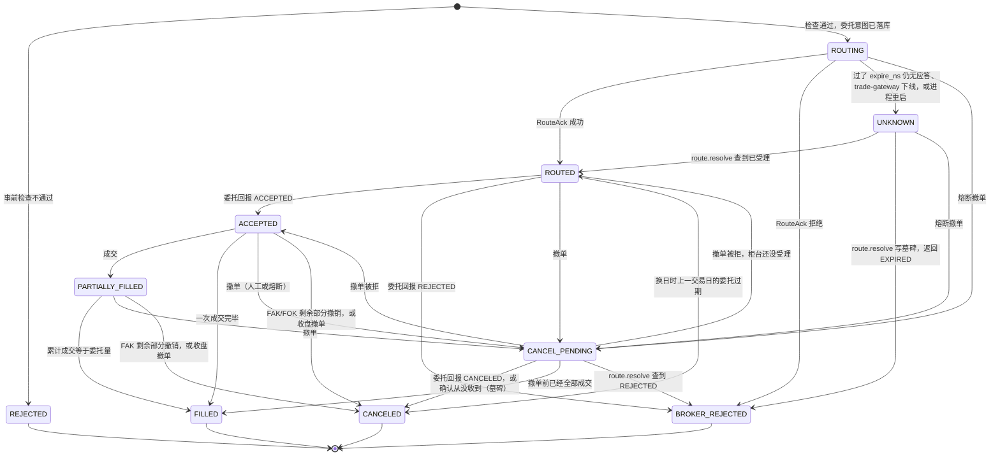

# futrisk 服务与模块间通信协议

| 项 | 内容 |
|---|---|
| 文档编号 | FR-IDD-02 |
| 版本 | v0.6（实现对齐：与代码逐项核对后的版本） |
| 状态 | 实现对齐 |
| 日期 | 2026-09-26 |
| 适用范围 | 内部总线（ZeroMQ）、外部接口（行情源、模拟柜台、控制接口、REST/WS、webhook）、进程内模块接口 |
| 对应标准 | GB/T 8567-2006 接口设计说明（IDD）；按 AsyncAPI 3.0 的要素组织（servers / channels / operations / messages / schemas）；规范性用语遵循 RFC 2119 / RFC 8174 |
| 协议版本 | 信封 `proto = 1`；全部 127 个注册负载的版本 `v = 1` |
| 代码对照 | 负载、枚举、错误码、主题：`futrisk.messages`；信封处理、白名单、超时、心跳：`futrisk.bus`；REST / WS：`futrisk.services.api_gateway`。与代码的一致性由 `scripts/check_docs.py` 机械核对（README §3.6） |
| 关联文档 | [README](README.md) · [01 架构](01-architecture.md) · [03 数据库](03-database-schema.md) |

> 本文是**主题、命令、消息类型、字段、枚举和错误码的唯一权威定义**。其他文档引用这些名称时，必须以本文为准。v0.6 起，本文的每个负载、字段、枚举值、错误码、命令、主题、REST 端点和 WS 主题都与代码一一对应，文档与代码的偏差由校验脚本发现。

## 目录
1. [范围与约定](#1-范围与约定)
2. [接口总览](#2-接口总览)
3. [端点（Servers）](#3-端点servers)
4. [内部总线协议](#4-内部总线协议)
5. [通道目录（Channels）](#5-通道目录channels)
6. [命令目录（Operations）](#6-命令目录operations)
7. [消息负载定义（Schemas）](#7-消息负载定义schemas)
8. [关键交互](#8-关键交互)
9. [外部接口](#9-外部接口)
10. [进程内模块接口](#10-进程内模块接口)
11. [错误码](#11-错误码)
12. [需求可追踪性](#12-需求可追踪性)
13. [附录：与设计方案的命名对照、修订记录](#13-附录)

---

## 1. 范围与约定
- **范围**：本文覆盖三类通信：
  - 内部服务之间的总线协议（第 4~8 章）；
  - 与外部组件的接口（第 9 章）：虚拟交易所的两路行情、新浪、模拟柜台、控制接口、REST、WebSocket、webhook；
  - 服务内部模块之间的 Python 接口（第 10 章）。
- **规范性用语**："必须 / 禁止 / 应当 / 不应 / 可以"的含义见 [README §3.2](README.md#32-规范性用语)。
- **类型记法**：负载字段的类型写法如下：
  - 基本类型：`int`（int64）、`float`（float64）、`str`、`bool`、`bytes`；
  - 十进制字符串：`DecStr`，见 §4.3；
  - 容器与可空：`list[T]`、`dict[K,V]`，以及 `T?`（可空或可省略）。
- **示例说明**：示例一律写成 JSON，但总线上的实际编码是 msgpack。
- **与代码的对应**：负载类型名就是 `futrisk.messages` 中 msgspec `Struct` 的类名；字段表的"必填"列与代码一致："是"表示代码中没有默认值，"否"表示有默认值（括号中给出），编码时等于默认值的字段不出现在线上（§4.3）。

## 2. 接口总览

| 接口 ID | 提供方 | 使用方 | 传输 | 编码 | 模式 | 章节 |
|---|---|---|---|---|---|---|
| IF-BUS-PUB | 各内部服务 | 订阅方 | ZeroMQ PUB/SUB（TCP） | msgpack | 发布/订阅 | §4、§5 |
| IF-BUS-CMD | 各内部服务 | 调用方 | ZeroMQ DEALER→ROUTER（TCP） | msgpack | 请求/应答 | §4.7、§6 |
| IF-EXT-01 | sim-exchange | md-gateway | WebSocket | JSON | 推送 + 续传/重放 | §9.1 |
| IF-EXT-02 | sim-exchange | md-gateway | HTTP GET | JSON | 轮询 | §9.2 |
| IF-EXT-03 | 新浪 hq.sinajs.cn | md-gateway | HTTP GET | GBK 文本 | 轮询 | §9.3 |
| IF-EXT-04 | sim-exchange | trade-gateway | ZeroMQ DEALER↔ROUTER | JSON | 请求/应答 + 异步回报（仿 CTP） | §9.4 |
| IF-EXT-05 | sim-exchange | api-gateway、CLI | HTTP | JSON | 请求/应答 | §9.5 |
| IF-EXT-06 | api-gateway | 浏览器、脚本 | HTTP | JSON（OpenAPI 3.1） | REST | §9.6 |
| IF-EXT-07 | api-gateway | 浏览器 | WebSocket | JSON | 订阅推送 | §9.7 |
| IF-EXT-08 | api-gateway | 通知渠道 | HTTP POST | JSON | 单向通知 | §9.8 |
| IF-MOD | 服务内部模块 | 服务内部模块 | 函数调用 | Python 对象 | Protocol 接口 | §10 |

## 3. 端点（Servers）
所有端点都在 `config/services.yaml` 中配置。下表是 `demo` 档位的默认值，其中 PUB 和 ROUTER 由服务方 bind。`docker` 档位把 `127.0.0.1` 换成容器的服务名。

| 实例 | PUB（bind） | ROUTER（bind） | 其他监听 |
|---|---|---|---|
| sim-exchange | — | — | Feed A `ws://127.0.0.1:7001/feed`；Feed B `http://127.0.0.1:7002/v1/quotes`；SimBroker `tcp://127.0.0.1:7003`（ROUTER，外部协议）；控制 `http://127.0.0.1:7004/control` |
| md-gateway | `tcp://127.0.0.1:7101` | `tcp://127.0.0.1:7102` | — |
| trade-gateway | `tcp://127.0.0.1:7201` | `tcp://127.0.0.1:7202` | — |
| risk-engine-0 | `tcp://127.0.0.1:7301` | `tcp://127.0.0.1:7302` | — |
| risk-engine-1 | `tcp://127.0.0.1:7311` | `tcp://127.0.0.1:7312` | — |
| clearing-worker | `tcp://127.0.0.1:7401` | `tcp://127.0.0.1:7402` | — |
| api-gateway | `tcp://127.0.0.1:7501` | `tcp://127.0.0.1:7502` | HTTP/WS `http://127.0.0.1:8000`（`/api/v1`、`/ws`、`/`） |
| supervisor | `tcp://127.0.0.1:7601` | `tcp://127.0.0.1:7602` | — |
| strategy-sim | — | — | 只作客户端 |

- api-gateway 的 PUB 只发布自己的心跳；它的 ROUTER 负责接收 `ctl.*` 和 `config.decision`。
- sim-exchange 和 strategy-sim 是外部组件，不接入总线心跳。supervisor 判断它们是否健康的依据是：进程是否存活，以及 sim-exchange 的 `GET /v1/health`（Feed B 端口，返回 200 且端口由 sim-exchange 自己的进程树持有）。
- `docker` 档位（`deploy/compose.yml`）：每个服务一个容器，端点改用容器的服务名；supervisor 以**只管时钟**模式运行（§6.6），进程由容器编排负责重启；所有容器通过环境变量 `FUTRISK_HOME_ID` 共用同一个 home 标识（§4.11）。

规则：
- 第 k 个 risk-engine 分片的端口是 `7301 + 10k`（PUB）和 `7302 + 10k`（ROUTER）。
- 账户所在的分片由 `config/accounts.yaml` 中的 `shard` 字段决定。命令发到错误的分片时，返回 `NOT_OWNER`。

`services.yaml` 片段示例：
```yaml
profile: demo
bus:
  heartbeat_ms: 1000
  peer_timeout_missed: 3
instances:
  md-gateway:      {pub: "tcp://127.0.0.1:7101", router: "tcp://127.0.0.1:7102"}
  trade-gateway:   {pub: "tcp://127.0.0.1:7201", router: "tcp://127.0.0.1:7202"}
  risk-engine-0:   {pub: "tcp://127.0.0.1:7301", router: "tcp://127.0.0.1:7302", shard: 0, coordinator: true}
  risk-engine-1:   {pub: "tcp://127.0.0.1:7311", router: "tcp://127.0.0.1:7312", shard: 1}
  clearing-worker: {pub: "tcp://127.0.0.1:7401", router: "tcp://127.0.0.1:7402"}
  supervisor:      {pub: "tcp://127.0.0.1:7601", router: "tcp://127.0.0.1:7602"}
  api-gateway:     {pub: "tcp://127.0.0.1:7501", router: "tcp://127.0.0.1:7502", http: "http://127.0.0.1:8000"}
```

### 3.1 进程环境变量
除了命令行参数，进程之间还通过少数环境变量传递启动参数：有的由 supervisor 在拉起子进程时设置，有的由部署环境设置。下表只列出与本文的协议有关的变量；全部环境变量（包括 CLI、docker compose 和测试使用的）见 11 §13。校验脚本要求文档中出现的每个 `FUTRISK_*` 变量都在这两张表之一中声明，并且代码确实读取它。

| 变量 | 设置方 | 读取方 | 取值与作用 |
|---|---|---|---|
| `FUTRISK_HOME` | 部署环境、CLI 使用者 | 全部服务、CLI | `<home>` 目录，优先级低于命令行参数 `--home`（01 §7.1） |
| `FUTRISK_HOME_ID` | 部署环境（docker compose 中所有容器取同一个值） | 全部服务、CLI | 覆盖 `<home>/home_id`，即 `Pong.home_id`、`ServiceList.home_id` 和 `/health` 中报告的 home 标识（§4.11） |
| `FUTRISK_CLOCK_VERSION` | supervisor（拉起 sim-exchange 时） | sim-exchange | 市场时钟的版本（`ClockState.version`），与命令行参数 `--clock-offset-ns`（市场时间减本机时间）一起给出（§8.8） |
| `FUTRISK_SIM_CLOCK_WAIT_S` | 部署环境 | sim-exchange | sim-exchange 不是由 supervisor 拉起（例如每个服务一个容器）而配置中有 supervisor 时，等待 supervisor 应答 `sys.clock` 的秒数，默认 60；等不到时以退出码 1 退出，由重启策略再次尝试（§8.8） |
| `FUTRISK_SUPERVISOR_CLOCK_ONLY` | 部署环境 | supervisor | 取 `1`、`true`、`yes` 或 `on` 时，supervisor 以只管时钟模式运行（§6.6），与 `futrisk up --clock-only` 相同 |
| `FUTRISK_BOTS_MODE`、`FUTRISK_BOTS_SEED`、`FUTRISK_BOTS_ACCOUNTS` | supervisor（`SvcRequest.env`、`futrisk up --svc-env`；`futrisk demo --scenario` 设置 `FUTRISK_BOTS_MODE=scenario`） | strategy-sim | 机器人的模式（`aggressive`、`breaker` 或 `scenario`）、随机种子、只运行哪些账户（如 `ACC3,ACC5`）。它们是 `SvcRequest.env` 唯一允许覆盖的变量（§6.6） |

---

## 4. 内部总线协议

### 4.1 套接字模式与连接拓扑
- **发布**：每个内部服务 bind 一个 PUB 套接字，用来发布事件；订阅方用 SUB 套接字 connect 到它需要的发布方，并按主题前缀订阅。
- **命令**：每个内部服务 bind 一个 ROUTER 套接字，用来接收命令；调用方用 DEALER 套接字 connect。DEALER 的 identity **必须**设为调用方的实例 ID（如 `risk-engine-1`），供 §4.11 做身份校验。
- **不设中心 broker**：订阅方直接连接发布方，没有单点。

**订阅矩阵**（前缀订阅；带 `{...}` 的是按账户逐个订阅）：

| 订阅方 | 发布方 | 订阅的主题前缀 |
|---|---|---|
| risk-engine-k | md-gateway | `md.tick.`、`md.status`（LV，后加入方式：先 `ctl.snapshot` 再接实时，§4.6）；`md.event`（FACT，起始策略 `FROM_NOW`） |
| risk-engine-k | trade-gateway | `td.exec.{本分片账户}`（FACT，`FROM_BEGINNING`）。**不订阅** `td.status`：trade-gateway 是否可用以它的心跳为准（§4.8），柜台断开时 `route.order` 直接返回 `REJECT_GATEWAY_UNAVAILABLE`（§6.4） |
| risk-engine-0（coordinator） | 其他分片 | `risk.snapshot.`（LV，后加入方式），外加各分片的 `sys.heartbeat.{实例}`，用来判断分片数据是否新鲜（§7.6 `FirmSnapshot.shards`） |
| 其他 risk-engine-k | risk-engine-0 | `risk.control.firm`（FACT，`FROM_BEGINNING`；超出重放窗口或换库时改用 `ctl.snapshot` 取最新一条，§7.6 `FirmControl`） |
| trade-gateway | risk-engine-0 | `risk.control.firm`（FACT，`FROM_BEGINNING`；公司级规则触发的 kill switch；人工 kill switch 另由 api-gateway 直接下发） |
| clearing-worker | trade-gateway | `td.exec.`（FACT，`FROM_BEGINNING`；只处理其中的 `Trade`） |
| clearing-worker | 所有 risk-engine | `risk.cash.`（FACT，`FROM_BEGINNING`） |
| api-gateway | md-gateway | `md.tick.`、`md.bar.1m.`、`md.status`、`md.event`（读模型，全部按后加入方式处理） |
| api-gateway | trade-gateway | `td.exec.`、`td.status`（读模型） |
| api-gateway | 所有 risk-engine | `risk.`、`oms.order.`、`sys.dayroll`（读模型） |
| api-gateway | clearing-worker | `sys.eod`、`clearing.settled`、`report.ready`、`backtest.status`（读模型） |
| api-gateway | supervisor | `sys.service`（读模型） |
| api-gateway（通知服务） | 所有 risk-engine、md-gateway、clearing-worker、supervisor | `risk.event`、`md.event`、`sys.eod`、`sys.service`（FACT，`FROM_NOW`，游标记在 api.db 的 `fact_cursors`，§9.8） |
| 所有内部服务 | supervisor | `sys.clock`（市场时钟；只有演示模式的偏移不为 0，§8.8） |
| api-gateway、supervisor | 所有内部服务 | `sys.heartbeat.` |
| risk-engine-k | md-gateway、trade-gateway、risk-engine-0 | `sys.heartbeat.{实例}`：对端存活判定（§4.8） |
| **每个按游标消费 FACT 的订阅方**（包括 clearing-worker、trade-gateway） | 它所订阅的每个发布方 | `sys.heartbeat.{发布方实例}`：用心跳里的 `fact_heads` 检测尾部缺口、确定起始位置，用 `stream` 初始化游标（§4.5）；心跳公布的 `epoch` 和 `stream` 就是发布方当前的化身（§4.12） |
| 所有内部服务 | clearing-worker | `sys.eod`（收到 `DONE` 后执行各自的库维护，见 03 §8）。**只为触发库维护而做的这类订阅不跟踪序号、不写游标**，收到 `DONE` 就执行维护，也不需要订阅发布方的心跳；漏掉一次，最多让维护推迟一天。api-gateway 的通知服务另外按游标消费 `sys.eod`（03 §4.5） |
| strategy-sim | md-gateway | `md.tick.` |
| strategy-sim | 所有 risk-engine | `oms.order.{自己负责的账户}`、`risk.state.{自己负责的账户}`、`risk.snapshot.{自己负责的账户}`（精确主题，后加入方式） |

**命令调用矩阵**：

| 调用方 | 被调方 | 命令 |
|---|---|---|
| strategy-sim | risk-engine-k | `order.*`；`risk.query.accounts`、`risk.query.orders`、`risk.query.positions`（启动同步和补漏）；`ctl.ping`（等分片就绪） |
| api-gateway | risk-engine-k | `order.*`、`risk.reset`、`risk.halt`、`risk.ack_alert`、`risk.liquidation.confirm`、`risk.recon.resolve`、`cash.move`、`risk.query.*`（`accounts`、`positions`、`orders`、`fills`、`alerts`、`metrics`、`rules`、`recon_breaks`、`liquidation_plans`） |
| api-gateway | 所有 risk-engine、trade-gateway | `firm.kill_switch`（扇出到全部目标，逐一确认） |
| api-gateway | 所有 risk-engine | `eod.force_unfreeze` |
| risk-engine-k | trade-gateway | `route.order`、`route.cancel`、`route.resolve`、`td.query.*`（`td.query.positions` 柜台持仓对账、`td.query.trades` 补成交、`td.query.orders` 补建委托） |
| risk-engine-k | md-gateway | `md.settle_inputs`（构建临时日初快照时取临时结算价）。`md.ticks` 原计划供 RETRO 影子评估取补数 tick；RETRO 影子评估（SHOULD）暂未实现，目前没有服务调用它，只供工具和排查使用 |
| risk-engine-k | clearing-worker | `settle.sod_snapshot` |
| clearing-worker | risk-engine-k | `eod.freeze`、`eod.rollover`；`risk.query.cash`、`risk.query.accounts`（EOD 核对、日内与结算对比）；`risk.query.alerts`、`risk.query.metrics`、`risk.query.orders`（日报取数） |
| clearing-worker | trade-gateway | `td.digest`、`td.query.trades` |
| clearing-worker | md-gateway | `md.settle_inputs`、`md.events`（日报取数） |
| clearing-worker | supervisor | `svc.history`（日报取数） |
| api-gateway | clearing-worker | `settle.*`（`run`、`query`、`status`、`import_official`、`seed_sod`、`override_price`）、`report.*`、`backtest.*` |
| api-gateway | md-gateway | `md.bars`、`md.events`、`md.sources`、`md.source.set` |
| api-gateway | trade-gateway | `td.import_trades` |
| api-gateway、CLI | supervisor | `svc.*`（`futrisk down` 发送 `svc.stop{instance:"*"}`） |
| supervisor | 所有内部服务 | `ctl.shutdown`（优雅停机，只发给用自己的心跳证明存活的服务） |
| CLI | 任一内部服务 | `ctl.ping`、`ctl.status`、`ctl.shutdown` |
| sim-exchange | supervisor | `ctl.ping`、`ctl.snapshot`（启动时取得 `sys.clock`，§8.8） |
| 所有内部服务 | api-gateway | `config.decision`（参与者超时或重启后查询两阶段提交的决定） |
| api-gateway | 所有内部服务 | `ctl.config.*` |
| 任一订阅方 | 对应发布方 | `ctl.snapshot`、`ctl.replay`（补齐跳号、后加入订阅） |

- CLI 的业务命令（`positions`、`settle`、`report`、`order place`、`backtest run`，以及演示控制 `futrisk demo …`）一律通过 api-gateway 的 REST 发出（演示控制走 `/api/v1/demo/*` 代理，§9.6），以便统一走 RBAC 和审计。只有 `up`、`down`、`ps`、`kill`、`status` 这几条运维命令直接与 supervisor 通信，此时 DEALER 的 identity 为 `cli`；动手之前先核对应答中的 `Pong.home_id` / `ServiceList.home_id` 与本机 home 一致（§4.11）。`logs` 直接读取本地日志文件，不经过总线。
- **套接字选项**：
  - DEALER 设置 `ZMQ_IMMEDIATE=1`，对端没有连上时，发送直接失败，不在本地排队。否则一个几分钟前通过风控的委托，可能在对端恢复后才被送达；
  - ROUTER 设置 `ZMQ_ROUTER_HANDOVER=1`，允许同一 identity 的客户端在重启后重新接管连接；
  - 所有套接字都在专门的 I/O 线程里使用，禁止跨线程共享（§8.1）。

### 4.2 帧格式与信封
- **PUB 消息**：两帧 `[topic, envelope]`。
  - 第 1 帧是 UTF-8 编码的主题，供 ZeroMQ 做前缀过滤；
  - 第 2 帧是 msgpack 编码的 `Envelope`；
  - 接收方**必须**校验第 1 帧与 `Envelope.topic` 一致，不一致就丢弃并计数。
- **命令**：
  - DEALER 只发一帧 `[envelope]`；
  - ROUTER 收到的是 `[identity, envelope]`；
  - ROUTER 按原 `identity` 回复 `[identity, envelope]`。

`Envelope` 字段（v1）：

| 字段 | 类型 | 必填 | 说明 |
|---|---|---|---|
| `proto` | int | 否（1） | 信封版本，当前为 1 |
| `topic` | str | 是 | PUB 消息为主题；请求为命令名（如 `order.submit`）；应答为"命令名 + `.reply`" |
| `type` | str | 是 | 负载类型名（PascalCase），如 `Tick`、`Reply` |
| `v` | int | 否（1） | 负载 schema 版本，取自负载类型的注册版本 |
| `src` | str | 是 | 发送方实例 ID |
| `epoch` | str | 是 | 发送方进程化身 ID（UUIDv7，每次进程启动时生成） |
| `stream` | str? | FACT 必填 | 发送方数据库的流 ID，即 03 §4.0 `db_meta.stream_id`。数据库新建或从备份恢复时，都会生成新的流 ID。LV 消息和命令中为 null |
| `seq` | int | 否（0） | PUB 消息为按 `(src, topic)` 计数的序号（§4.5）；请求和应答固定为 0 |
| `ts_ns` | int | 是 | 发送时刻（UTC ns）。FACT 消息取 outbox 的 `created_ns`，即市场时间（03 §4.0） |
| `td` | str? | 否 | 所属交易日 `YYYYMMDD` |
| `corr_id` | str? | 否 | 关联 ID：请求/应答中是请求 ID（UUIDv7）；事件中是业务关联键（`client_order_id`、`alert_key` 等） |
| `payload` | bytes | 否（空） | msgpack 编码的负载（第 7 章）。实际上总有值：没有字段的负载（如 `Ping`）也编码为一个空 map |

信封与负载一样按"等于默认值就省略"编码（§4.3），所以 `proto = 1`、`v = 1`、请求和应答的 `seq = 0` 在线上通常不出现，接收方按默认值补齐。`proto` 不是 1 的信封，发送方会显式写出，接收方据此拒收（§4.10）。

### 4.3 编码规则
- **序列化**：使用 msgspec 的 `Struct`。编码成 **map**（带字段名），不用 array，方便以后演进。
- **省略默认值**：所有负载和信封都以 `omit_defaults=True` 编码，等于默认值的字段不写到线上（例如 `Trade.origin = INTERNAL`、`RiskEvent.detail = {}`）。因此"必填 = 否"的字段在线上可能不存在，接收方**必须**按本文给出的默认值补齐，**禁止**把"字段不存在"解读为别的含义。
- **未知字段**：接收方**必须**忽略未知字段；缺失的可选字段按默认值处理。
- **`DecStr`**：规范十进制字符串，**禁止**使用指数和 `+` 号，小数点用 `.`，例如 `"202744.06"`、`"-2560"`、`"0.000023"`。以下场景必须使用 `DecStr`：
  - 进入清算的金额，如出入金、结算结果；
  - 需要精确比对的价格，如结算价、日初快照（SOD）中的价格。
- **float**：行情价格、盘中估值和风控比率用 float64，与 CTP 的 double 一致。接收方把它转成 Decimal 时，**必须**用 `Decimal(str(x))`。
- **时间**：
  - 字段名以 `_ns` 结尾的，是 UTC 纪元纳秒（int）；
  - `trading_day` / `action_day` 是 `YYYYMMDD` 字符串；
  - 交易所本地时间在进入系统时换算成 UTC。
- **枚举**：UPPER_SNAKE 字符串，取值见 §7.3。收到未知枚举值时，**必须**按"无法处理"记录，**禁止**猜测它的含义。
- **大小**：单条消息**不应**超过 1 MiB；`ctl.snapshot` 和 `ctl.replay` 的结果按 `limit` 分页返回（快照另按约 900 KB 一页截断，§7.2）。已知的例外：`risk.query.*` 的应答不分页，单个账户一天超过约 3,200 笔委托时，`risk.query.orders` 的应答会超过 1 MiB（技术债，见 01 第 11 章）。
- **请求哈希**：幂等去重用的 `request_hash` 全系统只有一个算法（`futrisk.messages.base.request_hash`）：把负载转成规范 JSON（键排序，`bytes` 写成十六进制）后取 SHA-256，**只在顶层**去掉请求自身的时间字段 `sent_ns`、`requested_ns`、`ts_ns`、`received_ns`。所以只刷新了 `sent_ns` 的重试仍是重复请求，而嵌套数据中的时间照常参与比较（例如两次 `td.import_trades` 只差成交的 `received_ns`，按 `CONFLICT` 处理）。

### 4.4 主题命名
- **语法**：`topic := domain "." category ["." key]`，键只能放在最后。
- **允许的 domain**：`md`、`td`、`risk`、`oms`、`clearing`、`report`、`backtest`、`sys`。
- **key 的取值**：合约代码、账户 ID 或实例 ID，取值不得包含 `.`。
- **前缀匹配陷阱**：ZeroMQ 按前缀过滤，订阅 `td.exec.ACC1` 也会收到 `td.exec.ACC10` 的消息。所以订阅方收到消息后，**必须**再按完整主题精确过滤一次；账户 ID **应当**定长。
- **命名空间**：命令名和主题名分属两个命名空间。
  - 通用控制命令统一用 `ctl.` 前缀；
  - 主题中的 `sys.` 前缀只用于系统事件。

### 4.5 可靠性等级与序号

| 等级 | 含义 | 发布方 | 丢失后的处理 |
|---|---|---|---|
| **LV**（最新值） | 每条消息都是完整状态，后到的覆盖先到的 | 在内存中缓存每个主题的最新一条（last-value cache） | 跳号时直接用最新的；epoch 变化或长时间静默时，发 `ctl.snapshot` 追平 |
| **FACT**（事实） | 不可丢失的业务事实，按顺序处理 | **必须**先在同一事务中写入业务表和 outbox（03 §4.0），提交后再发布 | 跳号时缓冲后续消息，用 `ctl.replay` 补齐缺失区间后再依序处理 |
| **CMD**（命令） | 点对点请求 | — | 超时后带同一幂等键重试（§4.7） |

**序号规则**：
- `seq` 按 `(src, topic)` 独立计数，从 1 开始，每条消息加 1。
- FACT 主题的 `seq` 就是 outbox 中的 `topic_seq`，由**永不清理**的计数表 `outbox_topics` 分配（03 §4.0）。它**跨进程重启持续递增**，也不会因为 outbox 按保留期清理而回退。
- FACT 消息带 `stream`。订阅方发现同一 `(src, topic)` 的 `stream` 变了（发布方的库是新建的，或者从备份恢复过），就把 `expected` 重置为收到的 `seq`，然后用领域查询核对这段时间的数据（§8.2）。订阅方没有提供领域核对时，从新流的 seq 1 开始重放（业务键保证重复应用无害）。
- LV 主题的 `seq` 在每个 epoch 从 1 重新开始。
- **`epoch` 和 `stream` 是否"变了"，以发布方心跳公布的值为准**，不比较 UUIDv7 的大小（§4.12）。
- 订阅方为每个 `(src, topic)` 维护期望序号 `expected`：
  - `seq == expected`：应用；
  - `seq < expected`：重复，丢弃；
  - `seq > expected`：
    - LV：直接应用，不补中间的；
    - FACT：进入补数流程（§8.2）。
  - LV 的 epoch 变化时：把 `expected` 重置为收到的 `seq + 1`，并请求快照。
- **尾部缺口**：只有收到更靠后的消息时，才能发现前面缺了消息。为了发现最后几条的丢失，发布方在心跳的 `fact_heads` 中公布本服务各 FACT 主题当前的最大 seq（§7.9）。订阅方发现自己的 `expected ≤ head` 时，主动调 `ctl.replay` 补齐。
- **起始位置**：订阅方第一次订阅某个 FACT 主题、还没有游标时，先从发布方的心跳中取得 `stream` 和 `fact_heads`，再按各自配置的起始策略处理：
  - `FROM_BEGINNING`：从 seq 1 开始重放，重放窗口内的都能补到。clearing-worker 订阅 `td.exec.*` 和 `risk.cash.*` 时用这种；
  - `FROM_NOW`：从心跳公布的 `head + 1` 开始。api-gateway 的通知服务订阅 `risk.event` 时用这种，以免把历史告警重新发一遍。
  - 还没有收到发布方的心跳时，先缓冲收到的消息，等第一个心跳到达（最多一个心跳周期）再确定起始位置。`FROM_NOW` 的起始位置取 `head + 1` 与缓冲区中最小 seq 两者的较小值，所以等心跳期间收到的消息不会丢。游标在应用第一条消息时连同 `stream` 一起写入 `fact_cursors`。

### 4.6 快照与重放（Clone 模式）
- **`ctl.snapshot`**：返回发布方最新值缓存中、与前缀匹配的每个主题的最后一条消息（信封原样返回，带 `seq` 和 `epoch`）。LV 和 FACT 主题都适用：FACT 主题返回的是它当前的最新状态消息，例如 `risk.state.ACC3` 的最后一条。发布方重启后，FACT 主题的缓存先用 outbox 中每个主题的最新一行填好，所以重启之后立即就能快照到 FACT 主题。
  - 前缀以 `.` 结尾时匹配其下的所有主题，否则是精确主题（与 §4.4 的精确过滤一致）；
  - 结果按主题字典序分页：每页最多 `limit` 条（默认 500，最大 1000）、约 900 KB，`next_cursor` 是本页最后一个主题。
- **`ctl.replay`**：只适用于 FACT 主题，按 `topic_seq` 从 outbox 中读取，并分页返回（`limit` 默认 500，最大 1000）。不是 FACT 主题或区间不合法时返回 `BAD_REQUEST`。
  - 如果请求区间的开头已经按保留期清理掉，返回 `NOT_FOUND`，应答的 `data` 仍是 `ReplayBatch`，其中 `next_seq` 是仍然保存着的第一个序号（整段都已清理时为 `to_seq + 1`）。订阅方只对已清理的部分 `[from_seq, next_seq − 1]` 做领域补齐，其余部分照常重放。这时订阅方**必须**改用领域查询补齐（例如 `td.query.trades`），补齐后把 `expected` 设为缺口末尾的下一个序号，再继续处理缓冲区（§8.2）。各订阅方的处理方式：
    - risk-engine：`td.exec.*` 主题记一条**不阻塞开仓**的对账异常（`REPLAY_EXPIRED`，03 §4.3 `recon_breaks`），并发出 `risk.event`（kind 为 `RECON_BREAK`，detail 中带 `break_id` 和缺失区间），供人工复核。其他主题（`md.event`、`risk.control.firm` 等）不涉及账户，改用 `ctl.snapshot` 或领域查询补齐后只记日志；
    - clearing-worker：只记日志，由 EOD 第 3 步的三方核对兜底，核对不一致时 EOD 失败；
    - api-gateway：记日志，并在仪表盘的"行情与系统"页给出系统告警。
- **后加入的订阅方**必须按下面的顺序操作：
  1. 先 SUB 并开始缓冲收到的消息；
  2. 调用 `ctl.snapshot`；
  3. 应用快照，并把每个主题的 `expected` 设为快照 `seq + 1`；
  4. 依序应用缓冲中 `seq ≥ expected` 的消息；
  5. 进入正常处理。

### 4.7 请求-应答
- **请求**：
  - `Envelope.topic` 填命令名，`type` 填请求负载类型，`corr_id` 填新生成的请求 ID（UUIDv7）；
  - 会修改状态的命令，**必须**在负载中带幂等键，各命令用哪个键见第 6 章的"幂等键"一列，共五类：
    - `client_order_id`：下单；
    - `command_id`：人工命令和撤单；
    - `movement_id`：出入金；
    - `config_version`：配置提交；
    - `(trading_day, version)`、`(next_trading_day, sod_version)`：EOD 两个命令。
  - 前三类记在 `processed_commands` 表（03 §4.0），后两类记在各自的状态表中（`config_versions`、`eod_states`）。
- **应答**：`topic` 为"命令名 + `.reply`"，`type = "Reply"`，`corr_id` 与请求相同。

`Reply`（v1）：

| 字段 | 类型 | 必填 | 说明 |
|---|---|---|---|
| `ok` | bool | 是 | 是否成功 |
| `code` | str | 否（`OK`） | 成功时为 `OK`，否则为错误码或拒单码（第 11 章） |
| `message` | str? | 否 | 人类可读的说明 |
| `data_type` | str? | 否 | `data` 的负载类型名 |
| `data` | bytes? | 否 | msgpack 编码的结果负载。失败的应答也可以带 `data`，例如拒单时的 `OrderAck`、`NOT_FOUND` 时的 `ReplayBatch` |
| `duplicate` | bool | 否（false） | 这个请求的幂等键此前已处理过时为 true，此时返回的是首次处理的结果 |
| `retry_after_ms` | int? | 否 | 仅在返回 `BUSY` 或 `RISK_BUSY` 时给出，表示建议的重试间隔 |

- **服务端的校验顺序**（`futrisk.bus.rpc_server`，任何一步失败就立即应答）：
  1. 信封无法解码：`BAD_REQUEST`；
  2. `proto` 不受支持：`VERSION_UNSUPPORTED`；
  3. 调用方的 DEALER identity 不在白名单内：`FORBIDDEN`（§4.11）；
  4. 没有注册这个命令：`BAD_REQUEST`；
  5. 负载不能按注册的类型解码，或者类型与命令不符：`BAD_REQUEST`；
  6. 待处理的积压超过上限：`BUSY`（risk-engine 的 `order.*` 为 `RISK_BUSY`），带 `retry_after_ms`。

  处理函数抛出异常时应答 `INTERNAL`，并记录日志。

- **超时默认值**：

  | 命令 | 超时 |
  |---|---|
  | `order.*` | 500ms（客户端视角） |
  | `route.*` | 1s |
  | `ctl.snapshot`、`ctl.replay` | 5s |
  | `eod.*`、`settle.*` | 30s |
  | `ctl.config.prepare` | 5s |
  | 其他 | 2s |

- **重试**：只重试 `TIMEOUT`、`UNAVAILABLE`、`BUSY`、`RISK_BUSY`。间隔为 100ms × 2ⁿ 再加 0~50ms 的抖动（服务端给出的 `retry_after_ms` 更大时用它），最多 3 次，重发的是同一份负载字节和同一个 `corr_id`，所以**必然**带同一个幂等键。对端没有连上时每次尝试立即失败（`ZMQ_IMMEDIATE=1`），3 次重试之后约 1.1s 得到 `UNAVAILABLE`；需要快速失败的调用（例如健康探测、临近 `expire_ns` 的 `route.order`）不重试。`route.order` 只能在它的 `expire_ns` 之前重试，过期后的处理见 §8.3。
- **服务端去重**：会修改状态的命令，其结果要写入 `processed_commands`（03 §4.0），收到重复请求时返回首次结果，并置 `duplicate=true`；同一个幂等键带着不同的内容再来，返回 `CONFLICT`。查重、业务写入和记录结果放在**同一个写库事务**里，并发到达的重复请求等待第一个请求的结果。`order.submit` 以 `client_order_id` 去重：如果同一个 ID 带着不同的**业务内容**再次提交，返回 `REJECT_DUPLICATE_ORDER_ID`。`client_order_id` **永久唯一**：已经被更早交易日的委托用过的 ID 再提交，同样返回 `REJECT_DUPLICATE_ORDER_ID`，`reject_detail` 为 `{trading_day}`（那笔委托所在的交易日）。判断内容是否相同时，用的是 `request_hash`（§4.3）：它只对业务字段计算，不含 `sent_ns`、`requested_ns` 这类时间字段。
- **顺序**：单线程服务按收到的顺序处理同一个 DEALER 发来的请求，不同调用方之间不保证顺序。
- **下单的特殊规则**：`order.submit` 在委托意图**落库并完成路由**之后才应答，但不会等 trade-gateway 确认。委托后续的状态统一通过 `oms.order.{account_id}` 推送。

### 4.8 心跳与存活检测
- **发送**：每个内部服务每 `heartbeat_ms`（默认 1000ms）发布一次 `sys.heartbeat.{instance}`（LV，负载为 `Heartbeat`，见 §7.9）。心跳不经过业务主循环发送（见下文"发送心跳的线程"），所以主循环再忙也不会漏发；心跳里带上 `loop_lag_ms`，即主循环上次完成一轮距今的时间。
- **下线判定**：连续 `peer_timeout_missed`（默认 3）个心跳周期收不到对端心跳，就判定对端下线，并采取对应的失效安全措施（01 §8.5）：
  - risk-engine 发现 md-gateway 下线：所有合约的行情质量视为 STALE，禁止开仓；
  - risk-engine 发现 trade-gateway 下线：新委托返回 `REJECT_GATEWAY_UNAVAILABLE`。
  - **本端卡顿不误判**：判定下线之前，同步服务先读空系统套接字（卡顿期间到达的心跳照样计入）；本端主循环卡顿超过下线判定时长之后，再宽限一个心跳周期才判定任何对端下线。真正停掉的对端最多晚一个周期被发现。
- **重启**：supervisor 发现以下三种情况之一时，按指数退避（`backoff_initial_ms` 1s → `backoff_max_ms` 30s，稳定运行 `stable_reset_s` 60s 后复位）重启服务，原因写进 `ServiceStateChanged.reason`。
  - **进程退出**（`EXITED`）：立即发现，按退避重启；
  - **心跳中断**（`HEARTBEAT_LOST`）：连续 3 个周期收不到心跳，判定进程挂起，先终止再重启；
  - **主循环卡死**（`LOOP_HANG`）：`loop_lag_ms` 连续 2 个心跳超过 `hang_threshold_ms`（默认 30s），先终止再重启。
  - **放弃**（`GAVE_UP`）：5 分钟内失败 5 次（`svc.kill` 造成的退出不计入），supervisor 停止重启该服务（状态 `FAILED`），直到人工 `svc.start` / `svc.restart`。
  - 只认自己拉起的进程：心跳的 `pid` 必须是 supervisor 拉起的进程或其子孙进程，其他进程（例如另一个 home 中占用同一端口的服务）发出的心跳一律忽略。
  - 慢操作只会抬高 `loop_lag_ms`，不会触发重启。这里说的慢操作包括重放、快照、EOD 等；risk-engine 的对外请求都是异步的（§8.1），不会阻塞主循环。
- **发送心跳的线程**：risk-engine 和 trade-gateway 使用同步主循环，心跳由独立的发布线程发送。其他服务是 asyncio 服务，心跳由事件循环中的定时任务发送；这些服务**禁止**在事件循环中执行阻塞操作，阻塞工作一律交给线程池或进程池。
- **心跳里的 `state`**：
  - `STARTING`：加载阶段拒绝一切委托，预热阶段只允许平仓（§8.6）；
  - `RUNNING`：正常；
  - `DEGRADED`：部分依赖不可用；
  - `STOPPING`：正在停机，拒绝一切新委托。

### 4.9 背压与 HWM

| 套接字 | 高水位（HWM） | 超过后的行为 |
|---|---|---|
| md-gateway PUB | SNDHWM 100k | 丢给慢订阅者。`md.tick` 是 LV，丢了不影响；`md.event` 是 FACT，丢了靠重放补 |
| 其他服务的 PUB | SNDHWM 10k | 同上 |
| risk-engine 的行情 SUB | RCVHWM 10k | 每轮读空并按合约只保留最新值 |
| risk-engine 的 ROUTER | RCVHWM 1k | 待处理的命令超过 1k 时，下单直接返回 `RISK_BUSY` |
| 其他服务的 ROUTER | RCVHWM 1k | 返回 `BUSY` |
| 关闭套接字时 | FACT 发布方 `LINGER` 1000ms；其他为 0 | 保证停机前事实消息发出去。即使来不及发出，重启后也会从 outbox 补发 |
| 所有 DEALER | `ZMQ_IMMEDIATE=1` | 对端没有连上时立即失败，不在本地排队（§4.1） |
| 所有 ROUTER | `ZMQ_ROUTER_HANDOVER=1` | 同一 identity 的客户端重启后可以重新接管连接 |

### 4.10 版本与兼容
- **`proto`**：信封版本。它一旦变化，所有服务必须同时升级；收到不支持的版本时，回复 `VERSION_UNSUPPORTED` 并丢弃。
- **`v`**：负载版本，按负载类型各自计数。
  - 新增**可选**字段是向前兼容的，`v` 不变；
  - 删除字段、改变字段语义、新增必填字段，都必须把 `v` 加 1。
- **过渡期**：发布方在过渡期内**应当**同时支持 N 和 N−1 两个版本；接收方**必须**至少支持 N−1。
- **公告**：每个服务在 `Heartbeat.versions` 中公布自己支持的版本范围：每个注册负载一项 `[最小, 最大]`，本期全部为 `[1, 1]`。

### 4.11 安全与身份
- **监听地址**：演示环境只 bind `127.0.0.1`。生产环境启用 ZeroMQ CURVE 加密，并用 ZAP 做身份认证，把 identity 与公钥绑定。
- **ROUTER 白名单**：以下命令只接受白名单内的 DEALER identity 发来的请求，否则返回 `FORBIDDEN`。

  | 命令 | 允许的调用方 |
  |---|---|
  | `route.order`、`route.cancel`、`route.resolve` | `risk-engine-*` |
  | `eod.freeze`、`eod.rollover` | `clearing-worker` |
  | `eod.force_unfreeze`、`firm.kill_switch`、`risk.reset`、`risk.halt`、`risk.ack_alert`、`risk.liquidation.confirm`、`risk.recon.resolve`、`cash.move`、`settle.override_price`、`settle.import_official`、`settle.seed_sod`、`td.import_trades` | `api-gateway` |
  | `order.submit`、`order.cancel`、`order.cancel_all` | `strategy-sim`、`api-gateway` |
  | `md.source.set`、`settle.run`、`backtest.run` | `api-gateway` |
  | `config.decision` | 所有内部服务实例 |
  | `svc.start`、`svc.stop`、`svc.restart`、`svc.kill` | `api-gateway`、`cli` |
  | `svc.clock` | `api-gateway` |
  | `ctl.shutdown` | `supervisor`、`cli` |
  | `ctl.config.*` | `api-gateway` |

- **白名单的实现**：`futrisk.bus.whitelist.WHITELIST`。表中没有列出的命令对所有调用方开放（例如各种查询和 `ctl.ping`）；`ctl.config.*` 中的 `*` 匹配任意后缀；"所有内部服务实例"指 `services.yaml` 中配置的全部实例。
- **RBAC**：由 api-gateway 执行。api-gateway 转发的人工命令里带有 `actor`（操作者）和 `role`（角色），下游服务对敏感命令**必须**再校验一次 `role`，不满足时返回 `FORBIDDEN`：
  - 要求 `RISK_MANAGER` 或 `ADMIN`：`risk.reset`、`risk.halt`、`risk.ack_alert`、`risk.liquidation.confirm`、`risk.recon.resolve`、`firm.kill_switch`（risk-engine 和 trade-gateway 都校验）、`eod.force_unfreeze`、`settle.override_price`；
  - 要求 `ADMIN`：`cash.move`、`settle.import_official`、`settle.seed_sod`、`td.import_trades`。
- **home 标识**：同一台机器上可以有多个 home（`<home>` 目录），各自运行一套服务。为了不误操作别的 home 的进程，每个进程都知道自己 home 的 `home_id`（`<home>/home_id` 文件；环境变量 `FUTRISK_HOME_ID` 可以覆盖，docker 档位让所有容器共用一个值）：
  - `ctl.ping` 的应答 `Pong` 带 `home_id` 和 `pid`；心跳的 `detail.home_id` 同样公布它；
  - supervisor 的 `ServiceList` 带 `home_id`；api-gateway 的 `GET /health` 返回 `home_id`、`pid`、`epoch`（§9.6）；
  - CLI 和 supervisor 在对占用端口的进程采取行动之前，先核对 `home_id` 与本机 home 一致；不一致的一律拒绝（不停止、不终止、不当作本 home 的服务上报）。CLI 在发送 bootstrap key 之前也先核对 `/health` 的 `home_id`。

### 4.12 发布方的化身（epoch 与 stream）
`Envelope.epoch`（每次进程启动生成）和 `Envelope.stream`（每个库生成）都是 UUIDv7。它们的先后顺序取决于生成时的本机时钟，而 Windows 的时间同步可能把时钟往回调：这时重启后的发布方（或新建的库）会得到一个**更小**的 ID。所以订阅方**禁止**按 UUIDv7 的大小判断新旧，而是按下面的规则（`futrisk.bus.incarnation`）确定每个发布方当前的 `epoch` 和 `stream`：

- **心跳说了算**：发布方的心跳（§7.9 `Heartbeat.epoch`、`Heartbeat.stream`）公布它当前的化身。心跳公布了一个没见过的 ID，就立即切换到它，旧的 ID 作废。接受过这个发布方的心跳之后，带着其他 ID 的信封一律视为过期并丢弃——包括新化身在它第一个心跳之前发出的消息，它们由切换时的重新快照（LV）或重放 / 领域核对（FACT）补回。
- **防止回切**：公布已作废 ID 的心跳，通常是旧进程还排在 SUB 套接字里的最后几个心跳（新旧进程是不同的连接，心跳可能交错），忽略；只有连续 2 个心跳都公布同一个已作废的 ID 时才切回去，用来纠正错误的切换。
- **收到第一个心跳之前**：按到达顺序判断，没见过的 ID 就是新化身，替换当前的，旧的作废；已作废的 ID 视为过期。从来收不到心跳的消费方一直用这条规则。
- **切换之后**：LV 订阅方重新取快照（§4.6）；FACT 订阅方对这个发布方的每个主题执行换库处理（§8.2），还没有新流行的主题从 seq 1 开始。
- 同一个实例不可能同时有两个进程在运行（它们会 bind 同一个 PUB 端点），ID 也从不重复使用，所以被替换的化身只会通过"防止回切"规则再次成为当前化身。
- **写测试和伪造发布方时**：发布方的重启或换库必须通过心跳公布；订阅方见过它的心跳之后，只靠信封伪造的 `epoch` 或 `stream` 变化会被当成过期消息丢弃。

---

## 5. 通道目录（Channels）

发送方（AsyncAPI 中的 `send`）即表中的发布方；接收方（`receive`）见 §4.1 的订阅矩阵。频率指稳态下的频率。

| 主题 | 发布方 | 等级 | 频率 | 负载（§7） | 语义 |
|---|---|---|---|---|---|
| `md.tick.{instrument_id}` | md-gateway | LV | 每个 LIVE 状态，约每合约每秒 2 条 | `Tick` | **只发布 LIVE 规范行情**。同一交易日内，每个合约的 `order_key` 严格递增。唯一的例外是水位回退（`md.event` 的 `MD_INTEGRITY`，`detail.action = WM_ROLLBACK`）：回退后的第一个 LIVE tick 带 `FLAG_WM_RESET` 标志（§7.1），它的 `order_key` 可能不大于上一个，消费方必须照常应用并以它为新的比较起点 |
| `md.bar.1m.{instrument_id}` | md-gateway | LV | 每分钟收盘一次，修订时再发 | `Bar` | 按 `(instrument_id, minute_start_ns)` 更新，`version` 大的覆盖小的 |
| `md.status` | md-gateway | LV | 1Hz | `MdStatus` | 所有数据源的可信状态和所有合约的行情质量（全量） |
| `md.event` | md-gateway | FACT | 事件驱动 | `MdEvent` | 数据源状态变化、合约质量变化、缺口开合、坏点、交叉校验不一致、切换抖动等 |
| `td.exec.{account_id}` | trade-gateway | FACT | 由回报驱动 | `BrokerOrderUpdate` 或 `Trade`（按 `Envelope.type` 区分） | 每个账户**一条有序的执行回报流**：委托回报和**成交事实**按柜台回报序号（`broker_seq`）排序，先落库再发布。trade-gateway 自己产生的委托状态（撤销尚未报出的委托、撤单被柜台拒绝后重申的状态、会话丢失后收尾的委托、到期未报出的委托）也发在这里，其 `broker_seq` 为 0。**顺序以 FACT 的 `seq` 为准**，消费方禁止按 `broker_seq` 去重 |
| `td.status` | trade-gateway | LV | 1Hz，状态变化时立即发 | `BrokerStatus` | 与柜台的连接状态和会话信息 |
| `risk.snapshot.{account_id}` | risk-engine-k | LV | 有变化时最多 2Hz；另外每个账户至少每秒一次（给 coordinator 的保活） | `AccountSnapshot` | 账户的全量风险快照：资金、指标、持仓、敞口、规则余量 |
| `risk.state.{account_id}` | risk-engine-k | FACT | 状态变化时 | `AccountStateChanged` | 账户风控状态、锁存标志和限制集合的变化 |
| `risk.event` | risk-engine-k | FACT | 事件驱动 | `RiskEvent` | 告警的触发、解除和确认，锁存与释放，重置，人工熔断，kill switch，RETRO，减仓计划，对账异常 |
| `oms.order.{account_id}` | risk-engine-k | FACT | 委托状态变化时 | `OrderUpdate` | 风控视角的委托生命周期（含拒单） |
| `risk.cash.{account_id}` | risk-engine-k | FACT | 出入金时 | `CashMovement` | 出入金事实，clearing-worker 用它做结算 |
| `risk.firm` | risk-engine-0 | LV | 1Hz | `FirmSnapshot` | 公司层汇总（跨分片） |
| `risk.control.firm` | risk-engine-0 | FACT | 变化时 | `FirmControl` | 公司级规则产生的控制：每条消息都是**完整的规则层状态**（`action=RULE_STATE`、`origin=RULE`：规则触发的 kill switch 和全部公司级限制），所以只看最新一条就能恢复规则层。人工 kill switch 不走这个主题，而是由 api-gateway 直接扇出下发 |
| `sys.dayroll` | risk-engine-k | FACT | 每交易日一次（重新定基、补结算时另发） | `DayRoll` | 本分片换日完成（`mode` 见 §7.3 `DayRollMode`） |
| `sys.eod` | clearing-worker | FACT | EOD 每个阶段一次；另有 WARN 事件 | `EodPhaseEvent` | 结算 saga 的阶段（§8.4）。WARN 事件重复该运行的**当前**阶段，`detail` 中带 `warning`、`kind`、`warn_id`（§7.7），所以按阶段行事的消费方（例如 `DONE` 之后的库维护）要按交易日去重 |
| `clearing.settled` | clearing-worker | FACT | 每交易日、每个版本一次 | `SettlementCompleted` | 结算完成，附账户摘要 |
| `report.ready` | clearing-worker | FACT | 每生成一份报表一次 | `ReportReady` | 报表已生成 |
| `backtest.status` | clearing-worker | LV | 进度变化时 | `BacktestStatus` | 回测作业进度 |
| `sys.service` | supervisor | FACT | 进程状态变化时 | `ServiceStateChanged` | 进程生命周期（启动、退出、重启） |
| `sys.heartbeat.{instance}` | 所有内部服务 | LV | 1Hz | `Heartbeat` | 存活状态与运行指标 |
| `sys.clock` | supervisor | LV | 变化时，另外每 5s 重发一次 | `ClockState` | 市场时钟的模式和偏移（§8.8）。服务启动时先用 `ctl.snapshot` 取得最新值 |

**跨主题顺序**：总线只保证同一 `(src, topic)` 内的顺序，不同主题之间不保证先后。消费方必须遵守以下规则：
1. 同一账户的委托回报和成交在同一个主题 `td.exec.{account_id}` 中，顺序与柜台回报顺序一致，所以"终态回报先于成交到达"这种乱序不会出现。risk-engine 用 `Trade` 推进成交，用 `BrokerOrderUpdate` 推进委托状态；如果成交所对应的委托还处于 `ROUTING`、`ROUTED` 或 `UNKNOWN` 状态，就视为该委托已被柜台受理，成交照常应用（§8.3）。
2. 仪表盘对 `risk.state` 和 `risk.snapshot` 都按"最后一条为准"处理。风控状态和限制以两者中 `state_version` 较大的一方为准；资金、持仓等其他内容以 `risk.snapshot` 为准。`state_version` 持久化在 `account_states` 表中，重启后继续递增。
3. clearing-worker 结算时，只依据本地的成交副本和出入金副本，外加 `td.digest` 做核对，不依赖消息到达的先后顺序。

---

## 6. 命令目录（Operations）

- 简单的请求负载直接在表中用"`类型名{字段: 类型, …}`"写出，复杂的负载见第 7 章。写法与代码一一对应：
  - `字段: 类型`：必填（代码中没有默认值）；
  - `字段: 类型?`：可以省略，省略时为 null；
  - `字段: 类型 = 值`：可以省略，省略时取该默认值。
- 所有应答都封装成 `Reply`（§4.7）。表中"应答 data"一列指的是 `Reply.data` 的类型；"—"表示成功时不带 `data`。
- "幂等键"一列标注的字段，就是 §4.7 所说的去重依据。
- 每个命令由哪个服务受理、负载按哪个类型解码，都在代码中注册（`add_handler(命令, 处理函数, payload_type=类型)`），与本章一一对应。

### 6.1 通用控制命令（所有内部服务都要实现）

| 命令 | 请求负载 | 应答 data | 幂等键 | 说明 |
|---|---|---|---|---|
| `ctl.ping` | `Ping{}` | `Pong{instance: str, state: str, ts_ns: int, home_id: str?, pid: int?}` | — | 存活探测。`state` 为 `ServiceState` 的取值；`home_id`、`pid` 用于核对进程属于哪个 home（§4.11） |
| `ctl.status` | `StatusRequest{}` | `Heartbeat` | — | 返回与心跳相同的内容，但为即时值 |
| `ctl.snapshot` | `SnapshotRequest` | `SnapshotBatch` | — | §4.6；LV 和 FACT 主题都适用。`prefixes` 为空时返回 `BAD_REQUEST`；本服务不发布任何主题时返回 `NOT_FOUND` |
| `ctl.replay` | `ReplayRequest` | `ReplayBatch` | — | 只适用于 FACT 主题；区间开头超过保留期返回 `NOT_FOUND`（`data` 中的 `next_seq` 为仍保存着的第一个序号，§4.6） |
| `ctl.config.prepare` | `ConfigPrepare` | `ConfigPrepared` | `config_version` | 两阶段提交的第一阶段（§8.5） |
| `ctl.config.commit` | `ConfigCommit` | — | `config_version` | 原子替换配置 |
| `ctl.config.abort` | `ConfigAbort` | — | `config_version` | 丢弃暂存的配置 |
| `ctl.shutdown` | `ShutdownRequest{reason: str = "", deadline_ms: int = 10000}` | — | — | 先应答，再进入 `STOPPING`：拒绝一切新委托（`REJECT_SYSTEM_NOT_READY`），其他会修改状态的命令返回 `UNAVAILABLE`（可以重试）→ 排空 → 落盘 → 退出。关闭 ROUTER 前最多等 200ms，让排队中的应答发出去 |

### 6.2 md-gateway

| 命令 | 请求负载 | 应答 data | 幂等键 | 说明 |
|---|---|---|---|---|
| `md.settle_inputs` | `SettleInputsRequest{trading_day: str, instruments: list[str]?}` | `SettleInputsBatch{items: list[SettleInput]}` | — | 结算价的输入数据。收到请求后，先对该交易日的原始 tick 落盘，再合并出规范 tick（幂等，03 §5.1），然后从规范 tick 计算。缺口没有补齐时，对应条目的 `quality=APPROX` |
| `md.events` | `MdEventsQuery{trading_day: str, kinds: list[MdEventKind]?, instrument_id: str?}` | `MdEventBatch{items: list[MdEvent]}` | — | 按交易日查询行情事件和缺口，日报和 REST 使用 |
| `md.ticks` | `TicksQuery{instrument_id: str, trading_day: str, from_ns: int, to_ns: int, modes: list[TickMode]?}` | `TickBatch{ticks: list[Tick], next_from_ns: int?}` | — | 从原始 tick 文件读取历史 tick，每页最多 1500 条，`next_from_ns` 非空表示还有下一页。原计划供 RETRO 影子评估取补数区间内的 `BACKFILL` tick（未实现，§4.1）。原始文件在崩溃恢复后可能含同一状态的两份拷贝（03 §5.1） |
| `md.bars` | `BarsRequest{instrument_id: str, trading_day: str, from_ns: int?, to_ns: int?}` | `BarsBatch{bars: list[Bar]}` | — | 历史 1 分钟 K 线（仪表盘、日报用） |
| `md.sources` | `SourcesRequest{}` | `MdStatus` | — | 数据源和合约质量的详细状态 |
| `md.source.set` | `SourceControl{command_id: str, source: SourceId, action: "EXCLUDE"\|"INCLUDE", reason: str, actor: str}` | `MdStatus` | `command_id` | 人工排除或恢复某个数据源（运维用），同时发布 `md.event`（kind 为 `SOURCE_STATE`，`detail` 中记录 `manual`、`action`、`actor` 和 `reason`，作为审计）。**人工排除会持久化**：这条事件就是持久化的记录，重启后按每个数据源最后一次人工操作恢复排除状态，直到人工 `INCLUDE`；这类事件永不清理（03 §8） |

### 6.3 risk-engine（第 k 个分片）

| 命令 | 请求负载 | 应答 data | 幂等键 | 说明 |
|---|---|---|---|---|
| `order.submit` | `OrderRequest` | `OrderAck` | `client_order_id` | 执行 9 步事前检查（01 §5.3.1）。检查不通过时 `ok=false`，`code` 为拒单码，`data` 仍然返回 `OrderAck`。被拒的委托也落库（`REJECTED`），只有未知账户或合约、重复的 ID、无法入库的委托（数量不大于 0 等）只应答不落库。账户不属于本分片时返回 `NOT_OWNER` |
| `order.cancel` | `CancelRequest{command_id: str, client_order_id: str, account_id: str, reason: str?}` | `OrderUpdate` | `command_id` | 撤单。对已经终结的委托撤单，返回 `CONFLICT`。委托已经是 `CANCEL_PENDING` 时：还在撤单超时之内就只回复"撤单已在进行"；已经超时，或者上一次 `route.cancel` 失败，就用这次的 `command_id` **重发**撤单（不计为新的撤单次数，§8.3）。受撤单次数限制（`REJECT_CANCEL_LIMIT` / `REJECT_LARGE_CANCEL_LIMIT`） |
| `order.cancel_all` | `CancelAllRequest{command_id: str, account_id: str, scope: "ALL"\|"OPEN_ONLY" = "ALL", product: str?, reason: str = "", actor: str = ""}` | `CancelAllAck{count: int}` | `command_id` | 批量撤单：`OPEN_ONLY` 只撤开仓委托；给出 `product` 时只撤该品种 |
| `risk.reset` | `ResetRequest{command_id: str, account_id: str, rule_id: str?, level: str?, reason: str, actor: str, role: Role}` | `ResetAck{account_state: AccountState, rearm_threshold: float?}` | `command_id` | 解除锁存，状态机进入 `REARMED`（§7.3、01 §8.14）。要求 `RISK_MANAGER` 或 `ADMIN`；`reason` 不能为空。不带 `rule_id` 时解除该账户的全部锁存，包括人工熔断；带 `rule_id`（和 `level`）时只解除对应的状态机。锁存级别所属的规则已被热加载删除时，解除后该状态机一并删除 |
| `risk.halt` | `HaltRequest{command_id: str, account_id: str, reason: str, actor: str, role: Role}` | `AccountStateChanged` | `command_id` | 人工熔断，直接锁存：记为保留的状态机 `manual_halt/halt/acct:{account_id}`（与规则锁存同一套持久化，重启后保持），发出 `risk.event`（kind 为 `MANUAL_HALT`），撤销挂着的开仓委托 |
| `risk.ack_alert` | `AckAlertRequest{command_id: str, alert_key: str, note: str?, actor: str, role: Role}` | — | `command_id` | 确认告警，只在告警上加确认标记，不改变规则状态 |
| `risk.liquidation.confirm` | `LiquidationConfirm{command_id: str, plan_id: str, decision: "CONFIRM"\|"CANCEL", actor: str, role: Role}` | `LiquidationPlan` | `command_id` | 确认或取消减仓计划。确认只记录决定并写审计，**不会自动下单**：由风控经理按计划中的 `steps` 手工下平仓单，熔断和禁开期间平仓照常可以下。每个决定都发出 `risk.event`（kind 为 `LIQUIDATION_PLAN`，`detail` 为 `{plan_id, status, actor}`；确认为 WARNING，取消为 INFO；换日时尚未确认的计划改为 `EXPIRED`，同样发一条 INFO 事件） |
| `cash.move` | `CashMoveRequest` | `CashMovement` | `movement_id` | 出入金，要求 `ADMIN`。生效交易日由 risk-engine 按**服务端时间和自身 EOD 状态**确定：当前交易日还没有冻结（`eod.freeze`）时，记入当前交易日；已经冻结、还没有换日时，记入下一交易日；已经换日时（即使新交易日还没开盘），记入换日后的当前交易日，也就是新的交易日，不会再往后顺延。与经纪商 17:00 截止规则的关系见 01 §8.15。出金金额不能超过"当前可用资金 − 已记入下一交易日的出金"（冻结期间同样检查） |
| `risk.recon.resolve` | `ReconResolveRequest{command_id: str, break_id: str, resolution: ReconResolution, note: str, actor: str, role: Role}` | — | `command_id` | 处理对账异常（`recon_breaks`，03 §4.3），要求 `RISK_MANAGER` 或 `ADMIN`。`RESYNCED` 表示已经补齐成交后复核一致；`RESEEDED` 表示已经用 `settle.seed_sod` 修正了日初快照并重新定基；`ACCEPTED` 表示人工确认差异可以接受（例如柜台侧的人工调整，已记录原因）。处理后写审计；如果该账户已经没有其他 `blocking=1` 的未处理异常，就解除 `BLOCK_OPEN`（`SYSTEM:RECON_BREAK`） |
| `firm.kill_switch` | `KillSwitchRequest{command_id: str, on: bool, reason: str, actor: str, role: Role}` | `FirmControl` | `command_id` | **所有分片都受理**（trade-gateway 也受理，见 §6.4），要求 `RISK_MANAGER` 或 `ADMIN`。只设置人工标志（`origin=MANUAL`，`action` 为 `KILL_SWITCH_ON` / `KILL_SWITCH_OFF`）；生效状态 = 人工标志 OR 规则标志。只拒绝新的开仓委托，**不撤销**已经挂着的委托。人工标志确实变化时才发出 `risk.event`（kind 为 `KILL_SWITCH_ON` / `KILL_SWITCH_OFF`）。api-gateway 把同一个 `command_id` 扇出到全部目标，逐一确认结果；任何一个目标失败都报警并重试（§9.6）。各目标自行持久化 kill switch 状态，所以 coordinator 下线时 kill switch 照样可以开关 |
| `risk.query.accounts` | `QueryAccounts{account_ids: list[str]?}` | `AccountSnapshotBatch{items: list[AccountSnapshot]}` | — | 按需查询的即时快照 |
| `risk.query.positions` | `QueryPositions{account_id: str?, product: str?, instrument_id: str?, exchange: Exchange?, sector: str?}` | `PositionBatch{items: list[PositionView]}` | — | 多维过滤 |
| `risk.query.orders` | `QueryOrders{account_id: str, trading_day: str, status: list[OrderStatus]?}` | `OrderBatch{items: list[OrderUpdate]}` | — | 委托流水 |
| `risk.query.fills` | `QueryFills{account_id: str, trading_day: str}` | `FillBatch{items: list[Trade]}` | — | 已应用的成交，由 `fills` 表生成（03 §4.3） |
| `risk.query.cash` | `QueryCash{trading_day: str, account_id: str?}` | `CashBatch{items: list[CashMovement]}` | — | 出入金流水，供 EOD 核对和日报使用 |
| `risk.query.recon_breaks` | `QueryReconBreaks{account_id: str?, status: ReconBreakStatus?}` | `ReconBreakBatch{items: list[ReconBreakView]}` | — | 对账异常列表。`ReconBreakView`（§7.11）的字段与 03 §4.3 `recon_breaks` 表的列同名 |
| `risk.query.alerts` | `QueryAlerts{trading_day: str, account_id: str?}` | `RiskEventBatch{items: list[RiskEvent]}` | — | 该交易日的风险事件 |
| `risk.query.metrics` | `QueryMetrics{account_id: str, trading_day: str, step_s: int = 5}` | `MetricSeries` | — | 1Hz 指标样本按步长降采样后的序列 |
| `risk.query.rules` | `QueryRules{}` | `RuleSet` | — | 当前生效的规则及其配置哈希 |
| `risk.query.liquidation_plans` | `QueryLiquidationPlans{trading_day: str?, account_id: str?, status: LiquidationStatus?}` | `LiquidationPlanBatch{items: list[LiquidationPlan]}` | — | 某个交易日（不给时为当前交易日）的减仓计划，可按账户和状态过滤，按创建时间排序 |
| `eod.freeze` | `EodFreezeRequest{trading_day: str, version: int}` | `EodFreezeAck` | `(trading_day, version)` | 只接受 clearing-worker 的请求。**幂等体现在状态上**：重复调用不会改变冻结状态；但**应答不缓存**，每次都按当前已应用的成交和出入金重新计算摘要，所以因为 risk-engine 延迟造成的不一致，重试后可以消除。冻结后交易模式为 `EOD_FROZEN`，新委托返回 `REJECT_EOD_IN_PROGRESS`。例外：本分片已经自行冻结该交易日并进入 `PROVISIONAL`（§8.4）时，只返回摘要，**不改变交易模式**，平仓照常。更早的交易日（补结算或重新结算，§8.4）只从 risk 库计算摘要，不冻结；本分片没有运行过的交易日，或者比当前交易日还晚的交易日，返回 `PRECONDITION_FAILED` |
| `eod.rollover` | `EodRolloverRequest{trading_day: str, next_trading_day: str, sod_version: int}` | `DayRoll` | `(next_trading_day, sod_version)` | 只接受 clearing-worker 的请求。risk-engine **异步处理**：先记下请求，再异步调用 `settle.sod_snapshot{trading_day=next_trading_day, version=sod_version}`，**按请求中指定的版本**取回日初快照（这时该版本还没有标记为已推送），校验通过后换日（或重新定基、补结算），发布 `sys.dayroll`，最后才应答（§8.1、§8.4）。同一个 `next_trading_day` 收到更大的 `sod_version` 时，按**重新定基（`REBASE`）**处理；更小的版本拒绝；同一个 `(next_trading_day, sod_version)` 再次到达时，返回首次的 `DayRoll` 并置 `duplicate=true`（重启后也一样）。快照无效（缺账户、无法建账）时返回 `PRECONDITION_FAILED`，什么都不改。`trading_day` 必须接得上本分片最近一个正式日初快照的交易日（或者是已经换过日的重新结算），否则返回 `PRECONDITION_FAILED`（"先结算更早的交易日"）。处于加载阶段、还没有任何日初快照的分片收到它（建账推送）时，直接加载该版本，再继续启动流程（§8.6） |
| `eod.force_unfreeze` | `ForceUnfreezeRequest{command_id: str, trading_day: str, reason: str, actor: str, role: Role}` | — | `command_id` | EOD 失败时的审计放行，要求 `RISK_MANAGER` 或 `ADMIN`。只在交易模式为 `PROVISIONAL`（使用临时日初快照，§8.4）时有效：解除 `SYSTEM:EOD_NOT_SETTLED` 禁开限制，允许在临时快照上开仓，并发出 `risk.event`（kind 为 `EOD_FORCE_UNFREEZE`）。正式快照到达后照常重新定基 |

- **当日以外的查询**：`risk.query.metrics`，以及 `risk.query.orders`、`fills`、`alerts`、`cash`、`liquidation_plans` 查询当前交易日以外的日期时，由 risk-engine 外壳直接从 risk 库（03 §4.3）回答；当前交易日从内存回答。
- **启动期间的应答**（§8.6）：等市场时钟期间，会修改状态的命令返回 `UNAVAILABLE`（可以重试），查询照常；加载阶段 `order.submit` 返回 `REJECT_SYSTEM_NOT_READY`；`eod.freeze` / `eod.rollover` 在追平成交之前先挂起，追平后再处理（最多挂起 25s，之后返回 `UNAVAILABLE`）。
- **致命错误之后**：一次提交失败或核心逻辑出错之后，分片不再对外产生任何动作，`order.submit` 一律返回 `REJECT_SYSTEM_NOT_READY`，其他命令返回 `UNAVAILABLE`，随后以退出码 1 退出，由 supervisor 从持久化状态重启（crash-only）。

### 6.4 trade-gateway

| 命令 | 请求负载 | 应答 data | 幂等键 | 说明 |
|---|---|---|---|---|
| `route.order` | `RouteOrder` | `RouteAck` | `client_order_id` | 只接受 `risk-engine-*` 的请求。在一个事务内按以下顺序检查：<br>1）`routed_orders` 中已有该 `client_order_id`：返回已有的状态（`duplicate=true`），不会重复报单；<br>2）已有墓碑（03 §4.2 `route_tombstones`）：拒单码 `ROUTE_LOST`，不写 `routed_orders`；<br>3）`now > expire_ns`（市场时间，没有宽限）：拒单码 `ROUTE_EXPIRED`；<br>4）kill switch 生效（人工 OR 规则）且为开仓：拒单码 `ROUTE_KILL_SWITCH`；<br>5）柜台不可用（没有登录，或者检测到柜台序号被重置）：`routed_orders` 记一行 `REJECTED`，返回 `REJECT_GATEWAY_UNAVAILABLE`。<br>第 3、4 种拒绝在 `routed_orders` 中记一行 `EXPIRED`，同样起墓碑的作用。通过的委托先落库（`RECEIVED`），再报给柜台，返回 `SUBMITTED`；柜台正在补回报（`RESYNCING`）时委托暂存，返回 `RECEIVED`，补完后再报出——但绝不在 `expire_ns` 之后报出（改为 `EXPIRED` / `ROUTE_EXPIRED`），kill switch 在暂存期间开启的开仓也不再报出（`ROUTE_KILL_SWITCH`），这些结果通过 `td.exec` 发布（§5） |
| `route.cancel` | `RouteCancel{command_id: str, client_order_id: str, reason: str?}` | `RouteAck` | `command_id` | 撤单，以 `command_id` 为幂等键，撤单失败之后可以换一个新的 `command_id` 再撤。**撤单请求持久化**：在记录幂等结果的同一个事务里写 `routed_orders.cancel_requested_ns`，无论柜台是否可达都立即应答 `CANCEL_PENDING`；柜台可达时马上发出，否则在下一次补回报之后、或者委托的下一条回报到达时重发，直到委托终结（至少一次送达，重复的撤单由柜台处理：已经终结的委托返回 `BROKER_ORDER_FINISHED`）。其他情况：<br>• 从没收到过这笔委托（熔断时撤 `ROUTING` 状态的委托）：写一条墓碑，返回 `ROUTE_LOST`（`status=EXPIRED`），迟到的路由会被拒绝；<br>• 委托已经终结：返回当前状态；<br>• 委托暂存未报出（`RECEIVED`）：直接撤销，返回 `CANCELED`，并在 `td.exec` 上发布 |
| `route.resolve` | `RouteResolve{client_order_id: str, trading_day: str}` | `RouteAck` | `client_order_id` | **只接受 `risk-engine-*` 的请求**，用来确认 `UNKNOWN` 或撤单超时的委托：收到过的，返回当前状态；从没收到过的，写墓碑（03 §4.2 `route_tombstones`）并返回 `ROUTE_LOST`（`status=EXPIRED`）。这是唯一会因为查询而产生墓碑的命令 |
| `td.query.positions` | `PositionQuery{trading_day: str, account_id: str?}` | `BrokerPositionBatch` | — | 柜台持仓查询，risk-engine 用它做持仓对账（§8.7）。柜台未登录、正在补回报或者还没完成过一次补回报时返回 `UNAVAILABLE`，因为这时柜台的持仓可能包含还没在 `td.exec` 上发布的成交 |
| `td.query.trades` | `TradeQuery{trading_day: str, account_id: str?, from_trade_seq: int?, limit: int = 500}` | `TradeBatch{trades: list[Trade], next_trade_seq: int, complete: bool}` | — | 用于恢复和对账，按 `trade_seq` 递增返回，每页最多 1000 条 |
| `td.query.orders` | `OrderQuery{trading_day: str, account_id: str?, client_order_ids: list[str]?}` | `BrokerOrderBatch{items: list[BrokerOrderUpdate]}` | — | 只读查询，**没有副作用**，供仪表盘和对账使用；不带 `client_order_ids` 时也包括外部委托。要确认 `UNKNOWN` 状态的委托，用 `route.resolve` |
| `td.digest` | `DigestRequest{trading_day: str}` | `TradeDigest` | — | 逐账户的成交数量和哈希。**只列出当日有成交的账户**：没有出现的账户，其摘要等于空摘要 |
| `td.import_trades` | `TradeImport{command_id: str, trading_day: str, trades: list[Trade], source: str, actor: str, role: Role}` | `TradeImportAck{inserted: int, duplicates: int}` | `command_id` | 导入成交回报（例如柜台导出的 CSV），要求 `ADMIN`。按成交键去重后写入 `trades`，并照常发布到 `td.exec`；导入的记录 `origin=EXTERNAL`，`broker_order_ref` 写成 `IMPORT:{command_id}`，`client_order_id` 只在 td.db 中确有其委托时保留 |
| `firm.kill_switch` | 同 §6.3 | `FirmControl` | `command_id` | trade-gateway 保存一份 kill switch 状态，开启时拒绝开仓路由，要求 `RISK_MANAGER` 或 `ADMIN`。这是纵深防御，**必须**实现 |

### 6.5 clearing-worker

| 命令 | 请求负载 | 应答 data | 幂等键 | 说明 |
|---|---|---|---|---|
| `settle.run` | `SettleRunRequest{command_id: str, trading_day: str, force_new_version: bool = false, actor: str = "system"}` | `SettleRunAck{trading_day: str, version: int, phase: EodPhase}` | `command_id` | 启动或继续 EOD saga，异步执行，进度通过 `sys.eod` 发布（§8.4）。判定规则：<br>• 该交易日有运行中的版本：继续它（带 `force_new_version` 时返回 `CONFLICT`）；<br>• 已有有效版本且不带 `force_new_version`：原样返回该版本；<br>• 上一版本 `FAILED`：以新版本重跑；<br>• 生成新版本的前提：更晚的交易日还没有结算（否则 `CONFLICT`）；更早的交易日都已换日（`ROLLED` 之后，否则 `PRECONDITION_FAILED`，交易日必须按顺序结算和换日）；该交易日已有日初快照（否则 `PRECONDITION_FAILED`）；市场时间已过该交易日所有品种的最后收盘时刻（有国债期货时为 15:15，否则 `PRECONDITION_FAILED`）。<br>不是交易日时返回 `BAD_REQUEST`。已换日之后再用 `force_new_version` 生成新版本时，第 6 步会让各分片重新定基（§8.4） |
| `settle.import_official` | `OfficialPriceImport{command_id: str, trading_day: str, prices: list[OfficialPrice], source: str, actor: str, role: Role}` | `ImportAck{inserted: int, changed: int}` | `command_id` | 导入官方结算价（交易所文件或 AkShare 脚本），要求 `ADMIN`。价格必须为正、合约必须存在且不能重复，否则 `BAD_REQUEST`。应答的 `message` 说明这批价格用于哪个结算版本（运行中且还没到 `PRICES_FIXED` 的版本，或者下一个版本）。`inserted` 为写入的价格条数；`changed` 为与"在用价格"不同的合约数：该交易日已有有效结算时与其所用的结算价比较，否则与之前最近一次导入比较。已结算且价格不同时，在 `sys.eod` 上发出一条 WARN 事件（`kind=OFFICIAL_PRICE_DIFF`，§7.7），由人工决定是否用 `force_new_version` 重算 |
| `settle.seed_sod` | `SeedSodRequest{command_id: str, trading_day: str, accounts: list[SodAccount], pre_settle: dict[str, DecStr] = {}, reason: str, actor: str, role: Role}` | `SodSnapshot` | `command_id` | **建立初始日初快照**，要求 `ADMIN`。用于首日建账（初始资金和昨仓）或更正日初快照。写入一个新版本（该交易日的第一个建账版本为 0，之后为最大版本 + 1），再通过 `eod.rollover` 推给各分片；当时不在线的分片，在它恢复后补推（§8.4）。更正时，请求中没有给出的账户和昨结算价沿用当前版本。拒绝的情形：<br>• 该交易日有既未 `FAILED` 也未 `DONE` 的 EOD 运行：`CONFLICT`（运行在 `BEGIN` 时已经固定了日初快照版本，应在运行结束后更正，再用 `force_new_version` 重算）；<br>• 已经存在更晚交易日的日初快照：`CONFLICT`；<br>• 最新的日初快照交易日还没有结算，却要为更晚的交易日建账（会跳过那一天）：`CONFLICT`；<br>• 任一 lot 的 `basis_price` 与快照中该合约的 `pre_settle` 不相等（昨仓按昨结算价计价），或账户、合约不存在，或 lot 的 `open_td` 不早于 `trading_day`：`BAD_REQUEST`。<br>`futrisk demo` 首次启动时，用 bootstrap ADMIN key（§9.6）按 `accounts.yaml` 自动执行一次：每个账户以 `initial_capital` 作为 `pre_balance`，`initial_positions` 成为昨仓 lot（`basis_price` 等于该合约的 `pre_settle`；模拟行情不报价的合约以 lot 的 `open_price` 作为 `pre_settle`），`pre_settle` 取自 sim 价格引擎（默认配置没有初始持仓）。docker 档位由一次性的 `seed` 容器（`deploy/seed_books.py`）发出同一个请求（幂等键相同） |
| `settle.override_price` | `PriceOverride{command_id: str, trading_day: str, instrument_id: str, price: DecStr, reason: str, actor: str, role: Role}` | `SettlementPriceView` | `command_id` | 人工覆盖结算价，要求 `RISK_MANAGER` 或 `ADMIN`；价格必须在 tick 网格上，`reason` 不能为空。在 `PRICES_FIXED` 之前提交，当次运行生效；之后提交则要以 `force_new_version` 重算一个新版本。应答中的 `version` 和 `message` 说明它用于哪个版本 |
| `settle.query` | `SettleQuery{trading_day: str, account_id: str?, version: int?}` | `SettlementResult` | — | 结算结果与结算单数据；不给 `version` 时取有效版本（§8.4），没有时返回 `NOT_FOUND` |
| `settle.sod_snapshot` | `SodRequest{trading_day: str, account_ids: list[str] = [], version: int?}` | `SodSnapshot` | — | `trading_day` 指**新交易日**；`account_ids` 为空表示全部账户。<br>• 传了 `version`：返回该版本，无论它是否已经推送过。换日时 risk-engine 就是这样取 `eod.rollover` 中指定的版本；<br>• 不传 `version`：取该交易日**已经推送过（`pushed_ns` 非空）的最新版本**，用于没有本地快照的重启场景；<br>• 该交易日还没有任何可用的快照时，返回 `NOT_FOUND` |
| `settle.status` | `EodStatusRequest{trading_day: str}` | `EodPhaseEvent` | — | 该交易日最新一次运行的当前阶段；`detail` 为该阶段的统计（去掉体积大的内容），有 WARN 时另加 `warning_count` 和最近 10 条 `warnings`（`{kind, message}`）。没有任何运行时返回 `NOT_FOUND` |
| `report.list` | `ReportListRequest{trading_day: str?}` | `ReportList{items: list[ReportReady]}` | — | 报表列表 |
| `report.get` | `ReportGetRequest{report_id: str}` | `ReportReady` | — | 返回文件路径和哈希；文件本身由 api-gateway 直接从只读卷读取。不存在时返回 `NOT_FOUND` |
| `backtest.run` | `BacktestRunRequest{command_id: str, config_name: str, overrides: dict?, actor: str = "system"}` | `BacktestStatus` | `command_id` | 提交回测作业：写入 `backtest_runs`（`QUEUED`）并放进进程池。`overrides` 原样交给回测程序，其中的 `seed` 必须是整数（否则 `BAD_REQUEST`）。服务重启时，被打断的作业标为 `FAILED` |
| `backtest.status` | `BacktestStatusRequest{run_id: str}` | `BacktestStatus` | — | 回测进度；不存在时返回 `NOT_FOUND` |
| `backtest.list` | `BacktestListRequest{}` | `BacktestList{items: list[BacktestStatus]}` | — | 回测作业列表 |

- 会修改状态的命令（`settle.run`、`settle.import_official`、`settle.seed_sod`、`settle.override_price`、`backtest.run`）在服务就绪（市场时钟已知、未完成的运行已恢复）之前返回 `UNAVAILABLE`；查询从一开始就可以用（risk-engine 启动时就要取 `settle.sod_snapshot`）。
- `settle.import_official` 和 `settle.override_price` 与 EOD 第 4 步（定价）共用同一把按交易日的价格锁，所以定价时读到的人工价和官方价是一致的。

### 6.6 supervisor

| 命令 | 请求负载 | 应答 data | 幂等键 | 说明 |
|---|---|---|---|---|
| `svc.ps` | `PsRequest{}` | `ServiceList{items: list[ServiceInfo], home_id: str?}` | — | 所有子进程的状态；`home_id` 是本 supervisor 的 home 标识（§4.11） |
| `svc.start` / `svc.stop` / `svc.restart` | `SvcRequest{command_id: str, instance: str, actor: str = "cli", env: dict[str, str?]?}` | `ServiceInfo`；`instance="*"` 时为 `ServiceList` | `command_id` | 启动、停止、重启；停止走优雅停机。`svc.start` 在进程拉起后应答；`svc.stop` / `svc.restart` 立即应答（状态 `STOPPING`），在后台完成，进度见 `sys.service`。`instance="*"` 表示全部服务：`svc.start *` 按启动顺序、`svc.stop *` 按相反顺序执行，`svc.stop *` 最后连 supervisor 自己也停止（`futrisk down`）。`env` 见下文 |
| `svc.kill` | `SvcRequest{command_id: str, instance: str, actor: str = "cli", env: dict[str, str?]?}` | `ServiceInfo` | `command_id` | **只在 demo 模式可用**（否则 `PRECONDITION_FAILED`）：直接终止进程以模拟崩溃，之后按重启策略自动拉起；不计入放弃重启的失败次数（§4.8）。只能针对单个实例，不能带 `env` |
| `svc.history` | `SvcHistoryRequest{trading_day: str?, since_ns: int?}` | `ServiceEventBatch{items: list[ServiceStateChanged]}` | — | 进程事件历史，日报的"系统运行"一节用 |
| `svc.clock` | `ClockJumpRequest{command_id: str, target: ClockTarget, at_ns: int?, actor: str = "system"}` | `ClockState` | `command_id` | **只在演示模式可用**：把市场时钟跳到目标时刻，只能向前跳（否则 `CONFLICT`）。supervisor 在一个 FULL 事务里写 `processed_commands` 和新的偏移（03 §4.6 `clock_state`），版本加 1，再发布 `sys.clock`。完整的跳转流程由 api-gateway 编排（本文 §8.8） |

- **`SvcRequest.env`**（supervisor 的扩展）：为单个实例设置环境变量覆盖，只被 `svc.start` / `svc.restart` 接受（带到 `*` 或其他命令上返回 `BAD_REQUEST`）。只允许每个服务的白名单中的变量名（目前只有 strategy-sim 的 `FUTRISK_BOTS_MODE`、`FUTRISK_BOTS_SEED`、`FUTRISK_BOTS_ACCOUNTS`），配置中保存密钥的变量名一律拒绝；值为 null 表示取消该变量。覆盖对之后每一次（重新）拉起都有效；只记录变量**名**（`ServiceInfo.env_keys`、`ServiceStateChanged.env_keys`、03 §4.6 `service_events.env_keys`），不记录值。`svc.start` 带的 `env` 改变了正在运行的实例的环境时，会重启它（`MANUAL`）。
- **只管时钟模式**（`futrisk up --clock-only` 或 `FUTRISK_SUPERVISOR_CLOCK_ONLY=1`，docker 档位使用）：supervisor 不管理任何进程，只维护市场时钟（`sys.clock`、`svc.clock`），照常应答 `svc.ps`（空列表）、`svc.history` 和 `ctl.*`，收到 `svc.stop *` 时停止；针对单个实例的 `svc.start` / `svc.stop` / `svc.restart` / `svc.kill` 返回 `PRECONDITION_FAILED`。心跳中 `detail.clock_only = true`。
- supervisor 正在停机时，`svc.*` 返回 `CONFLICT`；不认识的实例返回 `NOT_FOUND`。

### 6.7 api-gateway

| 命令 | 请求负载 | 应答 data | 幂等键 | 说明 |
|---|---|---|---|---|
| `config.decision` | `DecisionQuery{config_version: int}` | `ConfigDecision{config_version: int, status: ConfigStatus}` | — | 查询两阶段提交的决定。参与者投了赞成票之后，如果超时或者重启，就用它来确认该提交还是放弃（§8.5） |

api-gateway 同样实现 §6.1 的通用控制命令。api-gateway 的 HTTP 端口在它的心跳进入 `RUNNING` 之前就已经监听（`/health` 可用于判断它是否属于本 home）。

---

## 7. 消息负载定义（Schemas）

- 所有负载都是 msgspec `Struct`（`futrisk.messages`），本章列出的都是 v1。类型名就是代码中的类名；"负载"指注册过、可以单独出现在信封里的类型，"嵌套结构"只作为负载的字段出现（§7.11）。
- "必填 = 否"的字段可以省略；省略时取括号中的默认值，没写默认值的就是 `null`。等于默认值的字段编码时省略（§4.3）。
- 列表字段写作 `list[T]`、字典字段写作 `dict[K, V]`；它们有默认值时，默认值分别为 `[]`、`{}`。

### 7.1 行情类

**`Tick`**：`md.tick.{instrument_id}` 的负载，即规范化后的 L1 快照。字段含义与 CTP `CThostFtdcDepthMarketDataField` 对应。

| 字段 | 类型 | 必填 | 说明 |
|---|---|---|---|
| `instrument_id` | str | 是 | 规范合约代码（大小写规则见 README §3.3） |
| `exchange` | Exchange | 是 | 交易所 |
| `trading_day` | str | 是 | 交易日，由 md-gateway 按交易日历重新计算（夜盘归下一交易日） |
| `action_day` | str | 是 | 自然日 |
| `exch_ts_ns` | int | 是 | 交易所更新时间（CTP 的 UpdateTime 加 UpdateMillisec，由北京时间换算为 UTC） |
| `last` | float | 是 | 最新价 |
| `volume` | int | 是 | 当日累计成交量（手） |
| `turnover` | float | 是 | 当日累计成交额（元，**已乘合约乘数**） |
| `open_interest` | int | 是 | 持仓量（手） |
| `bid1` / `ask1` | float? | 否 | 买一价 / 卖一价；没有挂单时为 null |
| `bid_vol1` / `ask_vol1` | int | 否（0） | 买一量 / 卖一量 |
| `open` / `high` / `low` | float? | 否 | 今开 / 最高 / 最低 |
| `upper_limit` / `lower_limit` | float | 是 | 涨停价 / 跌停价。数据源没有提供时，按"昨结算 ×(1 ± 该交易日生效的涨跌停幅度)"计算，并**向内**取整到 tick |
| `pre_settle` | float | 是 | 昨结算价 |
| `pre_close` | float? | 否 | 昨收盘价 |
| `pre_open_interest` | int? | 否 | 昨持仓量 |
| `avg_price` | float? | 否 | 当日成交均价 |
| `source` | SourceId | 是 | 这个 LIVE 状态由哪个数据源推进 |
| `source_seq` | int? | 否 | Feed A 的 seq；其他数据源为 null |
| `recv_ns` | int | 是 | md-gateway 收到的时刻，按**市场时间**记录（演示模式下含时钟偏移，01 §8.2） |
| `fingerprint` | int | 否（0） | 64 位无符号指纹，算法见下文 |
| `flags` | int | 否（0） | 位标志（`futrisk.messages.md` 的常量）：bit0 `FLAG_COARSE_TS`（时间戳只精确到秒，如新浪）；bit1 `FLAG_AUCTION`（集合竞价）；bit2 `FLAG_LIMIT_UP_LOCKED`（涨停封板）；bit3 `FLAG_LIMIT_DOWN_LOCKED`（跌停封板）；bit4 `FLAG_WM_RESET`（水位回退后的第一个 LIVE tick，它的 `order_key` 可能不大于上一个，消费方必须照常应用，§5） |

- **`order_key`** 不单独传输，由 `(trading_day, volume, exch_ts_ns)` 推导，用于排序和水位比较（01 §8.13）。
- **指纹算法**（`futrisk.marketdata.fingerprint`，所有数据源共用）：
  1. 取归一化之后的 `[trading_day, volume, turnover, open_interest, last, bid1, ask1, bid_vol1, ask_vol1]`：计数为 int；价格为 float，四舍五入到 6 位小数；`turnover` 为 float（元），四舍五入到 2 位小数；`-0.0` 归为 `0.0`；缺失的价格和 NaN 记为 nil；
  2. 用 msgpack 编码这个列表；
  3. 取 BLAKE2b（8 字节摘要），按**大端**读成无符号 64 位整数。

  时间戳不参与计算，所以两个数据源描述的同一个快照、或者轮询源两次读到的同一个快照，指纹相同。

**`Bar`**：`md.bar.1m.{instrument_id}` 的负载。

| 字段 | 类型 | 必填 | 说明 |
|---|---|---|---|
| `instrument_id` | str | 是 | 合约 |
| `trading_day` | str | 是 | 交易日 |
| `minute_start_ns` | int | 是 | K 线起始时刻（按交易所时间分钟对齐） |
| `open` / `high` / `low` / `close` | float | 是 | OHLC。缺口期间日内最高、最低价发生变化时，把受影响的 K 线的高低点扩展到该值 |
| `volume` | int | 是 | 该分钟成交量，等于分钟边界处累计成交量之差 |
| `turnover` | float | 是 | 该分钟成交额（元） |
| `open_interest` | int | 是 | 分钟结束时的持仓量 |
| `quality` | BarQuality | 否（`OK`） | K 线质量 |
| `version` | int | 否（1） | 修订版本，从 1 开始；补数或修订后加 1 |

**`MdStatus`**：`md.status` 的负载，也是 `md.sources` 的应答。

| 字段 | 类型 | 必填 | 说明 |
|---|---|---|---|
| `as_of_ns` | int | 是 | 生成时刻 |
| `trading_day` | str | 是 | 当前交易日 |
| `sources` | list[SourceStatus] | 是 | 各数据源的状态 |
| `instruments` | list[InstrumentStatus] | 是 | 各合约的状态 |

`SourceStatus`（嵌套结构）的字段：

| 字段 | 类型 | 必填 | 说明 |
|---|---|---|---|
| `source` | SourceId | 是 | 数据源 |
| `state` | SourceState | 是 | 可信状态 |
| `since_ns` | int | 是 | 进入当前状态的时刻 |
| `connected` | bool | 是 | 是否连着 |
| `epoch` | str? | 否 | Feed A 的 epoch |
| `last_seq` | int? | 否 | Feed A 最近收到的 seq |
| `last_msg_ns` | int? | 否 | 最近一条消息的收到时刻 |
| `lag_ms` | float? | 否 | 收到时刻减交易所时间 |
| `reject_rate` | float | 否（0） | 最近 1 分钟的拒收比例（按数据源和合约分别统计，样本不足时不据此排除数据源） |
| `msgs_per_s` | float | 否（0） | 每秒消息数 |
| `integrity_votes` | int | 否（0） | 被交叉校验投票判为错误的次数 |

`InstrumentStatus`（嵌套结构）的字段：

| 字段 | 类型 | 必填 | 说明 |
|---|---|---|---|
| `instrument_id` | str | 是 | 合约 |
| `quality` | MdQuality | 是 | 行情质量：LIVE 流"当前"（没有被交叉校验冲突挡住，也没有任何数据源出现比水位新 `stale_s` 以上的新信息），并且至少一个可信数据源及时送达时为 `OK`；否则按连续时长变为 `STALE`（5s）、`UNKNOWN`（30s）。只在连续交易时段内按市场时间判定；启动时全部为 `UNKNOWN` |
| `live_source` | SourceId? | 否 | 最近推进 LIVE 的数据源 |
| `wm_volume` / `wm_exch_ts_ns` | int | 否（0） | 当前水位（最后一个 LIVE 状态的累计成交量和交易所时间） |
| `last_live_ns` | int? | 否 | 最后一个 LIVE 状态的时刻 |
| `quiet` | bool | 否（false） | 行情覆盖正常，但所有数据源都没有新成交，比如封板时 |
| `limit_lock` | LimitLock | 否（`NONE`） | 封板状态 |

**`MdEvent`**：`md.event` 的负载（FACT）。

| 字段 | 类型 | 必填 | 说明 |
|---|---|---|---|
| `event_id` | str | 是 | UUIDv7，幂等键 |
| `kind` | MdEventKind | 是 | 事件类别 |
| `ts_ns` | int | 是 | 发生时刻 |
| `trading_day` | str | 是 | 交易日 |
| `source` | SourceId? | 否 | 涉及的数据源 |
| `instrument_id` | str? | 否 | 涉及的合约 |
| `from_state` / `to_state` | str? | 否 | 状态迁移前后的值（取值为 SourceState 或 MdQuality） |
| `gap` | GapInfo? | 否 | 与缺口有关的事件才有 |
| `detail` | dict | 否（{}） | 附加信息，如坏点的价格、偏离幅度、投票详情 |

`detail` 的约定：
- 拒收和隔离的原因写在 `detail.reason`，取值见 §11.3；
- `MD_INTEGRITY` 的 `detail.action` 说明发生了什么（取值见 §7.3 的"字符串字段的固定取值"）：`VOTE`（一方可信、一方不可信，判不可信的一方错误）、`NO_VOTE`（双方都不可信，只记事件）、`HOLD`（双方都可信而同一成交量上价格不同：谁也无法判定，该合约暂停 LIVE，质量变为 `STALE`，直到出现第三方数据源、某一方自相矛盾或双方在更大的成交量上重新一致）、`RELEASE`（解除暂停，`detail.odd` 为被判错的一方，没有判定时为 null）、`EVICT`（已接受的状态事后被判为离群值，撤销并计入该数据源的拒收）、`WM_ROLLBACK`（水位被离群值污染后回退，§5）；
- `SOURCE_STATE` 由人工 `md.source.set` 引起时，`detail` 带 `manual=true`、`action`、`actor`、`reason`、`command_id`（§6.2）。

`GapInfo`（嵌套结构）的字段：

| 字段 | 类型 | 必填 | 说明 |
|---|---|---|---|
| `gap_id` | str | 是 | 格式二选一：Feed A 的序号缺口为 `feed_a:{epoch}:{from_seq}-{to_seq}`；时间窗缺口为 `{source 小写或 all}:{from_ns}`（缺口打开时 `to_ns` 还未知，所以不放进 ID）。所有数据源都中断时为 `all:{from_ns}`；Feed B 和新浪只有时间窗缺口 |
| `source` | SourceId? | 否 | 数据源；全源中断时为 null |
| `epoch` | str? | 否 | Feed A 的 epoch |
| `from_seq` / `to_seq` | int? | 否 | 序号缺口的区间 |
| `from_ns` | int | 是 | 时间窗起点。时间窗按 md-gateway **收到**的时刻计 |
| `to_ns` | int? | 否 | 时间窗终点 |
| `status` | GapStatus | 否（`OPEN`） | 缺口状态 |
| `filled` / `duplicates` / `unrecoverable` | int | 否（0） | 补齐条数 / 重复条数 / 无法恢复的条数 |

**`SettleInput`**：`md.settle_inputs` 应答中的条目。金额和价格都用 `DecStr`，以保证精确。所有值都由当日状态的**累计值**得出（只用得到后续状态印证的状态），所以盘中的缺口不影响结果。

| 字段 | 类型 | 必填 | 说明 |
|---|---|---|---|
| `trading_day` | str | 是 | 交易日 |
| `instrument_id` | str | 是 | 合约 |
| `exchange` | Exchange | 是 | 交易所 |
| `method` | SettleMethod | 是 | 由品种配置决定：SHFE/DCE 为 `VWAP_FULL_DAY`，CFFEX 为 `VWAP_LAST_HOUR` |
| `multiplier` | int | 是 | 合约乘数 |
| `tick_size` | DecStr | 是 | 最小变动价位 |
| `day_volume` | int | 是 | 全日（含夜盘）累计成交量 |
| `day_turnover` | DecStr | 是 | 全日累计成交额（元） |
| `window_start_ns` | int? | 否 | 最后一小时窗口的起点（股指为 14:00，T 为 14:15），只用于 `VWAP_LAST_HOUR` |
| `window_volume` / `window_turnover` | int? / DecStr? | 否 | 窗口内的成交量、成交额，等于窗口内最后一个状态与**边界状态**（窗口开始前的最后一个状态）之差 |
| `hourly` | dict[str, list[DecStr]]? | 否 | 仅 CFFEX：按交易时段切分的逐段成交 `{段起点的纳秒时间戳（十进制字符串）: [volume, turnover]}`，供逐小时回溯的回退链使用（`FALLBACK_HOURLY`）。段的切分方法见 03 §4.1 `settle_inputs.hourly`；各段之和等于 `day_volume` / `day_turnover` |
| `vwap_raw` | DecStr? | 否 | 未取整的 VWAP，等于"成交额 ÷(成交量 × 乘数)"；无成交时为 null |
| `last` / `bid1` / `ask1` | DecStr? | 否 | 收盘时的最新价和买一卖一价，供无成交时的回退链使用 |
| `limit_lock` | LimitLock | 否（`NONE`） | 收盘前 5 分钟的每个状态（以及其前一个状态）都封在同一个涨跌停板上时为 `UP` / `DOWN` |
| `pre_settle` | DecStr | 是 | 昨结算 |
| `quality` | SettleInputQuality | 否（`OK`） | 相关成交量（全日，或最后一小时窗口）为 0 时为 `NO_TRADE`。`APPROX`：缺少边界状态；边界状态早于窗口起点一个 Feed A 推送周期（500ms）以上，且两者之间的成交量超过窗口成交量的 0.2%；窗口结束附近还没有状态（例如盘中）；或者边界状态来自补数（`BACKFILL`） |
| `version` | int | 否（1） | 有补数到达、需要重新计算时加 1 |
| `computed_ns` | int | 是 | 计算时刻 |

### 7.2 通用类

| 类型 | 字段 |
|---|---|
| `Reply` | 见 §4.7 |
| `SnapshotRequest` | `prefixes: list[str]`（不能为空）；`include_fact: bool = true`；`next_cursor: str?`（翻页时填上一页返回的 `next_cursor`）；`limit: int = 500`（最大 1000） |
| `SnapshotBatch` | `items: list[SnapshotItem]`；`as_of_ns: int`；`next_cursor: str?`（非空表示还有下一页，把它填进下一次请求的同名字段） |
| `SnapshotItem` | `topic: str`；`seq: int`；`epoch: str`；`envelope: bytes`（原样返回的 Envelope） |
| `ReplayRequest` | `topic: str`（必须是 FACT 主题的完整名称）；`from_seq: int`；`to_seq: int?`；`limit: int = 500`（最大 1000） |
| `ReplayBatch` | `topic: str`；`envelopes: list[bytes]`（按 seq 递增）；`next_seq: int`（下一页从这里开始；`NOT_FOUND` 时为仍保存着的第一个序号）；`complete: bool` |

### 7.3 枚举定义

| 枚举 | 取值 | 说明 |
|---|---|---|
| `Exchange` | `SHFE` `DCE` `CFFEX` `INE` `CZCE` `GFEX` | 本期只用前三个 |
| `SourceId` | `FEED_A` `FEED_B` `SINA` | 路径、`gap_id`、配置键中使用小写形式（`feed_a` 等） |
| `SourceState` | `TRUSTED` `PROBATION` `EXCLUDED` | 数据源可信状态 |
| `MdQuality` | `OK` `STALE` `UNKNOWN` | 合约行情质量：LIVE 流连续 `stale_s`（5s）不"当前"（判定见 §7.1 `InstrumentStatus.quality`）为 `STALE`，连续 `unknown_s`（30s）为 `UNKNOWN`；恢复时立即回到 `OK`。从没收到过行情的合约一直是 `UNKNOWN` |
| `MdEventKind` | `SOURCE_STATE` `QUALITY_CHANGE` `GAP_OPEN` `GAP_FILLED` `GAP_UNRECOVERABLE` `MD_DOWN` `MD_RECOVERED` `MD_QUIET` `MD_INTEGRITY` `MD_FLAPPING` `BAD_TICK` `QUARANTINE_CONFIRMED` `QUARANTINE_DROPPED` | 行情事件 |
| `GapStatus` | `OPEN` `FILLED` `UNRECOVERABLE` | 缺口状态 |
| `BarQuality` | `OK` `GAP_FILLED` `GAP_UNFILLED` | K 线质量 |
| `LimitLock` | `NONE` `UP` `DOWN` | 封板状态 |
| `SettleMethod` | `VWAP_FULL_DAY` `VWAP_LAST_HOUR` | 结算价计算方法 |
| `SettleInputQuality` | `OK` `APPROX` `NO_TRADE` | 结算价输入质量 |
| `SettlePriceSource` | `MANUAL` `OFFICIAL` `VWAP` `FALLBACK_HOURLY` `FALLBACK_FULLDAY` `FALLBACK_MEDIAN` `FALLBACK_LIMIT` `FALLBACK_BENCHMARK` `PRE_SETTLE` | 结算价来源。前三个按优先级从高到低；`FALLBACK_*` 是各交易所无成交时的回退链（01 §8.15）：CFFEX 用 `HOURLY`（逐小时回溯）→ `FULLDAY`（全日 VWAP）→ `BENCHMARK`（昨结算加基准合约涨跌），SHFE/DCE 用 `MEDIAN` / `LIMIT`；最后才是 `PRE_SETTLE` |
| `Rounding` | `FLOOR_TICK` `ROUND_TICK` `NONE` | 结算价取整方式 |
| `Direction` | `BUY` `SELL` | 委托和成交的方向 |
| `PosDirection` | `LONG` `SHORT` | 持仓方向 |
| `Offset` | `OPEN` `CLOSE` `CLOSE_TODAY` `CLOSE_YESTERDAY` `FORCE_CLOSE` | 开平标志。SHFE/INE 必须显式区分平今和平昨；其他交易所收到 `CLOSE_TODAY` 或 `CLOSE_YESTERDAY` 时，风控会把它归一为 `CLOSE`。`FORCE_CLOSE`（CTP 的 '2'）只会出现在柜台回报中（柜台强平），客户端**禁止**用它下单 |
| `OrderType` | `LIMIT` `MARKET` | 委托价格类型 |
| `TimeInForce` | `GFD` `FAK` `FOK` | 有效期：当日有效 / 立即成交剩余撤销 / 全部成交否则撤销 |
| `OrderSource` | `BOT` `MANUAL` `API` `LIQUIDATION` | 委托来源 |
| `OrderStatus` | `ROUTING` `ROUTED` `ACCEPTED` `PARTIALLY_FILLED` `FILLED` `CANCEL_PENDING` `CANCELED` `REJECTED` `BROKER_REJECTED` `UNKNOWN` | 风控视角的委托状态（状态机见 §8.3）；`REJECTED` 专指事前检查拒单 |
| `BrokerOrderStatus` | `RECEIVED` `SUBMITTED` `ACCEPTED` `PARTIALLY_FILLED` `FILLED` `CANCEL_PENDING` `CANCELED` `REJECTED` `UNKNOWN` `EXPIRED` | 柜台视角的委托状态。`EXPIRED` 是墓碑状态：路由到达时已经过期或被 kill switch 拒绝；或者 trade-gateway 从没收到过这笔委托，被 `route.resolve` 或 `route.cancel` 判定为丢失（§8.3）。之后迟到的同一委托一律拒绝 |
| `BrokerConnState` | `DISCONNECTED` `CONNECTED` `LOGGED_IN` `RESYNCING` | 与柜台的连接状态 |
| `AccountState` | `NORMAL` `WARNING` `RESTRICTED` `HALTED` | 账户风控状态，严重程度依次递增 |
| `RuleSmState` | `OK` `PENDING` `ACTIVE` `REARMED` | 告警状态机的状态（迁移规则见 01 §8.14）。`REARMED` 是锁存级别经 `risk.reset` 解除后的"重新布防"状态；它与 `risk.ack_alert`（只给告警加确认标记，不改变状态机）无关 |
| `Action` | `ALERT` `RESTRICT` `CIRCUIT_BREAK` `LIQUIDATE` | 规则动作 |
| `Severity` | `INFO` `WARNING` `HIGH` `CRITICAL` | 事件严重程度 |
| `RestrictionKind` | `ORDER_SIZE_FACTOR` `NO_ADD_TO_LOSERS` `EXPOSURE_CAP_FACTOR` `BLOCK_OPEN` | 限制种类 |
| `RiskEventKind` | `ALERT_RAISED` `ALERT_CLEARED` `ALERT_ACKED` `RESET` `MANUAL_HALT` `KILL_SWITCH_ON` `KILL_SWITCH_OFF` `RETRO_BREACH` `LIQUIDATION_PLAN` `RECON_BREAK` `FILL_GAP` `EXTERNAL_FILL` `EOD_FORCE_UNFREEZE` | 风险事件类别。熔断级别变成 ACTIVE 时**只产生一条** `ALERT_RAISED`，其中 `action=CIRCUIT_BREAK`、`latched=true` |
| `CashType` | `DEPOSIT` `WITHDRAW` | 出入金类型 |
| `FirmAction` | `KILL_SWITCH_ON` `KILL_SWITCH_OFF` `SET_RESTRICTIONS` `RULE_STATE` | 公司级控制。`KILL_SWITCH_ON` / `KILL_SWITCH_OFF` 只用于人工来源（`origin=MANUAL`）。`RULE_STATE` 是公司级规则层的**完整状态**（`origin=RULE`）：`active` 为规则触发的 kill switch，`restrictions` 为当前生效的全部公司级限制（例如 `firm/prod:rb` 禁开），接收方用它**整体替换**自己的规则层，所以只看最新一条就能恢复。`SET_RESTRICTIONS` 是旧的写法（只下发限制），coordinator 已不再产生，接收方仍照常应用 |
| `LiquidationStatus` | `PENDING_CONFIRM` `CONFIRMED` `CANCELED` `EXPIRED` | 减仓计划状态。本期不自动执行，`CONFIRMED` 即为终态（01 TD-08） |
| `TradingMode` | `OPEN` `EOD_FROZEN` `PROVISIONAL` | risk-engine 的交易模式。`EOD_FROZEN`：已冻结，等待换日（此时是非交易时段）；`PROVISIONAL`：下一个交易时段已经开始，但正式的日初快照还没到，暂用临时快照，只能平仓（§8.4） |
| `TradeOrigin` | `INTERNAL` `EXTERNAL` | 成交来源。`INTERNAL` 是经风控路由的委托所产生的成交；`EXTERNAL` 是柜台强平、柜台端人工下单或导入的成交，此时 `client_order_id` 可以为空 |
| `ReconResolution` | `RESYNCED` `RESEEDED` `ACCEPTED` | 对账异常的处理方式（`risk.recon.resolve`） |
| `ReconBreakKind` | `POSITION_MISMATCH` `REPLAY_EXPIRED` `ORDER_STATE_CONFLICT` | 对账异常的类型：与柜台的持仓不一致（§8.7）；`td.exec` 的重放区间已经超出窗口，改用领域查询补齐（§4.6）；已经终结的委托又收到了成交（§8.3） |
| `ReconBreakStatus` | `OPEN` `RESOLVED` | 对账异常的处理状态，处理方式见 `ReconResolution` |
| `TickMode` | `LIVE` `BACKFILL` `QUARANTINED` `REJECTED` `DUPLICATE` | tick 文件中每一行的处理结果（03 §5.1），也用作 `md.ticks` 的过滤条件 |
| `EodPhase` | `BEGIN` `FROZEN` `TRADES_RECONCILED` `PRICES_FIXED` `SETTLED` `ROLLED` `REPORTED` `DONE` `FAILED` | EOD saga 的阶段（§8.4） |
| `FeeType` | `OPEN` `CLOSE_YD` `CLOSE_TODAY` `INTRADAY_OPEN` `INTRADAY_CLOSE` | 手续费类别。后两个用于 DCE 当日开平两腿都按日内费率收费的情形 |
| `ReconCheck` | `TRADE_DIGEST` `CASH_DIGEST` `EQUITY_IDENTITY` `POSITION_IDENTITY` `EXCH_FORMULA` `INTRADAY_VS_SETTLE` `FIRM_SUM` `MTM_VS_FIFO` | 对账检查项。前两项在 EOD 第 3 步执行，其余在第 5 步执行 |
| `CheckStatus` | `PASS` `WARN` `FAIL` | 检查结果 |
| `ReportType` | `RISK_DAILY_HTML` `STATEMENT_TXT` `STATEMENT_CSV` `SETTLEMENT_JSON` `BACKTEST_HTML` | 报表类型 |
| `BacktestState` | `QUEUED` `RUNNING` `DONE` `FAILED` | 回测作业状态 |
| `ServiceState` | `STARTING` `RUNNING` `DEGRADED` `STOPPING` | 服务自报的状态（写在心跳里） |
| `ClockMode` | `REAL` `DEMO` | 市场时钟的模式：`REAL` 时市场时间就是本机时间；`DEMO` 时为本机时间加偏移（§8.8） |
| `ClockTarget` | `PRE_CLOSE` `NEXT_OPEN` `AT` | 时钟跳转的目标：`PRE_CLOSE` 为当日的 `demo.pre_close_at`（默认 14:58，日盘收盘前 2 分钟）；`NEXT_OPEN` 为下一个交易时段开始前 `demo.lead_s`（默认 120s，含集合竞价）；`AT` 为指定的市场时刻 `at_ns` |
| `ProcessState` | `STARTING` `RUNNING` `EXITED` `RESTARTING` `STOPPING` `STOPPED` `FAILED` | supervisor 看到的进程状态 |
| `Role` | `VIEWER` `TRADER` `RISK_MANAGER` `ADMIN` | 角色（权限矩阵见 §9.6） |
| `ConfigStatus` | `PREPARING` `COMMITTING` `COMMITTED` `ABORTED` `FAILED` | 配置版本的两阶段提交状态（§8.5）。`COMMITTING` 表示提交决定已经持久化，正在下发 |
| `ConfigEffect` | `IMMEDIATE` `NEXT_TRADING_DAY` | 配置变更的生效时点 |
| `DayRollMode` | `ROLL` `REBASE` `PROVISIONAL` `CATCH_UP` | `DayRoll.mode`：正常换日 / 换成更新的日初快照版本后重新定基 / 进入临时日初快照 / 补结算：已经在更晚的交易日上以临时快照运行的分片，记下被跳过的某个交易日的正式日初快照，当前状态不变，等到当前交易日自己的正式快照到达时才重新定基（§8.4） |
| `FactStartPolicy` | `FROM_BEGINNING` `FROM_NOW` | FACT 订阅方没有游标时的起始策略（§4.5） |
| `ControlOrigin` | `MANUAL` `RULE` | kill switch 和公司级控制的来源：人工操作，或者公司级规则（§7.6 `FirmControl`） |
| `ServiceChangeReason` | `STARTUP` `SHUTDOWN` `EXITED` `HEARTBEAT_LOST` `LOOP_HANG` `KILLED_BY_DEMO` `MANUAL` `GAVE_UP` `SUPERVISOR_RESTART` | `ServiceStateChanged.reason` 的取值（§4.8）。后两个是 supervisor 的扩展：`GAVE_UP` 为 5 分钟内失败 5 次后停止重启（状态 `FAILED`，直到人工 `svc.start` / `svc.restart`）；`SUPERVISOR_RESTART` 为 supervisor 自己崩溃后重启时，把上一次遗留的未结束状态收尾（记为 `EXITED`） |

**范围键 `scope_key`** 的规范格式：
- 账户层：`acct:{account_id}`，以及它的细分 `acct:{account_id}/prod:{product}`、`acct:{account_id}/sector:{sector}`、`acct:{account_id}/inst:{instrument_id}`；
- 公司层：`firm`，以及 `firm/prod:{product}`、`firm/sector:{sector}`。

**`alert_key`** 的格式为 `{trading_day}|{rule_id}|{level}|{scope_key}|{episode}`，例如 `20260928|daily_loss|halt|acct:ACC3|1`。人工熔断使用保留的 `rule_id` `manual_halt`（级别 `halt`，§6.3 `risk.halt`）。

**字符串字段的固定取值**：下列字段在代码中是字符串（不是枚举类），但取值同样是封闭集合，接收方遇到未知取值时按 §4.3 的"无法处理"规则处理。

| 字段 | 取值 | 说明 |
|---|---|---|
| `SourceControl.action` | `EXCLUDE` `INCLUDE` | 人工排除 / 恢复数据源（§6.2） |
| `CancelAllRequest.scope` | `ALL` `OPEN_ONLY` | 批量撤单的范围（§6.3） |
| `LiquidationConfirm.decision` | `CONFIRM` `CANCEL` | 减仓计划的决定（§6.3） |
| `AccountStateChanged.cause`（也是 03 §4.3 `account_states.cause`） | `RULE` `MANUAL` `SYSTEM` `RESET` `DAYROLL` `KILL_SWITCH` | 账户状态变化的起因（§7.6） |
| `Restriction.source` 中的系统原因（`SYSTEM:{reason}`） | `FILL_GAP` `MD_UNKNOWN` `RECON_BREAK` `EOD_NOT_SETTLED` `STARTING` | 系统产生的限制（§7.6） |
| `OrderUpdate.reason`（也是 03 §4.3 `order_events.reason`） | `CIRCUIT_BREAK_CANCEL` `ROUTE_TIMEOUT` `ROUTE_LOST` `RESTART` `MANUAL_CANCEL` `CANCEL_REJECTED` `CANCEL_REFUSED` `CANCEL_RETRY` `FILL_AFTER_TERMINAL` `SESSION_CLOSE` `GATEWAY_DOWN` `RESOLVED` `RESOLVED_REJECTED` `RESOLVED_CANCELED` `RESOLVED_FILLED` `REBUILT_FROM_BROKER` | 委托状态变化的原因（§8.3）。人工撤单时也可能是请求中的自由文本 `reason` |
| `MdEvent.detail.action`（`MD_INTEGRITY`） | `VOTE` `NO_VOTE` `HOLD` `RELEASE` `EVICT` `WM_ROLLBACK` | 交叉校验的处理（§7.1） |
| `EodPhaseEvent.detail.kind`（WARN 事件） | `LATE_FACT` `OFFICIAL_PRICE_DIFF` `PUSH_INCOMPLETE` `PRE_SETTLE_MISMATCH` | EOD 警告的类别（§7.7） |
| `recon_breaks.detail.reason`（03 §4.3） | `CANCEL_STUCK` `SESSION_CLOSE_STILL_WORKING` `SOD_VS_EOD` `LATE_TRADE` `CLOSE_EXCEEDS_BOOK` `REBASE_REPLAY_FAILED` `UNDECODABLE_FACT` | 对账异常的具体原因（§8.3、§8.4） |
| 通知的 `kind`（§9.8） | `EOD_FAILED` `EOD_WARNING` `SERVICE_FAILED` `KILL_SWITCH_FAILED` `CONFIG_FAILED` `SUPPRESSED_DIGEST` | 除 `RiskEventKind` 和三个 `MdEventKind` 之外的通知类别 |
| `Tick.flags` 的位（`futrisk.messages.md` 的常量） | `FLAG_COARSE_TS` `FLAG_AUCTION` `FLAG_LIMIT_UP_LOCKED` `FLAG_LIMIT_DOWN_LOCKED` `FLAG_WM_RESET` | 依次为 bit0~bit4，含义见 §7.1 `Tick.flags` |
| `Heartbeat.detail.phase`（risk-engine） | `CLOCK` `SOD` `CATCHUP` `WARMUP` `RUNNING` | risk-engine 的启动阶段（§8.6） |
| `RtnOrder.status_msg`（模拟柜台，§9.4） | `SESSION_CLOSE` `FORCE_CLOSE_CANCELED` `FORCE_CLOSE` | 收盘撤单 / 强平前撤销挂着的平仓委托 / 强平生成的外部委托 |

### 7.4 委托类

**`OrderRequest`**：`order.submit` 的请求负载，由客户端（strategy-sim 或 api-gateway）发给 risk-engine。

| 字段 | 类型 | 必填 | 说明 |
|---|---|---|---|
| `client_order_id` | str | 是 | UUIDv7，客户端生成，**永久唯一的幂等键**（§4.7） |
| `account_id` | str | 是 | 账户，必须属于被调用的分片，否则返回 `NOT_OWNER` |
| `instrument_id` | str | 是 | 合约 |
| `direction` | Direction | 是 | 买卖方向 |
| `offset` | Offset | 是 | 开平标志。SHFE/INE 的 `CLOSE` 按 CTP 语义等同于 `CLOSE_YESTERDAY` |
| `order_type` | OrderType | 否（`LIMIT`） | 价格类型 |
| `tif` | TimeInForce | 否（`GFD`） | 有效期 |
| `price` | float? | `LIMIT` 时必填 | 限价，必须落在 tick 网格上 |
| `qty` | int | 是 | 手数，必须大于 0 |
| `source` | OrderSource | 否（`BOT`） | 委托来源。api-gateway 转发人工委托时默认填 `MANUAL` |
| `strategy_tag` | str? | 否 | 策略标签 |
| `actor` | str? | 否 | 人工下单时填写操作者 |
| `sent_ns` | int | 否（0） | 客户端发出时刻（不参与 `request_hash`，§4.3） |

**`OrderAck`**：`order.submit` 应答中的 `data`。

| 字段 | 类型 | 必填 | 说明 |
|---|---|---|---|
| `client_order_id` | str | 是 | 对应的委托 |
| `accepted` | bool | 是 | true 表示通过了事前检查，且已经路由出去 |
| `status` | OrderStatus | 是 | `ROUTING` 或 `REJECTED` |
| `reject_code` | str? | 否 | 拒单码（§11.2） |
| `reject_detail` | dict? | 否 | 拒单依据，例如 `{rule_id, level, value, threshold}`、`{required, available}`，或重复 ID 时的 `{trading_day}` |
| `risk_check_us` | int | 否（0） | 事前检查耗时（µs） |
| `trading_day` | str | 否（`""`） | 交易日 |

**`OrderUpdate`**：`oms.order.{account_id}` 的负载（FACT），也用于 `risk.query.orders` 的应答。

| 字段 | 类型 | 必填 | 说明 |
|---|---|---|---|
| `client_order_id` | str | 是 | 委托 |
| `account_id` / `instrument_id` | str | 是 | 账户 / 合约 |
| `exchange` | Exchange | 是 | 交易所 |
| `direction` / `offset` | Direction / Offset | 是 | `offset` 是归一化之后的值 |
| `order_type` / `tif` | OrderType / TimeInForce | 是 | 价格类型 / 有效期 |
| `price` | float? | 否 | 限价 |
| `qty` | int | 是 | 委托手数 |
| `status` | OrderStatus | 是 | 当前状态 |
| `filled_qty` | int | 否（0） | 累计成交手数 |
| `avg_fill_price` | float? | 否 | 成交均价 |
| `last_fill` | FillRef? | 否 | 最近一笔成交（§7.11） |
| `reject_code` / `reject_detail` | str? / dict? | 否 | 事前检查拒单或柜台拒单的原因 |
| `broker_order_ref` | str? | 否 | 柜台委托引用 |
| `source` | OrderSource | 是 | 委托来源 |
| `trading_day` | str | 是 | 交易日 |
| `created_ns` / `updated_ns` | int | 是 | 创建时刻 / 更新时刻 |
| `reason` | str? | 否 | 状态变化的原因，例如 `CIRCUIT_BREAK_CANCEL`、`ROUTE_TIMEOUT`、`SESSION_CLOSE`（全部取值见 §7.3 的"字符串字段的固定取值"） |

**`RouteOrder`**：`route.order` 的请求负载，由 risk-engine 发给 trade-gateway。

| 字段 | 类型 | 必填 | 说明 |
|---|---|---|---|
| `client_order_id` | str | 是 | 幂等键 |
| `account_id` / `instrument_id` | str | 是 | 账户 / 合约 |
| `exchange` | Exchange | 是 | 交易所 |
| `direction` | Direction | 是 | 买卖方向 |
| `offset` | Offset | 是 | **已经按交易所规则归一**：SHFE/INE 是明确的平今或平昨；其他交易所是 `OPEN` 或 `CLOSE` |
| `order_type` / `tif` | OrderType / TimeInForce | 是 | 同 `OrderRequest`，但必须写出 |
| `price` | float? | 否 | 限价（市价委托为 null） |
| `qty` | int | 是 | 手数 |
| `trading_day` | str | 是 | 交易日 |
| `risk_passed_ns` | int | 是 | 通过事前检查的时刻 |
| `expire_ns` | int | 是 | 路由的有效期截止时刻，等于 `risk_passed_ns` 加上 `route_ttl_ms`（默认 2000ms）。trade-gateway 在这个时刻之后拒绝路由（§6.4），避免"几分钟前通过风控的委托"在账户熔断之后才被执行 |
| `src_instance` | str | 是 | 来源分片的实例 ID，如 `risk-engine-1`。与调用方的 DEALER identity 不一致时，trade-gateway 记警告日志 |

**`RouteAck`**：`route.order`、`route.cancel` 和 `route.resolve` 应答中的 `data`。

| 字段 | 类型 | 必填 | 说明 |
|---|---|---|---|
| `client_order_id` | str | 是 | 委托 |
| `status` | BrokerOrderStatus | 是 | `route.order` 成功时为 `SUBMITTED`（已报给柜台）或 `RECEIVED`（柜台补回报期间暂存）；`route.cancel` 成功时为 `CANCEL_PENDING`（撤单已持久化）或 `CANCELED`（暂存的委托直接撤销）；柜台不可用时为 `REJECTED`，且 `Reply.code=REJECT_GATEWAY_UNAVAILABLE`；被 trade-gateway 拒绝或写了墓碑时为 `EXPIRED`，`Reply.code` 为 `ROUTE_EXPIRED`、`ROUTE_KILL_SWITCH` 或 `ROUTE_LOST`；委托已经终结时为它的终态 |
| `broker_order_ref` | str? | 否 | 柜台委托引用 |

**`BrokerOrderUpdate`**：`td.exec.{account_id}` 中的委托回报（FACT）。

| 字段 | 类型 | 必填 | 说明 |
|---|---|---|---|
| `client_order_id` | str? | 否 | 委托；`origin=EXTERNAL` 时为空 |
| `origin` | TradeOrigin | 否（`INTERNAL`） | 委托来源 |
| `account_id` / `instrument_id` | str | 是 | 账户 / 合约 |
| `broker_order_ref` | str | 是 | `{front_id}:{session_id}:{order_ref}`；从没报给柜台的委托为空字符串 |
| `order_sys_id` | str? | 否 | 交易所委托编号 |
| `status` | BrokerOrderStatus | 是 | 柜台视角的状态 |
| `filled_qty` / `remaining_qty` | int | 否（0） | 已成交 / 剩余手数 |
| `broker_code` / `broker_msg` | str? | 否 | 柜台返回的错误码和说明（§11.3）。撤单被拒时，trade-gateway 重申委托最后一次的柜台状态，并带上 `BROKER_ORDER_FINISHED` 或 `BROKER_ORDER_NOT_FOUND` |
| `broker_seq` | int | 是 | 柜台回报序号（在交易日内跨会话全局递增，§9.4）。**0 表示这条回报由 trade-gateway 自己产生**（§5 `td.exec`）；消费方以 FACT 的 `seq` 定序，禁止按 `broker_seq` 去重 |
| `trading_day` | str | 是 | 交易日 |
| `updated_ns` | int | 是 | 更新时刻 |

### 7.5 成交与柜台类

**`Trade`**：`td.exec.{account_id}` 中的成交回报（FACT），也用于 `td.query.trades` 和 `risk.query.fills` 的应答，以及 `td.import_trades` 的请求内容。

| 字段 | 类型 | 必填 | 说明 |
|---|---|---|---|
| `trading_day` | str | 是 | 交易日 |
| `exchange` | Exchange | 是 | 交易所 |
| `trade_id` | str | 是 | 交易所成交编号 |
| `direction` | Direction | 是 | 买卖方向 |
| `account_id` / `instrument_id` | str | 是 | 账户 / 合约 |
| `client_order_id` | str? | 否 | 对应的委托；`origin=EXTERNAL` 时可以为空 |
| `origin` | TradeOrigin | 否（`INTERNAL`） | 成交来源。risk-engine 收到 `EXTERNAL` 成交时照常应用，同时发出 `risk.event`（kind 为 `EXTERNAL_FILL`） |
| `broker_order_ref` | str | 是 | 柜台委托引用 |
| `order_sys_id` | str? | 否 | 交易所委托编号 |
| `offset` | Offset | 是 | 柜台回报的开平标志，可能是 `FORCE_CLOSE`（按 `CLOSE` 的规则处理） |
| `price` | float | 是 | 成交价（柜台给的是 double，进入清算时按 §4.3 转成 Decimal） |
| `qty` | int | 是 | 成交手数 |
| `trade_ts_ns` | int | 是 | 成交时间 |
| `broker_seq` | int? | 否 | 柜台回报序号。通过 `td.import_trades` 导入的成交可以为空，此时 `broker_order_ref` 写成 `IMPORT:{command_id}` |
| `trade_seq` | int | 否（0） | trade-gateway 的本地递增序号（即 td.db 中的 `trades.trade_seq`，永不重用），供 `td.query.trades` 续查。trade-gateway 发出的成交总是带有它；导入请求中的成交不需要填 |
| `received_ns` | int | 否（0） | trade-gateway 收到的时刻；trade-gateway 发出的成交总是带有它 |

成交的幂等键 `trade_key` 定义为 `{trading_day}|{exchange}|{trade_id}|{direction}`。之所以要带上 `direction`，是因为自成交时买卖双方共用同一个 `trade_id`。

**`TradeDigest`**：`td.digest` 应答中的 `data`，EOD 对账使用。risk-engine 的 `EodFreezeAck` 和 clearing-worker 的本地副本也必须按**同一算法**计算摘要（`futrisk.messages.orders.compute_account_digest`）。

| 字段 | 类型 | 必填 | 说明 |
|---|---|---|---|
| `trading_day` | str | 是 | 交易日 |
| `accounts` | list[AccountDigest] | 是 | 逐账户摘要（§7.11），只列出当日有成交的账户 |
| `total_count` | int | 是 | 成交总笔数 |
| `generated_ns` | int | 是 | 生成时刻 |

摘要算法：
1. 取该账户当日的全部成交，按 `trade_key` 字典序排序；
2. 每笔成交生成一行：`{trade_key}|{price}|{qty}|{offset}`。其中 `price` 用 DecStr 规范形式，去掉尾随的 0（例如 `3118.0` 写成 `3118`）；
3. 各行用 `\n` 连接，UTF-8 编码后计算 SHA-256，结果写成十六进制小写；`count` 为笔数，`qty_sum` 为手数之和，`max_trade_seq` 为最大的 `trade_seq`（没有成交时为 0）。

**`BrokerPositionBatch`**：`td.query.positions` 应答中的 `data`，柜台视角下的持仓。

| 字段 | 类型 | 必填 | 说明 |
|---|---|---|---|
| `trading_day` | str | 是 | 交易日 |
| `as_of_ns` | int | 是 | 查询时刻 |
| `items` | list[BrokerPosition] | 是 | 每个账户、合约、方向一条（§7.11）：今仓 `td_qty` 和昨仓 `yd_qty` |

**`BrokerStatus`**：`td.status` 的负载。

| 字段 | 类型 | 必填 | 说明 |
|---|---|---|---|
| `broker` | str | 是 | `sim` 或 `ctp` |
| `state` | BrokerConnState | 是 | 连接状态 |
| `trading_day` | str? | 否 | 柜台登录应答中给出的交易日 |
| `session_id` / `front_id` | str? / int? | 否 | 会话信息 |
| `last_broker_seq` | int | 否（0） | 已处理到的柜台回报序号 |
| `pending_orders` | int | 否（0） | 状态为 `RECEIVED` 或 `UNKNOWN` 的委托数 |
| `since_ns` | int | 是 | 进入当前状态的时刻 |

### 7.6 风控类

**`AccountSnapshot`**：`risk.snapshot.{account_id}` 的负载（LV）。

| 字段 | 类型 | 必填 | 说明 |
|---|---|---|---|
| `account_id` | str | 是 | 账户 |
| `shard` | int | 是 | 所属分片 |
| `trading_day` | str | 是 | 交易日 |
| `version` | int | 是 | 快照序号，每个账户在一个进程化身内单调递增，只用来判断两个快照的先后 |
| `state_version` | int | 是 | 风控状态版本，与 `account_states.state_version` 一致，持久化，重启后继续递增。它是判断风控状态新旧的依据（§5 的跨主题顺序规则 2） |
| `as_of_ns` | int | 是 | 快照时刻 |
| `quality` | MdQuality | 是 | 账户范围规则所用的行情质量。按重要性容忍：质量不是 OK 的持仓合约占账户总名义敞口不超过 `system.quality_stale_tolerance`（默认 10%，11 §6.1）时仍为 `OK`，账户范围规则继续按这些合约最后已知的价格评估；超过时取所持合约中最差的质量。品种、板块、合约范围的规则不受容忍度影响，用各自持仓合约中最差的质量（`ExposureView.quality`） |
| `state` | AccountState | 是 | 账户风控状态 |
| `halted_latched` | bool | 否（false） | `state=HALTED` 时：true 表示已经锁存，false 表示正在等待确认 |
| `trading_mode` | TradingMode | 否（`OPEN`） | 交易模式 |
| `restrictions` | list[Restriction] | 否（[]） | 当前生效的限制 |
| `funds` | AccountFunds | 是 | 资金 |
| `metrics` | AccountMetricsView | 是 | 指标 |
| `exposures` | list[ExposureView] | 否（[]） | 按品种列出的敞口 |
| `positions` | list[PositionView] | 否（[]） | 持仓 |
| `rules` | list[RuleStatus] | 否（[]） | 每条规则、每个范围的当前值和余量 |
| `open_orders` | int | 否（0） | 未终结的委托数 |

`AccountFunds`（嵌套结构；预估口径，正式结果以清算为准）：

| 字段 | 类型 | 必填 | 说明 |
|---|---|---|---|
| `initial_capital` | float | 是 | 初始资金，是验收口径下日亏损比例的分母 |
| `cum_net_deposit` | float | 是 | 开户之后的累计净入金（含当日，**不含初始资金**），用来计算业绩权益 |
| `pre_balance` | float | 是 | 上日结存，取自日初快照（SOD） |
| `net_deposit` | float | 是 | 当日净入金 |
| `static_equity` | float | 是 | 静态权益 = `pre_balance + net_deposit` |
| `close_pnl` | float | 是 | 当日平仓盈亏（盯市口径） |
| `position_pnl` | float | 是 | 持仓盯市盈亏（按最新价预估，封板时按涨跌停价） |
| `fee` | float | 是 | 当日手续费，其中 DCE 日内部分为预估 |
| `equity` | float | 是 | 动态权益 = `static_equity + close_pnl + position_pnl − fee` |
| `margin` | float | 是 | 保证金 = 最新价 × 乘数 × 手数 × 公司保证金率，含单向大边 |
| `frozen_margin` / `frozen_fee` | float | 是 | 挂单冻结的保证金 / 手续费 |
| `available` | float | 是 | 可用资金 = `equity − margin − frozen_margin − frozen_fee` |
| `risk_degree` | float | 是 | 风险度 = `margin / equity` |

`AccountMetricsView`（嵌套结构）：

| 字段 | 类型 | 必填 | 说明 |
|---|---|---|---|
| `daily_pnl` | float | 是 | 当日盈亏 = `equity − static_equity` |
| `daily_pnl_pct_init` | float | 是 | `daily_pnl / initial_capital`，**验收口径**，对应 `daily_loss` 规则 |
| `daily_pnl_pct_sod` | float | 是 | `daily_pnl / static_equity` |
| `floating_pnl_pct_init` | float | 是 | `position_pnl / initial_capital`，即纯浮亏口径，供 `floating_only` 选项使用 |
| `perf_equity` | float | 是 | **业绩权益** = `equity − cum_net_deposit`。没有追加出入金时就等于 `equity`；有出入金时把它扣除，出入金不会被当成盈亏 |
| `nav` | float | 是 | 单位净值 = `perf_equity / initial_capital`，对应 `nav_floor` 规则（01 §8.14） |
| `intraday_peak_equity` / `intraday_dd` | float | 是 | 当日业绩权益的峰值 / 距峰值的回撤 = `(峰值 − perf_equity) ÷ 峰值` |
| `hwm_equity` / `hwm_dd` | float | 是 | 业绩权益的历史高水位 / 距高水位的回撤 = `(高水位 − perf_equity) ÷ 高水位` |
| `gross_notional` / `net_notional` | float | 是 | 总名义敞口 / 净名义敞口（元） |
| `leverage` | float | 是 | 杠杆 = `gross_notional / equity` |
| `effective_n` | float | 是 | 有效品种数，按各品种 \|净名义\| 占比计算 1/HHI；空仓时为 0 |
| `limit_stress` | float | 是 | 涨跌停压力 = Σ(\|品种净名义\| × 该品种涨跌停幅度) / `equity` |
| `orders_today` / `cancels_today` | int | 是 | 当日报单数 / 撤单数（撤单按进入 `CANCEL_PENDING` 计，重发不重复计） |

`ExposureView`（嵌套结构，每个品种一条）：

| 字段 | 类型 | 必填 | 说明 |
|---|---|---|---|
| `product` / `sector` | str | 是 | 品种 / 板块 |
| `exchange` | Exchange | 是 | 交易所 |
| `long_lots` / `short_lots` / `net_lots` | int | 是 | 多头 / 空头 / 净手数 |
| `net_notional` / `gross_notional` | float | 是 | 净名义 / 总名义（元） |
| `net_pct_equity` | float | 是 | 净名义占权益的比例 |
| `cap_pct` | float? | 否 | 敞口上限 = 3% ÷ 涨跌停幅度 |
| `utilization` | float? | 否 | = `net_pct_equity / cap_pct` |
| `quality` | MdQuality? | 否 | 该品种持仓合约中最差的行情质量，即品种级规则所用的质量；null 表示发布方没有给出。公司级汇总按它计算账户质量（不使用应用了容忍度的 `AccountSnapshot.quality`，§7.6） |

`PositionView`（嵌套结构，每个合约、每个方向一条）：

| 字段 | 类型 | 必填 | 说明 |
|---|---|---|---|
| `account_id` / `instrument_id` / `product` | str | 是 | 账户 / 合约 / 品种 |
| `exchange` | Exchange | 是 | 交易所 |
| `direction` | PosDirection | 是 | 持仓方向 |
| `td_qty` / `yd_qty` | int | 是 | 今仓 / 昨仓 |
| `closable_qty` / `closable_td_qty` / `closable_yd_qty` | int | 是 | 可平量（已扣除在途平仓）。SHFE 需要分别给出今仓和昨仓的可平量 |
| `avg_open_price` | float | 是 | 开仓均价（逐笔口径） |
| `basis_avg_price` | float | 是 | 持仓均价（盯市口径：今仓按开仓价，昨仓按昨结算价，加权平均） |
| `last` | float? | 否 | 最新价 |
| `position_pnl` / `float_pnl_fifo` | float | 否（0） | 盯市浮盈 / 逐笔浮盈 |
| `margin` / `notional` / `pct_equity` | float | 否（0） | 保证金 / 名义价值 / 占权益比例 |
| `limit_locked` | bool | 否（false） | 是否处于封板状态 |

`RuleStatus`（嵌套结构，每条规则、每个范围一条）：

| 字段 | 类型 | 必填 | 说明 |
|---|---|---|---|
| `rule_id` / `scope_key` / `metric` | str | 是 | 规则、范围、指标 |
| `value` | float? | 否 | 当前值；行情质量不是 OK、或规则不适用（持仓未达 `min_gross_pct`）时为 null |
| `active_level` | str? | 否 | 当前生效的最高级别；没有生效级别时为 null |
| `sm_state` | RuleSmState | 否（`OK`） | 该范围内最高一级的状态机状态 |
| `next_level` / `next_threshold` | str? / float? | 否 | 下一个会触发的级别及其阈值 |
| `utilization` | float? | 否 | 相对**下一级别**的使用率：统一成"数值越大越危险"之后的 value ÷ `next_threshold`（仪表盘"距下一级别"排名用） |
| `headroom_money` | float? | 否 | 对金额类指标，给出距离下一级别还剩多少元（仪表盘"谁最先触发"排名用） |
| `hard_utilization` | float? | 否 | 相对**硬限额**的使用率，1 表示正好到达硬限额。硬限额取该规则第一个 `CIRCUIT_BREAK` 级别，没有时取最后一个 `RESTRICT` 级别，再没有时取最后一个级别（已应用按账户覆盖）。算法：`>=` / `>` 为 value ÷ 限额；`<=` / `<` 为 (b − value) ÷ (b − 限额)，b 为指标的中性点（亏损类为 0，净值为 1），b 为 +∞ 时（有效品种数）为限额 ÷ value；小于 0 时取 0；没有数值或分母为 0 时为 null。唯一定义在 `futrisk.core.rules.limit_utilization`，仪表盘、`metric_samples.rule_util` 和风控日报的"使用率"都用它 |
| `hard_level` | str? | 否 | 上一项所用的硬限额级别名 |

`Restriction`（嵌套结构）：

| 字段 | 类型 | 必填 | 说明 |
|---|---|---|---|
| `kind` | RestrictionKind | 是 | 限制种类 |
| `scope_key` | str | 是 | 作用范围：`acct:…`、`acct:…/prod:…`、`acct:…/sector:…`、`acct:…/inst:…`；公司级限制用 `firm`、`firm/prod:…`、`firm/sector:…`，由各分片应用到自己的全部账户 |
| `value` | float? | 否 | `ORDER_SIZE_FACTOR` 和 `EXPOSURE_CAP_FACTOR` 的系数 |
| `source` | str | 是 | 规则产生的写作 `{rule_id}/{level}`；系统原因写作 `SYSTEM:{reason}`，reason 可以是 `FILL_GAP`、`MD_UNKNOWN`、`RECON_BREAK`、`EOD_NOT_SETTLED` 或 `STARTING` |
| `since_ns` | int | 否（0） | 生效时刻 |

**`AccountStateChanged`**：`risk.state.{account_id}` 的负载（FACT），也是 `risk.halt` 应答中的 `data`。

| 字段 | 类型 | 必填 | 说明 |
|---|---|---|---|
| `account_id` / `trading_day` | str | 是 | 账户 / 交易日 |
| `from_state` / `to_state` | AccountState | 是 | 迁移前 / 迁移后的状态 |
| `halted_latched` | bool | 是 | 迁移后的锁存标志 |
| `state_version` | int | 是 | 迁移后的风控状态版本，与 `AccountSnapshot.state_version` 可比 |
| `restrictions` | list[Restriction] | 是 | 迁移后的**完整**限制集合 |
| `cause` | str | 是 | 起因：`RULE`、`MANUAL`、`SYSTEM`、`RESET`、`DAYROLL` 或 `KILL_SWITCH` |
| `cause_alert_key` | str? | 否 | 由规则引起时，填对应的 alert_key（取最严重的生效级别：熔断 > 限制下单 > 告警 > 减仓，再按级别序号）。熔断级别还处于 `PENDING`（尚未确认、还没有告警行）时为 null，确认后才填 |
| `actor` / `reason` | str? | 否 | 人工操作时的操作者和原因 |
| `ts_ns` | int | 是 | 发生时刻 |

**`RiskEvent`**：`risk.event` 的负载（FACT），也用于 `risk.query.alerts` 的应答。

| 字段 | 类型 | 必填 | 说明 |
|---|---|---|---|
| `event_id` | str | 是 | UUIDv7，在事件落库时生成，重放时保持不变 |
| `kind` | RiskEventKind | 是 | 事件类别 |
| `trading_day` / `ts_ns` | str / int | 是 | 交易日 / 发生时刻 |
| `account_id` | str? | 否 | 公司级事件为 null |
| `scope_key` | str? | 否 | 范围 |
| `alert_key` | str? | 否 | `ALERT_*` 和 `RESET` 类事件必填；`LIQUIDATION_PLAN` 类为触发该计划的告警。`RETRO_BREACH` 不对应任何告警，它的标识写在 `detail.retro_key` 中（格式见 03 §4.3 `retro_breaches`） |
| `rule_id` / `level` / `episode` | str? / str? / int? | 否 | 规则、级别、episode |
| `action` | Action? | 否 | 动作 |
| `severity` | Severity | 否（`INFO`） | 严重程度 |
| `latched` | bool? | 否 | 熔断级别的告警为 true |
| `metric` / `value` / `threshold` | str? / float? / float? | 否 | 指标、当时的值、阈值 |
| `actor` | str? | 否 | 人工操作的操作者 |
| `message` | str | 否（`""`） | 人类可读的说明（产生的事件总会填写） |
| `detail` | dict | 否（{}） | 例如：RETRO 类记录 `gap_id` 和最差值；`RECON_BREAK` 记录 `break_id`、`blocking` 和差异明细；FILL_GAP 类记录缺失区间；`LIQUIDATION_PLAN` 生成时（CRITICAL）为 `{plan_id, plan}`（`plan` 为完整的 `LiquidationPlan`），确认、取消、过期时为 `{plan_id, status, actor}` |

**`CashMoveRequest`**：`cash.move` 的请求负载。

| 字段 | 类型 | 必填 | 说明 |
|---|---|---|---|
| `movement_id` | str | 是 | UUIDv7，幂等键 |
| `account_id` | str | 是 | 账户 |
| `type` | CashType | 是 | 入金或出金 |
| `amount` | DecStr | 是 | 金额，必须为正数，精确到分 |
| `reason` / `actor` | str | 是 | 原因 / 操作者 |
| `role` | Role | 是 | 必须是 `ADMIN` |
| `requested_ns` | int | 否（0） | 请求时刻，只作记录（不参与 `request_hash`）。生效交易日由 risk-engine 按自身的 EOD 状态判定（§6.3 `cash.move`） |

**`CashMovement`**：`risk.cash.{account_id}` 的负载（FACT），也是 `cash.move` 应答中的 `data`。

| 字段 | 类型 | 必填 | 说明 |
|---|---|---|---|
| `movement_id` | str | 是 | 幂等键 |
| `account_id` | str | 是 | 账户 |
| `trading_day` | str | 是 | 生效交易日（§6.3 `cash.move`） |
| `type` | CashType | 是 | 入金或出金 |
| `amount` | DecStr | 是 | 金额（正数） |
| `actor` / `reason` | str | 是 | 操作者 / 原因 |
| `ts_ns` | int | 是 | 记账时刻 |

**`FirmSnapshot`**：`risk.firm` 的负载（LV，由 coordinator 每秒发布）。

| 字段 | 类型 | 必填 | 说明 |
|---|---|---|---|
| `trading_day` / `as_of_ns` | str / int | 是 | 交易日、快照时刻 |
| `equity` / `daily_pnl` / `daily_pnl_pct_init` / `margin` / `risk_degree` / `gross_notional` / `net_notional` | float | 是 | 公司层汇总。`daily_pnl_pct_init` 的分母是各账户初始资金之和 |
| `accounts_by_state` | dict[AccountState, int] | 否（{}） | 各状态的账户数 |
| `product_net` | list[ProductNet] | 否（[]） | 跨账户的品种敞口（§7.11） |
| `kill_switch` | bool | 否（false） | 全局 kill switch 的生效状态，即人工标志 OR 规则标志（§7.6 `FirmControl`） |
| `shards` | list[ShardFreshness] | 否（[]） | 各分片数据的新鲜度（§7.11）。分片最新的快照或心跳在 5s 之内为新鲜；`accounts.yaml` 中有账户、却一直没有上报的分片列为 `STALE`；只有持仓不为空的账户会拉低公司层的行情质量 |

公司层的日内峰值从公司的日初业绩权益开始；公司层高水位只保存在内存里，coordinator 重启后从当天重新开始（已知限制）。公司级锁存没有人工解除命令（`risk.reset` 按账户），只能等换日解除。

**`FirmControl`**：`risk.control.firm` 的负载（FACT），也是 `firm.kill_switch` 应答中的 `data`。

| 字段 | 类型 | 必填 | 说明 |
|---|---|---|---|
| `action` | FirmAction | 是 | 人工来源为 `KILL_SWITCH_ON` / `KILL_SWITCH_OFF`；规则来源为 `RULE_STATE`（完整的规则层状态）。旧的 `SET_RESTRICTIONS` 和规则来源的 `KILL_SWITCH_*` 仍照常应用 |
| `origin` | ControlOrigin | 是 | `MANUAL`（人工，由 api-gateway 扇出下发）或 `RULE`（公司级规则，由 coordinator 发布）。两种来源的 kill switch 标志**分开保存**，**生效状态 = 人工标志 OR 规则标志**，所以一种来源永远不会把另一种来源开启的 kill switch 关掉 |
| `active` | bool | 否（false） | 本来源的 kill switch 标志在执行后的值：`KILL_SWITCH_ON` / `KILL_SWITCH_OFF` 时为人工标志；`RULE_STATE` 时为规则触发的 kill switch。`SET_RESTRICTIONS` 不改变任何标志（记为 false） |
| `restrictions` | list[Restriction] | 否（[]） | 公司级限制（`scope_key` 以 `firm` 开头）。`RULE_STATE` 时为当前生效的**完整集合**，空列表表示解除全部规则限制；人工 kill switch 时为空 |
| `trading_day` | str | 是 | 交易日 |
| `actor` | str? | 否 | 操作者 |
| `reason` | str | 否（`""`） | 原因 |
| `cause_alert_key` | str? | 否 | 由公司级规则触发时填写（熔断生效期间为该告警） |
| `ts_ns` | int | 是 | 发生时刻 |

接收方（各 risk-engine 分片、trade-gateway、api-gateway）收到 `RULE_STATE` 时**整体替换**自己的规则层；每条被应用的控制都记入各自的 `firm_controls`（03 §4.2、§4.3），并刷新账户状态。只有某一来源的标志确实变化时，才发出 `KILL_SWITCH_ON` / `KILL_SWITCH_OFF` 风险事件。

**`LiquidationPlan`**：随 `risk.event`（kind 为 `LIQUIDATION_PLAN`）一起发出，也是 `risk.liquidation.confirm` 应答中的 `data`，以及 `risk.query.liquidation_plans` 应答中的条目。

| 字段 | 类型 | 必填 | 说明 |
|---|---|---|---|
| `plan_id` | str | 是 | 计划 |
| `account_id` / `trading_day` | str | 是 | 账户 / 交易日 |
| `trigger_alert_key` | str | 是 | 触发该计划的告警 |
| `status` | LiquidationStatus | 是 | 计划状态 |
| `steps` | list[LiquidationStep] | 是 | 逐合约的平仓步骤（§7.11）：亏损大的品种优先；SHFE 先平昨再平今；`price_rule` 为建议价格（对手价 ± N 跳），供风控经理手工执行时参考 |
| `created_ns` | int | 是 | 生成时刻 |
| `confirmed_by` / `confirmed_ns` | str? / int? | 否 | 确认人 / 确认时刻 |

**`MetricSeries`**：`risk.query.metrics` 应答中的 `data`，由 1Hz 的 `metric_samples`（03 §4.3）按步长降采样得到。

| 字段 | 类型 | 必填 | 说明 |
|---|---|---|---|
| `account_id` / `trading_day` | str | 是 | 账户 / 交易日 |
| `step_s` | int | 是 | 步长（秒） |
| `points` | list[MetricPoint] | 是 | 按时间排列的样本（§7.11）。`MetricPoint.rule_util` 为可选字段（各规则各范围的使用率，日报的"盘中峰值"一列用它） |

**`RuleSet`**：`risk.query.rules` 应答中的 `data`。

| 字段 | 类型 | 必填 | 说明 |
|---|---|---|---|
| `config_version` / `config_hash` | int / str | 是 | 生效的配置版本和哈希 |
| `rules` | list[dict] | 是 | 规则定义（`RuleDef`），与 `risk_rules.yaml` 的结构一一对应：`id`、`metric`、`op`、`scope`、`hysteresis`、`cooldown_s`、`hold_ms`、`pretrade`、`enabled`、`reset_on_day_roll`、`min_gross_pct`、`levels[{name, threshold, action, params, latch, confirm{states, ms}, rearm{extra}}]`、`overrides` |

### 7.7 EOD 与换日

**`EodPhaseEvent`**：`sys.eod` 的负载（FACT），也是 `settle.status` 应答中的 `data`。

| 字段 | 类型 | 必填 | 说明 |
|---|---|---|---|
| `trading_day` | str | 是 | 正在结算的交易日 |
| `version` | int | 是 | 结算运行的版本（与 `eod_runs.version` 对应） |
| `phase` | EodPhase | 是 | 阶段 |
| `next_trading_day` | str? | 否 | 下一交易日 |
| `detail` | dict | 否（{}） | 本阶段的统计，见下表；WARN 事件另见下文 |
| `error` | str? | 否 | `FAILED` 时填写原因（含补救办法，例如先用 `settle.override_price` 补价） |
| `ts_ns` | int | 是 | 发生时刻 |

各阶段 `detail` 的内容（同样记入 03 §4.4 `eod_runs.step_log`，其中体积大的内容只进 `step_log`）：

| 阶段 | `detail` 的键 |
|---|---|
| `BEGIN` | `triggered_by`；`sod_version`、`config_version`、`config_hash`（本次运行固定使用的日初快照版本和配置版本，§8.4）；`force_new_version`；`resettle_of`（换日之后的重新结算：被重算的有效版本） |
| `FROZEN` | `shards`：每个分片的 `{shard, accounts, trades, cash, open_orders}`。换日之后的重新结算不冻结分片，写 `{resettle_of, shards: "not frozen…"}`；第 5 步发现副本与固定的摘要不一致而退回本阶段时，写 `rewind`（`{from, reason, accounts}`）和 `refreezes_used` |
| `TRADES_RECONCILED` | `trades`、`cash_movements`（副本中的笔数）、`pulled_trades`、`pulled_cash`（补拉的笔数）、`refreezes`、`refreezes_used`（重新冻结的次数，每次运行最多 3 次）、`open_orders`；`step_log` 另存对账通过时固定下来的逐账户摘要 `digests` |
| `PRICES_FIXED` | `instruments`、`needed`、`sources`（各结算价来源的合约数）、`md_inputs`、`md_available`、`config_version`、`config_note`；`pre_settle_fallback`（昨结算缺失时的补位来源）；`pre_settle_mismatch`（md-gateway 的昨结算与日初快照不同的合约，以快照为准）及对应的 `warnings`（`kind=PRE_SETTLE_MISMATCH`）；`step_log` 另存本次定下的全部价格 `prices`、`sod_version`、`input_pre_settle`、`pre_settle_fallback_prices`、`skipped`，恢复时原样复用 |
| `SETTLED` | `accounts`、`positions`、`trades`（结算结果的条数）、`checks`（各结果的数量）、`equity`（权益合计）、`config_version`、`config_note`、`sod_version`（生成的下一交易日快照版本） |
| `ROLLED` | `sod_version`、`shards`（各分片的应答）；被更新的版本取代时为 `superseded: true` |
| `REPORTED` | `reports`（生成的报表数）；有失败时另加 `errors`（只算 WARN，不影响换日） |
| `DONE` | `elapsed_ms` |

**WARN 事件**：EOD 运行中出现的警告不改变运行的阶段，而是记入 `eod_runs.step_log["WARNINGS"]`，并发布一条**重复当前阶段**的 `EodPhaseEvent`，其 `detail` 为 `{warning, kind, warn_id, …上下文}`：`warning` 为说明文字，`kind` 为 `LATE_FACT`（结算之后才到达本地副本的成交或出入金，结算中不含它，由人工决定是否用 `force_new_version` 重算）、`OFFICIAL_PRICE_DIFF`（导入的官方结算价与已用的不同）、`PUSH_INCOMPLETE`（重试之后仍有分片没有确认 `eod.rollover`，补推继续）之一，`warn_id` 为 UUIDv7，是通知去重的键（§9.8）。`PRE_SETTLE_MISMATCH` 不单独发事件，而是写在 `PRICES_FIXED` 的 `detail.warnings` 中。按阶段行事的消费方必须按交易日去重，因为已完成运行上的 WARN 会重复 `phase=DONE`。

**`EodFreezeAck`**：`eod.freeze` 应答中的 `data`。

| 字段 | 类型 | 必填 | 说明 |
|---|---|---|---|
| `trading_day` | str | 是 | 交易日 |
| `shard` | int | 是 | 分片 |
| `accounts` | list[AccountDigest] | 是 | 本分片**已应用成交**的摘要，算法与 `TradeDigest` 相同 |
| `cash` | list[CashDigest] | 是 | 本分片该交易日的出入金摘要（§7.11）：`amount_sum` = Σ入金 − Σ出金（按类型带符号，保留两位小数），clearing-worker 用同一口径核对自己的出入金副本 |
| `open_orders` | int | 否（0） | 冻结时仍未终结的委托数。正常情况下应为 0；不为 0 时，clearing-worker 把对应的对账项记为 `WARN`。只从 risk 库计算摘要的更早交易日（§6.3）固定为 0 |
| `frozen_ns` | int | 是 | 冻结时刻 |

**`DayRoll`**：`sys.dayroll` 的负载（FACT），也是 `eod.rollover` 应答中的 `data`。

| 字段 | 类型 | 必填 | 说明 |
|---|---|---|---|
| `shard` | int | 是 | 分片 |
| `mode` | DayRollMode | 是 | `ROLL`：正常换日；`REBASE`：同一交易日换成了更新的日初快照版本，据此重新定基；`PROVISIONAL`：进入了临时日初快照；`CATCH_UP`：记下被跳过的更早交易日的正式快照，当前状态不变（§8.4） |
| `from_trading_day` / `to_trading_day` | str | 是 | 结算日 / 快照生效的新交易日 |
| `sod_version` | int | 是 | 日初快照版本（临时快照为 −1） |
| `accounts` | list[str] | 是 | 本分片的账户 |
| `latches_cleared` | int | 否（0） | 清除的锁存数 |
| `ts_ns` | int | 是 | 发生时刻 |

### 7.8 清算与报表

**`SettlementCompleted`**：`clearing.settled` 的负载（FACT）。

| 字段 | 类型 | 必填 | 说明 |
|---|---|---|---|
| `trading_day` / `version` / `next_trading_day` | str / int / str | 是 | 交易日 / 结算版本 / 下一交易日 |
| `accounts` | list[AccountSettlementSummary] | 是 | 每个账户一条资金摘要（§7.11），金额全部为 DecStr |
| `price_sources` | dict[SettlePriceSource, int] | 否（{}） | 各结算价来源分别用于多少个合约 |
| `checks` | list[CheckResult] | 否（[]） | 每项对账的结果（§7.11） |
| `ts_ns` | int | 是 | 发生时刻 |

**`SettlementResult`**：`settle.query` 应答中的 `data`。各部分的字段与 03 §4.4 中对应的表一一对应，金额和价格一律为 DecStr。

| 字段 | 类型 | 必填 | 说明 |
|---|---|---|---|
| `trading_day` / `version` | str / int | 是 | 交易日 / 结算版本 |
| `accounts` | list[AccountSettlement] | 是 | 对应表 `account_settlements`，即结算单中的"资金状况" |
| `positions` | list[PositionSettlement] | 否（[]） | 对应表 `position_settlements`，即"持仓明细 / 持仓汇总" |
| `margin_groups` | list[MarginGroupView] | 否（[]） | 对应表 `margin_groups` |
| `trades` | list[TradeSettlementView] | 否（[]） | 对应表 `trade_settlements`，即"成交记录" |
| `close_details` | list[CloseDetailView] | 否（[]） | 对应表 `close_details`，即"平仓明细" |
| `prices` | list[SettlementPriceView] | 否（[]） | 对应表 `settlement_prices` |
| `checks` | list[CheckResult] | 否（[]） | 对应表 `recon_checks` |

带 `account_id` 查询时，只返回该账户的部分（`prices` 仍为全部合约）。

**`SettlementPriceView`**：`SettlementResult.prices` 的条目，也是 `settle.override_price` 应答中的 `data`。

| 字段 | 类型 | 必填 | 说明 |
|---|---|---|---|
| `trading_day` / `instrument_id` | str | 是 | 交易日 / 合约 |
| `price` | DecStr | 是 | 最终采用的结算价（已按规则取整） |
| `source` | SettlePriceSource | 是 | 结算价来源 |
| `method` | SettleMethod? | 否 | 计算方法 |
| `vwap_raw` | DecStr? | 否 | 未取整的 VWAP |
| `rounding` | Rounding | 否（`NONE`） | 取整方式 |
| `input_quality` | SettleInputQuality? | 否 | 输入数据的质量 |
| `version` | int | 否（1） | 结算版本；`settle.override_price` 的应答中为这个人工价生效的版本 |
| `operator` / `reason` | str? | 否 | `source=MANUAL` 时为操作者和原因 |

**`SodSnapshot`**：`settle.sod_snapshot` 应答中的 `data`，也是 `settle.seed_sod` 的应答。

| 字段 | 类型 | 必填 | 说明 |
|---|---|---|---|
| `trading_day` | str | 是 | **新**交易日 |
| `version` | int | 是 | 日初快照的版本 |
| `from_settlement` | SettlementRef? | 否 | 由哪一次结算生成（§7.11）；建账生成的快照为 null |
| `accounts` | list[SodAccount] | 是 | 各账户的日初状态 |
| `pre_settle` | dict[str, DecStr] | 否（{}） | 各合约的昨结算价，即结算日的结算价 |

`SodAccount`（嵌套结构）的字段：

| 字段 | 类型 | 必填 | 说明 |
|---|---|---|---|
| `account_id` | str | 是 | 账户 |
| `pre_balance` | DecStr | 是 | 上日结存 |
| `initial_capital` | DecStr | 是 | 初始资金 |
| `cum_net_deposit` | DecStr | 否（`"0"`） | 截至上一交易日的累计净入金（不含初始资金） |
| `hwm_equity` | DecStr | 是 | 业绩权益的高水位 |
| `lots` | list[SodLot] | 否（[]） | 昨仓 lot |

`SodLot`（嵌套结构）的字段：

| 字段 | 类型 | 必填 | 说明 |
|---|---|---|---|
| `instrument_id` | str | 是 | 合约 |
| `direction` | PosDirection | 是 | 持仓方向 |
| `lot_no` | int | 是 | lot 编号 |
| `open_td` / `open_ts_ns` | str / int | 是 | 开仓交易日 / 开仓时刻（决定 FIFO 顺序） |
| `open_price` | DecStr | 是 | 开仓价 |
| `qty` | int | 是 | 手数 |
| `basis_price` | DecStr | 是 | 盯市基准，等于结算日的结算价，即快照的 `pre_settle`（`settle.seed_sod` 强制校验） |

**`ReportReady`**：`report.ready` 的负载（FACT），也是 `report.get` 应答中的 `data`。

| 字段 | 类型 | 必填 | 说明 |
|---|---|---|---|
| `report_id` | str | 是 | UUIDv7 |
| `trading_day` | str? | 否 | 回测报表为 null |
| `type` | ReportType | 是 | 报表类型 |
| `account_id` | str? | 否 | 账户级报表（如结算单）才填 |
| `path` | str | 是 | 相对于 `<home>` 的路径，例如 `reports/20260928/risk_daily.html` |
| `sha256` / `size_bytes` | str / int | 是 | 文件哈希 / 大小 |
| `version` | int? | 否 | 对应的结算版本；回测报表为 null |
| `created_ns` | int | 是 | 生成时刻 |

**`BacktestStatus`**：`backtest.status` 主题的负载（LV），也是同名命令和 `backtest.run` 应答中的 `data`。

| 字段 | 类型 | 必填 | 说明 |
|---|---|---|---|
| `run_id` | str | 是 | 作业 |
| `name` | str | 是 | 回测配置名 |
| `state` | BacktestState | 是 | 作业状态 |
| `progress` | float | 否（0） | 进度，0~1 |
| `submitted_ns` | int | 是 | 提交时刻 |
| `started_ns` / `finished_ns` | int? | 否 | 开始 / 结束时刻 |
| `report_id` | str? | 否 | 关联的报表（`BACKTEST_HTML`） |
| `summary` | dict? | 否 | 两组对照（有风控 / 无风控）各自的最大回撤、Calmar、触发次数等 |
| `error` | str? | 否 | 失败原因 |

### 7.9 系统类

**`Heartbeat`**：`sys.heartbeat.{instance}` 的负载（LV），也是 `ctl.status` 应答中的 `data`。

| 字段 | 类型 | 必填 | 说明 |
|---|---|---|---|
| `instance` / `service` | str | 是 | 实例 / 服务 |
| `state` | ServiceState | 是 | 服务自报的状态 |
| `pid` / `epoch` | int / str | 是 | 进程号 / 进程化身 ID。心跳公布的 `epoch` 就是发布方当前的化身（§4.12） |
| `app_version` | str | 是 | 应用版本 |
| `proto` | int | 否（1） | 信封协议版本 |
| `versions` | dict[str, list[int]] | 否（{}） | 每种负载支持的版本范围 `[最小, 最大]`（§4.10） |
| `config_version` / `config_hash` | int / str | 否（0 / `""`） | 当前生效的配置 |
| `clock_version` | int | 否（0） | 已经应用的市场时钟版本（`ClockState.version`）。api-gateway 用它确认时钟跳转已经生效（§8.8） |
| `loop_lag_ms` | int | 否（0） | 业务主循环上次完成一轮距今的时间。supervisor 用它判断主循环是否卡死（§4.8） |
| `stream` | str? | 否 | 本服务数据库的流 ID（没有 FACT 主题的服务为 null）。心跳公布的 `stream` 就是发布方当前的流（§4.12） |
| `fact_heads` | dict[str, int] | 否（{}） | 本服务每个 FACT 主题当前的最大 seq。订阅方用它发现尾部缺口和确定起始位置（§4.5） |
| `started_ns` | int | 是 | 进程启动时刻 |
| `trading_day` | str? | 否 | 当前交易日 |
| `trading_mode` | TradingMode? | 否 | 只有 risk-engine 填写 |
| `queues` | dict[str, int] | 否（{}） | 各队列的深度 |
| `rates` | dict[str, float] | 否（{}） | 每秒消息数 |
| `latency_us` | dict[str, LatencySummary] | 否（{}） | 延迟摘要（§7.11）。risk-engine 报 `pretrade`（事前检查）、`order_submit`（下单到应答）、`tick_eval`（行情到评估完成）、`persist`（提交）、`batch`（一轮批处理） |
| `deps` | dict[str, str] | 否（{}） | 对依赖对端的判断，取值 `UP` 或 `DOWN`（trade-gateway 另报 `broker`） |
| `detail` | dict | 否（{}） | 服务自定义的补充信息。所有服务都带 `home_id`（§4.11）；risk-engine 另带 `phase`（启动阶段，§8.6）、`shard`、`coordinator`；只管时钟模式的 supervisor 带 `clock_only = true` |

**`ClockState`**：`sys.clock` 的负载（LV），也是 `svc.clock` 应答中的 `data`。

| 字段 | 类型 | 必填 | 说明 |
|---|---|---|---|
| `mode` | ClockMode | 是 | 时钟模式 |
| `offset_ns` | int | 是 | 市场时间减本机时间；`REAL` 模式为 0 |
| `version` | int | 是 | 每次跳转加 1 |
| `market_now_ns` | int | 是 | 发布时的市场时间 |
| `actor` / `reason` | str? | 否 | 最近一次跳转的操作者 / 原因 |

**`ServiceStateChanged`**：`sys.service` 的负载（FACT），也用于 `svc.history` 的应答。

| 字段 | 类型 | 必填 | 说明 |
|---|---|---|---|
| `instance` / `service` | str | 是 | 实例 / 服务 |
| `pid` | int? | 否 | 进程号 |
| `from_state` / `to_state` | ProcessState | 是 | 迁移前 / 迁移后的状态 |
| `exit_code` | int? | 否 | 退出码 |
| `restarts` | int | 否（0） | 当日累计重启次数（supervisor 重启后从 `service_events` 恢复） |
| `reason` | ServiceChangeReason | 是 | 原因（§4.8） |
| `actor` | str? | 否 | 人工操作（`svc.*`）时的操作者，作为审计 |
| `trading_day` | str? | 否 | 交易日 |
| `ts_ns` | int | 是 | 发生时刻 |
| `env_keys` | list[str]? | 否 | 该实例生效的环境变量覆盖的**名字**（不含值，§6.6） |
| `detail` | str? | 否 | 人类可读的原因，例如 `port 7502 in use by pid 4242 (python.exe)`，或者停止重启的原因 |

**`ServiceInfo`**：`svc.*` 应答中的条目。

| 字段 | 类型 | 必填 | 说明 |
|---|---|---|---|
| `instance` / `service` | str | 是 | 实例 / 服务 |
| `state` | ProcessState | 是 | supervisor 看到的进程状态 |
| `pid` | int? | 否 | 进程号 |
| `started_ns` | int? | 否 | 进程启动时刻 |
| `restarts` | int | 否（0） | 当日累计重启次数 |
| `last_exit_code` | int? | 否 | 最近一次退出码 |
| `heartbeat_state` | ServiceState? | 否 | 最近一次心跳自报的状态（总线服务才有） |
| `last_heartbeat_ns` | int? | 否 | 最近一次心跳的时刻 |
| `env_keys` | list[str]? | 否 | 生效的环境变量覆盖的名字（§6.6） |
| `last_error` | str? | 否 | 最近一次失败的原因（端口冲突、停止重启等） |

### 7.10 配置类

| 类型 | 字段 | 说明 |
|---|---|---|
| `ConfigPrepare` | `config_version: int`；`config_hash: str`；`path: str`（版本快照目录，如 `config/versions/12/`）；`files: dict[str, str]`（文件名 → sha256）；`requested_by: str` | `config_hash` 的算法：把各文件的 `(文件名, sha256)` 按文件名排序后拼接，再计算 SHA-256 |
| `ConfigPrepared` | `instance: str`；`config_version: int`；`ok: bool`；`errors: list[str] = []`；`effects: dict[str, ConfigEffect] = {}`（配置段 → 生效时点）；`computed_hash: str = ""` | 服务自己算出的哈希与请求中的不一致时，`ok=false`。投了赞成票的参与者把它持久化在 `<home>/run/config-2pc/{instance}.json` |
| `ConfigCommit` | `config_version: int` | 投了赞成票的参与者**禁止**自行放弃。超时或者重启之后，一律用 `config.decision` 向 api-gateway 查询决定 |
| `ConfigDecision` | `config_version: int`；`status: ConfigStatus` | `config.decision` 的应答 |
| `ConfigAbort` | `config_version: int`；`reason: str = ""` | 丢弃暂存的配置 |

- **目录结构**：
  - `<home>/config/` 是管理员编辑配置的工作目录；
  - `POST /config/reload` 把工作目录复制成一个**不可变的版本快照** `config/versions/{N}/`，两阶段提交针对的就是这份快照；
  - 提交决定持久化之后，api-gateway 才更新 `config/active.json`，其内容为 `{config_version, path, effective}`。各服务**启动时只加载 `active.json` 指向的版本**，所以工作目录里被拒绝的修改，永远不会在重启时被误加载。
- **生效时点**：`active.json` 的 `effective` 字段记录每个配置段的生效时点，其中 `NEXT_TRADING_DAY` 类还要记录生效的交易日，这样重启也不会提前生效。各配置段的生效时点如下：
  - `risk_rules`（风控阈值）和 `accounts` 中的风控档案：`IMMEDIATE`；热加载永远不会解除已经锁存的熔断，被删除的规则所锁存的级别保留到 `risk.reset` 或换日；分片的账户归属发生变化时 prepare 返回 `ok=false`（需要重启）；
  - `products`（保证金、手续费、涨跌停）和交易日历：`NEXT_TRADING_DAY`，与交易所公告的生效方式一致。md-gateway 暂存到对应的交易日再应用；clearing-worker 按 03 §4.4 `config_history` 为每个交易日选用当日生效的版本；**risk-engine 在进程下次启动时才应用**（它的合约参数按进程固定），所以运维上应当在 EOD 之后提交、在下一个交易时段开始之前重启 risk-engine（已知限制，见 01 第 11 章）；
  - 其他配置段：`IMMEDIATE`；
  - `services` 和 `feeds` 中与端点相关的部分：必须重启服务才能生效。prepare 时如果发现这类变更，返回 `ok=false` 并给出说明。

### 7.11 嵌套结构一览

只作为其他负载的字段出现、不单独注册的 `Struct`。字段写法同 §6（`字段: 类型`、`字段: 类型?`、`字段: 类型 = 默认值`）；已经在前面各节用字段表定义的，只给出位置。

| 类型 | 字段 | 用在哪里 |
|---|---|---|
| `Envelope` | 见 §4.2 | 信封（它不是负载，但同样是 msgspec `Struct`） |
| `SnapshotItem` | 见 §7.2 | `SnapshotBatch.items` |
| `SourceStatus` | 见 §7.1 | `MdStatus.sources` |
| `InstrumentStatus` | 见 §7.1 | `MdStatus.instruments` |
| `GapInfo` | 见 §7.1 | `MdEvent.gap` |
| `FillRef` | `trade_id: str`；`price: float`；`qty: int`；`trade_ts_ns: int` | `OrderUpdate.last_fill` |
| `AccountDigest` | `account_id: str`；`count: int`；`qty_sum: int`；`max_trade_seq: int`；`sha256: str` | `TradeDigest.accounts`、`EodFreezeAck.accounts`（算法见 §7.5） |
| `BrokerPosition` | `account_id: str`；`instrument_id: str`；`direction: PosDirection`；`td_qty: int`；`yd_qty: int` | `BrokerPositionBatch.items` |
| `Restriction` | 见 §7.6 | 账户状态、快照、`FirmControl` |
| `AccountFunds` | 见 §7.6 | `AccountSnapshot.funds` |
| `AccountMetricsView` | 见 §7.6 | `AccountSnapshot.metrics` |
| `ExposureView` | 见 §7.6 | `AccountSnapshot.exposures` |
| `PositionView` | 见 §7.6 | `AccountSnapshot.positions`、`PositionBatch.items` |
| `RuleStatus` | 见 §7.6 | `AccountSnapshot.rules` |
| `CashDigest` | `account_id: str`；`count: int`；`amount_sum: DecStr`（Σ入金 − Σ出金） | `EodFreezeAck.cash` |
| `ProductNet` | `product: str`；`net_lots: int`；`net_notional: float`；`gross_notional: float`；`accounts: int`（持有该品种的账户数） | `FirmSnapshot.product_net` |
| `ShardFreshness` | `shard: int`；`as_of_ns: int`；`quality: MdQuality` | `FirmSnapshot.shards` |
| `LiquidationStep` | `instrument_id: str`；`direction: Direction`；`offset: Offset`；`qty: int`；`price_rule: str`（建议价格，例如对手价 ± N 跳） | `LiquidationPlan.steps` |
| `MetricPoint` | `ts_ns: int`；`equity: float`；`nav: float`；`daily_pnl_pct_init: float`；`intraday_dd: float`；`risk_degree: float`；`gross_notional: float`；`state: AccountState`；`rule_util: dict[str, float] = {}`（`{"{rule_id}/{scope_key}": 使用率}`，可选的向后兼容字段） | `MetricSeries.points` |
| `ReconBreakView` | `break_id: str`；`trading_day: str`；`account_id: str`；`kind: ReconBreakKind`；`status: ReconBreakStatus`；`blocking: bool`；`resolution: ReconResolution?`；`note: str?`；`detail: dict = {}`；`created_ns: int`；`resolved_ns: int?`；`resolved_by: str?` | `ReconBreakBatch.items`；与 03 §4.3 `recon_breaks` 的列同名 |
| `OfficialPrice` | `instrument_id: str`；`price: DecStr` | `OfficialPriceImport.prices` |
| `SodAccount` | 见 §7.8 | `SodSnapshot.accounts`、`SeedSodRequest.accounts` |
| `SodLot` | 见 §7.8 | `SodAccount.lots` |
| `SettlementRef` | `trading_day: str`；`version: int` | `SodSnapshot.from_settlement` |
| `CheckResult` | `check: ReconCheck`；`status: CheckStatus`；`account_id: str?`（公司层检查为 null）；`detail: dict?` | `SettlementCompleted.checks`、`SettlementResult.checks` |
| `AccountSettlementSummary` | `account_id: str`；`close_pnl: DecStr`；`position_pnl: DecStr`；`fee: DecStr`；`balance: DecStr`；`equity: DecStr`；`margin: DecStr`；`available: DecStr`；`risk_degree: DecStr`；`margin_call: DecStr` | `SettlementCompleted.accounts` |
| `AccountSettlement` | `trading_day: str`；`account_id: str`；`version: int`；`pre_balance: DecStr`；`deposit: DecStr`；`withdraw: DecStr`；`close_pnl: DecStr`；`position_pnl: DecStr`；`fee: DecStr`；`balance: DecStr`；`equity: DecStr`；`margin: DecStr`；`available: DecStr`；`risk_degree: DecStr`；`margin_call: DecStr`；`exch_formula_pnl: DecStr`；`fifo_realized_pnl: DecStr`；`fifo_float_pnl: DecStr`；`initial_capital: DecStr`；`cum_net_deposit: DecStr`；`hwm_equity: DecStr`；`nav: DecStr`；`max_drawdown: DecStr`；`checks_passed: bool` | `SettlementResult.accounts`；含义见 03 §4.4 `account_settlements` |
| `PositionSettlement` | `trading_day: str`；`account_id: str`；`instrument_id: str`；`direction: PosDirection`；`version: int`；`product: str`；`exchange: Exchange`；`sod_qty: int`；`open_qty: int`；`close_qty: int`；`close_today_qty: int`；`close_yd_qty: int`；`eod_qty: int`；`settle_price: DecStr`；`pre_settle_price: DecStr`；`multiplier: int`；`margin_rate: DecStr`；`margin_gross: DecStr`；`close_pnl: DecStr`；`position_pnl: DecStr`；`fee: DecStr`；`avg_open_price: DecStr?` | `SettlementResult.positions`；含义见 03 §4.4 `position_settlements` |
| `MarginGroupView` | `trading_day: str`；`account_id: str`；`margin_group: str`；`version: int`；`method: str`（`MarginMethod` 的取值，03 §3.3）；`long_margin: DecStr`；`short_margin: DecStr`；`excluded_margin: DecStr`；`charged_margin: DecStr`；`detail: dict = {}` | `SettlementResult.margin_groups`；含义见 03 §4.4 `margin_groups` |
| `TradeSettlementView` | `trading_day: str`；`exchange: Exchange`；`trade_id: str`；`direction: Direction`；`version: int`；`account_id: str`；`instrument_id: str`；`fee: DecStr`；`fee_type: FeeType`；`fee_rate: DecStr?`；`fee_per_lot: DecStr?`；`close_pnl: DecStr = "0"`；`matched_today_qty: int = 0`；`matched_yd_qty: int = 0` | `SettlementResult.trades`；含义见 03 §4.4 `trade_settlements` |
| `CloseDetailView` | `trading_day: str`；`version: int`；`account_id: str`；`detail_no: int`；`instrument_id: str`；`exchange: Exchange`；`trade_id: str`；`direction: Direction`；`close_type: str`（`CloseType` 的取值，03 §3.3）；`lot_open_td: str`；`lot_open_ts_ns: int`；`lot_open_price: DecStr`；`basis_price: DecStr`；`close_price: DecStr`；`qty: int`；`close_pnl_mtm: DecStr`；`close_pnl_fifo: DecStr` | `SettlementResult.close_details`；含义见 03 §4.4 `close_details` |
| `LatencySummary` | `p50: float`；`p99: float`；`max: float`；`n: int` | `Heartbeat.latency_us` |

---

## 8. 关键交互

### 8.1 risk-engine 的线程模型与主循环
- **业务主循环**：单线程，同步的 `zmq.Poller`。所有业务状态只在这里修改，业务逻辑全部在 `EngineCore` 中（01 §5.3.1）。
- **发布线程**：独占 PUB 套接字。主循环通过进程内队列把要发布的消息交给它。心跳也由它每秒发出，并带上 `loop_lag_ms`，所以主循环再慢也不会漏心跳（§4.8）。
- **写库线程**：独占数据库连接。主循环提交事务后，等待它确认提交（毫秒级）。
- **对外请求一律异步**：
  - 主循环用 DEALER 发出 `ctl.replay`、`ctl.snapshot`、`settle.sod_snapshot`、`td.query.*`、`md.ticks` 等请求，把 `corr_id` 记入待办表；应答作为事件在后续轮次中处理，超时由定时器触发；
  - 收到的命令如果要等外部应答才能回复（例如 `eod.rollover`），先记下 ROUTER identity 和 `corr_id`，等外部应答到了再回复；
  - **主循环中不允许任何阻塞等待**，只有第 1 步的提交确认例外。

```python
while running:
    poller.poll(timeout=next_timer_ms())
    # 0) 心跳：刷新对端的存活状态；FACT 发布方的心跳交给 on_heartbeat（§8.2），用来确定起始位置、发现尾部缺口
    for env in drain(hb_sub):
        on_heartbeat(decode(env))
    # 1) 行情：把 SUB 读空；Tick 按合约只保留最新一条（LV 合并），order_key 不大于已应用值的直接丢弃
    #    （带 FLAG_WM_RESET 的 LIVE tick 除外，§5）；ctl.snapshot 取回的 tick 只更新价格，不改变行情质量
    for env in drain(md_sub):
        if env.type == "Tick":
            slots[env.topic] = env
        else:
            on_md(env)            # MdStatus 直接应用（行情质量以它为准）；MdEvent 走 FACT 的序号处理
    # 2) 执行回报：td.exec 是 FACT，严格按 (src, topic) 的 seq 顺序处理；跳号时进入 §8.2
    for env in drain(td_sub):
        on_fact(env)
    # 3) 外部请求的应答：按 corr_id 找回待办项再处理
    for env in drain(dealers):
        execute(core.on_reply(pending.pop(env.corr_id), decode(env)))
    # 4) 命令：每轮最多处理 256 条，避免行情处理被饿死
    for identity, env in drain(router, limit=256):
        execute(core.handle(decode(env), reply_to=identity))   # 事前检查之前，如果账户是 dirty，先评估它
    # 5) 把最新价应用到估值
    for tick in slots.swap():
        core.apply_mark(tick)
    # 6) 评估 dirty 账户：每轮每个账户最多评估一次，追数时自然合并
    for acct in dirty.pop_all():
        execute(core.evaluate(acct))
    # 7) 定时器：确认计时、冷却、保持时间、请求超时、快照节流（2Hz）、指标采样（1Hz）、柜台持仓对账（§8.7）
    execute(core.on_timer(clock.now_ns()))
```

**执行 Effect 的顺序**必须是：
1. **同步落库**：把业务表和 outbox 放在同一个事务里，交给写库线程，等它确认提交；
2. **对外动作**：路由委托、撤单，都是异步发出；
3. **发布**：把 outbox 中的消息交给发布线程，发出后标记为已发布；
4. 最后回复命令。

进程在第 1 步之前崩溃时，内存状态随进程一起消失。重启后从持久化状态出发，确定性地重新评估，得到相同的状态迁移、相同的 `episode` 和 `alert_key`，所以不会产生重复告警。在第 1 步之后、第 3 步之前崩溃时，重启后会把 outbox 中尚未发布的消息补发出去。

实现上的补充（risk-engine 外壳，`futrisk.services.risk_engine.service`）：
- **成组提交**：同一轮（第 2、3、4 步和定时器）产生的全部 Effect，其业务行、outbox 消息和 FACT 游标合并成**一个**写库事务（其中任何一个是关键事务时整笔用 `synchronous=FULL`，03 DB-03），主循环等它提交完，再按顺序发出路由、发布 LV、回复命令——任何动作都不会早于本批的提交。
- **行情质量以 `md.status` 为准**：只有还没有 `md.status` 条目的合约，才由实时 tick 把质量置为 OK；`ctl.snapshot` 取回的 tick（可能已经很旧）只更新价格，不产生新的 LIVE 状态；md-gateway 下线时所有合约一律 `STALE`，直到它恢复心跳**并且**重新取完快照。
- **崩溃即退出**：一次提交失败或核心逻辑出错之后，分片不再执行任何 Effect，所有命令直接应答（§6.3），然后以退出码 1 退出，库以 `clean_shutdown=0` 关闭，由 supervisor 从持久化状态重启。

### 8.2 订阅方的 FACT 跳号补齐
以下伪代码用同步写法表达逻辑；在 risk-engine 中，`ctl.replay` 这类请求按 §8.1 的规则异步执行。

```python
def on_fact(env):
    key = (env.src, env.topic)
    cur = cursors.get(key)                         # 游标（stream 和 expected）持久化在 fact_cursors（03 §4.0）
    if cur is None:                                # 第一次订阅：先缓冲，确定起始位置后再统一处理
        buffer[key].add(env)
        hb = last_heartbeat(env.src)
        if hb is not None:                         # 还没收到发布方的心跳时，等 on_heartbeat 来处理
            start_cursor(key, hb)
        return
    if env.stream != cur.stream:                   # 发布方的库是新建的，或者从备份恢复过
        restart_stream(key, env.stream, next_seq=env.seq)
    if env.seq < cur.expected:
        return                                     # 重复，丢弃
    if env.seq > cur.expected:                     # 跳号：缓冲，并补齐 [expected, seq-1]
        buffer[key].add(env)
        ensure_repair(key, cur.expected, env.seq - 1)
        return
    apply_and_advance(env)      # 业务处理和游标推进放在同一事务：expected = seq + 1
    drain_contiguous(buffer[key])

def on_heartbeat(hb):                              # 用发布方的心跳确定起始位置、发现尾部缺口
    for topic, head in hb.fact_heads.items():
        key = (hb.instance, topic)
        if not subscribed(key):
            continue
        cur = cursors.get(key)
        if cur is None:                            # 第一次订阅
            start_cursor(key, hb)
        elif hb.stream != cur.stream:              # 发布方的库换了
            restart_stream(key, hb.stream, next_seq=head + 1)
        elif head >= cur.expected:                 # 尾部缺口：发布方公布的 head 已经超过自己的进度
            ensure_repair(key, cur.expected, head)

def start_cursor(key, hb):                         # 按起始策略（§4.5）确定起始位置，stream 和 head 取自发布方心跳
    if policy(key) == "FROM_BEGINNING":
        start = 1
    else:                                          # FROM_NOW：从 head + 1 开始，但等心跳期间缓冲的消息不丢
        head = hb.fact_heads.get(key.topic, 0)
        start = min([head + 1] + [e.seq for e in buffer[key] if e.stream == hb.stream])
    cursors[key] = Cursor(stream=hb.stream, expected=start)   # 应用第一条消息时，才连同 stream 一起写进 fact_cursors
    for env in buffer[key].pop_all():              # 此前缓冲的消息按正常流程处理
        on_fact(env)

def restart_stream(key, stream, next_seq):         # 库换了，旧流的序号不再有意义
    buffer[key].clear()                            # 丢弃旧流的缓冲，取消进行中的补数
    cancel_repair(key)
    reconcile_by_domain_query(key)                 # 例如用 td.query.trades 全量核对当日成交；业务键保证重复应用无害
    cursors[key].reset(stream=stream, expected=next_seq)   # next_seq 之前的消息已经由领域查询覆盖

def ensure_repair(key, lo, hi):
    r = request(key.src, "ctl.replay", ReplayRequest(topic=key.topic, from_seq=lo, to_seq=hi))
    if r.ok:
        apply_in_order(r.data)                      # 然后接着处理缓冲区
    elif r.code == "NOT_FOUND":                    # 区间已经超过重放窗口
        domain_fallback(key)                        # 例如 td.exec：用 td.query.trades 补成交，用 td.query.orders 核对未终结委托
        cursors[key].expected = hi + 1              # 跳过已由领域查询覆盖的区间
        drain_contiguous(buffer[key])               # 缓冲区从缺口之后继续处理
    else:
        retry_with_backoff()                        # TIMEOUT / UNAVAILABLE
        if key.topic.startswith("td.exec."):
            block_open(account_of(key), reason="FILL_GAP")   # 失效即安全，补齐后自动解除
```

实现（`futrisk.bus.fact.FactTracker`）与上面的伪代码相比，有以下细化：
- **`NOT_FOUND` 只放弃已清理的部分**：`ReplayBatch.next_seq` 之前的区间走领域补齐，之后的照常重放（§4.6）。
- **尾部缺口**：心跳可能先于事实消息到达（两者走不同的套接字），所以心跳显示的尾部缺口要在**下一个**心跳时仍然存在才补；实时消息暴露出的缺口立即补。同步服务先处理已经收到的事实消息，再看心跳。
- **换库**：由心跳公布的新 `stream` 触发（§4.12）。订阅方提供了领域核对（`on_stream_change`）时，核对完成后从 `next_seq` 继续；没有提供时，从新流的 seq 1 开始重放。旧流的消息和心跳一律作为过期数据丢弃。
- **回调必须是同步的**：`apply` 等回调直接在写库事务里完成业务写入和游标推进；asyncio 服务中一次有序写入失败之后，后续写入全部拒绝，服务以退出码 1 退出，失败的事实在重启后重新应用，不会被跳过。

### 8.3 委托状态机（risk-engine 视角，`OrderStatus`）


*这张图回答：委托从风控受理到终结经过哪些状态，过期、丢失、成交与回报交错时分别怎么处理。*

- **终结状态**：共 4 个，`REJECTED`、`FILLED`、`CANCELED`、`BROKER_REJECTED`。
- **成交可以在任何非终结状态到达**：包括 `ROUTING`、`ROUTED`、`UNKNOWN`、`CANCEL_PENDING`。成交照常应用，状态跳到 `PARTIALLY_FILLED` 或 `FILLED`，前面的状态视为已被柜台受理。图中只画了从 `ACCEPTED` 出发的路径。
- **撤单被拒后回到哪里**：按已成交量回到 `ACCEPTED` 或 `PARTIALLY_FILLED`，图中只画了前者。
- **终结状态再收到成交**：比如已经 `BROKER_REJECTED` 或 `CANCELED` 的委托又收到成交。成交是事实，**必须**应用，委托状态按累计成交量改正，同时记一条**不阻塞开仓**的对账异常（`ORDER_STATE_CONFLICT`），并发出 `risk.event`（kind 为 `RECON_BREAK`，detail 中带 `break_id`，注明状态冲突）。
- **路由重试与过期**：
  - 在 `expire_ns` 之前，risk-engine 可以用同一个 `client_order_id` 重试 `route.order`。trade-gateway 以主键去重，不会重复报单。
  - 过了 `expire_ns` 仍然没有应答时，委托转为 `UNKNOWN`，改用 `route.resolve` 确认：
    - 收到过的，按返回的状态继续；
    - 从没收到过的，trade-gateway 写一条墓碑并返回 `EXPIRED`，此后同一委托再到达，一律以 `ROUTE_LOST` 拒绝。risk-engine 把委托标为 `BROKER_REJECTED`（reason 为 `ROUTE_LOST`），并释放冻结保证金。
    - 仪表盘等调用的 `td.query.orders` 是只读的，**不会**产生墓碑。
  - **禁止**换一个新的 `client_order_id` 自动重发同一意图，是否重下由策略决定。
- **熔断撤单**：账户进入 HALTED 时（包括尚未锁存的 PENDING 阶段），所有非终结的开仓委托都要发 `route.cancel`，包括 `ROUTING` 和 `UNKNOWN` 状态的，委托先进入 `CANCEL_PENDING`。
  - trade-gateway 从没收到过的，写墓碑并返回 `EXPIRED`，risk-engine 把委托标为 `CANCELED`；
  - 收到过但还没报给柜台的，直接撤销；
  - 已经报给柜台的，照常撤单。
- **进程重启**：`ROUTING` 状态的委托一律转为 `UNKNOWN`，然后按上面的方法处理。重启后对每个 `UNKNOWN` 和 `CANCEL_PENDING` 的委托发 `route.resolve`；撤单请求可能在崩溃前还没发出，所以仍在挂着的立即重发。
- **trade-gateway 下线**：新委托返回 `REJECT_GATEWAY_UNAVAILABLE`，`ROUTING` 转为 `UNKNOWN`（reason `GATEWAY_DOWN`），委托检查暂停；恢复后立即对所有 `UNKNOWN` 和 `CANCEL_PENDING` 的委托发 `route.resolve`。
- **柜台会话丢失**（trade-gateway 一侧）：已经发往柜台、还没有回报的委托转为 `UNKNOWN`，**绝不重发**；下一次补回报之后仍然没有柜台记录的，收尾为 `REJECTED`（`broker_code=BROKER_DISCONNECTED`），带着撤单请求的收尾为 `CANCELED`，经 `td.exec` 发布（`broker_seq=0`）。
- **撤单超时**：进入 `CANCEL_PENDING` 后 5s 还没有结果，就用 `route.resolve` 查一次；每重发一次，等待时间加倍，最长 60s。按查到的结果处理：`CANCELED` → `CANCELED`（已经全部成交的为 `FILLED`）；墓碑（`EXPIRED`）→ `CANCELED`；`REJECTED` → `BROKER_REJECTED`；`FILLED` → 等成交到达；仍在柜台挂着 → 用**新的** `command_id` 再发 `route.cancel`，并在 `order_events` 记一条 `reason=CANCEL_RETRY` 的说明行（`from_status = to_status = CANCEL_PENDING`，`detail` 为 `{attempt, command_id}`）。重发 5 次仍未撤掉的，记一条**不阻塞开仓**的对账异常 `ORDER_STATE_CONFLICT`（`detail.reason = CANCEL_STUCK`；属于已熔断账户的开仓委托时为 HIGH 事件），每笔委托只记一次，重发照常继续。`route.resolve` 本身没有应答的，30s 后再发。只有进入 `CANCEL_PENDING` 才计入当日撤单次数，重发不计。
- **撤单被拒**：trade-gateway 以委托最后一次的柜台状态重申它，带上 `BROKER_ORDER_FINISHED` 或 `BROKER_ORDER_NOT_FOUND`（`broker_seq=0`）。终态照常应用；仍在挂着的状态让委托退回（`SUBMITTED` / `RECEIVED` 退回 `ROUTED`，其余退回 `ACCEPTED` / `PARTIALLY_FILLED`），对应的 `order_events` 行 `detail.cancel_refused = true`。不带柜台码的挂着状态是与撤单赛跑的普通回报，忽略。
- **熔断期间的不变量**：账户处于 HALTED 时，任何重新变为挂着状态的开仓委托（撤单被拒后退回、按柜台补建、`route.resolve` / `RouteAck` 发现仍在挂着、重启恢复）都要撤掉；被拒后的第一次重撤立即发出，反复被拒时按 5s、10s……最长 60s 退避。kill switch 和 `BLOCK_OPEN` 限制**只拒绝新的开仓**，不撤已经挂着的委托。
- **换日**：上一交易日的委托（`GFD` / `FAK` / `FOK`）在换日（`ROLL`）或进入临时快照（`PROVISIONAL`）时改为 `CANCELED`（reason `SESSION_CLOSE`），释放冻结，再用 `route.resolve` 确认；柜台仍报告其中某笔在挂着的，记一条不阻塞开仓的 `ORDER_STATE_CONFLICT`（`detail.reason = SESSION_CLOSE_STILL_WORKING`）。之后迟到的成交照常应用。
- **本地没有记录的委托**：只会出现在断电之后，risk 库丢失了最后几条委托意图（03 DB-03）。收到这类委托的回报时，先用 `td.query.orders` 取回委托内容，补建委托记录并写审计（`audit_events.action = RECON_RESOLVE`，`target = order:{client_order_id}`，`after.kind = ORDER_REBUILD`；order_events 的 reason 为 `REBUILT_FROM_BROKER`），再照常应用回报。这类 `INTERNAL` 成交先立即应用，其 `fills.client_order_id` 为空（对应的委托行在补建之前并不存在）。
- **冻结保证金**：处于 `ROUTING`、`ROUTED`、`UNKNOWN`、`ACCEPTED`、`PARTIALLY_FILLED`、`CANCEL_PENDING` 状态时，未成交部分的保证金和手续费计入冻结；进入终结状态后释放。委托自己的冻结金额随剩余手数变化，不会在多次部分成交中累积误差。

### 8.4 EOD saga 的消息流程

| 步骤 | 阶段（`sys.eod`） | 发起方 → 接收方 | 命令 / 主题 | 成功条件 | 超时 / 失败处理 |
|---|---|---|---|---|---|
| 1 | `BEGIN` | clearing-worker 发布 | `sys.eod` | 运行行已创建（`settle.run` 或调度器，前提见 §6.5），并**固定**本次使用的日初快照版本和配置版本（该交易日生效的配置，03 §4.4 `config_history`）；之后更正日初快照不会影响进行中的运行 | — |
| 2 | `FROZEN` | clearing-worker → 每个 risk-engine 分片 | `eod.freeze{trading_day, version}` | 所有分片都返回 `EodFreezeAck`，其中包括成交摘要和出入金摘要 | 每次 30s，最多重试 3 次；仍失败则 `FAILED` |
| 3 | `TRADES_RECONCILED` | clearing-worker → trade-gateway / risk-engine | `td.digest`，必要时再调 `td.query.trades`、`risk.query.cash` | 成交三方摘要一致（本地副本、trade-gateway、`EodFreezeAck.accounts`）；出入金副本与 `EodFreezeAck.cash` 一致。通过时把逐账户摘要固定到 `step_log` | 不一致时，先补拉数据，并重新调用 `eod.freeze` 取最新摘要（每次运行最多 3 次）；仍不一致则 `FAILED`，detail 中列出差异（对账项 `TRADE_DIGEST`、`CASH_DIGEST`） |
| 4 | `PRICES_FIXED` | clearing-worker → md-gateway | `md.settle_inputs`（md-gateway 先合并出规范 tick） | 每个持仓或当日成交过的合约都得到一个结算价：优先级为人工覆盖 > 官方 > VWAP > 各交易所的回退链（01 §8.15）。定下的价格和输入固定到 `step_log`，恢复后原样复用 | md-gateway 不可用时，只要每个需要的合约都有人工或官方价格就继续，否则 `FAILED`（`error` 中给出补救办法：用 `settle.override_price` 或 `settle.import_official` 补价后重跑） |
| 5 | `SETTLED` | clearing-worker 内部（进程池） | 发布 `clearing.settled` | 本地副本仍与第 3 步固定的摘要一致（否则退回 `FROZEN`，计为一次重新冻结）；结算结果（结算单所需的全部数据）、对账检查、日初快照在**同一个事务**中提交；对账检查中没有 `FAIL`（允许 `WARN`） | 任何一项检查为 `FAIL`：`FAILED`，**不换日**。结算进程意外退出时重试一次 |
| 6 | `ROLLED` | clearing-worker → 每个 risk-engine 分片 | `eod.rollover`（分片内部再异步调用 `settle.sod_snapshot{version=sod_version}`）；全部确认后写 `sod_versions.pushed_ns` | 所有分片都返回 `DayRoll`，`mode` 为 `ROLL`、`REBASE` 或 `CATCH_UP` | 每次 30s，按 §4.7 重试；仍未确认的分片继续补推（心跳恢复时，以及定期），并发出一条 WARN 事件（`PUSH_INCOMPLETE`）；运行停在 `SETTLED`，**不会**失败。没换日的分片保持冻结，下一个交易时段开始时进入 `PROVISIONAL` |
| 7 | `REPORTED` | clearing-worker 内部（进程池） | 结算单和风控日报文件生成后，每份发布一次 `report.ready` | 报表生成完毕 | 报表生成失败只记 `WARN`，不影响换日，可以稍后补生成 |
| 8 | `DONE` | clearing-worker 发布 | `sys.eod` | — | 所有服务收到 `DONE` 后，执行各自的库维护（03 §8） |

- **恢复**：每一步的状态都记录在 clearing.db 的 `eod_runs` 表（03 §4.4），clearing-worker 重启后从最后一个已完成的步骤继续。
- **补推**：某个日初快照版本（EOD 生成的或建账的）还有分片没有确认 `eod.rollover` 时，clearing-worker 在该分片的心跳恢复后重新推送，直到所有分片都确认，才写 `sod_versions.pushed_ns`。分片按版本号幂等处理，重复推送没有副作用。
- **失败告警**：发布 `sys.eod`（`FAILED`）后，由 api-gateway 推送告警并发送 webhook（§9.8）。
- **临时日初快照（`PROVISIONAL`）**：
  - **触发**：下一个交易日的第一个交易时段开始时，risk-engine 生效的日初快照仍然属于上一交易日 T，就进入这个模式。以下两种情况都算：
    - 已经收到 `eod.freeze`，但还没有收到 `eod.rollover`（此时处于 `EOD_FROZEN`）；
    - 连 `eod.freeze` 都没有收到过，例如 clearing-worker 一直不可用。此时先自行冻结 T，再进入临时快照。clearing-worker 恢复后继续 saga，这时收到的 `eod.freeze{T}` 只返回摘要，不改变交易模式（§6.3）。
  - **风控状态照常换日**：因为新的交易日已经开始，进入临时快照时同时执行风控状态的换日：各状态机归零，episode 重新计数，锁存按 `reset_on_day_roll` 解除，告警改为 `ROLLED`，尚未确认的减仓计划改为 `EXPIRED`。之后的重新定基只替换日初快照并重放成交，不会再对风控状态换一次日。
  - **构建临时快照**（与清算共用同一个结算函数计算）：
    - 今仓转为昨仓；
    - 成本基准用临时结算价：优先取 md-gateway `md.settle_inputs` 算出的 VWAP（按交易所规则取整），取不到时用当日最后一个行情价，再取不到时用昨结算；
    - `pre_balance` 取 risk-engine 自己按临时结算价算出的日终权益；快照版本记为 −1（03 §4.3 `sod_accounts.provisional`）。
  - **限制**：所有账户加上 `BLOCK_OPEN`（`SYSTEM:EOD_NOT_SETTLED`），**只能平仓**；同时发布 `sys.dayroll`（`mode=PROVISIONAL`）。
  - **放行**：`eod.force_unfreeze` 可以在审计之后解除这个禁开限制。
  - **退出**：正式快照到达（`eod.rollover`）后执行重新定基：
    1. 替换日初快照；
    2. 按顺序重放当日的全部成交，重算账本与指标；
    3. 解除限制，发布 `DayRoll`（`mode=REBASE`）。
- **换日之后又重新结算**：已经换日后，如果用 `force_new_version` 生成了新版本，第 6 步会带着新的 `sod_version` 再发一次 `eod.rollover`，各分片同样执行重新定基。告警状态机和 episode 保持不变，重新评估之后如果出现新的越线，就作为新的 episode 处理。这种运行（`BEGIN` 的 `detail.resettle_of` 为被重算的版本）的细节：
  - 第 2 步**不冻结**分片（它们已经在交易下一个交易日），`eod.freeze` 只从 risk 库计算摘要（§6.3）；
  - 第 3 步只做本地副本与 trade-gateway 的双向核对，并与被重算版本固定的摘要比较，差异记为 `WARN` 检查项；
  - 第 6 步推送新的快照版本，分片执行重新定基（`REBASE`）。
- **严格按顺序结算和换日**：只有更早的交易日都已经换日（`ROLLED` 之后），才能开始某个交易日的运行；推送也一天一天进行，更晚交易日的推送要等更早的完成。同一交易日内，更新的版本取代还在等待的旧版本（旧版本的推送在新版本送达全部分片后报告"被取代"）。
- **补结算（多日）**：clearing-worker 错过了几个交易日的 EOD 时，调度器从最早的一天开始逐日结算。已经在更晚的交易日上以临时快照运行的分片：
  - 收到更早交易日 X 的 `eod.freeze{X}` 时，只从 risk 库计算摘要，不冻结（`open_orders = 0`）；
  - 收到 X → Y 的 `eod.rollover` 时，只把 Y 的正式快照记下来（替换 Y 的 `sod_*` 行，`eod_states[X]` 记为 `ROLLED`），当前状态不变，应答 `DayRoll(mode=CATCH_UP)`；同一交易日更新的版本再次 `CATCH_UP`，更旧的版本拒绝；
  - 直到当前交易日自己的正式快照到达，才重新定基（`REBASE`）；
  - **连续性**：X 必须接得上分片最近一个正式快照的交易日（或者是已经结算过的 X → Y 的重新结算），否则返回 `PRECONDITION_FAILED`（"先结算更早的交易日"）；
  - 换日（`ROLL`）时还会把快照中的 lot 与分片自己的日终 lot 比较，不一致时记一条不阻塞开仓的 `POSITION_MISMATCH`（`detail.reason = SOD_VS_EOD`），只作复核用。
- **回退到 `FROZEN`**：第 5 步发现本地副本与第 3 步固定的摘要不同（固定之后又到达了成交或出入金），运行退回 `FROZEN` 重新对账（`detail.rewind`），计入重新冻结的次数。
- **`SETTLED` 之后永不失败**：结算结果一旦提交就是有效的；推送未完成、报表失败、之后才到达的事实（`LATE_FACT`）都只发 WARN 事件（§7.7），由人工决定是否以 `force_new_version` 重算。
- **有效版本**：某交易日的有效结算结果，是该日 `phase` 为 `SETTLED`、`ROLLED`、`REPORTED` 或 `DONE` 的最大版本。`settle.sod_snapshot` 不指定版本时，返回**已经推给各分片**的最新版本（§6.5）。
- **避免死锁**：clearing-worker 在等待 `eod.rollover` 应答期间，必须继续处理 `settle.sod_snapshot` 请求，它的 asyncio 循环不能被阻塞；risk-engine 一侧同样是异步的（§8.1）。
- **冻结摘要的来源**（risk-engine 内部）：当前交易日由内存回答并冻结；以临时快照运行时，构建临时快照所依据的那一天也由内存回答（只返回摘要，不改变交易模式）；本分片更早的交易日（有 `eod_states` 行）由外壳从 risk 库回答，只返回摘要；更晚的交易日或本分片没有运行过的交易日返回 `PRECONDITION_FAILED`。

### 8.5 配置热加载（两阶段提交）

| 步骤 | 发起方 | 消息 | 规则 |
|---|---|---|---|
| 1 | api-gateway | 把工作目录复制为版本快照 `config/versions/{N}/`，计算 `config_hash`，写入 `config_versions`，状态为 `PREPARING` | 版本号单调递增；版本快照不可修改 |
| 2 | api-gateway → 每个内部服务实例 | `ctl.config.prepare` | 超时 5s |
| 3 | 各服务 | 应答 `ConfigPrepared` | 校验失败、哈希不一致、端点类变更，都返回 `ok=false` |
| 4a | api-gateway | **先持久化提交决定**：`config_versions` 更新为 `COMMITTING`，并更新 `config/active.json`；然后向全部实例发送 `ctl.config.commit` | 所有实例都 `ok=true` 时才走这一步。实例原子切换到新版本；`NEXT_TRADING_DAY` 类的变更按 `active.json.effective` 暂存到对应交易日；全部确认后记为 `COMMITTED` |
| 4b | api-gateway | 持久化 `ABORTED`，然后向已 prepare 的实例发送 `ctl.config.abort` | 任一实例失败或超时时走这一步，并告警 |
| 5 | 参与者 | 投了赞成票后 60s 仍未收到决定，或者在 prepared 状态下重启：调用 `config.decision{N}` | 结果为 `COMMITTING`、`COMMITTED` 或 `FAILED`（`FAILED` 表示已经决定提交，只是有实例没有收敛），就提交；为 `ABORTED`，就放弃；为 `PREPARING`，就等待后重试。**参与者禁止自行放弃** |
| 6 | api-gateway 重启 | 读取 `config_versions` | 状态为 `COMMITTING` 的，重新发送 commit；为 `PREPARING` 的（还没有做出决定），持久化为 `ABORTED` 后再发 abort |
| 7 | api-gateway | 核对各实例心跳中的 `config_hash` | 期间向落后的实例重发 commit；30s 内仍有实例不一致：状态记为 `FAILED`，推送 WS `system` 事件并发送 CRITICAL 通知（`kind=CONFIG_FAILED`，§9.8）。磁盘上的 `active.json` 已经指向新版本，不一致的实例重启后会自动对齐 |

### 8.6 服务启动握手
1. 进程启动后，状态为 `STARTING`，立即开始每秒发送心跳（发送方式见 §4.8）。
2. 加载 `config/active.json` 指向的配置版本，打开本服务的库，执行迁移（03 §9），从库中恢复状态。
3. 建立订阅：
   - FACT 主题从 `fact_cursors` 恢复 `stream` 和期望序号，缺口用 `ctl.replay` 补齐；
   - LV 主题调用 `ctl.snapshot`，按 §4.6 的顺序处理；
   - 先向 supervisor 取得 `sys.clock` 的快照，再处理依赖市场时间的逻辑（交易时段、交易日、EOD 调度）。取不到时停在 `STARTING` 并重试。
4. 满足各服务的就绪条件后，进入 `RUNNING`：

| 服务 | 就绪条件 |
|---|---|
| md-gateway | 至少一个数据源为 `TRUSTED`（包括自举规则，01 §8.13）；非交易时段直接就绪 |
| trade-gateway | 与柜台 `LOGGED_IN`，补回报完成，已加载 kill switch 状态 |
| risk-engine | 分两个阶段：<br>1）**加载阶段**：日初快照已加载，当日成交已补齐。在此之前拒绝一切委托（`REJECT_SYSTEM_NOT_READY`）；<br>2）**预热阶段**：账户带有 `BLOCK_OPEN`（`SYSTEM:STARTING`），**允许平仓**，直到与柜台的持仓对账通过（§8.7），并且所持合约都拿到新鲜的 LIVE 行情（非交易时段不需要）。<br>取日初快照失败时：超时或 clearing-worker 不可用，每 5s 重试一次；返回 `NOT_FOUND`（当前交易日还没有任何日初快照）时，告警一次，之后每 30s 重试一次，同时等待建账推送（`eod.rollover`，见 §8.4 的补推）。建账由管理员执行 `settle.seed_sod`，`futrisk demo` 首次启动时自动执行 |
| clearing-worker | 库就绪；未完成的 `eod_runs` 已恢复 |
| api-gateway | 读模型已经通过快照重建 |
| supervisor | 自身为协调者，没有就绪条件 |

- **启动顺序**：supervisor 按 sim-exchange → md-gateway → trade-gateway → clearing-worker → risk-engine 各分片 → api-gateway → strategy-sim 的顺序拉起进程（`services.yaml` 的 `supervisor.startup_order`）。拉起之前先检查实例的端口：已经被别的进程监听时，本次启动直接失败（`port N in use by pid X (name)`，记在 `ServiceStateChanged.detail`），按重启策略重试。
- **等待条件**：每一步只等上一个进程**活着**，也就是收到它的第一个心跳（心跳的 `pid` 必须属于 supervisor 拉起的进程树，§4.8），无论状态如何，**不等它进入 `RUNNING`**；最多等 `liveness_timeout_s`（20s），超时由重启策略处理，不阻塞其他实例。这样即使行情源在启动时中断，其他服务也照样能启动；各服务是否可以交易，由它们自己的就绪条件决定。sim-exchange 和 strategy-sim 没有心跳：sim-exchange 以进程存活加 `GET /v1/health` 为准，strategy-sim 以进程存活一个心跳周期为准。
- **sim-exchange 的市场时钟**：supervisor 在命令行上传入当前的时钟偏移和版本（环境变量 `FUTRISK_CLOCK_VERSION`）；没有传入偏移时，sim-exchange 向 supervisor 用 `ctl.snapshot` 取 `sys.clock`，配置了 supervisor 却在 `FUTRISK_SIM_CLOCK_WAIT_S`（默认 60s）内取不到时以退出码 1 退出。
- **api-gateway**：HTTP 端口在心跳进入 `RUNNING` 之前就已监听；读模型没有追平（某个发布方的快照还没取到）或有对端下线时为 `DEGRADED`。
- **risk-engine 的启动阶段**（心跳 `detail.phase`，外壳 `futrisk.services.risk_engine.service`）：

| 阶段 | 内容 | 这时对命令的应答 |
|---|---|---|
| `CLOCK` | 等待市场时钟（`sys.clock` 快照） | 下单 `REJECT_SYSTEM_NOT_READY`；其他会修改状态的命令 `UNAVAILABLE`；查询照常；`eod.*` 挂起 |
| `SOD` | 新库：每 5s 调一次 `settle.sod_snapshot`（不带版本，`NOT_FOUND` 之后改为每 30s），直到它或建账推送（`eod.rollover`）送来日初快照 | 下单 `REJECT_SYSTEM_NOT_READY`；`eod.freeze` 挂起 |
| `CATCHUP` | 快照已恢复或加载，核心处于加载状态：从持久化的游标订阅 `td.exec`，并按账户用 `td.query.trades` 补齐当日全部成交（按成交键去重） | 下单 `REJECT_SYSTEM_NOT_READY`；`eod.freeze` / `eod.rollover` 挂起到追平为止 |
| `WARMUP` | 核心处于预热状态（`SYSTEM:STARTING`：禁开、允许平仓），直到持仓对账通过（`td.query.positions`，§8.7），并且每个处于交易时段的持仓合约都收到本进程亲自收到的、质量为 OK 的 LIVE tick（快照价不算；最多等 `warmup_marks_timeout_s`） | 开仓 `REJECT_ACCOUNT_BLOCKED`，平仓照常 |
| `RUNNING` | 全部重新评估一次后进入正常运行；md-gateway 或 trade-gateway 下线时心跳状态为 `DEGRADED` | 正常 |

  已经锁存的熔断在重启后保持：`account_states`、`rule_states`、`alerts` 被恢复，确定性的重新评估不会重复产生告警。

### 8.7 柜台持仓对账（"以柜台为准"）
- **何时对账**：risk-engine 启动的预热阶段对一次，交易时段内每 `recon_interval_s`（默认 300s）再对一次。
- **如何对账**：调用 `td.query.positions`，逐项比较（账户、合约、方向）的今仓和昨仓。
  - 该合约有挂着的委托，或者该账户最近 `recon_quiet_s`（5s）内有成交时，暂不比较，避免把在途成交误判为差异。
  - trade-gateway 正在补回报、柜台未登录或者还没完成过一次补回报时，`td.query.positions` 返回 `UNAVAILABLE`，本轮跳过（§6.4）。
- **连续两次都不一致**：
  1. 写入 `recon_breaks`（`POSITION_MISMATCH`，`blocking=1`）；
  2. 该账户加上 `BLOCK_OPEN`（`SYSTEM:RECON_BREAK`）；
  3. 发出 `risk.event`（kind 为 `RECON_BREAK`，detail 中带 `break_id`）。
- **处理**：
  - 先自动用 `td.query.trades` 全量补拉成交，补齐后复核一致的，自动处理为 `RESYNCED`；
  - 否则由人工通过 `risk.recon.resolve` 处理：修正日初快照后记为 `RESEEDED`，确认差异可以接受的记为 `ACCEPTED`。
- **哪些异常阻塞开仓**：只有持仓不一致（`POSITION_MISMATCH`）会让账户禁开，直到处理完毕。重放区间缺失（`REPLAY_EXPIRED`，§4.6）和终态委托收到成交（`ORDER_STATE_CONFLICT`，§8.3）发生时，成交已经补齐或已经应用，所以只记录、等人工复核，不阻塞开仓。异常是否阻塞，记在 `recon_breaks.blocking` 中。
- **原则**：系统从不悄悄修改持仓。持仓的任何修正，都只能以成交（补拉或 `td.import_trades`）或日初快照（`settle.seed_sod`）的形式进入，全部可以审计。

### 8.8 市场时钟与跳转（演示模式）
- **两种时间**（01 §8.2）：
  - **市场时间**：决定交易日、交易时段、夜盘归属、结算价的时间窗、EOD 调度和临时快照的触发。演示模式下等于本机时间加 `ClockState.offset_ns`；生产模式下偏移恒为 0；
  - **单调时间**：用于心跳、超时、陈旧判定的计时和延迟统计，不受偏移影响。
- **偏移的来源**：只有 supervisor 维护偏移。首次以演示模式启动时，按 `app.yaml` 的 `demo.start_at` 计算初始偏移；之后偏移持久化在 supervisor.db 中，重启后原样继续，所以市场时间只会随本机时间向前走，不会回退。
- **跳转流程**（`POST /demo/clock`，由 api-gateway 编排）：

| 步骤 | 发起方 → 接收方 | 动作 |
|---|---|---|
| 1 | api-gateway → sim-exchange | `POST /control/pause`：停止推送行情，暂停撮合 |
| 2 | api-gateway → supervisor | `svc.clock`：计算并持久化新的偏移，版本加 1，发布 `sys.clock` |
| 3 | api-gateway → sim-exchange | `POST /control/clock`：sim 改用新的偏移 |
| 4 | api-gateway | 等待所有内部服务的心跳报告新的 `clock_version`，最多 5s；超时则告警，但照样继续 |
| 5 | api-gateway → sim-exchange | `POST /control/resume`：按新的市场时间恢复。新时刻不在交易时段内时，sim 只发心跳，不推行情 |

- **失败处理**（`futrisk.services.api_gateway.clockjump`）：原则是 sim 绝不能以系统其他部分不用的偏移运行。
  - 第 1 步失败：什么都没改，直接返回错误；
  - 第 2 步失败：回读本进程跟随的 `sys.clock`。`TIMEOUT` 是不确定的（supervisor 可能已经跳转但应答丢了），所以最多等待一段时间（`sys.clock` 每 5s 重发）：版本已经前进，说明跳转已经发生，继续第 3 步；没有前进，恢复 sim 并返回错误；
  - 第 3 步重试之后仍然失败：sim **保持暂停**并返回明确的错误（此时恢复它会让交易所用旧偏移运行），修好之后重新 `POST /demo/clock`。
- `svc.clock` 只能向前跳，目标时刻不晚于当前市场时间时返回 `CONFLICT`。

- **跳转之后**：
  - 交易时段和交易日按新的市场时间重新判定；跨过收盘时，sim-exchange 撤销当日有效的挂单；
  - clearing-worker 的 EOD 调度器在市场时间到达 `eod_start_at`（默认 15:30，晚于国债期货 15:15 的收盘）时启动 EOD；也可以用 `POST /settlement/run` 手动启动；
  - 市场时间跨过下一个交易日的第一个交易时段开始时刻时，还没有换日的 risk-engine 按 §8.4 进入临时日初快照。
- **演示中的近似**：被跳过的时段没有行情，结算价只能用实际收到的 tick 计算。CFFEX 的"最后一小时 VWAP"在演示中往往只有跳转之后几分钟的数据，结算价输入标为 `APPROX`。生产模式不存在这个问题。

---

## 9. 外部接口

### 9.1 Feed A：CTP 风格推送行情（sim-exchange → md-gateway）
- **传输**：WebSocket `ws://127.0.0.1:7001/feed`。每个文本帧是一条 JSON 消息，`op` 字段表示消息类型。
- **推送频率**：每 500ms（可配置）推送一轮快照，只包含这段时间内有变化的合约，与 CTP 一致；没有变化时只发心跳。
- **序号**：
  - `seq` 在**整个 feed 范围内**递增，不区分合约。客户端**必须**订阅 `"*"`；如果只订阅部分合约，会看到大量假的跳号。
  - sim 每次重启都会换一个新的 `epoch`。
  - 环形缓冲默认保留 100k 条，按演示规模约为 75 分钟。
- **顺序**：
  - 实时推送（`replay=false`）的 seq 在同一连接内严格递增；
  - **续传**（`subscribe` 带 `resume`）：服务端先发 `replay_begin … replay_end`，其间缓冲实时数据，`replay_end` 之后从 `to_seq + 1` 接着推送。没有缺失的数据时，也会发一个空的重放块；
  - **连接内补洞**（`replay` 请求）：重放的 tick 带 `replay=true`，与实时推送交错到达（服务端每发 200 条重放 tick 看一次实时队列），实时推送的 seq **不会**回到 `to_seq + 1`。客户端按 seq 合并：重放的 tick 只用来填洞，不改变实时序号的期望值；
  - 请求的区间超出环形缓冲时，截取到 `[ring_low, head_seq]`（`replay_begin` 给出实际送出的区间）；整段都已被挤出时，返回 `error`（`code` 为 `SEQ_EVICTED`）；起点超过 `head_seq` 时返回 `error`（`code` 为 `BAD_REQUEST`）。
- **存活判定**：任何一帧（心跳、行情、重放）都算作对端存活。服务端在长时间的重放中（包括续传的重放块）也会每 `hb_ms` 穿插发送心跳。
- **慢客户端**：每个连接有自己的发送队列，超过 20 万条时服务端以 1008 关闭该连接；客户端不响应关闭握手时，服务端最多等 2s。
- **md-gateway 一侧的处理**（`futrisk.services.md_gateway.seqtracker`）：
  - 连续的 seq 立即交付；超前的 seq 先进重排缓冲，缓冲满或超时后，缺失的 seq 成为一个缺口（`GAP_OPEN`），立即用 `replay` 补；
  - 心跳的 `head_seq` 连续几个心跳都超过已收到的最大 seq，视为尾部缺口，同样补；
  - 重连时从 `last_contiguous_seq + 1` 续传：`SEQ_EVICTED` 放弃被挤出的部分（`GAP_UNRECOVERABLE`），补回缓冲里还有的部分；`EPOCH_CHANGED` 放弃旧 epoch 已知的尾部（`GAP_UNRECOVERABLE`），并把新 epoch 的快照和环形缓冲作为 `BACKFILL` 补进来；`BAD_RESUME` 从服务端的 head 重新开始；收到 `NOT_SUBSCRIBED` 时重连；
  - 游标只在对应的原始 tick 分片落盘之后才持久化（03 §4.1 `feed_cursors`）；同一进程内的重连使用内存中的位置。

| 方向 | `op` | 字段 | 说明 |
|---|---|---|---|
| 客户端→服务端 | `subscribe` | `req: int`、`instruments: "*"`、`resume: {epoch, from_seq} \| null` | 首次连接时 `resume` 填 null；断线重连时 `from_seq` 填**第一个缺失的 seq**，即 `last_contiguous_seq + 1`（03 §4.1 `feed_cursors`） |
| 服务端→客户端 | `welcome` | `req`、`epoch`、`head_seq`、`ring_low`、`hb_ms`、`trading_day` | 连接应答 |
| 服务端→客户端 | `snapshot` | `as_of_seq`、`ticks: list[FeedATick]` | 首次连接，或者续传被拒绝后发送 |
| 服务端→客户端 | `replay_begin` | `req`、`from_seq`、`to_seq` | 开始重放 |
| 服务端→客户端 | `tick` | `seq`、`replay: bool`、`d: FeedATick` | 行情 |
| 服务端→客户端 | `replay_end` | `req`、`to_seq` | 重放结束。续传时，之后从 `to_seq + 1` 开始推送实时数据；连接内补洞时，实时推送不受影响（见上文"顺序"） |
| 服务端→客户端 | `resume_rejected` | `req`、`reason: "EPOCH_CHANGED"\|"SEQ_EVICTED"\|"BAD_RESUME"`、`ring_low`、`head_seq` | 三种情况服务端都会随后发送快照。`EPOCH_CHANGED`：按新连接处理；`SEQ_EVICTED`：只能补回 `ring_low` 之后的部分，之前的部分记为 `GAP_UNRECOVERABLE`；`BAD_RESUME`：`from_seq` 大于 `head_seq + 1`，按新连接处理 |
| 客户端→服务端 | `replay` | `req`、`from_seq`、`to_seq` | 在同一连接上补洞 |
| 服务端→客户端 | `heartbeat` | `ts`（epoch ms）、`head_seq` | 每 `hb_ms` 一次，连续丢 3 个即判定断线。`head_seq` 大于客户端已收到的最大 seq，说明尾部有缺口 |
| 服务端→客户端 | `error` | `req?`、`code`、`message`、`ring_low?`、`head_seq?` | 协议错误，`code` 取值见 §11.3 的 Feed A 协议错误码 |

**`FeedATick` 字段**（沿用 CTP 的字段名）及其到 `Tick` 的映射：

| FeedATick | 类型 | → `Tick` | 说明 |
|---|---|---|---|
| `InstrumentID` | str | `instrument_id` | 原样 |
| `ExchangeID` | str | `exchange` | — |
| `TradingDay` / `ActionDay` | str | 只作校验 | 与 md-gateway 按日历算出的结果不一致时，拒收这条 tick |
| `UpdateTime` / `UpdateMillisec` | str `HH:MM:SS` / int | `exch_ts_ns` | ActionDay 加 UpdateTime，按北京时间换算为 UTC |
| `LastPrice` | float | `last` | — |
| `Volume` / `Turnover` / `OpenInterest` | int / float / float | `volume` / `turnover` / `open_interest` | 都是当日累计值；`Turnover` 已乘合约乘数 |
| `BidPrice1` / `BidVolume1` / `AskPrice1` / `AskVolume1` | float / int | `bid1` / `bid_vol1` / `ask1` / `ask_vol1` | 值为 `DBL_MAX`（1.7976931348623157e308）时表示无效，映射为 null（与 CTP 相同） |
| `OpenPrice` / `HighestPrice` / `LowestPrice` | float | `open` / `high` / `low` | `DBL_MAX` 同样映射为 null |
| `UpperLimitPrice` / `LowerLimitPrice` | float | `upper_limit` / `lower_limit` | — |
| `PreSettlementPrice` / `PreClosePrice` / `PreOpenInterest` | float | `pre_settle` / `pre_close` / `pre_open_interest` | — |
| `AveragePrice` | float | `avg_price` | sim 给出的已经是除以乘数之后的值。真实 CTP 各交易所口径不一，由适配器负责换算 |

### 9.2 Feed B：厂商风格轮询行情（md-gateway → sim-exchange）
- **接口**：
  - `GET http://127.0.0.1:7002/v1/quotes?symbols=RB2701,IF2612`，`symbols` 省略时返回全部合约；
  - `GET /v1/health` 返回 `{"status":"ok","ts":…}`。
- **轮询**：每 `poll_ms`（默认 1000ms）一次，前一次没有完成时跳过本次；超时设置为连接 1s、读取 1.5s。
- **语义**：返回虚拟交易所**当前最新的快照**，不做重新采样。所以它与 Feed A 的同一个快照，归一化之后指纹相同。`symbols` 不区分大小写；顶层 `td` 是当前市场时间所属的交易日，当日还没有成交的合约（例如夜盘期间的 CFFEX）保持上一个状态，它自己的 `t` 属于上一个交易日。
- **健康检查**：`GET /v1/health` 只反映进程是否健康，注入行情故障期间照样返回 200（supervisor 据此判断是否重启 sim-exchange）。

```json
{"ts": 1790000000123, "td": "20260928",
 "data": [{"sym": "RB2701", "ex": "SHFE", "px": "3118", "bp": "3117", "ap": "3118", "bv": 12, "av": 5,
           "vol": 570630, "amt": "17771239560", "oi": 1615888, "up": "3272", "dn": "2961",
           "ps": "3111", "pc": "3118", "o": "3115", "h": "3120", "l": "3100", "t": 1790000000000}]}
```

| 厂商字段 | 类型 | → `Tick` | 说明 |
|---|---|---|---|
| `sym` | str（大写） | `instrument_id` | 按品种主数据还原大小写，例如 `RB2701` → `rb2701` |
| `ex` | str | `exchange` | — |
| `td`（顶层） | str | 只作校验 | 交易日 |
| `t` | int（epoch ms，UTC） | `exch_ts_ns` | 乘以 10⁶ |
| `px` / `bp` / `ap` | str / str? / str? | `last` / `bid1` / `ask1` | 价格是字符串 |
| `bv` / `av` | int | `bid_vol1` / `ask_vol1` | — |
| `vol` / `amt` / `oi` | int / str / int | `volume` / `turnover` / `open_interest` | `amt` 是累计成交额，单位元 |
| `up` / `dn` | str | `upper_limit` / `lower_limit` | — |
| `ps` / `pc` | str | `pre_settle` / `pre_close` | — |
| `o` / `h` / `l` | str? | `open` / `high` / `low` | — |

- **异常处理**：
  - 5xx、超时、JSON 格式错误（可以通过故障注入模拟）：这一轮计为失败；
  - 单条记录校验失败：只拒收这一条；
  - **不在交易时段内的合约**：`symbols` 省略时返回全部合约，其中已收盘或尚未开盘的合约，记录的是它最近一次的状态（`t` 为旧时间）。客户端按交易时段**跳过**这些记录，**不计入拒收率**；
  - 最近 1 分钟拒收率超过 5%，或者连续 3 轮失败：该数据源转为 `EXCLUDED`。

### 9.3 新浪期货行情（md-gateway → hq.sinajs.cn）
- **请求**：`GET https://hq.sinajs.cn/list={codes}`，必须带请求头 `Referer: https://finance.sina.com.cn`。
  - 商品期货的代码写作 `nf_{大写合约}`，例如 `nf_RB2701`；中金所写作 `CFF_RE_{合约}`，例如 `CFF_RE_IF2612`；
  - 所有合约合并成一个请求；轮询间隔**不应**小于 1s（默认 `poll_ms` 1500ms），太频繁有被封 IP 的风险；
  - httpx 的 `trust_env` 做成可配置（`feeds.yaml` 的 `sina.trust_env`，默认 false；录制命令另有 `--trust-env`），以应对代理环境。
- **响应**：每个合约一行，格式为 `var hq_str_{code}="f0,f1,…";`。
  - **必须**用 `gb18030` 解码（它是 GBK 的超集）；
  - 返回空字符串表示合约代码无效。
- **时间与时段**：字段中的时间是北京时间，日期是自然日。交易日由 md-gateway 按日历推算；非交易时段返回的是旧数据，会在交易日和时段校验中被拒收。
  - 有的数据源在夜盘期间把**交易日**填进日期字段（例如经 CTP 转来的 DCE 行情）：这种报价的时间在夜盘，日期却比收到日期晚 1~3 天，只有这时才把它的时刻重新锚定到收到日期上；
  - 其他比收到时刻晚 `future_tolerance_s`（默认 120s）以上的报价不能推进 LIVE：照常构造 `Tick`（录制保留全部字段），但以 `MD_REJECT_FUTURE_TS` 拒收（`detail` 以 `future_ts` 开头）。所有合约都出现这种拒收时，说明本机时钟偏慢。
- **录制**（`futrisk data record`，独立于 md-gateway 的新浪录制工具）：每 5s 滚动一个原始分片；另把每次轮询的原始 HTTP 应答存入 `ticks/wire/`，以便解析规则修正后重建；写入失败时改写到 `<home>/ticks/spill/`；同一 home 只允许一个录制进程（实例锁）；Windows 上录制期间阻止系统休眠。文件布局见 03 §5.1。
- **字段下标**（从 0 开始）：
  - "已核实"表示与 AkShare 1.18.55 中 `futures_zh_spot` 的列定义一致；
  - "样本"表示根据 2026-09-24 的实测样本推断，实现时**必须**用抓包样本写单测锁定。

商品期货（`nf_`）：

| 下标 | 含义 | → `Tick` | 依据 |
|---|---|---|---|
| 0 | 合约名称（GBK） | — | 已核实 |
| 1 | 时间 `HHMMSS` | 与 17 一起组成 `exch_ts_ns` | 已核实 |
| 2 / 3 / 4 | 开盘 / 最高 / 最低 | `open` / `high` / `low` | 已核实 |
| 5 | 昨收（AkShare 称 `last_close`；收盘后这里等于当日收盘价） | `pre_close`（只在盘中采用） | 已核实 |
| 6 / 7 | 买一价 / 卖一价 | `bid1` / `ask1` | 已核实 |
| 8 | 最新价 | `last` | 已核实 |
| 9 | 动态结算价（AkShare 称 `avg_price`；样本中等于按 tick 向下取整后的 VWAP） | — | 已核实 |
| 10 | 昨结算 | `pre_settle` | 已核实 |
| 11 / 12 | 买一量 / 卖一量 | `bid_vol1` / `ask_vol1` | 已核实 |
| 13 | 持仓量 | `open_interest` | 已核实 |
| 14 | 成交量（累计） | `volume` | 已核实 |
| 15 / 16 | 交易所简称（沪/连/郑）/ 品种名 | 用于校验 `exchange` | 样本 |
| 17 | 日期 `YYYY-MM-DD` | 自然日 | 样本 |
| 27 | 成交均价（未取整的 VWAP） | `avg_price` | 样本 |

商品期货数据里**没有成交额**，用 `下标27 × volume × 乘数` 估算 `turnover`；也**没有涨跌停价**，按"昨结算 × 涨跌停幅度"计算并向内取整。因此新浪数据的指纹一般无法与 A/B 两路匹配，交叉校验时只比较"成交量相同时最新价是否一致"。

中金所（`CFF_RE_`）：

| 下标 | 含义 | → `Tick` | 依据 |
|---|---|---|---|
| 0 / 1 / 2 | 开盘 / 最高 / 最低 | `open` / `high` / `low` | 已核实 |
| 3 | 最新价 | `last` | 已核实 |
| 4 | 成交量（累计） | `volume` | 已核实 |
| 5 | 成交额，**等于 Σ 价格 × 手数，没有乘合约乘数** | `turnover` = 该值 × 乘数 | 已核实（含义由样本验证：249,694,034.6 ÷ 56,735 ≈ 均价 4401.06） |
| 6 | 持仓量 | `open_interest` | 已核实 |
| 9 / 10 | 涨停价 / 跌停价 | `upper_limit` / `lower_limit` | 样本 |
| 13 / 14 / 15 | 昨收 / 昨结算 / 昨持仓 | `pre_close` / `pre_settle` / `pre_open_interest` | 已核实：2026-09-23 中金所官方数据中 IF2612 收盘 4461.8、结算 4462.2，分别对应 13、14 号字段；报价中的涨跌停价也是由 14 号字段推出的 |
| 16 / 17 | 买一价 / 买一量 | `bid1` / `bid_vol1` | 样本 |
| 26 / 27 | 卖一价 / 卖一量 | `ask1` / `ask_vol1` | 样本 |
| 36 / 37 | 日期 `YYYY-MM-DD` / 时间 `HH:MM:SS` | 自然日 / `exch_ts_ns` | 37 已核实，36 样本 |
| 48 | 成交均价 | `avg_price` | 样本 |
| 49 | 合约名称 | — | 已核实 |

- 新浪数据的时间戳只精确到秒，因此 `Tick.flags` 带上 `COARSE_TS` 标志；只有成交量增加时，新浪数据才能推进 LIVE（01 §8.13）。
- **使用范围**：新浪是公开的网页行情，本系统只在研究和演示中使用它（live 档、真实 tick 录制），**不应**当作生产数据源。

### 9.4 SimBroker 交易接口（trade-gateway ↔ sim-exchange，仿 CTP）
- **传输**：ZeroMQ。sim-exchange 在 `tcp://127.0.0.1:7003` 上 bind ROUTER，trade-gateway 用 DEALER 连接，identity 为 `trade-gateway`。每条消息一帧 JSON，`msg` 字段为消息类型。
- **序号**：`broker_seq` 在同一交易日内**跨会话全局递增**，覆盖 `RtnOrder` 和 `RtnTrade`。trade-gateway 断线重连后，用 `ReqQryOrder` / `ReqQryTrade` 带上 `from_broker_seq` 补回报。
- **补回报的游标**：`ReqQryOrder` 只返回每个委托的**最新状态**（与 CTP 一致），不返回中间的每一条回报，所以补回报后的 `broker_seq` 会有永久的空洞，不能用查询结果检查序号连续性。trade-gateway 把游标推进到收到的最大 `broker_seq`，用回报本身（成交键、委托状态）做幂等。
- **回报的发送范围**：委托和成交回报发给所有已登录的会话。
- **柜台状态持久化**：sim-exchange 把柜台侧的委托、成交、持仓和 `broker_seq` 保存在 `sim.db` 中（03 §4.7）。进程重启只会让行情侧的 Feed A 换一个 epoch，柜台侧的序号和成交编号会接着之前的继续，不会与 trade-gateway 已经保存的记录冲突，这一点与真实柜台一致。

| 方向 | `msg` | 主要字段 | 说明 |
|---|---|---|---|
| 请求 | `ReqUserLogin` | `broker_id`、`user_id`、`app_id` | 登录 |
| 应答 | `RspUserLogin` | `trading_day`、`front_id`、`session_id`、`max_order_ref`、`broker_seq_head`、`error?` | 登录应答 |
| 请求 | `ReqOrderInsert` | `req_id`、`order_ref`、`client_order_id`、`investor_id`（即 account_id）、`instrument_id`、`exchange_id`、`direction`（`"0"` 买 / `"1"` 卖）、`comb_offset_flag`（`"0"` 开 / `"1"` 平 / `"3"` 平今 / `"4"` 平昨）、`order_price_type`（`LIMIT` / `ANY`）、`limit_price`、`volume_total_original`、`time_condition`（`GFD` / `IOC`）、`volume_condition`（`AV` / `CV`） | FAK 对应 `IOC+AV`，FOK 对应 `IOC+CV` |
| 异步 | `ErrRtnOrderInsert` | `req_id`、`order_ref`、`error_id`、`error_msg` | 柜台或交易所拒单，例如平今仓位不足 |
| 请求 | `ReqOrderAction` | `req_id`、`front_id`、`session_id`、`order_ref`、`order_sys_id?`、`action: "DELETE"` | 撤单 |
| 异步 | `ErrRtnOrderAction` | `req_id`、`error_id`、`error_msg` | 撤单失败，例如委托已经终结 |
| 异步 | `RtnOrder` | `broker_seq`、`trading_day`、`front_id`、`session_id`、`order_ref`、`order_sys_id`、`client_order_id`、`investor_id`、`instrument_id`、`exchange_id`、`direction`、`comb_offset_flag`、`limit_price`、`volume_total_original`、`volume_traded`、`volume_total`、`order_status`（`ACCEPTED` / `PART_TRADED` / `ALL_TRADED` / `CANCELED` / `REJECTED`）、`status_msg`、`insert_time`、`update_ns` | 委托回报 |
| 异步 | `RtnTrade` | `broker_seq`、`trading_day`、`trade_id`、`order_ref`、`order_sys_id`、`client_order_id`、`investor_id`、`instrument_id`、`exchange_id`、`direction`、`offset_flag`、`price`、`volume`、`trade_date`、`trade_time`、`trade_ts_ns` | 成交回报 |
| 请求 / 应答 | `ReqQryOrder` / `RspQryOrder` | 请求：`req_id`、`trading_day`、`from_broker_seq`；应答：`req_id`、`items: list[RtnOrder]`、`is_last` | 补委托回报 |
| 请求 / 应答 | `ReqQryTrade` / `RspQryTrade` | 请求：`req_id`、`trading_day`、`from_broker_seq`；应答：`req_id`、`items: list[RtnTrade]`、`is_last` | 补成交回报 |
| 请求 / 应答 | `ReqQryInvestorPosition` / `RspQryInvestorPosition` | 请求：`req_id`、`trading_day`、`investor_id?`；应答：`req_id`、`items: list[{investor_id, instrument_id, posi_direction, today_position, yd_position}]`、`is_last` | 柜台持仓查询，对应 `td.query.positions`（§8.7）。`posi_direction` 取 `LONG` / `SHORT`，与 `PosDirection` 一致 |
| 应答 | `RspError` | `req_id?`、`error_id`、`error_msg` | 请求本身无法处理，例如未登录、格式错误 |
| 异步 | `Heartbeat` | `ts`、`broker_seq_head` | 心跳 |

- **映射到内部定义**：
  - `comb_offset_flag` 与 `Offset` 一一对应：0 → `OPEN`，1 → `CLOSE`，2 → `FORCE_CLOSE`，3 → `CLOSE_TODAY`，4 → `CLOSE_YESTERDAY`；
  - `RtnTrade` 中 `client_order_id` 为空的成交（柜台强平，或者在柜台终端上直接下的单）视为 `origin=EXTERNAL`；
  - 收到未知的枚举值时，trade-gateway 在适配器这一层就拒收，记日志、计数并告警，**不写库**，避免数据库的 CHECK 约束导致服务崩溃；
  - `order_status` 与 `BrokerOrderStatus` 对应：`ACCEPTED`→`ACCEPTED`，`PART_TRADED`→`PARTIALLY_FILLED`，`ALL_TRADED`→`FILLED`，`CANCELED`→`CANCELED`，`REJECTED`→`REJECTED`。
- **撮合语义**（sim）：
  - 可以立即成交的限价单，按对手方最优价成交；市价单（`ANY`）也按对手方最优价成交；
  - 可成交数量受对手方一档挂单量限制；
  - `IOC` 委托中未成交的部分撤销；`CV`（全部成交否则撤销）不能全部成交时，整单撤销；
  - 封板的一侧不成交；
  - 收盘时撤销所有 `GFD` 委托，`status_msg` 为 `SESSION_CLOSE`；
  - 可以通过控制接口模拟柜台强平：先撤销该持仓上挂着的平仓委托（`status_msg` 为 `FORCE_CLOSE_CANCELED`），再生成一笔 `offset_flag=2`、没有 `client_order_id` 的外部委托和成交，用来演示 `EXTERNAL_FILL` 的处理；
  - 不在交易阶段内的委托以 `BROKER_REJECT_SESSION_CLOSED` 拒绝；集合竞价期间的 GFD 委托等到连续竞价再首次撮合，这种"等待首次撮合"的标志随柜台状态持久化，重启后照样按对手价撮合（03 §4.7 `sim_orders.pending_match`）；
  - 价格按委托到达时生效的交易日的涨跌停板校验；
  - SHFE 的平今、平昨仓位不足时，返回 `ErrRtnOrderInsert`。这是柜台侧的第二道检查，正常情况下风控已经先拦截了。

### 9.5 sim-exchange 控制接口（api-gateway / CLI → sim-exchange）
- **访问限制**：地址为 `http://127.0.0.1:7004/control`，只在 `app.mode=demo` 时开放，并且只监听本机，本身不做认证。api-gateway 的 `/api/v1/demo/*` 代理这些接口（§9.6），CLI 的演示命令也走这些代理，从而统一经过 API key、RBAC 和 `api_audit`。
- **交易时段**：由市场时钟（§8.8）和交易日历决定。每个交易时段结束时停止推送，当日最后一个交易时段结束时撤销当日有效（GFD）的挂单。sim-exchange 启动时，由 supervisor 通过命令行参数传入当前的时钟偏移（§8.6）。
- **错误应答**：`{"ok": false, "code", "message"}`，HTTP 400 / 404 / 409，`code` 取自 §11.1（`BAD_REQUEST`、`NOT_FOUND`、`CONFLICT`）。
- **比率**：参数中的比率一律是小数（README §3.4）：`pct: -0.04` 表示 −4%，`ratio: 0.2` 表示 20%，`offset_pct: 0.05` 表示 +5%。

| 方法与路径 | 请求体 | 应答 | 说明 |
|---|---|---|---|
| `GET /control/state` | — | `{epoch, trading_day, faults, fault_history, scenario, prices, paused, market_now_ns, clock, shocks, instruments, …}` | 当前状态：生效中的故障和故障历史、正在执行的剧本、各合约的最新价和状态、是否暂停、市场时钟 |
| `POST /control/faults` | `{type, target?, params, duration_s?}` | `{fault_id, state, fault}` | 注入故障。`duration_s` 省略时持续到手动删除或故障自然结束（一次性的故障）；参数校验失败返回 400 |
| `DELETE /control/faults/{fault_id}` | — | `{ok}` | 撤销故障；没有这个生效中的故障时返回 404 |
| `POST /control/shock` | `{instruments?: [...], sector?: str, pct: float, duration_s: float = 0, shape: "STEP"\|"LINEAR" = "STEP"}` | `{shock_id, shock}` | 价格冲击，比如对黑色系施加 `pct: -0.04` |
| `GET /control/scenarios` | — | `[{name, description}]` | 可用的场景剧本（来自 `config/scenarios/*.yaml`） |
| `POST /control/scenario` | `{name, speed?: float, vars?: dict}` | `{run_id, name}` | 执行剧本，例如 `breaker`、`feed_outage`、`all_feeds_outage`；`speed` 默认 1，`vars` 为剧本变量 |
| `DELETE /control/scenario` | — | 被取消的那次运行 | 取消正在执行的剧本（本期新增）；从没启动过剧本时返回 404 |
| `POST /control/pause` | — | `{ok}` | 暂停：停止推送行情，暂停撮合（时钟跳转的第 1 步，§8.8） |
| `POST /control/clock` | `{offset_ns, version}` | `{ok, market_now_ns}` | 设置市场时钟的偏移，只能在暂停状态下调用 |
| `POST /control/resume` | — | `{ok}` | 按当前的市场时间恢复；不在交易时段内时只发心跳 |

故障类型（`type`，目标用数据源的小写名）：

| 类型 | 目标 | 参数 |
|---|---|---|
| `FEED_DISCONNECT` | `feed_a` / `feed_b` | `{refuse_reconnect_s = 0, mode: "close"\|"silent" = "close"}`。`close` 断开连接（Feed B 返回 HTTP 503），`refuse_reconnect_s` 期间拒绝重连；`silent` 只适用于 `feed_a`：连接保持但不再发任何消息，靠丢失心跳发现 |
| `FEED_GAP` | `feed_a`（默认） | `{drop_count}`：丢弃若干条实时消息，它们仍在环形缓冲中，可以重放 |
| `FEED_DUPLICATE` | 任一 feed（默认 `feed_a`） | `{ratio}` |
| `FEED_REORDER` | 任一 feed（默认 `feed_a`） | `{window}`（至少 2） |
| `FEED_LATENCY` | 任一 feed（默认 `feed_a`） | `{ms}` |
| `FEED_FREEZE` | 不填（整个引擎）或某个 feed | `{instrument}` |
| `BAD_TICK` | 不填（两个 feed）或某个 feed | `{instrument, offset_pct, with_volume: bool = false}`：`offset_pct` 不能为 0 |
| `MALFORMED` | `feed_b` | `{ratio, mode: "body"\|"record" = "body"}`：`body` 截断整个应答体，`record` 损坏其中一条记录 |
| `SIM_RESTART` | — | 无参数。行情侧的 Feed A 换一个新的 epoch，环形缓冲清空；柜台侧的状态从 `sim.db` 恢复（§9.4） |
| `BROKER_FORCE_CLOSE` | — | `{account_id, instrument_id, qty?, posi_direction?: "LONG"\|"SHORT"}`，模拟柜台强平，生成外部成交；`qty` 不填表示全部 |
| `BROKER_DISCONNECT` | — | `{seconds}` |

### 9.6 REST API（api-gateway）
- **基本约定**：
  - 基础路径为 `/api/v1`；
  - 认证方式：请求头 `X-API-Key: <key>`，每个 key 对应一个角色（存于 `api.db` 的 `api_keys` 表）。缺少或无效的 key 返回 401；同一个客户端地址认证失败过多时（令牌桶：突发 30 次，每秒恢复 2 次）返回 **429**（`BUSY`，带 `Retry-After`），这时不再校验它的 key；
  - key 的来源：`app.yaml` 的 `api_keys` 列出具名 key（`{name, role, key_env}`），明文从环境变量读入，库中只存哈希，`key_id` 就是 `name`（审计和转发命令中的操作者）。具名 key 被从 `app.yaml` 删除、环境变量没有设置、长度不足 16 个字符、或者与另一个具名 key 的明文相同时，一律停用。首次启动时如果一个可用的具名 ADMIN key 都没有，api-gateway 自动生成一个 bootstrap ADMIN key（`key_id="bootstrap"`），写入 `<home>/secrets/bootstrap_admin.key`（写入前先把目录和文件限制为只有当前用户可读），日志中只提示文件位置，不打印 key。`futrisk demo` 和 CLI 从这个文件读取 key（发送之前先核对 `/health` 的 `home_id`，§4.11）。配置了可用的具名 ADMIN key 之后，api-gateway 停用 bootstrap key 并删除文件；具名 ADMIN key 失效时，bootstrap key 重新启用作为恢复手段；
  - 字段级定义以运行时生成的 `/openapi.json` 为准，Swagger UI 在 `/docs`；
  - 变更类请求（POST、DELETE）**必须**带 `Idempotency-Key` 请求头（UUID），缺失或不是 UUID 时返回 400。api-gateway 用它作为转发命令的幂等键：出入金用作 `movement_id`，其余用作 `command_id`；并在 `api.db` 的 `processed_commands` 中去重。`POST /orders` 例外，它以请求体中**必填**的 `client_order_id`（UUID，建议 UUIDv7）作为幂等键；
  - **幂等重放**：同一个 key、同一个请求（方法、路径、调用者、请求体都相同）再来一次，返回首次的应答，并在响应体中加 `"duplicate": true`（第一次还在处理时，等它的结果）；同一个 key 用于不同的请求，返回 409 `CONFLICT`。结果码可以重试（`TIMEOUT`、`UNAVAILABLE`、`BUSY`、`RISK_BUSY`）或为 `INTERNAL` 的应答不记录，客户端可以用同一个 key 重试（下游服务按同一个 `command_id` 去重）；例外是 `/demo/*` 代理（sim 不去重）和 kill switch（重试可能覆盖更新的决定），它们记录每一个结果，重试一律得到记录下来的应答；
  - **请求体大小**：最多 1 MiB，`/trades/import` 和 `/settlement/seed-sod` 最多 32 MiB；超过时返回 **413**（`code` 为 `BAD_REQUEST`），不读取请求体。变更类请求在读取请求体**之前**先校验 key；
  - **查询的时限**：GET 请求中的每次总线调用最多 5s、不重试，整个请求最多 12s；
  - **未知路径**：`/api/` 下不存在的路径返回 404（`NOT_FOUND`）；路径存在而方法不对返回 405（`code` 为 `BAD_REQUEST`）；
  - **响应头**：每个 `/api/` 响应都带 `X-Result-Code`（与响应体的 `code` 相同）、`X-Content-Type-Options: nosniff` 和 `Referrer-Policy: no-referrer`；
  - **仪表盘静态页面**：`/` 下托管仪表盘的构建产物。页面响应带 `Content-Security-Policy`（`default-src 'self'`；因 Element Plus 允许内联样式；图片允许 `data:`；推送通道允许 `ws:` / `wss:`；禁止被嵌入框架、禁止 `<base>` 和插件）、`nosniff` 和 `Referrer-Policy: no-referrer`；报表预览用的 `srcdoc` 沙箱 iframe 继承这一策略，内联样式和 `data:` 图表能显示，脚本不执行。带哈希的构建文件（`/assets/<名字>-<哈希>.<扩展名>`）缓存一年（`immutable`），`index.html` 为 `no-cache`。1 KiB 以上的响应在客户端支持时用 gzip 压缩。`/docs` 和 `/openapi.json`（Swagger UI 从 CDN 加载）不带这条 CSP；
  - **审计**：每个 `/api/` 请求和每个 WebSocket 会话都写一行 `api_audit`（03 §4.5）。未预期的异常返回 500 `INTERNAL`，只给出 `error_id`，细节只写日志。
- **统一响应体**：`{"ok": bool, "code": str, "message": str, "data": …}`，幂等重放时另加 `"duplicate": true`。唯一的例外是 `GET /reports/{report_id}`，它直接返回报表文件。
- **错误码到 HTTP 状态码的映射**（`futrisk.services.api_gateway.rest`；§11 中的每个码都有明确的状态码，只有 `INTERNAL` 是 500，未知的码按 `INTERNAL` 处理）：

  | 错误码 | HTTP 状态码 |
  |---|---|
  | `OK`；业务结果 `REJECT_*`、`MD_REJECT_*`、`MD_QUARANTINE_*`、`BROKER_*`、`ROUTE_*`（此时 `ok=false`） | 200 |
  | `BAD_REQUEST` | 400 |
  | `UNAUTHORIZED` | 401 |
  | `FORBIDDEN` | 403 |
  | `NOT_FOUND` | 404 |
  | `CONFLICT`、`NOT_OWNER`、`PRECONDITION_FAILED` | 409 |
  | `BUSY`、`RISK_BUSY` | 429，并带 `Retry-After` 响应头 |
  | `INTERNAL` | 500 |
  | `VERSION_UNSUPPORTED`（下游服务的协议版本不同） | 502 |
  | `UNAVAILABLE` | 503，并带 `Retry-After` 响应头 |
  | `TIMEOUT` | 504 |

  另有两种固定的状态码：请求体超限为 413；扇出命令（kill switch、EOD 强制放行）**总是** 200，`ok` 只在所有目标都确认时为 true，`code` 为各目标中最严重的码，`data.targets` 给出每个目标的结果（某个目标的码不会变成 HTTP 状态码）。

**权限矩阵**：

| 权限 | VIEWER | TRADER | RISK_MANAGER | ADMIN |
|---|---|---|---|---|
| 所有 GET 查询（`/health` 公开） | ✓ | ✓ | ✓ | ✓ |
| 下单、撤单 | | ✓ | | ✓ |
| 重置熔断、人工熔断、kill switch、确认告警、确认减仓计划、处理对账异常、覆盖结算价、EOD 强制放行 | | | ✓ | ✓ |
| 出入金、发起结算、导入官方结算价、建立日初快照、导入成交、提交回测、热加载配置、排除或恢复数据源、服务启停与重启、演示接口 | | | | ✓ |

ADMIN 可以做所有操作；TRADER 和 RISK_MANAGER 互不包含。角色不够时返回 403。

**端点**（路径相对于 `/api/v1`；另有根路径 `GET /health`，内容与 `/api/v1/health` 相同，不在 OpenAPI 中）：

| 方法 | 路径 | 权限 | 对应的总线命令或数据来源 |
|---|---|---|---|
| GET | `/health` | 公开 | 本地存活检查与身份：`{status, instance, state, home_id, pid, epoch, version, trading_day, ts_ns}`，不含任何秘密。CLI 用 `home_id` 确认它属于本 home（§4.11） |
| GET | `/auth/me` | VIEWER | 调用者的 `{key_id, name, role}` |
| GET | `/system/services` | VIEWER | 读模型（`sys.heartbeat.*`、`sys.service`）+ `svc.ps`：`{items, events, supervisor}`。`items` 每个实例一条，合并 `ServiceInfo` 与最新心跳（`process_state`、`heartbeat_state`、`since_ns`、`heartbeat`、`liveness` 等）；`events` 为最近的进程事件；`supervisor` 为 `svc.ps` 的结果码 |
| GET | `/system/status` | VIEWER | 读模型汇总：交易日与交易模式、kill switch（生效状态 `kill_switch`；公司级控制 `firm_control` = `{kill_switch, manual, rule}`，`manual` 为人工期望状态及各目标的确认情况，`rule` 为 coordinator 的规则层 `RULE_STATE`，任一层生效即 `kill_switch` 为 true；人工期望状态及其待确认 / 失败的目标 `kill_switch_control`）、市场时钟 `clock`（`ClockState`）、配置版本、服务上下线统计、各分片状态、读模型同步与补数情况、WS 统计、认证情况（具名 key 缺失或被拒、bootstrap key 是否生效、被限流次数）、通知统计（各状态的行数，含 `SUPPRESSED`）、最近的进程事件 |
| POST | `/services/{instance}/start` | ADMIN | `svc.start` |
| POST | `/services/{instance}/stop` | ADMIN | `svc.stop` |
| POST | `/services/{instance}/restart` | ADMIN | `svc.restart` |
| GET | `/market/quotes?instruments=` | VIEWER | 读模型（`md.tick.*`）：最新的 LIVE tick，`instruments` 为逗号分隔的合约 |
| GET | `/market/bars?instrument=&td=&from_ns=&to_ns=` | VIEWER | `md.bars` |
| GET | `/market/feeds` | VIEWER | 读模型（`md.status`），另加 md-gateway 的 `stale` / `age_ms`；读模型还没有时调 `md.sources` |
| GET | `/market/events?td=&kind=&instrument=` | VIEWER | `md.events`（`kind` 可以逗号分隔多个） |
| POST | `/market/sources/{source}` | ADMIN | `md.source.set`，请求体为 `{action, reason}`；`source` 为 `feed_a` / `feed_b` / `sina`（不区分大小写） |
| GET | `/accounts` | VIEWER | 读模型（`risk.snapshot.*`）：`accounts.yaml` 中的每个账户一条，带显示名 `name`；还没有快照的账户为 `{account_id, name, shard, missing: true}` 加上已知的风控状态和所属分片的存活信息 |
| GET | `/accounts/{account_id}` | VIEWER | 读模型（`AccountSnapshot` 加 `name`）；读模型中没有时调 `risk.query.accounts` |
| GET | `/accounts/{account_id}/positions` | VIEWER | 读模型；没有快照时调 `risk.query.positions` |
| GET | `/accounts/{account_id}/orders?td=&status=` | VIEWER | `risk.query.orders`（`status` 可以逗号分隔多个） |
| GET | `/accounts/{account_id}/trades?td=` | VIEWER | `risk.query.fills` |
| GET | `/accounts/{account_id}/equity-curve?td=&step_s=` | VIEWER | `risk.query.metrics`（`step_s` 为 1~3600，默认 5） |
| POST | `/accounts/{account_id}/cash` | ADMIN | `cash.move`，请求体为 `{type, amount, reason}`（`amount` 为正的 DecStr，最多两位小数） |
| GET | `/positions?account=&product=&instrument=&exchange=&sector=&group_by=` | VIEWER | 读模型，跨分片聚合：`{group_by, items, groups, accounts_missing, accounts_stale}`；`group_by` 可取 `account`、`product`、`instrument`、`exchange`、`sector` |
| POST | `/orders` | TRADER | `order.submit`。请求体字段同 `OrderRequest`；`client_order_id` **必填**，由客户端生成；`source` 默认为 `MANUAL`；`actor` 取自 API key |
| DELETE | `/orders/{client_order_id}?account=&reason=` | TRADER | `order.cancel`。所属账户先查读模型，再用 `?account=`，最后向各账户查询；`reason` 也可以放在请求体 `{reason}` 中 |
| POST | `/orders/cancel-all` | TRADER | `order.cancel_all`，请求体为 `{account_id, scope, product?, reason}` |
| GET | `/risk/rules` | VIEWER | `risk.query.rules`（先问 coordinator，所有分片都不可用时用本地配置，并在 `message` 中说明） |
| GET | `/risk/state?account=` | VIEWER | 读模型（`risk.state.*`，账户状态与限制） |
| GET | `/risk/events?td=&account=` | VIEWER | 所有分片的 `risk.query.alerts` 合并读模型中的最新事件：`{trading_day, items, errors}`；某些分片没有应答时 `errors` 列出它们，`message` 注明 partial |
| POST | `/risk/events/{alert_key}/ack` | RISK_MANAGER | `risk.ack_alert`，请求体为 `{note?}`；按 `alert_key` 中的账户找到分片，公司级告警先问 coordinator |
| GET | `/risk/compare` | VIEWER | 由读模型计算，内容同 WS 的 `compare` 主题：`{trading_day, as_of_ns, accounts, rules, matrix, ranking, exposure, liveness, accounts_stale}` |
| GET | `/risk/compare/history?days=` | VIEWER | 最近 `days`（1~60，默认 20）个交易日逐日 `settle.query`，并统计各账户当日熔断次数：`{days, missing, errors}` |
| GET | `/risk/liquidation-plans?account=&status=&td=` | VIEWER | 所有分片的 `risk.query.liquidation_plans`：`{trading_day, items, errors}`；没有应答的分片，用读模型中已知的计划补上并标 `stale: true` |
| GET | `/risk/recon-breaks?account=&status=` | VIEWER | `risk.query.recon_breaks`，向所有分片查询后合并：`{items, targets}` |
| POST | `/risk/accounts/{account_id}/reset` | RISK_MANAGER | `risk.reset`，请求体为 `{reason, rule_id?, level?}` |
| POST | `/risk/accounts/{account_id}/halt` | RISK_MANAGER | `risk.halt`，请求体为 `{reason}` |
| POST | `/risk/firm/kill-switch` | RISK_MANAGER | `firm.kill_switch`，请求体为 `{on, reason}`。api-gateway 先把期望状态持久化（03 §4.5 `kill_switch`），再扇出到所有 risk-engine 分片和 trade-gateway；应答 `data` 为 `{targets, all_ok, control, retrying, failed}`（`control` 为某个目标返回的 `FirmControl`）。只对可以重试的应答按间隔 2s 重试，每个目标最多 30 次，始终带当前的期望状态（同一个 `command_id`）；新的命令取代所有未完成的重试；其他应答或重试耗尽记为失败，CRITICAL 日志、通知（`KILL_SWITCH_FAILED`）和 WS `system` 事件。api-gateway 重启后，把期望状态重新推给还没有确认的目标 |
| POST | `/risk/recon-breaks/{break_id}/resolve` | RISK_MANAGER | `risk.recon.resolve`，请求体为 `{resolution, note}`；先查到异常所在的分片 |
| POST | `/risk/liquidation-plans/{plan_id}/confirm` | RISK_MANAGER | `risk.liquidation.confirm`，请求体为 `{decision}` |
| POST | `/risk/eod/{td}/force-unfreeze` | RISK_MANAGER | 向所有分片发送 `eod.force_unfreeze`，请求体为 `{reason}`；应答同扇出命令 |
| POST | `/settlement/run` | ADMIN | `settle.run`，请求体为 `{td, force_new_version}`（一次尝试，最多等 10s：它只负责启动 saga） |
| POST | `/settlement/seed-sod` | ADMIN | `settle.seed_sod`（首日建账或更正日初快照），请求体为 `{trading_day, accounts, pre_settle, reason}` |
| GET | `/settlement/days?limit=` | VIEWER | 最近 `limit`（1~120，默认 30）个交易日各自最新的 EOD 阶段（逐日 `settle.status`；clearing-worker 忙时用 `sys.eod` 读模型补上）：`{items: [{trading_day, version, phase, warning_count}], errors}` |
| GET | `/settlement/{td}?account=&version=` | VIEWER | `settle.query` |
| GET | `/settlement/{td}/status` | VIEWER | `settle.status`（`detail` 中带 `warning_count` / `warnings`）；clearing-worker 不可达时返回读模型中最新的 `sys.eod` 阶段，并在 `message` 中说明 |
| GET | `/settlement/{td}/statements/{account}` | VIEWER | `report.list` + `report.get` + `settle.query`：有文本结算单文件时 `data = {format: "text", text}`，否则 `{format: "settlement", settlement}`（`SettlementResult`） |
| POST | `/settlement/{td}/prices/{instrument}` | RISK_MANAGER | `settle.override_price`，请求体为 `{price, reason}` |
| POST | `/settlement/{td}/official-prices` | ADMIN | `settle.import_official`，请求体为 `{prices: [{instrument_id, price}], source}` |
| POST | `/trades/import` | ADMIN | `td.import_trades`，请求体为 `{trading_day, trades, source}`（`trades` 的条目为 `Trade`） |
| GET | `/reports?td=&kind=` | VIEWER | `report.list`（`kind` 为 `ReportType`，在网关一侧过滤） |
| GET | `/reports/{report_id}` | VIEWER | 先调 `report.get`，再从只读的报表卷读取文件并直接返回（只允许 `reports/` 和 `backtests/` 下的文件）。响应头带 `X-Report-Sha256`、`X-Report-Id`、`Content-Security-Policy: sandbox` 和 `nosniff`，报表按惰性文档显示，不执行脚本 |
| GET | `/backtests` | VIEWER | `backtest.list` |
| POST | `/backtests` | ADMIN | `backtest.run`，请求体为 `{config_name, overrides?}` |
| GET | `/backtests/{run_id}` | VIEWER | `backtest.status`；clearing-worker 不可达时返回读模型中缓存的状态 |
| GET | `/config` | VIEWER | 当前生效的配置及其哈希：`{config_version, config_hash, path, effective, active_version, files, sections}` |
| GET | `/config/versions?limit=` | VIEWER | `api.db` 的 `config_versions` 表 |
| POST | `/config/reload` | ADMIN | 两阶段提交（§8.5） |
| GET | `/demo/state` | ADMIN（仅演示模式） | sim 的 `GET /control/state` |
| GET | `/demo/faults` | ADMIN（仅演示模式） | sim 的 `GET /control/state`，整理为 `{items, history}` |
| POST | `/demo/faults` | ADMIN（仅演示模式） | sim 的 `POST /control/faults` |
| DELETE | `/demo/faults/{fault_id}` | ADMIN（仅演示模式） | sim 的 `DELETE /control/faults/{fault_id}` |
| POST | `/demo/shock` | ADMIN（仅演示模式） | sim 的 `POST /control/shock` |
| GET | `/demo/scenarios` | ADMIN（仅演示模式） | sim 的 `GET /control/scenarios` |
| POST | `/demo/scenario` | ADMIN（仅演示模式） | sim 的 `POST /control/scenario`，请求体为 `{name, speed?, vars?}` |
| DELETE | `/demo/scenario` | ADMIN（仅演示模式） | sim 的 `DELETE /control/scenario`（取消正在执行的剧本） |
| POST | `/demo/clock` | ADMIN（仅演示模式） | 市场时钟跳转，请求体为 `{target, at?, at_ns?}`：`at` 为北京时间的 ISO 8601 字符串或纪元纳秒，`at_ns` 为纪元纳秒。按 §8.8 的流程执行，应答 `data` 为跳转结果。演示 EOD 的典型用法：先跳到 `PRE_CLOSE` 看收盘，再用 `AT` 跳到 `eod_start_at` 之后触发 EOD，最后跳到 `NEXT_OPEN` |
| POST | `/demo/kill/{instance}` | ADMIN（仅演示模式） | `svc.kill` |

- `/demo/*` 只在 `app.mode=demo` 时可用，其他模式下返回 403。
- 读取账户数据的端点对不存在的账户返回 404；`td` 参数必须是 `YYYYMMDD`（否则 400）。
### 9.7 WebSocket 推送协议（api-gateway → 浏览器）
- **连接**：地址为 `ws://127.0.0.1:8000/ws?token={api_key}`；也可以不带 token，改为在连接后的第一条消息里发送 `{"op":"auth","key":…}`。连接后 5s 内没有完成认证，服务端先发一个 `error` 帧，再以 4401 关闭连接；同一地址认证失败过多时同样限流（§9.6）。任何有效的 key 都可以订阅（等同 GET 权限）。
- **客户端→服务端**（一条消息最大 64 KiB，超过时以 1009 关闭）：
  - `{"op":"sub","topics":[…]}`：订阅，服务端随即返回每个主题的 `snapshot`；
  - `{"op":"unsub","topics":[…]}`：取消订阅，该主题排队中的帧一并丢弃；
  - `{"op":"resync","topics":[…]}`：要求重新同步，服务端返回 `snapshot`（该主题的快照还在排队时忽略这次请求）；
  - `{"op":"ping","ts":…}`：心跳，服务端回 `pong`。

  每次操作最多 100 个主题，每个会话最多订阅 500 个主题；不认识的主题在 `error` 帧的 `data.topics` 中列出。
- **服务端→客户端**：
  - **主题帧**：`{"v":1, "type", "topic", "seq", "ts", "mts", "td", "data"}`，`type` 取 `snapshot`、`upsert`、`event`、`resync` 之一。每个主题、每个连接的 `seq` 从 1 开始独立计数，客户端发现跳号时发 `resync`，服务端随即返回一份 `snapshot`；
  - **会话帧**：`{"v":1, "type", "ts", "mts", "data"}`，没有 `topic`、`seq`、`td`：`heartbeat`（每 5s 一次，`data` 为 null）、`pong`（`data.ts` 原样返回 ping 的 `ts`）、`error`（`data.code`、`data.message`）；
  - `ts` 是服务端的**本机时钟**（纪元毫秒，用来判断数据是否陈旧）；`mts` 是**市场时钟**（纪元毫秒，演示模式跳转之后与 `ts` 不同，§8.8）；`td` 是当前交易日。

| WS 主题 | 数据来源（总线） | 推送方式 | 频率 | `data` 内容 |
|---|---|---|---|---|
| `quotes` | `md.tick.*` | 按合约 upsert | 2Hz | `{instrument_id, exchange, last, bid1, ask1, volume, change_pct, source, lag_ms, quality, upper_limit, lower_limit, pre_settle, limit_lock?}`，`change_pct` 相对昨结算，为比率 |
| `feeds` | `md.status`、`md.event` | 状态用 snapshot，事件用 event | 1Hz；事件即时 | snapshot 为 `MdStatus`；event 为 `MdEvent`（缺口、补数、切换等） |
| `accounts` | `risk.snapshot.*`（摘要）、`risk.state.*` | 按账户 upsert | 2Hz | `{account_id, name, shard, state, halted_latched, state_version, equity, daily_pnl, daily_pnl_pct_init, risk_degree, worst_utilization, worst_rule, quality, trading_mode, trading_day, initial_capital, margin, open_orders, as_of_ns, stale, age_ms}`；`stale` / `age_ms` 为所属分片的存活信息 |
| `positions:{account_id}` | `risk.snapshot.{account_id}` | snapshot | 2Hz | list[PositionView] |
| `orders:{account_id}` | `oms.order.{account_id}` | 按 `client_order_id` upsert | 即时 | OrderUpdate；订阅时先用 `risk.query.orders` 补上当日的委托 |
| `equity:{account_id}` | api-gateway 每 5s 从 `risk.snapshot.{account_id}` 采一个点；订阅时先用 `risk.query.metrics` 补上当日的历史点 | 按时间点 upsert | 每 5s | `{ts_ns, equity, daily_pnl_pct_init, intraday_dd, state, nav, risk_degree}` |
| `events` | `risk.event`、`risk.state.*` | event | 即时 | RiskEvent 或 AccountStateChanged；订阅时先用各分片的 `risk.query.alerts` 补上当日事件（snapshot 最多 200 条） |
| `compare` | 由全部 `risk.snapshot.*` 计算 | snapshot | 1Hz | 与 `GET /risk/compare` 相同：账户 × 规则的 `{value, limit, utilization, band, active_level}` 矩阵（色带 `ok` / `watch` / `warn` / `breach`，分界 60%、80%、100%）；距下一级别的余量排名；品种 × 账户的带符号敞口网格（含公司净额一列） |
| `firm` | `risk.firm`、`risk.control.firm` | 状态用 snapshot，控制用 event | 1Hz；控制即时 | snapshot 为 `FirmSnapshot` 加 `control`（人工层和规则层的 kill switch 与限制）；event 为 `FirmControl` |
| `system` | `sys.heartbeat.*`、`sys.service`、`sys.clock`，以及 api-gateway 自己的 kill switch 和配置事件 | 状态用 snapshot，事件用 event | 1Hz；事件即时 | snapshot 为条目列表，每条带 `kind`：`"service"`（每个实例一条：`{instance, service, state, restarts, queues, rates, latency, loop_lag_ms, config_version, config_hash, clock_version, pid, started_ns, trading_mode, deps, liveness}`）或 `"clock"`（`instance="sys.clock"`，内容为 `ClockState`）。event 同样带 `kind`：`"service"`（`ServiceStateChanged`）、`"kill_switch"` 或 `"config"` |
| `eod` | `sys.eod`（阶段和 WARN 事件）、`clearing.settled`、`report.ready`、`sys.dayroll` | event | 即时 | 对应的负载；snapshot 为最近 100 条 |
| `backtests` | `backtest.status`；订阅时先用 `backtest.list` 补上已有的作业 | 按 `run_id` upsert | 1Hz | BacktestStatus |

- **慢客户端处理**（每个会话的内存有界）：
  - 状态类的帧只保留每个键的最新值；一个主题的新 `snapshot` 取代该主题排队中的一切（upsert、event、待发的 `resync`）；
  - 事件帧**不会悄悄丢弃**：每个主题最多排队 1000 帧，超过时丢弃该主题排队的帧，并发一个 `resync` 帧通知客户端重新加载（事件类主题 `events`、`eod`、`orders:*`、`equity:*` 需要时改用 REST 拉取历史）；
  - 会话帧合并排队（最多一个 `pong`、一个 `heartbeat`，每个主题一个 `resync`，最多 16 个 `error`）；排队的会话帧超过 64 个时以 1008（违反策略）关闭会话；
  - 每个会话最多排队 8 MiB，发送一帧最多等 10s，超过任一限制时以 1013（稍后重试）关闭会话；
  - 每次同步 key 之后、以及每 5s，重新检查会话的 key：被撤销、停用或过期时以 4401 关闭。
- **关闭码**：4401 未认证或 key 失效；1008 客户端刷屏；1009 消息过大；1013 慢消费者。

### 9.8 告警 webhook（api-gateway → 通知渠道）
- **触发来源**（按游标消费 FACT，起始策略 `FROM_NOW`，首次启动不重发历史，§4.5）：
  - `risk.event` 中严重程度不低于配置阈值（`app.yaml` 的 `notify.min_severity`，默认 `HIGH`）的事件。某个告警的触发已经通知过时，它的生命周期事件（`ALERT_CLEARED`、`ALERT_ACKED`、`RESET`）无论自身严重程度如何都通知；减仓计划的生成通知过时，它的决定（`LIQUIDATION_PLAN` 且 `detail.status` 为 `CONFIRMED` / `CANCELED` / `EXPIRED`）同样通知；
  - `md.event` 中的 `MD_DOWN`（HIGH）、`GAP_UNRECOVERABLE`（WARNING）和 `MD_INTEGRITY`：按 `detail.action`，`VOTE` 和 `WM_ROLLBACK` 为 HIGH，`HOLD` 为 WARNING，`RELEASE`、`EVICT`、`NO_VOTE` 不通知；
  - `sys.eod` 的 `FAILED`（kind `EOD_FAILED`，CRITICAL）；`sys.eod` 的 WARN 事件（kind `EOD_WARNING`，WARNING，每个警告一条）；`PRICES_FIXED` 的 `detail.warnings` 中的 `PRE_SETTLE_MISMATCH`（每个合约一条 `EOD_WARNING`）；
  - `sys.service` 中 `to_state=FAILED` 的事件（kind `SERVICE_FAILED`，CRITICAL）；
  - api-gateway 自己产生的：kill switch 某个目标最终失败（`KILL_SWITCH_FAILED`，CRITICAL）、配置提交后 30s 仍未收敛（`CONFIG_FAILED`，CRITICAL），以及被压制通知的汇总（`SUPPRESSED_DIGEST`）。
- **格式**：通用格式如下。渠道为 `wecom`（企业微信）、`dingtalk`（钉钉）、`feishu`（飞书）或 `log`（只写日志），每个渠道有一个适配器，负责把它转换成各自要求的消息体；webhook 地址从 `notify.webhook_url_env` 指定的环境变量读取，每次配置提交后重新读取。

```json
{"notify_key": "20260928|daily_loss|halt|acct:ACC3|1|ALERT_RAISED", "kind": "ALERT_RAISED", "severity": "CRITICAL",
 "account_id": "ACC3", "rule_id": "daily_loss", "level": "halt", "action": "CIRCUIT_BREAK",
 "value": -0.0302, "threshold": -0.03, "message": "ACC3 当日亏损 -3.02%，已熔断禁开",
 "ts": "2026-09-28T10:32:15.123+08:00"}
```

- **`notify_key`**：
  - 与告警相关的风险事件用 `{alert_key}|{kind}`，这样同一个告警的触发、解除、确认、重置各通知一次，不会互相吞掉；减仓计划的决定用 `{alert_key}|LIQUIDATION_PLAN|{status}`；
  - 没有 `alert_key` 的风险事件用 `{kind}|{event_id}`；
  - 行情事件用 `MD|{event_id}`；
  - EOD 失败用 `EOD|{trading_day}|{version}`；EOD 警告用 `EODWARN|{trading_day}|{version}|{warn_id}`，`PRE_SETTLE_MISMATCH` 用 `EODWARN|{trading_day}|{version}|PRE_SETTLE_MISMATCH|{instrument}`；
  - 服务失败用 `SVC|{instance}|{ts_ns}`；
  - kill switch 失败用 `KILL_SWITCH|{command_id}|{target}`；配置失败用 `CONFIG|{version}|FAILED`；汇总用 `DIGEST|{ts_ns}`。
- **`kind`**：取值为 `RiskEventKind` 的全部值，再加上上面三个 `MdEventKind` 值，以及 `EOD_FAILED`、`EOD_WARNING`、`SERVICE_FAILED`、`KILL_SWITCH_FAILED`、`CONFIG_FAILED`、`SUPPRESSED_DIGEST`（§7.3 的"字符串字段的固定取值"）。
- **恰好一次**：每条被消费的事实，在**同一个事务**里插入通知行（`PENDING`，`(notify_key, channel)` 冲突时什么都不做）并推进 FACT 游标；冲突说明这条通知已经存在（同一告警重复发出、换库后的重放等），不再发送。提交之后才由渠道适配器发送。
- **重试**：失败时按指数退避重试 3 次（共 4 次尝试）；仍失败则记为 `FAILED`，并在仪表盘（`/system/status`）上提示。崩溃遗留的 `PENDING` 行在启动时重发。
- **防刷屏**：**CRITICAL 的通知永不压制**（严重程度为 CRITICAL、`action=CIRCUIT_BREAK`，以及 EOD / 服务 / kill switch / 配置失败和汇总）。其余的：
  - 第一次看到时已经超过 `stale_after_s`（按市场时间，默认 1 小时）的积压事件（例如长时间中断之后），存为 `SUPPRESSED`，不发送；
  - 每个 webhook 渠道限速（令牌桶，默认每分钟 20 条，与企业微信群机器人的限制一致）；排队等令牌的超过 100 条时，后来的非关键通知存为 `SUPPRESSED`；
  - 一批压制发生后，延迟一段时间发一条汇总通知（`SUPPRESSED_DIGEST`："有 N 条告警没有逐条发送"）。
---

## 10. 进程内模块接口
这些接口用 Python `Protocol` 或普通类定义，由各服务的启动代码负责组装。实盘、回测、测试只是注入了不同的实现。使用方法见 `src/futrisk/bus/README.md`（运行时）和 `src/futrisk/core/ENGINE.md`（风控核心）。

| 接口 | 主要方法 | 实现 |
|---|---|---|
| 服务运行时（总线） | `publish(topic, body)`（LV）；`append_fact(conn, topic, body)`（FACT，只能在写库事务里调用，提交后发布）；`subscribe(publisher, prefixes, handler, snapshot=…)`；`subscribe_fact(publisher, topics, policy, apply, cursors, on_expired, on_stream_change, …)`；`request(target, command, payload, …)`；`add_handler(command, fn, payload_type)` / `serve(handlers)`；`idempotent(db, command, requester, command_id, payload, handler)`；`open_database(name, metadata, migrations, synchronous)` | `SyncServiceRuntime`（risk-engine、trade-gateway：单个业务线程驱动 `zmq.Poller`）；`AsyncServiceRuntime`（md-gateway、clearing-worker、api-gateway、supervisor：asyncio）；`InprocBus`（回测、单测，同步且确定性投递，也应答 `ctl.snapshot` / `ctl.replay`） |
| `Clock` | `now_ns()`、`monotonic_ns()` | `SystemClock`（本机时间，定期重新锚定）；`MarketClock`（市场时间 = 本机时间 + `sys.clock` 的偏移，§8.8）；`SimClock`（回测，直接设置或推进时间） |
| `MarketDataSource` | `start(sink)`；`stop()`；能力 `SourceCapabilities`（是否有序号、能否重放、时间戳是否只精确到秒）；Feed A 另有 `request_replay(lo, hi)`；回调 `SourceSink`（`on_incoming`、`on_connected`、`on_disconnected`、`on_poll`、`on_frame`、`on_gap`、`on_epoch_change`、`on_resume_finished`） | `FeedAWsSource`、`FeedBRestSource`、`SinaSourceAdapter`（md-gateway）；独立录制工具用 `SinaSource` |
| `BrokerAdapter` | `bind(callbacks)`；`start()`；`stop()`；`login()`；`insert_order(RouteOrder) -> broker_order_ref`；`cancel(client_order_id, broker_order_ref=, order_sys_id=)`；`query_orders(td, from_broker_seq, on_done)`；`query_trades(td, from_broker_seq, on_done)`；`query_positions(td, on_done)`；`pump()`；`poll_timers(now)`；回调 `BrokerCallbacks`（`on_status`、`on_order`、`on_trade`、`on_invalid`、`on_insert_error`、`on_action_error`、`on_heartbeat`） | `SimBrokerAdapter`；`CtpBrokerAdapter`（只预留接口，对应 CTP 的 `ReqQryInvestorPosition` 等）。收到未知枚举值等无法识别的回报时，适配器把它报告为 `on_invalid`，不写库（§9.4） |
| 结算价决定 | `decide_prices(registry, trading_day, version, needed, inputs, overrides, official, sod_pre)` → 每个合约一个 `SettlementPriceView`；单个合约的规则在 `futrisk.core.settle_price.determine_settlement_price` | 优先级：人工覆盖 → 官方 → VWAP → 各交易所的回退链（01 §8.15） |
| 通知 | `Notifier.apply(env, cursor)`（消费 FACT）；`Notifier.notify(…)`（api-gateway 自己的通知）；发送接口 `Sender` | `WebhookSender`（企业微信、钉钉、飞书适配器）；`log` 渠道只写日志 |
| `EngineCore` | `handle(payload, ctx) -> list[Effect]`；`apply_mark(tick, live=True)`；`apply_md_status(status)`；`apply_exec(Trade \| BrokerOrderUpdate) -> list[Effect]`；`evaluate(account_id)` / `evaluate_dirty()`；`on_timer(now_ns)`、`next_timer_ns()`；`on_route_ack` / `on_cancel_result` / `on_resolve_result` / `on_request_result`；`restore(tables)`、`post_restore()`；`roll_day(sod, mode)` | risk-engine 外壳与回测共用（ENGINE.md） |
| `Effect` | `Persist(rows, outbox, critical, label)`、`Route(order)`、`CancelRoute(client_order_id, command_id, reason)`、`ResolveRoute(client_order_id, trading_day)`、`Request(token, target, command, payload, timeout_ms)`、`Publish(topic, payload)`、`ReplyTo(token, reply)` | 由外壳按 §8.1 的顺序执行：每批最多一个 `Persist`，再是对外动作、`Publish`、`ReplyTo`。`Persist.rows` 的表和列与 03 §4.3 一致（ENGINE.md §6） |
| 注册表 | `@register_metric(name, scope=…)`、`@register_action(action)`、`@register_broker(kind)` | 注册依赖模块的导入副作用。PyInstaller 打包时**必须**显式导入所有插件模块 |

---

## 11. 错误码

### 11.1 通用错误码（`Reply.code`）

| 错误码 | 可以重试 | 含义 |
|---|---|---|
| `OK` | — | 成功 |
| `BAD_REQUEST` | 否 | 请求格式错误或参数不合法 |
| `UNAUTHORIZED` | 否 | 没有认证 |
| `FORBIDDEN` | 否 | 身份不在白名单内，或角色不够（§4.11） |
| `NOT_FOUND` | 否 | 对象不存在，或重放区间已经超过保留期 |
| `CONFLICT` | 否 | 状态冲突，例如撤销一个已经终结的委托、同一个幂等键带着不同的内容、`settle.seed_sod` 与进行中的 EOD 运行冲突、时钟向后跳 |
| `NOT_OWNER` | 否 | 账户不属于这个分片 |
| `PRECONDITION_FAILED` | 否 | 前置条件不满足，例如结算 D 日时 D−1 还没有换日、交易日还没收盘、`eod.rollover` 接不上分片的快照链、非演示模式下的 `svc.kill`、只管时钟模式下的进程命令 |
| `TIMEOUT` | 是 | 超时 |
| `UNAVAILABLE` | 是 | 依赖不可用 |
| `BUSY` | 是 | 服务端队列满 |
| `RISK_BUSY` | 是 | risk-engine 的命令队列满（下单过载） |
| `VERSION_UNSUPPORTED` | 否 | 不支持该信封版本或负载版本 |
| `INTERNAL` | 否 | 内部错误，服务会记录日志；按设计，服务崩溃后由 supervisor 重启 |

### 11.2 拒单码（`order.submit`，按事前检查流水线的步骤排列）

| 步骤 | 拒单码 | 含义 |
|---|---|---|
| 1 静态校验 | `REJECT_UNKNOWN_ACCOUNT` / `REJECT_UNKNOWN_INSTRUMENT` | 账户或合约不存在 |
| 1 | `REJECT_NOT_TRADABLE` | 合约不在交易期（未上市或已到期） |
| 1 | `REJECT_INVALID_ORDER` | 字段组合不合法，例如 LIMIT 单没有价格 |
| 1 | `REJECT_INVALID_QTY` / `REJECT_QTY_EXCEEDS_MAX` | 手数不合法 / 超过单笔上限（例如股指限价单最多 20 手） |
| 1 | `REJECT_PRICE_OFF_TICK` | 价格不在最小变动价位的网格上 |
| 1 | `REJECT_DUPLICATE_ORDER_ID` | 同一个 `client_order_id` 带着不同的内容重复提交，或者这个 ID 已经被更早交易日的委托用过（`reject_detail` 为 `{trading_day}`，§4.7） |
| 2 系统状态 | `REJECT_SYSTEM_NOT_READY` | 服务处于启动的**加载阶段**（持仓还没有重建完），或者正在停机（STOPPING）。进入预热阶段后改为 `BLOCK_OPEN`（`SYSTEM:STARTING`），平仓可以通过（§8.6） |
| 2 | `REJECT_EOD_IN_PROGRESS` | 交易模式为 `EOD_FROZEN`（已冻结，等待换日，此时是非交易时段）。进入 `PROVISIONAL` 后改为 `BLOCK_OPEN`（`SYSTEM:EOD_NOT_SETTLED`），平仓可以通过（§8.4） |
| 2 | `REJECT_SESSION_CLOSED` | 不在交易时段内 |
| 2 | `REJECT_MD_UNAVAILABLE` | 该合约的行情质量不是 OK（**只拦截开仓**） |
| 2 | `REJECT_FIRM_KILL_SWITCH` | 全局 kill switch 已开启（**只拦截开仓**） |
| 2 | `REJECT_GATEWAY_UNAVAILABLE` | trade-gateway 已下线，或者与柜台断开 |
| 3 价格 | `REJECT_PRICE_LIMIT` | 价格超出涨跌停 |
| 3 | `REJECT_FAT_FINGER` | 与标记价的偏离超过 max(k 跳, x%) |
| 4 账户与限制 | `REJECT_ACCOUNT_HALTED` | 账户处于 HALTED（无论是否已锁存）时开仓 |
| 4 | `REJECT_ACCOUNT_BLOCKED` | 账户范围内有 `BLOCK_OPEN` 限制（`detail.source` 说明来源，例如 `SYSTEM:FILL_GAP`） |
| 4 | `REJECT_PRODUCT_BLOCKED` | 品种、板块或合约范围内有 `BLOCK_OPEN` 限制 |
| 4 | `REJECT_ORDER_SIZE_RESTRICTED` | 超过打了折扣的单笔上限（`ORDER_SIZE_FACTOR`） |
| 4 | `REJECT_ADD_TO_LOSER` | 在亏损的品种上加仓（`NO_ADD_TO_LOSERS`） |
| 4 | `REJECT_EXPOSURE_CAP` | 开仓后会超过打了折扣的敞口上限（`EXPOSURE_CAP_FACTOR`） |
| 5 节流 | `REJECT_THROTTLED` | 报单速率超过令牌桶限制 |
| 5 | `REJECT_OPEN_VOLUME_LIMIT` | 超过当日开仓手数限制（例如 IF 每个合约每天 500 手） |
| 5 | `REJECT_CANCEL_LIMIT` / `REJECT_LARGE_CANCEL_LIMIT` | 撤单次数或大额撤单次数达到上限（适用于 `order.cancel`） |
| 6 持仓 | `REJECT_CLOSE_EXCEEDS_POSITION` | 平仓数量超过可平量 |
| 6 | `REJECT_CLOSE_TODAY_EXCEEDS` / `REJECT_CLOSE_YD_EXCEEDS` | SHFE/INE 的平今或平昨数量超过对应的可平量 |
| 6 | `REJECT_POSITION_LIMIT` | 开仓后的持仓（含在途开仓）会超过限仓 |
| 7 资金 | `REJECT_INSUFFICIENT_FUNDS` | 预计的保证金加手续费超过"可用资金 ×(1 − 缓冲)" |
| 8 what-if | `REJECT_WHATIF_BREACH` | 按"当前指标 + 本单影响"预估，会越过禁开级别的阈值（`detail` 中给出 `rule_id` 和 `level`） |
| 9 自成交 | `REJECT_SELF_TRADE` | 与本账户的反向挂单价格交叉 |

**平仓委托的豁免**：平仓委托（减仓）不经过以下检查：
- 第 2 步的行情质量检查和 kill switch 检查；
- 第 4 步的全部账户与品种限制，包括 `HALTED` 和各种 `SYSTEM:*` 禁开；
- 第 7 步的资金检查（平仓会释放保证金，即使可用资金为负也要允许减仓）；
- 第 8 步的 what-if 预估。

其他步骤照常检查，包括交易时段、可平量，以及加载阶段和停机时的 `REJECT_SYSTEM_NOT_READY`。所以熔断之后、对账异常期间、EOD 未完成时，都仍然可以平仓。另外，合约的行情质量不是 OK 时，平仓委托也跳过第 3 步的胖手指检查（涨跌停检查照常）；第 8 步的 what-if 预估使用最后已知的价格，不管其行情质量如何。

### 11.3 行情与柜台原因码
- **行情拒收和隔离**：以下原因码写在 `md.event` 的 `detail.reason` 中，同时写入录制文件的 `reject_reason` 列。

| 原因码 | 含义 |
|---|---|
| `MD_REJECT_TRADING_DAY` | 交易日与日历不一致 |
| `MD_REJECT_OUT_OF_SESSION` | 不在交易时段内 |
| `MD_REJECT_PRICE_LIMIT` | 价格超出涨跌停 |
| `MD_REJECT_OFF_TICK` | 价格不在 tick 网格上 |
| `MD_REJECT_NON_MONOTONIC` | 成交量、成交额或时间戳倒退 |
| `MD_REJECT_PRICE_WITHOUT_TRADE` | 最新价变了，但成交量没有增加 |
| `MD_REJECT_VOLUME_JUMP` | 成交量增量不合理 |
| `MD_REJECT_MALFORMED` | 格式错误 |
| `MD_REJECT_FUTURE_TS` | 交易所时间戳比收到时刻晚得多（超过容忍度，默认 120s），通常是本机时钟偏慢或数据源日期字段异常 |
| `MD_REJECT_INTEGRITY` | 交叉校验不一致：与一个可信数据源在同一成交量上的价格不同，本数据源被判为错误的一方（`MD_INTEGRITY`，§7.1） |
| `MD_QUARANTINE_SPIKE` | 偏离过大，被隔离等待确认 |

- **柜台原因码**：写在 `BrokerOrderUpdate.broker_code` 中。

| 原因码 | 含义 |
|---|---|
| `BROKER_DISCONNECTED` | 与柜台断开 |
| `BROKER_REJECT_CLOSE_TODAY` | 平今仓位不足 |
| `BROKER_REJECT_CLOSE_YD` | 平昨仓位不足 |
| `BROKER_REJECT_FUNDS` | 资金不足 |
| `BROKER_REJECT_PRICE` | 价格不合法 |
| `BROKER_ORDER_NOT_FOUND` | 委托不存在 |
| `BROKER_ORDER_FINISHED` | 委托已经终结，无法撤单 |
| `BROKER_REJECT_POSITION` | 平仓数量超过柜台持仓 |
| `BROKER_REJECT_SESSION_CLOSED` | 不在交易时段内（集合竞价期间的 GFD 委托会等到连续竞价再撮合，IOC 委托直接撤销） |
| `BROKER_REJECT_INVALID` | 委托字段不合法 |
| `BROKER_DUPLICATE_ORDER_REF` | 同一会话内 `order_ref` 重复 |
| `BROKER_NOT_LOGGED_IN` | 会话尚未登录（trade-gateway 把它视为会话丢失，撤单请求留待补回报之后重发） |
| `BROKER_LOGIN_FAILED` | 登录失败 |
| `BROKER_BAD_REQUEST` | 请求格式错误（`RspError`） |
| `BROKER_REJECT` | 柜台的 `ErrRtnOrderInsert` 没有给出 `error_id` 时，trade-gateway 填的缺省码 |
| `BROKER_ACTION_REJECTED` | 柜台的 `ErrRtnOrderAction` 没有给出 `error_id` 时，trade-gateway 填的缺省码 |

  前 7 个码定义在 `futrisk.messages.codes`；`BROKER_REJECT_POSITION` 到 `BROKER_BAD_REQUEST` 是模拟柜台（sim-exchange）的扩展码，最后两个是 trade-gateway 的缺省码。`BROKER_DISCONNECTED` 也用于会话丢失后、下一次补回报仍没有柜台记录而被收尾为 `REJECTED` 的委托（§8.3）。trade-gateway 自己拒绝的路由，`routed_orders.broker_code` 记的是路由拒绝码或 `REJECT_GATEWAY_UNAVAILABLE`。

- **Feed A 协议错误码**：sim-exchange 在 `error` 消息的 `code` 中返回（§9.1）。

| 错误码 | 含义 |
|---|---|
| `SEQ_EVICTED` | 请求重放的整段区间都已被挤出环形缓冲 |
| `BAD_RESUME` | 续传的 `from_seq` 大于 `head_seq + 1`（也作为 `resume_rejected` 的原因返回） |
| `NOT_SUBSCRIBED` | 还没有订阅就请求重放 |
| `ALREADY_SUBSCRIBED` | 同一连接重复订阅 |
| `BAD_REQUEST` | 请求格式错误，或者请求重放的起点超过 `head_seq`（此时带上 `ring_low` 和 `head_seq`） |

- **路由拒绝码**：trade-gateway 在 `RouteAck` 中返回，也写在 `BrokerOrderUpdate.broker_code` 中。

| 原因码 | 含义 |
|---|---|
| `ROUTE_EXPIRED` | 路由已经过了 `expire_ns` |
| `ROUTE_KILL_SWITCH` | kill switch 开启时的开仓路由 |
| `ROUTE_LOST` | 该委托已经被判定为丢失，并写了墓碑（§8.3） |

---

## 12. 需求可追踪性

| task.md 条目 | 本文章节 |
|---|---|
| 接入至少 2 个行情源，更新频率和数据格式自行设计 | §9.1、§9.2、§9.3；§7.1 `Tick` |
| 行情源中断恢复后补全缺失数据，不产生重复或错误的风险信号 | §4.5、§4.6、§8.2；§9.1 续传与重放；§7.1 的 `fingerprint` |
| 开平仓记录；持仓来源与更新机制 | §7.4、§7.5、§8.3 |
| 按账户和品种查询；多账户汇总 | §6.3 `risk.query.positions`；§9.6 `/positions` 与 `group_by` |
| 风控指标（含单位净值 `nav`）、阈值动作（告警 / 限制下单 / 熔断） | §7.6、§7.3（`Action` 和 `RestrictionKind`）、§11.2 |
| 验收：单日浮亏达到初始资金的 3%，自动熔断，阻止该账户继续开仓 | §7.6 `daily_pnl_pct_init`、`floating_pnl_pct_init`；§8.3 熔断撤单；§11.2 `REJECT_ACCOUNT_HALTED`；01 §6.3、§8.14 |
| 逐日盯市、保证金核算、风控日报 | §7.7、§7.8、§8.4 |
| 附加项：回测、仪表盘、配置化、多账户对比 | §6.5 `backtest.*`；§9.7；§7.10 与 §8.5；§9.7 `compare` |
| 生产级能力：幂等、容错、审计、安全（总表见 01 §8.17） | §4.7、§4.8、§4.11、§11 |

---

## 13. 附录

### 13.1 与设计方案的命名对照
本文正式命名时，对已批准的设计方案做了细化，对照如下：

| 设计方案中的写法 | 本文的正式定义 | 说明 |
|---|---|---|
| `snapshot` / `replay` | `ctl.snapshot` / `ctl.replay` | 所有服务通用的控制命令，统一用 `ctl.` 前缀 |
| `settle_inputs(td)` | `md.settle_inputs` | — |
| `query_trades(td, from_seq)` | `td.query.trades` | — |
| `trade_digest(td)` | `td.digest` | — |
| `sod_snapshot(td, accounts)` | `settle.sod_snapshot` | — |
| 由 risk-engine 回复 `eod.ack` | `eod.freeze` 的应答 `EodFreezeAck` | — |
| 广播 `sys.config.reload` 后各服务回 ack | `ctl.config.prepare` / `commit` / `abort`（两阶段提交） | 保证"要么全部生效，要么全部回滚" |
| `md.status` 同时承担状态和事件 | 拆成 LV 的 `md.status` 和 FACT 的 `md.event` | 状态可以合并，事件不能丢 |
| 信封 `{topic, type, v, src, seq, ts_ns, corr_id, payload}` | 增加了 `proto`、`epoch`、`stream`、`td` 四个字段 | `epoch` 用来识别发布方进程重启；`stream` 用来识别库新建或从备份恢复 |
| （方案中未命名） | 新增 `risk.cash.{account_id}`、`risk.firm`、`risk.control.firm`、`backtest.status` 四个主题 | 分别用于出入金事实、公司层汇总、kill switch、回测进度 |
| 演示合约 IF2610 / IC2610 | IF2612 / IC2612 | 10 月合约在 2026-10-16 到期，会影响演示 |
| `sys.eod.*` | `sys.eod`，阶段写在负载的 `phase` 字段中 | 一个主题足够，订阅方按 `phase` 区分 |
| `route_order` / `cancel` | `route.order` / `route.cancel` | 统一命令命名；撤单以 `command_id` 为幂等键 |
| supervisor 的 `ps` / `restart` / `stop` | `svc.*` | — |
| `sys.shutdown` | `ctl.shutdown` | 通用控制命令 |
| `td.order.{acct}` / `td.trade.{acct}` | `td.exec.{account_id}` | 委托回报和成交合并成一条有序的执行回报流，消除两者之间的乱序（交叉验证后的修订） |
| 状态机的 `ACKED` | `REARMED` | 与"确认告警"（`risk.ack_alert`）区分开 |
| supervisor 没有存储 | 新增 `supervisor.db` | 进程事件要持久化，供日报的"系统运行"一节使用 |
| api-gateway 只有 HTTP | 新增 PUB 7501 / ROUTER 7502 | 用来发心跳、接收 `ctl.*` 和 `config.decision` |

### 13.2 修订记录

| 版本 | 日期 | 说明 |
|---|---|---|
| v0.1 | 2026-09-25 | 初版：内部总线、主题、命令、负载、交互、外部接口、错误码全部定义完毕 |
| v0.2 | 2026-09-25 | 交叉验证后的修订（机械核对 0 问题，外加三路独立审查）：<br>1）`td.order.{acct}` 和 `td.trade.{acct}` 合并为 `td.exec.{account_id}`；<br>2）信封增加 `stream`；序号改由 `outbox_topics` 分配；心跳增加 `fact_heads` 和 `loop_lag_ms`，并规定起始策略；<br>3）路由增加 `expire_ns` 和墓碑，委托状态机补全；<br>4）EOD 增加临时日初快照（`PROVISIONAL`）和重新定基，出入金按冻结状态入账并加入核对；<br>5）配置两阶段提交改为先持久化决定，新增 `config.decision`；<br>6）kill switch 扇出，新增公司级限制；<br>7）新增 `risk.recon.resolve`、`td.query.positions`、`td.import_trades`、`settle.import_official`、`settle.seed_sod`、`md.events`、`md.ticks`、`risk.query.cash`；<br>8）api-gateway 新增 PUB 和 ROUTER；<br>9）REST 变更请求必须带幂等键；<br>10）平仓在更多场景下豁免检查；<br>11）状态 `ACKED` 改名为 `REARMED`，新增 `FORCE_CLOSE` / `EXTERNAL` 外部成交 |
| v0.3 | 2026-09-25 | 第二轮交叉验证（回归审查）后的修订：<br>1）`eod.rollover` 按指定版本调用 `settle.sod_snapshot`，不指定版本的请求只用于重启；<br>2）FACT 游标的起始位置和 `stream` 取自发布方心跳，每个 FACT 订阅方都订阅发布方的心跳；只为触发库维护的 `sys.eod` 订阅不写游标；<br>3）新增 `route.resolve` 和路由墓碑表，`td.query.orders` 改为只读，`RouteAck` 可以返回 `EXPIRED`；<br>4）新增 `ControlOrigin`，kill switch 按来源分开保存；<br>5）统一 `STARTING` / `STOPPING` 的拒单规则和心跳的发送方式；<br>6）临时日初快照的触发条件推广，进入时风控状态换日；risk-engine 可以调用 `md.settle_inputs`；<br>7）新增 `risk.query.recon_breaks`，对账异常区分是否阻塞开仓，事件带 `break_id`；<br>8）EOD 第 3 步不一致时重新 `eod.freeze`，新增对账项 `CASH_DIGEST`；配置决定为 `FAILED` 时参与者提交；<br>9）导入成交的 `broker_seq` 可以为空；权限矩阵补全；<br>10）复核后的补充：`route.order` 先查墓碑再查过期；§8.2 的伪代码补上换库、`FROM_NOW` 缓冲和重放窗口外缺口的处理，主循环把心跳交给 `on_heartbeat`；`ReconBreakKind`、`ReconBreakStatus` 移入 §7.3；处于 `PROVISIONAL` 时收到的 `eod.freeze` 不改变交易模式 |
| v0.4 | 2026-09-25 | 需求对齐审查后的修订：`AccountMetricsView` 和 `MetricSeries` 增加单位净值 `nav`；Feed A 写明推送频率；熔断撤单改为进入 HALTED（含待确认阶段）时就执行；`futrisk logs` 改为直接读本地日志；需求可追踪性按 task.md 原文对齐 |
| v0.5 | 2026-09-25 | 设计问题复核后的修订：<br>1）新增市场时钟：`sys.clock`、`svc.clock`、`ClockState`、`ClockMode`、`ClockTarget`，心跳增加 `clock_version`，新增 §8.8 跳转流程；sim 控制接口用 pause / clock / resume 取代 session，REST 用 `/demo/clock` 取代 `/demo/fast-forward`；<br>2）首次启动：bootstrap ADMIN key；risk-engine 加载阶段的重试规则；加载阶段接受建账推送；clearing-worker 补推未确认的分片；<br>3）断电后本地没有记录的委托，按 `td.query.orders` 补建；<br>4）减仓计划只生成和确认，不自动执行，`LiquidationStatus` 删去 EXECUTING 和 DONE 两个状态；<br>5）出入金记入交易日的措辞改为不会被读成 T+2 |
| v0.6 | 2026-09-26 | 实现对齐：以代码为准逐项核对全文，并把一部分核对交给校验脚本：`scripts/check_docs.py` 直接导入代码，核对每个消息结构的字段及是否必填、每个枚举的取值、`futrisk.messages.codes` 的每个错误码、文档中出现的每个 `FUTRISK_*` 环境变量（§3.1）；主题、命令、负载类型名只在文档之间核对，白名单、REST 端点、错误码到 HTTP 的映射、WS 主题靠人工逐项核对。主要修订：<br>1）新增枚举值 `FirmAction.RULE_STATE`（规则层的完整状态，`risk.control.firm` 只看最新一条即可恢复）、`DayRollMode.CATCH_UP`（多日补结算）、`ServiceChangeReason.GAVE_UP` / `SUPERVISOR_RESTART`；新增原因码 `MD_REJECT_INTEGRITY` 和 trade-gateway 的缺省柜台码；新增 `Tick.flags` 的 `WM_RESET` 位（水位回退，§5 的 `order_key` 递增保证的唯一例外）；<br>2）新增命令 `risk.query.liquidation_plans`（`QueryLiquidationPlans` / `LiquidationPlanBatch`）；`Pong` 增加 `home_id`、`pid`，`ServiceList` 增加 `home_id`，`SvcRequest` 增加 `env`，`ServiceInfo` / `ServiceStateChanged` 增加 `env_keys` 等，`SnapshotRequest` 增加分页字段，`SettleInput` 增加 `hourly`，`MetricPoint` 增加 `rule_util`；<br>3）全部字段表统一为四列，"必填"与代码的默认值一致，并说明线上省略默认值（§4.3）；新增 §7.11 嵌套结构一览，所有 `Struct` 都有定义；新增 §7.3 的字符串固定取值表；<br>4）订阅矩阵和命令调用矩阵按实际的订阅和调用修正（risk-engine 不订阅 `td.status`，coordinator 只订阅 `risk.snapshot.`，api-gateway 不调 `td.query.*` 等）；新增 §4.12 发布方化身的判定规则（以心跳为准，不比较 UUIDv7）；§4.7 补充服务端校验顺序和 `request_hash` 的唯一算法；§4.11 补充 home 标识和下游的角色复核清单；<br>5）§6 各命令补齐实现细节：trade-gateway 暂存委托、持久化撤单、柜台不可用；clearing-worker 的 `settle.run` 前提、`settle.seed_sod` 的拒绝条件、`ImportAck` 语义；supervisor 的 `env`、放弃重启、只管时钟模式；risk-engine 的当日以外查询、启动期间和致命错误之后的应答；<br>6）§8.3 补充撤单超时与重发、撤单被拒、熔断不变量、换日过期、会话丢失；§8.4 补充固定快照与配置版本、严格按顺序结算、多日补结算与连续性、回退到 FROZEN、换日后重新结算、`SETTLED` 之后永不失败和 WARN 事件；§8.6 补充 risk-engine 的启动阶段；§8.8 补充时钟跳转的失败处理；<br>7）§9.5 按控制接口实现补齐（`DELETE /control/scenario`、剧本变量、`FEED_DISCONNECT` 的 `silent` 模式、`MALFORMED` 的模式、强平的方向）；§9.6 给出完整端点表（64 个，含 `/auth/me`、`/settlement/days`、`/risk/liquidation-plans`、`/demo/*` 代理）、每个错误码的 HTTP 状态（413、429、502）、幂等重放、请求体上限、`/health` 身份字段；§9.7 按 WS hub 修订帧格式（`mts`、`kind`，没有 `delete` 帧）、新增 `backtests` 主题和各项会话限额；§9.8 按通知服务修订来源、`notify_key`、恰好一次和防刷屏；§10 按实际接口修订；<br>8）代码冻结前的最后一轮：新增 §3.1 进程环境变量；`RuleStatus` 增加 `hard_utilization` / `hard_level`（硬限额使用率，仪表盘、指标样本和日报共用这一个定义），`utilization` 明确为相对下一级别；`ExposureView` 增加 `quality`；`AccountSnapshot.quality` 改为按 `system.quality_stale_tolerance` 容忍的口径；`/system/status.firm_control` 写明结构；§9.6 补充仪表盘页面的安全响应头、缓存和压缩 |
