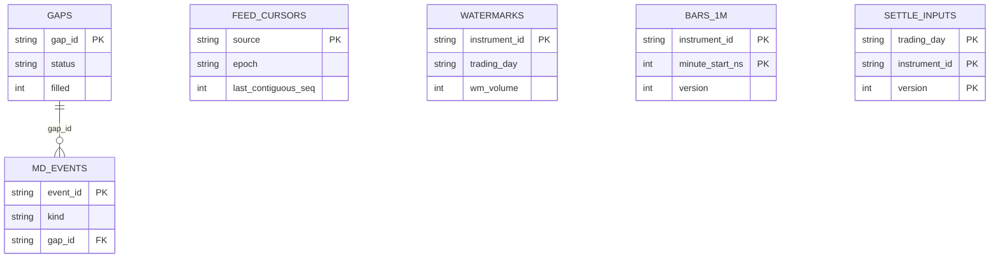
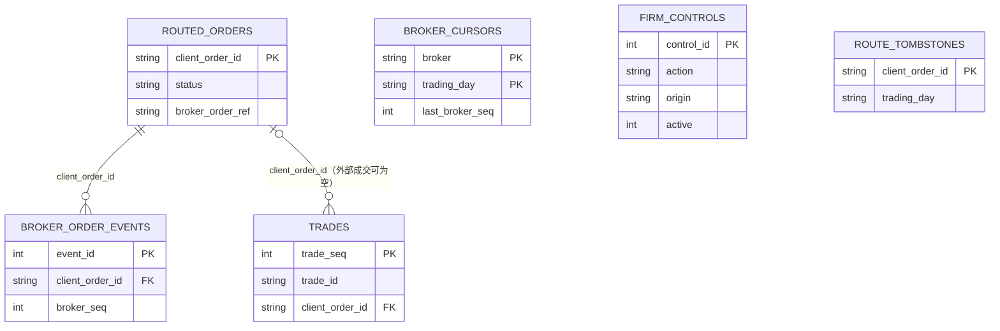
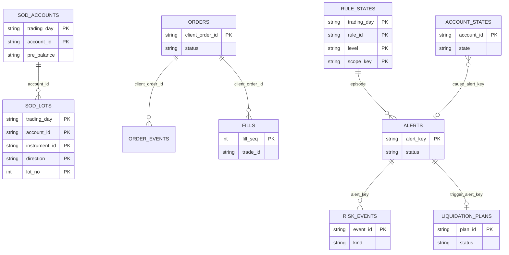
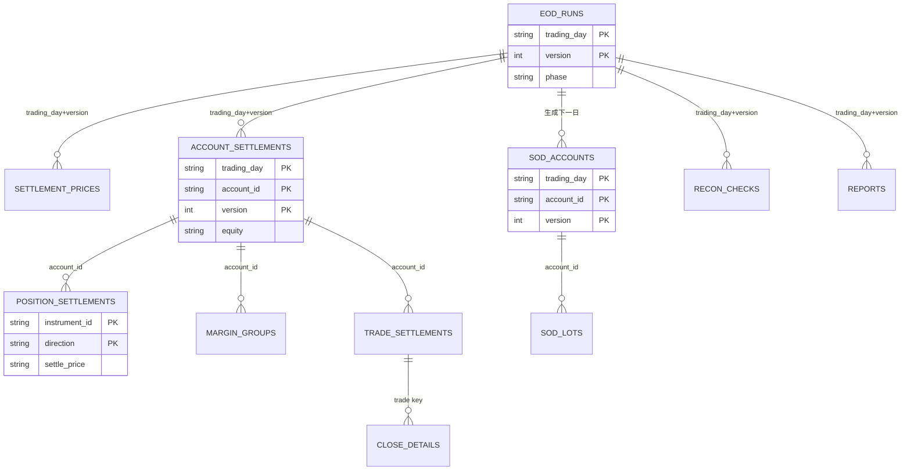

# futrisk 数据库设计与字段说明

| 项 | 内容 |
|---|---|
| 文档编号 | FR-DBDD-03 |
| 版本 | v0.7（精简版，完整版为 git 标签 `v0.1-full`） |
| 状态 | 实现对齐 |
| 日期 | 2026-09-26 |
| 适用范围 | 各服务的 SQLite 库（生产环境可迁移到 PostgreSQL）、tick 与回测 Parquet 文件、报表文件 |
| 对应标准 | GB/T 8567-2006 数据库设计说明（DBDD）：数据库级设计决策、详细设计、访问方式、需求可追踪性 |
| 数据库版本 | md.db 2；td.db 3；risk-{shard}.db 3；clearing.db 2；api.db 2；supervisor.db 2（各库的迁移历史见 §9.1）；sim.db 2（`PRAGMA user_version`） |
| 代码对照 | 表结构：各服务的 `schema.py`（SQLAlchemy `MetaData` 和 `MIGRATIONS`）、`futrisk.db.common_tables`、`futrisk.sim.exchange.store`；与代码的一致性由 `scripts/check_docs.py` 机械核对（README §3.6） |
| 关联文档 | [README](README.md) · [01 架构](01-architecture.md) · [02 通信协议](02-communication-protocol.md) |

> 本文是**表结构、列、键、约束以及仅用于存储的枚举**的唯一权威定义。消息负载和通用枚举见 [02](02-communication-protocol.md)；本文引用这些负载时，列名与 02 中的字段名保持一致。v0.6 起，本文的每张表、每一列（含可空性）、每个库的迁移历史和冻结的枚举取值都与代码一一对应，偏差由校验脚本发现。

## 目录
1. [范围](#1-范围)
2. [数据库级设计决策](#2-数据库级设计决策)
3. [逻辑类型与通用约定](#3-逻辑类型与通用约定)
4. [各数据库详细设计](#4-各数据库详细设计)
5. [文件型存储](#5-文件型存储)
6. [跨库引用与一致性](#6-跨库引用与一致性)
7. [数据访问与事务边界](#7-数据访问与事务边界)
8. [数据生命周期、备份与恢复](#8-数据生命周期备份与恢复)
9. [迁移与版本](#9-迁移与版本)
10. [需求可追踪性](#10-需求可追踪性)
11. [修订记录](#11-修订记录)

---

## 1. 范围

| 存储 | 文件（位于 `<home>` 下） | 所属服务（唯一写者） | 内容 |
|---|---|---|---|
| md.db | `db/md.db` | md-gateway | 行情游标、每个合约的水位、行情事件（含人工排除数据源的持久化记录）、缺口、1 分钟 K 线、结算价输入、outbox |
| td.db | `db/td.db` | trade-gateway | 已路由委托、路由墓碑、柜台回报、成交、柜台游标、kill switch 状态、outbox |
| risk-{shard}.db | `db/risk-0.db`、`db/risk-1.db` | risk-engine-{shard} | 日初快照副本、委托、已应用成交、出入金、规则状态、告警、风险事件、账户状态、审计、指标样本、EOD 状态、outbox |
| clearing.db | `db/clearing.db` | clearing-worker | 成交与出入金副本、EOD 运行记录、结算价、结算结果、日初快照、对账、报表索引、回测作业、配置历史、outbox |
| api.db | `db/api.db` | api-gateway（**单实例**，它是 api.db 的唯一写者） | API key、接口审计、通知、配置版本、人工 kill switch 的期望状态 |
| supervisor.db | `db/supervisor.db` | supervisor | 进程事件、市场时钟、outbox |
| tick 文件 | `ticks/raw/…`、`ticks/canonical/…`、`ticks/wire/…`、`ticks/spill/…` | md-gateway；新浪录制工具 | 原始 tick 与去重后的规范 tick；新浪原始 HTTP 应答；写入失败时的备用目录（Parquet，见 §5.1） |
| 历史数据 | 仓库内的 `data/hist/…` | 开发期脚本（运行时只读） | 回测用的历史日线（§5.2） |
| 回测与报表文件 | `backtests/…`、`reports/…` | clearing-worker | §5.2、§5.3 |
| sim.db（外部模拟组件） | `db/sim.db` | sim-exchange | 模拟柜台的委托、成交、持仓和序号，以及价格引擎的当日累计状态（§4.7），用来模拟真实柜台和行情"重启不丢状态"的特性 |

**不在本文范围内的数据**：
- **配置数据**：品种、账户、规则、端点等，存放在 `config/*.yaml`，由 pydantic 模型定义，属于主数据，不入库。
- **纯内存状态**：各服务的最新值缓存、槽位、可信状态等，重启后通过快照和重放重建。仲裁水位是例外，它会持久化（§4.1 `watermarks`）。
- **sim-exchange 的行情侧和 strategy-sim**：没有持久化。sim-exchange 的柜台侧见 §4.7。

---

## 2. 数据库级设计决策

| 编号 | 决策 | 理由 |
|---|---|---|
| DB-01 | **每个服务一个库，库的写者唯一**。其他服务**禁止**直接读写别人的库，只能通过总线交换数据。数据库从不共享；共享的只有以下几个目录，每个都只有一个写者，其余进程只读： • `config/`：api-gateway 写入（版本快照 `config/versions/{N}/` 和 `active.json`，02 §8.5），其他服务只读； • `reports/`、`backtests/`：clearing-worker 写入，api-gateway 只读，用来下载报表。 docker compose 部署（`deploy/compose.yml`）按同样的划分挂载卷：这几个目录各是一个共享卷，只有写者以读写方式挂载；另有一个一次性的建账容器，以只读方式挂载 api-gateway 的 home，只为读取 bootstrap 管理员 key。没有单独的密钥卷 | 所属关系清晰；各库独立演进；故障相互隔离（01 ADR-010） |
| DB-02 | 使用 SQLite，开启 WAL；每个库只有一个写库线程，采用批量事务；写事务一律 `BEGIN IMMEDIATE` | 零运维，可以打进 exe；单写者不会发生写锁升级失败 |
| DB-03 | PRAGMA 设置：`journal_mode=WAL`、`foreign_keys=ON`、`busy_timeout=5000`；读连接设 `query_only=ON`。`synchronous` 按库和事务区分： • md、risk 库默认为 `NORMAL`：提交时不 fsync，进程崩溃不丢数据，只有断电或操作系统崩溃时，可能丢失最后几条提交； • risk 库中的**关键事务**在提交前临时切换为 `FULL`，逐次落盘：锁存熔断与解除、kill switch 与公司级控制、出入金、EOD 冻结与换日、对账异常、减仓计划、人工命令； • td、clearing、api、supervisor 库整库使用 `FULL`：它们要么写入量小，要么不在下单往返的路径上 | 下单往返的延迟目标（01 §1.2）容不下每条委托意图都 fsync，笔记本上一次 fsync 就要毫秒级。断电时丢失的高频写入都能补回：成交从 trade-gateway 重新拉取，委托按 `td.query.orders` 补建（02 §8.3），行情本来就可以重新获取；而熔断锁存这类必须"任何重启后都保持"的状态，仍然逐次落盘 |
| DB-04 | 通过 SQLAlchemy Core 访问，用一份 `MetaData` 定义表结构，按方言生成 DDL；生产环境迁移到 PostgreSQL 时，每个服务一个 schema | 只需维护一份表定义 |
| DB-05 | 事实类消息写入**事务性 outbox**（§4.0），与业务数据在同一个事务中提交；事务提交之后再发布消息；重放时读 outbox。主题序号由**永不清理**的 `outbox_topics` 计数表分配 | 保证事实不丢，并且可以重放；outbox 清理之后序号也不会回退（02 §4.5） |
| DB-06 | 清算相关的金额和价格存为**十进制规范字符串**（逻辑类型为 `DEC_*`），所有算术都在 Python 的 Decimal 中完成，SQL 只负责存取 | SQLite 没有精确的十进制类型；用字符串既精确又便于阅读 |
| DB-07 | 盘中估值、风控比率和 K 线价格用 REAL（float64） | 与 02 §4.3 一致 |
| DB-08 | 时间统一存为 UTC 纳秒整数；交易日存为 `YYYYMMDD` 文本 | 与消息的编码一致，排序简单 |
| DB-09 | 不同库之间没有外键，只做**逻辑引用**，靠对账保证一致（§6）；同一个库内部可以声明外键 | 这是每服务一库的必然结果 |
| DB-10 | 幂等由唯一键保证：`client_order_id`、成交键、`alert_key`、`movement_id`、`command_id`、`(trading_day, version)` | 重试、重放和重启都不会产生重复数据（01 §8.4） |
| DB-11 | 每个库有一个**流 ID**（`db_meta.stream_id`），新建库和从备份恢复时都会重新生成；使用 `NORMAL` 的库在断电之后也要重新生成（判断方法见 §4.0 `db_meta`）。FACT 消息的信封中带有它 | 从备份恢复之后，或者断电丢失了最后几条提交之后，outbox 的序号可能回退；换一个流 ID，订阅方就能识别出来，并用领域查询重新核对（02 §8.2），不会把新消息当成重复丢掉 |

---

## 3. 逻辑类型与通用约定

### 3.1 逻辑类型

| 逻辑类型 | SQLite 存储 | PostgreSQL | 说明 |
|---|---|---|---|
| `ID` | TEXT | VARCHAR(64) | 业务标识，如账户、合约、实例 ID |
| `UUID` | TEXT | UUID | UUIDv7 字符串（按时间有序） |
| `TD` | TEXT，`CHECK(length(x)=8)` | CHAR(8) | 交易日 `YYYYMMDD` |
| `TS` | INTEGER | BIGINT | UTC 纪元纳秒 |
| `INT` | INTEGER | BIGINT | 手数、序号、计数 |
| `DEC_PRICE` | TEXT | NUMERIC(18,6) | 价格，存为规范十进制字符串（02 §4.3 的 `DecStr`） |
| `DEC_MONEY` | TEXT | NUMERIC(20,2) | 金额，精确到分 |
| `DEC_AMOUNT` | TEXT | NUMERIC(24,6) | 未取整的金额，例如累计成交额 |
| `DEC_RATE` | TEXT | NUMERIC(12,8) | 精确比例，例如保证金率、费率、结算后的风险度 |
| `REAL` | REAL | DOUBLE PRECISION | 浮点值，用于盘中指标和 K 线价格 |
| `BOOL` | INTEGER，`CHECK(x IN (0,1))` | BOOLEAN | 布尔值 |
| `ENUM(名称)` | TEXT，`CHECK(x IN (…))` | TEXT + CHECK | 取值见 02 §7.3 或本文 §3.3 |
| `JSON` | TEXT，`CHECK(json_valid(x))` | JSONB | JSON 文本 |
| `BLOB` | BLOB | BYTEA | msgpack 编码的负载 |
| `HASH` | TEXT，64 位十六进制小写 | CHAR(64) | SHA-256 |

### 3.2 通用约定
- **命名**：
  - 表名用 snake_case 复数，列名用 snake_case；
  - 普通索引命名为 `ix_{表}__{列}`，唯一约束命名为 `uq_{表}__{列}`。
- **必备列**：会被修改的表都带 `created_ns` 和 `updated_ns`。只追加的日志型表只带 `ts_ns` 或 `created_ns`。
- **可空约定**：字段表中"可空"一列为"否"的列，都声明 `NOT NULL`。
- **列名对齐**：表直接保存某种负载时，列名与 02 中对应的字段名**完全一致**，例如 `client_order_id`、`trading_day`、`trade_seq`、`updated_ns`。像 `eod_runs`、`sod_*` 这类聚合或派生的表，与负载之间的对应关系在该表的说明中单独写明。
- **账户和合约**：`account_id`、`instrument_id` 的合法取值由配置（`accounts.yaml`、`products.yaml`）决定。写入时由应用层校验，数据库不另设主表。

### 3.3 仅用于存储的枚举
02 §7.3 中的枚举（包括 `TickMode`、`ConfigStatus`、`ReconResolution`、`ReconBreakKind`、`ReconBreakStatus`、`TradeOrigin`、`ControlOrigin`、`ClockMode`）在库中直接沿用。下面这些枚举只在存储中出现：

| 枚举 | 取值 | 使用位置 |
|---|---|---|
| `AlertStatus` | `ACTIVE` `CLEARED` `RESET` `ROLLED` | risk 库 `alerts.status`：生效中 / 已自动解除 / 已人工重置 / 已随换日解除 |
| `RiskEodStatus` | `OPEN` `FROZEN` `PROVISIONAL` `ROLLED` `FORCE_UNFROZEN` | risk 库 `eod_states.status`。`PROVISIONAL` 表示正在使用临时日初快照（02 §8.4） |
| `AuditAction` | `RISK_RESET` `RISK_HALT` `ALERT_ACK` `KILL_SWITCH_ON` `KILL_SWITCH_OFF` `FIRM_RESTRICTIONS` `CASH_MOVE` `LIQUIDATION_CONFIRM` `LIQUIDATION_CANCEL` `EOD_FORCE_UNFREEZE` `RECON_RESOLVE` `DAYROLL` `DAYROLL_REBASE` `PROVISIONAL_SOD` `CONFIG_COMMIT` | risk 库 `audit_events.action` |
| `MarginMethod` | `GROSS` `BIG_SIDE` | clearing 库 `margin_groups.method` |
| `CloseType` | `TODAY` `YD` | clearing 库 `close_details.close_type` |
| `NotificationStatus` | `PENDING` `SENT` `FAILED` `SUPPRESSED` | api 库 `notifications.status` |

---

## 4. 各数据库详细设计

### 4.0 通用表
下表列出各库包含哪些通用表：

| 表 | md | td | risk | clearing | api | supervisor |
|---|---|---|---|---|---|---|
| `schema_version` | ✓ | ✓ | ✓ | ✓ | ✓ | ✓ |
| `db_meta` | ✓ | ✓ | ✓ | ✓ | ✓ | ✓ |
| `outbox` 和 `outbox_topics` | ✓ | ✓ | ✓ | ✓ | — | ✓ |
| `processed_commands` | ✓ | ✓ | ✓ | ✓ | ✓ | ✓ |
| `fact_cursors` | — | ✓ | ✓ | ✓ | ✓ | — |

#### `db_meta`：库元数据（单行表）

| 列 | 类型 | 可空 | 约束 | 说明 |
|---|---|---|---|---|
| `id` | INT | 否 | PK，`CHECK(id=1)` | 固定为 1 |
| `stream_id` | UUID | 否 | | 流 ID，即信封中的 `stream`（02 §4.2）。新建库时生成；**从备份恢复时必须重新生成**，恢复脚本负责这一步 |
| `created_ns` | TS | 否 | | 库创建时刻 |
| `restored_from` | TEXT | 是 | | 如果是从备份恢复的，记录备份文件名 |
| `clean_shutdown` | BOOL | 否 | 默认 0 | 服务正常停机时置 1，每次启动时置 0 |
| `host_boot_ns` | TS | 是 | | 上次启动时主机的开机时刻。本次启动时，如果 `clean_shutdown=0` 且主机的开机时刻变了，说明期间发生过断电或系统崩溃，使用 `NORMAL` 的库要重新生成 `stream_id`（DB-11）。单纯的进程崩溃不会丢数据，不需要重新生成 |

#### `outbox_topics`：FACT 主题序号计数（**永不清理**）

| 列 | 类型 | 可空 | 约束 | 说明 |
|---|---|---|---|---|
| `topic` | TEXT | 否 | PK | 完整主题 |
| `last_seq` | INT | 否 | | 已分配的最大序号。写 outbox 时，在同一事务里加 1 并取用 |
| `updated_ns` | TS | 否 | | 更新时刻 |

#### `schema_version`：迁移记录

| 列 | 类型 | 可空 | 约束 | 说明 |
|---|---|---|---|---|
| `version` | INT | 否 | PK | 迁移版本号 |
| `description` | TEXT | 否 | | 迁移说明 |
| `checksum` | HASH | 否 | | 迁移脚本的 SHA-256；与已执行的记录不一致时，服务拒绝启动 |
| `applied_ns` | TS | 否 | | 执行时刻 |

#### `outbox`：事务性发件箱（所有 FACT 主题都从这里发布和重放）

| 列 | 类型 | 可空 | 约束 | 说明 |
|---|---|---|---|---|
| `outbox_id` | INT | 否 | PK，自增 | 本库内的全局顺序 |
| `topic` | TEXT | 否 | `uq_outbox__topic_seq(topic, topic_seq)` | 完整主题，例如 `td.exec.ACC3` |
| `topic_seq` | INT | 否 | 同上 | 就是信封中的 `seq`，由 `outbox_topics.last_seq + 1` 分配，在同一个事务中完成。**不能**用 outbox 中的 MAX()+1，否则 outbox 按保留期清理之后序号会回退 |
| `type` / `v` | TEXT / INT | 否 | | 负载类型和版本 |
| `epoch` | TEXT | 否 | | 写入时发布方的 epoch（用于审计） |
| `td` | TD | 是 | | 交易日 |
| `corr_id` | TEXT | 是 | | 业务关联键 |
| `payload` | BLOB | 否 | | msgpack 编码的负载 |
| `created_ns` | TS | 否 | | 写入时刻，重放时作为信封的 `ts_ns` |
| `published_ns` | TS | 是 | `ix_outbox__unpublished`（部分索引：`published_ns IS NULL`） | 发布成功的时刻。服务启动时，把尚未发布的消息按 `outbox_id` 顺序补发 |

#### `processed_commands`：命令幂等记录

| 列 | 类型 | 可空 | 约束 | 说明 |
|---|---|---|---|---|
| `command_id` | TEXT | 否 | PK | 幂等键：`command_id`、`movement_id`，或者 REST 请求头中的 `Idempotency-Key` |
| `command` | TEXT | 否 | | 命令名，例如 `risk.reset` |
| `requester` | TEXT | 否 | | 调用方的 DEALER identity |
| `request_hash` | HASH | 否 | | 请求中**业务字段**的哈希，不含 `sent_ns`、`requested_ns` 这类时间字段。幂等键相同但哈希不同时，返回 `CONFLICT` |
| `result_code` | TEXT | 否 | | 首次处理的结果码 |
| `reply` | BLOB | 否 | | 首次处理的完整 `Reply`，重复请求时原样返回，并置 `duplicate=true` |
| `trading_day` | TD | 否 | `ix_processed_commands__td` | 用于按交易日清理 |
| `received_ns` | TS | 否 | | 收到的时刻 |

说明：
- `route.order` 以 `routed_orders` 的主键去重；`order.submit` 以 `orders` 的主键加 `request_hash` 去重，内容不同时返回 `REJECT_DUPLICATE_ORDER_ID`。这两个命令**不再**另外写 `processed_commands`。
- `route.cancel` 以 `command_id` 为幂等键，撤单失败之后可以换一个新的 `command_id` 再撤。
- `route.resolve` 天然幂等：第一次调用之后，结果已经落在 `routed_orders` 或 `route_tombstones` 中，再次调用返回同样的结果。
- `eod.freeze`、`eod.rollover` 和 `ctl.config.*` 的幂等体现在各自的状态表中（`eod_states`、`config_versions`），不写本表。

#### `fact_cursors`：FACT 订阅游标

| 列 | 类型 | 可空 | 约束 | 说明 |
|---|---|---|---|---|
| `src` | ID | 否 | PK(src, topic) | 发布方实例 |
| `topic` | TEXT | 否 | 同上 | 完整主题 |
| `stream` | UUID | 否 | | 最近一次应用的消息所属的流 ID。与新消息的 `stream` 不一致时，按 02 §8.2 重置游标并核对 |
| `last_seq` | INT | 否 | | 已应用的最大连续 seq，下一条期望的是 `last_seq + 1` |
| `start_policy` | ENUM(FactStartPolicy) | 否 | | 首次订阅时采用的起始策略（02 §4.5） |
| `updated_ns` | TS | 否 | | 更新时刻 |

**规则**：
- 更新游标，必须与应用这条消息产生的业务写入放在**同一个事务**里（02 §8.2）。
- 游标在应用第一条消息时才写入，此前的起始位置取自发布方心跳中的 `stream` 和 `fact_heads`（02 §4.5），所以 `stream` 列不会为空。
- 只为触发库维护而订阅的 `sys.eod` 不写游标（02 §4.1）。md-gateway 和 supervisor 没有其他 FACT 订阅，所以它们的库没有本表。

### 4.1 md.db（md-gateway）

*这张图回答：md.db 中各表之间的关系。缺口事件通过 `gap_id` 关联到缺口表。*

#### `feed_cursors`：各数据源的续传游标

| 列 | 类型 | 可空 | 约束 | 说明 |
|---|---|---|---|---|
| `source` | ENUM(SourceId) | 否 | PK | 数据源 |
| `epoch` | TEXT | 是 | | Feed A 的 epoch；其他数据源为 null |
| `last_contiguous_seq` | INT | 是 | | Feed A **已落盘**的最大连续 seq。重连时 `resume.from_seq = last_contiguous_seq + 1`（02 §9.1） |
| `last_exch_ts_ns` | TS | 是 | | 没有 seq 的数据源，记录最后一次成功轮询到的交易所时间 |
| `trading_day` | TD | 否 | | 交易日 |
| `updated_ns` | TS | 否 | | 在对应的原始 tick 分片落盘**之后**才更新（§5.1）。所以游标永远不会超前于录制，崩溃之后缺口可以补齐 |

#### `watermarks`：每个合约的仲裁水位

| 列 | 类型 | 可空 | 约束 | 说明 |
|---|---|---|---|---|
| `instrument_id` | ID | 否 | PK | 合约 |
| `trading_day` | TD | 否 | | 交易日 |
| `wm_volume` / `wm_exch_ts_ns` | INT / TS | 否 | | 最后一个 LIVE 状态的 `order_key`（01 §8.13） |
| `wm_fingerprint` | INT | 是 | | 最后一个 LIVE 状态的指纹（版本 2 新增）。重启后，轮询源再次送来同一个状态、只是时间戳更晚时，按指纹识别为重复，不再发布 |
| `updated_ns` | TS | 否 | | 约每秒写一次 |

md-gateway 重启后先加载水位，只有 `order_key` 大于它的状态才能发布为 LIVE，保证 02 §5 中"`order_key` 严格递增"的承诺在重启之后依然成立。risk-engine 这一侧也会丢弃 `order_key` 不大于已应用值的 Tick，作为第二道防线。

#### `md_events`：行情事件（`md.event` 的业务表）

| 列 | 类型 | 可空 | 约束 | 说明 |
|---|---|---|---|---|
| `event_id` | UUID | 否 | PK | 对应 `MdEvent.event_id` |
| `kind` | ENUM(MdEventKind) | 否 | `ix_md_events__td_kind(trading_day, kind)` | 事件类别 |
| `trading_day` | TD | 否 | 同上 | 交易日 |
| `ts_ns` | TS | 否 | | 发生时刻 |
| `source` | ENUM(SourceId) | 是 | | 数据源 |
| `instrument_id` | ID | 是 | `ix_md_events__inst_ts(instrument_id, ts_ns)` | 合约 |
| `from_state` / `to_state` | TEXT | 是 | | 迁移前后的状态 |
| `gap_id` | TEXT | 是 | FK → `gaps.gap_id` | 与缺口相关的事件才有 |
| `actor` | TEXT | 是 | | 由人工操作（`md.source.set`）引起的事件，记录操作者，作为审计 |
| `detail` | JSON | 否 | 默认 `{}` | 例如 `reason`（取值见 02 §11.3）、坏点价格、投票详情 |

#### `gaps`：缺口台账

| 列 | 类型 | 可空 | 约束 | 说明 |
|---|---|---|---|---|
| `gap_id` | TEXT | 否 | PK | 格式见 02 §7.1 `GapInfo` |
| `source` | ENUM(SourceId) | 是 | | 数据源；所有源都中断时为 null |
| `epoch` | TEXT | 是 | | Feed A 的 epoch |
| `from_seq` / `to_seq` | INT | 是 | | 序号缺口的区间 |
| `from_ns` / `to_ns` | TS | 否 / 是 | | 时间窗 |
| `trading_day` | TD | 否 | | 交易日 |
| `status` | ENUM(GapStatus) | 否 | | 缺口状态 |
| `filled` / `duplicates` / `unrecoverable` | INT | 否 | 默认 0 | 补齐条数 / 重复条数 / 无法恢复的条数 |
| `opened_ns` / `closed_ns` | TS | 否 / 是 | | 打开 / 关闭时刻 |

#### `bars_1m`：1 分钟 K 线

| 列 | 类型 | 可空 | 约束 | 说明 |
|---|---|---|---|---|
| `instrument_id` | ID | 否 | PK(instrument_id, minute_start_ns) | 合约 |
| `minute_start_ns` | TS | 否 | 同上 | 分钟起点 |
| `trading_day` | TD | 否 | `ix_bars_1m__td_inst(trading_day, instrument_id)` | 交易日 |
| `open` / `high` / `low` / `close` | REAL | 否 | | OHLC |
| `volume` | INT | 否 | | 本分钟成交量（累计量的差分） |
| `turnover` | REAL | 否 | | 本分钟成交额（元） |
| `open_interest` | INT | 否 | | 分钟末的持仓量 |
| `quality` | ENUM(BarQuality) | 否 | | K 线质量 |
| `version` | INT | 否 | | 修订版本；有补数时加 1，覆盖原来的行 |
| `updated_ns` | TS | 否 | | 更新时刻 |

#### `settle_inputs`：结算价输入（`md.settle_inputs` 的数据源）

| 列 | 类型 | 可空 | 约束 | 说明 |
|---|---|---|---|---|
| `trading_day` | TD | 否 | PK(trading_day, instrument_id, version) | 交易日 |
| `instrument_id` | ID | 否 | 同上 | 合约 |
| `version` | INT | 否 | 同上 | 补数到达需要重新计算时加 1 |
| `exchange` | ENUM(Exchange) | 否 | | 交易所 |
| `method` | ENUM(SettleMethod) | 否 | | 计算方法 |
| `multiplier` | INT | 否 | | 合约乘数 |
| `tick_size` | DEC_PRICE | 否 | | 最小变动价位 |
| `day_volume` | INT | 否 | | 全日累计成交量 |
| `day_turnover` | DEC_AMOUNT | 否 | | 全日累计成交额 |
| `window_start_ns` | TS | 是 | | 最后一小时窗口的起点 |
| `window_volume` / `window_turnover` | INT / DEC_AMOUNT | 是 | | 窗口内的成交量和成交额 |
| `hourly` | JSON | 是 | | 仅 CFFEX 使用：按整点划分的各小时 `{hour_start_ns: [volume, turnover]}`。最后一小时没有成交时，回退链按它逐小时向前回溯（`FALLBACK_HOURLY`，01 §8.15） |
| `vwap_raw` | DEC_PRICE | 是 | | 未取整的 VWAP |
| `last` / `bid1` / `ask1` | DEC_PRICE | 是 | | 收盘时的价格，供回退链使用 |
| `limit_lock` | ENUM(LimitLock) | 否 | | 收盘时的封板状态 |
| `pre_settle` | DEC_PRICE | 否 | | 昨结算 |
| `quality` | ENUM(SettleInputQuality) | 否 | | 输入质量 |
| `computed_ns` | TS | 否 | | 计算时刻 |

**计算方式**：收到 `md.settle_inputs` 请求时依次执行：
1. 先把该交易日的原始 tick 全部落盘；
2. 如果规范 tick 文件（§5.1）还没有生成，或者已经过期，就合并生成（幂等）；
3. 从规范 tick **重新计算**结算价输入，不依赖内存中的累加值，所以 md-gateway 在盘中重启也不会影响结算价。

### 4.2 td.db（trade-gateway）

*这张图回答：一笔委托在柜台侧留下哪些记录。`route_tombstones` 与其他表没有关联，它记录的正是 trade-gateway 从没收到过的委托。*

#### `routed_orders`：已路由的委托

| 列 | 类型 | 可空 | 约束 | 说明 |
|---|---|---|---|---|
| `client_order_id` | UUID | 否 | PK | 幂等键 |
| `account_id` / `instrument_id` | ID | 否 | `ix_routed_orders__td_acct(trading_day, account_id)` | 账户 / 合约 |
| `exchange` | ENUM(Exchange) | 否 | | 交易所 |
| `direction` | ENUM(Direction) | 否 | | 买卖方向 |
| `offset` | ENUM(Offset) | 否 | | 已经归一化的开平标志 |
| `order_type` / `tif` | ENUM | 否 | | 价格类型 / 有效期 |
| `price` | DEC_PRICE | 是 | | 限价 |
| `qty` | INT | 否 | `CHECK(qty>0)` | 委托手数 |
| `trading_day` | TD | 否 | | 交易日 |
| `src_instance` | ID | 否 | | 来源分片，如 `risk-engine-1`（即 `RouteOrder.src_instance`） |
| `expire_ns` | TS | 否 | | 路由有效期截止时刻（`RouteOrder.expire_ns`） |
| `broker` | TEXT | 否 | | `sim` 或 `ctp` |
| `broker_order_ref` | TEXT | 是 | `uq_routed_orders__broker_ref`（非空时唯一） | `{front_id}:{session_id}:{order_ref}` |
| `order_sys_id` | TEXT | 是 | | 交易所委托编号 |
| `status` | ENUM(BrokerOrderStatus) | 否 | 部分索引：状态未终结 | 柜台视角的状态。`EXPIRED` 表示委托到达时已经过期或者被 kill switch 拒绝，没有报给柜台，原因码记在 `broker_code`；它同样起墓碑的作用。从没收到过的委托，墓碑记在 `route_tombstones` |
| `filled_qty` | INT | 否 | 默认 0 | 已成交手数 |
| `broker_code` / `broker_msg` | TEXT | 是 | | 柜台原因码和说明 |
| `cancel_requested_ns` | TS | 是 | | 收到 `route.cancel` 的时刻（版本 2 新增）。与该命令的 `processed_commands` 记录在同一个写任务中写入，撤单因此是持久的：柜台暂时不可用时，在下一次补回报之后或该委托的下一条回报到达时重发，直到委托终结 |
| `received_ns` / `submitted_ns` / `updated_ns` | TS | 否 / 是 / 否 | | 收到 / 报出 / 更新时刻 |

#### `route_tombstones`：路由墓碑（从没收到过的委托）

risk-engine 用 `route.resolve` 确认 `UNKNOWN` 状态的委托，或者熔断时撤销 `ROUTING` 状态的委托，而 trade-gateway 从没收到过这笔委托时，就写一行墓碑（02 §8.3）。之后同一 `client_order_id` 的 `route.order` 再到达，一律以 `ROUTE_LOST` 拒绝。`td.query.orders` 是只读查询，不会写本表。

| 列 | 类型 | 可空 | 约束 | 说明 |
|---|---|---|---|---|
| `client_order_id` | UUID | 否 | PK | 被判定为丢失的委托；与 `routed_orders` 的主键不会重复 |
| `trading_day` | TD | 否 | `ix_route_tombstones__td` | 交易日 |
| `command` | TEXT | 否 | | 写入它的命令：`route.resolve` 或 `route.cancel` |
| `command_id` | TEXT | 是 | | `route.cancel` 的 `command_id` |
| `requested_by` | ID | 否 | | 请求方实例，如 `risk-engine-1` |
| `created_ns` | TS | 否 | | 写入时刻 |

#### `broker_order_events`：柜台委托回报流水

| 列 | 类型 | 可空 | 约束 | 说明 |
|---|---|---|---|---|
| `event_id` | INT | 否 | PK，自增 | 流水号 |
| `trading_day` | TD | 否 | `uq_broker_order_events__td_seq(trading_day, broker_seq)` | 交易日 |
| `broker_seq` | INT | 否 | 同上 | 柜台回报序号（当日全局递增），用于去重 |
| `client_order_id` | UUID | 是 | FK → `routed_orders`（可空） | 委托；外部委托为空 |
| `broker_order_ref` | TEXT | 否 | | 柜台委托引用 |
| `origin` | ENUM(TradeOrigin) | 否 | | 委托来源 |
| `status` | ENUM(BrokerOrderStatus) | 否 | | 回报中的状态 |
| `filled_qty` / `remaining_qty` | INT | 否 | | 累计成交 / 剩余手数 |
| `broker_code` / `broker_msg` | TEXT | 是 | | 柜台原因码和说明 |
| `detail` | JSON | 否 | 默认 `{}` | 原始回报中的关键字段 |
| `ts_ns` | TS | 否 | | 时刻 |

#### `trades`：成交（**成交事实的源头**）

| 列 | 类型 | 可空 | 约束 | 说明 |
|---|---|---|---|---|
| `trade_seq` | INT | 否 | PK，自增 | 对应 `Trade.trade_seq`，供 `td.query.trades` 续查 |
| `trading_day` | TD | 否 | `uq_trades__key(trading_day, exchange, trade_id, direction)` | 成交键（02 §7.5） |
| `exchange` | ENUM(Exchange) | 否 | 同上 | 交易所 |
| `trade_id` | TEXT | 否 | 同上 | 交易所成交编号 |
| `direction` | ENUM(Direction) | 否 | 同上 | 买卖方向 |
| `account_id` / `instrument_id` | ID | 否 | `ix_trades__td_acct_seq(trading_day, account_id, trade_seq)` | 账户 / 合约 |
| `client_order_id` | UUID | 是 | FK → `routed_orders`（可空） | 委托。外部成交（柜台强平、柜台终端下单、导入）为空 |
| `origin` | ENUM(TradeOrigin) | 否 | | 成交来源 |
| `import_batch` | TEXT | 是 | | `td.import_trades` 导入时的 `command_id` |
| `broker_order_ref` | TEXT | 否 | | 柜台委托引用；导入的成交写成 `IMPORT:{command_id}` |
| `order_sys_id` | TEXT | 是 | | 交易所委托编号 |
| `offset` | ENUM(Offset) | 否 | | 回报中的开平标志，可能是 `FORCE_CLOSE`。未知的取值在适配器这一层就拒收（02 §9.4），不会写到这里 |
| `price` | DEC_PRICE | 否 | | 成交价，由柜台给出的 double 按 `Decimal(str(x))` 转换 |
| `qty` | INT | 否 | `CHECK(qty>0)` | 成交手数 |
| `trade_ts_ns` | TS | 否 | | 成交时间 |
| `broker_seq` | INT | 是 | | 柜台回报序号；导入的成交（`td.import_trades`）可以为空 |
| `received_ns` | TS | 否 | | 收到时刻 |

#### `broker_cursors`：柜台补回报游标

| 列 | 类型 | 可空 | 约束 | 说明 |
|---|---|---|---|---|
| `broker` | TEXT | 否 | PK(broker, trading_day) | 柜台 |
| `trading_day` | TD | 否 | 同上 | 交易日 |
| `last_broker_seq` | INT | 否 | | 已处理的最大回报序号；断线重连后从 `last_broker_seq + 1` 开始查询 |
| `session_id` / `front_id` | TEXT / INT | 是 | | 最近一次登录的会话信息 |
| `updated_ns` | TS | 否 | | 更新时刻 |

#### `firm_controls`：kill switch 状态（trade-gateway 保存的副本）

列与 risk 库的 `firm_controls` 相同（§4.3），当前状态的算法也相同：每种来源（`origin`）各取最新的 kill switch 记录，**生效状态 = 人工标志 OR 规则标志**。trade-gateway 启动时先加载它，再接收 `firm.kill_switch` 和 `risk.control.firm`；kill switch 生效时，开仓路由一律以 `ROUTE_KILL_SWITCH` 拒绝。

### 4.3 risk-{shard}.db（risk-engine，每个分片一个库）

*这张图回答：风控核心的持久化状态如何组织，告警、事件、账户状态之间如何关联。*

**重启恢复用到的表**（01 §6.5）：
- `sod_*`：当日起点；
- `fills`：按 `fill_seq` 重放，重建 lot 和资金账本；
- `cash_movements`：当日出入金，用来恢复静态权益和累计净入金；
- `rule_states`、`alerts`、`account_states`、`firm_controls`：恢复状态机、episode、锁存、kill switch 和公司级限制；
- `orders`：恢复未终结的委托和冻结的保证金，其中 `ROUTING` 状态的委托转为 `UNKNOWN`（02 §8.3）；
- `eod_states`：恢复交易模式（`EOD_FROZEN` / `PROVISIONAL`）；
- `liquidation_plans`、`recon_breaks`：恢复待确认的减仓计划，以及未处理的对账异常（对应的禁开限制也随之恢复）；
- `metric_samples`：当日 `perf_equity` 的最大值就是日内峰值，用来恢复 `intraday_dd` 的基准。样本每秒写一次，所以重启后峰值最多低估 1 秒之内的波动，这一点在 01 §11 中列为已知的精度限制；
- 合规计数（当日开仓手数、撤单次数）：从 `orders` 和 `fills` 推导。

#### `sod_accounts`：日初快照副本（账户部分）

| 列 | 类型 | 可空 | 约束 | 说明 |
|---|---|---|---|---|
| `trading_day` | TD | 否 | PK(trading_day, account_id) | 快照生效的交易日 |
| `account_id` | ID | 否 | 同上 | 账户 |
| `sod_version` | INT | 否 | | 对应 clearing.db 中 `sod_versions.version`；临时快照为 −1 |
| `pre_balance` | DEC_MONEY | 否 | | 上日结存 |
| `initial_capital` | DEC_MONEY | 否 | | 初始资金，是日亏损比例的分母 |
| `cum_net_deposit` | DEC_MONEY | 否 | | 截至上一交易日的累计净入金（不含初始资金），用来计算业绩权益 |
| `hwm_equity` | DEC_MONEY | 否 | | 业绩权益的历史高水位 |
| `provisional` | BOOL | 否 | 默认 0 | 是否为临时日初快照（02 §8.4）；为 1 时 `sod_version` 为 −1 |
| `loaded_ns` | TS | 否 | | 载入时刻 |

#### `sod_lots`：日初快照副本（持仓 lot）

| 列 | 类型 | 可空 | 约束 | 说明 |
|---|---|---|---|---|
| `trading_day` / `account_id` / `instrument_id` / `direction` / `lot_no` | TD / ID / ID / ENUM(PosDirection) / INT | 否 | PK（五列） | lot 标识 |
| `sod_version` | INT | 否 | | 快照版本 |
| `open_td` | TD | 否 | | 开仓交易日 |
| `open_ts_ns` | TS | 否 | | 开仓时刻，决定 FIFO 顺序 |
| `open_price` | DEC_PRICE | 否 | | 开仓价，用于逐笔口径 |
| `qty` | INT | 否 | `CHECK(qty>0)` | 手数 |
| `basis_price` | DEC_PRICE | 否 | | 盯市基准，即昨结算 |

#### `sod_prices`：昨结算价

| 列 | 类型 | 可空 | 约束 | 说明 |
|---|---|---|---|---|
| `trading_day` / `instrument_id` | TD / ID | 否 | PK | 交易日 / 合约 |
| `pre_settle` | DEC_PRICE | 否 | | 昨结算价 |
| `sod_version` | INT | 否 | | 快照版本 |

#### `orders`：委托（事前检查的结果与委托生命周期）

| 列 | 类型 | 可空 | 约束 | 说明 |
|---|---|---|---|---|
| `client_order_id` | UUID | 否 | PK | 幂等键 |
| `account_id` / `instrument_id` | ID | 否 | `ix_orders__td_acct(trading_day, account_id)` | 账户 / 合约 |
| `exchange` | ENUM(Exchange) | 否 | | 交易所 |
| `direction` / `offset` | ENUM | 否 | | `offset` 为归一化之后的值 |
| `order_type` / `tif` | ENUM | 否 | | 价格类型 / 有效期 |
| `price` | DEC_PRICE | 是 | | 限价 |
| `qty` | INT | 否 | `CHECK(qty>0)` | 委托手数 |
| `trading_day` | TD | 否 | | 交易日 |
| `source` | ENUM(OrderSource) | 否 | | 委托来源 |
| `strategy_tag` / `actor` | TEXT | 是 | | 策略标签 / 操作者 |
| `status` | ENUM(OrderStatus) | 否 | 部分索引：状态未终结 | 状态机见 02 §8.3 |
| `filled_qty` | INT | 否 | 默认 0 | 已成交手数 |
| `avg_fill_price` | DEC_PRICE | 是 | | 成交均价 |
| `reject_code` | TEXT | 是 | | 拒单码（02 §11.2） |
| `reject_detail` | JSON | 是 | | 拒单依据 |
| `broker_order_ref` | TEXT | 是 | | 柜台委托引用 |
| `frozen_margin` / `frozen_fee` | DEC_MONEY | 否 | 默认 "0" | 未成交部分冻结的保证金和手续费 |
| `cancel_command_id` / `cancel_sent_ns` / `cancel_attempts` | TEXT / TS / INT | 是 | `cancel_attempts` 默认 0 | 撤单重发的记录（版本 2 新增）：最近一次 `route.cancel` 的 `command_id`、发出时刻、已发次数。撤单超时仍未终结时换新的 `command_id` 重发，超时依次为 5s、10s、20s、40s，之后每次 60s（02 §8.3） |
| `risk_check_us` | INT | 否 | | 事前检查耗时 |
| `request_hash` | HASH | 否 | | 请求中**业务字段**的哈希，不含 `sent_ns`，用来识别"同一个 ID、不同内容"的重复提交 |
| `config_hash` | HASH | 否 | | 检查时生效的规则配置 |
| `created_ns` / `updated_ns` | TS | 否 | | 创建 / 更新时刻 |

#### `order_events`：委托状态流水

| 列 | 类型 | 可空 | 约束 | 说明 |
|---|---|---|---|---|
| `event_id` | INT | 否 | PK，自增 | 流水号 |
| `client_order_id` | UUID | 否 | FK → `orders`，`ix_order_events__coid` | 委托 |
| `ts_ns` | TS | 否 | | 时刻 |
| `from_status` | ENUM(OrderStatus) | 是 | | 新建时为 null |
| `to_status` | ENUM(OrderStatus) | 否 | | 新状态 |
| `reason` | TEXT | 是 | | 例如 `CIRCUIT_BREAK_CANCEL`、`ROUTE_TIMEOUT` |
| `detail` | JSON | 否 | 默认 `{}` | 附加信息 |

#### `fills`：已应用的成交

| 列 | 类型 | 可空 | 约束 | 说明 |
|---|---|---|---|---|
| `fill_seq` | INT | 否 | PK，自增 | 应用顺序，重放时按它排序 |
| `trading_day` / `exchange` / `trade_id` / `direction` | TD / ENUM / TEXT / ENUM | 否 | `uq_fills__key`（四列） | 成交键（幂等） |
| `account_id` / `instrument_id` | ID | 否 | `ix_fills__td_acct(trading_day, account_id)` | 账户 / 合约 |
| `client_order_id` | UUID | 是 | FK → `orders`（可空） | 委托；外部成交为空 |
| `origin` | ENUM(TradeOrigin) | 否 | | 成交来源 |
| `broker_order_ref` | TEXT | 否 | | 柜台委托引用 |
| `offset` | ENUM(Offset) | 否 | | 开平标志 |
| `price` | DEC_PRICE | 否 | | 成交价 |
| `qty` | INT | 否 | | 成交手数 |
| `trade_ts_ns` | TS | 否 | | 成交时间 |
| `trade_seq` | INT | 否 | | 该成交在 trade-gateway 中的 `trade_seq`（跨账户全局递增，与 `Trade.trade_seq` 同名同义）。恢复时**按账户**分别取本库中该账户的最大值加 1，调用 `td.query.trades`（带 `account_id`）续查 |
| `broker_seq` | INT | 是 | | 与 `Trade.broker_seq` 相同；导入的成交为空 |
| `received_ns` | TS | 否 | | 与 `Trade.received_ns` 相同。`risk.query.fills` 直接用本表生成 `Trade` |
| `close_today_qty` / `close_yd_qty` | INT | 否 | 默认 0 | 应用时实际平掉的今仓和昨仓手数 |
| `fee_est` | DEC_MONEY | 否 | | 盘中估算的手续费，正式值以清算结果为准 |
| `applied_ns` | TS | 否 | | 应用时刻 |

#### `cash_movements`：出入金（`risk.cash` 的业务表）

| 列 | 类型 | 可空 | 约束 | 说明 |
|---|---|---|---|---|
| `movement_id` | UUID | 否 | PK | 幂等键 |
| `account_id` | ID | 否 | | 账户 |
| `trading_day` | TD | 否 | | 生效交易日，由 risk-engine 按自身的 EOD 状态判定（02 §6.3 `cash.move`） |
| `type` | ENUM(CashType) | 否 | | 入金 / 出金 |
| `amount` | DEC_MONEY | 否 | `CHECK(amount GLOB '[0-9]*' AND amount NOT GLOB '*[^0-9.]*' AND amount NOT GLOB '*.*.*')` | 金额，正数，DecStr 格式。应用层先用 Decimal 严格校验（大于 0、最多两位小数），数据库的 CHECK 只做兜底 |
| `actor` / `reason` | TEXT | 否 | | 操作者 / 原因 |
| `ts_ns` | TS | 否 | | 时刻 |

#### `rule_states`：告警状态机持久化

| 列 | 类型 | 可空 | 约束 | 说明 |
|---|---|---|---|---|
| `trading_day` / `rule_id` / `level` / `scope_key` | TD / ID / ID / TEXT | 否 | PK（四列） | 一个状态机实例 |
| `state` | ENUM(RuleSmState) | 否 | | 当前状态，迁移规则见 01 §8.14 |
| `episode` | INT | 否 | 默认 0 | 当日进入 ACTIVE 的次数，换日后归零 |
| `latched` | BOOL | 否 | | 是否锁存 |
| `confirm_count` | INT | 否 | 默认 0 | PENDING 期间看到的不同 LIVE 状态数 |
| `pending_since_ns` / `active_since_ns` / `clear_since_ns` | TS | 是 | | 各阶段的起始时刻 |
| `cooldown_until_ns` | TS | 是 | | 冷却截止时刻 |
| `rearm_threshold` | REAL | 是 | | 进入 `REARMED` 后的重新布防线 |
| `last_value` | REAL | 是 | | 最近一次评估的值 |
| `config_hash` | HASH | 否 | | 评估时生效的规则配置 |
| `updated_ns` | TS | 否 | | 更新时刻 |

#### `alerts`：告警（每个 episode 一行）

| 列 | 类型 | 可空 | 约束 | 说明 |
|---|---|---|---|---|
| `alert_key` | TEXT | 否 | PK（`ON CONFLICT DO NOTHING`） | 格式见 02 §7.3 |
| `trading_day` / `rule_id` / `level` / `scope_key` / `episode` | TD / ID / ID / TEXT / INT | 否 | `ix_alerts__td(trading_day)` | 由 `alert_key` 拆出的各部分 |
| `account_id` | ID | 是 | | 公司级告警为 null |
| `action` | ENUM(Action) | 否 | | 动作 |
| `severity` | ENUM(Severity) | 否 | | 严重程度 |
| `metric` | TEXT | 否 | | 指标 |
| `value` / `threshold` | REAL | 否 | | 触发时的值 / 阈值 |
| `latched` | BOOL | 否 | | 是否锁存 |
| `status` | ENUM(AlertStatus) | 否 | | 告警状态 |
| `raised_ns` | TS | 否 | | 触发时刻 |
| `cleared_ns` / `reset_ns` / `acked_ns` | TS | 是 | | 解除 / 重置 / 确认时刻 |
| `reset_by` / `acked_by` | TEXT | 是 | | 重置人 / 确认人 |
| `message` | TEXT | 否 | | 说明 |
| `detail` | JSON | 否 | 默认 `{}` | 附加信息 |

#### `risk_events`：风险事件（`risk.event` 的业务表）

| 列 | 类型 | 可空 | 约束 | 说明 |
|---|---|---|---|---|
| `event_id` | UUID | 否 | PK | 对应 `RiskEvent.event_id` |
| `kind` | ENUM(RiskEventKind) | 否 | `ix_risk_events__td_kind(trading_day, kind)` | 事件类别 |
| `trading_day` | TD | 否 | 同上 | 交易日 |
| `ts_ns` | TS | 否 | | 时刻 |
| `account_id` / `scope_key` / `alert_key` | ID / TEXT / TEXT | 是 | `ix_risk_events__alert_key` | 账户 / 范围 / 关联告警 |
| `rule_id` / `level` / `episode` | ID / ID / INT | 是 | | 规则 / 级别 / episode |
| `action` | ENUM(Action) | 是 | | 动作 |
| `severity` | ENUM(Severity) | 否 | | 严重程度 |
| `latched` | BOOL | 是 | | 熔断级别的告警为 1 |
| `metric` / `value` / `threshold` | TEXT / REAL / REAL | 是 | | 指标 / 当时的值 / 阈值 |
| `actor` | TEXT | 是 | | 操作者 |
| `message` | TEXT | 否 | | 说明 |
| `detail` | JSON | 否 | 默认 `{}` | 与 `RiskEvent.detail` 相同，例如 RETRO 类的 `retro_key` 和 `gap_id`、RECON 类的差异明细 |

#### `retro_breaches`：只在补数区间内出现的越线（SHOULD，只作审计，不触发动作）

| 列 | 类型 | 可空 | 约束 | 说明 |
|---|---|---|---|---|
| `retro_key` | TEXT | 否 | PK | `RETRO\|{td}\|{rule_id}\|{level}\|{scope_key}\|{gap_id}` |
| `trading_day` / `rule_id` / `level` / `scope_key` | TD / ID / ID / TEXT | 否 | | 规则与范围 |
| `gap_id` | TEXT | 否 | | 逻辑引用 md.db 的 `gaps.gap_id` |
| `first_breach_ns` | TS | 否 | | 首次越线的时刻 |
| `worst_value` / `threshold` | REAL | 否 | | 最差值 / 阈值 |
| `detected_ns` | TS | 否 | | 发现时刻 |
| `detail` | JSON | 否 | | 附加信息 |

#### `account_states`：账户风控状态（当前值）

| 列 | 类型 | 可空 | 约束 | 说明 |
|---|---|---|---|---|
| `account_id` | ID | 否 | PK | 账户 |
| `trading_day` | TD | 否 | | 交易日 |
| `state` | ENUM(AccountState) | 否 | | 风控状态 |
| `halted_latched` | BOOL | 否 | | 是否锁存 |
| `restrictions` | JSON | 否 | 默认 `[]` | list[Restriction]（02 §7.6） |
| `cause` | TEXT | 否 | | `RULE` / `MANUAL` / `SYSTEM` / `RESET` / `DAYROLL` / `KILL_SWITCH` |
| `cause_alert_key` | TEXT | 是 | | 由规则引起时的告警 |
| `state_version` | INT | 否 | | 每次变化加 1，随 `risk.state` 和 `risk.snapshot` 一起发布（02 §7.6） |
| `since_ns` / `updated_ns` | TS | 否 | | 进入当前状态 / 更新的时刻 |

状态变化的历史通过 `risk.state` 的 outbox 行和 `audit_events` 查询。

#### `firm_controls`：公司级控制记录

- 人工 kill switch 由 api-gateway 直接下发到**每个**分片，各分片各写一行（`origin=MANUAL`）；
- 公司级规则触发的控制，由 coordinator 写入并发布 `risk.control.firm`，其他分片应用后各写一份副本（`origin=RULE`）；
- **当前状态**：kill switch 按来源分开计算，每种来源各取 `action` 为 `KILL_SWITCH_ON` 或 `KILL_SWITCH_OFF` 的最新一行，**生效状态 = 人工标志 OR 规则标志**。所以 coordinator 发出的规则记录永远关不掉人工开启的 kill switch，反之亦然。公司级限制取 `SET_RESTRICTIONS` 的最新一行；
- coordinator 下线时，其他分片保持最后一次已知的状态，并告警。

| 列 | 类型 | 可空 | 约束 | 说明 |
|---|---|---|---|---|
| `control_id` | INT | 否 | PK，自增 | 记录号 |
| `action` | ENUM(FirmAction) | 否 | | 开启或关闭 kill switch，或者下发公司级限制 |
| `origin` | ENUM(ControlOrigin) | 否 | `ix_firm_controls__origin_action(origin, action, control_id)` | 来源：人工（`MANUAL`）或公司级规则（`RULE`） |
| `active` | BOOL | 否 | | 本来源的 kill switch 标志在执行后的值。只对 `KILL_SWITCH_ON` / `KILL_SWITCH_OFF` 有意义，`SET_RESTRICTIONS` 行固定写 0 且不参与计算 |
| `restrictions` | JSON | 否 | 默认 `[]` | 当前生效的公司级限制，每次都存完整集合（`FirmControl.restrictions`） |
| `trading_day` | TD | 否 | | 交易日 |
| `actor` / `reason` | TEXT | 是 / 否 | | 操作者 / 原因 |
| `cause_alert_key` | TEXT | 是 | | 由公司级规则触发时的告警 |
| `src_instance` | ID | 否 | | 记录的来源实例：人工操作为 `api-gateway`，规则触发为 coordinator（`risk-engine-0`） |
| `ts_ns` | TS | 否 | | 时刻 |

#### `liquidation_plans`：减仓计划

| 列 | 类型 | 可空 | 约束 | 说明 |
|---|---|---|---|---|
| `plan_id` | UUID | 否 | PK | 计划 |
| `account_id` / `trading_day` | ID / TD | 否 | | 账户 / 交易日 |
| `trigger_alert_key` | TEXT | 否 | FK → `alerts` | 触发该计划的告警 |
| `status` | ENUM(LiquidationStatus) | 否 | | 计划状态 |
| `steps` | JSON | 否 | | 与 02 §7.6 `LiquidationPlan.steps` 相同 |
| `created_ns` | TS | 否 | | 创建时刻 |
| `confirmed_by` / `confirmed_ns` / `finished_ns` | TEXT / TS / TS | 是 | | 确认人 / 确认时刻 / 完成时刻 |

#### `audit_events`：审计记录（只追加）

| 列 | 类型 | 可空 | 约束 | 说明 |
|---|---|---|---|---|
| `audit_id` | INT | 否 | PK，自增 | 记录号 |
| `ts_ns` / `trading_day` | TS / TD | 否 | `ix_audit_events__td` | 时刻 / 交易日 |
| `actor` | TEXT | 否 | | 操作者，系统动作写 `system` |
| `role` | ENUM(Role) | 是 | | 角色 |
| `action` | ENUM(AuditAction) | 否 | | 动作 |
| `target` | TEXT | 否 | | 对象，例如 `acct:ACC3` 或 `firm` |
| `before` / `after` | JSON | 是 | | 变更前后的状态和指标值 |
| `reason` | TEXT | 是 | | 原因 |
| `command_id` / `corr_id` | TEXT | 是 | | 命令 ID / 关联 ID |

#### `metric_samples`：账户指标样本（每秒一条，批量异步写入）

| 列 | 类型 | 可空 | 约束 | 说明 |
|---|---|---|---|---|
| `account_id` / `ts_ns` | ID / TS | 否 | PK(account_id, ts_ns) | 账户 / 采样时刻 |
| `trading_day` | TD | 否 | `ix_metric_samples__td_acct` | 交易日 |
| `equity` / `perf_equity` / `daily_pnl` / `gross_notional` / `net_notional` | REAL | 否 | | 资金与敞口（`perf_equity` 的定义见 02 §7.6） |
| `rule_util` | JSON | 否 | 默认 `{}` | 各规则在各范围上的使用率：`{rule_id/scope_key: utilization}`。日报用它计算"盘中峰值"这一列 |
| `nav` / `daily_pnl_pct_init` / `intraday_dd` / `hwm_dd` / `risk_degree` / `leverage` | REAL | 否 | | 单位净值与风控比率（定义见 02 §7.6） |
| `state` | ENUM(AccountState) | 否 | | 当时的风控状态 |
| `quality` | ENUM(MdQuality) | 否 | | 当时的行情质量 |

#### `eod_states`：本分片的 EOD 状态

| 列 | 类型 | 可空 | 约束 | 说明 |
|---|---|---|---|---|
| `trading_day` | TD | 否 | PK | 交易日 |
| `status` | ENUM(RiskEodStatus) | 否 | | EOD 状态 |
| `freeze_version` | INT | 是 | | 最近一次 `eod.freeze` 带来的结算版本 |
| `frozen_ns` | TS | 是 | | 冻结时刻 |
| `digest` | JSON | 是 | | 最近一次返回的 `EodFreezeAck` 中 `accounts` 和 `cash` 两部分的内容，只作审计；应答每次都重新计算（02 §6.3） |
| `provisional_ns` | TS | 是 | | 进入 `PROVISIONAL` 的时刻 |
| `next_trading_day` / `sod_version` / `rolled_ns` | TD / INT / TS | 是 | | 换日结果 |
| `forced_by` / `forced_reason` | TEXT | 是 | | 强制放行时填写 |

#### `recon_breaks`：对账异常

| 列 | 类型 | 可空 | 约束 | 说明 |
|---|---|---|---|---|
| `break_id` | UUID | 否 | PK | 异常编号 |
| `trading_day` / `account_id` | TD / ID | 否 | | 交易日 / 账户 |
| `kind` | ENUM(ReconBreakKind) | 否 | | 异常类型 |
| `status` | ENUM(ReconBreakStatus) | 否 | `ix_recon_breaks__open(account_id, status)` | 处理状态 |
| `blocking` | BOOL | 否 | | 是否阻塞开仓：`POSITION_MISMATCH` 为 1，其余为 0（02 §8.7）。账户只要还有 `blocking=1` 且为 `OPEN` 的异常，就带有 `BLOCK_OPEN`（`SYSTEM:RECON_BREAK`） |
| `resolution` | ENUM(ReconResolution) | 是 | | 处理方式（`risk.recon.resolve`），系统自动补齐的为 `RESYNCED` |
| `note` | TEXT | 是 | | 处理说明 |
| `detail` | JSON | 否 | | 差异明细 |
| `created_ns` | TS | 否 | | 发现时刻 |
| `resolved_ns` / `resolved_by` | TS / TEXT | 是 | | 处理时刻 / 处理人（自动处理的写 `system`） |

### 4.4 clearing.db（clearing-worker）

*这张图回答：一次结算运行（`trading_day + version`）会产出哪些结果。*

**版本规则**：
- 同一交易日的每一次结算运行都有一个版本号 `version`，从 1 开始；
- 重跑同一版本是幂等的，结果完全相同；
- 官方结算价更正或人工覆盖之后，以 `force_new_version` 生成新版本；
- **当前有效的结果**是该交易日中 `eod_runs.phase` 为 `SETTLED`、`ROLLED`、`REPORTED` 或 `DONE` 的最大版本（`FAILED` 的版本不算）；
- 换日时推给各分片的是哪一个日初快照版本，记录在 `sod_versions.pushed_ns` 中；`settle.sod_snapshot` 不指定版本时，只返回已经推送过的版本（02 §6.5）。

#### `trades`：成交副本（订阅 `td.exec.*`，只保存其中的 `Trade`）

这张表只保存结算需要的列，列名与 `Trade` 的字段同名：
- **主键**：`(trading_day, exchange, trade_id, direction)`；
- **成交相关列**：`account_id`、`instrument_id`、`client_order_id`（可空）、`origin`、`offset`、`price`（DEC_PRICE）、`qty`、`trade_ts_ns`；
- **来源列**：`trade_seq`（td.db 中的 `trade_seq`）、`received_ns`；
- **不保存的列**：柜台侧的 `broker_order_ref`、`order_sys_id`、`broker_seq` 在结算中用不到，不保存；
- **索引**：`ix_trades__td_acct(trading_day, account_id)`。

#### `cash_movements`：出入金副本（订阅 `risk.cash.*` 写入）

| 列 | 类型 | 可空 | 约束 | 说明 |
|---|---|---|---|---|
| `movement_id` | UUID | 否 | PK | 幂等键 |
| `account_id` / `trading_day` | ID / TD | 否 | `ix_cash_movements__td_acct` | 账户 / 生效交易日 |
| `type` | ENUM(CashType) | 否 | | 入金 / 出金 |
| `amount` | DEC_MONEY | 否 | | 金额 |
| `actor` / `reason` | TEXT | 否 | | 操作者 / 原因 |
| `ts_ns` | TS | 否 | | 时刻 |
| `src_instance` | ID | 否 | | 来源分片 |

#### `eod_runs`：结算运行（saga 状态）

| 列 | 类型 | 可空 | 约束 | 说明 |
|---|---|---|---|---|
| `trading_day` / `version` | TD / INT | 否 | PK | 结算运行 |
| `phase` | ENUM(EodPhase) | 否 | | 当前阶段；重启后从这里继续 |
| `next_trading_day` | TD | 否 | | 下一交易日 |
| `triggered_by` | TEXT | 否 | | `scheduler` 或操作者 |
| `config_hash` | HASH | 否 | | 本次运行使用的配置 |
| `step_log` | JSON | 否 | 默认 `{}` | 各阶段的完成时刻和统计（同 `EodPhaseEvent.detail`），键见下文 |
| `error` | TEXT | 是 | | 失败原因 |
| `started_ns` / `updated_ns` / `finished_ns` | TS | 否 / 否 / 是 | | 开始 / 更新 / 结束时刻 |

`step_log` 的键是 `EodPhase` 的取值，每个阶段一项 `{ts_ns, …统计}`；另有一个 `WARNINGS` 列表（最多 50 条），记录不改变阶段的 WARN 事件（如 md-gateway 给出的昨结算与日初快照不一致）。其中两项在恢复时会被原样复用，保证中途崩溃后重跑的结果不变：
- `BEGIN`：`triggered_by`、`sod_version`、`config_version`、`config_hash`；重新结算时还有 `resettle_of`（被取代的版本）或 `force_new_version`。第 4、5 步只使用这里记下的配置版本，运行期间提交的新配置不影响正在进行的结算；
- `PRICES_FIXED`：除统计外，固定本次结算的全部输入：`prices`（`SettlementPriceView` 列表）、`sod_version`、`input_pre_settle`、`pre_settle_fallback_prices`、`skipped`。

`REPORTED` 在报表生成失败时带 `errors`；重新生成成功后改记为 `errors_cleared` 和 `regenerated_ns`。

#### `config_history`：各配置版本的结算生效日（版本 2 新增）

产品参数（保证金、手续费、最小变动价位、涨跌停、结算规则）和交易日历按 `NEXT_TRADING_DAY` 生效（02 §7.10），而运行时会立即换上新配置。clearing-worker 因此记下见过的每个配置版本，以及其中结算相关部分从哪个交易日起适用；结算某一天时，使用当天已经生效的最新版本。

| 列 | 类型 | 可空 | 约束 | 说明 |
|---|---|---|---|---|
| `config_version` | INT | 否 | PK | 配置版本 |
| `config_hash` | HASH | 否 | | 配置哈希 |
| `settle_hash` | HASH | 否 | | `products.yaml` 与日历文件的 SHA-256 |
| `settle_from` | TD | 是 | | 结算相关部分开始适用的交易日；null 表示在所有已记录的交易日之前就已生效。结算文件没变时沿用上一版本的值；变了时取 api-gateway 在 `active.json` 的 `effective` 中为 `products` / `calendar` 记下的交易日，没有时取下一交易日（运行中提交），或当前交易日（clearing-worker 停机期间发生的变更） |
| `recorded_ns` | TS | 否 | | 记录时刻 |

clearing-worker 启动时记录当前运行的版本，收到 `ctl.config.commit` 时记录新提交的版本。结算要用的旧版本从 `<home>/config/versions/{N}/` 加载。

#### `official_prices`：导入的官方结算价

| 列 | 类型 | 可空 | 约束 | 说明 |
|---|---|---|---|---|
| `trading_day` / `instrument_id` | TD / ID | 否 | PK(trading_day, instrument_id, import_id) | 交易日 / 合约 |
| `import_id` | UUID | 否 | 同上 | 等于 `settle.import_official` 的 `command_id` |
| `price` | DEC_PRICE | 否 | | 官方结算价 |
| `source` | TEXT | 否 | | 来源说明（自由文本），例如 `shfe_file`、`akshare` |
| `imported_by` / `imported_ns` | TEXT / TS | 否 | | 导入人 / 导入时刻 |

同一合约有多次导入时，以最新的一次为准。结算价的优先级为：人工覆盖 > 官方 > VWAP > 回退链。

#### `price_overrides`：人工覆盖的结算价（审计）

| 列 | 类型 | 可空 | 约束 | 说明 |
|---|---|---|---|---|
| `override_id` | UUID | 否 | PK，等于命令的 `command_id` | 覆盖记录 |
| `trading_day` / `instrument_id` | TD / ID | 否 | `ix_price_overrides__td_inst` | 交易日 / 合约 |
| `price` | DEC_PRICE | 否 | | 必须在 tick 网格上 |
| `reason` / `actor` | TEXT | 否 | | 原因 / 操作者 |
| `created_ns` | TS | 否 | | 创建时刻 |
| `superseded_ns` | TS | 是 | | 被同一合约更新的覆盖取代的时刻 |

#### `settlement_prices`：结算价

| 列 | 类型 | 可空 | 约束 | 说明 |
|---|---|---|---|---|
| `trading_day` / `instrument_id` / `version` | TD / ID / INT | 否 | PK | 交易日 / 合约 / 结算版本 |
| `price` | DEC_PRICE | 否 | | 最终采用的结算价（已按规则取整） |
| `source` | ENUM(SettlePriceSource) | 否 | | 结算价来源 |
| `method` | ENUM(SettleMethod) | 是 | | 计算方法 |
| `vwap_raw` | DEC_PRICE | 是 | | 未取整的 VWAP |
| `rounding` | ENUM(Rounding) | 否 | | 取整方式 |
| `input_quality` | ENUM(SettleInputQuality) | 是 | | 输入数据的质量 |
| `operator` / `reason` | TEXT | 是 | | `source=MANUAL` 时必须填写 |
| `created_ns` | TS | 否 | | 创建时刻 |

#### `account_settlements`：账户结算结果（结算单"资金状况"部分）

| 列 | 类型 | 可空 | 约束 | 说明 |
|---|---|---|---|---|
| `trading_day` / `account_id` / `version` | TD / ID / INT | 否 | PK | 交易日 / 账户 / 结算版本 |
| `pre_balance` | DEC_MONEY | 否 | | 期初结存（上日结存） |
| `deposit` / `withdraw` | DEC_MONEY | 否 | | 当日入金 / 出金 |
| `close_pnl` | DEC_MONEY | 否 | | 平仓盈亏（盯市口径） |
| `position_pnl` | DEC_MONEY | 否 | | 持仓盯市盈亏 |
| `fee` | DEC_MONEY | 否 | | 手续费合计 |
| `balance` | DEC_MONEY | 否 | `CHECK` 由对账保证 | 期末结存 = 期初结存 + 入金 − 出金 + 平仓盈亏 + 持仓盈亏 − 手续费 |
| `equity` | DEC_MONEY | 否 | | 客户权益，盯市口径下等于 `balance` |
| `margin` | DEC_MONEY | 否 | | 保证金占用，等于该账户各 `margin_groups.charged_margin` 之和 |
| `available` | DEC_MONEY | 否 | | 可用资金 = 权益 − 保证金 |
| `risk_degree` | DEC_RATE | 否 | | 风险度 = 保证金 ÷ 权益 |
| `margin_call` | DEC_MONEY | 否 | 默认 "0" | 追加保证金 = max(0, 保证金 − 权益) |
| `exch_formula_pnl` | DEC_MONEY | 否 | | 交易所公式算出的当日盈亏，是第二道校验 |
| `fifo_realized_pnl` / `fifo_float_pnl` | DEC_MONEY | 否 | | 逐笔对冲口径的平仓盈亏 / 浮动盈亏 |
| `initial_capital` | DEC_MONEY | 否 | | 初始资金 |
| `cum_net_deposit` | DEC_MONEY | 否 | | 截至当日的累计净入金（不含初始资金） |
| `hwm_equity` | DEC_MONEY | 否 | | 更新后的**业绩权益**高水位。业绩权益 = 权益 − 累计净入金（02 §7.6） |
| `nav` | DEC_RATE | 否 | | 净值 = 业绩权益 ÷ 初始资金，出入金不影响净值 |
| `max_drawdown` | DEC_RATE | 否 | | 业绩权益距高水位的回撤 |
| `checks_passed` | BOOL | 否 | | 本账户的所有对账检查中没有 `FAIL` |
| `created_ns` | TS | 否 | | 创建时刻 |

#### `position_settlements`：持仓结算结果（"持仓明细 / 持仓汇总"部分）

| 列 | 类型 | 可空 | 约束 | 说明 |
|---|---|---|---|---|
| `trading_day` / `account_id` / `instrument_id` / `direction` / `version` | TD / ID / ID / ENUM(PosDirection) / INT | 否 | PK（五列） | 持仓结算记录 |
| `product` / `exchange` | ID / ENUM(Exchange) | 否 | | 品种 / 交易所 |
| `sod_qty` | INT | 否 | | 期初持仓（全部是昨仓） |
| `open_qty` / `close_qty` | INT | 否 | | 当日开仓 / 平仓手数 |
| `close_today_qty` / `close_yd_qty` | INT | 否 | | 平今 / 平昨手数，按交易所的计费规则拆分 |
| `eod_qty` | INT | 否 | `CHECK(eod_qty = sod_qty + open_qty - close_qty)` | 期末持仓 |
| `settle_price` / `pre_settle_price` | DEC_PRICE | 否 | | 今结算 / 昨结算 |
| `multiplier` | INT | 否 | | 合约乘数 |
| `margin_rate` | DEC_RATE | 否 | | 公司保证金率（交易所费率 + 经纪商加收） |
| `margin_gross` | DEC_MONEY | 否 | | 按单边全额计算的保证金，单向大边之前的值 |
| `close_pnl` / `position_pnl` / `fee` | DEC_MONEY | 否 | | 平仓盈亏 / 持仓盈亏 / 手续费 |
| `avg_open_price` | DEC_PRICE | 是 | | 期末持仓的开仓均价 |

#### `margin_groups`：保证金分组（单向大边）

| 列 | 类型 | 可空 | 约束 | 说明 |
|---|---|---|---|---|
| `trading_day` / `account_id` / `margin_group` / `version` | TD / ID / TEXT / INT | 否 | PK | 分组。`margin_group` 的取值：SHFE 为 `SHFE:{product}`，CFFEX 为 `CFFEX:INDEX` 或 `CFFEX:TREASURY`，不适用单向大边的为 `GROSS:{instrument_id}` |
| `method` | ENUM(MarginMethod) | 否 | | 计算方法 |
| `long_margin` / `short_margin` | DEC_MONEY | 否 | | 组内多头 / 空头保证金合计，**按金额**比较 |
| `excluded_margin` | DEC_MONEY | 否 | 默认 "0" | 已退出单向大边的合约按双边收取的部分。退出的时点：SHFE 在最后交易日前第 5 个交易日收盘之后；CFFEX 的实物交割合约（国债期货）在交割月前一个交易日收盘之后，股指期货不退出（01 §8.15） |
| `charged_margin` | DEC_MONEY | 否 | | 实收保证金 = max(多, 空) + 已退出部分；采用 `GROSS` 方法时为多空之和 |
| `detail` | JSON | 否 | | 组内各合约的明细 |

#### `trade_settlements`：逐笔成交结算（"成交记录"部分）

| 列 | 类型 | 可空 | 约束 | 说明 |
|---|---|---|---|---|
| `trading_day` / `exchange` / `trade_id` / `direction` / `version` | TD / ENUM / TEXT / ENUM / INT | 否 | PK（五列） | 成交键加版本 |
| `account_id` / `instrument_id` | ID | 否 | | 账户 / 合约 |
| `fee` | DEC_MONEY | 否 | | 本笔手续费，逐笔四舍五入到分 |
| `fee_type` | ENUM(FeeType) | 否 | | 手续费类别（平今按 CFFEX、DCE 的规则判定） |
| `fee_rate` / `fee_per_lot` | DEC_RATE / DEC_MONEY | 是 | | 适用的费率或每手费用，二者只填一个 |
| `close_pnl` | DEC_MONEY | 否 | 默认 "0" | 本笔的平仓盈亏（盯市口径） |
| `matched_today_qty` / `matched_yd_qty` | INT | 否 | 默认 0 | 本笔平掉的今仓 / 昨仓手数 |

#### `close_details`：平仓明细（与 lot 的匹配）

| 列 | 类型 | 可空 | 约束 | 说明 |
|---|---|---|---|---|
| `trading_day` / `version` / `account_id` / `detail_no` | TD / INT / ID / INT | 否 | PK | 明细编号 |
| `instrument_id` | ID | 否 | | 合约 |
| `exchange` / `trade_id` / `direction` | ENUM / TEXT / ENUM | 否 | 引用 `trade_settlements` | 平仓成交 |
| `close_type` | ENUM(CloseType) | 否 | | 平今 / 平昨 |
| `lot_open_td` / `lot_open_ts_ns` | TD / TS | 否 | | 被平 lot 的开仓交易日和时刻 |
| `lot_open_price` | DEC_PRICE | 否 | | 被平 lot 的开仓价 |
| `basis_price` | DEC_PRICE | 否 | | 盯市基准：平今为开仓价，平昨为昨结算 |
| `close_price` | DEC_PRICE | 否 | | 平仓价 |
| `qty` | INT | 否 | | 手数 |
| `close_pnl_mtm` / `close_pnl_fifo` | DEC_MONEY | 否 | | 盯市口径 / 逐笔口径的平仓盈亏 |

#### `sod_versions`：日初快照版本

| 列 | 类型 | 可空 | 约束 | 说明 |
|---|---|---|---|---|
| `trading_day` / `version` | TD / INT | 否 | PK | **新交易日** / 快照版本。首日建账为 0，此后每个结算版本对应一个快照版本 |
| `source` | TEXT | 否 | `CHECK(source IN ('EOD','SEED'))` | 快照来源：EOD 结算生成，或者 `settle.seed_sod` 建账/更正 |
| `from_trading_day` / `from_version` | TD / INT | 是 | | `source=EOD` 时，记录生成它的结算运行 |
| `reason` / `actor` | TEXT | 是 | | `source=SEED` 时必须填写 |
| `created_ns` | TS | 否 | | 创建时刻 |
| `pushed_ns` | TS | 是 | | 所有分片都确认 `eod.rollover` 的时刻，为空表示还没有推送过。换日时 risk-engine 按 `eod.rollover` 中指定的版本取快照，不看这一列；这一列只用于没有本地快照的重启场景（02 §6.5） |

#### `sod_accounts` / `sod_lots` / `sod_prices`：日初快照内容（下一交易日的起点，也是 `settle.sod_snapshot` 的数据源）
- **`sod_accounts`**：
  - 主键：`(trading_day, account_id, version)`，其中 `trading_day` 是**新交易日**，`(trading_day, version)` 引用 `sod_versions`；
  - 资金：`pre_balance`、`initial_capital`、`cum_net_deposit`、`hwm_equity`（均为 DEC_MONEY）；
  - 其他：`created_ns`。
- **`sod_lots`**：
  - 主键：`(trading_day, account_id, instrument_id, direction, lot_no, version)`；
  - 其他列：`open_td`、`open_ts_ns`、`open_price`、`qty`、`basis_price`（等于结算日的结算价）。
- **`sod_prices`**：
  - 主键：`(trading_day, instrument_id, version)`；
  - 其他列：`pre_settle`（DEC_PRICE）。

risk 库中的同名表是这三张表的**副本**，两边的对应关系如下：
- 本库主键中的 `version`，在副本中叫 `sod_version`，并且不在主键里（每个交易日副本中只保存当前生效的一个版本，重新定基时整体替换）；
- 副本多出 `loaded_ns` 和 `provisional` 两列；
- 本库的 `created_ns` 不复制到副本。

#### `recon_checks`：对账检查结果

| 列 | 类型 | 可空 | 约束 | 说明 |
|---|---|---|---|---|
| `check_id` | INT | 否 | PK，自增 | 记录号 |
| `trading_day` / `version` | TD / INT | 否 | `ix_recon_checks__run` | 结算运行 |
| `account_id` | ID | 是 | | 公司层检查为 null |
| `check` | ENUM(ReconCheck) | 否 | | 检查项 |
| `status` | ENUM(CheckStatus) | 否 | | 检查结果 |
| `expected` / `actual` / `diff` | TEXT | 是 | | 用 DecStr 或计数表示 |
| `detail` | JSON | 否 | | 明细 |
| `created_ns` | TS | 否 | | 创建时刻 |

#### `reports`：报表索引

| 列 | 类型 | 可空 | 约束 | 说明 |
|---|---|---|---|---|
| `report_id` | UUID | 否 | PK | 报表 |
| `trading_day` | TD | 是 | `ix_reports__td_type` | 回测报表为 null |
| `type` | ENUM(ReportType) | 否 | 同上 | 报表类型 |
| `account_id` | ID | 是 | | 结算单等账户级报表才有 |
| `version` | INT | 是 | | 对应的结算版本；回测报表（`BACKTEST_HTML`）为空 |
| `path` | TEXT | 否 | | 相对于 `<home>` 的路径（§5.3） |
| `sha256` | HASH | 否 | | 文件哈希 |
| `size_bytes` | INT | 否 | | 文件大小 |
| `created_ns` | TS | 否 | | 生成时刻 |

#### `backtest_runs`：回测作业

| 列 | 类型 | 可空 | 约束 | 说明 |
|---|---|---|---|---|
| `run_id` | UUID | 否 | PK | 作业 |
| `name` | TEXT | 否 | | 回测配置名 |
| `config_hash` / `data_hash` | HASH | 否 | | 配置 / 数据的哈希，用于重现 |
| `seed` | INT | 否 | | 随机种子 |
| `git_sha` | TEXT | 否 | | 代码版本；没有 git 仓库时写 `nogit` |
| `state` | ENUM(BacktestState) | 否 | | 作业状态 |
| `progress` | REAL | 否 | 默认 0 | 进度 |
| `submitted_by` | TEXT | 否 | | 提交人 |
| `submitted_ns` / `started_ns` / `finished_ns` | TS | 否 / 是 / 是 | | 提交 / 开始 / 结束时刻 |
| `report_id` | UUID | 是 | 引用 `reports` | 回测报表 |
| `summary` | JSON | 是 | | 两组对照的关键结果（与 `BacktestStatus.summary` 相同） |
| `error` | TEXT | 是 | | 失败原因 |

### 4.5 api.db（api-gateway）

#### `api_keys`：API key 与角色

| 列 | 类型 | 可空 | 约束 | 说明 |
|---|---|---|---|---|
| `key_id` | ID | 否 | PK | key 的标识，也是审计中的操作者 |
| `key_hash` | HASH | 否 | 唯一 | API key 的 SHA-256，**不保存明文** |
| `name` | TEXT | 否 | | 持有人或用途 |
| `role` | ENUM(Role) | 否 | | 角色 |
| `created_ns` / `expires_ns` | TS | 否 / 是 | | 创建 / 过期时刻 |
| `disabled` | BOOL | 否 | 默认 0 | 是否停用 |

#### `api_audit`：接口访问审计（只追加）

| 列 | 类型 | 可空 | 约束 | 说明 |
|---|---|---|---|---|
| `audit_id` | INT | 否 | PK，自增 | 记录号 |
| `ts_ns` | TS | 否 | `ix_api_audit__ts` | 时刻 |
| `key_id` / `role` | ID / ENUM(Role) | 是 | | 调用者；匿名访问 `/health` 时为 null |
| `method` / `path` | TEXT | 否 | | HTTP 方法 / 路径 |
| `command` / `command_id` / `target` | TEXT | 是 | | 转发到总线的命令、命令 ID 和对象 |
| `http_status` / `result_code` | INT / TEXT | 否 | | HTTP 状态码 / 结果码 |
| `latency_us` | INT | 否 | | 耗时 |
| `client_ip` | TEXT | 否 | | 客户端地址 |

#### `notifications`：通知去重与发送状态

| 列 | 类型 | 可空 | 约束 | 说明 |
|---|---|---|---|---|
| `notify_key` | TEXT | 否 | PK(notify_key, channel) | 取值规则见 02 §9.8。与告警相关的事件用 `{alert_key}\|{kind}`，同一告警的触发、解除、确认、重置各通知一次 |
| `channel` | TEXT | 否 | 同上 | 通知渠道，如 `wecom`、`dingtalk`、`feishu` |
| `kind` / `severity` | TEXT / ENUM(Severity) | 否 | | 事件类别 / 严重程度 |
| `status` | ENUM(NotificationStatus) | 否 | | 发送状态 |
| `attempts` | INT | 否 | 默认 0 | 已尝试次数 |
| `last_error` | TEXT | 是 | | 最近一次失败原因 |
| `payload` | JSON | 否 | | 发出的消息体 |
| `first_seen_ns` / `sent_ns` | TS | 否 / 是 | | 首次收到 / 发送成功的时刻 |

#### `config_versions`：配置版本与两阶段提交记录

| 列 | 类型 | 可空 | 约束 | 说明 |
|---|---|---|---|---|
| `config_version` | INT | 否 | PK | 单调递增 |
| `config_hash` | HASH | 否 | | 配置哈希（算法见 02 §7.10） |
| `path` | TEXT | 否 | | 不可变的版本快照目录 `config/versions/{N}/` |
| `files` | JSON | 否 | | 文件名 → sha256 |
| `effective` | JSON | 否 | | 各配置段的生效时点；`NEXT_TRADING_DAY` 类还要记录生效的交易日，与 `config/active.json` 中的内容相同 |
| `status` | ENUM(ConfigStatus) | 否 | | 提交状态（02 §7.3）。先持久化为 `COMMITTING`，再下发 commit（02 §8.5） |
| `acks` | JSON | 否 | 默认 `{}` | 各实例的回复：instance → `{ok, errors, effects}` |
| `requested_by` | TEXT | 否 | | 发起人 |
| `requested_ns` / `finished_ns` | TS | 否 / 是 | | 发起 / 结束时刻 |
| `error` | TEXT | 是 | | 失败原因 |

#### `kill_switch`：人工 kill switch 的期望状态（单行表，版本 2 新增）

`POST /risk/firm/kill-switch` 先把期望状态和各目标的确认情况写入这里，再向每个风控分片和 trade-gateway 发送 `firm.kill_switch`（02 §6.3）。新命令会取代尚在重试的旧命令；可以重试的应答（`TIMEOUT`、`UNAVAILABLE`、`BUSY`、`RISK_BUSY`）按固定间隔用**当前**期望状态重试，其他应答或重试用尽时该目标记为 `FAILED` 并发出 CRITICAL 通知；api-gateway 启动时向尚未确认的目标重新推送。

| 列 | 类型 | 可空 | 约束 | 说明 |
|---|---|---|---|---|
| `id` | INT | 否 | PK，`CHECK(id=1)` | 固定为 1 |
| `desired_on` | BOOL | 否 | 默认 0 | 期望开启还是关闭 |
| `command_id` | TEXT | 否 | | 这次期望状态的命令 ID；重试沿用它，目标据此去重 |
| `reason` / `actor` | TEXT | 否 | | 原因 / 操作者 |
| `role` | ENUM(Role) | 否 | | 操作者的角色 |
| `requested_ns` / `updated_ns` | TS | 否 | | 发起 / 更新时刻 |
| `targets` | JSON | 否 | 默认 `{}` | 目标实例 → `{status, code, message, attempts, updated_ns}`，`status` 为 `PENDING`、`CONFIRMED` 或 `FAILED` |

通用表：
- `processed_commands`：用于 REST 请求头 `Idempotency-Key`；
- `fact_cursors`：通知服务消费 `risk.event`、`md.event`、`sys.eod`、`sys.service` 的游标，保证重启后不漏发、不重发。

### 4.6 supervisor.db（supervisor）

#### `service_events`：进程事件（`sys.service` 的业务表，也是日报"系统运行"一节的数据源）

| 列 | 类型 | 可空 | 约束 | 说明 |
|---|---|---|---|---|
| `event_id` | INT | 否 | PK，自增 | 记录号 |
| `ts_ns` | TS | 否 | `ix_service_events__ts` | 时刻 |
| `trading_day` | TD | 是 | | 交易日 |
| `instance` / `service` | ID | 否 | | 实例 / 服务 |
| `pid` | INT | 是 | | 进程号 |
| `from_state` / `to_state` | ENUM(ProcessState) | 否 | | 迁移前 / 迁移后的状态 |
| `exit_code` | INT | 是 | | 退出码 |
| `restarts` | INT | 否 | | 当日累计重启次数 |
| `reason` | ENUM(ServiceChangeReason) | 否 | | 原因（02 §7.3）；版本 2 起允许 `GAVE_UP`、`SUPERVISOR_RESTART` |
| `actor` | TEXT | 是 | | 人工操作（`svc.*`）的操作者，作为审计 |
| `env_keys` | JSON | 是 | | 该实例生效的环境变量覆盖的**名字**列表（不记录取值），来自 `svc.start` / `svc.restart` 的 `env` 或 `futrisk up --svc-env`（版本 2 新增） |
| `detail` | TEXT | 是 | | 给人看的原因说明，例如端口冲突、为什么暂停拉起某个服务（版本 2 新增） |

#### `clock_state`：市场时钟（单行表）

市场时钟的偏移只保存在这里，由 supervisor 通过 `sys.clock` 下发（02 §8.8）。

| 列 | 类型 | 可空 | 约束 | 说明 |
|---|---|---|---|---|
| `id` | INT | 否 | PK，`CHECK(id=1)` | 固定为 1 |
| `mode` | ENUM(ClockMode) | 否 | | `REAL` 或 `DEMO` |
| `offset_ns` | INT | 否 | `CHECK(mode='DEMO' OR offset_ns=0)` | 市场时间减本机时间；`REAL` 模式下为 0 |
| `version` | INT | 否 | | 每次跳转加 1 |
| `updated_ns` | TS | 否 | | 更新时刻（本机时间） |
| `actor` / `reason` | TEXT | 是 | | 跳转的操作者 / 原因 |

### 4.7 sim.db（sim-exchange，外部模拟组件）

sim.db 不属于 futrisk 的服务，只是为了让模拟柜台像真实柜台一样"重启不丢状态"。有了它，`broker_seq` 和 `trade_id` 在重启后会接着之前的继续，不会与 td.db 中已有的记录冲突（02 §9.4）。

| 表 | 主要列 | 说明 |
|---|---|---|
| `sim_meta` | `trading_day`、`last_broker_seq`、`last_trade_no`、`md_epoch` | 柜台序号、成交编号计数器，以及行情侧当前的 epoch（行情 epoch 每次重启都会换新） |
| `sim_orders` | `order_sys_id` PK、`front_id`、`session_id`、`order_ref`、`client_order_id`、`investor_id`、`instrument_id`、`direction`、`comb_offset_flag`、`limit_price`、`volume_total_original`、`volume_traded`、`order_status`、`insert_ns`、`updated_ns` | 柜台侧的委托 |
| `sim_trades` | `trade_id` PK、`order_sys_id`、`broker_seq`、`investor_id`、`instrument_id`、`direction`、`offset_flag`、`price`、`volume`、`trade_ts_ns` | 柜台侧的成交 |
| `sim_positions` | `investor_id`、`instrument_id`、`posi_direction`（联合主键）、`today_position`、`yd_position` | 柜台侧的持仓，`ReqQryInvestorPosition` 的数据源 |

---

## 5. 文件型存储

### 5.1 tick 文件（Parquet，由 md-gateway 写入）

| 文件 | 路径 | 内容 | 写入方式 |
|---|---|---|---|
| 原始 tick | `ticks/raw/{trading_day}/{source 小写}/part-{epoch_ms}-{n}.parquet` | 收到的**所有**归一化状态，包括被拒收、重复、隔离和补数的状态 | 每 5s 或满 10k 行落一个分片，压缩用 zstd。每个分片落盘之后才推进 `feed_cursors` |
| 规范 tick | `ticks/canonical/{trading_day}.parquet` | EOD 合并后得到的去重行情状态 | 日终合并：按 `fingerprint` 去重，保留优先级最高的一条（LIVE 优先，其次时间戳更精细，再次数据源优先级更高） |

列定义（与 02 §7.1 的 `Tick` 字段同名）：

| 列 | Arrow 类型 | 说明 |
|---|---|---|
| `instrument_id`、`exchange`、`trading_day`、`action_day` | string（字典编码） | 同 `Tick` |
| `exch_ts_ns`、`recv_ns` | int64 | 同 `Tick` |
| `last`、`bid1`、`ask1`、`open`、`high`、`low`、`upper_limit`、`lower_limit`、`pre_settle`、`pre_close`、`avg_price`、`turnover` | float64（可空） | 同 `Tick` |
| `volume`、`open_interest`、`bid_vol1`、`ask_vol1`、`pre_open_interest` | int64 | 同 `Tick` |
| `source` | string（字典编码） | SourceId |
| `source_seq` | int64（可空） | 数据源序号 |
| `epoch` | string（可空） | Feed A 的 epoch |
| `fingerprint` | uint64 | 指纹 |
| `flags` | int32 | 位标志 |
| `mode` | string（字典编码） | `TickMode`（§3.3） |
| `reject_reason` | string（可空） | 拒收原因码（02 §11.3） |

**用途**：
- EOD 时从这些文件重新计算 `settle_inputs`（§4.1）；
- 用于事后审计和补数统计。

### 5.2 历史数据与回测输出

| 文件 | 路径 | 内容 |
|---|---|---|
| 逐合约日线 | `data/hist/daily/{exchange}/{product}.parquet` | 列：`trading_day`、`instrument_id`、`open`、`high`、`low`、`close`、`settle`、`pre_settle`、`volume`、`open_interest`、`is_main`（前一交易日持仓量最大的合约为主力）。SHFE/CFFEX 数据来自交易所，DCE 数据来自新浪连续合约 |
| 分钟线 | `data/hist/minute/{product}_{period}m.parquet` | 新浪 60/15/5 分钟线，只作 `SOURCES.md` 中数据校验的依据，回测不读取 |
| 数据来源说明 | `data/hist/SOURCES.md` | 抓取时间、所用接口、换月识别规则、已知缺陷 |
| 回测报告 | `backtests/{run_id}/report.html` | 自包含的 HTML |
| 回测逐日数据 | `backtests/{run_id}/daily.csv` | 每个方案、账户、交易日一行：结算数字（权益、日盈亏、手续费、保证金、风险度、净值）、各级别是否触发及触发值、是否锁存、被拒的开仓和加仓、是否换月日、是否用了估计的结算价；UTF-8 带 BOM |
| 回测事件 | `backtests/{run_id}/events.csv` | 列：`run`、`arm`、`tier`、`threshold`、`trading_day`、`ts_ns`、`ts`、`account_id`、`kind`、`rule_id`、`level`、`action`、`severity`、`latched`、`value`、`threshold_value`、`alert_key`、`episode`、`step`、`message` |
| 回测委托 | `backtests/{run_id}/orders.csv` | 每笔委托：方案、交易日、账户、合约、方向、开平、手数、价格、用途、是否受理、应答码 |
| 回测摘要 | `backtests/{run_id}/summary.json` | 各方案各账户的统计、相对基线的差值、规则生效日明细、一致性检查（10 §2.5） |
| 运行清单 | `backtests/{run_id}/manifest.json` | `config_hash`、`data_hash`、`seed`、`git_sha`、版本号，与 `backtest_runs` 表一致 |

### 5.3 报表文件（由 clearing-worker 生成，登记在 `reports` 表中）

| 类型（`ReportType`） | 路径 | 说明 |
|---|---|---|
| `RISK_DAILY_HTML` | `reports/{trading_day}/risk_daily.html` | 风控日报，自包含 HTML（图片 base64 内嵌），可以打印成 PDF |
| `STATEMENT_TXT` | `reports/{trading_day}/statement_{account_id}.txt` | CTP 风格的文本结算单：资金状况、成交记录、平仓明细、持仓明细、持仓汇总 |
| `STATEMENT_CSV` | `reports/{trading_day}/statement_{account_id}.csv` | 结算单的结构化数据，UTF-8 带 BOM |
| `SETTLEMENT_JSON` | `reports/{trading_day}/settlement.json` | 当日完整的结算结果（同 `SettlementResult`），供外部系统对接 |
| `BACKTEST_HTML` | `backtests/{run_id}/report.html` | 见 §5.2 |

结算产生新版本时，报表覆盖到同名文件，同时在 `reports` 表中新增一行（`version` 更大），旧文件的哈希保留在旧行中作为审计依据。

---

## 6. 跨库引用与一致性
不同库之间没有外键（DB-09），一致性靠逻辑键加对账来保证。

| 逻辑键 | 源头（库.表） | 引用方 | 一致性保证 |
|---|---|---|---|
| `client_order_id` | risk.`orders` | td.`routed_orders`、td.`trades`、risk.`fills`、clearing.`trades` | 委托先在 risk 库落库，再路由。risk-engine 重启时，把 `ROUTING` 和 `UNKNOWN` 状态的委托用 `route.resolve` 确认，trade-gateway 从没收到过的写进 `route_tombstones`（02 §8.3）。外部成交的 `client_order_id` 为空 |
| 成交键 `(trading_day, exchange, trade_id, direction)` | td.`trades` | risk.`fills`、clearing.`trades`、clearing.`trade_settlements`、clearing.`close_details` | 三处都有唯一约束；EOD 时做三方摘要核对（`TRADE_DIGEST`，02 §8.4 第 3 步）；盘中定时做柜台持仓对账（02 §8.7） |
| 流 ID `stream_id` | 各库的 `db_meta` | 各订阅方 `fact_cursors.stream` | 流 ID 变化，说明发布方的库是新建的或者从备份恢复过。订阅方重置游标，并用领域查询核对（02 §8.2） |
| 日初快照版本 `(trading_day, version)` | clearing.`sod_versions` | risk.`sod_*`（`sod_version`）、risk.`eod_states.sod_version` | 换日时，各分片加载 `eod.rollover` 中指定的版本；只有在没有本地快照的重启场景，才取已推送（`pushed_ns` 非空）的最新版本。推送更新的版本时重新定基 |
| `movement_id` | risk.`cash_movements` | clearing.`cash_movements` | 由 FACT 流保证不丢；EOD 第 3 步按账户核对笔数和金额合计（`CASH_DIGEST`） |
| `alert_key` | risk.`alerts` | risk.`risk_events`、risk.`account_states`、risk.`liquidation_plans`、api.`notifications`（作为 `notify_key`） | 主键加 `ON CONFLICT DO NOTHING`；通知按 `(notify_key, channel)` 去重 |
| `gap_id` | md.`gaps` | md.`md_events`、risk.`retro_breaches` | 格式由 02 §7.1 统一规定 |
| 结算版本 `(trading_day, version)` | clearing.`eod_runs` | clearing 的各结算表、risk.`sod_*`（`sod_version`）、risk.`eod_states` | risk 库只接受 `eod.rollover` 中指定的版本 |
| `config_version` / `config_hash` | api.`config_versions` | 各服务心跳、risk.`rule_states`、risk.`orders`、clearing.`eod_runs` | 两阶段提交；心跳中的哈希一致性由仪表盘监控 |
| `report_id` | clearing.`reports` | clearing.`backtest_runs`、api-gateway（通过 `report.get`） | — |
| `instance` | `config/services.yaml` | supervisor.`service_events`、各库 outbox 的来源、`fact_cursors.src`、td.`routed_orders.src_instance` | 以配置为准 |
| kill switch 状态 | 人工操作由 api-gateway 扇出下发；公司级规则由 coordinator 发出 | risk.`firm_controls`（每个分片一份）、td.`firm_controls` | 每个目标独立持久化；api-gateway 逐一确认下发结果 |
| `account_id`、`instrument_id` | `config/accounts.yaml`、`config/products.yaml` | 所有库 | 写入时由应用层校验 |

**对账检查**：与柜台的持仓对账在 risk-engine 启动的预热阶段和交易时段内定期进行，日终对账在 EOD 时进行。

| 检查 | 位置 | 失败时的处理 |
|---|---|---|
| 成交三方摘要（`TRADE_DIGEST`）、出入金核对（`CASH_DIGEST`） | EOD 第 3 步 | 补拉数据并重新 `eod.freeze`，最多 3 次仍不一致：EOD `FAILED` |
| 资金恒等式（`EQUITY_IDENTITY`）、持仓恒等式（`POSITION_IDENTITY`） | EOD 第 5 步 | `FAIL`：不换日 |
| 交易所公式（`EXCH_FORMULA`）、逐日盯市与逐笔对冲对比（`MTM_VS_FIFO`） | EOD 第 5 步 | `FAIL`：不换日 |
| 日内状态与结算结果对比（`INTRADAY_VS_SETTLE`） | EOD 第 5 步 | 差异超过"价格差异 × 持仓"的解释范围时记为 `WARN` |
| 各账户合计等于公司汇总（`FIRM_SUM`） | EOD 第 5 步 | `FAIL`：不换日 |
| 与柜台的持仓核对（`recon_breaks`） | risk-engine 预热阶段一次，交易时段内每 300s 一次（02 §8.7） | 连续两次不一致：账户禁开。自动补拉成交后复核一致的，自动处理为 `RESYNCED` 并解除；否则由人工处理 |

---

## 7. 数据访问与事务边界
每个库只有所属服务的写库线程可以写入，读取也只在所属服务内部进行。下表列出主要事务，同一行中的表**在同一个事务里**提交。

| 库 | 事务 | 包含的表 | 触发时机 |
|---|---|---|---|
| md | 行情事件 | `md_events`（+ `gaps`）+ `outbox`（`md.event`） | 状态迁移、缺口开合、坏点、`md.source.set` 等 |
| md | 人工控制 | `processed_commands` + `md_events`（含 `actor`）+ `outbox` | `md.source.set` |
| md | K 线 | `bars_1m`（批量 upsert） | 每分钟一次，补数修订时也会写 |
| md | 游标与水位 | `feed_cursors`、`watermarks` | 原始 tick 分片落盘后更新游标；水位约每秒写一次 |
| md | 结算输入 | `settle_inputs` | 收到 `md.settle_inputs` 请求时（先落盘并合并规范 tick） |
| td | 路由受理 | `routed_orders`（新建；到达时已过期或被 kill switch 拒绝的，状态直接为 `EXPIRED`） | `route.order` |
| td | 撤单 | `processed_commands` + `routed_orders`（更新），或者 `route_tombstones`（从没收到过的委托） | `route.cancel` |
| td | 路由确认 | `route_tombstones`（只在从没收到过时写入） | `route.resolve` |
| td | 柜台回报 | `broker_order_events` + `routed_orders`（更新）+ `trades` + `broker_cursors` + `outbox`（`td.exec.*`） | 每条回报，或者补回报的每一批 |
| td | 导入成交 | `processed_commands` + `trades`（`origin=EXTERNAL`）+ `outbox`（`td.exec.*`） | `td.import_trades` |
| td | kill switch | `processed_commands` 或 `fact_cursors` + `firm_controls` | `firm.kill_switch`、`risk.control.firm` |
| risk | 委托意图 | `orders` + `order_events` + `outbox`（`oms.order`） | `order.submit`，包括被拒的委托 |
| risk | 路由结果 | `orders`（更新）+ `order_events` + `outbox`（`oms.order`） | `RouteAck`、路由超时转 `UNKNOWN`、`route.resolve` 的结果 |
| risk | 撤单 | `processed_commands` + `orders` + `order_events` + `outbox`（`oms.order`） | `order.cancel`、`order.cancel_all`、熔断撤单 |
| risk | 应用执行回报 | `orders`（更新）+ `order_events` + （成交时再加 `fills`）+ `fact_cursors`（`td.exec.*`）+ `outbox`（`oms.order`，外部成交再加 `risk.event`） | 每条 `td.exec` 消息 |
| risk | 规则迁移 | `rule_states` + `alerts` + `risk_events` + `account_states` + `audit_events` + `outbox`（`risk.event`、`risk.state`），必要时加 `liquidation_plans` | 状态机迁移（02 §8.1 的第 1 步） |
| risk | 公司级控制 | `firm_controls` + `account_states` + `outbox`（coordinator 另加 `risk.control.firm`）+ `fact_cursors` 或 `processed_commands` | 公司级规则触发、`firm.kill_switch`、应用 `risk.control.firm` |
| risk | 人工命令 | `processed_commands` + 相应的业务表 + `audit_events` + `outbox` | `risk.reset`、`risk.halt`、`risk.ack_alert`、`risk.liquidation.confirm`、`risk.recon.resolve`、`eod.force_unfreeze` |
| risk | 对账异常 | `recon_breaks` + `risk_events` + `outbox`（`risk.event`），`blocking=1` 时再加 `account_states` 和 `outbox`（`risk.state`） | 持仓对账不一致、重放区间缺失、终态委托收到成交 |
| risk | 出入金 | `cash_movements` + `processed_commands` + `audit_events` + `outbox`（`risk.cash`） | `cash.move` |
| risk | EOD 冻结 | `eod_states` | `eod.freeze` |
| risk | 临时快照 | `sod_*`（`sod_version=-1`，`provisional=1`）+ `eod_states`（`PROVISIONAL`，必要时先写入冻结）+ `rule_states`（重置）+ `alerts`（改为 `ROLLED`）+ `liquidation_plans`（尚未确认的改为 `EXPIRED`）+ `account_states` + `audit_events`（`PROVISIONAL_SOD`）+ `outbox`（`sys.dayroll`、`risk.state`） | 下一交易日的第一个交易时段开始时，生效的日初快照仍属于上一交易日（02 §8.4） |
| risk | 换日或重新定基 | `sod_*`（整体替换）+ `eod_states` + `rule_states`（换日时重置；从临时快照重新定基时已经换过日，不再重置）+ `alerts`（换日时把状态改为 `ROLLED`）+ `liquidation_plans`（换日时，尚未确认的改为 `EXPIRED`；重新定基时不动）+ `account_states` + `audit_events`（`DAYROLL` / `DAYROLL_REBASE`）+ `outbox`（`sys.dayroll`、`risk.state`） | `eod.rollover` |
| risk | 指标样本 | `metric_samples` | 异步批量写入 |
| clearing | 副本 | `trades` 或 `cash_movements` + `fact_cursors` | 每条 FACT 消息 |
| clearing | 结算价导入与覆盖 | `processed_commands` + `official_prices` 或 `price_overrides` | `settle.import_official`、`settle.override_price` |
| clearing | 结算提交 | `settlement_prices` + `account_settlements` + `position_settlements` + `margin_groups` + `trade_settlements` + `close_details` + `recon_checks` + `sod_versions` + `sod_accounts` + `sod_lots` + `sod_prices` + `eod_runs` + `outbox`（`clearing.settled`、`sys.eod`） | EOD 第 5 步，**单个事务** |
| clearing | 建账 | `processed_commands` + `sod_versions`（`source=SEED`）+ `sod_accounts` + `sod_lots` + `sod_prices` | `settle.seed_sod` |
| clearing | 推送完成 | `sod_versions.pushed_ns` + `eod_runs` + `outbox`（`sys.eod`） | 所有分片都确认 `eod.rollover` |
| clearing | 阶段推进 | `eod_runs` + `outbox`（`sys.eod`） | EOD 的其他阶段 |
| clearing | 报表 | `reports` + `outbox`（`report.ready`） | 每份报表 |
| clearing | 回测作业 | `processed_commands` + `backtest_runs`（状态更新另起事务） | `backtest.run` 以及作业进度 |
| api | 通知 | `notifications` + `fact_cursors` | 每条要通知的事件 |
| api | 配置版本 | `config_versions` | 两阶段提交的每一步（02 §8.5） |
| supervisor | 进程事件 | `service_events` + `outbox`（`sys.service`） | 进程状态迁移、`svc.*` |
| supervisor | 时钟跳转 | `processed_commands` + `clock_state`；提交后发布 `sys.clock`（LV，不经过 outbox） | `svc.clock` |

---

## 8. 数据生命周期、备份与恢复

| 数据 | 保留期（可配置） | 清理方式 |
|---|---|---|
| 原始 tick | 30 天 | 按交易日删除目录 |
| 规范 tick | 365 天 | 同上 |
| `bars_1m`、`settle_inputs` | 永久 | — |
| `md_events`、`gaps` | 90 天 | EOD 后删除 |
| td.`routed_orders`、td.`trades` | 永久（审计） | — |
| td.`broker_order_events` | 90 天 | EOD 后删除 |
| risk 的委托、成交、告警、风险事件、审计、对账异常、状态机和 EOD 状态 | 永久 | — |
| risk.`metric_samples` | 90 天 | EOD 后删除 |
| 所有库的 `processed_commands` | 当前交易日和前一个交易日 | 换日时删除 |
| 所有库的 `outbox` | 已发布且超过 7 天（**重放窗口为 7 天**） | EOD 后删除；超出窗口的请求按 02 §4.6 的规定回退到领域查询。序号计数在 `outbox_topics` 中，**永不清理**，所以清理 outbox 不会让序号回退 |
| clearing 的结算、日初快照、对账和报表 | 永久 | — |
| api.`api_audit` | 180 天 | — |
| api.`notifications` | 90 天 | — |
| supervisor.`service_events` | 90 天 | — |
| 日志文件（`<home>/logs/`） | 30 天 | loguru 按天滚动（单个文件超过 100MB 再切分），旧文件压缩，超期自动删除 |

- **维护**：每个交易日 `sys.eod` 进入 `DONE` 之后，各服务对自己的库依次执行下面几步。所有步骤都在非交易时段、由写库线程分批完成，不会阻塞业务主循环。
  1. `PRAGMA wal_checkpoint(TRUNCATE)`；
  2. `VACUUM INTO '<home>/backup/{trading_day}/{db}.db.tmp'`，完成后再原子重命名为 `.db`。`VACUUM INTO` 在目标文件已经存在时会失败，所以必须先写临时文件；同一交易日再次备份时，直接覆盖之前的结果；
  3. 按保留期分批清理数据，每批按 rowid 删除若干行；备份目录默认保留 20 个交易日。
- **恢复**：
  1. 停止对应的服务；
  2. 用备份文件替换库文件，并由恢复脚本**重新生成 `db_meta.stream_id`**，这样订阅方能识别出序号已经回退（02 §8.2）；
  3. 启动服务。服务会按 02 §8.6 的握手流程，从各发布方重放缺失的事实（重放窗口是 7 天），并与柜台对账。
- **灾难恢复**：如果 risk 库丢失，可以用 clearing 最近一次的日初快照，加上 trade-gateway 当日的全部成交重建。告警历史和审计记录会有缺口，缺口本身要记入审计。

---

## 9. 迁移与版本
- **迁移的写法**：每个库的迁移是它的 `schema.py` 中的 `MIGRATIONS` 列表（`futrisk.db.migrations.Migration`），只能向前执行，版本号从 1 开始连续递增。迁移体有三种：
  - SQL 脚本（`Migration.sql_script`）：checksum 为脚本的 SHA-256（换行统一为 `\n`）；
  - 按冻结的表定义建表（`Migration.create_all`）：checksum 为表结构的稳定描述（列、类型、键、约束、索引）的 SHA-256，与 SQLAlchemy 生成 DDL 的格式无关；
  - Python 函数（`Migration.from_callable`，用于 SQLite 无法 `ALTER` 的重建）：checksum 为声明的 `checksum_source`。

  SQL 直接写在模块里，不放单独的 `.sql` 文件，这样打包成 exe 时不需要额外的数据文件。
- **启动时的执行**：服务打开数据库时，在同一个写事务（`BEGIN IMMEDIATE`）中核对 `schema_version` 并执行尚未执行的迁移，失败则整体回滚。以下情况拒绝启动：
  - 已执行记录的 checksum 与代码不一致（已发布的迁移不能修改，只能追加新迁移）；
  - 数据库中有本版本代码不认识的更高版本（用旧程序打开了新库）；
  - 待执行的迁移版本小于已执行的最大版本。
- **枚举取值冻结**：每个迁移中 `CHECK` 约束的枚举取值是写死的字面量，不引用代码中的枚举类。因此代码给枚举加一个取值，不会改变旧迁移的 checksum；而要把新取值存进库，必须追加一个重建该表 `CHECK` 的迁移（如 td、risk 库的版本 3）。
- **表结构的来源**：当前表结构以各服务 `schema.py` 中的 SQLAlchemy Core `MetaData` 为准，SQLite 和 PostgreSQL 的 DDL 都由它生成，类型映射见 §3.1。本文与代码的一致性（每张表、每一列及其可空性）由 `scripts/check_docs.py` 核对。
- **兼容规则**：
  - 只加列（允许为空，或者有默认值）属于兼容变更；
  - 删除列、改变列的含义、改变主键，都必须同时升级对应消息的版本 `v`（02 §4.10），并在本文的修订记录中写明。

### 9.1 各库的迁移历史

| 库 | 版本 | 内容 |
|---|---|---|
| md.db | 1 | 初始表结构（§4.1） |
| md.db | 2 | `watermarks` 增加 `wm_fingerprint` |
| td.db | 1 | 初始表结构（§4.2） |
| td.db | 2 | `routed_orders` 增加 `cancel_requested_ns`（持久化的撤单请求） |
| td.db | 3 | 重建 `firm_controls`，`action` 允许 `RULE_STATE`（保留原有行、`control_id` 和自增计数） |
| risk-{shard}.db | 1 | 初始表结构（§4.0、§4.3） |
| risk-{shard}.db | 2 | `orders` 增加 `cancel_command_id`、`cancel_sent_ns`、`cancel_attempts`（撤单重发记录） |
| risk-{shard}.db | 3 | 重建 `firm_controls`，`action` 允许 `RULE_STATE`（coordinator 的规则层完整状态） |
| clearing.db | 1 | 初始表结构（§4.4） |
| clearing.db | 2 | 新增 `config_history` |
| api.db | 1 | 初始表结构（§4.5） |
| api.db | 2 | 新增 `kill_switch`（人工 kill switch 的期望状态） |
| supervisor.db | 1 | 初始表结构（§4.6） |
| supervisor.db | 2 | 重建 `service_events`：`reason` 允许 `GAVE_UP`、`SUPERVISOR_RESTART`，增加 `env_keys`、`detail` |

sim.db 不走这套机制，用 `PRAGMA user_version` 记版本，当前为 2：打开版本 1 的文件时自动补上 `pending_match` 列（§4.7）。

---

## 10. 需求可追踪性

| task.md 条目 | 本文章节 |
|---|---|
| 行情中断恢复后补全数据，不产生重复或错误的信号 | §4.1（`gaps`、`feed_cursors`、`settle_inputs`）；§5.1（原始 tick 与规范 tick）；§4.0（`outbox`、`fact_cursors`） |
| 开平仓记录，持仓数据的来源与更新机制 | §4.2（`trades`）；§4.3（`orders`、`fills`、`sod_lots`） |
| 按账户、按品种查询；多账户独立核算与汇总 | §4.3（每个表都带 `account_id`，每个分片一个库）；§4.4（`account_settlements`、`position_settlements`） |
| 风控动作与熔断状态的持久化（重启后不丢失） | §4.3（`rule_states`、`alerts`、`account_states`、`firm_controls`） |
| 逐日盯市、保证金核算 | §4.4（`settlement_prices`、`account_settlements`、`position_settlements`、`margin_groups`、`trade_settlements`、`close_details`） |
| 风控日报 | §4.4（`reports`）；§5.3 |
| 附加项：回测 | §4.4（`backtest_runs`）；§5.2 |
| 附加项：配置化 | §4.5（`config_versions`） |
| 生产级能力：审计、幂等、备份与恢复（总表见 01 §8.17） | §4.0、§4.3（`audit_events`）、§4.5（`api_audit`）、§6、§8 |
| 盘中风控指标的留存（含单位净值） | §4.3（`metric_samples`） |
| 工程化：日志系统 | §8（日志文件的保留期） |

---

## 11. 修订记录

| 版本 | 日期 | 说明 |
|---|---|---|
| v0.1 | 2026-09-25 | 初版：6 个库和文件型存储的完整定义，包括跨库一致性、事务边界、生命周期和迁移 |
| v0.2 | 2026-09-25 | 交叉验证后的修订： 1）新增 `db_meta`（流 ID）、`outbox_topics`（永不清理的序号计数）、`watermarks`、td 库的 `firm_controls`、`official_prices`、`sod_versions`，以及外部组件的 sim.db； 2）`fills`、`broker_order_events`、`risk_events` 补全与负载对齐的列；外部成交允许 `client_order_id` 为空； 3）回撤和净值改按业绩权益（`cum_net_deposit`）计算； 4）增加临时快照、重新定基、对账处理、路由墓碑等事务； 5）备份先写临时文件再重命名，从备份恢复时重新生成流 ID； 6）金额 CHECK 改为 GLOB 格式校验 |
| v0.3 | 2026-09-25 | 第二轮交叉验证（回归审查）后的修订： 1）td 库新增 `route_tombstones`； 2）`firm_controls` 增加 `origin`，kill switch 按来源计算生效状态； 3）`recon_breaks` 增加 `blocking`，`ReconBreakKind` 删去没有产生方的取值； 4）`trades.broker_seq` 和 `fills.broker_seq` 允许为空； 5）明确游标的写入时机和 `sys.eod` 的例外，api 库的通知游标加上 `md.event`； 6）日初快照版本、出入金核对（`CASH_DIGEST`）、持仓对账时机与 02 对齐；临时快照事务包含风控状态换日； 7）复核后的补充：`ReconBreakKind`、`ReconBreakStatus` 改由 02 §7.3 定义；重新定基时不再作废减仓计划 |
| v0.4 | 2026-09-25 | 需求对齐审查后的修订：`metric_samples` 增加 `nav`；数据生命周期表增加日志文件；需求可追踪性补充指标留存和日志 |
| v0.5 | 2026-09-25 | 设计问题复核后的修订： 1）DB-03 改为 md、risk 库默认 `NORMAL`，risk 库的关键事务和其余各库用 `FULL`； 2）`db_meta` 增加 `clean_shutdown`、`host_boot_ns`，断电后重新生成流 ID； 3）supervisor.db 新增 `clock_state`； 4）减仓计划换日时只作废尚未确认的 |
| v0.6 | 2026-09-26 | 实现对齐：以代码为准逐表逐列核对，并交给校验脚本机械核对（`scripts/check_docs.py` 导入各服务的 `schema.py`，核对每张表、每一列及其可空性）。主要修订： 1）补齐代码中已有而本文缺少的内容：clearing 库的 `config_history`（配置版本的结算生效日）、api 库的 `kill_switch`（人工 kill switch 的期望状态）、`watermarks.wm_fingerprint`、`routed_orders.cancel_requested_ns`、`orders` 的撤单重发记录、`service_events.env_keys` / `detail`； 2）写明 `eod_runs.step_log` 的键，以及恢复时原样复用的输入； 3）§9 按实现重写：迁移写在各服务 `schema.py` 的 `MIGRATIONS` 中，三种迁移体及其 checksum、拒绝启动的条件、枚举取值按迁移冻结；新增 §9.1 各库的迁移历史（md 2、td 3、risk 3、clearing 2、api 2、supervisor 2）； 4）DB-01 列出全部共享目录及其唯一写者，与 docker compose 的卷划分一致 |
| v0.7 | 2026-09-26 | 范围精简（完整版保留为 git 标签 `v0.1-full`）：§5.2 的回测输出改为 `daily.csv`、`events.csv`、`orders.csv`、`summary.json`；分钟线只作数据校验的依据；§5.1 与 DB-01 删除 C 层回测这一用途（`ticks/` 不再共享） |

