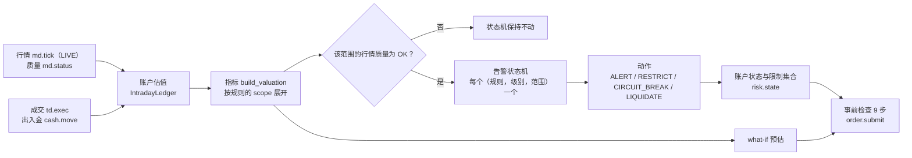
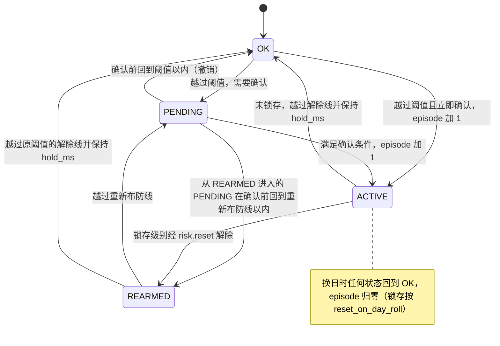
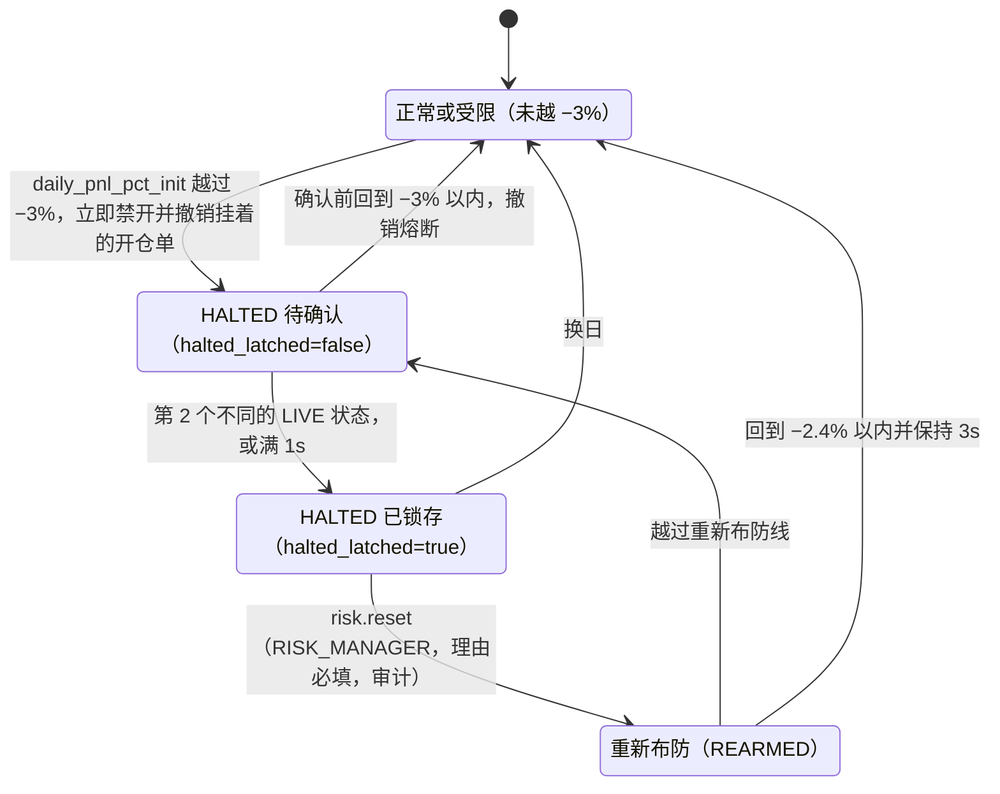

# futrisk 风控规则：指标、阈值与理由

| 项 | 内容 |
|---|---|
| 文档编号 | FR-SRS-04 |
| 版本 | v1.0 |
| 状态 | 实现对齐 |
| 日期 | 2026-10-08 |
| 适用范围 | risk-engine 的盘中风控：指标、规则与阈值、告警状态机、动作与账户状态、熔断的生命周期、事前检查、公司层控制，以及阈值的调整方法 |
| 对应标准 | GB/T 8567-2006 软件需求规格说明（SRS）中的功能需求与数据要求：逐条给出风控功能的输入（指标定义）、处理（规则、状态机）和输出（动作），每个阈值附理由 |
| 代码对照 | `config/risk_rules.yaml`（模型 `src/futrisk/common/config/risk_rules.py`）；`src/futrisk/core/` 目录下的 `metrics.py`、`rules.py`、`state_machine.py`、`evaluation.py`、`actions.py`、`restrictions.py`、`pretrade.py`、`risk_account.py`、`engine.py`，以及公司层的 `firm.py`（调用约定见同目录的 `ENGINE.md`）；配置热加载的校验在 `src/futrisk/services/risk_engine/service.py`（`_validate_config`） |
| 关联文档 | [README](README.md)（规范）· [01 架构](01-architecture.md) · [02 通信协议](02-communication-protocol.md) · [03 数据库](03-database-schema.md) · [05 清算](05-clearing.md) · [10 回测分析](10-backtest-analysis.md) |

> 本文是风控规则的完整说明，01 §8.14 只列要点。主题、命令、消息字段、枚举和表以 [02](02-communication-protocol.md)、[03](03-database-schema.md) 为准，本文只引用。文中的数字都取自代码、配置或测试，出处写在表格或正文中；各阈值的**理由是设计判断，不是监管要求**，数字都可以按账户覆盖。比率一律写成小数（README §3.4），−0.03 即 −3%。

## 目录
1. [范围与依据](#1-范围与依据)
2. [风控处理链路](#2-风控处理链路)
3. [指标](#3-指标)
4. [规则与阈值](#4-规则与阈值)
5. ["单日浮亏 3%"的口径](#5-单日浮亏-3的口径)
6. [告警状态机](#6-告警状态机)
7. [动作与账户状态](#7-动作与账户状态)
8. [熔断的生命周期](#8-熔断的生命周期)
9. [事前检查流水线](#9-事前检查流水线)
10. [公司层](#10-公司层)
11. [验收场景](#11-验收场景)
12. [如何调整阈值](#12-如何调整阈值)
13. [回测验证](#13-回测验证)
14. [已知限制](#14-已知限制)
15. [需求可追踪性](#15-需求可追踪性)
16. [修订记录](#16-修订记录)

---

## 1. 范围与依据

### 1.1 本文回答的问题
- 系统监控哪些风险指标，每个指标怎么算、用什么单位、属于哪个维度，行情不可信时怎么处理（第 3 章）；
- 每条规则的每个级别：阈值、动作、确认、解除线、冷却、锁存与重新布防、按账户覆盖，以及**为什么是这个数**（第 4 章）；
- 题目的"单日浮亏 3%"按什么口径计算（第 5 章）；
- 告警怎样做到"只触发一次"，熔断怎样从越线走到锁存、再到人工重置或换日（第 6~8 章）；
- 下单前的 9 步检查（第 9 章）、公司层控制（第 10 章）、验收场景（第 11 章）和阈值的调整方法（第 12 章）。

### 1.2 事实来源

| 内容 | 来源 |
|---|---|
| 规则、级别、阈值、按账户覆盖、事前检查与系统参数 | `config/risk_rules.yaml`，结构由 `src/futrisk/common/config/risk_rules.py` 的 pydantic 模型校验（未知键报错，`params` 除外） |
| 涨跌停幅度、保证金率、交易所限额 | `config/products.yaml` |
| 账户、初始资金、分片 | `config/accounts.yaml` |
| 指标公式 | `src/futrisk/core/metrics.py`：`build_valuation`（账户估值）、`compliance_utilization`、`WhatIf`（事前预估）；字段含义同 02 §7.6 |
| 规则编译、解除线、重新布防线 | `src/futrisk/core/rules.py`：`compile_rule`、`CompiledRule.clear_line` / `rearm_line` |
| 状态机、范围展开 | `src/futrisk/core/state_machine.py`（`LevelMachine`）、`src/futrisk/core/evaluation.py`（`evaluate_owner`） |
| 动作、限制、账户状态、熔断 | `src/futrisk/core/actions.py`、`src/futrisk/core/restrictions.py`、`src/futrisk/core/engine.py` |
| 事前检查 | `src/futrisk/core/pretrade.py`（`check_order`） |
| 公司层 | `src/futrisk/core/firm.py` |
| 行为验证 | `tests/unit/engine/` 下的 `test_engine_rules_sm.py`、`test_engine_acceptance.py`、`test_engine_pretrade.py`、`test_engine_firm.py`、`test_engine_metrics.py`、`test_engine_compliance.py`、`test_engine_quality_materiality.py`；`tests/unit/bots/test_bots_calibration.py`；`tests/e2e/test_e2e_acceptance.py` |

本文的数字在 v1.0 修订时用代码函数逐一复算过（规则的解除线和布防线、各品种上限、ACC3 的价格状态、what-if 例子、剧本标定），出处见各处正文。

### 1.3 记号
- C：初始资金（`initial_capital`）；E：动态权益（`equity`）；S：静态权益（`static_equity`）；P_perf：业绩权益（`perf_equity`）。
- `net_p`：品种 p 的净名义敞口（多头为正、空头为负，按标记价 × 乘数 × 手数计算）；`lp_p`：品种 p 在当前交易日的涨跌停幅度（`products.yaml` 的 `limit_pct` 加 `limit_schedule`）。
- 盘中估值和比率用 float64；清算结果用十进制精确值（01 §8.3，[05 清算](05-clearing.md)）。

---

## 2. 风控处理链路


*这张图回答：行情、成交和出入金怎样变成账户状态，事前检查又用到了哪些结果。*

- **评估时机**（02 §8.1 主循环）：行情只更新持有或挂着该合约的账户并把它标为 dirty；每轮循环对 dirty 账户各评估一次（`EngineCore.evaluate_dirty`）；收到 `order.submit` 时，如果账户是 dirty，先评估再做事前检查（`test_dirty_account_is_evaluated_before_the_pretrade_check`）。确认计时、解除保持计时和冷却由定时器推进（`on_timer` → `reevaluate_due`）。
- **什么算"新的市场状态"**：`confirm.states` 只数**不同的 LIVE 市场状态**。市场状态是按账户计的：账户**任一**持仓合约的 LIVE tick 都会推进它的市场状态序号（`EngineCore.apply_mark` → `RiskAccount.touch_market`），不一定是越线所依赖的那个合约，价格不变也算；其他输入只触发重算（`touch`）：

| 输入 | 算新的 LIVE 市场状态 | 触发重算 |
|---|---|---|
| 持仓合约的 LIVE tick（`md.tick.{instrument_id}`） | 是 | 是 |
| 只有挂单、没有持仓的合约的 tick | 否 | 是 |
| `ctl.snapshot` 取回的 tick（只更新标记价，01 §6.1） | 否 | 是 |
| 成交、出入金 | 否 | 是 |
| 提交委托、撤单（合规计数和报单令牌桶变化，§3.4） | 否 | 是 |
| `md.status` 使持仓合约的质量变化 | 否 | 是 |
| 定时器到期（`confirm.ms`、`hold_ms`、冷却结束） | 否 | 只重算到期的状态机 |

  成交和出入金不算新状态，是因为它们不是对市场的独立观察：同一组价格下的成交不能证明越线不是一个坏点（`test_facts_do_not_confirm_a_pending_breaker`）。反过来，另一个持仓合约的一笔行情就能确认某个合约的坏点，这是已知缺陷（§8.2、第 14 章，08 §5.2）。

---

## 3. 指标
指标按维度分组：资金（§3.2）、持仓（§3.3）、交易行为（§3.4）、公司层（§3.5）。指标名在规则里写作 `account.*`、`product.*`、`sector.*`（公司层为 `firm.*` 前缀），通过 `@register_metric` 注册（02 §10），可以扩展。账户的全部指标由 `metrics.build_valuation` 一次算出。行情质量门控按规则的范围取值，对所有指标一视同仁（本文 §3.6）。

### 3.1 估值口径

| 项 | 口径 | 出处 |
|---|---|---|
| 标记价 | 当日最新 tick 的最新价（`md.tick` 流的 LIVE tick，或 `ctl.snapshot` 取回的 tick）；tick 带涨停或跌停封板标志时取涨跌停价（封板时仓位出不去，按可成交的价格估值）；当日还没有 tick 时取昨结算价 | `engine.py` `_tick_mark`、`mark_of` |
| 资金 | 与 02 §7.6 `AccountFunds` 相同：S = 上日结存 + 当日净入金；E = S + 平仓盈亏 + 持仓盯市盈亏 − 手续费；保证金 = 标记价 × 乘数 × 手数 × 公司保证金率，含单向大边；可用资金 = E − 保证金 − 冻结保证金 − 冻结手续费；风险度 = 保证金 ÷ E | `ledger.py` `IntradayLedger.funds` |
| 日内峰值 | 起点为 SOD 的业绩权益（上日结存 − 累计净入金）；**只在账户范围的行情质量为 OK 时推进**（§3.6）；重启后从 `metric_samples` 表中质量为 OK 的样本恢复（RK-09） | `engine.py` `_value`、ENGINE.md 第 8 节 |
| 高水位 | max（SOD 的 `hwm_equity`，日内峰值）。SOD 的 `hwm_equity` 由清算按 max（上日高水位，当日业绩权益）逐日滚动（[05 清算](05-clearing.md)） | `metrics.py` `build_valuation` |
| 除法 | 分母 > 0 时正常相除；分子为 0 时结果为 0；否则按符号封顶为 ±9999（风险度封顶 9999.99999999） | `metrics.py` `_ratio`、`ledger.py` |

盘中的数字是预估，正式结果以清算为准。盘中账本复用清算的持仓、计费和单向大边算法，标记价等于结算价时两者一致（[05 清算](05-clearing.md)"盘中预估与结算的关系"一节）。

### 3.2 资金维度

| 指标（规则中的 `metric`） | 定义 | 单位 | 用于规则 |
|---|---|---|---|
| `account.daily_pnl` | E − S = 平仓盈亏 + 持仓盯市盈亏 − 手续费（昨结起算） | 元 | — |
| `account.daily_pnl_pct_init` | `daily_pnl` ÷ C | 比率 | `daily_loss`（**验收口径**，第 5 章） |
| `account.daily_pnl_pct_sod` | `daily_pnl` ÷ S | 比率 | —（可替换的口径） |
| `account.floating_pnl_pct_init` | 持仓盯市盈亏 ÷ C | 比率 | `daily_loss` 的 `floating_only` 口径 |
| `account.perf_equity` | E − 累计净入金（不含初始资金） | 元 | — |
| `account.nav` | P_perf ÷ C | 无量纲 | `nav_floor` |
| `account.intraday_dd` | （日内峰值 − P_perf）÷ 日内峰值；峰值 ≤ 0 时为 0 | 比率 | `intraday_dd` |
| `account.hwm_dd` | （高水位 − P_perf）÷ 高水位；高水位 ≤ 0 时为 0 | 比率 | `hwm_dd` |
| `account.risk_degree` | 保证金 ÷ E（保证金按公司费率，含单向大边，**不含**挂单冻结） | 比率 | `risk_degree` |
| `account.available` | E − 保证金 − 冻结保证金 − 冻结手续费 | 元 | —（事前检查第 7 步） |

- 出入金不是盈亏：`daily_pnl` 以 S 为基准，S 已经包含当日净入金；回撤和净值按扣除累计净入金后的业绩权益计算，所以入金不会被当成"盈利"，出金也不会被当成"亏损"（`test_cash_is_not_pnl`）。
- `money_base`：`daily_pnl_pct_init`、`floating_pnl_pct_init`、`nav` 以 C 换算成金额，`daily_pnl_pct_sod` 以 S 换算，用于 02 §7.6 `RuleStatus.headroom_money`（仪表盘上"离下一级还剩多少元"，`metrics.money_headroom`）。

### 3.3 持仓维度

| 指标 | 定义 | 单位 | 用于规则 |
|---|---|---|---|
| `account.gross_notional` | Σ 标记价 × 乘数 × 手数（多空都计） | 元 | — |
| `account.net_notional` | Σ 带符号的名义值（多头为正） | 元 | — |
| `account.leverage` | 总名义 ÷ E | 倍 | `leverage` |
| `account.effective_n` | 1 ÷ Σ w_p²，w_p = \|net_p\| ÷ Σ\|net_q\|（`metrics.effective_n_of`）；空仓时为"不适用"（None，快照中显示为 0） | 个 | `concentration` |
| `product.net_pct_equity` | \|net_p\| ÷ E（p 的各月份合约多空相抵后） | 比率 | — |
| `product.utilization` | `net_pct_equity` ÷ `cap_pct`，其中 `cap_pct` = 0.03 ÷ lp_p（`metrics.LIMIT_LOSS_BUDGET`） | 比率 | `product_exposure` |
| `sector.net_pct_equity` | \|Σ_{p∈s} net_p\| ÷ E（板块 s 内的品种相抵后） | 比率 | `sector_exposure` |
| `account.limit_stress` | Σ_p \|net_p\| × lp_p ÷ E | 比率 | `limit_stress` |

- 品种所属板块取自 `products.yaml` 的 `sector`：`black`（rb、hc、i、j）、`nonferrous`（cu）、`precious`（au）、`agri`（m）、`equity_index`（IF、IH、IC、IM）、`rates`（T）。
- 涨跌停幅度按交易日生效（`limit_schedule`）：i、m 自 20260930 起由 0.06 调为 0.08，`cap_pct` 和 `limit_stress` 在当天自动随之变化。
- 限仓的使用率计入 `account.compliance_util`（§3.4）：持仓达到限仓的 80% 时 `compliance/warn` 告警；开仓后会超过限仓时，事前检查第 6 步拒单（`REJECT_POSITION_LIMIT`，第 9 章）。

### 3.4 交易行为（合规）维度

| 指标 | 定义 | 用于规则 |
|---|---|---|
| `account.compliance_util` | 以下各项的最大值：当日开仓手数 ÷ 每日开仓上限、撤单次数 ÷ 撤单上限、大额撤单次数 ÷ 大额撤单上限（这三项逐合约）；自成交次数 ÷ 自成交上限；持仓手数（多空中较大的一边）÷ 限仓（逐合约）；报单令牌桶的使用率（1 − 剩余令牌 ÷ 桶容量）。计算函数为 `metrics.compliance_utilization`，令牌桶部分为 `risk_account.TokenBucket.utilization` | `compliance` |
| `account.orders_today` / `account.cancels_today` | 当日报单数 / 撤单数（只做展示） | — |

计数规则：开仓手数按当日开仓成交累计；每次**进入** `CANCEL_PENDING` 算一次撤单（撤单重发不算，ENGINE.md 第 7 节）；委托数量不小于 `large_cancel.min_qty` 的撤单同时计为大额撤单；同一账户买卖两个方向出现同一个成交编号，算一次自成交。上限取自 `products.yaml`：

| 交易所 / 品种 | 撤单上限（每合约每日） | 大额撤单 | 自成交上限 | 每日开仓上限 | 限仓 | 单笔上限 LIMIT / MARKET |
|---|---|---|---|---|---|---|
| SHFE（rb、hc、cu、au） | 500 | 数量 ≥ 300 的撤单最多 50 次 | 5 | — | — | 500 / 30 |
| DCE（i、m） | 500 | 数量 ≥ 800 的撤单最多 50 次 | 5 | — | — | 1000 / 100 |
| DCE（j） | 500 | 同上 | 5 | — | — | 500 / 50 |
| CFFEX（IF） | 400 | 数量 ≥ 16 的撤单最多 100 次 | 5 | 500 | 5000 | 20 / 10 |
| CFFEX（IH、IC、IM） | 400 | 同上 | 5 | 500 | 1200 | 20 / 10 |
| CFFEX（T） | 400 | 同上 | 5 | — | 4000 | 50 / 30 |

报单速率由每个账户一个令牌桶控制（`pretrade.throttle_rate_per_s: 20`，`throttle_burst: 40`）：通过事前检查前 4 步的委托（不论最终是否通过）各消耗一个令牌，桶空时第 5 步拒单（`REJECT_THROTTLED`）。桶的使用率计入 `compliance_util`，短时间内连续报单用掉 32 个令牌（80%）时 `compliance/warn` 先告警（`test_the_order_rate_warns_before_the_throttle_rejects`）；每笔委托和每次撤单都会让账户重新评估。

### 3.5 公司层
- coordinator（分片 0）汇总各分片的 `AccountSnapshot`，得到公司层估值（`FirmAggregator.build_valuation`）：资金各字段求和，风险度按汇总后的保证金 ÷ 汇总后的权益重算；各品种敞口跨账户相加（多空相抵）；有效品种数、涨跌停压力按汇总后的品种敞口重算。
- 公司层指标以 `firm.` 为前缀，名称与账户层相同（例如公司层的 `daily_pnl_pct_init`，分母是各账户初始资金之和），在 coordinator 的公司层估值上计算，供 `scope` 为 `firm` 的规则使用；`firm/product`、`firm/sector` 范围的规则直接用 `product.*`、`sector.*` 指标，作用在公司层的汇总敞口上。公司层没有 `compliance_util`。
- 公司层的日内峰值从公司的 SOD 业绩权益起算，按公司自己的业绩权益跟踪（不是各账户峰值之和，那样会高估回撤），只在公司层质量为 OK 时推进；公司高水位是跨日的峰值最大值，**只保存在内存中**（第 14 章）。
- 汇总结果以 `FirmSnapshot` 发布到 `risk.firm`（02 §7.6），每秒一次。

### 3.6 行情质量门控
合约的行情质量（`MdQuality`）以 `md.status` 为准：某合约还没有 `md.status` 时，收到 LIVE tick 就视为 `OK`；从没见过的合约为 `UNKNOWN`（失效即安全）；md-gateway 心跳丢失时，所有合约按 `STALE` 处理（`UNKNOWN` 仍为 `UNKNOWN`），直到心跳恢复（`EngineCore.quality_of`）。md-gateway 在合约连续 5s 没有可信来源覆盖时把它标为 `STALE`，满 30s 标为 `UNKNOWN`（`feeds.yaml` 的 `arbitration.stale_s` / `unknown_s`，只在连续交易时段内判定，01 §8.13）。覆盖看的是可信源是否还在送这个合约，不看价格是否在变：最后一个可信源连着却不出新行情时，合约仍为 `OK`，风控按不再更新的标记价评估（08 §5.2）。

规则范围的质量（`metrics.build_valuation`）：

| 范围 | 质量取值 |
|---|---|
| 账户（`acct:{A}`） | 所持合约中质量不是 `OK` 的那些，名义值合计不超过总名义的 `system.quality_stale_tolerance`（默认 0.10）时，账户按 `OK` 计，这些合约按最后已知的标记价估值；超过时取所持合约中最差的质量。空仓账户为 `OK`。容忍度设为 0 时直接取最差的质量 |
| 品种、板块、合约（`acct:{A}/prod:{p}` 等） | 该范围内所持合约中最差的质量（不适用容忍度） |
| 公司（`firm`、`firm/prod:{p}`、`firm/sector:{s}`） | 有敞口的账户中最差的质量，每个账户按其所持合约中最差的质量计（账户层的容忍度不传到公司层）；某分片超过 5s 没有快照或心跳时，它的账户按 `STALE` 计 |

容忍度的理由：一个只占敞口 5% 的品种行情陈旧，不应让整个账户的 `daily_loss` 停摆，其他品种的真实亏损照样要能触发熔断（`test_a_small_stale_position_does_not_stop_a_real_breach_from_halting`）；陈旧部分超过 10% 时，按最后标记价估出的数字已不可靠，状态机保持不动（`test_a_large_stale_share_still_holds_the_machines`）。md-gateway 心跳丢失时所有合约都按 `STALE` 计，有持仓的账户都超过容忍度。

这一门控的代价：门控期间账户范围的规则完全不动，其余 `OK` 合约的真实亏损即使超过 −3%（2026-10-08 的核对中实测到 −5.8%，已越过 −5% 的减仓线）也不熔断、不告警、不生成减仓计划，`RuleStatus.value` 为 null，只靠第 2 步（陈旧合约禁开）和 what-if（拦截使越线指标更差的开仓）约束开仓。这是已知缺陷（第 14 章，08 §5.2）。

范围的质量不是 `OK` 时：

| 对象 | 行为 |
|---|---|
| 状态机 | **保持不动**：既不升级也不降级，不发生任何迁移；定时器复查也跳过这些状态机（01 §8.14 质量门控） |
| 解除的保持计时（`hold_ms`） | 清零，质量恢复后重新计时，保持期不能跨越行情不可信的时段（`test_quality_gating_resets_the_hold_timer`） |
| 确认计时（`confirm.ms`）和告警冷却（`cooldown_s`） | **不暂停**：两者分别从进入 PENDING 和告警解除的时刻按市场时间计算，门控期间照常流逝，只是不能生效。质量恢复后的第一次评估中，仍越线的 PENDING 熔断级别若已满 `confirm.ms`，立即确认并锁存，不需要新的 LIVE 状态；已经过期的冷却也不再挡住告警。确认计时不暂停是已知缺陷（08 §5.2） |
| `RuleStatus.value` | 为 null（02 §7.6） |
| 日内峰值 | 不推进（只看账户范围的质量） |
| 该合约的开仓 | 事前检查第 2 步拒绝（`REJECT_MD_UNAVAILABLE`），平仓不受影响 |
| 账户 | `UNKNOWN` 合约的名义值超过总名义的 50%（`system.md_unknown_account_block_pct: 0.5`）时，加上账户禁开限制 `SYSTEM:MD_UNKNOWN`，质量恢复后自动解除（01 §8.5） |
| 事前 what-if | 照常按最后已知的标记价计算（§9.3）：它只会多拒单，不会放行 |

质量取值只看规则的范围，与指标本身是否依赖行情无关：账户范围的 `compliance`、`nav_floor` 等规则，在账户的陈旧敞口超过容忍度时同样保持不动。

### 3.7 "不适用"与 `min_gross_pct`
- 指标值为"不适用"（None）时视为**未越线**：已有的状态机按正常路径解除（越过解除线满 `hold_ms`），没有状态机的不创建。例如空仓账户的有效品种数（`test_none_value_is_never_a_breach`）。
- 规则配置了 `min_gross_pct` 时，账户（或公司）的总名义 ÷ 权益低于它，该规则就是"不适用"（`evaluation.rule_value`）。默认配置只有 `concentration` 用它（0.5）：小账本谈不上集中度风险（`test_small_book_is_never_evaluated`）。
- "不适用"与质量门控不同：前者是一次正常的观察，状态机可以因此解除；后者让状态机保持不动（`test_quality_freeze_is_not_the_gate`）。

---

## 4. 规则与阈值

### 4.1 规则的公共参数
每条规则对一个指标、在一种范围上展开，每个级别有自己的阈值和动作（结构与 02 §7.6 `RuleSet.rules` 的 RuleDef 一致；编译为 `rules.CompiledRule`）。

| 键 | 默认值 | 含义 | 校验 |
|---|---|---|---|
| `id` | 必填 | 规则名，出现在告警键和限制的 `source` 中 | — |
| `metric` | 必填 | 注册的指标名（第 3 章） | 编译时不检查；只有热加载的 prepare 阶段拦截未注册的名字，冷启动时要到第一次评估才抛异常（§12.1） |
| `op` | 必填 | `<=`、`<`：越小越危险（亏损、净值、有效品种数）；`>=`、`>`：越大越危险 | 只能取这四个值 |
| `scope` | `account` | `account`、`account/product`、`account/sector`、`account/instrument`、`firm`、`firm/product`、`firm/sector`；展开成 02 §7.3 的 `scope_key` | 未知范围在 `RuleBook` 构造时失败（冷启动即失败） |
| `hysteresis` | 0.2 | 解除线 = 阈值 ∓ \|阈值\| × hysteresis，取越线方向的内侧（安全侧） | — |
| `hold_ms` | 3000 | 越过解除线后必须持续的时间 | — |
| `cooldown_s` | 60 | 冷却时间，**只对 ALERT 级别生效**（§6.4） | — |
| `pretrade` | false | 参与事前检查第 8 步的 what-if | — |
| `enabled` | true | 关闭后该规则不评估，也不编译 | — |
| `reset_on_day_roll` | true | 换日时解除锁存 | — |
| `min_gross_pct` | 无 | 总名义 ÷ 权益低于它时规则不适用（§3.7） | — |
| `levels[].threshold` / `action` / `params` | 必填 / 必填 / {} | 阈值、动作、动作参数（§7.2） | `params` 是不定类型的字典，**不校验**：拼错的键被忽略，值的类型到级别生效时才转换（§7.2、第 14 章） |
| `levels[].confirm` | `states: 1, ms: 0`（立即确认）；`CIRCUIT_BREAK` 没有配置时为 `states: 2, ms: 1000` | 确认条件（§6.2）；`states: 0` 表示只按时间确认 | `states: 0` 必须配 `ms` > 0 |
| `levels[].latch` | false | 锁存 | 只允许 `CIRCUIT_BREAK` 和 `LIQUIDATE`；`ALERT`、`RESTRICT` 锁存（包括经按账户覆盖设置的）编译失败 |
| `levels[].rearm.extra` | 0.01 | 重新布防线与重置时指标值的距离（§6.5） | — |
| `overrides` | {} | 账户 → 级别名 → 要覆盖的字段 | 覆盖不存在的级别名编译失败 |

热加载的 prepare 阶段还会检查已启用的规则能否编译、指标名是否已注册（risk-engine `_validate_config`），任一项失败则整个配置版本被放弃（§12.1）。`futrisk config validate` 和离线的 `futrisk config commit` 只做 pydantic 的结构校验，不编译规则、不检查指标名，也不检查 `params`（08 §5.2）。

### 4.2 默认阈值总表
来源：`config/risk_rules.yaml`。解除线由 `CompiledRule.clear_line` 按 §4.1 的公式算出；"what-if"一列表示该级别会不会在事前检查第 8 步拦截开仓（规则 `pretrade: true`，且级别为熔断或带 `block_open`，即 `LevelSpec.blocks_open`）。

| 规则 | 指标 / 方向 / 范围 | 级别 | 阈值 | 动作（参数） | 确认 | 解除线 | what-if |
|---|---|---|---|---|---|---|---|
| `daily_loss` | `account.daily_pnl_pct_init` `<=` 账户；hysteresis 0.2，`pretrade: true` | warn | −0.020 | `ALERT` | 立即 | −0.016 | 否 |
| | | restrict | −0.025 | `RESTRICT`（`max_order_factor: 0.5`，`no_add_to_losers: true`） | 立即 | −0.020 | 否 |
| | | halt | −0.030 | `CIRCUIT_BREAK`，锁存，`rearm.extra: 0.01` | 2 个不同 LIVE 状态或 1000ms | −0.024（只在 `REARMED` 时起作用） | **是** |
| | | derisk | −0.050 | `LIQUIDATE`（`step: 0.5`） | 立即 | −0.040 | 否 |
| `intraday_dd` | `account.intraday_dd` `>=` 账户 | warn | 0.025 | `ALERT` | 立即 | 0.020 | 否 |
| | | block | 0.04 | `RESTRICT`（`block_open`） | 立即 | 0.032 | 否 |
| `hwm_dd` | `account.hwm_dd` `>=` 账户 | warn | 0.08 | `ALERT` | 立即 | 0.064 | 否 |
| | | halve | 0.12 | `RESTRICT`（`exposure_cap_factor: 0.5`） | 立即 | 0.096 | 否 |
| | | block | 0.15 | `RESTRICT`（`block_open`） | 立即 | 0.12 | 否 |
| `nav_floor` | `account.nav` `<=` 账户；**hysteresis 0.02** | warn | 0.90 | `ALERT` | 立即 | 0.918 | 否 |
| | | derisk | 0.85 | `LIQUIDATE`（`step: 0.5`） | 立即 | 0.867 | 否 |
| `risk_degree` | `account.risk_degree` `>=` 账户；`pretrade: true` | warn | 0.35 | `ALERT` | 立即 | 0.28 | 否 |
| | | block | 0.50 | `RESTRICT`（`block_open`） | 立即 | 0.40 | **是** |
| | | derisk | 0.70 | `LIQUIDATE`（`step: 0.3`） | 立即 | 0.56 | 否 |
| `product_exposure` | `product.utilization` `>=` 账户 × 品种；`pretrade: true` | warn | 0.7 | `ALERT` | 立即 | 0.56 | 否 |
| | | block | 1.0 | `RESTRICT`（`block_open`，该品种） | 立即 | 0.8 | **是** |
| `concentration` | `account.effective_n` `<` 账户；**hysteresis 0.1**，`min_gross_pct: 0.5` | warn | 5 | `ALERT` | 只按时间，30000ms | 5.5 | 否 |
| | | restrict | 3 | `RESTRICT`（`block_open_largest_product`） | 只按时间，30000ms | 3.3 | 否 |
| `sector_exposure` | `sector.net_pct_equity` `>=` 账户 × 板块 | warn | 0.8 | `ALERT` | 立即 | 0.64 | 否 |
| | | block | 1.2 | `RESTRICT`（`block_open`，该板块） | 立即 | 0.96 | 否 |
| `leverage` | `account.leverage` `>=` 账户；`pretrade: true` | warn | 3.0 | `ALERT` | 立即 | 2.4 | 否 |
| | | block | 4.0 | `RESTRICT`（`block_open`） | 立即 | 3.2 | **是** |
| `limit_stress` | `account.limit_stress` `>=` 账户 | warn | 0.10 | `ALERT` | 立即 | 0.08 | 否 |
| | | block | 0.15 | `RESTRICT`（`block_open`） | 立即 | 0.12 | 否 |
| `compliance` | `account.compliance_util` `>=` 账户 | warn | 0.8 | `ALERT` | 立即 | 0.64 | 否 |

- 所有规则的 `hold_ms` 都是默认的 3000，`cooldown_s` 都是 60（只影响 ALERT 级别）；只有 `daily_loss/halt` 锁存。三个 `LIQUIDATE` 级别（`daily_loss/derisk`、`nav_floor/derisk`、`risk_degree/derisk`）都**不锁存**：越过解除线满 3s 后解除，再次越线是一个新的 episode，会生成一份新的减仓计划。
- 默认配置里没有公司层规则（§10.2），也没有按账户覆盖的熔断线；唯一的按账户覆盖是 `concentration`（§4.4）。

### 4.3 各阈值的理由

#### 4.3.1 当日亏损 `daily_loss`
衡量当日按昨结起算的盯市总盈亏占初始资金的比例（口径见第 5 章）。四级阈值以 CTA 账户的波动为尺度：年化波动 10%~15% 时，日波动 σ = 年化波动 ÷ √252 = 0.63%~0.945%（01 §8.14 的设计假设）。

| 级别 | 阈值 | 约合几个日 σ | 理由 |
|---|---|---|---|
| warn | −2% | 2.1~3.2 | 超出日常波动，通知风控经理和策略，但不干预交易 |
| restrict | −2.5% | 2.6~4.0 | 减速而不停车：单笔上限减半（例如 rb 限价单 500 手降为 250 手），并拒绝在亏损的品种和方向上加仓，正好针对"逆势加仓"的亏损放大方式 |
| halt | −3% | 3.2~4.8 | 题目的验收阈值：正常波动很少触及；从越线那一刻起禁开，确认后锁存，只能人工重置或换日 |
| derisk | −5% | 5.3~7.9 | 极端情况，只生成减仓计划，由风控经理确认后手工执行（TD-08） |

- 期货收益有厚尾，σ 倍数只用来比较各级别的相对位置，不能当成发生概率。
- 三个级别之间各留 0.5 个百分点：从预警到减速、再到熔断，都给人和策略留出反应时间；验收演示也靠这个间距让三个级别依次出现（第 11 章）。
- 熔断级别的确认条件是 2 个不同的 LIVE 状态或 1s：设计意图是让很快被纠正的单个坏点锁不死账户（01 §8.13 坏点防线的最后一道），真实的持续下跌也只延迟一个 tick 或 1s；而在确认之前账户已经禁开（§8.2），所以这段时间不会有新的开仓成交。实现上，坏点只有在同一合约的下一笔行情于 1s 内把它纠正、且这期间账户没有别的持仓合约来行情时才会被撤销；第二个状态可以来自任一持仓合约（§2），所以坏点之后先到的是别的合约的行情，或 1s 内没有纠正，账户照样锁存，要人工重置（§8.2，08 §5.2）。
- `rearm.extra: 0.01`：人工重置后，亏损再扩大 1 个百分点就重新熔断（§6.5）。
- `pretrade: true`：熔断级别参与 what-if。一笔开仓的手续费和相对标记价的滑点会立即减少权益，如果下单后的当日亏损会越过 −3% 且比下单前更差，这笔单在事前就被拒（`REJECT_WHATIF_BREACH`）。what-if 始终按 −3% 判断，人工重置后也一样（§6.5）。

#### 4.3.2 日内回撤 `intraday_dd`
衡量当日业绩权益距日内峰值的回撤，抓的是"利润大幅回吐"。它与当日亏损互补：一个先赚 3% 的账户回吐 4%（峰值 1.03C，此时业绩权益 0.9888C），当日亏损只有约 −1.1%，`daily_loss` 一级都不会触发，但回吐本身说明行情或策略出现了异常。

| 级别 | 阈值 | 理由 |
|---|---|---|
| warn | 2.5% | 与 `daily_loss/restrict` 的幅度相同：没有日内盈利的账户，两者同时出现（§4.5） |
| block | 4% | 禁开而不熔断：回吐不是亏损限额，账户仍然可以平仓和持有；回吐收窄到解除线 3.2% 以内满 3s 后自动解除 |

#### 4.3.3 距高水位回撤 `hwm_dd`
衡量业绩权益距历史高水位（跨日）的回撤，逐级降低敞口，与资管产品常见的回撤控制线对齐。

| 级别 | 阈值 | 理由 |
|---|---|---|
| warn | 8% | 提示进入回撤管理区 |
| halve | 12% | `exposure_cap_factor: 0.5`：各品种的敞口上限减半（例如 rb 从 60% 降为 30%，§4.3.6），只拦截使净敞口增大的开仓，既有仓位不强制削减 |
| block | 15% | 全面禁开，只能平仓 |

#### 4.3.4 单位净值 `nav_floor`
衡量相对初始资金的累计表现，对应产品合同中常见的预警线（0.90）和止损线（0.85），这两个数是示例值，应当按每个账户的合同覆盖。
- 0.85 生成减仓计划（`step: 0.5`，逐合约减半）。
- `hysteresis: 0.02`：净值是 1 附近的水平量，不是从 0 起算的量。默认的 0.2 会把解除线放到 1.08 和 1.02，账户几乎不可能解除；0.02 给出 0.918 和 0.867（`test_nav_floor_clears_on_its_configured_line`）。
- 与 `hwm_dd` 的分工见 §4.5：账户曾经大幅盈利时，高水位回撤先触发；净值一直在 1 附近时，两者按 0.92 → 0.90 → 0.88 → 0.85 交替逐级收紧。

#### 4.3.5 风险度 `risk_degree`
衡量公司保证金口径的风险度（保证金 ÷ 权益），是追加保证金的前兆：清算时权益低于保证金就要追保（[05 清算](05-clearing.md)：追加保证金 = max(0，保证金 − 权益)）。

| 级别 | 阈值 | 理由 |
|---|---|---|
| warn | 35% | 期货账户风险度通常控制在 30%~50% |
| block | 50% | 留出节前保证金上调的缓冲（见下） |
| derisk | 70% | 距追保只剩 30% 的权益缓冲（保证金不变时，权益再减少 30% 就要追保）；生成减仓计划，每个合约减 30%（`step: 0.3`），比亏损类规则的 50% 温和，因为风险度高本身还不是亏损 |

节前保证金上调：`products.yaml` 中 i、m 的保证金条目自 20260930 起把交易所保证金率由 8%、7% 上调到 10%，加上经纪商加收的 1%，公司费率由 9%、8% 上调到 11%（`InstrumentRegistry.margin_rate`），同样的持仓风险度分别上升 22.2% 和 37.5%（只看交易所费率是 25% 和 42.9%）。一个恰好在 35% 告警线上、只持有 m 的账户，上调后风险度为 35% × 1.375 = 48.1%，仍低于 50% 的禁开线：告警线与禁开线之间的间距，正好容得下节前上调。配置中保证金条目的生效日比大商所的通知（自 2026-09-29 结算时起调整为 10%）晚一个交易日，节后恢复原费率的条目也没有配置，这是配置数据的缺陷（08 §5.2）；涨跌停 8% 自 20260930 起与通知一致。

#### 4.3.6 单品种敞口 `product_exposure`
**上限 = 3% ÷ 涨跌停幅度**，`utilization` = 品种净名义占权益的比例 ÷ 上限。`utilization` = 1 时，\|net_p\| × lp_p = 3% × E：该品种走一个完整的不利涨跌停，亏损恰好是当前权益的 3%。所以只要各品种都在上限以内，**任何单个品种一次涨跌停都不会单独打穿 3% 的熔断线**。

| 品种 | 涨跌停幅度（`products.yaml`） | 上限（净名义 ÷ 权益） | 告警线（0.7 × 上限） |
|---|---|---|---|
| rb、hc | 0.05 | 60% | 42% |
| cu | 0.07 | 42.9% | 30% |
| au | 0.14 | 21.4% | 15% |
| i、m | 0.06；20260930 起 0.08 | 50%；20260930 起 37.5% | 35%；20260930 起 26.25% |
| j | 0.08 | 37.5% | 26.25% |
| IF、IH、IC、IM | 0.10 | 30% | 21% |
| T | 0.02 | 150% | 105% |

- 上限以当前权益为分母，熔断线以初始资金为分母；权益接近初始资金时两者一致。
- 节前放宽涨跌停（i、m 从 6% 到 8%）会自动把上限从 50% 收紧到 37.5%。
- 净名义按品种计算（同品种各月份多空相抵），所以跨期价差不会被误判为大敞口；价差的风险由杠杆和板块规则约束。
- block 级别在该品种范围加 `BLOCK_OPEN`（`REJECT_PRODUCT_BLOCKED`），平仓不受影响。what-if 拦截"下单后会越过 1.0 且使 `utilization` 增大"的开仓；反方向开仓会降低净敞口，what-if 放行，但 block 一旦生效，该品种的所有开仓都被拒，要降低敞口只能平仓。

#### 4.3.7 有效品种数 `concentration`
有效品种数 N = 1/HHI 把"按敞口加权后相当于几个等权品种"量化成一个数。CTA 的分散化通常要求至少约 5 个相互独立的头寸（warn N < 5）；少于 3 个时风险高度集中在一两个品种上（restrict N < 3：拒绝在 \|净名义\| 最大的品种上开仓，每次评估重新确定最大品种）。
- `min_gross_pct: 0.5`：总名义不到权益的一半时不评估，小账本谈不上集中度风险。
- **只按时间确认 30s**（`states: 0, ms: 30000`）：多品种建仓时，第一个品种成交后的几秒内 N = 1，这是过渡状态，不应告警或限制；持续 30s 才确认（`test_build_transient_raises_nothing`、`test_persistent_concentration_activates_after_30s`）。
- `hysteresis: 0.1`：解除线 5.5 和 3.3，避免在整数附近来回跳。
- 按账户的授权范围覆盖阈值，见 §4.4。

#### 4.3.8 板块敞口 `sector_exposure`
同一板块内的品种高度相关（如黑色的 rb、hc、i、j），一个板块的净敞口相当于一个大品种，要按一个整体控制。告警线 80% 约为 rb 单品种上限（60%）的 1.3 倍，禁开线 120% 是它的 2 倍：板块里可以有两个品种各自接近上限，再多就只能在板块外找敞口。板块按品种净名义相加后取绝对值，板块内的对冲（如多 rb 空 hc）会相互抵消，每条腿仍受 `product_exposure` 约束。

#### 4.3.9 杠杆 `leverage`
总名义 ÷ 权益。CTA 常见的总名义杠杆为 1~3 倍：3 倍告警，4 倍禁开（what-if 拦截）。总名义多空都计，价差和对冲头寸按两条腿计入，是保守的口径。

#### 4.3.10 涨跌停压力 `limit_stress`
所有持仓同时走一个不利涨跌停时的亏损占权益的比例。封板时仓位出不去，这种风险只能在事前控制。由 §4.3.6 的定义可得：

> `limit_stress` = Σ_p \|net_p\| × lp_p ÷ E = 0.03 × Σ_p `utilization`_p

所以告警线 10% 相当于各品种 `utilization` 之和达到 3.33，禁开线 15% 相当于 5：例如 5 个品种各自顶到上限。它补上了 `product_exposure` 只看单个品种的缺口。

#### 4.3.11 合规 `compliance`
交易所对开仓手数、撤单次数、大额撤单、自成交和限仓的规定是硬约束（§3.4 的表格），报单速率由令牌桶约束。规则在任何一项用到 80% 时告警；达到 100% 的拦截由事前检查执行：开仓手数 `REJECT_OPEN_VOLUME_LIMIT` 和报单速率 `REJECT_THROTTLED`（第 5 步）、撤单 `REJECT_CANCEL_LIMIT` / `REJECT_LARGE_CANCEL_LIMIT`（`order.cancel`）、限仓 `REJECT_POSITION_LIMIT`（第 6 步）、单笔上限 `REJECT_QTY_EXCEEDS_MAX`（第 1 步，不计入 `compliance_util`），自成交在第 9 步防范（`REJECT_SELF_TRADE`）。

### 4.4 按账户覆盖（授权范围）
`overrides` 把指定级别的字段（通常是阈值）合并进该账户的级别定义（`compile_rule`），what-if 也按覆盖后的级别计算。默认配置只覆盖 `concentration`：全公司 N ≥ 5 的要求针对多品种的 CTA 账户，而以下账户按授权本来就只交易少数品种，照搬会让它们整天告警。

| 账户（`accounts.yaml`） | 授权品种（`products`） | 覆盖 | 解除线 | 说明 |
|---|---|---|---|---|
| ACC3 日内逆势加仓 | rb、hc、i | warn 2.0，restrict 1.5 | 2.2 / 1.65 | 基础仓位 rb 0.39、hc 0.17、i 0.22 倍权益时 N = 2.65；rb 加仓加满（+50%）时约 2.27（`metrics.effective_n_of`）。只有真正塌缩到约两个品种时才告警 |
| ACC4 股指杠杆方向 | IF、IC | warn 1.5，restrict 1.0 | 1.65 / 1.1 | 两个股指；由于 N ≥ 1，`<` 1.0 的 restrict 永远不会触发 |
| ACC5 螺纹跨期套利 | rb | warn 1.0，restrict 1.0 | 1.1 / 1.1 | 单品种跨期，N = 1 是结构性的，两个级别都不会触发 |

- 这些账户仍然受其他规则约束：`sector_exposure`、`product_exposure`、`daily_loss` 等不因授权而放宽。
- `accounts.yaml` 的 `products` 只是说明和策略机器人、回测的输入，**事前检查不据此拦截**：ACC5 照样可以开 IF 的仓，ACC4 照样可以开 rb、cu 的仓（第 14 章，08 §5.2）。

### 4.5 阈值之间的一致性

| 关系 | 推导 | 结论 |
|---|---|---|
| 单品种上限与熔断线 | `utilization` = 1 ⇔ \|net_p\| × lp_p = 3% × E | 任何一个品种走一个不利涨跌停，都不会单独打穿 −3% |
| 涨跌停压力与单品种 | `limit_stress` = 0.03 × Σ `utilization` | 告警 ⇔ Σ = 3.33，禁开 ⇔ Σ = 5 |
| 距高水位回撤与净值 | 高水位 = C 时，`hwm_dd` = 1 − `nav` | 净值依次经过 0.92（hwm warn）、0.90（nav warn）、0.88（敞口上限减半）、0.85（hwm 禁开，同时 nav 生成减仓计划） |
| 日内回撤与当日亏损 | 上日结存 = C（没有累计出入金）、当日没有出入金、业绩权益从未高于开盘时，`intraday_dd` = −`daily_pnl_pct_init` | 纯亏损日：−2% 告警 → −2.5% 限制下单并出现日内回撤告警 → −3% 熔断 → 4% 日内回撤禁开（此时已熔断）→ −5% 减仓计划 |
| 风险度与杠杆 | 不计单向大边时，风险度 = 杠杆 × 按名义加权的公司保证金率 | 公司费率 8%~17%（T 为 2%）时，3 倍杠杆对应约 24%~51% 的风险度 |
| 风险度告警线与节前上调 | 35% × 11/8 = 48.1% < 50% | 告警线上的账户不会因为节前上调直接被禁开（§4.3.5） |

---

## 5. "单日浮亏 3%"的口径

### 5.1 三种可能的口径

| 口径 | 定义 | 问题 |
|---|---|---|
| 纯浮亏 | 持仓盯市盈亏 | 平掉亏损仓后"归零"：账户可以在同一天反复亏 3% 而继续开仓；手续费不计入 |
| 按开仓价计算的浮亏 | Σ（标记价 − 开仓价）× 乘数 × 手数 | 把前几天的盈亏混进当天：昨天的浮盈会掩盖今天的亏损，昨天的浮亏又会让今天一开盘就越线 |
| **当日盯市总盈亏（采用）** | E − S = 平仓盈亏 + 持仓盯市盈亏 − 手续费，昨结起算 | 与清算的当日盈亏（权益 − 静态权益）口径相同（[05 清算](05-clearing.md)）；平仓不能让它归零；出入金不影响它 |

采用的口径下，平仓盈亏以昨结算（昨仓）或开仓价（今仓）为基准，持仓盯市盈亏以昨结算或开仓价为基准，所以"当日"就是从上一个结算价开始的这一天，与交易所逐日盯市的口径一致。手续费是真实损失（例如 IF 按 4400 点当日开平一手：开仓 30.36 元加平今 303.60 元，共 333.96 元，`fees.compute_fee` 按 `products.yaml` 的费率算出），计入更保守。

### 5.2 分母：初始资金
- 验收要求是"初始资金的 3%"，所以分母取初始资金 C（`daily_pnl_pct_init`）：阈值对应一笔固定的金额（ACC3 为 300,000 元），不随当天的出入金和前几天的盈亏变化。
- 以当日静态权益 S 为分母的 `daily_pnl_pct_sod` 同样已经实现；需要"按当前规模"控制的账户，把规则的 `metric` 改成它即可。

### 5.3 `floating_only` 选项
- 把 `daily_loss` 规则的 `metric` 改为 `account.floating_pnl_pct_init`（持仓盯市盈亏 ÷ C），阈值不变，通过热加载生效（第 12 章）。
- 两种口径都有测试：`test_floating_only_variant_also_triggers` 用同一个账本分别验证熔断触发，告警里的 `metric` 字段标明所用口径。
- 验收用例的构造让两种口径都会触发：ACC3 的仓位是当天开的，熔断之前没有平仓，没有已实现盈亏，两者只差当日手续费；默认口径含手续费，所以越线稍早。

---

## 6. 告警状态机
每个 `(规则, 级别, 范围)` 一个实例（`state_machine.LevelMachine`），状态持久化在 `rule_states` 表中（03 §4.3），状态取值为 02 §7.3 的 `RuleSmState`。

### 6.1 状态与迁移


*这张图回答：一个规则级别在什么条件下触发、确认、解除和重新布防。*

| 迁移 | 条件 | 产生的记录 |
|---|---|---|
| OK → PENDING | 越线，且确认条件没有立即满足；冷却中的 ALERT 级别不迁移，除非同一规则和范围的更严重级别同时越线 | `rule_states` 行；熔断级别此刻即生效（§8.2），但不产生告警 |
| OK → ACTIVE | 越线且立即确认（`confirm.states: 1`） | episode 加 1；`alerts` 行、`ALERT_RAISED` 事件 |
| PENDING → ACTIVE | 满 `confirm.states` 个不同的 LIVE 状态，或在 PENDING 中满 `confirm.ms` | 同上 |
| PENDING → OK / REARMED | 确认前回到阈值（从 REARMED 进入时为重新布防线）以内 | 只更新 `rule_states`，不产生告警事件 |
| ACTIVE → OK | 未锁存；越过解除线并持续 `hold_ms` | `ALERT_CLEARED` 事件，告警状态改为 `CLEARED`；ALERT 级别开始冷却 |
| ACTIVE → REARMED | 锁存级别经 `risk.reset` | `RESET` 事件，告警状态改为 `RESET`，审计 `RISK_RESET` |
| REARMED → PENDING | 越过重新布防线 | 同 OK → PENDING |
| REARMED → OK | 越过**原阈值**的解除线并持续 `hold_ms`，之后恢复按原阈值监控 | `rule_states` 行 |
| 任意 → OK | 换日（§6.7） | 告警状态改为 `ROLLED` |

从 REARMED 再次越线时先进入 PENDING，走与第一次相同的确认，而不是直接回到 ACTIVE，这样单个坏点不会一出现就重新锁存账户（ENGINE.md 第 12 节；确认规则的局限见 §8.2）。

### 6.2 确认（confirm）
- `confirm.states` 数的是账户**不同的** LIVE 市场状态：进入 PENDING 的那个状态算第 1 个，此后每个新的市场状态加 1；同一个状态下的重复评估不计数（`test_confirm_needs_distinct_states`）。任一持仓合约的 LIVE tick 都是一个新状态（§2），不要求是越线所依赖的合约。
- `confirm.ms`：PENDING 持续这么久也算确认，由定时器推进（`test_confirmation_by_time_without_a_second_state`：999ms 时仍为 PENDING，1000ms 时 ACTIVE）。计时从进入 PENDING 的时刻按市场时间算，行情质量门控期间不暂停（§3.6）。
- `states: 1`（默认）：立即确认，不报告 PENDING。
- `states: 0`：只按时间确认，市场状态再多也不算（`test_confirm_states_zero_is_time_only`）。
- 重启后第一个市场状态重新作为锚点，已经计入的次数保留（`rule_states.confirm_count`）。

### 6.3 解除线与保持时间
- 解除线 = 阈值 ∓ \|阈值\| × `hysteresis`，取越线方向的内侧，例如 −3% → −2.4%，0.025 → 0.02，0.90 → 0.918（`CompiledRule.clear_line`，§4.2 列出了全部解除线）。
- 指标回到解除线以内（安全侧）才开始计时，持续 `hold_ms`（3000ms）才解除；中途回到解除线以外，计时清零（`test_hysteresis_hold_and_cooldown`）。回到阈值以内但还没到解除线，状态保持 ACTIVE。
- 行情质量不是 OK 时计时清零（§3.6）。
- 锁存的级别不会自动解除。

### 6.4 冷却（cooldown）
- 只对 **ALERT** 级别生效：ACTIVE → OK 之后 `cooldown_s`（60s）之内，同一级别再次越线不会触发，避免指标在阈值附近抖动时反复告警。冷却的截止时刻在解除时定下，按市场时间流逝，行情质量门控期间也不暂停。
- 升级不受冷却限制：同一规则和范围的更严重级别同时越线时，冷却中的级别照常触发（escalation）。
- RESTRICT、CIRCUIT_BREAK、LIQUIDATE 级别没有冷却，每次重新越线都立即生效（新的 episode）。如果它们也冷却，冷却期内越线的账户就不受限制，这是"失效即开放"（fail-open），违背 01 §8.5（`test_cooldown_only_for_alert_levels`、`test_restrict_reactivates_inside_the_cooldown`）。

### 6.5 锁存与重新布防
- 锁存（latch）只允许用在 `CIRCUIT_BREAK` 和 `LIQUIDATE` 上；默认配置只有 `daily_loss/halt` 锁存。锁存的 ACTIVE 不随指标恢复而解除（`test_latch_reset_rearm_new_episode`）。
- `risk.reset` 把锁存的级别改为 REARMED，**重新布防线**按越线方向取（`CompiledRule.rearm_line`，重置时的值为状态机最后一次在行情可信时看到的值）：
  - 越小越危险：min（阈值，重置时的值 − `extra`）；
  - 越大越危险：max（阈值，重置时的值 + `extra`）。

  例子（阈值 −3%，`extra` 0.01）：在 −3.5% 时重置，布防线为 −4.5%；在 −2.1% 时重置，布防线为 −3.1%；核心验收测试在约 −2.86% 时重置，布防线约为 −3.86%。
- 在布防线以内继续恶化不会重新熔断；越过布防线进入 PENDING，确认后成为新的 episode（episode 2），并再次锁存。
- REARMED 状态下回到原阈值的解除线（−2.4%）以内满 `hold_ms`，回到 OK，之后恢复按 −3% 监控（`test_rearmed_clears_after_hold`）。
- **重新布防只影响状态机，不影响事前检查**：第 8 步的 what-if 仍按级别的阈值（−3%）判断（§9.3）。重置时当日亏损已经超过 −3% 的账户，在回到 −3% 以内之前，任何会让当日盈亏更差的开仓都被拒（`REJECT_WHATIF_BREACH`，`detail.threshold` 为 −0.03）；按标记价或更差价格开仓，手续费本身就让盈亏更差，所以只有价格优于标记价的开仓才可能通过，重置实际上没有恢复正常开仓，而账户状态已经不再是 HALTED（第 14 章，08 §5.2）。

### 6.6 episode 与告警键：恰好一次
每次进入 ACTIVE，episode 加 1，并写进告警键 `alert_key`（02 §7.3，`rules.alert_key`），格式为 `{trading_day}|{rule_id}|{level}|{scope_key}|{episode}`，例如：

```text
20260928|daily_loss|halt|acct:ACC3|1
```

| 保证 | 机制 |
|---|---|
| 一个 episode 只有一条 `ALERT_RAISED` | 只在进入 ACTIVE 时产生告警；PENDING 不产生；熔断级别确认时产生唯一的一条，带 `action=CIRCUIT_BREAK`、`latched=true`（02 §7.3） |
| 迁移与其结果原子提交 | 同一个事务写入 `rule_states`（UPSERT）、`alerts`（按 `alert_key` 插入，冲突忽略）、`risk_events`（按 `event_id` 插入，冲突忽略）、`account_states`（UPSERT）和 outbox；涉及锁存、重置、人工熔断的事务逐次落盘（03 DB-03） |
| 重启不重复 | 重启时从 `rule_states` 恢复状态、episode、锁存标志和计时器；核心是确定性的，重新评估得到相同的迁移，已经 ACTIVE 的级别不会再次触发（`test_restore_rebuilds_identical_state_and_no_duplicate_alerts`） |
| 重放不重复 | FACT 按 outbox 序号重放，消费方按 `event_id` 和 `alert_key` 去重；api-gateway 的通知按 `(notify_key, channel)` 去重，告警类事件的 `notify_key` 为 `{alert_key}\|{kind}`（02 §9.8，03 §4.5 `notifications`） |
| 同一交易日多次触发互不覆盖 | episode 是告警键的一部分 |

端到端的证据：`test_halt_survives_risk_engine_kill` 在 risk-engine-1 被杀掉、重启之后，断言 ACC3 仍为 HALTED、告警键没有重复、`daily_loss` 的告警键仍以 `|1` 结尾（episode 仍为 1）。

### 6.7 换日
- ROLL 和 PROVISIONAL（02 §8.4）换日时，所有实例回到 OK，episode 归零（`LevelMachine.day_roll`）；锁存按 `reset_on_day_roll` 解除（默认 true）；仍为 `ACTIVE` 的告警改为 `ROLLED`；等待确认的减仓计划改为 `EXPIRED`；审计 `DAYROLL`（进入临时快照时为 `PROVISIONAL_SOD`）记录解除的锁存数（`latches_cleared`）。
- `reset_on_day_roll: false` 的锁存级别延续到新交易日，作为新交易日的 episode 1，并产生一条新的 `ALERT_RAISED`（`detail.carried_from` 标明来源交易日）。
- REBASE（同一交易日换成更新的 SOD 版本）不动风控状态：状态机和 episode 保持不变。

### 6.8 热加载对状态机的影响
- 阈值和参数在下一次评估时生效：已有的状态机直接换成新编译的级别定义（`evaluation._step_scope`）。例如把告警阈值调到当前值以外，ACTIVE 的告警会按新的解除线走正常的解除路径。
- 被删除或禁用的规则和级别：状态机被移除，它产生的限制随之解除，仍为 ACTIVE 的非锁存告警改为 `CLEARED`，并发出 `ALERT_CLEARED`（`detail.reason` 说明是配置删除）。
- **删除或禁用锁存中的级别不会让它静默解除**：它保留旧的规则定义，HALTED 和告警都保持，直到 `risk.reset` 或换日，并写一条审计 `CONFIG_COMMIT` 说明原因。重启后由 `alerts` 表的记录重建这个状态机。
- 规则和级别仍在、只改了定义时，锁存中的状态机同样直接换成新定义（第一条），不写审计：只改阈值时锁存保持；把熔断级别的动作改成 `ALERT` 或 `LIQUIDATE`，账户立即不再是 HALTED，开仓不再因熔断被拒。这是已知缺陷（第 14 章，08 §5.2）。

---

## 7. 动作与账户状态

### 7.1 四种动作

| 动作 | 何时生效 | 对账户状态的贡献 | 限制 | 事件严重度 | 附带动作 |
|---|---|---|---|---|---|
| `ALERT` | ACTIVE | `WARNING` | — | `WARNING` | — |
| `RESTRICT` | ACTIVE | `RESTRICTED` | 按参数生成（§7.2），**不锁存**，级别解除时随之消失 | `HIGH` | — |
| `CIRCUIT_BREAK` | **PENDING 和 ACTIVE** | `HALTED`：PENDING 时 `halted_latched=false`，确认锁存后为 true | 全部开仓被拒（`REJECT_ACCOUNT_HALTED`） | `CRITICAL` | 进入 HALTED 时撤销全部挂着的开仓单（§8.2） |
| `LIQUIDATE` | ACTIVE | 不改变 | — | `CRITICAL` | 生成减仓计划（§7.5） |

动作通过 `@register_action` 注册（02 §10，`actions.py`），可以扩展。

### 7.2 `RESTRICT` 的参数

| 参数 | 限制种类（`RestrictionKind`） | 作用范围 | 事前检查的效果（第 4 步） | 使用它的级别 |
|---|---|---|---|---|
| `max_order_factor` | `ORDER_SIZE_FACTOR` | 规则的范围 | 单笔上限 = ⌊品种的单笔上限 × 系数⌋，超过则 `REJECT_ORDER_SIZE_RESTRICTED` | `daily_loss/restrict`（0.5） |
| `no_add_to_losers` | `NO_ADD_TO_LOSERS` | 规则的范围 | 同品种、同方向持仓的盯市盈亏为负时，拒绝该方向的开仓（`REJECT_ADD_TO_LOSER`） | `daily_loss/restrict` |
| `exposure_cap_factor` | `EXPOSURE_CAP_FACTOR` | 规则的范围 | 开仓使品种 \|净名义\| 增大、且开仓后 \|净名义\| ÷ E 超过（0.03 ÷ lp）× 系数时拒绝（`REJECT_EXPOSURE_CAP`） | `hwm_dd/halve`（0.5） |
| `block_open` | `BLOCK_OPEN` | 规则的范围 | 账户范围：`REJECT_ACCOUNT_BLOCKED`；品种、板块、合约范围：`REJECT_PRODUCT_BLOCKED` | `intraday_dd/block`、`hwm_dd/block`、`risk_degree/block`、`product_exposure/block`、`sector_exposure/block`、`leverage/block`、`limit_stress/block` |
| `block_open_largest_product` | `BLOCK_OPEN` | `acct:{A}/prod:{最大品种}`，按 \|净名义\| 每次评估重新确定 | `REJECT_PRODUCT_BLOCKED` | `concentration/restrict` |

- 限制由 `restrictions.level_restrictions` 生成，`source` 写作 `{rule_id}/{level}`（02 §7.6）；同一种系数有多个来源时取最小值。
- 参数在编译时不校验，生效时按 Python 的真值和 `float()` 解释：拼错的键（例如 `max_order_facter`）被忽略，这个级别生效时账户照样显示 `RESTRICTED`，却没有任何限制；`block_open: "false"`（带引号的字符串）为真，反而禁开；`max_order_factor: "half"` 或 `LIQUIDATE` 的 `step: "x"` 在级别生效的那次评估中抛出异常，risk-engine 主循环的异常是致命的，进程退出后由 supervisor 重启，只要仍越线就会再次崩溃（第 14 章，08 §5.2）。

### 7.3 账户状态的聚合
账户状态（`AccountState`）取所有来源中最严重的一个（`restrictions.aggregate`）：`NORMAL` < `WARNING` < `RESTRICTED` < `HALTED`。

| 来源 | 贡献 |
|---|---|
| ALERT 级别为 ACTIVE | `WARNING` |
| RESTRICT 级别为 ACTIVE | `RESTRICTED`，加上它的限制 |
| 系统限制 `SYSTEM:*`（§7.4） | `RESTRICTED`，账户范围的 `BLOCK_OPEN` |
| 公司级限制（`firm`、`firm/prod:…`、`firm/sector:…`，第 10 章） | `RESTRICTED`，限制作用于每个账户 |
| kill switch 生效 | `RESTRICTED`（标志变化时 `cause=KILL_SWITCH`；开仓在事前检查第 2 步被拒） |
| CIRCUIT_BREAK 级别为 PENDING 或 ACTIVE；人工熔断 | `HALTED` |
| LIQUIDATE 级别 | 不改变 |

- 升级立即生效；降级随状态机解除自动发生；锁存的 HALTED 只能由 `risk.reset` 或换日解除。
- 状态、锁存标志或限制集合变化时，才写 `account_states` 表并发布 `AccountStateChanged`（`risk.state.{account_id}`，02 §7.6），`state_version` 加 1 并持久化。`cause` 为 `RULE`、`MANUAL`、`SYSTEM`、`RESET`、`DAYROLL` 或 `KILL_SWITCH`。
- `cause_alert_key` 取当前最严重的生效级别：按动作排序 CIRCUIT_BREAK > RESTRICT > ALERT > LIQUIDATE，再按级别序号；这个级别是尚未确认的熔断时为 null（ENGINE.md 第 12 节）。

### 7.4 系统限制
系统限制都是账户范围的 `BLOCK_OPEN`，平仓不受影响（02 §7.6 `Restriction.source`）。

| 来源 | 触发 | 解除 |
|---|---|---|
| `SYSTEM:FILL_GAP` | 成交流出现缺口且补不回来（02 §8.2），同时发出 `FILL_GAP` 事件（`HIGH`） | `td.query.trades` 补齐之后 |
| `SYSTEM:MD_UNKNOWN` | `UNKNOWN` 合约的名义值超过总名义的 50% | 自动，质量恢复后 |
| `SYSTEM:RECON_BREAK` | 阻塞型对账异常：与柜台的持仓连续两次不一致、无法入账的成交等（02 §8.7） | `risk.recon.resolve` 之后没有其他阻塞型异常；或者之后的周期对账持仓重新一致，持仓类异常被自动处理为 `RESYNCED` |
| `SYSTEM:EOD_NOT_SETTLED` | 进入临时日初快照（`PROVISIONAL`，02 §8.4） | 正式快照到达后重新定基，或 `eod.force_unfreeze` 审计放行 |
| `SYSTEM:STARTING` | 启动的预热阶段（`Lifecycle.WARMUP`，02 §8.6） | 进入 `Lifecycle.RUNNING` |

### 7.5 `LIQUIDATE`：减仓计划
级别进入 ACTIVE 时生成一份 `LiquidationPlan`（02 §7.6），状态为 `PENDING_CONFIRM`，并发出 `LIQUIDATION_PLAN` 事件（`CRITICAL`）。

| 规则 | 实现（`actions.liquidation_steps`、`EngineCore._create_plan`） |
|---|---|
| 范围 | 规则范围内的全部持仓（账户范围即整个账户） |
| 顺序 | 按持仓盯市盈亏从低到高，亏损最多的先减 |
| 手数 | min（可平量，max（1，⌈可平量 × `step`⌉）），每个合约至少 1 手；可平量扣除在途平仓；`step` 取自级别参数（缺省 0.5）：`daily_loss/derisk` 0.5、`nav_floor/derisk` 0.5、`risk_degree/derisk` 0.3 |
| 开平 | SHFE/INE 先平昨（`CLOSE_YESTERDAY`）再平今（`CLOSE_TODAY`）；其他交易所 `CLOSE` |
| 建议价格 | `price_rule`：卖出为 `对手价-2跳`，买入为 `对手价+2跳`（级别参数 `price_ticks`，默认 2） |
| 决定 | `risk.liquidation.confirm`（RISK_MANAGER 或 ADMIN）确认或取消，只记录决定并写审计，**不自动下单**（TD-08）；风控经理按计划手工下平仓单，熔断和禁开期间平仓照常可以下 |
| 过期 | 换日时仍在等待确认的计划改为 `EXPIRED` |

---

## 8. 熔断的生命周期

### 8.1 总览


*这张图回答：一个账户从越过 −3% 到恢复开仓，要经过哪些状态、由谁推动。*

### 8.2 越线：立即禁开（待确认阶段）
- 首次越线的那个市场状态就让熔断级别进入 PENDING，账户**立即**变为 HALTED（`halted_latched=false`）。从这一刻起，所有开仓都被拒（`REJECT_ACCOUNT_HALTED`）。
- 进入 HALTED 的同一个事务里，撤销该账户**全部挂着的开仓单**，包括还在路由中（`ROUTING`）和状态不明（`UNKNOWN`）的委托，原因为 `CIRCUIT_BREAK_CANCEL`（02 §8.3）。trade-gateway 从没收到过的委托会留下墓碑，迟到的路由一律拒绝。平仓单不撤。
- 此时还没有告警：`AccountStateChanged` 的 `cause_alert_key` 为 null。
- 确认前指标回到 −3% 以内：撤销熔断，账户回到其他来源决定的状态；已经撤掉的开仓单不会自动恢复，由策略决定是否重下（`test_single_bad_state_reverting_before_confirmation_revokes_the_halt`）。
- 与撤单同时到达柜台的成交照常入账（成交是事实）。
- **确认规则的局限**（08 §5.2）：
  - 坏点可以被别的合约确认（2026-10-08 核对）：ACC3 的 rb 打出一笔落在涨跌停带内的坏价，当日盈亏到 −3.05%，进入 PENDING；100ms 后 hc 来了一笔价格不变的行情，熔断即确认并锁存，rb 随后纠正也解不开，要人工重置。坏点之后 1s 内没有任何行情时，计时也会把它确认。
  - 在阈值附近来回不会锁存：PENDING 回到阈值以内就立即撤销，没有滞回，也没有最短保持时间。当日盈亏在 −3% 上下交替时（2026-10-08 核对：20s 内每 500ms 交替一次），账户状态随每笔行情在 HALTED 与 RESTRICTED 之间切换（20s 内 40 次），每次进入 HALTED 都撤销挂着的开仓单，却始终没有确认锁存，也没有熔断告警。

### 8.3 确认与锁存
- 满足确认条件（第 2 个不同的 LIVE 状态，或在 PENDING 中满 1s）后进入 ACTIVE，账户状态变为 HALTED（`halted_latched=true`），产生**唯一的一条** `ALERT_RAISED`（`action=CIRCUIT_BREAK`、`latched=true`、`CRITICAL`），告警键以 episode 1 结尾。
- 这次提交逐次落盘（`synchronous=FULL`），掉电也不会丢失锁存。
- 之后指标无论恶化还是恢复，都不会再产生告警，也不会解除锁存（`test_full_path_alert_restrict_halt_latch_reset_rearm`）。

### 8.4 撤单守护
- **熔断不变式**：账户处于 HALTED 时，任何开仓单一旦重新处于工作状态（撤单被柜台拒绝后回退、从柜台重建的委托、`route.resolve` 或路由应答发现它仍在工作、重启恢复），都会被再次撤销。拒绝后的第一次重撤立即发出，之后按 5s、10s……60s 退避。
- **撤单超时**：`CANCEL_PENDING` 的委托在发出后 5s（每次重发加倍，上限 60s）用 `route.resolve` 核对；仍在工作就换一个新的 `command_id` 重发。发满 5 次仍未撤掉，开一个不阻塞的 `ORDER_STATE_CONFLICT` 对账异常（`reason = CANCEL_STUCK`；HALTED 账户的开仓单为 `HIGH`），重试继续。
- kill switch 和 `BLOCK_OPEN` 类限制只拒绝新的开仓，**不撤**挂着的单；只有熔断会撤单。

### 8.5 熔断期间只允许减仓
平仓委托豁免第 2 步的行情质量和 kill switch 检查、第 4 步的全部账户限制（包括 HALTED）、第 7 步的资金检查和第 8 步的 what-if（§9.2），但照常检查交易时段、涨跌停价和胖手指（该合约质量为 OK 时）、报单令牌桶、可平量（SHFE/INE 分平今、平昨）和自成交。所以熔断、禁开、临时日初快照期间都可以平仓（`test_close_orders_pass_while_halted_and_latched`）；冻结交易日（`EOD_FROZEN`）期间所有委托都被拒（`REJECT_EOD_IN_PROGRESS`），加载、停机阶段和 trade-gateway 不可用时也一样（§9.2）。

### 8.6 人工重置 `risk.reset`

| 项 | 规则 |
|---|---|
| 权限 | `RISK_MANAGER` 或 `ADMIN`（02 §6.3），核心再校验一次角色（否则 `FORBIDDEN`） |
| 理由 | 必填，不能为空（否则 `BAD_REQUEST`） |
| 范围 | 不指定 `rule_id` / `level` 时，重置该账户的**全部**锁存级别，包括人工熔断；指定时只重置对应的级别 |
| 效果 | 锁存级别 → REARMED（布防线见 §6.5）；人工熔断的状态机直接回到 OK；因热加载删除而保留的锁存级别直接移除。事前 what-if 仍按原阈值判断（§6.5） |
| 应答 | `ResetAck{account_state, rearm_threshold}`：重置后的账户状态（其他生效级别仍然决定它，例如限制下单仍在时为 RESTRICTED），以及布防线 |
| 记录 | 每个被重置的级别一条 `RESET` 事件（`HIGH`，`detail` 含布防线和理由）；告警状态改为 `RESET` 并记录 `reset_by`；审计 `RISK_RESET`；逐次落盘 |
| 幂等 | 以 `command_id` 为键，重复提交返回第一次的应答 |

熔断重置只需一人操作，生产环境应当改为双人复核（TD-06）。

### 8.7 人工熔断 `risk.halt`
风控经理可以对账户直接熔断（02 §6.3）：立即锁存，不经过确认。它用一个保留的规则名 `manual_halt`（级别 `halt`）的状态机表示，与规则锁存共用 `rule_states` 和 `alerts` 的持久化，所以同样能在重启后保持；发出 `MANUAL_HALT` 事件（`CRITICAL`），审计 `RISK_HALT`，并撤销挂着的开仓单。解除方式同样是 `risk.reset` 或换日。

### 8.8 换日解除
换日时锁存按 `reset_on_day_roll`（默认 true）解除，告警改为 `ROLLED`（§6.7）。临时日初快照（`PROVISIONAL`）同样执行风控状态的换日；之后的重新定基不会再换一次（02 §8.4）。

### 8.9 重启后保持
锁存状态分布在 `rule_states`、`alerts`、`account_states` 三张表中，都在同一个事务里写入。risk-engine 重启时：
1. `restore` 恢复状态机（状态、episode、锁存、计时器）、告警和账户状态（含 `state_version`）；
2. `post_restore` 把 `ROUTING` 的委托改为 `UNKNOWN` 并用 `route.resolve` 确认，同时对 HALTED 账户执行熔断不变式，撤销仍在工作的开仓单；
3. 预热阶段（`SYSTEM:STARTING`）禁开，平仓可以通过；重新评估不会产生重复告警，也不会产生虚假的状态变化（ENGINE.md 第 8 节）。

---

## 9. 事前检查流水线
risk-engine 是订单的唯一入口（01 §5.3.1），`order.submit` 按以下 9 步依次检查（`pretrade.check_order`），第一个失败即拒单，拒单码为 02 §11.2 的定义。

### 9.1 步骤、拒单码与参数

| 步骤 | 检查 | 拒单码 | 开仓 / 平仓 | 参数与出处 |
|---|---|---|---|---|
| 1 静态校验 | 合约存在（未知账户和重复 id 在流水线之前处理，不写库）、在上市期内；不允许客户端下 `FORCE_CLOSE`；限价单要有价格；价格为正；数量 > 0；不超过单笔上限；限价单价格在 tick 网格上 | `REJECT_UNKNOWN_INSTRUMENT`、`REJECT_NOT_TRADABLE`、`REJECT_INVALID_ORDER`、`REJECT_INVALID_QTY`、`REJECT_QTY_EXCEEDS_MAX`、`REJECT_PRICE_OFF_TICK` | 都查 | 单笔上限取 `products.yaml` 的 `max_order_qty`（按委托类型），没有配置时为 `pretrade.default_max_order_qty: 1000` |
| 2 系统状态 | 加载或停机中；`EOD_FROZEN`；不在交易时段；该合约质量不是 `OK`；kill switch 生效；trade-gateway 不可用 | `REJECT_SYSTEM_NOT_READY`、`REJECT_EOD_IN_PROGRESS`、`REJECT_SESSION_CLOSED`、`REJECT_MD_UNAVAILABLE`、`REJECT_FIRM_KILL_SWITCH`、`REJECT_GATEWAY_UNAVAILABLE` | 质量和 kill switch 只查开仓 | 交易时段按市场时间和交易日历判定（集合竞价也算在内） |
| 3 价格 | 只对限价单：在涨跌停价以内；与标记价的偏离不超过 max（k 跳，x%）（胖手指） | `REJECT_PRICE_LIMIT`、`REJECT_FAT_FINGER` | 都查；平仓在该合约质量不是 `OK` 时跳过胖手指（涨跌停仍查） | `pretrade.fat_finger_ticks: 50`、`pretrade.fat_finger_pct: 0.03` |
| 4 账户与限制 | HALTED；账户范围 `BLOCK_OPEN`；品种、板块、合约范围 `BLOCK_OPEN`；`ORDER_SIZE_FACTOR`；`NO_ADD_TO_LOSERS`；`EXPOSURE_CAP_FACTOR` | `REJECT_ACCOUNT_HALTED`、`REJECT_ACCOUNT_BLOCKED`（`detail.source` 说明来源）、`REJECT_PRODUCT_BLOCKED`、`REJECT_ORDER_SIZE_RESTRICTED`、`REJECT_ADD_TO_LOSER`、`REJECT_EXPOSURE_CAP` | 只查开仓 | 限制来自 §7.2、§7.4 和公司级控制 |
| 5 节流 | 每账户令牌桶；每合约每日开仓上限（含在途开仓） | `REJECT_THROTTLED`、`REJECT_OPEN_VOLUME_LIMIT` | 令牌桶都查；开仓上限只查开仓 | `pretrade.throttle_rate_per_s: 20`、`pretrade.throttle_burst: 40`；开仓上限见 §3.4 |
| 6 持仓 | 平仓数量不超过可平量（扣除在途平仓，SHFE/INE 分平今、平昨）；开仓后的持仓（含同方向的在途开仓）不超过限仓 | `REJECT_CLOSE_EXCEEDS_POSITION`、`REJECT_CLOSE_TODAY_EXCEEDS`、`REJECT_CLOSE_YD_EXCEEDS`、`REJECT_POSITION_LIMIT` | 可平量查平仓，限仓查开仓 | 限仓见 §3.4 |
| 7 资金 | 本单的增量保证金（按单向大边增量计算，`IntradayLedger.order_cost`）+ 手续费 ≤ 可用资金 ×（1 − 缓冲） | `REJECT_INSUFFICIENT_FUNDS` | 只查开仓 | `pretrade.funds_buffer: 0.05`；限价单按委托价、市价单按标记价估算 |
| 8 what-if | `pretrade: true` 的规则，按"当前指标 + 本单影响"预估，会越过禁开级别且使指标更差的拒单（§9.3） | `REJECT_WHATIF_BREACH`（`detail` 给出 `rule_id`、`level`、`threshold`、预估值和当前值） | 只查开仓 | 默认参与的规则：`daily_loss`、`risk_degree`、`product_exposure`、`leverage` |
| 9 自成交 | 与本账户同一合约的反方向挂单价格交叉（市价单视为必然交叉） | `REJECT_SELF_TRADE` | 都查 | — |

通过全部检查后，先把委托意图落库（`ROUTING`），再路由到 trade-gateway，路由有效期为 `pretrade.route_ttl_ms: 2000`（02 §8.3）。合约不在主数据中、数量或价格无法按 03 §4.3 落库的委托只应答、不写库；其他被拒的委托以 `REJECTED` 落库。撤单另有次数检查（`REJECT_CANCEL_LIMIT`、`REJECT_LARGE_CANCEL_LIMIT`，本文 §3.4）。

### 9.2 平仓豁免
平仓委托不经过：第 2 步的行情质量检查和 kill switch 检查；第 4 步的全部账户与品种限制（包括 HALTED 和各种 `SYSTEM:*` 禁开）；第 7 步的资金检查（平仓释放保证金，即使可用资金为负也允许减仓）；第 8 步的 what-if。其他步骤照常检查，包括交易时段、`EOD_FROZEN`、trade-gateway 不可用、涨跌停价、令牌桶、可平量、自成交，以及加载阶段和停机时的 `REJECT_SYSTEM_NOT_READY`（02 §11.2；`test_close_passes_every_open_only_block`、`test_close_allowed_with_negative_available`）。

### 9.3 what-if 的细节
- **参与的级别**：规则 `pretrade: true`，且级别会禁开：`CIRCUIT_BREAK`，或 `RESTRICT` 带 `block_open` / `block_open_largest_product`。
- **本单影响**（`pretrade.order_delta`、`metrics.WhatIf`）：假设整单立即按委托价成交：权益变化 = （标记价 − 委托价）× 乘数 × 手数 × 方向 − 手续费；保证金加上本单的增量保证金；本品种和本板块的名义加上本单名义（按标记价）；总名义、净名义随之变化。其他品种和板块沿用当前值（只重算本单的品种和板块，保证检查在延迟预算之内，01 §8.12）。
- **只看持仓和本单**：当前指标来自持仓的估值，**挂着的开仓单不计入**（第 5、6 步的开仓上限和限仓则计入在途开仓）。几笔同时挂着的开仓单各自都能通过，全部成交后仍可能越过禁开级别：例如只启用 `leverage` 规则时，ACC4 持有 20 手 IF（杠杆 2.70 倍），连续三笔各 5 手的买开单都被放行，全部成交后杠杆为 4.73 倍；默认规则下一笔 6 手 IF 会被 `product_exposure/block` 的 what-if 拒绝，拆成三笔 2 手却都能通过。这是已知缺陷（第 14 章，08 §5.2）。
- **判定**：预估值越过某个禁开级别的阈值时拒单；但如果下单前已经越过同一阈值，而本单不会让指标更差，就放行（例如用反方向开仓降低净敞口）。
- **阈值取级别的阈值**：人工重置后的重新布防线不用于 what-if（§6.5）。
- **`min_gross_pct`**：按下单后的总名义判断规则是否适用。
- **与行情质量无关**：预估一律按最后已知的标记价计算。账户所持的另一个合约为 `STALE` 时，what-if 照样拦截（`test_whatif_runs_on_last_marks_whatever_their_quality`）；本单合约自己的质量在第 2 步把关。
- **计算方式**：`WhatIf` 按指标逐个标量计算，结果与完整的 `AccountValuation.whatif` 相同；没有标量公式的指标（有效品种数、涨跌停压力）回退到完整计算。
- 例子（`test_whatif_breach_on_a_blocking_level`，测试只启用 `leverage` 规则；默认规则下 2 手 IF 成交之后，再开 2 手就会被 `product_exposure/block` 的 what-if 拒绝）：ACC4 持有 20 手 IF（4500 点，名义 27,000,000 元，杠杆 2.70 倍），再买开 20 手预估杠杆 5.40 倍，越过 4 倍被拒；买开 5 手预估 3.38 倍，放行；平仓不经过 what-if。

### 9.4 延迟
事前检查是同步的进程内计算，目标为 p50 ≤ 50µs、p99 ≤ 250µs（01 §8.12）。完整版 `v0.1-full` 的 `futrisk bench` 实测开仓单 p50 31.0µs、p99 62.7µs，达标（13 §3，01 §10.2 QS-08）；精简版的事前检查代码与之相同。

---

## 10. 公司层

### 10.1 coordinator
- risk-engine-0 兼任 coordinator（`services.yaml` 的 `coordinator: true`，01 §5.3.1）：它订阅其他分片的 `risk.snapshot.{account_id}`，每秒汇总一次公司层估值（本文 §3.5），发布 `risk.firm`，并评估公司层规则。
- 每个分片每秒至少把每个账户发布一次快照（即使没有变化），作为给 coordinator 的保活；某个分片最近的快照或心跳超过 5s，就把它的账户按 `STALE` 计。没有敞口的账户不会拉低公司层质量；配置中存在但从没报过的分片在 `FirmSnapshot.shards` 中列为 `STALE`。

### 10.2 公司层规则
- 范围为 `firm`、`firm/product`、`firm/sector` 的规则由 coordinator 用同一套状态机评估（`test_firm_rule_switches_the_rule_kill_switch_and_publishes_controls`）：
  - `CIRCUIT_BREAK` 级别生效（PENDING 或 ACTIVE）→ 规则 kill switch 开启；
  - `RESTRICT` 级别生效 → 公司级限制（如 `firm/prod:rb` 禁开），作用于每个分片的每个账户。
- **默认配置没有公司层规则**（`risk_rules.yaml` 的规则都是账户范围），所以默认情况下公司层只做汇总和展示，规则 kill switch 不会开启。需要时按账户规则的写法增加，例如测试里用的：

```yaml
- id: firm_loss
  metric: firm.daily_pnl_pct_init   # 分母为各账户初始资金之和
  op: "<="
  scope: firm
  levels:
    - {name: kill, threshold: -0.005, action: CIRCUIT_BREAK, confirm: {states: 1, ms: 0}}   # 测试用阈值
```

- 公司层没有 `risk.reset`（它是逐账户的）：锁存的公司层级别只能由换日解除（第 14 章）。

### 10.3 `RULE_STATE`：规则层的完整状态
- coordinator 把规则层的**全部**状态作为一条事实发布到 `risk.control.firm`：`FirmControl(action=RULE_STATE, origin=RULE, active=<规则 kill switch 是否开启>, restrictions=<全部生效的公司级规则限制>, cause_alert_key=<公司层熔断的告警键>)`（02 §7.6）。
- 消费方（各分片、trade-gateway、api-gateway）收到后**整体替换**自己的规则层：空列表解除全部规则限制，`active=false` 关闭规则 kill switch。所以只拿到最新一条事实（例如 `ctl.snapshot` 的回退只保留主题的最新一条消息），也能恢复规则层的完整状态（`test_a_shard_rebuilds_the_rule_layer_from_the_newest_fact_only`）。
- 只在规则层变化时发布。旧版的 `SET_RESTRICTIONS` 和规则来源的 `KILL_SWITCH_ON` / `KILL_SWITCH_OFF` 仍被接受。每条应用过的控制都写入 `firm_controls` 表。

### 10.4 kill switch：`MANUAL` 与 `RULE`

| 项 | 人工（`MANUAL`） | 规则（`RULE`） |
|---|---|---|
| 来源 | `firm.kill_switch`，由 api-gateway 扇出到每个分片和 trade-gateway（02 §6.3、§6.4），要求 `RISK_MANAGER` 或 `ADMIN` | coordinator 的公司层熔断级别，经 `risk.control.firm` 的 `RULE_STATE` |
| 存储 | 每个目标各自持久化；两种来源的标志**分开保存** | 同左 |
| 生效状态 | 人工标志 OR 规则标志；一种来源关不掉另一种来源开启的 kill switch | 同左 |
| 作用 | 拒绝全部新开仓（`REJECT_FIRM_KILL_SWITCH`，事前检查第 2 步）；账户状态为 `RESTRICTED`；**不撤**挂着的单；平仓照常；trade-gateway 自己也拒绝开仓路由（纵深防御） | 同左 |
| 记录 | 只有该来源的标志真正变化时才发 `KILL_SWITCH_ON` / `KILL_SWITCH_OFF` 事件；审计 `KILL_SWITCH_ON` / `KILL_SWITCH_OFF` | `firm_controls` 表记录每条控制 |

kill switch 关闭只需一人操作，生产环境应当改为双人复核（TD-06）。

### 10.5 失效时的行为
coordinator 下线时，其他分片保持最后一次已知的公司级控制，人工 kill switch 照样可以直接下发到每个分片（01 §8.5）。

---

## 11. 验收场景
题目的验收场景："某账户单日浮亏达到初始资金的 3%，系统自动触发熔断，阻止该账户继续开仓"。对应 01 的质量场景 QS-03（熔断）和 QS-04（重启后保持）。

### 11.1 熔断配置
验收用的就是默认的 `daily_loss` 规则（§4.2），没有专门的演示配置：

```yaml
- id: daily_loss
  metric: account.daily_pnl_pct_init   # floating_only: account.floating_pnl_pct_init
  op: "<="
  scope: account
  hysteresis: 0.2
  cooldown_s: 60
  pretrade: true
  levels:
    - {name: warn, threshold: -0.020, action: ALERT}
    - {name: restrict, threshold: -0.025, action: RESTRICT, params: {max_order_factor: 0.5, no_add_to_losers: true}}
    - {name: halt, threshold: -0.030, action: CIRCUIT_BREAK, latch: true, confirm: {states: 2, ms: 1000}, rearm: {extra: 0.01}}
    - {name: derisk, threshold: -0.050, action: LIQUIDATE, params: {step: 0.5}}
  overrides: {}
```

### 11.2 演示剧本 `config/scenarios/breaker.yaml`
- **账户**：ACC3（日内逆势加仓，初始资金 10,000,000 元，交易 rb、hc、i）。策略机器人在剧本模式下持有 0.78 倍权益的黑色系多头：rb 0.39、hc 0.17、i 0.22 倍权益（`src/futrisk/sim/bots/bots.yaml`）；价格每比参考价低 0.5% 加仓一档，每档加基础手数的 6.25%，最多 8 档（到 −4% 时共加 50%）。`futrisk demo --scenario breaker` 等 ACC3 的黑色系多头达到 0.7 倍权益后才启动剧本。
- **起点在各持仓规则的告警线以内**：rb 的 `utilization` = 0.39 ÷ 0.60 = 0.65 < 0.7；黑色板块 0.78 < 0.8；有效品种数 2.65 > 2.0（ACC3 的覆盖值）；涨跌停压力 0.39 × 0.05 + 0.17 × 0.05 + 0.22 × 0.06 = 4.12% < 10%（i 的 6% 是 20260930 之前的幅度）；杠杆 0.78 < 3。
- **三段冲击**：黑色板块（rb、hc、i、j）按 LINEAR 形状下跌三段，每段 30s 完成、再保持 30s，第 0、60、120s 开始：

| 段 | 开始 | 幅度（变量） | 目标级别 |
|---|---|---|---|
| 1 | 0s | −2.5%（`leg1_pct`） | 先出现持仓维度的告警（加仓推高板块和 rb 敞口），然后 −2% 告警 |
| 2 | 60s | −0.48%（`leg2_pct`） | −2.5% 限制下单（加仓被拒 `REJECT_ADD_TO_LOSER`） |
| 3 | 120s | −0.88%（`leg3_pct`） | −3% 熔断 |

- **为什么这样设计**：
  - 每段一个级别：三个级别只相差 0.5 个百分点，而黑色系账本的市场噪声随时间按平方根增长（两分钟后约为权益的 0.1%），所以每段都很快（30s），段与段之间留足间隔。按 120s 间隔、60s 斜坡的旧方案，最多约 85% 的随机种子能做到每段一个级别（剧本文件注释）。
  - LINEAR 斜坡：md-gateway 和风控看到的是一段随成交连续下跌的状态序列，像真实的快速下跌一样逐级越线。md-gateway 不拒收涨跌停以内的价格跳变（01 §8.13），剧本文件注释中"单个尖峰会被隔离"的说法已经过时。
  - 累计跌幅（三段复合约 −3.82%）小于各品种的涨跌停（rb、hc ±5%，i ±6%，j ±8%）：封板的市场没有买盘，ACC3 的平仓单会成交不了。
  - 经验公式：当日盈亏 ≈ −N × M ÷ 10,000,000，N 为 ACC3 的黑色系多头名义（含加仓），M 为板块累计跌幅；换一个账本时，各段按 7.8M ÷ N 缩放。
- **标定结果**：`futrisk.sim.bots.calibration` 在进程内用真实的 `EngineCore` 和 ACC3 机器人、按 sim-exchange 的价格模型运行。下表是 2026-10-08 用当前代码重跑（`python -m futrisk.sim.bots.calibration --seeds 160`）的结果，与剧本文件注释记录的 2026-09-25 标定一致（注释中第二段末为 −2.69%、最差 −4.28%）：

| 运行 | 结果 |
|---|---|
| 无噪声路径 | 告警 27s、限制下单 78s、熔断 132s；三段结束时当日盈亏为 −2.21%、−2.67%、−3.50%；最差 −3.51%（161s） |
| 随机种子 1~60 | 60/60 做到每段一个级别（间隔 ≥ 30s，熔断发生在最后一步之前） |
| 随机种子 61~160 | 98/100（种子 121 的一次价格跳跃把三个级别都拉进前两段；种子 127 的限制下单晚到 123.5s）；最差的当日盈亏为 −4.29%，没有触及 −5% 的减仓计划 |

### 11.3 预期事件
按无噪声路径（`python -m futrisk.sim.bots.calibration --no-noise`，时间为剧本开始后的秒数，2026-10-08 重跑）：

| 时间 | 事件 | 账户状态 |
|---|---|---|
| 6s | `sector_exposure/warn`：加仓使黑色板块的净敞口超过 0.8 倍权益 | `WARNING` |
| 12s | `product_exposure/warn`：rb 的 `utilization` 超过 0.7 | `WARNING` |
| 27s | `daily_loss/warn`（−2%） | `WARNING` |
| 78s | `daily_loss/restrict`（−2.5%）：单笔上限减半、拒绝在亏损品种加仓；同时 `intraday_dd/warn`（§4.5） | `RESTRICTED` |
| 78s 之后 | 加仓单按减半后的手数提交，被拒 `REJECT_ADD_TO_LOSER`（无噪声路径中 3 笔） | `RESTRICTED` |
| 131.5s | 当日盈亏越过 −3%：账户立即变为 HALTED（待确认），撤销挂着的开仓单；机器人从 `risk.state` 得知熔断 | `HALTED`（未锁存） |
| 132s | 下一个不同的 LIVE 状态到达，`daily_loss/halt` 确认并锁存，产生唯一一条 `ALERT_RAISED`（`latched=true`） | `HALTED`（已锁存） |
| 熔断之后每约 20s | 机器人发 1 手开仓探测，被拒 `REJECT_ACCOUNT_HALTED`（无噪声路径中 24 笔） | `HALTED` |
| 熔断 30s 后 | 机器人按 10% 减仓一次，3 笔平仓单全部成交（熔断期间平仓照常） | `HALTED` |
| 161s | 最差当日盈亏 −3.51%，没有触及 −5% | `HALTED` |

之后的端到端验证（`tests/e2e/test_e2e_acceptance.py`）：
1. `test_breaker_levels_raise_once_each`：`daily_loss` 的三个级别都出现、按 warn → restrict → halt 的顺序、每个告警键只出现一次；熔断时 ACC3 为 HALTED、当日盈亏 ≤ −3%；
2. `test_opens_rejected_closes_fill_while_halted`：人工下的开仓单被拒 `REJECT_ACCOUNT_HALTED`，平今单成交；
3. `test_halt_survives_risk_engine_kill`：`futrisk kill risk-engine-1` 后 supervisor 把它拉起，ACC3 仍为 HALTED，开仓仍被拒，告警没有重复，`daily_loss` 的告警仍是 episode 1。

### 11.4 自动化验证一览

| 层级 | 测试 | 验证内容 |
|---|---|---|
| 核心 | `tests/unit/engine/test_engine_acceptance.py` | 固定价格点：ACC3 持有 rb 80 手、hc 75 手、i 32 手（开仓价 3100、3300、800）；价格依次走到当日盈亏 −2.11%、−2.61%、−3.08%，逐级验证告警、限制（300 手被拒，因为 500 × 0.5 = 250）、立即禁开与撤单（包括 `ROUTING` 和 `UNKNOWN` 的开仓单，不包括平仓单）、第二个状态锁存、只有一条告警、约 −2.86% 时重置得到布防线 min(−3%，值 − 1%) ≈ −3.86%、恶化到约 −3.97% 产生 episode 2；另有按时间确认、`floating_only` 口径、质量门控、重启恢复等用例 |
| 核心 | `tests/unit/engine/test_engine_quality_materiality.py` | 陈旧敞口占 5.1% 时熔断照常触发并锁存；占 13.8% 时状态机保持不动，质量恢复后立即越线；容忍度为 0 时退回"取最差质量" |
| 标定 | `tests/unit/bots/test_bots_calibration.py`（慢测试） | 真实机器人 + 真实核心：无噪声路径的每个验收行为；20 个随机种子中至少 19 个做到每段一个级别，最差当日盈亏高于 −4.5% |
| 端到端 | `tests/e2e/test_e2e_acceptance.py` | 8 个真实进程，见 §11.3 |

---

## 12. 如何调整阈值

### 12.1 步骤
1. 编辑 `<home>/config/risk_rules.yaml`（`<home>` 为运行目录，01 §7.1）。
2. 用 `futrisk config validate --home <home>` 校验：pydantic 校验结构，出错时以退出码 1 结束。这一步不编译规则，`latch` 用错、`confirm.states: 0` 没配 `ms`、覆盖了不存在的级别、未知的 `scope`、未注册的指标名都能通过，要到第 3 步的 prepare 阶段才会被拦截；`params` 的错误连 prepare 也不检查（§7.2）。绕过热加载（停机后改文件、用离线的 `futrisk config commit` 提交）时没有这道拦截：未知的 `scope` 等编译错误让 risk-engine 启动失败，未注册的指标名在冷启动后第一次评估时抛出 `KeyError`，进程反复崩溃重启（08 §5.2）。
3. 调用 `POST /config/reload`（`ADMIN`，02 §9.6）。api-gateway 把工作目录复制成不可变的版本快照 `config/versions/{N}/`，走两阶段提交（01 §6.7、02 §8.5）：
   - prepare：每个服务加载快照、校验、比对哈希；risk-engine 额外检查已启用的规则能否编译、指标是否已注册、本分片的账户归属是否不变；md-gateway 否决 `products.yaml`、交易日历和数据源的任何改动（§12.2）；
   - 全部同意才提交；任何一个服务失败或超时，这个版本整体放弃，所有服务继续使用旧配置；
   - 提交后各服务心跳中的 `config_version` / `config_hash` 更新为新版本。

### 12.2 生效时点

| 配置段 | 生效时点（02 §7.10） | risk-engine 中的实际效果 |
|---|---|---|
| `risk_rules`（规则、阈值、`pretrade`、`system`） | `IMMEDIATE` | 提交时替换规则集（`EngineCore.update_rules`），下一次评估即用新阈值（§6.8）；事前检查参数和令牌桶参数立即生效；删除或禁用的锁存级别保留到重置或换日（改动作的例外见 §6.8） |
| `accounts` | `IMMEDIATE` | 分片归属变化在 prepare 阶段即被拒绝，必须重启；其他字段不影响正在运行的风控核心（初始资金以日初快照为准，03 `sod_accounts`） |
| `products`、`calendar` | `NEXT_TRADING_DAY` | md-gateway 在 prepare 阶段否决这两项的任何改动，整个版本被放弃，所以**不能热加载**：要停机后修改 `<home>/config`，用 `futrisk config commit` 离线提交，再启动，时间在 EOD 完成之后、下一交易日第一个交易时段之前（01 TD-09、11 §1.3）。即使没有否决，risk-engine 的合约参数在进程内也是固定的，新版本要到进程下次启动才生效。清算按交易日选用配置版本，不受影响（[05 清算](05-clearing.md)） |
| `services` 与 `feeds` 中的端点 | 只能重启 | prepare 阶段返回失败 |

事先写入带生效日期的品种参数（例如 `products.yaml` 中 i、m 自 20260930 起的保证金率和涨跌停），不需要任何操作，到日期自动生效；只有新的品种参数变更才需要停机离线提交。

### 12.3 常见修改

| 目的 | 修改 |
|---|---|
| 把某账户的熔断线放宽到 −4% | 在 `daily_loss` 下加 `overrides: {ACC2: {halt: {threshold: -0.040}}}` |
| 改用纯浮亏口径 | `daily_loss.metric` 改为 `account.floating_pnl_pct_init` |
| 改用"占当日静态权益"口径 | `daily_loss.metric` 改为 `account.daily_pnl_pct_sod` |
| 熔断不随换日解除 | `daily_loss.reset_on_day_roll: false` |
| 某条规则暂时不用 | `enabled: false`（锁存中的级别保留到重置或换日） |
| 增加公司层限额 | 增加 `scope: firm` / `firm/product` / `firm/sector` 的规则（§10.2） |

### 12.4 事前检查与系统参数
`risk_rules.yaml` 中规则之外的两段参数，同样随 `risk_rules` 热加载立即生效：

| 键 | 当前值 | 含义 |
|---|---|---|
| `pretrade.fat_finger_ticks` / `pretrade.fat_finger_pct` | 50 / 0.03 | 胖手指：\|委托价 − 标记价\| > max（50 跳，3% × 标记价）时拒单（第 3 步） |
| `pretrade.funds_buffer` | 0.05 | 资金检查只用可用资金的 95%（第 7 步） |
| `pretrade.throttle_rate_per_s` / `pretrade.throttle_burst` | 20 / 40 | 每个账户的报单令牌桶（第 5 步；使用率计入 `compliance_util`） |
| `pretrade.route_ttl_ms` | 2000 | 路由有效期：过期仍无应答的委托转为 `UNKNOWN`，用 `route.resolve` 确认（02 §8.3） |
| `pretrade.default_max_order_qty` | 1000 | 品种没有配置单笔上限时的默认值（第 1 步） |
| `system.snapshot_hz` | 2.0 | `risk.snapshot.{account_id}` 的最高频率；每个账户每秒至少发布一次作为保活 |
| `system.metric_sample_s` | 1.0 | `metric_samples` 的采样周期（日报的盘中峰值和图表用它） |
| `system.md_unknown_account_block_pct` | 0.5 | `UNKNOWN` 合约的名义占比超过它时，账户禁开（`SYSTEM:MD_UNKNOWN`） |
| `system.recon_interval_s` | 300 | 与柜台持仓对账的周期；连续两次不一致开阻塞型对账异常并禁开（02 §8.7） |
| `system.recon_quiet_s` | 5 | 对账时跳过最近 5s 内有成交的账户，以及有在途委托的合约，避免把在途成交误判为不一致 |
| `system.quality_stale_tolerance` | 0.10（代码默认值，默认 yaml 没有写出） | 账户范围质量门控的重要性容忍度（§3.6），取值 0~1，0 表示关闭 |

`snapshot_hz`、`metric_sample_s`、`recon_interval_s` 设为 0 即关闭对应的定时器，回测就是这样运行的（ENGINE.md 第 11 节）。

---

## 13. 回测验证
阈值是否有效，用历史数据回放验证（01 §8.16）：回测用同一个 `EngineCore`，同一份数据分别跑不启用规则（`no_rules`）和生产的日亏规则（`block_open`）两组（`config/backtest/default.yaml`），比较收益、最大回撤和最差单日，并列出规则生效的每一个账户日及当天、次日两组的盈亏之差；验收场景（−2% 告警、−2.5% 限制、−3% 熔断的确认与锁存、300ms 后由同一合约纠正的单个坏点不锁存）用合成剧本 `breaker_synthetic` 精确断言。

方法、数据与结论见 [10 回测分析](10-backtest-analysis.md)。本文不引用回测数字，以那篇文档为准。

---

## 14. 已知限制
标为"缺陷"的各项已列入 08 §5.2 的已知缺陷表，那里给出处理建议；本文只说明代码现在的行为。

| 项 | 说明 | 现在的应对 |
|---|---|---|
| 质量门控期间不升级（缺陷） | 账户范围的规则在陈旧敞口超过总名义的 10%（`quality_stale_tolerance`），或 md-gateway 心跳丢失时完全不动：其余 `OK` 合约的真实亏损超过 −3% 乃至 −5% 也不熔断、不告警、不生成减仓计划；不超过 10% 时按最后标记价照常评估，陈旧部分的估值可能偏离（§3.6） | 陈旧合约禁开；超过 50% 敞口为 `UNKNOWN` 时整个账户禁开；what-if 仍按最后标记价拦截使越线指标更差的开仓（§9.3）；`STALE` 满 30s 变为 `UNKNOWN` |
| 门控期间计时不暂停（缺陷） | `confirm.ms` 和告警冷却按市场时间流逝，门控期间不暂停（§3.6）：质量恢复后，PENDING 的熔断可能不等第二个 LIVE 状态就锁存 | 恢复后的第一次评估用的是可信行情 |
| 熔断确认与来回越线（缺陷） | 第二个确认状态可以来自任一持仓合约，一个坏点可能被别的合约价格不变的行情确认并锁存；PENDING 回到阈值内立即撤销、没有滞回，亏损在 −3% 附近来回时反复进入和退出 HALTED（每次都撤开仓挂单）却从不锁存（§8.2） | 锁存后人工重置；来回越线期间每次越线都立即禁开 |
| what-if 不计挂单（缺陷） | 事前预估只看持仓和本单，多笔同时挂着的开仓单各自通过，合计成交后越过禁开级别（§9.3） | 越线后状态机照常触发禁开或熔断；资金检查（第 7 步）按含挂单的增量保证金计算，限仓和开仓上限计入在途开仓 |
| 重置后 what-if 仍按原阈值（缺陷） | `risk.reset` 后状态机按布防线监控，what-if 仍按 −3% 判断，重置时已亏过 −3% 的账户只有价格优于标记价的开仓能通过（§6.5） | 平仓不受影响；需要放开时用 `overrides` 调整阈值 |
| 动作参数不校验（缺陷） | `params` 是不定类型的字典：拼错的键被忽略（显示 `RESTRICTED` 却没有限制），`block_open: "false"` 反而禁开，类型错误在级别生效时让 risk-engine 崩溃并反复重启（§7.2） | 修改后在测试环境验证账户状态和限制集合 |
| 改动作会解除锁存（缺陷） | 热加载只改锁存中级别的定义（规则和级别仍在）时，状态机直接换用新定义且不写审计：熔断级别的动作改成 `ALERT` 或 `LIQUIDATE` 后账户不再是 HALTED（§6.8） | 锁存期间不改该级别的动作（只改阈值、删除或禁用时锁存保持） |
| 离线校验不编译规则（缺陷） | `futrisk config validate` 和离线 `futrisk config commit` 只做 pydantic 校验；未知 `scope` 让 risk-engine 启动失败，未注册的指标名在第一次评估时崩溃（§12.1） | 运行中改阈值一律走热加载：prepare 阶段编译规则并检查指标名 |
| 授权品种不拦截（缺陷） | `accounts.yaml` 的 `products` 不参与事前检查（§4.4） | 品种和板块敞口规则照常约束 |
| DCE 节前保证金日期（缺陷） | `products.yaml` 中 i、m 的 10% 保证金自 20260930 起生效，比大商所通知晚一个交易日，节后恢复也没有配置（§4.3.5） | 按公告手工维护 `products.yaml`（TD-04） |
| 补数区间的越线 | 01 §8.14 的 `RETRO_BREACH` 影子评估（SHOULD）没有实现 | 补数（`BACKFILL`）本来就不进 risk-engine，不会产生信号 |
| 减仓计划不自动执行 | 确认后要人工下单 | TD-08；平仓在任何状态下都可以下（冻结交易日除外） |
| 公司层高水位只在内存中 | coordinator 重启后公司层高水位从当日重新开始 | 账户层高水位由清算持久化，不受影响 |
| 公司层锁存没有重置命令 | `risk.reset` 是逐账户的 | 只能换日解除；人工 kill switch 不受影响 |
| what-if 只重算本单的品种和板块 | 为控制延迟 | 其他品种和板块本来不受本单影响 |
| 品种参数和交易日历不能热加载 | md-gateway 在 prepare 阶段否决这类改动，整个版本被放弃；risk-engine 的合约参数也要到进程下次启动才更新 | 停机后用 `futrisk config commit` 离线提交再启动（TD-09，见 §12.2） |

---

## 15. 需求可追踪性

| task.md 要求 | 本文位置 |
|---|---|
| 实时监控风险指标，触发阈值时执行告警 / 限制下单 / 熔断 | 第 2、3、4、7 章 |
| 至少覆盖资金维度（净值、最大回撤、当日盈亏等） | §3.2；规则 `daily_loss`、`intraday_dd`、`hwm_dd`、`nav_floor`、`risk_degree` |
| 至少覆盖持仓维度（单品种敞口、集中度等） | §3.3；规则 `product_exposure`、`concentration`、`sector_exposure`、`leverage`、`limit_stress` |
| 指标选择与阈值设定自行设计 | §4.3（逐条理由）、§4.5（一致性） |
| "熔断"的实现方式自行设计 | 第 8 章 |
| 验收场景：单日浮亏达到初始资金的 3% 自动熔断，阻止开仓 | 第 5 章、第 11 章 |
| 行情中断恢复后不产生重复或错误的风险信号 | §3.6、§6.2、§6.6 |
| 配置化：风控参数可以通过配置文件调整，无需改代码 | 第 12 章 |
| 回测验证风控规则的有效性 | 第 13 章 |

---

## 16. 修订记录

| 版本 | 日期 | 说明 |
|---|---|---|
| v0.6 | 2026-09-25 | 初版，按实现编写（实现对齐）：指标定义与质量门控；全部规则和级别的阈值、确认、解除线、冷却、锁存、按账户覆盖及理由；"单日浮亏 3%"的口径；告警状态机与恰好一次的告警键；动作、账户状态与熔断的生命周期；9 步事前检查；公司层与 kill switch；验收场景与标定结果；阈值的调整方法。全部按代码描述，与 01 §8.14（v0.6 已按实现修订）一致；实现中确定的调整（冷却只对 ALERT、REARMED 再越线先经过 PENDING、按规则设置的 hysteresis、`min_gross_pct`、只按时间确认、按投资授权覆盖集中度）在第 4、6 章给出理由。机械核对：`python scripts/check_docs.py` 0 个问题 |
| v0.7 | 2026-09-26 | 范围精简（完整版保留为 git 标签 `v0.1-full`）：第 13 章按精简后的回测（`no_rules` 与 `block_open` 配对、合成剧本）改写 |
| v1.0 | 2026-10-08 | 文档重建，按当前代码逐条核对：1）行情质量门控改为账户范围带重要性容忍度（`system.quality_stale_tolerance` 0.10，陈旧敞口不超过 10% 时账户按 OK 计），公司层仍取所持合约的最差质量；写明门控期间不升级的后果；更正"确认计时和冷却在门控期间不推进"——两者按市场时间流逝，恢复后 PENDING 熔断可立即锁存（§3.6、§6.2、§6.4）；2）`compliance_util` 已包含限仓使用率和报单令牌桶使用率，删除"限仓和报单速率没有预警"（§3.3、§3.4、§4.3.11）；3）写明并核实代码的实际行为，缺陷指向 08 §5.2：确认状态可来自任一持仓合约、来回越线不锁存（原文"单个坏点锁不死账户"过于绝对）；what-if 不计挂着的开仓单；重置后 what-if 仍按 −3%；动作参数不校验；`config validate` 与离线 `config commit` 不编译规则；`accounts.yaml` 授权品种不拦截；i、m 保证金生效日比大商所通知晚一天（§2、§4.1、§4.3、§4.4、§6.5、§7.2、§8.2、§9.3、§12.1、第 14 章）；4）`RECON_BREAK` 可由之后的对账自动解除（`RESYNCED`），通知去重键为 `{alert_key}\|{kind}`（§6.6、§7.4）；5）用代码复算全部数字：解除线、σ 倍数、品种上限、节前上调、ACC3 价格状态（−2.11%、−2.61%、−3.08%，重置于约 −2.86%，原写 −2.60%、−3.07%、−2.9%）、what-if 例子；2026-10-08 重跑剧本标定 160 个种子（第二段末 −2.67%、最差 −4.29%）；事前检查延迟改引 13 §3 的实测值，删除旧的 58µs；各公式注明计算函数。机械核对：`python scripts/check_docs.py` 对本文报告 0 个问题。随后的独立交叉审查用自己的脚本和引擎探针复算了本文的数字和缺陷描述，更正 10 处：热加载改动作会解除锁存（§6.8、第 14 章）、品种参数和交易日历不能热加载（§12、第 14 章）、来回越线为 20s 内 40 次、平仓仍受的检查、what-if 例子只启用 `leverage` 规则、LINEAR 斜坡的理由、确认计时标为缺陷，以及描述性文字中的"冻结""禁止"和 `price_rule` 的字符串 |
