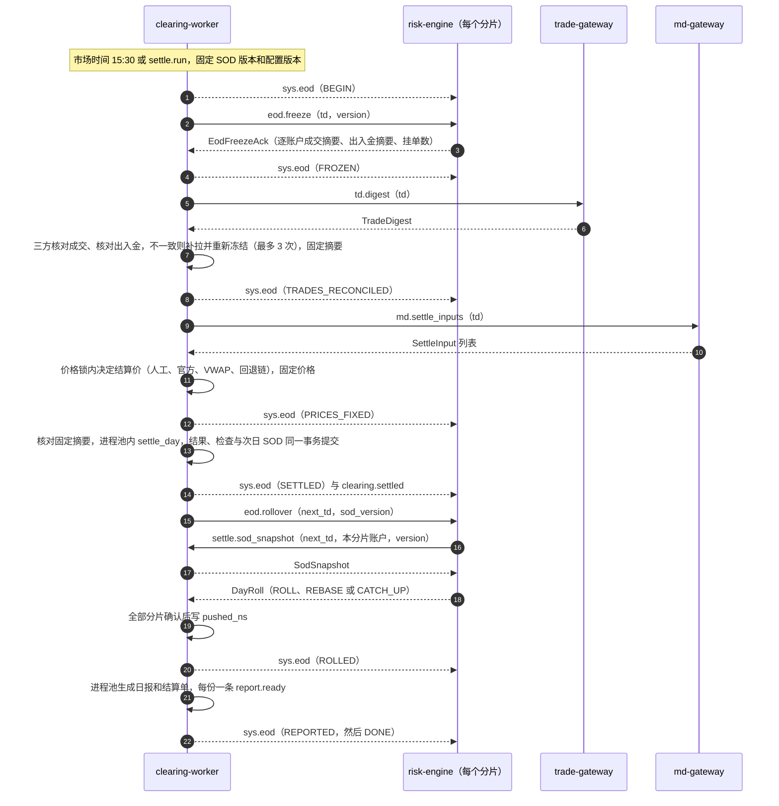

# futrisk 清算规则：公式、出处与手算示例

| 项 | 内容 |
|---|---|
| 文档编号 | FR-SDD-05 |
| 版本 | v0.6（实现对齐） |
| 状态 | 实现对齐 |
| 日期 | 2026-09-25 |
| 适用范围 | 盘后清算：逐日盯市、手续费、保证金（含单向大边）、资金、结算价、对账检查、EOD saga、结算单与风控日报；以及 risk-engine 盘中预估与结算的关系 |
| 对应标准 | GB/T 8567-2006 软件设计说明（SDD）的部分内容：清算计算的算法设计、数据来源、精度与验证 |
| 代码对照 | `src/futrisk/core/` 下的 `settlement.py`（`settle_day`）、`fees.py`、`margin.py`、`lots.py`、`pnl.py`、`settle_price.py`、`ledger.py`、`instruments.py`、`_num.py`；`src/futrisk/services/clearing/` 下的 `saga.py`、`prices.py`、`digests.py`、`pushes.py`、`eodwarn.py`、`reports/` |
| 关联文档 | [README](README.md)（规范）· [01 架构](01-architecture.md) · [02 通信协议](02-communication-protocol.md) · [03 数据库](03-database-schema.md) · [04 风控规则](04-risk-rules.md) |

> 本文是清算计算的完整说明，01 §8.15 只列要点。消息负载、命令、主题以 [02](02-communication-protocol.md) 为准，结算结果的表和列以 03 §4.4 为准，本文只引用。文中的数字都取自代码、配置或测试：手算示例（第 9 章）的每个数都能在 `tests/golden/CASES.md` 和 `tests/golden/test_clearing_golden.py` 中找到。

## 目录
1. [范围与依据](#1-范围与依据)
2. [记号](#2-记号)
3. [逐日盯市与资金](#3-逐日盯市与资金)
4. [开平与手续费](#4-开平与手续费)
5. [保证金与单向大边](#5-保证金与单向大边)
6. [结算价](#6-结算价)
7. [第二道校验：交易所公式](#7-第二道校验交易所公式)
8. [对账检查](#8-对账检查)
9. [手算示例（黄金用例）](#9-手算示例黄金用例)
10. [EOD saga](#10-eod-saga)
11. [数值精度](#11-数值精度)
12. [结算单与风控日报](#12-结算单与风控日报)
13. [已知简化与差异](#13-已知简化与差异)
14. [需求可追踪性](#14-需求可追踪性)
15. [修订记录](#15-修订记录)

---

## 1. 范围与依据

### 1.1 范围
清算由 clearing-worker 的 EOD saga 驱动（第 10 章），计算部分是 `core/` 中的纯函数 `settle_day`：输入日初快照（SOD）、当日成交、出入金和结算价，输出账户、持仓、保证金组、逐笔成交、平仓明细、结算价各结果行，对账检查，以及下一交易日的 SOD。它没有 I/O、不读时钟、没有随机数，同样的输入得到同样的输出，所以同一个 `(trading_day, version)` 可以安全重跑。回测和 risk-engine 的临时日初快照调用同一个函数（01 §8.16、02 §8.4）。

### 1.2 规则出处

| 规则 | 出处 | 本系统的实现 |
|---|---|---|
| 当日无负债结算（逐日盯市） | 《上海期货交易所结算细则》第三十六条：每一交易日闭市后，按当日结算价结算所有合约的盈亏、交易保证金及手续费等 | `settle_day` 每日结算（第 3 章） |
| 有成交时的当日结算价 | 上期所结算细则第三十八条：当日成交价格按成交量的加权平均价 | SHFE、DCE 取全日（含夜盘）VWAP，SHFE 向下取整到 tick（§6.2） |
| 无成交时的当日结算价 | 上期所结算细则第三十八条：（一）闭市时有买卖双方报价的，取最优买价、最优卖价、上一交易日结算价三者居中者；（二）闭市前连续五分钟保持停板价格且只有单方报价的，取停板价；（三）其他情况按前面有成交的最近月份合约的涨跌幅推算 | 回退链 `MEDIAN` → `LIMIT` → `PRE_SETTLE`，第（三）项简化为昨结算（§6.5、第 13 章） |
| 当日盈亏公式 | 上期所结算细则第三十九条：当日盈亏 = Σ[(卖出成交价 − 当日结算价) × 卖出量] + Σ[(当日结算价 − 买入成交价) × 买入量] + (上一交易日结算价 − 当日结算价) × (上一交易日卖出持仓量 − 上一交易日买入持仓量) | 第二道校验 `EXCH_FORMULA`（第 7 章） |
| SHFE 单向大边 | 上期所结算细则第三十一条：同一客户在同一会员处的同品种期货合约双向持仓，可以单边收取交易保证金，期货合约进入最后交易日前第五个交易日闭市后除外 | 按保证金**金额**取大边；最后交易日前第 5 个交易日（L−5）的结算起双边收取（§5.2） |
| CFFEX 当日结算价 | 《中国金融期货交易所结算细则》第四十三条：某一时段的成交量加权平均价；该时段无成交的逐个时段向前推；最后一笔成交距开盘不足一个时段的取全天均价；当日无成交的按基准合约推算，并受涨跌停约束。时段由合约规则规定：股指期货为最后一小时，国债期货收盘为 15:15 | `VWAP_LAST_HOUR`（IF 类 14:00–15:00、T 14:15–15:15）加回退链 `HOURLY` → `FULLDAY` → `BENCHMARK` → `PRE_SETTLE`（§6.3、§6.4） |
| CFFEX 单向大边 | 中金所结算细则第三十八条：同一客户号在同一会员处的同品种、跨品种双向持仓，可以按单边较大者收取（实物交割合约在交割月份前一个交易日收盘后除外），跨品种的品种由交易所公告 | 股指组、国债组；国债在交割月前一个交易日收盘后退出（§5.3） |
| CFFEX 平今手续费 | 中金所"先平当日新开仓"的平今判定（`tests/golden/CASES.md` 中的 CFFEX FAQ 用例） | `close_today_fee_rule: SAME_DAY_OPENS_FIRST`（§4.4） |
| DCE 日内开平与保证金 | 大商所的手续费标准（部分品种对当日开平的两条腿收取日内费率，`products.yaml` 中的 j 按 0.00014 配置）；大商所的双向持仓优惠通过套利交易保证金实现（《大连商品交易所套利交易管理办法》：结算时对同一交易编码下的持仓按先跨期、后跨品种、由近到远的顺序组合） | `close_today_fee_rule: INTRADAY_BOTH_LEGS`（§4.5）；保证金不做组合，按双边收取（§5.4） |
| 结算单与资金恒等式 | 中国期货业协会对期货结算单的解读（CTP 结算单的资金状况、成交记录、平仓明细、持仓明细、持仓汇总各部分） | 文本和 CSV 结算单（第 12 章）；期末结存 = 期初结存 + 出入金 + 平仓盈亏 + 持仓盯市盈亏 − 手续费 |

条文引自上期所结算细则（上期所网站历史版本栏目的 2023-09 版）和中金所结算细则（2015-07-10 修订版）。黄金用例（`tests/golden/CASES.md`）按这些规则手算，并在设计阶段用精确的十进制算术核对过；CASES.md 在用例 1 中标注的"Art. 39"即上期所结算细则第三十九条，用例 2 用同一个公式核对中金所合约的当日盈亏。交易所的收费标准和保证金率会调整，`config/products.yaml` 中的值是 2026-09-24 前后核对过的示例值，生产环境以最新公告为准（TD-04）。

### 1.3 事实来源

| 内容 | 来源 |
|---|---|
| 交易所规则、品种参数、费率、保证金率、涨跌停、交易时段 | `config/products.yaml`（pydantic 模型 `src/futrisk/common/config/products.py`） |
| 逐日盯市、资金、检查、下一日 SOD | `src/futrisk/core/settlement.py` |
| 持仓与 lot、开平规则 | `src/futrisk/core/lots.py` |
| 盈亏公式、交易所公式 | `src/futrisk/core/pnl.py` |
| 手续费分类与计算 | `src/futrisk/core/fees.py` |
| 保证金与单向大边 | `src/futrisk/core/margin.py`、`src/futrisk/core/instruments.py` |
| 结算价 | `src/futrisk/core/settle_price.py`（算法）、`src/futrisk/services/clearing/prices.py`（取价）、`src/futrisk/services/md_gateway/settle.py`（结算价输入） |
| EOD saga | `src/futrisk/services/clearing/saga.py`、`digests.py`、`pushes.py`、`eodwarn.py`、`scheduler.py` |
| 手算用例与测试 | `tests/golden/CASES.md`、`tests/golden/test_clearing_golden.py`；`tests/unit/core/`（`test_core_fees.py`、`test_core_margin.py`、`test_core_settle_price.py`、`test_core_settlement.py`） |

---

## 2. 记号

| 记号 | 含义 |
|---|---|
| P | 昨结算价（上一交易日的结算价，SOD 的 `pre_settle`） |
| S | 今结算价 |
| m | 合约乘数 |
| q | 手数 |
| s | 持仓方向符号：多头 +1，空头 −1 |
| 今仓 / 昨仓 | lot 的开仓交易日等于 / 早于当前交易日。夜盘成交属于下一交易日（01 §8.2），所以前一晚夜盘开的仓是当日的今仓 |
| 逐日盯市（mark-to-market） | 盈亏以结算价为基准逐日结清：昨仓以 P、今仓以开仓价为基准 |
| 逐笔对冲（per-trade / FIFO） | 盈亏始终以开仓价为基准，只用于对照（`close_pnl_fifo`、`MTM_VS_FIFO`） |

---

## 3. 逐日盯市与资金

### 3.1 持仓模型：lot 与盯市基准
- 持仓按 `(账户, 合约, 方向)` 组织，每个持仓下挂按 FIFO 排序的 lot（开仓交易日、开仓时间、lot 编号），每个 lot 记录开仓价 `open_price` 和盯市基准 `basis_price`，列定义见 03 §4.4 的 `sod_lots`。
- 今仓的盯市基准是开仓价；换日时每个 lot 都变为昨仓，基准改为当日结算价。所以平仓盈亏和持仓盈亏都可以写成"价格 − lot 基准"。
- 持仓只由成交改变（事件溯源，01 §8.1）。

### 3.2 平仓盈亏

| 平掉的 lot | 平仓盈亏 |
|---|---|
| 今仓（平今） | (平仓价 − 开仓价) × m × q × s |
| 昨仓（平昨） | (平仓价 − P) × m × q × s |

一笔平仓可能消耗多个 lot，每个 lot 一条平仓明细（`close_details` 表），同时给出逐笔对冲口径的平仓盈亏 (平仓价 − 开仓价) × m × q × s。消耗哪些 lot 由交易所规则决定（第 4 章）。

### 3.3 持仓盯市盈亏

| 剩余的 lot | 持仓盯市盈亏 |
|---|---|
| 今仓 | (S − 开仓价) × m × q × s |
| 昨仓 | (S − P) × m × q × s |

### 3.4 资金恒等式

```text
静态权益   = 上日结存 + 入金 − 出金
期末结存   = 上日结存 + 入金 − 出金 + 平仓盈亏 + 持仓盯市盈亏 − 手续费
客户权益   = 期末结存
当日盈亏   = 客户权益 − 静态权益 = 平仓盈亏 + 持仓盯市盈亏 − 手续费
```

- 本系统没有期权、质押和其他费用，客户权益等于期末结存。
- 账户的平仓盈亏和持仓盯市盈亏按持仓（合约 × 方向）逐项取整到分后相加；手续费按笔取整后相加（第 11 章）。
- 出入金必须为正数、精确到分，否则结算失败（`SettlementError`，EOD 失败而不是产出错误的数字）。一笔出入金记入哪个交易日由 risk-engine 按自身的 EOD 状态判定：冻结之前记入当日，冻结之后、换日之前记入下一交易日，换日之后记入新的当前交易日（01 §8.15、02 §6.3）。

### 3.5 保证金（公司保证金率）

```text
合约全额保证金 = S × m × q × 公司保证金率          （每个合约先取整到分）
公司保证金率   = 交易所保证金率 + 经纪商加收
账户保证金     = Σ 各保证金组的收取额              （单向大边见第 5 章）
```

- **生效中的费率**：费率表分两层，按合约列出的一层和适用于全部合约（`contracts: "*"`）的一层；每层取 `effective_from` ≤ 当日的最新一条；两层都有时取公司费率**较高**的一条，相等时取合约专属的一条。交易所按适用的最高标准收取：节前对全部合约统一上调时，原来有专属费率的合约也按两者中较高的一个收取。
- 当前配置（`products.yaml`）：

| 品种 | 公司保证金率（交易所 + 经纪商） | 生效日期 |
|---|---|---|
| rb、hc | 7% + 1% | 20260101 |
| rb2610 | 10% + 1% | 20260901（高于 `*` 层，取 11%） |
| cu | 9% + 1%；cu2610、cu2611、cu2612、cu2701、cu2702 为 11% + 1% | 20260101；20260901 |
| au | 16% + 1% | 20260101 |
| i、m | i 8% + 1%、m 7% + 1%；两者 20260930 起 10% + 1% | 20260101；20260930 |
| j | 12% + 1% | 20260101 |
| IF、IH、IC、IM | 12% + 0 | 20260101 |
| T | 2% + 0 | 20260101 |

### 3.6 可用资金、风险度与追加保证金

| 项 | 结算口径 | 盘中口径（[04 风控规则](04-risk-rules.md)） |
|---|---|---|
| 可用资金 | 客户权益 − 保证金 | 权益 − 保证金 − 冻结保证金 − 冻结手续费 |
| 风险度 | 保证金 ÷ 客户权益，保留 8 位小数；权益 ≤ 0 而有保证金时封顶为 9999.99999999 | 保证金 ÷ 权益（float） |
| 追加保证金 | max(0，保证金 − 客户权益)：风险度超过 100% 时为保证金与权益之差，否则为 0 | — |

### 3.7 业绩权益、单位净值与高水位

```text
累计净入金   = SOD 的累计净入金 + 当日入金 − 当日出金      （不含初始资金）
业绩权益     = 客户权益 − 累计净入金
单位净值     = 业绩权益 ÷ 初始资金
高水位       = max(SOD 的高水位, 当日业绩权益)
回撤         = (高水位 − 业绩权益) ÷ 高水位
```

- 出入金不影响单位净值和回撤（`test_cash_movements_do_not_move_nav`）。
- `account_settlements.max_drawdown`（03 §4.4 的列名）存的是**当前**距高水位的回撤，不是历史最大回撤（`test_drawdown_from_high_water_mark`）；SOD 只携带高水位，不携带历史最大值（见第 13 章）。
- 首日建账（`settle.seed_sod`）：上日结存 = 高水位 = 初始资金，累计净入金为 0，快照版本为 0（02 §6.5）。

### 3.8 下一交易日的 SOD
结算的最后一步生成下一交易日的 SOD（03 §4.4 `sod_accounts` / `sod_lots` / `sod_prices`）：

| 字段 | 取值 |
|---|---|
| lot | 剩余 lot 全部变为昨仓，`basis_price` = 当日结算价，开仓价和开仓交易日保留（逐笔口径仍可追溯） |
| `pre_balance` | 当日期末结存 |
| `initial_capital` | 不变 |
| `cum_net_deposit` | 更新后的累计净入金 |
| `hwm_equity` | 更新后的高水位 |
| `pre_settle` | 当日确定的全部结算价：包括所有持仓和成交的合约，以及 SOD 中其他合约按回退链（通常是 `PRE_SETTLE`）得到的价格，所以每个可交易合约的昨结算都能延续到下一日（§6.6） |

### 3.9 盘中预估与结算的关系
risk-engine 的盘中账本（`IntradayLedger`）复用同一套持仓（`PositionBook`）、计费（`DayFeeBook`）和单向大边规则（`group_charge`），只是用最新价代替结算价、用 float 代替 Decimal。所以标记价等于结算价时，盘中数字与结算结果一致，差异只来自：

| 差异来源 | 说明 |
|---|---|
| 价格 | 盘中按最新价（封板时按涨跌停价），结算按结算价 |
| 浮点 | 盘中 float64，结算 Decimal；手续费的 float 取整与 Decimal ROUND_HALF_UP 一致（`round_cents`） |
| DCE 日内费率 | 盘中开仓先按开仓费率预估，被当日平仓配对时在平仓成交上补记差额；按比率收费的品种可能有逐笔取整的差异（§4.5） |

EOD 第 5 步的 `INTRADAY_VS_SETTLE` 检查核对两者之差是否在"价格差 × 持仓"的解释范围内（§8.1）。

---

## 4. 开平与手续费

### 4.1 手续费模型

| 费用腿（`FeeType`） | 费率 |
|---|---|
| `OPEN` | `open` |
| `CLOSE_YD` | `close_yd` |
| `CLOSE_TODAY` | `close_yd` × `close_today_mult` |
| `INTRADAY_OPEN` / `INTRADAY_CLOSE` | `intraday`（DCE 当日开平两腿） |

```text
type: rate     一条腿的手续费 = 成交价 × m × q × 费率
type: per_lot  一条腿的手续费 = q × 每手金额
一笔成交的手续费 = Σ 各腿（不取整）→ ROUND_HALF_UP 到 0.01      （逐笔取整）
```

- 一笔成交可以有两类腿，例如 CFFEX 平 10 手其中 8 手平今：8 手 `CLOSE_TODAY` + 2 手 `CLOSE_YD`。`trade_settlements.fee_type` 取"特殊"的那一类，优先级为 `INTRADAY_CLOSE` > `CLOSE_TODAY` > `INTRADAY_OPEN` > `CLOSE_YD` > `OPEN`。
- 费率表的匹配顺序：按合约列出（`contracts`）> 按月份列出（`months`）> 其他（`months: other` 或不写）；同一层内取 `effective_from` ≤ 当日的最新一条；当日还没有任何一条生效时（例如更早的回测），取最早的一条。
- 当前配置的费率（`products.yaml`）：

| 品种 | 类型 | 开仓 / 平昨 | 平今倍数 | 日内 |
|---|---|---|---|---|
| rb、hc（1、5、10 月合约） | rate | 0.0001 / 0.0001 | 1 | — |
| rb、hc（其他月份） | rate | 0.00002 / 0.00002 | 1 | — |
| cu | rate | 0.00005 / 0.00005 | 2 | — |
| au（6、12 月合约） | per_lot | 20 / 20 元 | 0（平今免收） | — |
| au（其他月份） | per_lot | 10 / 10 元 | 0 | — |
| i | rate | 0.0001 / 0.0001 | 1 | — |
| j | rate | 0.0001 / 0.0001 | 1 | 0.00014 |
| m | per_lot | 1.5 / 1.5 元 | 1 | — |
| IF、IH、IC、IM | rate | 0.000023 / 0.000023 | 10（平今 0.00023） | — |
| T | per_lot | 3 / 3 元 | 0 | — |

### 4.2 各交易所的开平规则

| 交易所 | 平仓必须区分今昨（`explicit_close_today`） | lot 消耗顺序（`close_style`） | 平今判定（`close_today_fee_rule`） |
|---|---|---|---|
| SHFE（INE 同） | 是 | 在允许的范围内先开先平 | `close_today_fee_rule: LOT_MATCH`：按实际消耗的 lot 判定 |
| CFFEX | 否 | `close_style: TODAY_FIRST`：先平今仓 | `close_today_fee_rule: SAME_DAY_OPENS_FIRST`：先平当日新开仓 |
| DCE | 否 | `close_style: FIFO`：先开先平（昨仓在前） | `close_today_fee_rule: INTRADAY_BOTH_LEGS`：实际平掉的今仓按日内费率，两条腿都算 |

lot 的消耗顺序（对应 CTP 的 CloseStyle）只影响平仓盈亏与持仓盈亏的拆分，不影响当日盈亏总额（§9.2 用 FIFO 和先平今各算一遍，总额都是 23,160）；计费规则单独配置，两者分开。

### 4.3 SHFE：显式平今、平昨
- 平仓委托必须指定 `CLOSE_TODAY` 或 `CLOSE_YESTERDAY`：`CLOSE_TODAY` 只消耗今仓，`CLOSE_YESTERDAY` 只消耗昨仓；普通的 `CLOSE` 按 CTP 语义归一为平昨（02 §7.3 `Offset`）。数量超过对应的可平量时，事前检查拒单（`REJECT_CLOSE_TODAY_EXCEEDS` / `REJECT_CLOSE_YD_EXCEEDS`），结算侧同样拒绝入账（`test_close_today_6_on_t2_rejected`）。
- 柜台强平（`FORCE_CLOSE`，只出现在成交回报中）按 `CLOSE` 处理；因为它是柜台已经执行的事实，昨仓不够时会继续消耗今仓，而不是被拒绝，平仓明细记录实际消耗的 lot 类型，手续费也按实际消耗的 lot 收取（`test_shfe_force_close_spills_into_today_lots`）。
- 平今手续费 = 平昨费率 × 平今倍数：rb、hc 为 1 倍，cu 为 2 倍，au 平今免收。

### 4.4 CFFEX：先平当日新开仓
- 一笔平仓按时间顺序与同一账户、同一持仓方向的**当日开仓**配对，配上的手数收平今手续费，其余收平昨手续费，**与实际消耗哪个 lot 无关**。持有昨仓时，只要当日先开后平，也按 10 倍费率收平今费。
- `close_style: TODAY_FIRST` 让 lot 的消耗顺序与这条计费规则一致，所以平仓明细、`matched_today_qty` 与平今手续费的手数相同（`test_today_first_columns_agree`）；若改为 FIFO，当日总额不变，只是平仓盈亏和持仓盈亏的拆分不同（§9.2）。
- 中金所 FAQ 的两个例子见 §9.3。

### 4.5 DCE：日内开平两腿
- 平仓按先开先平消耗 lot，昨仓在前；只有**实际消耗的今仓**算日内，按 `intraday` 费率收取，并把与之配对的开仓腿（尚未被配对的最早的当日开仓）也改为日内费率。
- 例：持有 2 手昨仓，买开 5 手、卖平 3 手：平仓先平 2 手昨仓，再平 1 手今仓，所以是 1 手日内平仓 + 1 手日内开仓、2 手平昨和 4 手普通开仓（§9.5）。
- 没有配置 `intraday` 的品种（i、m），实际消耗的今仓按平今费率收取（平昨费率 × 平今倍数）。
- 开仓腿的最终类别取决于之后的平仓，所以精确的手续费要等当日最后一笔成交之后才能确定：结算时全部成交分类完毕再逐笔计算；盘中先按开仓费率预估，被平仓配对时在平仓成交上补记差额，盘中累计值与 EOD 精确值相等（逐笔取整可能差几分钱，按手收费的品种完全相等，`test_rate_intraday_estimate_close_to_exact`、`test_per_lot_intraday_estimate_exact`）。

### 4.6 生效日期
手续费、保证金率和涨跌停幅度都带生效日期（`effective_from`、`limit_schedule`），按交易日取值。例如 `products.yaml` 中 i、m 自 20260930 起保证金率上调、涨跌停幅度由 6% 放宽到 8%。clearing-worker 在每次运行开始时固定该交易日适用的配置版本（`step_log.BEGIN.config_version`），第 4、5 步只用这个版本，运行中提交的新配置不会改变正在进行的结算（`src/futrisk/services/clearing/confighist.py`）。

---

## 5. 保证金与单向大边

### 5.1 算法
合约按保证金组（`margin_groups.margin_group`，03 §4.4）归组，每组的收取额为：

```text
GROSS 组：    收取额 = 多头保证金 + 空头保证金
BIG_SIDE 组： 收取额 = max(多头保证金, 空头保证金) + 退出单向大边的合约保证金
```

- 大边按**保证金金额**比较，不按手数（§9.4 的用例 3 专门验证这一点：多头 8 手按 10% 的金额大于空头 10 手按 7% 的金额）。
- 已退出单向大边的合约双边收取，计入 `excluded_margin`。

| 交易所 | 配置 | 保证金组 | 退出规则 |
|---|---|---|---|
| SHFE | `big_side: SAME_PRODUCT` | `SHFE:{品种}`，同品种跨月份 | `big_side_exit: LAST_TRADE_DAY_MINUS_5` |
| CFFEX | `big_side: GROUPS` | `CFFEX:INDEX`（IF、IH、IC、IM）、`CFFEX:TREASURY`（T） | `big_side_exit: PHYSICAL_DELIVERY_MONTH_MINUS_1` |
| DCE | `big_side: NONE` | `GROSS:{合约}` | — |

### 5.2 SHFE：同品种、按金额、L−5 退出
- 最后交易日 L 前的第 5 个交易日记为 L−5。按"进入最后交易日前第五个交易日闭市后除外"，**L−5 当日的结算**起该合约双边收取，最后 5 个交易日（L−4 至 L）不参加单向大边。
- 盘中与结算的区别：退出在 L−5 的收盘结算时生效，所以 L−5 当日盘中仍然享受单向大边，从下一个交易日起盘中也双边收取（`test_exit_day_is_l_minus_5`、`test_intraday_exclusion_starts_the_day_after_exit`）。
- 不同品种是不同的组（rb 与 hc 不互抵）。

### 5.3 CFFEX：同品种和跨品种
- 股指期货 IF、IH、IC、IM 为一组，国债期货为一组，组内同品种和跨品种的双向持仓都按大边收取（§9.4 变体：IF 多 1 手与 IH 空 1 手）。
- 实物交割的合约（国债，`physical_delivery: true`）在交割月份前一个交易日收盘后退出，双边收取；股指期货现金交割，永不退出（`test_index_futures_never_excluded`、`test_treasury_leaves_group_before_delivery_month`）。

### 5.4 DCE：不实现单向大边，以及理由
- 大商所的双向持仓优惠是套利交易保证金：结算时按"先跨期、后跨品种、由近到远"的组合顺序把持仓配成组合，再对组合收取套利保证金。它与"按金额取大边"是不同的算法，需要实现组合规则和优先级，本期没有实现（TD-03：DCE 组合保证金）。
- DCE 的持仓因此按双边全额收取（`GROSS:{合约}` 组）。这样保证金只会**高估**、不会低估：风险度和可用资金偏保守，符合失效即安全（01 §8.5）；与柜台的差异可以在对账中看到。

### 5.5 挂单冻结保证金
- 挂着的开仓单冻结的保证金按**增量**计算：冻结额 = 收取额（持仓 + 全部挂单）− 收取额（仅持仓），每笔挂单按自己的价格估值。
- 所以在 SHFE，小边方向上的挂单只要不翻转大边，就不冻结保证金；翻转大边时只冻结超出的部分。这就是成交后交易所实际要收的钱（与 CTP 的单向大边冻结一致）。因为 max 是单调的，假设全部挂单成交是最坏情况（`test_small_side_order_freezes_nothing`、`test_flipping_the_big_side_freezes_the_excess`）。
- 事前检查第 7 步按同样的增量规则估算本单需要的保证金（[04 风控规则](04-risk-rules.md)的事前检查一章）。

---

## 6. 结算价

### 6.1 优先级
每个合约按以下顺序确定结算价，前一项存在就不看后一项：

| 优先级 | 来源（`SettlePriceSource`） | 说明 |
|---|---|---|
| 1 | `MANUAL` | `settle.override_price` 人工覆盖（RISK_MANAGER 或 ADMIN，记录操作者和原因）；必须在 tick 网格上，否则拒绝 |
| 2 | `OFFICIAL` | `settle.import_official` 导入的官方结算价（ADMIN）；按原值使用，可以不在 tick 网格上（交割日的交割结算价可能不在网格上） |
| 3 | `VWAP` | 由 md-gateway 的结算价输入（`md.settle_inputs`，02 §7.1 `SettleInput`）计算，按交易所规则取整 |
| 4 | `FALLBACK_*` | 该合约无成交时，按交易所配置的回退链（§6.5） |
| 5 | `PRE_SETTLE` | 昨结算价，回退链的最后一环；配置的链里没写也会自动补上 |

- 第 4 步（02 §8.4）先在价格锁之外取 `md.settle_inputs`，再在价格锁之内读取人工覆盖和官方价格、做出决定并提交，所以同一交易日的 `settle.override_price` / `settle.import_official` 不会与第 4 步交错。决定的价格固定在 `step_log` 中，重启后原样复用。
- 人工覆盖在第 4 步之前提交，当次运行生效；之后提交需要用 `force_new_version` 重算一个新版本（02 §6.5）。已经结算之后导入的官方价格与所用价格不同时，产生一条 WARN（`detail.kind = OFFICIAL_PRICE_DIFF`，本文 §10.4），由人决定是否重算。

### 6.2 SHFE、DCE：全日 VWAP 与取整

```text
VWAP = 当日成交额 ÷ (当日成交量 × m)          （全日，含上一晚的夜盘）
```

- **SHFE 向下取整到 tick**（`settle_rounding: FLOOR_TICK`）。证据：在官方数据样本（2026-09-18 至 2026-09-24）中，rb、hc、cu、au 有成交的 218 个合约日，结算价全部等于 VWAP 向下取整到 tick，四舍五入只能复现其中 114 个（`data/hist/SOURCES.md`）。例：rb 的 VWAP 3118.7 结算为 3118，四舍五入会得到 3119；au 的 VWAP 850.0933 结算为 850.08（tick 0.02），四舍五入会得到 850.10（§9.6）。
- **DCE 四舍五入到 tick**（`settle_rounding: ROUND_TICK`），尚未用官方数据核实（RK-10）。导入官方结算价后以官方为准，差异会告警。
- 盘后的结算价输入由 md-gateway 从规范 tick 计算（02 §7.1）。历史数据中新浪分钟线的成交量不完整，回测不用它估算 VWAP（`data/hist/SOURCES.md`）。

### 6.3 CFFEX：最后一小时 VWAP
- 时段取品种的 `settle_window`：IF、IH、IC、IM 为 14:00–15:00，T 为 14:15–15:15（`settle_method: VWAP_LAST_HOUR`）。
- md-gateway 从当日各状态的**累计**成交量和成交额计算（中途的缺口不影响结果）：时段内的量和额 = 时段内最后一个状态 − 时段开始前最后一个状态（边界状态）。以下情况把输入质量标为 `APPROX`（`src/futrisk/services/md_gateway/settle.py`）：
  - 没有边界状态；
  - 边界状态距时段开始超过 500ms，且它与时段内第一个状态之间的成交量超过时段成交量的 0.2%（这部分成交的归属无法确定）；
  - 时段结束前 60s 内没有状态；
  - 边界状态、时段内第一个状态或最后一个状态来自补数（`BACKFILL`）。

  `APPROX` 只作标记：价格照常使用，记在 `settlement_prices.input_quality` 中，并显示在日报表头的结算价来源表里；导入官方价格后以官方为准。
- 取整：四舍五入到 tick（`ROUND_TICK`）。历史数据中的官方结算价全部落在 tick 网格上（股指 0.2，国债 0.005），但取整方向无法从日线数据确定（需要分钟或逐笔数据），按四舍五入实现。
- 例（用例 2）：最后一小时成交额 264,890 × 300 元、成交量 60 手，VWAP = 4414.833…，结算价 4414.8；这个值在一位小数、四舍五入到 tick、向下取整到 tick 三种口径下都相同。若误用全日 VWAP，会得到 4399.02（§9.2）。

### 6.4 CFFEX：无成交时的回退
回退链 `HOURLY` → `FULLDAY` → `BENCHMARK` → `PRE_SETTLE`：

| 步骤 | 规则 | 来源 |
|---|---|---|
| `HOURLY`：首小时规则 | 当日最后一笔成交距开盘不足一个交易小时（首个交易小时结束于 10:30）：取全天 VWAP | `FALLBACK_FULLDAY` |
| `HOURLY`：逐小时回溯 | 最后一小时无成交：从前一个**交易小时**起逐个向前，取第一个有成交的交易小时的 VWAP | `FALLBACK_HOURLY` |
| `FULLDAY` | 没有逐小时数据时取全天 VWAP | `FALLBACK_FULLDAY` |
| `BENCHMARK` | 当日无成交：昨结算 +（基准合约今结算 − 基准合约昨结算），夹在涨跌停价之间，再取整到 tick | `FALLBACK_BENCHMARK` |
| `PRE_SETTLE` | 以上都不可用 | `PRE_SETTLE` |

交易小时从收盘往前按交易分钟数划分，跨越午休（`trading_hour_windows`）：

| 品种 | 交易小时（从最后一小时往前） |
|---|---|
| IF、IH、IC、IM | [14:00,15:00)、[13:00,14:00)、[10:30,11:30)、[09:30,10:30) |
| T | [14:15,15:15)、[13:15,14:15)、[10:45,11:30) 加 [13:00,13:15)（跨午休）、[09:45,10:45)、[09:30,09:45) |

`SettleInput.hourly` 按交易小时再在首小时结束处切开（T 的 [09:45,10:45) 切成 [09:45,10:30) 和 [10:30,10:45)）分桶，所以逐小时回溯和首小时规则都是精确的；按钟点小时分桶只能近似（RK-04）。测试中的例子（`tests/unit/core/test_core_settle_price.py`）：

| 用例 | 输入 | 结果 |
|---|---|---|
| IF 逐小时回溯 | 10:10 4390 × 1、13:10 4401 × 1、13:20 4402 × 2，最后一小时无成交 | [13:00,14:00) 的 VWAP 4401.667 → 4401.6（`FALLBACK_HOURLY`） |
| IF 首小时规则 | 09:40 4400 × 1、10:15 4420 × 1 | 最后一笔在 10:30 之前，取全天均价 4410（`FALLBACK_FULLDAY`），而不是 10 点钟点小时的 4420 |
| T 回溯到 13:15 的交易小时 | 13:05 101.0 × 9、13:30 101.2 × 1 | [13:15,14:15) 只有 13:30 那笔 → 101.2；按钟点小时会混入 13:05，得到 101.02 |
| T 跨午休的交易小时 | 11:00 101.0 × 1、13:05 101.1 × 1 | 两笔同属 [10:45,11:30) 加 [13:00,13:15) → 101.05 |
| 没有逐小时数据 | 10:10 4390、13:10 4401 | 全天 4395.5 → 4395.6（最近的 tick，逢半进位） |
| 基准合约 | 昨结算 4400，基准合约 4410 → 4431.3 | 4400 + 21.3 = 4421.3 → 4421.4；基准涨到 6000 时封顶于涨停价 4840 |

基准合约由 clearing-worker 选取：同品种中、本次运行里价格来自成交（`VWAP`、`OFFICIAL`、`MANUAL`）且**当日成交量最大**的合约（`prices.py` `_benchmark_for`）。中金所细则的定义是"当日有成交的离交割月最近的合约"，两者不同，见第 13 章。

### 6.5 回退链汇总

| 交易所 | `settle_fallback` | 各步骤 |
|---|---|---|
| SHFE、DCE | `MEDIAN`、`LIMIT`、`PRE_SETTLE` | `MEDIAN`：买一、卖一、昨结算三者居中（需要双边报价）→ `LIMIT`：收盘前 5 分钟一直封板（`limit_lock` 为 `UP` / `DOWN`）时取涨跌停价 → `PRE_SETTLE` |
| CFFEX | `HOURLY`、`FULLDAY`、`BENCHMARK`、`PRE_SETTLE` | 见 §6.4 |

封板判定由 md-gateway 给出：收盘前 5 分钟内的每个状态（以及它之前的最后一个状态）都锁在同一个涨跌停价上，对应上期所细则"闭市前连续五分钟报价保持停板价格"。回退的价格同样按交易所规则取整。

### 6.6 昨结算价的来源
- **SOD 的值优先**：它是清算自己的结算结果，也是 SOD 中 lot 的盯市基准；md-gateway 给出的 `SettleInput.pre_settle` 只用于 SOD 中没有的合约。两者都有且不同时用 SOD 的值，并在 `PRICES_FIXED` 阶段记一条 WARN（`detail.kind = PRE_SETTLE_MISMATCH`）。同一个值也用于 `MEDIAN`、`LIMIT`、`BENCHMARK`，所以无成交、价格不变的一天，盈亏为 0。
- **价格集合**覆盖：所有持仓或成交的合约（缺一个即 `FAILED`）；所有有 md 输入或人工、官方价格的合约；**SOD 中的全部合约**（按回退链定价，通常是 `PRE_SETTLE`），保证下一日的 SOD 为每个可交易合约延续昨结算价。
- 当日首次交易、SOD 和 md-gateway 都不知道昨结算的新合约（例如 md-gateway 不可用时）：依次用同一交易日较早一次运行记录的 md 输入，或当日的人工、官方价格作为昨结算；仍然没有就结算失败，而不是悄悄用今天的价格（`test_previous_settlement_price_is_required`）。

### 6.7 涨跌停价

```text
涨停价 = 向下取整到 tick( P × (1 + 涨跌停幅度) )
跌停价 = 向上取整到 tick( P × (1 − 涨跌停幅度) )        （都向价格区间内侧取整）
```

涨跌停幅度按交易日取 `limit_schedule`。例：rb 昨结算 3121、幅度 5%，3277.05 → 3277，2964.95 → 2965（§9.6）。

---

## 7. 第二道校验：交易所公式
上期所结算细则第三十九条的当日盈亏公式只用成交价、成交量、今结算、昨结算和昨日持仓量，**与开平标志和 lot 的配对方式无关**：

```text
当日盈亏 = [ Σ(卖出成交价 − S) × 卖出量 + Σ(S − 买入成交价) × 买入量 + (P − S) × (昨空 − 昨多) ] × m
```

- 按账户 × 合约计算，必须**逐分**等于"平仓盈亏 + 持仓盯市盈亏"之和；不等则 `EXCH_FORMULA` 检查为 `FAIL`，EOD 不换日。
- 它能发现开平标志错误、lot 配对错误、昨仓基准错误等只影响拆分或基准的问题；黄金用例在每个交易日都用一个与核心无关的测试侧实现（`formula_oracle`）再核对一遍。
- 例（用例 1 的 T2，P = 3120，S = 3132，昨多 12 手）：[(3140 − 3132) × 6 + (3135 − 3132) × 2 + (3132 − 3115) × 4 + (3120 − 3132) × (0 − 12)] × 10 = (48 + 6 + 68 + 144) × 10 = 2,660，等于平仓 1,600 + 持仓 1,060。

---

## 8. 对账检查

### 8.1 八项检查
检查项为 02 §7.3 的 `ReconCheck`，结果写入 `recon_checks` 表（03 §4.4）。第 5 步的检查都把**已经生成的结果行重新读出来**独立求和，与汇总值比较，而不是比较同一个变量（`test_equity_identity_reads_the_emitted_rows`、`test_position_identity_reads_the_next_sod`、`test_firm_sum_reads_the_margin_rows`）。

| 检查 | 步骤 | 比较的内容 | 不一致时 |
|---|---|---|---|
| `TRADE_DIGEST` | 3 | 逐账户的成交摘要（笔数、手数合计、SHA-256）三方一致：clearing-worker 的本地副本、trade-gateway 的 `td.digest`、各分片 `EodFreezeAck.accounts` | 补拉后重新冻结，最多 3 次，仍不一致则 `FAILED`；冻结时仍有挂单记 `WARN` |
| `CASH_DIGEST` | 3 | 逐账户的出入金笔数和**带符号的净额**（入金减出金）：本地副本与 `EodFreezeAck.cash` | 同上 |
| `EQUITY_IDENTITY` | 5 | 期末结存 = 静态权益 + 平仓 + 持仓 − 手续费；当日盈亏 = 交易所公式 − 手续费；逐笔成交行的平仓盈亏之和 = 平仓明细之和 = 账户平仓盈亏；逐笔成交行的手续费之和 = 账户手续费 = 各持仓手续费之和；保证金组之和 = 账户保证金 | `FAIL`，不换日 |
| `POSITION_IDENTITY` | 5 | 期初 + 开仓 − 平仓 = 期末 = 剩余 lot = 下一日 SOD 的 lot；平今 + 平昨 = 平仓；每笔平仓的明细覆盖全部手数 | `FAIL`，不换日 |
| `EXCH_FORMULA` | 5 | 第 7 章 | `FAIL`，不换日 |
| `MTM_VS_FIFO` | 5 | 平仓 + 持仓（盯市口径）= 逐笔已实现 + 逐笔浮动（期末）− 逐笔浮动（期初，按昨结算估值） | `FAIL`，不换日 |
| `INTRADAY_VS_SETTLE` | 5 | 各分片的盘中权益与结算权益之差，是否在"Σ\|结算价 − 最新价\| × 手数 × m + \|盘中手续费 − 结算手续费\| + 1 元"的解释范围内 | 只记 `WARN` |
| `FIRM_SUM` | 5 | 各账户权益之和 = 静态权益之和 + 交易所公式之和 − 逐笔手续费之和；保证金之和 = 保证金组之和；手续费之和 = 逐笔手续费之和；期末持仓手数之和 = 下一日 SOD 的 lot 手数之和 | `FAIL`，不换日 |

`FAIL` 表示结算结果不可信：EOD 以 `FAILED` 结束，不推送新的 SOD，各分片保持冻结，下一个交易时段开始时自行进入临时日初快照（第 10 章）。`WARN` 允许继续。

### 8.2 三方成交摘要与出入金摘要
- 成交摘要的算法见 02 §7.5，本地副本、trade-gateway 和 risk-engine 用同一个函数计算；某一方没有某个账户，按 0 笔计。
- 出入金摘要的净额按十进制比较（"100" 与 "100.00" 相等）；入金、出金都是正数，类型记反会破坏摘要（02 §7.7）。
- 不一致时（02 §8.4 第 3 步）：先对本地副本与 trade-gateway 不一致的账户分页拉取 `td.query.trades`，对出入金不一致的账户向所属分片拉取 `risk.query.cash`，再重新 `eod.freeze` 取最新摘要，最多 3 次。

### 8.3 固定摘要与回退
- 第 3 步核对通过时，把逐账户的成交和出入金摘要固定在 `step_log.TRADES_RECONCILED.digests` 中。
- 第 5 步先用本地副本重新计算摘要，与固定的摘要比较；如果有账户不同（核对之后又到了成交或出入金），运行**回退到 `FROZEN`** 重新核对，这次回退计入 3 次的重新冻结额度。
- `settle_day` 在进程池中运行期间如果又有成交写入本地副本，提交 `SETTLED` 的事务会发现副本的笔数变了，同样回退到 `FROZEN`。所以第 5 步结算的数据，一定是第 3 步核对过的数据。
- `SETTLED` 之后才到达本地副本的成交或出入金不在本次结算中，记一条 WARN（`detail.kind = LATE_FACT`），由人决定是否用 `force_new_version` 重算。

---

## 9. 手算示例（黄金用例）
来源：`tests/golden/CASES.md`（设计阶段用精确的十进制算术核对）和 `tests/golden/test_clearing_golden.py`（逐个断言这些数字，全部通过）。黄金用例用测试自带的品种参数（例如保证金 7%、没有经纪商加收），不是 `products.yaml` 的值；手续费按笔四舍五入到分（交易所自己的手续费取整方式尚未核实）。

### 9.1 用例 1：SHFE rb2701，三个交易日
参数：乘数 10；开仓、平昨、平今手续费率都是 0.0001（平今倍数 1）；保证金 7%；期初结存 200,000 元；T1 的昨结算 3100。交易日 T1 = 20260922、T2 = 20260923、T3 = 20260924。

| 交易日 | 成交时间 | 成交 | 开平 | 手续费 |
|---|---|---|---|---|
| T1 | 20260921 21:05（夜盘，属于 T1） | 买 10 手 @3100 | 开仓 | 3100 × 10 × 10 × 0.0001 = 31.00 |
| T1 | 09:40 | 买 5 手 @3110 | 开仓 | 3110 × 10 × 5 × 0.0001 = 15.55 |
| T1 | 14:10 | 卖 3 手 @3130 | 平今，消耗 @3100 的 lot | 3130 × 10 × 3 × 0.0001 = 9.39 |
| T2 | 20260922 21:10（夜盘，属于 T2） | 买 4 手 @3115 | 开仓 | 3115 × 10 × 4 × 0.0001 = 12.46 |
| T2 | 09:30 | 卖 6 手 @3140 | 平仓（CTP 的 '1'，即平昨） | 3140 × 10 × 6 × 0.0001 = 18.84 |
| T2 | 10:00 | 卖 2 手 @3135 | 平今 | 3135 × 10 × 2 × 0.0001 = 6.27 |
| T3 | 09:30 | 卖 8 手 @3100 | 平仓（此时全部是昨仓） | 3100 × 10 × 8 × 0.0001 = 24.80 |

| 项 | T1（P = 3100，S = 3120） | T2（P = 3120，S = 3132） | T3（P = 3132，S = 3095） |
|---|---|---|---|
| 平仓盈亏 | (3130 − 3100) × 10 × 3 = 900 | 平昨 (3140 − 3120) × 10 × 6 = 1,200；平今 (3135 − 3115) × 10 × 2 = 400；合计 1,600 | (3100 − 3132) × 10 × 8 = −2,560 |
| 持仓盈亏 | (3120 − 3100) × 10 × 7 + (3120 − 3110) × 10 × 5 = 1,400 + 500 = 1,900 | 昨仓 (3132 − 3120) × 10 × 6 = 720；今仓 (3132 − 3115) × 10 × 2 = 340；合计 1,060 | 0（已平完） |
| 交易所公式 | [(3130 − 3120) × 3 + (3120 − 3100) × 10 + (3120 − 3110) × 5] × 10 = 2,800 | (48 + 6 + 68 + 144) × 10 = 2,660（第 7 章） | [(3100 − 3095) × 8 + (3132 − 3095) × (0 − 8)] × 10 = −2,560 |
| 手续费 | 31.00 + 15.55 + 9.39 = 55.94 | 12.46 + 18.84 + 6.27 = 37.57 | 24.80 |
| 客户权益 = 期末结存 | 200,000 + 900 + 1,900 − 55.94 = 202,744.06 | 202,744.06 + 1,600 + 1,060 − 37.57 = 205,366.49 | 205,366.49 − 2,560 − 24.80 = 202,781.69 |
| 保证金 | 3120 × 10 × 12 × 7% = 26,208.00 | 3132 × 10 × 8 × 7% = 17,539.20 | 0 |
| 可用资金 | 176,536.06 | 187,827.29 | 202,781.69 |
| 风险度 | 0.12926643（12.9266%） | 0.08540439（8.5404%） | 0 |

- **lot 的变化**：T1 结束后的 SOD 为 lot 1（开仓价 3100，7 手）、lot 2（开仓价 3110，5 手），基准都是 3120。T2 的平昨 6 手从 lot 1 中扣除（平仓明细：昨仓，开仓价 3100、基准 3120，盯市平仓盈亏 1,200.00、逐笔平仓盈亏 2,400.00）；平今 2 手扣自当日的 lot 3（开仓价 3115）。T2 结束后的 SOD 为 lot 1 × 1 手、lot 2 × 5 手、lot 3 × 2 手，基准都是 3132。T3 平完后 SOD 为空。
- **持仓行（T2 多头）**：期初 12、开仓 4、平仓 8（平今 2、平昨 6）、期末 8；结算价 3132、昨结算 3120、保证金率 0.07、全额保证金 17,539.20。
- **跨日恒等式**：三日盯市盈亏之和 900 + 1,900 + 1,600 + 1,060 − 2,560 = 2,900 =（卖出成交额 59,300 − 买入成交额 59,010）× 10；手续费合计 118.31；200,000 + 2,900 − 118.31 = 202,781.69，等于 T3 的权益。
- **反例**：T2 平今 6 手必须拒绝（今仓只有 4 手）：事前检查返回 `REJECT_CLOSE_TODAY_EXCEEDS`，结算侧也拒绝入账（`SettlementError`）。T3 任何平今都要拒绝；平仓 8 手可以，9 手返回 `REJECT_CLOSE_YD_EXCEEDS`。
- **变体**：平今倍数改为 2（如 cu）时，两笔平今手续费变为 18.78 和 12.54，三日手续费为 65.33、43.84、24.80，全部检查仍然通过。

### 9.2 用例 2：CFFEX IF2612，含平今手续费陷阱
参数：乘数 300；开仓、平昨费率 0.000023（0.23‱），平今费率 0.00023（2.3‱，10 倍）；保证金 12%；期初结存 1,000,000 元；D1 的昨结算 4380。交易日 D1 = 20260922、D2 = 20260923、D3 = 20260924。

**结算价**：
- D1 的成交流水（含本账户的成交）：10:00 4400.0 × 2（本账户买开 2）；13:55 4380.0 × 50（在最后一小时之外）；14:05 4410.0 × 10；14:20 4415.0 × 20；14:30 4420.0 × 5（含本账户卖平 1）；14:45 4418.0 × 15；14:59:30 4412.0 × 10。最后一小时 [14:00,15:00) 的成交额为 4410 × 10 + 4415 × 20 + 4420 × 5 + 4418 × 15 + 4412 × 10 = 264,890（点 × 手），成交量 60 手，VWAP = 4414.833…，**S1 = 4414.8**。全日 VWAP 为 4399.02（112 手），选错时段的缺陷会被抓到。
- D2 的最后一小时：14:10 4440.0 × 10、14:40 4444.0 × 10、14:55 4442.0 × 5，VWAP = 111,050 ÷ 25 = **4442.0**。
- D3 的结算价直接给定为 4480.0（当日平仓后无持仓，它只影响公式中的昨仓项）。

**成交与手续费**：

| 交易日 | 成交 | 平今判定 | 手续费 |
|---|---|---|---|
| D1 | 10:00 买开 2 @4400 | — | 4400 × 300 × 2 × 0.000023 = 60.72 |
| D1 | 14:30 卖平 1 @4420 | 当日有开仓：平今 | 4420 × 300 × 1 × 0.00023 = 304.98 |
| D2（有 1 手昨仓，基准 4414.8） | 09:35 买开 1 @4400 | — | 4400 × 300 × 1 × 0.000023 = 30.36 |
| D2 | 10:30 卖平 1 @4450 | **平仓之前当日先有开仓：平今** | 4450 × 300 × 1 × 0.00023 = **307.05** |
| D3 | 卖平 1 @4500 | 当日没有开仓：平昨 | 4500 × 300 × 1 × 0.000023 = 31.05 |

**陷阱**：D2 账户同时有昨仓和今仓。按 lot 实际消耗计费的引擎（FIFO 先平昨仓）会按平昨收 4450 × 300 × 0.000023 = 30.705 → 30.71 元（`test_lot_match_fee_engine_would_charge_30_71`）；中金所"先平当日新开仓"，应收 307.05 元。

**盈亏与资金**：

| 项 | D1（P = 4380，S = 4414.8） | D2（P = 4414.8，S = 4442） | D3（P = 4442，S = 4480） |
|---|---|---|---|
| 平仓盈亏 | (4420 − 4400) × 300 = 6,000 | 先平今：(4450 − 4400) × 300 = 15,000；FIFO：(4450 − 4414.8) × 300 = 10,560 | (4500 − 4442) × 300 = 17,400 |
| 持仓盈亏 | (4414.8 − 4400) × 300 = 4,440 | 先平今：昨仓 (4442 − 4414.8) × 300 = 8,160；FIFO：今仓 (4442 − 4400) × 300 = 12,600 | 0 |
| 当日合计 = 交易所公式 | 10,440 | 23,160（两种配对相同）：[(4450 − 4442) + (4442 − 4400) + (4414.8 − 4442) × (0 − 1)] × 300 | 17,400：[(4500 − 4480) + (4442 − 4480) × (0 − 1)] × 300 |
| 手续费 | 60.72 + 304.98 = 365.70 | 30.36 + 307.05 = 337.41 | 31.05 |
| 客户权益 | 1,000,000 + 10,440 − 365.70 = 1,010,074.30 | 1,010,074.30 + 23,160 − 337.41 = 1,032,896.89 | 1,032,896.89 + 17,400 − 31.05 = 1,050,265.84 |
| 保证金 | 4414.8 × 300 × 1 × 12% = 158,932.80 | 4442 × 300 × 1 × 12% = 159,912.00 | 0 |
| 可用资金 | 851,141.50 | 872,984.89 | 1,050,265.84 |
| 风险度 | 0.15734763（15.7348%） | 0.15481894（15.4819%） | 0 |

- `products.yaml` 的 CFFEX 为 `close_style: TODAY_FIRST`，结果取"先平今"一列；FIFO 一列由测试另外验证，当日合计、权益和保证金完全相同。
- 用 `products.yaml` 的 IF 参数（0.23‱、平今 10 倍、12%、先平今）跑同一组成交，得到相同的结果（`test_bundled_products_yaml_path`）。
- **跨日恒等式**：盯市盈亏合计 10,440 + 23,160 + 17,400 = 51,000 =（卖出 13,370 − 买入 13,200）× 300；手续费合计 734.16。

### 9.3 CFFEX FAQ：平今的判定
持有 IF2612 昨仓多头 20 手（昨结算 4400），当日成交价都是 4400：

| 顺序 | 平今 / 平昨 | 手续费 |
|---|---|---|
| 先卖平 10 手，再买开 8 手 | 0 / 10：平仓时当日还没有开仓 | 平仓按平昨，开仓按开仓 |
| 先买开 8 手，再卖平 10 手 | 8 / 2：先平当日新开的 8 手 | 8 × 4400 × 300 × 0.00023 + 2 × 4400 × 300 × 0.000023 = 2,428.80 + 60.72 = 2,489.52，`fee_type` 为 `CLOSE_TODAY` |

### 9.4 用例 3：SHFE 双向持仓（单向大边）
参数：rb2610 保证金 10%（合约专属，20260901 起），rb2701 为 7%（2026-09-24 的官方费率，不含经纪商加收）；手续费率 0.0001；期初结存 500,000 元；昨结算 rb2610 3050、rb2701 3110。rb2610 的最后交易日为 20261015，按含 10 月 1~7 日假期的交易日历，L−5 = 20261008。交易日 E1 = 20260930、E2 = 20261008。

| 项 | E1 | E2（rb2610 的 L−5，无成交） |
|---|---|---|
| 成交 | 买开 rb2610 8 手 @3050（手续费 3050 × 10 × 8 × 0.0001 = 24.40）；卖开 rb2701 10 手 @3110（31.10） | — |
| 结算价 | rb2610 3056、rb2701 3111 | rb2610 3060、rb2701 3100 |
| 盈亏 | (3056 − 3050) × 10 × 8 = 480；(3110 − 3111) × 10 × 10 = −100；合计 380 | (3060 − 3056) × 10 × 8 = 320；(3111 − 3100) × 10 × 10 = 1,100；合计 1,420 |
| 各边保证金 | 多 3056 × 10 × 8 × 10% = 24,448.00；空 3111 × 10 × 10 × 7% = 21,777.00；全额合计 46,225.00 | rb2610 已退出：双边收取 3060 × 10 × 8 × 10% = 24,480.00；其余按大边：max(多 0，空 3100 × 10 × 10 × 7% = 21,700.00) |
| 收取的保证金 | **24,448.00**：多头手数少，但按金额更大；按手数取大边会选空头，是错的 | **46,180.00** = 24,480.00 + 21,700.00 |
| 权益 / 可用资金 | 500,000 + 380 − 55.50 = 500,324.50 / 475,876.50 | 500,324.50 + 1,420 = 501,744.50 / 455,564.50 |
| 风险度 | 0.04886429（4.8864%）；若按全额收取为 9.2390% | 0.09203888（9.2039%）；若漏掉退出规则只收 24,480.00，为 4.8790% |

- E2 的保证金组行：多头 0.00、空头 21,700.00、退出部分 24,480.00、收取 46,180.00；明细中 rb2610 标记为已退出。
- 退出在 L−5 的结算时生效：E2 的**结算**已经双边收取，E2 的**盘中**仍按大边，下一个交易日起盘中也双边收取。
- **CFFEX 变体**：IF2612 多 1 手（开仓 4410，结算 4414.8）与 IH2612 空 1 手（开仓 2860，结算 2858.2），保证金 158,932.80 与 102,895.20，同属股指组，只收 158,932.80；盈亏 IF (4414.8 − 4410) × 300 = 1,440、IH (2860 − 2858.2) × 300 = 540。股指期货在 20261211、20261217、20261218 都不退出单向大边。

### 9.5 DCE：日内开平两腿
**例 A**（`test_14_intraday_and_2_regular_lots`）：j2701，乘数 100，按手收费：开仓、平昨 1.5 元，日内 3.0 元；SOD 有 2 手昨仓多头（开仓价 1990，昨结算 1995）；当日结算价 2015。

| 时间 | 成交 | 消耗的 lot（先开先平） | 费用腿 | 手续费 |
|---|---|---|---|---|
| 09:01 | 买开 5 @2000 | — | 5 手最终都在当日平掉：`INTRADAY_OPEN` 5 | 5 × 3.0 = 15.00 |
| 09:02 | 卖平 3 @2010 | 2 手昨仓 + 1 手今仓 | `INTRADAY_CLOSE` 1 + `CLOSE_YD` 2 | 3.0 + 2 × 1.5 = 6.00 |
| 09:03 | 买开 2 @2005 | — | 2 手都在当日平掉：`INTRADAY_OPEN` 2 | 2 × 3.0 = 6.00 |
| 09:04 | 卖平 6 @2020 | 6 手今仓（第一笔开仓剩下的 4 手 + 第二笔的 2 手） | `INTRADAY_CLOSE` 6 | 6 × 3.0 = 18.00 |

合计 45.00 元：日内 14 手，普通 2 手；持仓行的平今 7、平昨 2、期末 0。盘中逐笔预估（开仓先按开仓费率，配对时补差）的累计值同样是 45.00。交易所公式：[(2010 − 2015) × 3 + (2020 − 2015) × 6 + (2015 − 2000) × 5 + (2015 − 2005) × 2 + (1995 − 2015) × (0 − 2)] × 100 = 15,000，等于平仓加持仓盈亏。

**例 B**（`test_close_consumes_yesterday_lots_first`）：同样的 SOD，只有买开 5 @2000 和卖平 3 @2010。平仓先消耗 2 手昨仓，只有 1 手今仓算日内：开仓 1 × 3.0 + 4 × 1.5 = 9.00，平仓 3.0 + 2 × 1.5 = 6.00，合计 15.00；期末持仓 4 手。若按时间顺序把 3 手平仓都与当日开仓配对（旧规则），会得到 12.00 + 9.00。

**例 C**（`test_close_consumes_yesterday_lots_first_bundled_rates`，`products.yaml` 的 j：开平 0.0001、日内 0.00014）：开仓 2000 × 100 × 1 × 0.00014 + 2000 × 100 × 4 × 0.0001 = 28.00 + 80.00 = 108.00；平仓 2010 × 100 × 1 × 0.00014 + 2010 × 100 × 2 × 0.0001 = 28.14 + 40.20 = 68.34。

### 9.6 SHFE 向下取整与封板回退
（`TestShfeFloorToTick`、`TestLimitLockFallback`）

| 用例 | 计算 | 结果 |
|---|---|---|
| rb 向下取整 | 09:30 3118 × 3、10:30 3119 × 7：VWAP = 31,187 ÷ 10 = 3118.7 | 结算价 3118（`FLOOR_TICK`），四舍五入会得到 3119 |
| 按取整后的价格结算 | 当日买开 7 手 @3119 | 持仓盈亏 (3118 − 3119) × 10 × 7 = −70.00；保证金 3118 × 10 × 7 × 7% = 15,278.20；下一日的昨结算为 3118 |
| au 向下取整（tick 0.02） | 850.00 × 1、850.14 × 2：VWAP = 850.0933… | 850.08，四舍五入会得到 850.10 |
| 封板涨停、无成交 | 昨结算 3121，涨停价 3121 × 1.05 = 3277.05 → 3277 | `FALLBACK_LIMIT` 3277 |
| 封板跌停、无成交 | 跌停价 3121 × 0.95 = 2964.95 → 2965 | `FALLBACK_LIMIT` 2965 |
| 双边报价、无成交 | 买一 3125、卖一 3130、昨结算 3121 | 三者居中 3125（`FALLBACK_MEDIAN`） |
| 什么都没有 | — | `PRE_SETTLE` 3121 |
| 官方与人工 | 导入官方 3270；再人工覆盖 3275 | 官方覆盖回退链；人工覆盖官方（`MANUAL`，记录操作者） |
| 封板日的结算 | 5 手昨仓多头（开仓 3100，基准 3121），结算价 3277 | 持仓盈亏 (3277 − 3121) × 10 × 5 = 7,800.00；权益 107,800.00；保证金 3277 × 10 × 5 × 7% = 11,469.50；逐笔浮动盈亏 (3277 − 3100) × 50 = 8,850.00 |

---

## 10. EOD saga

### 10.1 流程


*这张图回答：盘后清算经过哪些步骤、与哪些服务交互，每一步产出什么。*

### 10.2 各步骤

| 步骤 | 阶段（`EodPhase`） | 做什么 | 超时与失败 |
|---|---|---|---|
| 1 | `BEGIN` | 由调度器或 `settle.run` 创建运行行（`eod_runs` 表）；固定 SOD 版本、该交易日适用的配置版本和哈希；如果该日的有效版本已经换日，记录 `resettle_of`（§10.5） | 前置条件见 §10.6 |
| 2 | `FROZEN` | 向每个分片发 `eod.freeze`，分片进入 `EOD_FROZEN`（新委托 `REJECT_EOD_IN_PROGRESS`），返回摘要 | 每次 30s，最多重试 3 次，仍失败则 `FAILED` |
| 3 | `TRADES_RECONCILED` | `td.digest` 加三方核对（§8.2）；固定摘要；冻结时仍有挂单记 `WARN` | 补拉后重新冻结，最多 3 次，仍不一致则 `FAILED`，detail 列出差异 |
| 4 | `PRICES_FIXED` | 在价格锁之外取 `md.settle_inputs`（md-gateway 先合并出规范 tick），再在价格锁内决定每个合约的结算价（第 6 章），固定价格和昨结算的来源 | md-gateway 不可用：如果每个持仓和成交的合约都有人工或官方价格就继续，否则 `FAILED`；有合约定不出价格时 `FAILED`，提示用 `settle.override_price` 或 `settle.import_official` 补价后重跑 |
| 5 | `SETTLED` | 核对固定摘要（不同则回退到 `FROZEN`）；在进程池中运行 `settle_day`；加上 `INTRADAY_VS_SETTLE`；全部结果表、`recon_checks`、下一日 SOD、`eod_runs` 以及 `clearing.settled` 与 `sys.eod` 的 outbox 在**同一个事务**中提交 | 任何一项检查为 `FAIL`：`FAILED`，不换日；进程池的工作进程死亡时换新进程池重试一次 |
| 6 | `ROLLED` | 向每个分片发 `eod.rollover`，分片按指定版本取 SOD（`settle.sod_snapshot`），换日后应答 `DayRoll`；全部分片确认后，`sod_versions.pushed_ns` 与 `ROLLED` 在同一个事务中写入 | 每次 30s，最多重试 3 次；没确认的分片保持冻结，心跳恢复时和每 30s 补推，直到确认；第一次失败记一条 WARN（`detail.kind = PUSH_INCOMPLETE`） |
| 7 | `REPORTED` | 在进程池中生成日报和结算单（第 12 章），每个文件一条 `report.ready` | 失败只记 `WARN`，不影响换日，可以稍后补生成 |
| 8 | `DONE` | 发布 `sys.eod`（`DONE`），然后执行库维护（03 §8） | — |

每一步的状态变化和对应的 `sys.eod` 在同一个事务中提交；clearing-worker 重启后从 `eod_runs.phase` 记录的最后一个已完成步骤继续。

### 10.3 分片的换日模式
分片收到 `eod.rollover{X → Y, V}` 后，按指定的版本 V 取 SOD，校验通过（本分片每个账户都在，账本能建起来）才修改状态，否则回复 `PRECONDITION_FAILED`，什么都不变（`DayRollMode`，02 §7.3）：

| 模式 | 条件 | 分片的处理 |
|---|---|---|
| `ROLL` | Y 晚于当前交易日，X 为当前交易日 | 已收盘交易日的 GFD、FAK、FOK 委托改为 `CANCELED`（原因 `SESSION_CLOSE`）并用 `route.resolve` 确认；风控状态换日（[04 风控规则](04-risk-rules.md)的"换日"一节）；安装新 SOD；应用冻结期间记入下一日的出入金和缓存的下一日成交，并向 trade-gateway 补拉新交易日的成交；把正式 SOD 的 lot 与自己的日终持仓比较，不一致时开一个不阻塞的 `POSITION_MISMATCH` 对账异常（`reason = SOD_VS_EOD`）；发布 `sys.dayroll` |
| `REBASE` | Y 就是当前交易日，版本更新：建账更正、换日后重新结算、正式 SOD 替换临时 SOD | 替换 SOD，按顺序重放当日成交和出入金；风控状态和 episode 保持不变；来自临时 SOD 时回到 `OPEN`，并与临时快照的持仓比较 |
| `PROVISIONAL` | 分片自己触发：下一交易日的第一个交易时段（含集合竞价）开始时，仍停在旧交易日 | 自行冻结旧交易日；向 md-gateway 取 `md.settle_inputs`；临时结算价 = VWAP（按交易所规则取整）> 当日最后一个标记价 > 结算价输入中的最新价 > 昨结算；用 `settle_day` 生成版本为 −1 的临时 SOD（今仓转昨仓，上日结存 = 自己算出的日终权益）；风控状态换日；全部账户禁开（`SYSTEM:EOD_NOT_SETTLED`），平仓照常 |
| `CATCH_UP` | Y 早于分片的当前交易日：分片因为漏掉的 EOD 已经在更晚的交易日上使用临时快照 | 只把 Y 的正式 SOD 记入本地的 `sod_*` 表，当前状态不变；同一 Y 的更新版本再次 `CATCH_UP`，旧版本拒绝 |

- **连续性**：X 必须是分片链上最新的正式 SOD 所在的交易日，或者是一个已经结算过的 X → Y（重新结算），否则 `PRECONDITION_FAILED`（"settle {day} first"）。clearing-worker 也严格按交易日顺序结算和推送：前一个交易日还没有 `ROLLED`，后一个交易日就不开始。
- **幂等**：同一个 `(Y, V)` 再次到达，返回第一次的 `DayRoll`（`duplicate=true`），重启之后也一样。
- 推送的确认模式为 `ROLL`、`REBASE` 或 `CATCH_UP`。

### 10.4 失败、警告与恢复

| 情形 | 处理 |
|---|---|
| 第 1~5 步中不可恢复的错误 | 运行以 `FAILED` 结束，`error` 记录原因，对账差异列在 detail 中；发布 `sys.eod`（`FAILED`），api-gateway 推送告警和 webhook（02 §9.8）；不换日 |
| `FAILED` 之后 | 修正原因后用 `settle.run` 重跑，生成新的版本 |
| `SETTLED` 之后 | 结算结果有效，运行**不再失败**：推送持续重试，报表失败只记 `WARN` |
| 分片一直没有确认换日 | 该分片保持 `EOD_FROZEN`；下一个交易时段开始时自行进入 `PROVISIONAL`（§10.3）；恢复后补推的正式 SOD 让它 `REBASE`（漏掉多日时先对更早的交易日 `CATCH_UP`） |
| clearing-worker 重启 | 从最后完成的步骤继续；同一交易日有更新版本时，较旧的、尚未 `SETTLED` 的运行标为 `FAILED`（被取代） |
| WARN 类事件 | 不改变运行的阶段，写入 `step_log.WARNINGS`，并以 `sys.eod` 事件发布：迟到的成交或出入金（`detail.kind = LATE_FACT`）、官方价格与所用价格不同（`detail.kind = OFFICIAL_PRICE_DIFF`）、推送未完成（`detail.kind = PUSH_INCOMPLETE`）；昨结算不一致（`detail.kind = PRE_SETTLE_MISMATCH`）随 `PRICES_FIXED` 发布。通知按 `detail.warn_id` 去重 |

### 10.5 重新结算
- 用 `settle.run` 带 `force_new_version` 生成一个更大的版本；某交易日的**有效结算结果**是 `phase` 为 `SETTLED`、`ROLLED`、`REPORTED` 或 `DONE` 的最大版本（02 §8.4）。
- 该日的运行仍在进行时返回 `CONFLICT`；更晚的交易日已经结算时也返回 `CONFLICT`（不能改动已经被后续结算引用的一天）。
- **换日之后重新结算**（有效版本已经 `ROLLED`，运行记录 `resettle_of`）：各分片已经在下一交易日交易，所以第 2 步**不再冻结**；第 3 步把本地副本与 trade-gateway 双向核对（不一致为 `FAIL`），再与被重算版本固定的摘要比较，差异（例如补进来的迟到成交）只记 `WARN`；第 6 步推送新的 SOD 版本，各分片执行 `REBASE`，风控状态机和 episode 保持不变，重新评估后出现的新越线按新的 episode 处理。

### 10.6 启动条件
- **调度**：市场时间到达 `app.eod_start_at`（默认 "15:30"）时，调度器对系统当前所在的交易日（最新 SOD 的交易日）创建运行；已经有运行（进行中、`DONE` 或 `FAILED`）的不再创建，`FAILED` 需要人工处理。演示时钟的跳转与真实时间一样触发 EOD（02 §8.8）。
- **前置条件**（`decide_run_tx`）：

| 条件 | 不满足时 |
|---|---|
| 是交易日 | `BAD_REQUEST` |
| 该交易日已经收盘：所有品种最后一个交易时段结束（有 T 时为 15:15） | `PRECONDITION_FAILED` |
| 该交易日有 SOD（建账或前一日结算产生） | `PRECONDITION_FAILED` |
| 更早的交易日都已 `ROLLED` | `PRECONDITION_FAILED` |
| 更晚的交易日没有结算 | `CONFLICT` |

- 停机多日后（时钟跳转、假期），调度器按顺序逐日补结算：每次运行产生下一日的 SOD，下一轮调度再结算下一日；已经在更晚交易日上使用临时快照的分片，对这些补推回复 `CATCH_UP`，对它所在交易日的推送回复 `REBASE`。

---

## 11. 数值精度

| 数值 | 类型与取整 |
|---|---|
| 运算上下文 | 十进制，34 位有效数字，ROUND_HALF_UP；在固定的上下文中运算，与调用方的全局设置无关（`_num.CLEARING_CTX`） |
| 金额（结存、权益、盈亏、保证金、可用资金、追加保证金） | ROUND_HALF_UP 量化到 0.01 元（`DEC_MONEY`，03 §3.1） |
| 手续费 | **逐笔取整**：一笔成交的各条腿不取整相加，再四舍五入到分 |
| 保证金 | 每个合约的全额保证金先取整到分，再按保证金组汇总（取大边），所以持仓行的 `margin_gross` 能加总到组的值 |
| 平仓盈亏、持仓盈亏 | 精确计算；账户汇总时按持仓逐项取整到分再相加 |
| 比率（风险度、单位净值、回撤） | 精确相除后 ROUND_HALF_UP 量化到 1e-8（`DEC_RATE`）；分子为 0 时为 0；分母 ≤ 0 时封顶 ±9999.99999999（此时由追加保证金传递真实信号） |
| 价格 | 规范的十进制字符串，不带末尾的 0（如 "4414.8"、"3120"）；VWAP 原值量化到 1e-6 记入 `vwap_raw` |
| 消息中的价格 | 成交价在消息里是 float，入账时经 `str` 转为十进制，0.1 仍是 0.1（02 §4.3） |
| 盘中预估 | float64；手续费的 float 取整与十进制 ROUND_HALF_UP 一致（15.525 在二进制中略小于 15.525，也会进位为 15.53） |

---

## 12. 结算单与风控日报
报表文件的类型和路径见 03 §5.3：风控日报 `reports/{trading_day}/risk_daily.html`，结算单 `statement_{account_id}.txt` 和 `.csv`，完整的结算结果 `settlement.json`。结算产生新版本时覆盖同名文件，`reports` 表中新增一行。

### 12.1 CTP 风格的结算单
按 CTP 结算单的五个部分排列（`src/futrisk/services/clearing/reports/statement.py`）：

| 部分 | 内容 |
|---|---|
| 资金状况 | 上日结存、当日存取合计、平仓盈亏、持仓盯市盈亏、手续费、当日结存；客户权益、保证金占用、可用资金、风险度、追加保证金；入金、出金、初始资金、单位净值、最大回撤（数值是当前距高水位的回撤，§3.7） |
| 成交记录 | 成交日期、交易所、品种、合约、买/卖、投/保、成交价、手数、成交额、开平、手续费、平仓盈亏、成交时间、成交编号 |
| 平仓明细 | 每个被消耗的 lot 一行：开仓日期、手数、开仓价、盯市基准（平今为开仓价，平昨为昨结算）、成交价、平仓盈亏、逐笔平仓盈亏、类型（平今 / 平昨） |
| 持仓明细 | 每个 lot 一行：开仓日期、持仓量、开仓价、昨结算、结算价、浮动盈亏（逐笔口径）、盯市盈亏、保证金（全额） |
| 持仓汇总 | 每个合约一行：买持、买均价、卖持、卖均价、昨结算、今结算、持仓盯市盈亏、保证金占用（全额）；下方注明单向大边的实际收取额（保证金组、方法、收取额） |

- 资金状况满足：当日结存 = 上日结存 + 当日存取合计 + 平仓盈亏 + 持仓盯市盈亏 − 手续费；客户权益 = 当日结存；可用资金 = 客户权益 − 保证金占用；风险度 = 保证金占用 ÷ 客户权益。
- 文本结算单按显示宽度对齐（汉字算两个字符）；CSV 与文本结算单的部分相同，用 UTF-8 带 BOM 写出，表格软件可以直接打开。

### 12.2 风控日报
自包含的 HTML（图片 base64 内嵌），可以打印成 PDF。章节与数据来源见 01 §5.3.4，依次为：表头（交易日含上一晚夜盘、配置哈希、各合约结算价的来源和输入质量）、摘要、资金表（CTP 口径）、盈亏与敞口、限额使用（日终值、盘中峰值、突破次数）、事件与动作、数据质量（数据源可用率为估算值）、系统运行、图表、压力测试（日终持仓在各板块 ±3%、±5% 冲击下的盈亏，以及全部板块同时冲击）。

---

## 13. 已知简化与差异

| 项 | 交易所规则 | 本系统的实现 | 影响与应对 |
|---|---|---|---|
| SHFE 无成交结算价的第（三）项 | 按前面有成交的最近月份合约的涨跌幅推算，受涨跌停约束 | 回退到昨结算（`PRE_SETTLE`） | 只影响全天无成交、又没有双边报价和封板的远月合约；有官方价时以官方为准，也可以人工覆盖（RK-04） |
| CFFEX 基准合约 | 当日有成交的离交割月最近的合约 | 同品种中价格来自成交、当日成交量最大的合约 | 两者通常是同一个合约，但近月临近到期、成交转向下一季月时会不同；应当改为按交割月选择 |
| CFFEX 交易中断 | 扣除中断时间后向前取满相应时段 | 未实现 | 交易所系统故障属于极端情况，以官方价格为准 |
| CFFEX 新上市合约 | 以挂盘基准价作为上一交易日结算价 | 取 md-gateway 给出的昨结算，或当日的人工、官方价格；都没有时结算失败 | 失败是显式的，不会产出错误数字 |
| 交割 | 到期合约按交割结算价结算并进入交割 | 不实现交割流程（TD-03）；过了最后交易日的合约不能再下单（`REJECT_NOT_TRADABLE`） | 到期日的结算价以导入的官方价格为准；持仓应在最后交易日前了结 |
| DCE 保证金 | 套利和组合保证金优惠 | 双边全额收取 | 保证金只会高估（§5.4） |
| DCE 结算价取整 | — | 四舍五入到 tick，尚未核实 | RK-10；导入官方价格后以官方为准 |
| 手续费取整 | 交易所自己的取整方式未核实 | 逐笔四舍五入到分 | 与柜台可能相差分位 |
| 报单申报费 | 按报撤单数量收取的费用 | 未实现（TD-03） | — |
| `max_drawdown` 的含义 | — | 列名是"最大回撤"，实际存的是当前距高水位的回撤（§3.7）；结算单和日报资金表的"最大回撤"一栏展示的就是这个值 | 标签与含义不一致：应当改名为"回撤"，或者另行累计历史最大回撤 |

---

## 14. 需求可追踪性

| task.md 要求 | 本文位置 |
|---|---|
| 每日收盘后完成逐日盯市计算（盈亏结算） | 第 3 章、第 7 章、第 10 章 |
| 保证金核算 | §3.5、第 5 章 |
| 生成风控日报：盈亏汇总、风险敞口、关键指标 | 第 12 章 |
| 多账户独立核算 | 每个账户独立结算；`FIRM_SUM` 核对各账户之和与公司汇总（§8.1） |
| 清算计算的正确性（评估维度） | 第 9 章黄金用例；第 8 章八项检查 |
| 行情中断恢复后正确补全数据 | 结算价输入只来自规范 tick，`APPROX` 标记（§6.3） |

---

## 15. 修订记录

| 版本 | 日期 | 说明 |
|---|---|---|
| v0.6 | 2026-09-25 | 初版，按实现编写（实现对齐）：逐日盯市与资金公式、各交易所的开平与计费、单向大边（SHFE 按金额和 L−5 退出，CFFEX 跨品种与国债退出，DCE 不实现的理由）、结算价的优先级、取整与回退链、第二道校验、八项对账检查与固定摘要、黄金用例的逐数推导、EOD saga 的步骤与换日模式、数值精度、结算单与日报；规则出处对照上期所、中金所结算细则的条文核对。全部按代码描述，与 01 §8.15（v0.6 已按实现修订）一致；另外给出与交易所细则的差异（第 13 章），其中 CFFEX 基准合约的选法与细则不同。机械核对：`python scripts/check_docs.py` 0 个问题 |
