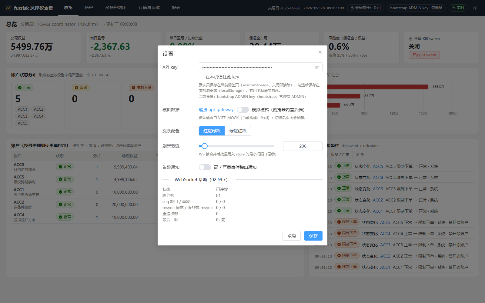
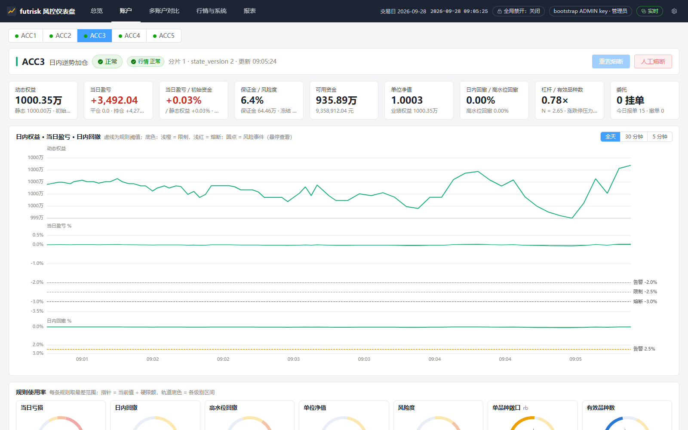
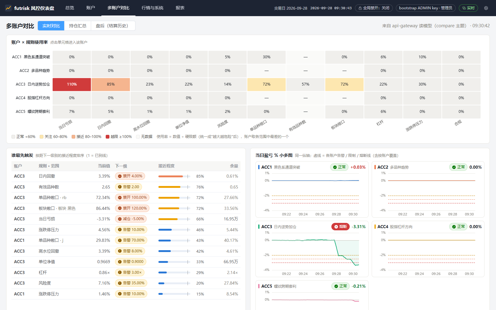
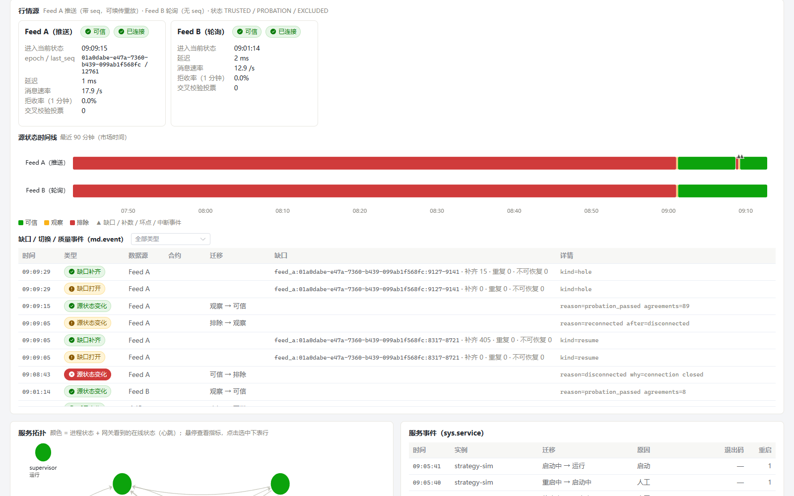
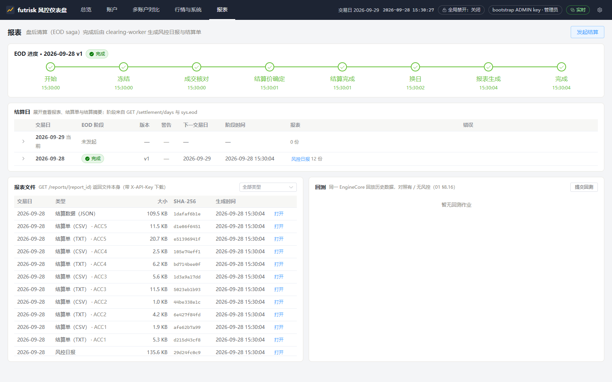
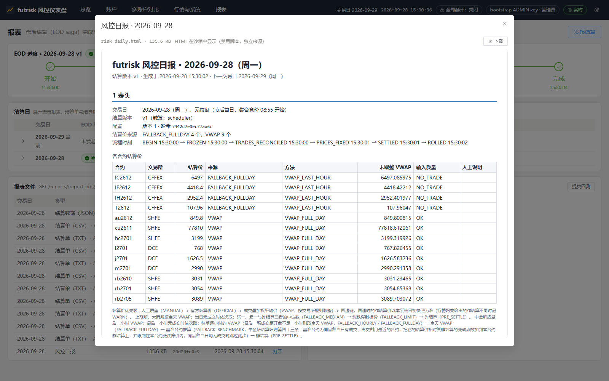
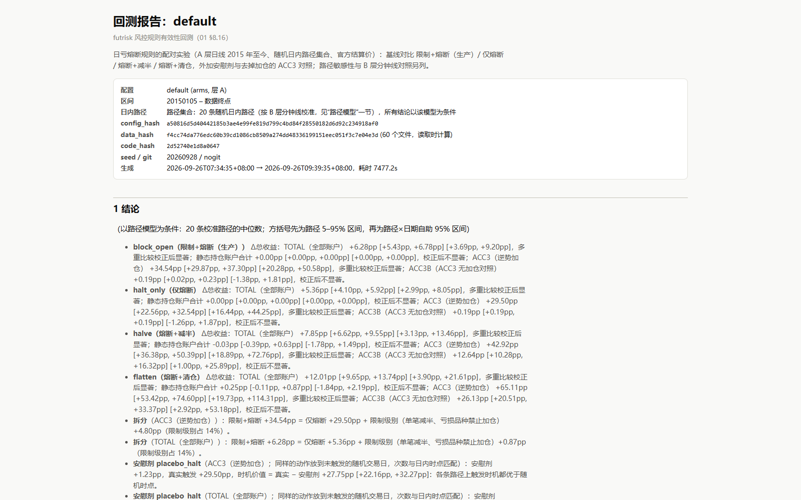

# futrisk 使用说明与演示脚本

| 项 | 内容 |
|---|---|
| 文档编号 | FR-SUM-07 |
| 版本 | v0.2（按已实现的系统编写） |
| 状态 | 实现对齐 |
| 日期 | 2026-09-26 |
| 适用范围 | futrisk 0.1.0：安装与启停、仪表盘、命令行、日常操作（EOD、报表、回测、配置、故障注入、行情录制）和现场演示 |
| 对应标准 | GB/T 8567-2006 软件用户手册（SUM） |
| 关联文档 | [README](README.md)（规范）· [01 架构](01-architecture.md) · [02 通信协议](02-communication-protocol.md) · [04 风控规则](04-risk-rules.md) · [08 部署运维](08-deployment.md) · [11 配置参考](11-config-reference.md) · 项目根目录的 [README](../README.md)（快速开始） |

> 本文面向使用和演示 futrisk 的人：风控经理、交易员、运维和评审方。先读第 2 章把系统跑起来，第 3 章认识仪表盘，第 4 章查命令，第 5 章做日常操作，第 6 章是约 8 分钟的现场演示脚本，第 7 章是故障排除。设计原理见 01，接口和错误码见 02，每个配置项见 11。本文所有命令都在 Windows 11 + Python 3.12 上逐条执行过。

## 目录
1. [概述](#1-概述)
2. [安装与启动](#2-安装与启动)
3. [仪表盘](#3-仪表盘)
4. [命令行参考](#4-命令行参考)
5. [日常操作](#5-日常操作)
6. [现场演示脚本](#6-现场演示脚本)
7. [故障排除](#7-故障排除)
- [附录 A 修订记录](#附录-a-修订记录)

---

## 1. 概述

futrisk 是多品种期货交易风控与清算系统：接入两路模拟行情（外加可选的新浪真实行情），由成交推导持仓，盘中实时计算资金和持仓两个维度的风险指标，越线时告警、限制下单或熔断；每日收盘后逐日盯市结算，生成风控日报和结算单。系统由 6 个服务、1 个虚拟交易所和 1 组策略机器人共 8 个进程组成（01 §5.1），通过浏览器仪表盘和 `futrisk` 命令行操作。

| 使用方式 | 适合谁 | 做什么 |
|---|---|---|
| 仪表盘 `http://127.0.0.1:8000` | 风控经理、评审方 | 看账户和风险状态、多账户对比、行情与服务健康；重置熔断、人工熔断、kill switch、确认告警；发起结算、看报表、提交回测；演示控制 |
| 命令行 `futrisk ...` | 运维、交易员、演示者 | 启停和监控进程；查询持仓、账户、委托、风险事件；下单撤单；结算和报表；故障注入和时钟跳转；回测；录制行情；校验配置 |
| REST API `/api/v1` | 脚本、集成 | 全部功能，其中配置热加载、出入金、结算价覆盖等少数操作只有 REST 入口（§4.12）。Swagger UI 在 `http://127.0.0.1:8000/docs` |

角色与权限（02 §9.6）：`VIEWER` 只读；`TRADER` 可以下单撤单；`RISK_MANAGER` 可以重置熔断、人工熔断、kill switch、确认告警和减仓计划、覆盖结算价、EOD 强制放行；`ADMIN` 拥有全部权限，另外可以发起结算、出入金、热加载配置、提交回测、控制服务和使用演示接口。首次启动自动生成的 bootstrap key 是 `ADMIN`（§2.5）。

## 2. 安装与启动

### 2.1 运行方式

| 方式 | 前提 | 步骤 | 默认 home |
|---|---|---|---|
| exe（推荐） | Windows 10/11 x64；不需要安装 Python | 解压 `dist\futrisk-win64-0.1.0.zip`，运行 `futrisk\futrisk.exe demo` | `futrisk\var\`（不可写时为 `%LOCALAPPDATA%\futrisk`） |
| 源码 | Python 3.12、Poetry 2.x | 在仓库根目录执行 `poetry install`，然后 `.venv\Scripts\python -m futrisk.main demo` | 仓库下的 `var\` |
| docker | Docker Desktop 或 Linux + compose v2 | `docker compose -f deploy/compose.yml up -d --build` | 每个容器一个卷（08 §3） |

```powershell
# exe：先核对 SHA-256（与 .zip.sha256 文件中的值一致），再解压运行
Get-FileHash dist\futrisk-win64-0.1.0.zip -Algorithm SHA256
Get-Content dist\futrisk-win64-0.1.0.zip.sha256
Expand-Archive dist\futrisk-win64-0.1.0.zip -DestinationPath D:\futrisk-demo
D:\futrisk-demo\futrisk\futrisk.exe demo

# 源码
poetry install
.venv\Scripts\python -m futrisk.main demo
```

- 本文的命令一律写成 `futrisk ...`。exe 方式把 `futrisk` 换成 `futrisk.exe` 的完整路径（或把它的目录加入 `PATH`）；源码方式换成 `.venv\Scripts\python -m futrisk.main`，或 `poetry run futrisk`。
- 仪表盘的前端已经构建好放在包内，运行时不需要 Node.js；只有修改 `web/` 之后重新构建才需要 Node 20（08 §2.1）。
- docker 方式的运维命令在容器里执行：`docker compose -f deploy/compose.yml exec api-gateway futrisk status`（08 §3.2）。

### 2.2 启动与停止

| 命令 | 作用 |
|---|---|
| `futrisk demo` | 一键演示：没有 supervisor 时在后台拉起 `futrisk up`，等本 home 的 api-gateway 就绪，读取 API key，账本为空时按 `accounts.yaml` 首日建账，然后打开浏览器。**不带 `--headless` 时会一直附着在控制台上，按 Ctrl-C 停止全部服务** |
| `futrisk demo --headless` | 同上，但不开浏览器、完成后立即返回（任何一步失败时退出码非 0）；系统留在后台运行，用 `futrisk down` 停止 |
| `futrisk demo --scenario breaker` | 另外启动熔断剧本：先把 strategy-sim 切到剧本模式，等 ACC3 的 rb/hc/i 多头达到 0.7 倍权益，再启动剧本（§6.2 第 4 步）；也可以是 `feed_outage`、`all_feeds_outage`。系统已在运行时同样可用（再加 `--headless`，免得再打开一个浏览器页） |
| `futrisk up` | 在前台运行 supervisor，按依赖顺序拉起全部服务，Ctrl-C 停止全部；`--headless` 不在控制台输出日志 |
| `futrisk down` | 按启动的相反顺序优雅停机（约 5s），最后停 supervisor |
| `futrisk ps` | 每个进程的状态、PID、运行时长、重启次数、退出码、心跳 |
| `futrisk status` | 一句话健康检查：supervisor、服务、市场时钟、仪表盘；不健康时退出码为 1 |
| `futrisk logs <实例> [-f]` | 查看某个实例的日志 |
| `futrisk kill <实例>` | 仅演示模式：硬杀一个服务模拟崩溃，supervisor 按策略重启它 |

`futrisk demo` 的正常输出（节选，数字因机器而异）：

```text
ok     supervisor  futrisk up (pid 39752), console log logs/supervisor.console.log
ok     dashboard   http://127.0.0.1:8000/api/v1/health
ok     api key     D:\futrisk-demo\futrisk\var\secrets\bootstrap_admin.key
ok     books       seeded the SOD of 20260928 for 5 accounts
ok     browser     opened http://127.0.0.1:8000
futrisk demo is running (http://127.0.0.1:8000); press Ctrl-C to stop every service
```

`futrisk ps` 全部为 RUNNING 时的样子：

```text
 INSTANCE          STATE          PID   UPTIME   RESTARTS   EXIT   HEARTBEAT
 supervisor        RUNNING       2928   0:42            -      -   clock v1
 sim-exchange      RUNNING      37336   0:42            0      -   -
 md-gateway        RUNNING      42760   0:39            0      -   RUNNING 1.0s
 trade-gateway     RUNNING      28940   0:36            0      -   RUNNING 0.6s
 clearing-worker   RUNNING      18868   0:34            0      -   RUNNING 0.1s
 risk-engine-0     RUNNING      34352   0:32            0      -   RUNNING 0.5s
 risk-engine-1     RUNNING      15596   0:29            0      -   RUNNING 0.4s
 api-gateway       RUNNING      20388   0:26            0      -   RUNNING 0.5s
 strategy-sim      RUNNING      28328   0:21            0      -   -
```

- 首次启动约 20~40s。sim-exchange 和 strategy-sim 是外部组件，不发总线心跳，HEARTBEAT 列为 `-`。
- **市场时钟**：演示模式下市场时间 = 本机时间 + 偏移（01 §8.2）。一个新 home 第一次启动时，市场时间放在下一个交易日的 08:58（开盘集合竞价之前，可用 `--start-at` 指定）；此后偏移保存在 supervisor.db 里，停机再启动时市场时间继续随墙钟前进，只会向前。所以隔几个小时再启动，市场可能已经收盘或过了 EOD：用 `futrisk clock jump --to next-open` 跳到下一个交易时段（§5.1）。
- 需要从头开始（例如排练后恢复干净状态）：`futrisk down`，删除或改名 home 目录，再 `futrisk demo`；或者直接用一个新的 `--home`。

### 2.3 运行时目录（home）

所有状态都在 home 里。确定 home 的顺序：命令行 `--home` → 环境变量 `FUTRISK_HOME` → 默认值（源码为仓库下的 `var\`；exe 为 `<exe 目录>\var`，不可写时为 `%LOCALAPPDATA%\futrisk`）。同一套系统的所有命令都要用同一个 home。

```text
<home>/
  home_id                       本 home 的身份；CLI 只操作 home_id 相同的进程
  config/                       配置的工作目录（首次启动时复制包内默认配置）
  config/versions/<N>/          不可变的配置版本；config/active.json 指向生效的版本
  run/config-2pc/               热加载过程中各实例的投票记录
  db/                           md.db td.db risk-0.db risk-1.db clearing.db api.db supervisor.db sim.db
  db/demo_seed.json             `futrisk demo` 已建账的标记
  backup/<交易日>/              每日 EOD 之后的库备份
  ticks/raw/<交易日>/<源>/      录制的原始 tick（Parquet）
  ticks/canonical/              日终合并去重后的 tick
  ticks/wire/<交易日>/sina/     新浪原始应答归档（`futrisk data rebuild` 用）
  reports/<交易日>/             风控日报 risk_daily.html、结算单 statement_<账户>.txt/.csv、settlement.json
  backtests/<名字>-<时间戳>/    回测输出
  secrets/bootstrap_admin.key   bootstrap ADMIN key（只有当前用户可读）
  logs/<实例>_<YYYYMMDD>.log    每个实例的 JSON 日志；<实例>.console.log 为控制台输出
```

### 2.4 端口

默认全部绑定 `127.0.0.1`，由 `config/services.yaml`、`sim.yaml`、`feeds.yaml` 配置（11 §3）：

| 进程 | 端口 | 用途 |
|---|---|---|
| sim-exchange | 7001 / 7002 / 7003 / 7004 | Feed A（WebSocket）/ Feed B（HTTP，含 `/v1/health`）/ 模拟柜台（ZeroMQ）/ 控制接口（HTTP，仅演示模式） |
| md-gateway | 7101 / 7102 | 总线 PUB / ROUTER |
| trade-gateway | 7201 / 7202 | 总线 PUB / ROUTER |
| risk-engine-0 | 7301 / 7302 | 总线 PUB / ROUTER |
| risk-engine-1 | 7311 / 7312 | 总线 PUB / ROUTER |
| clearing-worker | 7401 / 7402 | 总线 PUB / ROUTER |
| api-gateway | 7501 / 7502，**8000** | 总线 PUB / ROUTER；HTTP：仪表盘 `/`、REST `/api/v1`、WebSocket `/ws`、Swagger `/docs` |
| supervisor | 7601 / 7602 | 总线 PUB / ROUTER |

启动前可以用 `futrisk doctor` 检查这些端口是否空闲、被谁占用（§7.1）。

### 2.5 API key 与角色

| key | 来源 | 角色 | 说明 |
|---|---|---|---|
| bootstrap key | api-gateway 首次启动时生成，写入 `<home>\secrets\bootstrap_admin.key` | `ADMIN` | 没有可用的具名 ADMIN key 时存在；日志只提示文件位置，不打印 key |
| 具名 key | `app.yaml` 的 `api_keys: [{name, role, key_env}]`，明文放在环境变量 `key_env` 中（至少 16 个字符） | 按配置 | 必须在执行 `futrisk up` / `futrisk demo` **之前**设置环境变量（服务继承 supervisor 的环境）；有可用的具名 ADMIN key 后，bootstrap key 停用、文件被删除 |

- **仪表盘**：第一次打开时自动弹出设置对话框，把 key 粘贴进去即可。默认只保存在当前标签页（sessionStorage），勾选"在本机记住此 key"才长期保存；key 无效时页头显示"key 无效"并重新打开设置。

  ```powershell
  Get-Content D:\futrisk-demo\futrisk\var\secrets\bootstrap_admin.key   # 显示 bootstrap key
  ```

- **CLI**：优先使用环境变量 `FUTRISK_API_KEY`，否则读取 bootstrap key 文件。读文件前先核对监听端口的 api-gateway 属于本 home（`/health` 的 `home_id`），防止把 key 发给另一套系统。
- 具名 key 的配置示例见 11 §2；按角色分配 key 后，仪表盘会按角色隐藏或禁用按钮（§3.1）。

## 3. 仪表盘

浏览器打开 `http://127.0.0.1:8000`。截图文件放在 `docs/screenshots/`，全部取自真实运行的系统（2026-09-26 代码冻结后，演示模式，市场时间为 2026-09-28 的上午和收盘后；浏览器窗口 1600×1000）：

| 文件 | 内容 |
|---|---|
| `screenshots/settings.png` | 设置对话框（API key） |
| `screenshots/overview.png` | 总览页 |
| `screenshots/account.png`、`screenshots/account-halted.png` | 账户页；ACC3 熔断锁存后的账户页 |
| `screenshots/compare.png` | 多账户对比页 |
| `screenshots/market-system.png`、`screenshots/market-feed-outage.png` | 行情与系统页；Feed A 中断和补数时的行情事件 |
| `screenshots/reports.png`、`screenshots/daily-report.png` | 报表页；风控日报 |
| `screenshots/backtest-report.png` | 回测报告 |

### 3.1 页头与设置



- **导航**：总览、账户、多账户对比、行情与系统、报表。
- **右侧状态**：当前交易日、市场时钟（北京时间，演示模式下随跳转变化）、kill switch 状态、当前 key 的角色、WebSocket 连接状态（点击查看收到的帧数、缺口、重连次数）、设置（齿轮）。
- **设置**：API key；模拟数据开关（浏览器内置的模拟后端，离线演示和截图用，页头会显示"模拟数据"）；涨跌配色；刷新节流；高 / 严重事件弹出通知。
- **按角色控制按钮**：重置熔断、人工熔断、kill switch、确认告警、确认减仓计划、EOD 强制放行需要 `RISK_MANAGER` 或 `ADMIN`；发起结算、提交回测、重启服务、演示控制需要 `ADMIN`。没有权限的按钮置灰，悬停显示所需角色。

### 3.2 总览


截图时 ACC3 刚刚熔断锁存（演示第 4 步）：状态分组中 ACC3 在"熔断"一栏并标明锁存，事件流（最新的在最上面）记录了这一过程：告警 → 限制下单 → 熔断待确认 → 熔断锁存。

| 区域 | 内容 | 操作 |
|---|---|---|
| 公司指标 | 公司权益、当日盈亏、当日盈亏 / 初始资金（验收口径）、保证金占用（附总名义和净名义）、风险度（阈值 35% / 50% / 70%）。数字由 coordinator 分片（risk-engine-0）汇总两个分片的账户得出 | — |
| kill switch | 当前状态，人工和规则两层分别显示；开关后显示每个目标（两个风控分片和 trade-gateway）的确认进度和重试次数 | 开启 / 关闭 kill switch（RISK_MANAGER，须填写原因） |
| 账户状态分组 | 按 NORMAL / WARNING / RESTRICTED / HALTED 分组列出账户；HALTED 标明"锁存"或"待确认" | 点击账户进入账户页 |
| 账户表 | 账户、状态、分片、动态权益、当日盈亏、盈亏 / 初始资金、风险度、最差规则使用率（进度条）、行情质量 | 点击进入账户页 |
| 事件流 | 实时的风险事件和账户状态变化 | 确认告警（RISK_MANAGER） |

### 3.3 账户



| 区域 | 内容 | 操作 |
|---|---|---|
| 账户选择与状态 | 状态徽标（HALTED 时区分待确认 / 已锁存）、交易模式（非 OPEN 时显示，如 `PROVISIONAL`）、行情质量、分片离线时的"数据陈旧"提示；生效中的限制（如单笔上限 ×0.5、禁止亏损加仓、禁开）及其来源规则 | 重置熔断（可选只重置某条规则的某一级，RISK_MANAGER）；人工熔断（RISK_MANAGER）；两者都要填写原因并记审计 |
| 指标 | 动态权益（静态权益、初始资金）、当日盈亏（平仓、持仓、手续费）、当日盈亏 / 初始资金（另有 / 静态权益和纯浮亏口径）、保证金与风险度、可用资金、单位净值、日内回撤与高水位回撤、杠杆与有效品种数与涨跌停压力、挂单与当日报撤单数 | — |
| 日内曲线 | 权益、当日盈亏、日内回撤；虚线为规则阈值，浅橙底色为限制期间、浅红底色为熔断期间，圆点为风险事件 | 全天 / 30 分钟 / 5 分钟 |
| 规则使用率 | 每条规则取最差的范围，指针为当前值 ÷ 硬限额，轨道底色为各级别区间 | — |
| 标签页 | 持仓（lot 汇总、今昨仓、可平量、盈亏、保证金）；品种敞口（多空净手数、净 / 总名义、占权益比例、上限及使用率）；委托（含拒单码）；成交；减仓计划；风险事件 | 减仓计划：确认或取消（RISK_MANAGER；确认只记录决定，平仓单要手工下，见 04 §7.5） |

熔断锁存后的账户页（演示第 4 步）：


### 3.4 多账户对比



| 标签页 | 内容 |
|---|---|
| 实时对比 | 账户 × 规则使用率热力图（点击单元格进入账户）；"谁最先触发"排名（按距下一级别的接近程度）；各账户当日盈亏 % 小多图（同一纵轴，虚线为各账户自己的告警 / 限制 / 熔断线，含按账户覆盖）；品种 × 账户带符号敞口表（公司净额 = 各账户之和） |
| 持仓汇总 | 跨账户、跨分片的持仓，按账户 / 品种 / 合约 / 交易所 / 板块分组和筛选（同 `futrisk positions -g`） |
| 盘后（结算历史） | 最近 20 / 40 / 60 个交易日的逐日收益、年化波动率、夏普比率、最大回撤、区间收益、熔断次数、最新净值；单位净值曲线；逐日收益热力图 |

### 3.5 行情与系统


截图时市场时间为 09:03，中金所的股指和国债期货 09:30 才开盘，这些合约还没有行情，质量为"未知"（UNKNOWN），开仓被禁止（失效即安全）。

| 区域 | 内容 | 操作 |
|---|---|---|
| 行情 | 各合约最新价、涨跌幅、买一卖一、成交量、当前来源、延迟、质量（OK / STALE / UNKNOWN，非 OK 的合约禁开）、封板状态 | — |
| 行情源 | Feed A、Feed B（启用时还有新浪）的可信状态（TRUSTED / PROBATION / EXCLUDED）、连接状态、状态时间线；行情事件表：来源状态迁移、缺口（`GAP_OPEN`、`GAP_FILLED`，显示补齐条数和重复条数）、质量变化、坏点 | 按事件类型筛选 |
| 服务拓扑 | 服务图，颜色 = 进程状态 + 心跳在线状态；服务事件（启动、退出、重启及原因） | 点击查看指标 |
| 服务健康 | 每个实例的在线状态、进程 / 心跳状态、PID、重启次数、主循环滞后、队列深度、消息速率、延迟 p50 / p99、配置版本和哈希（与多数不一致时标红）、时钟版本 | 重启（ADMIN，优雅停机后拉起） |
| 演示控制 | 仅演示模式：故障注入与撤销、价格冲击、场景剧本（执行 / 停止）、kill 服务、市场时钟跳转（收盘前 / 下一交易时段 / 指定北京时间） | 全部需要 ADMIN |

Feed A 中断并补数时的行情事件（演示第 6 步）：



### 3.6 报表



| 区域 | 内容 | 操作 |
|---|---|---|
| 当前 EOD | 进行中或最近一次结算流程的阶段：BEGIN → FROZEN → TRADES_RECONCILED → PRICES_FIXED → SETTLED → ROLLED → REPORTED → DONE，每步的时间 | 发起结算（ADMIN，可选"生成新版本"） |
| PROVISIONAL 提示 | 有风控分片处于临时日初快照时出现（上一日 EOD 没在下一个交易时段开始前完成，只允许平仓） | 强制放行开仓（RISK_MANAGER，填写原因） |
| 结算日 | 每个交易日的 EOD 阶段、版本、警告数、下一交易日、报表；展开后显示日报和各账户结算单的链接、账户结算摘要（上日结存、平仓盈亏、持仓盯市盈亏、手续费、权益、保证金、风险度、净值、校验结果）和各项对账检查 | 打开日报、查看结算单 |
| 报表 | 全部报表文件（日报、结算单 TXT/CSV、settlement.json、回测报告），可按类型筛选；显示大小和 SHA-256 | 打开（在沙箱中显示）、下载 |
| 回测 | 回测作业列表、状态和摘要 | 提交回测（ADMIN：填配置名和 JSON 覆盖）、打开报告 |

风控日报（`reports/<交易日>/risk_daily.html`）的章节：表头、摘要、资金表（CTP 口径）、盈亏与敞口、限额使用、事件与动作、数据质量、系统运行、图表、压力测试（01 §5.3.4）：



## 4. 命令行参考

### 4.1 通用约定

| 约定 | 说明 |
|---|---|
| 查看帮助 | `futrisk --help`，每个子命令都有 `--help`，如 `futrisk order place --help` |
| `--home <目录>` | 运行时 home（默认见 §2.3）；**同一套系统的所有命令都要指向同一个 home** |
| `--api <URL>` | 覆盖 api-gateway 地址（默认取 `services.yaml` 中 api-gateway 的 `http`） |
| `--json` | 输出 API 的原始 JSON 应答，便于脚本处理 |
| 退出码 | 成功为 0；失败打印 `错误码: 说明`（02 §11.1）并以 1 退出；参数错误为 2 |
| 时间 | 一律按北京时间（市场时间）显示，与本机时区无关 |
| 数值 | 金额和价格按 API 给出的原样打印，比率显示为百分比 |
| API key | `FUTRISK_API_KEY` 或 bootstrap key 文件（§2.5） |

命令分组：运维（§4.2）、持仓与账户（§4.3）、委托（§4.4）、风控（§4.5）、演示控制（§4.6）、结算与报表（§4.7）、回测与性能基准（§4.8）、行情数据（§4.9）、配置（§4.10）、单个服务（§4.11）；只有 REST 入口的操作见 §4.12。

### 4.2 运维

| 命令 | 作用 | 主要选项 | 示例 |
|---|---|---|---|
| `version` | 打印版本 | — | `futrisk version` |
| `demo` | 一键演示（§2.2） | `--scenario <剧本>`、`--headless`、`--start-at <ISO 北京时间>`（只对新 home 有效）、`--timeout`、`--book-timeout`、`--bots normal\|scenario` | `futrisk demo --headless --start-at 2026-09-28T09:25:00` |
| `up` | 前台运行 supervisor | `--headless`、`--svc-env 实例:变量=值`（只允许 strategy-sim 的 `FUTRISK_BOTS_MODE/_SEED/_ACCOUNTS`）、`--clock-only`（只维护市场时钟，docker 用） | `futrisk up --svc-env strategy-sim:FUTRISK_BOTS_MODE=scenario` |
| `down` | 优雅停止全部服务 | `--timeout` | `futrisk down` |
| `ps` | 进程列表 | `--json` | `futrisk ps` |
| `status` | 健康摘要，不健康时退出码 1 | — | `futrisk status` |
| `logs` | 查看日志（读本地文件，不经总线） | `-f` 跟随、`-n` 行数、`--console` 看控制台输出、`--raw` 原样输出 JSON | `futrisk logs risk-engine-1 -n 100 -f` |
| `kill` | 演示模式：硬杀一个实例，supervisor 自动重启 | — | `futrisk kill risk-engine-1` |
| `doctor` | 本机环境检查：Python、home、中文路径、时区库、时钟同步、pyzmq、SQLite/WAL、配置、端口占用、api-gateway 的 home、key、仪表盘文件、日志 | `--json` | `futrisk doctor` |

### 4.3 持仓与账户

| 命令 | 作用 | 主要选项 | 示例 |
|---|---|---|---|
| `positions` | 全部账户、全部分片的持仓，可筛选和汇总（`GET /positions`） | `-a` 账户、`-p` 品种、`-i` 合约、`-e` 交易所、`-s` 板块、`-g account\|product\|instrument\|exchange\|sector` | `futrisk positions -g product`；`futrisk positions -a ACC3` |
| `accounts` | 账户总览：状态、权益、当日盈亏及比例、风险度、保证金、可用资金、行情质量、快照时间 | — | `futrisk accounts` |

### 4.4 委托（TRADER）

| 命令 | 作用 | 主要选项 | 示例 |
|---|---|---|---|
| `order place` | 下一笔委托；被拒时打印拒单码（02 §11.2）并以 1 退出 | `-a` 账户、`-i` 合约、`--side buy\|sell`、`--offset open\|close\|close-today\|close-yesterday`、`-q` 手数、`--price`（限价单必填）、`--type limit\|market`、`--tif gfd\|fak\|fok` | `futrisk order place -a ACC1 -i rb2701 --side buy --offset open -q 2 --price 3100` |
| `order cancel` | 撤一笔委托 | `-a` 账户（加快查找）、`--reason` | `futrisk order cancel 01a0d8ef-100b-7212-b6c6-71e634651918 -a ACC3` |
| `order cancel-all` | 撤一个账户的全部挂单 | `-a` 账户、`--open-only` 只撤开仓单、`-p` 品种、`--reason` | `futrisk order cancel-all -a ACC1 --open-only` |
| `order list` | 一个账户的委托流水 | `-a` 账户、`--active` 只看未终结的、`--td` 交易日 | `futrisk order list -a ACC3 --active` |

SHFE 的平仓必须区分 `close-today` 和 `close-yesterday`；DCE、CFFEX 用 `close`。

### 4.5 风控（RISK_MANAGER）

| 命令 | 作用 | 主要选项 | 示例 |
|---|---|---|---|
| `risk state` | 账户状态、是否锁存、交易模式、生效的限制 | `-a` 账户 | `futrisk risk state -a ACC3` |
| `risk events` | 某交易日的风险事件；ALERT KEY 列可直接用于 `risk ack` | `--td`、`-a` 账户、`-n` 条数 | `futrisk risk events -a ACC3 -n 20` |
| `risk reset` | 重置锁存的熔断：锁存级别转为 REARMED，重新布防线 = min(阈值, 当前值 − extra)，并解除人工熔断 | `-r` 原因（必填）、`--rule`、`--level` | `futrisk risk reset ACC3 -r "risk reviewed"` |
| `risk halt` | 人工熔断：立即锁存 HALTED，撤销开仓挂单 | `-r` 原因（必填） | `futrisk risk halt ACC4 -r "manual stop"` |
| `risk ack` | 确认告警（只记确认，不改变规则状态） | `--note` | `futrisk risk ack "20260928\|daily_loss\|halt\|acct:ACC3\|1" --note "known"` |
| `risk kill-switch` | 全公司 kill switch：扇出到每个风控分片和 trade-gateway，逐个目标显示结果；未确认的目标由 api-gateway 在后台重试 | `on\|off`、`-r` 原因（必填） | `futrisk risk kill-switch on -r "drill"` |

`risk ack` 的告警键里有 `|`，在 PowerShell 中要整体加引号（上表示例中的 `\|` 是表格转义，实际输入 `|`）。

### 4.6 演示控制（ADMIN，仅演示模式）

这些命令经 api-gateway 的 `/demo/*` 接口转发给 sim-exchange 或 supervisor，全部记审计；`app.mode` 不是 `demo` 时返回 403。

| 命令 | 作用 | 主要选项 | 示例 |
|---|---|---|---|
| `fault inject` | 向虚拟交易所注入故障（类型和参数见 11 §9.2） | `TYPE`、`-t feed_a\|feed_b`、`-p 键=值`（可重复）、`-d` 持续秒数（缺省为直到撤销） | `futrisk fault inject FEED_LATENCY -t feed_a -p ms=800 -d 60` |
| `fault list` | 当前生效的故障 | `-a` 同时显示最近结束的 | `futrisk fault list` |
| `fault clear` | 撤销故障 | `故障 ID`，或 `-a` 撤销全部 | `futrisk fault clear -a` |
| `shock` | 对板块或合约施加价格冲击 | `--pct`（比率 `-0.03` 或百分比 `-3%`）、`-s` 板块 / `-i` 合约、`-d` 持续秒数、`--shape step\|linear` | `futrisk shock -s black --pct -1% -d 20 --shape linear` |
| `scenario list` | 可用剧本和最近一次运行的进度 | — | `futrisk scenario list` |
| `scenario run` | 启动剧本（同一时刻只运行一个，已有剧本在运行时返回 409） | `名字`、`-v 变量=值`（可重复）、`--speed` 倍速 | `futrisk scenario run feed_outage -v outage_s=30` |
| `scenario cancel` | 停止运行中的剧本 | — | `futrisk scenario cancel` |
| `clock show` | 市场时间、交易日、交易模式、时钟模式和版本、墙钟 | — | `futrisk clock show` |
| `clock jump` | 市场时钟向前跳：暂停行情 → 跳转 → 等全部服务确认 → 恢复（02 §8.8） | `--to`：`HH:MM`（市场时钟之后的下一个该时刻）、`"YYYY-MM-DD HH:MM"`、`pre-close`（当日 14:58）、`next-open`（下一个交易时段开始前 2 分钟） | `futrisk clock jump --to 15:29` |

市场时钟只能向前跳；跳过的时间段里没有行情，也不会有成交。

### 4.7 结算与报表

| 命令 | 作用 | 主要选项 | 示例 |
|---|---|---|---|
| `settle run` | 启动（或继续）某交易日的 EOD 结算流程（ADMIN）；该交易日最后一个交易时段收盘后才能发起 | `--td`（默认当前交易日）、`--force-new-version` 生成新的结算版本、`-w` 等到 DONE 或 FAILED、`--timeout` | `futrisk settle run --td 20260928 -w` |
| `settle status` | 某交易日最新的 EOD 阶段和错误 | `--td` | `futrisk settle status --td 20260928` |
| `settle show` | 结算结果：账户资金、持仓、结算价（含来源和方法）、对账检查 | `--td`、`-a` 账户、`--version` | `futrisk settle show --td 20260928 -a ACC3` |
| `settle days` | 最近各交易日的 EOD 阶段 | `-n` | `futrisk settle days` |
| `report list` | 已生成的报表 | `--td`、`-k` 类型或前缀（`risk_daily`、`statement`、`statement_txt`、`settlement`、`backtest`） | `futrisk report list --td 20260928 -k statement` |
| `report daily` | 风控日报的路径、URL 和哈希 | `--td`（默认最新）、`--open` 用浏览器打开 | `futrisk report daily --open` |
| `report statement` | 打印一个账户的文本结算单 | `账户`、`--td`（默认最近结算日） | `futrisk report statement ACC3` |

### 4.8 回测与性能基准

| 命令 | 作用 | 主要选项 | 示例 |
|---|---|---|---|
| `backtest run` | 运行回测配置，在输出目录中写出报告 `<输出目录>\report.html` 以及 `metrics.csv`、`events.parquet`、`manifest.json` 等 | `配置名或 YAML 路径`、`--set 键=值`（可重复）、`--out`、`--workers` | `futrisk backtest run breaker_synthetic` |
| `backtest sweep` | 熔断阈值 × 动作档位的参数扫描 | `配置`（默认 `sweep`）、`--set`、`--out`、`--workers` | `futrisk backtest sweep --set "sweep.thresholds=[0.02,0.03]"` |
| `backtest list` | 包内回测配置和 `<home>\backtests` 下最近的运行 | `--limit` | `futrisk backtest list` |
| `backtest show` | 一次运行的清单（哈希、种子、耗时）和主要数字 | `运行目录或名字` | `futrisk backtest show breaker_synthetic-20260925T222421` |
| `backtest bench` | 一个方案的回放吞吐（tick/s） | `--start`、`--days`、`--tier`、`--profile`、`--static` | `futrisk backtest bench --days 60 --profile` |

回测结果写在 `<home>\backtests\<名字>-<时间戳>\`，方法和结论见 10 文档；性能基准的结果见 13 文档（基准工具只在完整版 `v0.1-full` 中）。

### 4.9 行情数据（新浪）

| 命令 | 作用 | 主要选项 | 示例 |
|---|---|---|---|
| `data record` | 在交易时段轮询新浪行情，录制到 `<home>\ticks\raw\<交易日>\sina\`（原始应答另存 `ticks\wire\`）；非交易时段自动休眠 | `--symbols`、`--poll-ms`（≥1000）、`--until "YYYY-MM-DD HH:MM"`（北京时间）、`--duration-s`、`--ignore-sessions`、`--trust-env` | `futrisk data record --until "2026-09-30 15:30"` |
| `data sina-probe` | 取一次行情并打印解析结果（检查网络和格式） | `--symbols`、`--raw`、`--save` | `futrisk data sina-probe --symbols rb2701,IF2612` |
| `data summary` | 已录制交易日各合约的行数（按 LIVE / BACKFILL 等模式） | `--td` | `futrisk data summary --td 20260928` |
| `data rebuild` | 用归档的原始应答重新生成某日的 tick 文件（解析器修复之后） | `--td`（必填）、`--symbols` | `futrisk data rebuild --td 20260928` |

`data` 命令读取包内默认配置中的 `feeds.yaml`（合约与新浪代码的对应），不读 home 中的配置。无人值守的多日录制见 §5.7。

### 4.10 配置

| 命令 | 作用 | 主要选项 | 示例 |
|---|---|---|---|
| `config validate` | 校验全部配置文件，出错时退出码 1 | `--home`（校验 `<home>\config`）或 `--dir` | `futrisk config validate --home var` |
| `config show` | 打印校验后的配置（JSON，含默认值） | `app\|services\|products\|accounts\|risk_rules\|feeds\|sim`、`--home`、`--dir` | `futrisk config show risk_rules` |
| `config schema` | 导出每个配置文件的 JSON Schema | `--out <目录>` | `futrisk config schema --out var\schema` |

热加载没有 CLI 命令，用 REST 调用（§5.4）。

### 4.11 单个服务

`futrisk svc <服务>` 在前台运行一个服务，供调试或由 supervisor 调用：`md-gateway`、`risk-engine`、`trade-gateway`、`clearing-worker`、`api-gateway`、`supervisor`、`sim-exchange`、`strategy-sim`。选项：`--home`、`--instance`、`--shard`（risk-engine 的分片号）、`--parent-pid`（该进程退出时本服务也退出）、`--clock-offset-ns`（sim-exchange 的市场时钟偏移）。

```powershell
futrisk svc risk-engine --shard 1 --home var
```

正常使用时不需要手动运行：`futrisk up` 会按顺序拉起全部服务。

### 4.12 只能通过 REST 完成的操作

以下操作没有 CLI 命令（部分在仪表盘上有按钮）。所有 POST / DELETE 都要带 `Idempotency-Key` 请求头（一个新的 UUID），同一个 key 重发时返回第一次的结果（02 §9.6）。PowerShell 示例：

```powershell
$api = 'http://127.0.0.1:8000/api/v1'
$key = Get-Content var\secrets\bootstrap_admin.key
function Invoke-Futrisk($Method, $Path, $Body) {
    $h = @{ 'X-API-Key' = $key; 'Idempotency-Key' = [guid]::NewGuid().ToString() }
    if ($Body) { Invoke-RestMethod -Method $Method -Uri "$api$Path" -Headers $h -ContentType 'application/json' -Body ($Body | ConvertTo-Json -Depth 5) }
    else { Invoke-RestMethod -Method $Method -Uri "$api$Path" -Headers $h }
}
Invoke-Futrisk Post '/config/reload'                                              # 配置热加载
Invoke-Futrisk Post '/settlement/20260928/prices/rb2701' @{ price = '3015'; reason = 'exchange notice' }
```

| 操作 | 方法与路径 | 请求体 | 权限 | 仪表盘 |
|---|---|---|---|---|
| 配置热加载 | `POST /config/reload` | — | ADMIN | 无 |
| 出入金 | `POST /accounts/{id}/cash` | `{type: DEPOSIT\|WITHDRAW, amount: "1000000.00", reason}` | ADMIN | 无 |
| 人工覆盖结算价 | `POST /settlement/{td}/prices/{instrument}` | `{price, reason}` | RISK_MANAGER | 无 |
| 导入官方结算价 | `POST /settlement/{td}/official-prices` | `{prices: [{instrument_id, price}], source}` | ADMIN | 无 |
| 建立或更正日初快照 | `POST /settlement/seed-sod` | `SeedSodRequest`（02 §6.5） | ADMIN | 无（`futrisk demo` 自动建账） |
| 导入柜台成交 | `POST /trades/import` | `{trading_day, trades, source}` | ADMIN | 无 |
| 处理对账异常 | `POST /risk/recon-breaks/{break_id}/resolve` | `{resolution: RESYNCED\|RESEEDED\|ACCEPTED, note}` | RISK_MANAGER | 无 |
| 排除或恢复数据源 | `POST /market/sources/{source}` | `{action: EXCLUDE\|INCLUDE, reason}` | ADMIN | 无 |
| 确认或取消减仓计划 | `POST /risk/liquidation-plans/{plan_id}/confirm` | `{decision: CONFIRM\|CANCEL}` | RISK_MANAGER | 账户页 |
| EOD 强制放行 | `POST /risk/eod/{td}/force-unfreeze` | `{reason}` | RISK_MANAGER | 报表页 |
| 启停、重启服务 | `POST /services/{instance}/start`、`/stop`、`/restart` | — | ADMIN | 行情与系统页（重启） |
| 提交回测 | `POST /backtests` | `{config_name, overrides}` | ADMIN | 报表页 |

完整的端点、字段和错误码见 02 §9.6 和运行时的 `http://127.0.0.1:8000/docs`。

## 5. 日常操作

### 5.1 首次启动、建账与市场时钟

1. `futrisk demo`（或 `futrisk up` 后另开窗口执行 `futrisk demo --headless`）。
2. api-gateway 首次启动时生成 bootstrap key；风控分片取不到日初快照，停在等待阶段。
3. `futrisk demo` 发现账本为空，按 `accounts.yaml` 的初始资金、`sim.yaml` 的昨结算为 5 个账户首日建账（`POST /settlement/seed-sod`），写下 `db\demo_seed.json` 标记；以后再运行 `futrisk demo` 显示 `books already seeded`，不会重复建账。
4. 各分片加载快照、完成启动；市场在 09:00 开盘后，机器人开始交易。

市场时钟的常用操作：

| 需求 | 做法 |
|---|---|
| 看当前市场时间 | `futrisk clock show`；仪表盘页头 |
| 跳到下一个交易时段 | `futrisk clock jump --to next-open`（例如午休、收盘后） |
| 看收盘前的行情 | `futrisk clock jump --to pre-close`（当日 14:58） |
| 触发当日 EOD | `futrisk clock jump --to 15:29`，一分钟后 15:30 自动开始结算（§5.2） |
| 指定时刻 | `futrisk clock jump --to "2026-09-29 10:00"` |
| 让新 home 从某个时刻开始 | `futrisk demo --home <新目录> --start-at 2026-09-28T09:25:00` |

生产模式（`app.mode: prod`）下市场时间就是本机时间，不能跳转，`futrisk demo` 也不会自动建账。

### 5.2 盘后清算（EOD）

**自动**：每个交易日市场时间到达 `app.eod_start_at`（默认 15:30）后，clearing-worker 自动开始结算流程（01 §6.6）：

| 阶段 | 含义 |
|---|---|
| BEGIN | 固定本次使用的日初快照版本和配置版本 |
| FROZEN | 各风控分片冻结当日（`EOD_FROZEN`），返回成交和出入金摘要 |
| TRADES_RECONCILED | 本地副本、trade-gateway、风控三方核对成交和出入金，缺的补齐 |
| PRICES_FIXED | 确定结算价：人工覆盖 > 官方 > VWAP > 回退链 |
| SETTLED | 逐日盯市、手续费、保证金（含单向大边）、资金，对账检查，生成下一交易日的日初快照 |
| ROLLED | 各分片换日：按新快照重新定基，锁存按规则配置解除 |
| REPORTED | 生成风控日报和结算单 |
| DONE / FAILED | 完成；失败时发布告警 |

演示环境中一次 EOD 通常几秒完成。之后账户显示下一交易日，而市场时钟仍在当日下午，直到夜盘开始。

**查看进度与结果**：

```powershell
futrisk settle status --td 20260928      # 阶段；FAILED 时显示错误
futrisk settle show --td 20260928        # 账户资金、持仓、结算价及来源、对账检查
futrisk settle days                      # 最近各交易日的阶段
```

**手动**：`futrisk settle run --td 20260928 -w`（ADMIN）。已完成的交易日返回 `already settled`；要重新结算（例如导入官方结算价之后），加 `--force-new-version` 生成新版本，已经换日的分片会按新版本重新定基。只能在该交易日最后一个交易时段收盘之后发起；更早的交易日没有换日完成时返回 `PRECONDITION_FAILED`。

**结算价的人工覆盖和官方价**（REST，§4.12）：在 `PRICES_FIXED` 之前提交，作用于进行中的这次结算；之后提交，应答会说明"作用于下一个版本"，再用 `settle run --force-new-version` 重新结算。导入的官方价与已结算价不同时，EOD 记一条警告（报表页的"警告"列）。

**失败与临时快照**：EOD 失败时 `settle status` 显示原因，修复后再次 `settle run`（生成新版本）。如果下一个交易时段开始时仍未换日，各分片进入 `PROVISIONAL`：所有账户禁开、平仓照常；EOD 完成后自动恢复。紧急时风控经理可以在报表页"强制放行开仓"（`POST /risk/eod/{td}/force-unfreeze`，记审计）。

### 5.3 报表

| 文件（`<home>\reports\<交易日>\`） | 内容 |
|---|---|
| `risk_daily.html` | 风控日报：摘要要点、资金表（CTP 口径）、盈亏与敞口、限额使用、事件与动作（告警、熔断、重置、被拒委托）、数据质量、系统运行、图表、压力测试。自包含，可直接打印 |
| `statement_<账户>.txt` | CTP 风格文本结算单：资金状况、成交记录、平仓明细、持仓明细、持仓汇总 |
| `statement_<账户>.csv` | 同样内容的结构化版本（UTF-8 BOM，可用 Excel 打开） |
| `settlement.json` | 完整的结算结果（02 §7.8 `SettlementResult`） |

查看：仪表盘报表页；`futrisk report daily --open`；`futrisk report statement ACC3`；`futrisk report list --td 20260928`。每个文件的 SHA-256 登记在 clearing.db 中；重新结算时同名文件被新版本覆盖（03 §5.3）。

### 5.4 配置变更与热加载

1. 编辑 `<home>\config\` 下的文件（不是仓库的 `config\`，也不是 `versions\` 下的快照）。每个字段的含义和生效方式见 11。
2. 校验：`futrisk config validate --home <home>`。
3. 提交：

   ```powershell
   $h = @{ 'X-API-Key' = (Get-Content var\secrets\bootstrap_admin.key); 'Idempotency-Key' = [guid]::NewGuid().ToString() }
   Invoke-RestMethod -Method Post -Uri http://127.0.0.1:8000/api/v1/config/reload -Headers $h
   ```

   成功时应答为 `ok: True`、`message: config version N committed`，通常 1s 内完成。
4. 确认：仪表盘行情与系统页的服务健康表中，7 个内部实例的"配置"列都显示 `vN · 哈希`（sim-exchange 和 strategy-sim 不参与）；`GET /api/v1/config/versions` 中该版本为 `COMMITTED`。30s 内有实例没有跟上时，该版本标为 `FAILED` 并告警（该实例重启后自动加载新版本）。

| 情况 | 结果 | 处理 |
|---|---|---|
| 修改 `risk_rules.yaml` 的阈值 | 即时生效；已经锁存的熔断保持到重置或换日 | — |
| 修改 `products.yaml`、交易日历 | 下一交易日生效；风控分片要重启才用新值（TD-09） | 在 EOD 之后提交，下一个交易时段开始前重启 `risk-engine-0/1`（仪表盘"重启"） |
| 修改端点（`services.yaml`）、数据源（`feeds.yaml` 中除 `arbitration` 以外的部分）、账户的分片归属 | 被否决，整轮放弃，应答为 `BAD_REQUEST: prepare failed: ...`，各服务保持原版本 | 停机后离线提交新版本（08 §4.5） |
| 修改 `sim.yaml`、剧本、`bots.yaml` | 可以提交，但外部组件只在启动时读取 | 提交后重启 sim-exchange / strategy-sim |
| 回退到旧配置 | 把工作目录改回旧内容（可从 `config\versions\<旧版本>\` 复制）再热加载，生成一个内容相同的新版本 | 版本号只增不减 |

### 5.5 回测

| 配置（`config/backtest/`） | 内容 | 耗时量级 |
|---|---|---|
| `breaker_synthetic` | D 层合成剧本：精确断言告警 → 限制 → 熔断（先待确认、再锁存）、熔断后开仓被拒平仓成交、单个坏点不会锁存 | 几秒 |
| `default` | A 层日线 2015 年至今的配对实验：各动作档位对比基线，20 条随机日内路径，另含路径敏感性和 B 层对照（10 §4） | 约 2 小时（15 个工作进程） |
| `stress` | 压力窗口（2015-07 股灾、2016-11-14 黑色暴跌等），每个窗口单独运行 | 约 5 分钟 |
| `sweep` | 熔断阈值 × 动作档位扫描，样本内 / 样本外（10 §4.8） | 约 1 小时（15 个工作进程） |
| `minute` | B 层新浪分钟线 | 不到 1 分钟 |
| `ticks` | C 层自录 tick（需要先录制，§5.7） | 取决于录制天数 |

```powershell
futrisk backtest run breaker_synthetic            # 结束时打印 "scenario checks: 16/16 passed"
futrisk backtest run default --set start=20200101 --workers 4
futrisk backtest list
futrisk backtest show <运行名>
```

- 输出目录 `<home>\backtests\<名字>-<时间戳>\`：报告 `<输出目录>\report.html`，以及 `metrics.csv`、`events.parquet`、`summary.json`、`manifest.json`（配置哈希、数据哈希、随机种子、代码哈希，保证可复现）等。
- 配置从包内 `config\backtest\` 读取，改 `<home>\config\backtest\` 不起作用；自己的配置传 YAML 路径（11 §10.2）。
- 也可以在仪表盘报表页"提交回测"，由 clearing-worker 在进程池中运行。



### 5.6 故障注入与场景剧本

| 剧本 | 过程 | 看点 |
|---|---|---|
| `breaker` | 黑色板块分三段下跌（每段 30s 线性下跌、间隔 60s） | ACC3 依次触发 −2% 告警、−2.5% 限制、−3% 熔断，每级只告警一次；熔断后开仓被拒、平仓成交 |
| `feed_outage` | Feed A 断开 20s（拒绝重连），Feed B 照常；随后制造 15 条跳号、20% 重复和乱序 | 瞬时切换到 Feed B；重连后按序号重放补齐（`GAP_FILLED`，重复 0 条），补数不进风控 |
| `all_feeds_outage` | Feed A 和 Feed B 同时中断 35s | 合约 5s 后 STALE、30s 后 UNKNOWN，禁开、平仓照常，状态机不动；恢复后回到 OK |

- 运行：`futrisk scenario run <名字>`；`breaker` 依赖 ACC3 建满持仓，建议用 `futrisk demo --scenario breaker`（§2.2）。
- 单独注入故障：`futrisk fault inject FEED_DISCONNECT -t feed_a -p refuse_reconnect_s=20`；价格冲击：`futrisk shock -s black --pct -2% -d 30 --shape linear`；撤销：`futrisk fault clear -a`。
- 服务级故障：`futrisk kill risk-engine-1`、`futrisk kill md-gateway`（仪表盘演示控制中也有"Kill 服务"）。
- 剧本文件格式和故障参数见 11 §9。

### 5.7 录制新浪真实行情

真实 tick 是 C 层回测的数据来源（01 §8.16）。录制与仿真系统互不影响，可以同时运行。

```powershell
futrisk data sina-probe --symbols rb2701,IF2612        # 先确认网络和解析正常
powershell -ExecutionPolicy Bypass -File scripts\record_forever.ps1 -Until "2026-09-30 15:30"
futrisk data summary --td 20260928                     # 另开窗口查看录制进度
```

- `record_forever.ps1` 循环运行 `futrisk data record`，崩溃后按 5s、10s、20s…（上限 60s）退避重启；正常结束、Ctrl-C、另一个录制进程持有锁或参数错误时停止。每次启动和退出都记入 `<home>\logs\record_forever.log`。参数：`-Until`（北京时间）、`-FutriskHome`、`-RecordArgs "--poll-ms 1000"`。
- 录制程序按交易日历和交易时段自动休眠，只在交易时段前后轮询；每 5s 关闭一个分片文件，意外中断最多丢几秒数据。
- 在 Windows Terminal 中运行：旧控制台里选中文字会暂停程序输出。多日无人值守时接通电源，把"合盖"和"睡眠"设为不操作，暂停系统更新，并执行 `w32tm /resync` 校时。
- 输出：`<home>\ticks\raw\<交易日>\sina\part-*.parquet`，原始应答在 `<home>\ticks\wire\`（解析器修复后可用 `futrisk data rebuild` 重新生成）。

## 6. 现场演示脚本

约 8 分钟，10 步。每一步给出命令和要讲的要点。命令在另一个 PowerShell 窗口中执行，屏幕上同时放浏览器（仪表盘）和终端。

### 6.1 演示前准备

| 时间 | 事项 |
|---|---|
| 前一天 | 在演示机器上完整排练一遍；运行 `futrisk doctor` 确认全部 PASS；预先跑好 `futrisk backtest run default`（约 2 小时；也可以直接打开 `docs/backtests/default.html`，即代码冻结后那次运行的报告），演示时直接打开报告 |
| 开场前 30 分钟内 | 用一个新 home 启动：`futrisk demo --home D:\futrisk-demo\home --headless --start-at 2026-09-28T09:20:00`（市场时间从 09:20 开始，开场时约 09:40，处于连续交易时段）；浏览器打开仪表盘并填好 key；准备好第二个 home 作为备用（§6.3） |
| 开场前 1 分钟 | `futrisk status` 全部健康；仪表盘各页能正常打开；关闭无关窗口和通知 |

下文命令省略 `--home`，演示时可以先执行 `$env:FUTRISK_HOME = 'D:\futrisk-demo\home'`，之后所有命令都用这个 home。

### 6.2 演示步骤

| # | 时长 | 操作与命令 | 要讲的要点 |
|---|---|---|---|
| 1 | 0:30 | 展示根目录 README 的架构图（或 01 §5.1） | 6 个服务 + 虚拟交易所 + 策略机器人；ZeroMQ 无 broker 总线；风控是订单唯一入口；按账户分片（ACC1/ACC2 在分片 0，ACC3/4/5 在分片 1）；每服务一库 |
| 2 | 0:45 | `futrisk ps`、`futrisk status`；仪表盘行情与系统页 | 8 个进程全部 RUNNING；心跳 1Hz 不经过业务主循环；服务健康表中各实例的配置版本和哈希一致；一个 exe 一条命令拉起 |
| 3 | 0:45 | `futrisk positions -g account`、`futrisk positions -g product`；仪表盘总览页、多账户对比页的"持仓汇总" | 按账户、按品种查询持仓（题目要求）；持仓只由成交推导，每个账户独立核算；总览页的公司权益、当日盈亏由分片 0 汇总两个分片得出 |
| 4 | 1:45 | `futrisk demo --scenario breaker --headless`（等 ACC3 建满持仓后自动启动剧本）；仪表盘切到 ACC3 账户页；约 2 分钟后：`futrisk risk events -a ACC3`；`futrisk order place -a ACC3 -i rb2701 --side buy --offset open -q 1 --type market`；`futrisk order place -a ACC3 -i rb2701 --side sell --offset close-today -q 1 --type market` | 持仓维度先报警（板块、单品种敞口）；资金维度三级依次触发：−2% 告警 → −2.5% 限制（单笔上限 ×0.5、禁止亏损加仓）→ −3% 熔断；越线当即禁开并撤销开仓挂单（待确认），2 个 LIVE 状态确认后锁存；**每级只有一条告警**（`alert_key` 带 episode）；开仓被拒 `REJECT_ACCOUNT_HALTED`，平仓照常成交；机器人每 20s 的试探开仓也被拒（委托标签页） |
| 5 | 0:45 | `futrisk kill risk-engine-1`，紧接着再下一笔开仓单；`futrisk ps`；`futrisk risk state -a ACC3`；`futrisk risk events -a ACC3` | 风控不在时下单直接失败（`UNAVAILABLE`，失效即安全，没有绕过风控的通道）；supervisor 约 2~3s 拉起；重启后 HALTED 仍然锁存、告警键不变、没有重复告警（状态机和告警持久化，成交从 trade-gateway 补回） |
| 6 | 1:15 | `futrisk scenario run feed_outage`（`breaker` 剧本启动约 3 分钟后才结束，之前会返回 409）；仪表盘行情与系统页的行情源和行情事件；约 1 分钟后 `futrisk kill md-gateway` | Feed A 断开 → 状态 EXCLUDED，行情由 Feed B 接续、没有中断；重连后按序号续传，缺口作为补数重放：行情事件显示 `GAP_FILLED`（如"补齐 450 条，重复 0 条"），补数不进风控；Feed A 经 10s 观察期恢复 TRUSTED；之后的跳号、重复、乱序都被吸收。kill md-gateway：服务变红 → 重启 → 变绿，期间相关账户的行情质量变为 STALE / UNKNOWN、禁开，恢复后回到 OK |
| 7 | 0:30 | 仪表盘多账户对比页 | 账户 × 规则使用率热力图；"谁最先触发"排名；各账户当日盈亏小多图叠加各自阈值（ACC3 穿过熔断线）；品种 × 账户敞口表 |
| 8 | 1:00 | `futrisk clock jump --to 15:29`；约 1 分钟后 `futrisk settle status --td 20260928`（或报表页的阶段条）；`futrisk settle show --td 20260928`；`futrisk report daily --open`；`futrisk report statement ACC3` | 市场时钟跳转：暂停 → 跳转 → 全部服务确认新时钟 → 恢复，与生产共用同一套交易日历；15:30 自动开始 EOD：冻结 → 三方核对成交 → 结算价（来源一列：有成交的取 VWAP，没有的走回退链）→ 逐日盯市和保证金（Decimal）→ 对账检查全部通过 → 换日 → 日报和结算单；日报的"事件与动作"一节记录了 ACC3 的熔断；换日后锁存按配置解除 |
| 9 | 0:30 | `futrisk backtest run breaker_synthetic`；打开事先跑好的 `default` 回测报告（`futrisk backtest list` 找到运行名） | 回测用同一个 `EngineCore` 回放：合成剧本 16 项断言全部通过、几秒完成；配对实验对比无规则与各动作档位的收益、回撤、Calmar，结论见 10 文档 |
| 10 | 0:30 | 编辑 `<home>\config\risk_rules.yaml`（如把 `daily_loss` 的 warn 从 `-0.020` 改为 `-0.019`）→ `futrisk config validate --home <home>` → `POST /api/v1/config/reload`（§5.4）→ 行情与系统页的配置列 | 两阶段提交：全部 7 个内部实例一起切到新版本（配置列同一个版本号和哈希），约 1s 完成；风控阈值即时生效；如果改的是只能重启生效的项（如 `feeds.yaml` 的 `poll_ms`），整轮被否决，全部保持原版本 |

步骤 4 的剧本约 2 分钟后才熔断，等待时可以讲解账户页的日内曲线（虚线阈值、限制和熔断期间的底色）和规则使用率。步骤 8 之后账户已换到下一交易日；如果还要继续演示盘中功能，执行 `futrisk clock jump --to next-open`。

### 6.3 备用方案

| 现场问题 | 应对 |
|---|---|
| `futrisk demo` 某一步失败 | 看它打印的那一步和原因；`futrisk status`、`futrisk ps`；`futrisk logs <实例> --console`；必要时 `futrisk down` 后重新 `futrisk demo`（已建账的 home 不会重复建账） |
| 端口被占用、另一套系统在运行 | `futrisk doctor` 指出占用者（§7.1）；换用事先准备、配置了另一组端口的备用 home（§7.2） |
| 剧本跑完没有到熔断（随机行情偏离了校准） | 再加一段冲击：`futrisk shock -s black --pct -1% -d 10 --shape linear`；或者用人工熔断展示同样的行为：`futrisk risk halt ACC3 -r demo`（立即锁存、开仓被拒、平仓照常） |
| 市场已收盘、行情不动 | `futrisk clock jump --to next-open` |
| 仪表盘打不开或数据不刷新 | 检查页头的 WebSocket 状态和 key（设置对话框）；强制刷新页面；全部改用 CLI 继续演示 |
| 某个服务反复重启 | `futrisk ps` 看 EXIT 和 DETAIL；`futrisk logs <实例> -n 100`；切换到备用 home |
| 现场机器整体不可用 | 展示事先录好的端到端验收测试输出（`pytest -m e2e tests/e2e -v`，自动完成熔断、kill 风控、行情中断、EOD 全流程，约 8~10 分钟）、合成剧本回测，以及 `docs/screenshots/` 中的截图 |

备用 home 要在演示前 1 小时内准备：停机期间市场时钟照样随墙钟前进，准备得太早，启动时可能已经过了 15:30，EOD 会自动运行并换日。

## 7. 故障排除

### 7.1 端口被占用

`futrisk up` / `futrisk demo` 失败，或 supervisor 反复报某个实例启动失败（`port N in use by pid X`）：

```powershell
futrisk doctor
```

`ports` 各行显示每个端口是空闲、被本 home 的 futrisk 进程占用（系统已在运行），还是被其他程序或另一个 home 占用（FAIL）。按提示结束占用端口的程序；如果是上次没有正常退出的 futrisk 进程，先 `futrisk down`，仍有残留再按 PID 结束。也可以用 `Get-NetTCPConnection -LocalPort 8000` 查看占用者。

### 7.2 同一台机器上的另一套系统

每个 home 有自己的 `home_id`。CLI 发现监听这些端口的 supervisor 或 api-gateway 属于另一个 home 时拒绝操作，提示 `the supervisor on these ports belongs to another home (...); use that home or change ports`，绝不会停掉、杀掉或把 key 发给另一套系统。处理办法：

- 用 `--home`（或 `FUTRISK_HOME`）指向正在运行的那套系统；或者先停掉它（`futrisk down --home <那个 home>`）。
- 真要同时运行两套：第二个 home 要在第一次启动**之前**换好端口（首次启动时把 `config\` 提交为版本 1；之后端点改动只能离线提交，08 §4.5）：
  1. 把包内默认配置复制为新 home 的配置目录：源码为 `Copy-Item -Recurse config D:\home2\config`，exe 为 `Copy-Item -Recurse futrisk\_internal\config D:\home2\config`；
  2. 改 `D:\home2\config\` 下 `services.yaml`、`sim.yaml`、`feeds.yaml` 中的全部端口（19 个端点，11 §3），例如都加 10000；
  3. `futrisk config validate --home D:\home2`，`futrisk doctor --home D:\home2` 确认新端口空闲，再 `futrisk demo --home D:\home2`。

### 7.3 exe 被杀毒软件拦截

PyInstaller 打包的程序偶尔被 Windows Defender 或 SmartScreen 误报。

1. 先核对 SHA-256：`Get-FileHash futrisk-win64-0.1.0.zip -Algorithm SHA256`，与 `.zip.sha256` 文件中的值一致，说明文件完好；
2. 解除下载标记：`Get-ChildItem D:\futrisk-demo\futrisk -Recurse | Unblock-File`；
3. 仍被拦截时，把解压目录加入 Defender 的排除项（需要管理员权限），或改用源码方式运行（§2.1）。

### 7.4 中文路径

支持把 exe 放在含中文的路径下（构建脚本的冒烟测试会把整个包复制到中文目录中验证）。`futrisk doctor` 的 `non-ASCII path` 一项会在 home 下创建中文目录，做一次文件和 SQLite 往返，确认可用。控制台显示乱码时改用 Windows Terminal；futrisk 自身始终以 UTF-8 输出和写文件。

### 7.5 本机时区不是北京时间

futrisk 的业务时间一律按北京时间（`Asia/Shanghai`）计算，与操作系统时区无关：市场时钟、交易日归属、交易时段、EOD 时刻、CLI 和仪表盘显示、报表、`record_forever.ps1 -Until` 都是北京时间。例如本机时区为 UTC+9 时，本机时钟 10:00 对应北京时间 09:00。需要注意的只有：

- 日志文件中 `ts` 字段是本机时区的时间（带偏移，如 `+09:00`），日志文件按本机日期切分；`futrisk logs` 显示的时刻也是本机时间；
- `futrisk doctor` 的 `os time zone` 一项显示本机时区（仅供参考），`tz Asia/Shanghai` 一项必须 PASS；
- Windows 时间服务未启动时 `clock sync` 为 WARN：以管理员身份执行 `net start w32time` 和 `w32tm /resync`。

### 7.6 其他常见问题

| 现象 | 原因与处理 |
|---|---|
| 仪表盘提示"key 无效" | key 不对，或已配置具名 ADMIN key、bootstrap key 已停用；重新粘贴有效的 key |
| CLI 报 `UNAUTHORIZED` | bootstrap key 已停用：设置 `$env:FUTRISK_API_KEY` 为具名 key |
| 演示命令报 `demo endpoints are only available in demo mode` | `app.yaml` 的 `mode` 不是 `demo` |
| `futrisk demo` 一直等待 api-gateway | 看 `logs\supervisor.console.log` 和 `futrisk ps` 的 DETAIL 列；常见原因是端口被占用（§7.1） |
| 行情不动、机器人不下单 | 市场已收盘或在午休：`futrisk clock show`，再 `futrisk clock jump --to next-open` |
| 想让时钟回到过去重新演示 | 时钟只能向前：换一个新 home（§2.2） |
| 账户全部禁开、只能平仓 | 看 `futrisk risk state` 的 MODE 和 RESTRICTIONS：`PROVISIONAL`（上一日 EOD 未完成，§5.2）、`SYSTEM:STARTING`（刚重启，预热中）、kill switch 开启（`futrisk clock show` 的 `kill switch` 一行）、行情质量不是 OK |
| 热加载返回 `prepare failed: ... restart required` | 改了只能重启生效的项，整轮已放弃（§5.4） |
| 日志太多或磁盘不足 | 日志按天和 100MB 切分，默认保留 30 天（`app.yaml` 的 `logging`）；`futrisk doctor` 的 `disk` 一项显示剩余空间 |

---

## 附录 A 修订记录

| 版本 | 日期 | 说明 |
|---|---|---|
| v0.1 | 2026-09-25 | 初版：安装与启停、home、端口、API key；仪表盘五个页面的内容与按角色的操作（截图占位）；全部 CLI 命令及示例（按各命令的 `--help` 核对）和只有 REST 入口的操作；EOD、报表、热加载、回测、故障注入、新浪录制的操作步骤；约 8 分钟的现场演示脚本和备用方案；故障排除。演示脚本在独立 home（换用一组端口）上完整执行验证：熔断三级各告警一次、kill risk-engine-1 后约 3s 恢复且熔断保持、Feed A 中断补齐 450 条且重复 0 条、跳到 15:29 后 EOD 约 2s 完成并生成日报和结算单、热加载约 0.6s 全部提交 |
| v0.2 | 2026-09-26 | 代码冻结后：第 3 章的截图全部换成真实运行的系统（总览与对比页取自 ACC3 熔断锁存之后，另有 Feed A 中断补数和 EOD 后的报表），并加注截图条件；§5.5 的回测耗时改为代码冻结后的实测值 |
