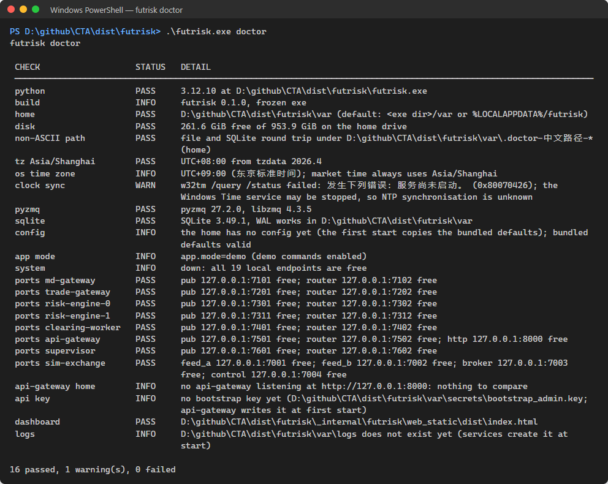
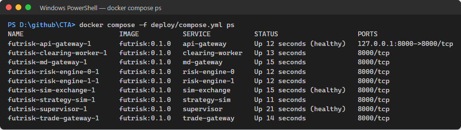

# futrisk 使用说明与演示脚本

| 项 | 内容 |
|---|---|
| 文档编号 | FR-SUM-07 |
| 版本 | v1.0 |
| 状态 | 实现对齐 |
| 日期 | 2026-10-08 |
| 适用范围 | futrisk 0.1.0（精简版，完整版为 git 标签 `v0.1-full`）：安装与启停、仪表盘、命令行、日常操作（EOD、报表、回测、配置、故障注入、行情录制）和现场演示 |
| 对应标准 | GB/T 8567-2006 软件用户手册（SUM） |
| 关联文档 | [README](README.md)（规范）· [01 架构](01-architecture.md) · [02 通信协议](02-communication-protocol.md) · [04 风控规则](04-risk-rules.md) · [08 部署运维](08-deployment.md) · [11 配置参考](11-config-reference.md) · 项目根目录的 [README](../README.md)（快速开始） |

> 本文面向使用和演示 futrisk 的人：风控经理、交易员、运维和评审方。先读第 2 章把系统跑起来（三种运行方式的分步说明，以及第一次运行时常见的问题），第 3 章认识仪表盘，第 4 章查命令，第 5 章做日常操作，第 6 章是约 8 分钟的现场演示脚本，第 7 章是故障排除。设计原理见 01，接口和错误码见 02，构建、部署和运维见 08，每个配置项见 11。命令、选项和输出按 2026-10-08 的代码（各命令的 `--help` 和源码）核对过。

## 目录
1. [概述](#1-概述)
2. [安装与启动](#2-安装与启动)
3. [仪表盘](#3-仪表盘)
4. [命令行参考](#4-命令行参考)
5. [日常操作](#5-日常操作)
6. [现场演示脚本](#6-现场演示脚本)
7. [故障排除](#7-故障排除)
- [附录 A 修订记录](#附录-a-修订记录)

---

## 1. 概述

futrisk 是多品种期货交易风控与清算系统：接入两路模拟行情（外加可选的新浪真实行情），由成交推导持仓，盘中实时计算资金和持仓两个维度的风险指标，越线时告警、限制下单或熔断；每日收盘后逐日盯市结算，生成风控日报和结算单。系统由 6 个服务（风控按账户分成 2 个分片）、1 个虚拟交易所和 1 组策略机器人组成，运行时共 9 个进程：supervisor 和它拉起的 8 个子进程（01 §5.1、§7.1）。通过浏览器仪表盘和 `futrisk` 命令行操作。

| 使用方式 | 适合谁 | 做什么 |
|---|---|---|
| 仪表盘 `http://127.0.0.1:8000` | 风控经理、评审方 | 看账户和风险状态、多账户对比、行情与服务健康；重置熔断、人工熔断、kill switch、确认告警；发起结算、看报表、提交回测；演示控制 |
| 命令行 `futrisk ...` | 运维、交易员、演示者 | 启停和监控进程；查询持仓、账户、委托、风险事件；下单撤单；结算和报表；故障注入和时钟跳转；回测；录制行情；校验和离线提交配置 |
| REST API `/api/v1` | 脚本、集成 | 全部功能，其中配置热加载、出入金、结算价覆盖等少数操作只有 REST 入口（§4.12）。Swagger UI 在 `http://127.0.0.1:8000/docs` |

角色与权限（02 §9.6）：`VIEWER` 只读；`TRADER` 可以下单撤单；`RISK_MANAGER` 可以重置熔断、人工熔断、kill switch、确认告警、确认或取消减仓计划、处理对账异常、覆盖结算价、EOD 强制放行，但不能下单；`ADMIN` 拥有全部权限，另外可以发起结算、出入金、导入官方结算价和成交、建立日初快照、热加载配置、排除或恢复数据源、提交回测、控制服务和使用演示接口。首次启动自动生成的 bootstrap key 是 `ADMIN`（§2.5）。

## 2. 安装与启动

### 2.1 运行方式

| 方式 | 前提 | 仪表盘前端 | 默认 home | 本文命令 `futrisk ...` 的写法 |
|---|---|---|---|---|
| exe（评审和演示推荐） | Windows 10/11 x64；不需要安装 Python | 已打在包内 | `futrisk\var\`（不可写时为 `%LOCALAPPDATA%\futrisk`） | `futrisk.exe` 的完整路径，或把解压目录加入 `PATH` |
| 源码 | Python 3.12、Poetry 2.x；构建仪表盘还需要 Node.js 20.19 以上 | **不在版本库中**，第一次运行前要构建（§2.2.2） | 仓库下的 `var\` | `.venv\Scripts\futrisk`（也可以 `poetry run futrisk` 或 `.venv\Scripts\python -m futrisk.main`） |
| docker | Docker Desktop，或 Linux 上的 Docker Engine 加 compose v2 | 在镜像构建时生成 | 每个容器一个卷（08 §3） | `docker compose -f deploy/compose.yml exec api-gateway futrisk ...` |

三种方式的端口、home 布局和 API key 约定相同（§2.3~§2.5）；docker 下进程由容器编排管理，`futrisk up`、`futrisk down`、`futrisk kill` 不适用，差别见 08 §3.4。构建 exe 和部署 docker 的细节见 08 §2、§3。

### 2.2 启动说明

#### 2.2.1 exe（解压包）

1. **核对并解压**。在 zip 和 `.sha256` 文件所在的目录打开 PowerShell：

   ```powershell
   (Get-FileHash .\futrisk-win64-0.1.0.zip -Algorithm SHA256).Hash -eq (Get-Content .\futrisk-win64-0.1.0.zip.sha256).Split(' ')[0]   # 应为 True
   Expand-Archive .\futrisk-win64-0.1.0.zip -DestinationPath D:\futrisk-demo
   Get-ChildItem D:\futrisk-demo\futrisk -Recurse | Unblock-File   # 从网上下载的 zip：解除下载标记（§7.3）
   ```

   解压目录可以含中文。下文的 `futrisk` 指 `D:\futrisk-demo\futrisk\futrisk.exe`。

2. **检查环境**：`D:\futrisk-demo\futrisk\futrisk.exe doctor`。有 FAIL 时先按提示处理（端口被占用见 §7.1）；`clock sync` 为 WARN 时见 §2.2.5 第 4 条。

   
   *截图：`futrisk doctor` 逐项列出检查结果，最后一行汇总通过、警告和失败的项数；有失败项时退出码为 1。*

3. **一键演示**：`D:\futrisk-demo\futrisk\futrisk.exe demo`。第一次运行会在 `D:\futrisk-demo\futrisk\var\` 创建 home，拉起全部进程，为 5 个演示账户首日建账，然后在浏览器中打开 `http://127.0.0.1:8000`。这个窗口之后一直附着在系统上，不要关闭（§2.2.4）。

   
   *截图：`futrisk demo --headless --start-at 2026-09-28T09:20:00` 的输出：逐步报告 supervisor、等待 api-gateway 就绪（每 5 秒一行进度和已运行的实例数）、仪表盘、API key 和建账；`--headless` 不打开浏览器，完成后即返回。不带 `--headless` 时还有 browser 一行和按 Ctrl-C 停止全部服务的提示（§2.2.4）。*

4. **填 API key**：仪表盘第一次打开时弹出设置对话框，把 bootstrap key 粘贴进去并保存（§2.5）。key 在 home 的 `secrets` 目录中，可以这样显示：

   ```powershell
   Get-Content D:\futrisk-demo\futrisk\var\secrets\bootstrap_admin.key
   ```

5. **确认运行状态**：另开一个 PowerShell 窗口，`futrisk status` 显示全部健康、退出码为 0；`futrisk ps` 列出 supervisor 和 8 个子进程。

   
   *截图：`futrisk status` 的健康摘要和 `futrisk ps` 的进程列表。*

6. **停止**：在 `futrisk demo` 的窗口按 Ctrl-C，停止全部服务。用 `--headless` 启动的系统，或者从别的窗口停止时，执行 `futrisk down`。

#### 2.2.2 源码

1. **准备**：Python 3.12、Poetry 2.x、Node.js 20.19 以上（带 npm）。
2. **安装依赖**（仓库根目录）：`poetry install`。它在仓库下创建 `.venv`（`poetry.toml` 的 `in-project = true`），同时装上开发工具。
3. **构建仪表盘**：构建产物 `src\futrisk\web_static\dist\` 被 `.gitignore` 排除，不在版本库中，检出后必须先构建一次（修改 `web\` 之后也要重新构建）：

   ```powershell
   cd web
   npm.cmd ci
   npm.cmd run build    # vue-tsc 类型检查 + vite build，产物写入 ..\src\futrisk\web_static\dist
   cd ..
   ```

   在 Windows PowerShell 中写 `npm.cmd`：执行策略为默认的 Restricted 时，`npm` 会解析到被拦截的 `npm.ps1`（构建脚本同样调用 `npm.cmd`）。不构建也能运行，但 `http://127.0.0.1:8000/` 只显示一行"The dashboard is not built"，`futrisk doctor` 的 `dashboard` 一项为 WARN；REST、WebSocket 和 `/docs` 不受影响。api-gateway 只在启动时检查构建产物，系统运行中才构建的话要重启它（§2.2.5 第 7 条）。
4. **检查环境**：`.venv\Scripts\futrisk doctor`。
5. **启动**：`.venv\Scripts\futrisk demo`，过程与 exe 相同，home 是仓库下的 `var\`，key 在 `var\secrets\bootstrap_admin.key`。也可以在一个窗口前台运行 `.venv\Scripts\futrisk up`（日志打印在控制台），再在另一个窗口执行 `.venv\Scripts\futrisk demo --headless` 完成建账。
6. **停止**：Ctrl-C（`futrisk demo` 或前台的 `futrisk up` 所在窗口），或 `.venv\Scripts\futrisk down`。

#### 2.2.3 docker compose

1. **准备**：Docker Desktop（Windows）或 Docker Engine 加 compose v2。先校准宿主机时钟（§2.2.5 第 4 条），否则容器内的行情会出现一段时间戳超前的拒收（08 §3.3）。
2. **构建并启动**（仓库根目录）：`docker compose -f deploy/compose.yml up -d --build`。第一次构建要几分钟（2026-10-07 实测约 8 分钟，06 §7.7）。一次性的 `config-init` 先写入配置版本 1，supervisor 健康后其余服务依次启动，`seed` 在 api-gateway 健康后首日建账。
3. **查看容器**：`docker compose -f deploy/compose.yml ps`，9 个常驻容器都在运行，supervisor、sim-exchange、api-gateway 显示 healthy；加 `-a` 还能看到已经正常结束的 `config-init` 和 `seed`。

   
   *截图：`docker compose ps` 列出 9 个常驻容器及其健康状态。*

4. **取 API key**：`docker compose -f deploy/compose.yml exec api-gateway cat /var/lib/futrisk/secrets/bootstrap_admin.key`。
5. **打开仪表盘**：`http://127.0.0.1:8000`，在设置对话框中粘贴 key。宿主机的 8000 端口被占用时，先设置环境变量 `FUTRISK_HTTP_PORT` 换一个端口再 `up -d`。
6. **用 CLI**：命令在 api-gateway 容器里执行，例如 `docker compose -f deploy/compose.yml exec api-gateway futrisk status`，`ps`、`accounts`、`clock show`、`clock jump --to next-open` 同理（08 §3.2）。
7. **重启一个服务**：`docker compose -f deploy/compose.yml restart md-gateway`（docker 下没有 `futrisk kill`，仪表盘的"重启"也不可用）。
8. **停止**：`docker compose -f deploy/compose.yml down` 删除容器、保留数据卷，之后 `up -d` 接着运行，配置版本、账本和市场时钟都还在；`down -v` 连数据卷一起删除，下次从头开始。

docker 的市场时钟同样只向前走：隔一段时间再 `up -d`，市场可能已经收盘，用 `futrisk clock jump --to next-open` 跳到下一个交易时段（08 §3.3）。

#### 2.2.4 启停命令一览

| 命令 | 作用 |
|---|---|
| `futrisk demo` | 一键演示：没有 supervisor 在运行时，在后台拉起 `futrisk up --headless`（输出写入 `<home>\logs\supervisor.console.log`），等本 home 的 api-gateway 就绪，读取 API key，账本为空时按 `accounts.yaml` 首日建账，然后打开浏览器。**它拉起的系统随它的窗口存亡**：之后一直附着在控制台上，按 Ctrl-C 或关闭窗口都会停止全部服务。系统已经在运行时，它只做后面几步，打开浏览器后就返回 |
| `futrisk demo --headless` | 同上，但不开浏览器、完成后立即返回（任何一步失败时退出码为 1）；系统留在后台运行，用 `futrisk down` 停止 |
| `futrisk demo --scenario breaker` | 另外启动熔断剧本：先把 strategy-sim 切到剧本模式（`FUTRISK_BOTS_MODE=scenario`），等 ACC3 的 rb/hc/i 多头达到 0.7 倍权益（最多 `--book-timeout` 秒，默认 180），再启动剧本（§6.2 第 4 步）。也可以是 `feed_outage`、`all_feeds_outage`，这两个不等持仓。系统已在运行时同样可用（加 `--headless`，免得再打开一个浏览器页）；剧本没能启动时机器人切回原来的模式，`--bots normal` 显式切回正常模式 |
| `futrisk up` | 在前台运行 supervisor，按依赖顺序拉起全部服务，Ctrl-C 停止全部；`--headless` 不在控制台输出日志（JSON 日志照常写入 `<home>\logs`） |
| `futrisk down` | 按启动的相反顺序优雅停止各服务，最后停 supervisor；最多等 `--timeout` 秒（默认 180） |
| `futrisk ps` | supervisor 和它拉起的每个进程：状态、PID、运行时长、当日重启次数、最近的退出码、心跳状态；有实例带环境变量覆盖（如 `demo --scenario` 设置的 `FUTRISK_BOTS_MODE`）或不在运行时附 DETAIL 列 |
| `futrisk status` | 健康摘要：supervisor、服务、市场时钟、仪表盘；不健康时退出码为 1 |
| `futrisk logs <实例> [-f]` | 查看某个实例的日志（读本地文件） |
| `futrisk kill <实例>` | 仅演示模式：硬杀一个服务模拟崩溃，supervisor 按重启策略拉起它 |

`futrisk demo` 的正常输出（尖括号中的内容因机器和日期而异）：

```text
ok     supervisor  futrisk up (pid <pid>), console log logs/supervisor.console.log
ok     dashboard   http://127.0.0.1:8000/api/v1/health
ok     api key     <home>\secrets\bootstrap_admin.key
ok     books       seeded the SOD of <交易日> for 5 accounts
ok     browser     opened http://127.0.0.1:8000
futrisk demo is running (http://127.0.0.1:8000); press Ctrl-C to stop every service
```

等待 api-gateway 就绪期间每 5 秒多打印一行 `waiting for the api-gateway: ...` 和已运行的实例数（如 `4/8 running; ...`）；`--headless` 时没有 browser 一行和最后一行提示（截图见 §2.2.1）。系统已在运行时 supervisor 一行为 `already running`；再次运行时 books 一行为 `books already seeded (demo_seed.json)`，不会重复建账。某一步失败时该行以 `FAILED` 开头并给出原因，命令以退出码 1 结束。

`futrisk ps` 全部为 RUNNING 时的样子（节选，数字因机器而异）：

```text
futrisk services
 INSTANCE          STATE          PID   UPTIME   RESTARTS   EXIT   HEARTBEAT
 supervisor        RUNNING       2928   0:42            -      -   clock v1
 sim-exchange      RUNNING      37336   0:42            0      -   -
 md-gateway        RUNNING      42760   0:39            0      -   RUNNING 1.0s
 trade-gateway     RUNNING      28940   0:36            0      -   RUNNING 0.6s
 clearing-worker   RUNNING      18868   0:34            0      -   RUNNING 0.1s
 risk-engine-0     RUNNING      34352   0:32            0      -   RUNNING 0.5s
 risk-engine-1     RUNNING      15596   0:29            0      -   RUNNING 0.4s
 api-gateway       RUNNING      20388   0:26            0      -   RUNNING 0.5s
 strategy-sim      RUNNING      28328   0:21            0      -   -
```

sim-exchange 和 strategy-sim 是外部组件，不发总线心跳，HEARTBEAT 列为 `-`。

#### 2.2.5 第一次运行的常见问题

1. **排练用一个新的 home**。每个 home 有自己的配置、账本和市场时钟，用过的 home 不能"回到开盘前"。排练或演示前用一个新目录启动，并指定开始时的市场时间：

   ```powershell
   futrisk demo --home D:\futrisk-demo\rehearsal --headless --start-at 2026-09-28T09:20:00
   ```

   `--start-at` 是北京时间，在 supervisor 启动时生效：新 home 直接从这个时刻开始；已有市场时钟的 home 只能往后调，早于当前市场时间时被忽略（supervisor 的日志记 `clock.start_at_ignored`）；supervisor 已在运行时 `futrisk demo` 提示 `--start-at ignored`，这时用 `futrisk clock jump`。不再需要时 `futrisk down --home <目录>`，再删除整个目录。
2. **演示的市场时钟**。演示模式下市场时间 = 本机时间 + 偏移（01 §8.2）。新 home 第一次启动时市场时间放在下一个交易日的 08:58（09:00 开盘前两分钟），此后偏移保存在 `supervisor.db` 里：停机期间市场时间照样随墙钟前进，而且只能向前。所以隔几个小时再启动，市场可能已经收盘，甚至已经过了 15:30 自动完成了 EOD。用 `futrisk clock jump --to next-open` 跳到下一个交易时段（本文 §5.1）；要回到过去只能换一个新 home。
3. **端口被占用**。系统使用 `127.0.0.1` 上的 7001~7004、7101~7602 中的 14 个端口和 8000（§2.4）。`futrisk doctor` 的 `ports` 各行指出每个端口空闲、被本 home 的 futrisk 占用，还是被其他程序或另一个 home 占用；处理见 §7.1、§7.2。
4. **时钟同步警告**。`futrisk doctor` 的 `clock sync` 为 WARN，多半是 Windows Time 服务没有运行，本机时钟会慢慢漂移。exe 和源码方式的所有进程共用本机时钟，演示不受影响；但录制新浪行情时，本机时钟比交易所慢 1 秒以上会让 tick 被判为 `MD_REJECT_FUTURE_TS`（§5.7）；docker 下宿主机时钟不准会让虚拟机时钟跳变，md-gateway 在一段时间内拒收时间戳超前的 tick，甚至排除数据源，稍后自动恢复（08 §3.3）。以管理员身份执行 `net start w32time` 和 `w32tm /resync` 校时（本文 §7.5）。
5. **杀毒软件**。exe 没有代码签名，Windows Defender 或 SmartScreen 可能拦截或误报：核对哈希、解除下载标记，必要时加排除项（§7.3）。
6. **中文路径**。exe 和 home 都可以放在含中文的路径下，`futrisk doctor` 的 `non-ASCII path` 一项会实际验证；控制台显示乱码时改用 Windows Terminal（§7.4）。
7. **源码方式没有构建仪表盘**。浏览器只显示"The dashboard is not built"：按 §2.2.2 第 3 步构建，再重启 api-gateway（它只在启动时检查构建产物）：`futrisk down` 后重新启动，演示模式下也可以 `futrisk kill api-gateway` 让 supervisor 重新拉起它，然后刷新浏览器。
8. **控制台**。在 Windows Terminal 中运行。旧控制台（conhost）里选中文字会暂停该窗口中程序的输出，前台运行的 `futrisk up`、`futrisk data record` 写控制台时会被挂起，按 Esc 或右键取消选择即可恢复。
9. **不要关掉 demo 的窗口**。不带 `--headless` 的 `futrisk demo` 拉起的系统随它的窗口存亡；要让系统留在后台运行，用 `futrisk demo --headless`，之后用 `futrisk down` 停止。

### 2.3 运行时目录（home）

所有状态都在 home 里。确定 home 的顺序：命令行 `--home` → 环境变量 `FUTRISK_HOME` → 默认值（源码为仓库下的 `var\`；exe 为 `<exe 目录>\var`，不可写时为 `%LOCALAPPDATA%\futrisk`）。同一套系统的所有命令都要用同一个 home。

```text
<home>/
  home_id                       本 home 的身份；CLI 只操作 home_id 相同的进程
  config/                       配置的工作目录（首次启动时复制包内默认配置）
  config/versions/<N>/          不可变的配置版本；config/active.json 指向生效的版本
  run/config-2pc/               热加载时参与方投赞成票后的准备状态（提交或放弃后删除）
  db/                           md.db td.db risk-0.db risk-1.db clearing.db api.db supervisor.db sim.db
  db/demo_seed.json             `futrisk demo` 已建账的标记
  backup/<交易日>/              每日 EOD 之后的库备份
  ticks/raw/<交易日>/<源>/      录制的原始 tick（Parquet；源为 feed_a、feed_b、sina）
  ticks/canonical/              日终合并去重后的 tick（每个交易日一个文件）
  ticks/wire/<交易日>/sina/     新浪原始应答归档（排查用）
  ticks/.recorder.lock          `futrisk data record` 的单实例锁；ticks/spill/ 为写盘失败时的备用目录
  reports/<交易日>/             风控日报 risk_daily.html、结算单 statement_<账户>.txt/.csv、settlement.json
  backtests/<名字>-<时间戳>/    futrisk backtest run 的回测输出；仪表盘提交的作业为 backtests/<run_id>/
  secrets/bootstrap_admin.key   bootstrap ADMIN key（只有当前用户可读）
  logs/<实例>_<YYYYMMDD>.log    每个实例的 JSON 日志；<实例>.console.log 为控制台输出（08 §4.1）
```

### 2.4 端口

默认全部绑定 `127.0.0.1`，由 `config/services.yaml`、`sim.yaml`、`feeds.yaml` 配置（11 §3）：

| 进程 | 端口 | 用途 |
|---|---|---|
| sim-exchange | 7001 / 7002 / 7003 / 7004 | Feed A（WebSocket）/ Feed B（HTTP，含 `/v1/health`）/ 模拟柜台（ZeroMQ）/ 控制接口（HTTP，仅演示模式） |
| md-gateway | 7101 / 7102 | 总线 PUB / ROUTER |
| trade-gateway | 7201 / 7202 | 总线 PUB / ROUTER |
| risk-engine-0 | 7301 / 7302 | 总线 PUB / ROUTER |
| risk-engine-1 | 7311 / 7312 | 总线 PUB / ROUTER |
| clearing-worker | 7401 / 7402 | 总线 PUB / ROUTER |
| api-gateway | 7501 / 7502，**8000** | 总线 PUB / ROUTER；HTTP：仪表盘 `/`、REST `/api/v1`、WebSocket `/ws`、Swagger `/docs` |
| supervisor | 7601 / 7602 | 总线 PUB / ROUTER |

strategy-sim 只作客户端，不监听端口。启动前可以用 `futrisk doctor` 检查这些端口是否空闲、被谁占用（§7.1）。docker 部署中这些端口在 compose 网络内部，只有 8000 映射到宿主机的 `127.0.0.1`（08 §3.1）。

### 2.5 API key 与角色

| key | 来源 | 角色 | 说明 |
|---|---|---|---|
| bootstrap key | api-gateway 首次启动时生成，写入 `<home>\secrets\bootstrap_admin.key`（目录和文件只允许当前用户访问） | `ADMIN` | 没有可用的具名 ADMIN key 时存在；日志只提示文件位置，不打印 key |
| 具名 key | `app.yaml` 的 `api_keys: [{name, role, key_env}]`，明文放在环境变量 `key_env` 中（至少 16 个字符，不同的 key 不能相同） | 按配置 | 必须在执行 `futrisk up` / `futrisk demo` **之前**设置环境变量：服务继承 supervisor 的环境，热加载 `app.yaml` 时 api-gateway 读的仍是自己启动时的环境（08 §5.2）。有可用的具名 ADMIN key 后，bootstrap key 停用、文件被删除；具名 ADMIN key 都不可用时 bootstrap key 重新启用 |

- **仪表盘**：没有 key 时（第一次打开，或者没有勾选"在本机记住此 key"时新开的标签页）自动弹出设置对话框，把 key 粘贴进去即可。默认只保存在当前标签页（sessionStorage），勾选"在本机记住此 key"才长期保存；key 被拒绝时页头显示"key 无效"并重新打开设置。
- **CLI**：优先使用环境变量 `FUTRISK_API_KEY`，否则读取本 home 的 bootstrap key 文件。用文件中的 key 时，CLI 先核对监听端口的 api-gateway 属于本 home（`/health` 的 `home_id`），不会把 key 发给另一套系统；显式设置了 `FUTRISK_API_KEY` 时不做这项核对。
- 具名 key 的配置示例见 11 §2；按角色分配 key 后，仪表盘会按角色禁用按钮（§3.1）。

## 3. 仪表盘

浏览器打开 `http://127.0.0.1:8000`，标签页标题为"<页面> · futrisk 风控仪表盘"。截图取自 2026-10-08 真实运行的系统（exe，演示模式，市场时间为 2026-09-28 的上午和 15:30 EOD 之后；仪表盘窗口 1600×1000），文件放在 `docs/screenshots/`。

### 3.1 页头与设置


*截图：设置对话框——API key（勾选了"在本机记住此 key"，下方显示当前身份）、模拟数据、涨跌配色、刷新节流、告警通知，以及 WebSocket 诊断。*

- **导航**：总览、账户、多账户对比、行情与系统、报表。
- **页头右侧**：交易日；市场时钟（北京时间，演示模式下随跳转变化）；"全局禁开"状态（开启 / 关闭 / 未知 / 未知（陈旧）/ 部分生效 x/y / 部分解除 x/y）；EOD 提示（EOD 失败、临时快照交易、EOD 冻结，点击进入报表页）；当前 key 的名称和角色（只读 / 交易员 / 风控 / 管理员，被拒绝时显示"key 无效"）；WebSocket 连接状态（实时 / 连接中 / 重连中 / 未设置 API key / API key 无效 / 断开，点击打开设置，其中的"WebSocket 诊断"显示收到的帧数、seq 缺口和重复、重连次数）；设置（齿轮）。
- **异常提示**：连接中断超过 5 秒时页面顶部出现"连接中断"横幅，页面上的数值不再更新；"EOD 失败"在任何页面都弹出不会自动消失的提示；"全局禁开未能全部生效""配置未收敛"同样不会自动消失，但来自 WebSocket 的 `system` 主题，只有打开"行情与系统"页时才会弹出。
- **设置**：API key（默认只保存在当前标签页，勾选"在本机记住此 key"才长期保存）；模拟数据（浏览器内置的模拟后端，离线演示用，页头显示"模拟数据"）；涨跌配色（红涨绿跌 / 绿涨红跌）；刷新节流（50~2000 ms）；告警通知（高 / 严重事件弹出通知）。
- **按角色控制按钮**：开启或关闭 kill switch、确认告警、重置熔断、人工熔断、确认或取消减仓计划、EOD 强制放行需要 `RISK_MANAGER` 或 `ADMIN`；发起结算、提交回测、重启服务和演示控制需要 `ADMIN`。没有权限时按钮置灰，悬停提示"需要 RISK_MANAGER 或 ADMIN 角色"或"需要 ADMIN 角色"；事件流中的"确认"链接直接不显示；演示控制整块禁用，并在上方说明原因。页面还没有取到当前 key 的角色时不禁用任何按钮，由服务端判定权限。
- **需要填写原因**（写入审计）的操作：kill switch、重置熔断、人工熔断、EOD 强制放行。

### 3.2 总览


*截图：总览页——公司指标、全局 kill switch、账户状态分布、公司品种净敞口、账户表和实时风险事件。拍摄于 `breaker` 剧本之后（市场时间 09:30）：ACC3 熔断并锁存，风险事件中依次是品种敞口告警、−2% 告警、日内回撤告警、−2.5% 限制和 −3% 熔断（先待确认，再锁存）。*

| 区域 | 内容 | 操作 |
|---|---|---|
| 公司指标 | 公司权益、当日盈亏、当日盈亏 / 初始资金（验收口径）、保证金占用（附总名义和净名义）、风险度（保证金 / 权益，阈值 35% / 50% / 70%）。由 coordinator 分片（risk-engine-0）汇总两个分片的账户得出；还没有收到过公司快照时（例如 coordinator 自 api-gateway 启动以来一直没有发布）由浏览器把各账户相加，这时没有名义价值一行。数据来源注明在页面标题旁（"公司层汇总来自 coordinator（risk.firm）"或"由各账户快照计算"）；coordinator 中途离线时仍显示它最后一次的公司快照，页头显示"全局禁开：未知（陈旧）" | — |
| 全局 Kill switch | 当前状态，人工和规则两层分别显示；开关后显示每个目标（两个风控分片和 trade-gateway）的确认进度和重试次数，未确认的目标由 api-gateway 每 2s 重试；另显示公司级限制的条数 | 开启 / 关闭 kill switch（RISK_MANAGER，须填写原因） |
| 账户状态分布 | 按正常 / 告警 / 限制下单 / 熔断（`NORMAL` / `WARNING` / `RESTRICTED` / `HALTED`）分组列出账户；熔断的账户标明"锁存"或"待确认" | 点击账户进入账户页 |
| 公司品种净敞口 | 各品种的公司净敞口 | — |
| 账户表 | 按最差规则使用率排序：账户、状态、分片、动态权益、当日盈亏、盈亏 / 初始、风险度、最差规则使用率（进度条）、行情（行情质量）；没有快照或数据陈旧的账户另有提示 | 点击进入账户页 |
| 实时风险事件 | 风险事件和账户状态变化，最新的在最上面；可以只看高 / 严重事件 | 确认告警（RISK_MANAGER） |

### 3.3 账户


*截图：账户页的上半部分——状态、指标、日内曲线和规则使用率（明细标签页在页面下方，未截入）。拍摄时 ACC3 刚经历 `breaker` 剧本的第一段下跌，当日盈亏 −2.32%，状态为告警，还没有生效的限制；曲线上的圆点是风险事件。*

| 区域 | 内容 | 操作 |
|---|---|---|
| 账户与状态 | 账户代码和名称；状态徽标（熔断时区分待确认 / 已锁存，并有一行说明）；交易模式（不是 `OPEN` 时显示为"临时快照"或"EOD 冻结"）；行情质量；分片离线时显示"分片离线 · 数据陈旧"；分片、状态版本和更新时间；生效中的限制，每条显示限制、范围和来源（如"单笔上限系数 ×0.5"，来源为 `daily_loss/restrict` 这样的规则和级别，系统限制的来源以 `SYSTEM:` 开头，§7.6） | 重置熔断：只在有已锁存的熔断时可用，"范围（可选）"可以只重置某条规则的某一级；人工熔断：未锁存时可用。两者都需要 RISK_MANAGER，都要填写原因并记审计 |
| 指标 | 动态权益（静态权益、初始资金）、当日盈亏（平仓、持仓、手续费）、当日盈亏 / 初始资金（另有 / 静态权益和纯浮亏口径）、保证金与风险度、可用资金、单位净值、日内回撤与高水位回撤、杠杆与有效品种数与涨跌停压力、挂单与当日报撤单数 | — |
| 日内曲线 | 权益、当日盈亏、日内回撤；虚线为规则阈值，浅橙底色为限制期间、浅红底色为熔断期间，圆点为风险事件 | 全天 / 30 分钟 / 5 分钟 |
| 规则使用率 | 每条规则取最差的范围，指针为当前值 ÷ 硬限额，轨道底色为各级别区间，并显示下一级别和余量 | — |
| 标签页 | 持仓（按合约和方向汇总：今昨仓、可平量、盈亏、保证金）；品种敞口（多空净手数、净 / 总名义、占权益比例、上限及使用率）；委托（全部 / 拒单 / 未终结，拒单码悬停显示明细）；成交；减仓计划（有待确认的计划时标签上显示红色数字角标）；风险事件 | 减仓计划：确认计划或取消计划（RISK_MANAGER，不需要填原因；确认只记录决定，平仓单要手工下，见 04 §7.5） |

熔断锁存后的账户页（演示第 4 步）：


*截图：熔断锁存后的账户页——状态为"熔断 · 已锁存"，红色说明行写明新开仓一律拒绝（`REJECT_ACCOUNT_HALTED`）、平仓照常；生效限制是 `daily_loss/restrict` 的"禁止亏损加仓"和"单笔上限系数 ×0.5"；日内曲线在限制期间为浅橙底色、熔断期间为浅红底色。*

### 3.4 多账户对比


*截图：多账户对比页的"实时对比"标签，拍摄于 `breaker` 剧本之后：热力图中 ACC3 的当日亏损使用率越过 100%，小多图中 ACC3 的曲线穿过熔断线。*

| 标签页 | 内容 |
|---|---|
| 实时对比 | 账户 × 规则使用率热力图（点击单元格进入账户）；"谁最先触发"排名（按距下一级别的接近程度，最多 12 项）；各账户当日盈亏 % 小多图（同一纵轴，虚线为各账户自己的告警 / 限制 / 熔断线，含按账户覆盖）；品种 × 账户带符号敞口表（"公司净额"列 = 各账户之和） |
| 持仓汇总 | 跨账户、跨分片的持仓，按品种 / 账户 / 合约 / 交易所 / 板块分组，或不分组看明细（同 `futrisk positions -g`） |
| 盘后（结算历史） | 选择最近 20 / 40 / 60 天：结算历史统计表（最新日收益、平均日收益、年化波动率、夏普比率、最大回撤、区间收益、熔断次数、最新净值）和单位净值曲线；逐日收益网格固定显示最近 20 个交易日 |

### 3.5 行情与系统


*截图：行情与系统页的上半部分——行情和行情源（行情事件、服务拓扑与服务健康在页面下方，未截入）。拍摄于市场时间 09:27（已跨过 09:25 的中金所集合竞价）：中金所 4 个合约 09:30 开盘前质量为"未知"，两路行情都是可信、拒收率为 0。*

开盘前（例如中金所合约 09:30 开盘前）还没有行情的合约质量为"未知"（`UNKNOWN`），不能开仓（失效即安全）。

| 区域 | 内容 | 操作 |
|---|---|---|
| 行情 | 各合约最新价、涨跌幅、买一卖一、成交量、交易所、当前来源、延迟、质量（正常 / 陈旧 / 未知，即 `OK` / `STALE` / `UNKNOWN`；非 OK 的合约禁开；md-gateway 离线时全部显示"未知"）、封板状态、更新（距上次更新的时长） | — |
| 行情源 | Feed A、Feed B（启用时还有新浪）的可信状态（`TRUSTED` / `PROBATION` / `EXCLUDED`）、连接状态、进入当前状态的时间、epoch 和最新序号、延迟、消息速率、最近 1 分钟的拒收率、交叉校验投票；源状态时间线（最近 90 分钟） | — |
| 行情事件 | `md.event`：来源状态迁移、缺口（`GAP_OPEN`、`GAP_FILLED`、`GAP_UNRECOVERABLE`，显示补齐、重复和不可恢复的条数）、质量变化、行情中断与恢复（`MD_DOWN`、`MD_RECOVERED`）、行情静默（`MD_QUIET`）、交叉校验不一致（`MD_INTEGRITY`）、坏点（`BAD_TICK`） | 按事件类型筛选 |
| 服务拓扑 | 服务图，颜色 = 进程状态 + 心跳在线状态。悬停显示状态、PID、重启次数、主循环滞后、队列和延迟，点击选中下方服务健康表中的对应行；服务事件表（`sys.service`：启动、退出、重启及原因） | — |
| 服务健康 | 每个实例的在线状态、进程 / 心跳状态、PID、重启次数、主循环滞后、队列深度、消息速率、延迟 p50 / p99、配置版本和哈希（与多数不一致时标红）、时钟版本（落后时标红）；另有 API key、通知失败和配置两阶段提交的提示 | 重启（ADMIN，优雅停机后拉起；supervisor 一行没有这个按钮；docker 部署中不可用） |
| 演示控制 | 仅演示模式：故障注入（类型、参数、持续时间）与撤销、价格冲击（板块或合约、幅度、时长、形状）、场景剧本（执行 / 停止剧本、倍速）、Kill 服务、市场时钟跳转（收盘前 / 下一开盘 / 指定时刻，指定时刻填北京时间，只能向前） | 全部需要 ADMIN |

行情源中断时的行情源状态与行情事件（演示第 6 步）：


*截图：`feed_outage` 剧本结束后的行情源区域（市场时间 09:30）：Feed A 断开期间由 Feed B 接续，重连后按序号续传补齐，10s 观察期后恢复可信；时间线上 Feed B 在剧本期间一直可信，事件表中有剧本制造的 15 条跳号的补齐记录（重复 0 条）。*

### 3.6 报表


*截图：报表页——EOD 进度、结算日、报表文件和回测。*

| 区域 | 内容 | 操作 |
|---|---|---|
| EOD 进度 | 卡片"EOD 进度 · 交易日 v版本"：开始 → 冻结 → 成交核对 → 结算价确定 → 结算完成 → 换日 → 报表生成 → 完成（对应 `BEGIN` → `FROZEN` → `TRADES_RECONCILED` → `PRICES_FIXED` → `SETTLED` → `ROLLED` → `REPORTED` → `DONE`，§5.2），每步的时间。收到 WebSocket `eod` 主题的 EOD 事件后出现；订阅时的快照带有 api-gateway 运行以来最近的 EOD 事件，所以做过 EOD 后打开页面即显示最近一次 | 报表页标题栏右侧的"发起结算"（ADMIN）：填交易日，可选"生成新版本"（`force_new_version`，已结算的交易日重算） |
| 临时快照提示 | 有风控分片处于临时日初快照（`PROVISIONAL`）时出现：上一日 EOD 没在下一个交易时段开始前完成，只允许平仓 | "强制放行开仓（force-unfreeze）"（RISK_MANAGER，填写原因） |
| 结算日 | 每个交易日的 EOD 阶段、版本、警告数、阶段时间、错误、下一交易日；展开后显示当日全部报表文件的链接和每个账户的"文本结算单"按钮、账户结算摘要（上日结存、平仓盈亏、持仓盯市盈亏、手续费、权益、保证金、风险度、净值、校验结果）、各项对账检查和 EOD 警告明细。默认显示最近 12 天，可以"显示全部" | 打开日报、查看结算单（没有结算单文件时显示结算数据） |
| 报表文件 | 最新的 200 个报表文件（日报、结算单 TXT / CSV、settlement.json、回测报告），可按类型筛选；显示大小和 SHA-256（列中显示前 10 位，悬停显示全部） | 打开：HTML 报表在沙箱中显示，TXT、CSV、JSON 以文本显示；查看窗口中可以下载 |
| 回测 | 回测作业列表、状态、进度和各方案的摘要 | 提交回测（ADMIN：选配置名、可填 JSON 覆盖）；打开报告。注意下拉框列出的 6 个配置名中只有 `default` 和 `breaker_synthetic` 存在，选其余 4 个（`stress`、`sweep`、`minute`、`ticks`）或照抄覆盖框中的示例 `{"rules.daily_loss.halt": -0.03}`，作业会立即 `FAILED`（08 §5.2） |

风控日报（`reports/<交易日>/risk_daily.html`）的章节：表头、摘要、资金表（CTP 口径）、盈亏与敞口、限额使用、事件与动作、数据质量、系统运行、图表、压力测试（01 §5.3.4）：


*截图：在报表页的查看窗口中打开的风控日报（沙箱显示）；日报本身是自包含的 HTML，可以直接打印。*

回测报告（`<home>\backtests\<名字>-<时间戳>\report.html`，§5.5）：


*截图：`default` 配对实验的回测报告（自包含的 HTML）：运行信息与各项哈希、累计盈亏曲线（圆点为熔断锁存的交易日）、各方案统计和规则效果。*

## 4. 命令行参考

### 4.1 通用约定

| 约定 | 说明 |
|---|---|
| 查看帮助 | `futrisk --help`；每个子命令都有 `--help`，如 `futrisk order place --help` |
| `--home <目录>` | 运行时 home（默认见 §2.3）；**同一套系统的所有命令都要指向同一个 home**。`backtest` 的三个命令没有这个选项，用 `FUTRISK_HOME` 或默认 home（`backtest run` 也可以用 `--out` 指定输出目录） |
| `--api <URL>` | 覆盖 api-gateway 地址（默认取 `services.yaml` 中 api-gateway 的 `http`） |
| `--json` | 输出 API 的原始 JSON 应答，便于脚本处理 |
| 退出码 | 成功为 0；失败时向标准错误打印 `error: 错误码 (HTTP 状态码): 说明`（状态码只在 HTTP 错误时出现，错误码见 02 §11.1）并以 1 退出；参数错误为 2。另有约定的：`backtest run` 剧本检查不通过为 2，`data record` 见 §4.9 |
| 时间 | 一律按北京时间显示，与本机时区无关 |
| 数值 | 金额和价格按 API 给出的原样打印（浮点数可能带很长的尾数，08 §5.2），比率显示为百分比 |
| API key | `FUTRISK_API_KEY` 或 bootstrap key 文件（§2.5） |

命令分组：运维（§4.2）、持仓与账户（§4.3）、委托（§4.4）、风控（§4.5）、演示控制（§4.6）、结算与报表（§4.7）、回测（§4.8）、行情数据（§4.9）、配置（§4.10）、单个服务（§4.11）；只有 REST 入口的操作见 §4.12。

### 4.2 运维

| 命令 | 作用 | 主要选项 | 示例 |
|---|---|---|---|
| `version` | 打印版本 | — | `futrisk version` |
| `demo` | 一键演示（§2.2.4） | `--scenario <剧本>`、`--headless`、`--start-at <ISO 北京时间>`（§2.2.5 第 1 条）、`--timeout`（等仪表盘，默认 180s）、`--book-timeout`（等剧本所需的持仓，默认 180s）、`--bots normal\|scenario` | `futrisk demo --headless --start-at 2026-09-28T09:25:00` |
| `up` | 前台运行 supervisor | `--headless`、`--svc-env 实例:变量=值`（只允许 strategy-sim 的 `FUTRISK_BOTS_MODE/_SEED/_ACCOUNTS`）、`--clock-only`（只维护市场时钟，docker 用） | `futrisk up --svc-env strategy-sim:FUTRISK_BOTS_MODE=scenario` |
| `down` | 优雅停止全部服务 | `--timeout`（默认 180s） | `futrisk down` |
| `ps` | 进程列表 | `--json` | `futrisk ps` |
| `status` | 健康摘要，不健康时退出码 1 | — | `futrisk status` |
| `logs` | 查看日志（读本地文件，不经总线） | `-f` 跟随、`-n` 行数（默认 50）、`--console` 看控制台输出、`--raw` 原样输出 JSON | `futrisk logs risk-engine-1 -n 100 -f` |
| `kill` | 演示模式：硬杀一个实例，supervisor 自动重启 | — | `futrisk kill risk-engine-1` |
| `doctor` | 本机环境检查：Python、home、磁盘、中文路径、时区库、时钟同步、pyzmq、SQLite/WAL、配置（工作目录和生效版本）、端口占用、api-gateway 的 home、key、仪表盘文件、日志；有失败项时退出码 1 | `--json`、`--api` | `futrisk doctor` |

### 4.3 持仓与账户

| 命令 | 作用 | 主要选项 | 示例 |
|---|---|---|---|
| `positions` | 全部账户、全部分片的持仓，可筛选和汇总（`GET /positions`） | `-a` 账户、`-p` 品种、`-i` 合约、`-e` 交易所、`-s` 板块、`-g account\|product\|instrument\|exchange\|sector` | `futrisk positions -g product`；`futrisk positions -a ACC3` |
| `accounts` | 账户总览：状态、权益、当日盈亏及比例、风险度、保证金、可用资金、挂单数、行情质量、快照时间 | — | `futrisk accounts` |

### 4.4 委托（TRADER）

| 命令 | 作用 | 主要选项 | 示例 |
|---|---|---|---|
| `order place` | 下一笔委托；被拒时打印拒单码（02 §11.2）并以 1 退出 | `-a` 账户、`-i` 合约、`--side buy\|sell`、`--offset open\|close\|close-today\|close-yesterday`、`-q` 手数、`--price`（限价单必填）、`--type limit\|market`（默认 limit）、`--tif gfd\|fak\|fok`（默认 GFD） | `futrisk order place -a ACC1 -i rb2701 --side buy --offset open -q 2 --price 3100` |
| `order cancel` | 撤一笔委托 | `-a` 账户（加快查找）、`--reason` | `futrisk order cancel 01a0d8ef-100b-7212-b6c6-71e634651918 -a ACC3` |
| `order cancel-all` | 撤一个账户的全部挂单 | `-a` 账户、`--open-only` 只撤开仓单、`-p` 品种、`--reason` | `futrisk order cancel-all -a ACC1 --open-only` |
| `order list` | 一个账户的委托流水 | `-a` 账户、`--active` 只看未终结的、`--td` 交易日 | `futrisk order list -a ACC3 --active` |

上期所（SHFE）的平仓区分今昨：`close-today` 只平今仓，`close` 和 `close-yesterday` 只平昨仓（CTP 语义）；大商所、中金所不区分今昨，三种平仓都按 `close` 处理。

### 4.5 风控（RISK_MANAGER）

| 命令 | 作用 | 主要选项 | 示例 |
|---|---|---|---|
| `risk state` | 账户状态、是否锁存、交易模式、生效的限制（RESTRICTIONS 列显示限制种类和范围，来源用 `--json` 或仪表盘账户页查看） | `-a` 账户 | `futrisk risk state -a ACC3` |
| `risk events` | 某交易日的风险事件；ALERT KEY 列可直接用于 `risk ack` | `--td`、`-a` 账户、`-n` 条数（默认 50） | `futrisk risk events -a ACC3 -n 20` |
| `risk reset` | 重置锁存的熔断：锁存级别转为 `REARMED`，重新布防线 = min(阈值, 当前值 − extra)，并解除人工熔断 | `-r` 原因（必填）、`--rule`、`--level` | `futrisk risk reset ACC3 -r "risk reviewed"` |
| `risk halt` | 人工熔断：立即锁存 HALTED，撤销开仓挂单 | `-r` 原因（必填） | `futrisk risk halt ACC4 -r "manual stop"` |
| `risk ack` | 确认告警（只记确认，不改变规则状态） | `--note` | `futrisk risk ack "20260928\|daily_loss\|halt\|acct:ACC3\|1" --note "known"` |
| `risk kill-switch` | 全公司 kill switch：扇出到每个风控分片和 trade-gateway，逐个目标显示结果；全部确认才算成功（否则退出码 1），未确认的目标由 api-gateway 在后台重试 | `on\|off`、`-r` 原因（必填） | `futrisk risk kill-switch on -r "drill"` |

`risk ack` 的告警键里有 `|`，在 PowerShell 中要整体加引号（上表示例中的 `\|` 是表格转义，实际输入 `|`）。

### 4.6 演示控制（ADMIN，仅演示模式）

这些命令经 api-gateway 的 `/demo/*` 接口转发给 sim-exchange 或 supervisor，全部记审计；`app.mode` 不是 `demo` 时返回 `FORBIDDEN`（HTTP 403）。

| 命令 | 作用 | 主要选项 | 示例 |
|---|---|---|---|
| `fault inject` | 向虚拟交易所注入故障（类型和参数见 11 §9.2） | `TYPE`、`-t feed_a\|feed_b`、`-p 键=值`（可重复）、`-d` 持续秒数（缺省为直到撤销） | `futrisk fault inject FEED_LATENCY -t feed_a -p ms=800 -d 60` |
| `fault list` | 当前生效的故障 | `-a` 同时显示最近结束的 | `futrisk fault list` |
| `fault clear` | 撤销故障 | `故障 ID`，或 `-a` 撤销全部 | `futrisk fault clear -a` |
| `shock` | 对板块或合约施加价格冲击 | `--pct`（比率 `-0.03` 或百分比 `-3%`）、`-s` 板块 / `-i` 合约（可重复或用逗号分隔）、`-d` 持续秒数（默认 0）、`--shape step\|linear`（默认 step） | `futrisk shock -s black --pct -1% -d 20 --shape linear` |
| `scenario list` | 可用剧本和最近一次运行的进度 | — | `futrisk scenario list` |
| `scenario run` | 启动剧本（同一时刻只运行一个，已有剧本在运行时返回 409） | `名字`、`-v 变量=值`（可重复）、`--speed` 倍速 | `futrisk scenario run feed_outage -v outage_s=30` |
| `scenario cancel` | 停止运行中的剧本 | — | `futrisk scenario cancel` |
| `clock show` | 市场时间、交易日、交易模式、时钟模式与版本和偏移、墙钟、`app.mode`、kill switch | — | `futrisk clock show` |
| `clock jump` | 市场时钟向前跳：暂停行情 → 跳转 → 等全部服务确认 → 恢复（02 §8.8） | `--to`：`HH:MM`（市场时钟之后的下一个该时刻）、`"YYYY-MM-DD HH:MM"`、`pre-close`（当前交易日的 `app.demo.pre_close_at`，默认 14:58）、`next-open`（下一个交易时段开始前 `app.demo.lead_s`，默认 120s） | `futrisk clock jump --to 15:29` |

市场时钟只能向前跳；跳过的时间段里没有行情，也不会有成交。

### 4.7 结算与报表

| 命令 | 作用 | 主要选项 | 示例 |
|---|---|---|---|
| `settle run` | 启动（或继续）某交易日的 EOD 结算流程（ADMIN）；该交易日最后一个交易时段收盘后才能发起 | `--td`（默认当前交易日）、`--force-new-version` 生成新的结算版本、`-w` 等到 DONE 或 FAILED、`--timeout`（`-w` 时最多等多少秒，默认 300） | `futrisk settle run --td 20260928 -w` |
| `settle status` | 某交易日最新的 EOD 阶段和错误 | `--td` | `futrisk settle status --td 20260928` |
| `settle show` | 结算结果：账户资金、持仓、结算价（含来源和方法）、对账检查 | `--td`、`-a` 账户、`--version` | `futrisk settle show --td 20260928 -a ACC3` |
| `settle days` | 最近各交易日的 EOD 阶段 | `-n`（默认 20，最多 120） | `futrisk settle days` |
| `report list` | 已生成的报表 | `--td`、`-k` 类型或前缀（`risk_daily`、`statement`、`statement_txt`、`settlement`、`backtest`） | `futrisk report list --td 20260928 -k statement` |
| `report daily` | 风控日报的交易日、版本、大小、SHA-256、本地路径和 URL | `--td`（默认最新）、`--open` 用浏览器打开 | `futrisk report daily --open` |
| `report statement` | 打印一个账户的文本结算单（没有文件时显示结算数据） | `账户`、`--td`（默认最近结算日） | `futrisk report statement ACC3` |

### 4.8 回测

| 命令 | 作用 | 主要选项 | 示例 |
|---|---|---|---|
| `backtest run` | 运行回测配置，在输出目录中写出 `report.html`、`daily.csv`、`events.csv`、`orders.csv`、`summary.json`、`manifest.json`；合成剧本的检查不通过时退出码为 2 | `配置名或 YAML 路径`、`--set 键=值`（可重复）、`--out` 输出目录、`--workers` 进程数 | `futrisk backtest run breaker_synthetic` |
| `backtest list` | 包内回测配置和 `<home>\backtests` 下最近的运行 | `--limit`（默认 20） | `futrisk backtest list` |
| `backtest show` | 一次运行的清单（各项哈希、随机种子、git 版本、耗时）和主要数字 | `运行目录或名字` | `futrisk backtest show breaker_synthetic-20260925T222421` |

回测结果默认写在 `<home>\backtests\<名字>-<时间戳>\`；这三个命令按 `FUTRISK_HOME`（或默认 home）定位 home。方法和结论见 10 文档；性能基准的结果见 13 文档（基准工具只在完整版 `v0.1-full` 中）。

### 4.9 行情数据（新浪）

| 命令 | 作用 | 主要选项 | 示例 |
|---|---|---|---|
| `data record` | 在交易时段轮询新浪行情，经 md-gateway 的校验和仲裁流水线后录制到 `<home>\ticks\raw\<交易日>\sina\`（原始应答另存 `ticks\wire\`）；非交易时段自动休眠 | `--symbols`、`--poll-ms`（≥1000，默认取 `feeds.yaml`）、`--until "YYYY-MM-DD HH:MM"`（北京时间）、`--duration-s`、`--ignore-sessions`、`--trust-env`；另有分片、状态输出、时段前后余量、超前容忍、原始应答归档、防休眠等选项，见 `--help` | `futrisk data record --until "2026-10-30 15:30"` |
| `data sina-probe` | 取一次行情并打印解析结果（检查网络和格式） | `--symbols`、`--raw`、`--save`、`--timeout-ms` | `futrisk data sina-probe --symbols rb2701,IF2612` |
| `data summary` | 已录制交易日各合约的行数（按 `LIVE`、`BACKFILL` 等模式） | `--home`、`--td` | `futrisk data summary --td 20260928` |

- `data` 命令读取包内默认配置中的 `feeds.yaml`（合约与新浪代码的对应），不读 home 中的配置（08 §5.2）。
- `data record` 的退出码：0 正常结束（到达 `--until` 或 `--duration-s`），130 被 Ctrl-C 或 Ctrl-Break 停止，3 另一个录制进程持有锁（`<home>\ticks\.recorder.lock`），4 最后一次写盘失败、有数据丢失，1 程序崩溃。无人值守的多日录制见 §5.7。

### 4.10 配置

| 命令 | 作用 | 主要选项 | 示例 |
|---|---|---|---|
| `config validate` | 校验全部配置文件（7 个 YAML 和交易日历），出错时退出码 1 | `--home`（校验 `<home>\config`）或 `--dir`；都不给时校验包内默认配置 | `futrisk config validate --home var` |
| `config show` | 打印校验后的配置（JSON，含默认值） | `app\|services\|products\|accounts\|risk_rules\|feeds\|sim`、`--home`、`--dir` | `futrisk config show risk_rules` |
| `config schema` | 导出每个配置文件的 JSON Schema | `--out <目录>` | `futrisk config schema --out var\schema` |
| `config commit` | 离线提交：校验 `<home>\config` 并把它提交为新的生效版本；本 home 的系统在运行时拒绝（§5.4） | `--home`、`--force`（系统在运行时也提交，服务下次启动时才加载） | `futrisk config commit --home var` |

系统运行时的热加载没有 CLI 命令，用 REST 调用（§5.4）。

### 4.11 单个服务

`futrisk svc <服务>` 在前台运行一个服务，供调试或由 supervisor 调用：`md-gateway`、`risk-engine`、`trade-gateway`、`clearing-worker`、`api-gateway`、`supervisor`、`sim-exchange`、`strategy-sim`。选项：`--home`、`--instance`、`--shard`（risk-engine 的分片号）、`--parent-pid`（该进程退出时本服务也退出）、`--clock-offset-ns`（sim-exchange 的市场时钟偏移）。

```powershell
futrisk svc risk-engine --shard 1 --home var
```

正常使用时不需要手动运行：`futrisk up` 会按顺序拉起全部服务。

### 4.12 只能通过 REST 完成的操作

以下操作没有 CLI 命令（部分在仪表盘上有按钮）。POST / DELETE 请求都要带 `Idempotency-Key` 请求头（一个新的 UUID），同一个 key 重发时返回第一次的结果（02 §9.6）；`POST /orders` 例外，它以请求体中的 `client_order_id` 为幂等键。PowerShell 示例（源码方式的 home；exe 把路径换成 `futrisk\var\secrets\bootstrap_admin.key`）：

```powershell
$api = 'http://127.0.0.1:8000/api/v1'
$key = Get-Content var\secrets\bootstrap_admin.key
function Invoke-Futrisk($Method, $Path, $Body) {
    $h = @{ 'X-API-Key' = $key; 'Idempotency-Key' = [guid]::NewGuid().ToString() }
    if ($Body) { Invoke-RestMethod -Method $Method -Uri "$api$Path" -Headers $h -ContentType 'application/json' -Body ($Body | ConvertTo-Json -Depth 5) }
    else { Invoke-RestMethod -Method $Method -Uri "$api$Path" -Headers $h }
}
Invoke-Futrisk Post '/config/reload'                                              # 配置热加载
Invoke-Futrisk Post '/settlement/20260928/prices/rb2701' @{ price = '3015'; reason = 'exchange notice' }
```

| 操作 | 方法与路径 | 请求体 | 权限 | 仪表盘 |
|---|---|---|---|---|
| 配置热加载 | `POST /config/reload` | — | ADMIN | 无 |
| 出入金 | `POST /accounts/{id}/cash` | `{type: DEPOSIT\|WITHDRAW, amount: "1000000.00", reason}` | ADMIN | 无 |
| 人工覆盖结算价 | `POST /settlement/{td}/prices/{instrument}` | `{price, reason}` | RISK_MANAGER | 无 |
| 导入官方结算价 | `POST /settlement/{td}/official-prices` | `{prices: [{instrument_id, price}], source}` | ADMIN | 无 |
| 建立或更正日初快照 | `POST /settlement/seed-sod` | `SeedSodRequest`（02 §6.5） | ADMIN | 无（`futrisk demo` 自动建账） |
| 导入柜台成交 | `POST /trades/import` | `{trading_day, trades, source}` | ADMIN | 无 |
| 处理对账异常 | `POST /risk/recon-breaks/{break_id}/resolve` | `{resolution: RESYNCED\|RESEEDED\|ACCEPTED, note}` | RISK_MANAGER | 无 |
| 排除或恢复数据源 | `POST /market/sources/{source}` | `{action: EXCLUDE\|INCLUDE, reason}` | ADMIN | 无 |
| 确认或取消减仓计划 | `POST /risk/liquidation-plans/{plan_id}/confirm` | `{decision: CONFIRM\|CANCEL}` | RISK_MANAGER | 账户页 |
| EOD 强制放行 | `POST /risk/eod/{td}/force-unfreeze` | `{reason}` | RISK_MANAGER | 报表页 |
| 启停、重启服务 | `POST /services/{instance}/start`、`/stop`、`/restart` | — | ADMIN | 行情与系统页（只有重启） |
| 提交回测 | `POST /backtests` | `{config_name, overrides}` | ADMIN | 报表页 |

表中的 RISK_MANAGER 操作 ADMIN 也可以执行。完整的端点、字段和错误码见 02 §9.6 和运行时的 `http://127.0.0.1:8000/docs`。

## 5. 日常操作

### 5.1 首次启动、建账与市场时钟

1. `futrisk demo`（或在一个窗口 `futrisk up`，另一个窗口 `futrisk demo --headless`）。
2. api-gateway 首次启动时生成 bootstrap key；风控分片取不到日初快照，停在等待日初快照的阶段。
3. `futrisk demo` 确认账本为空（没有账户快照、没有结算记录）后，按 `accounts.yaml` 为 5 个账户首日建账（`POST /settlement/seed-sod`，02 §6.5）：初始资金作为上日结存，`initial_positions`（默认配置中没有）成为昨仓，昨结算价取自 `sim.yaml`；然后写下 `db\demo_seed.json` 标记。以后再运行 `futrisk demo` 显示 `books already seeded (demo_seed.json)`，不会重复建账。`app.yaml` 的 `demo.auto_seed: false` 关闭自动建账。
4. clearing-worker 把日初快照推给各分片，各分片完成启动；市场在 09:00 开盘后，机器人开始交易。

市场时钟的常用操作：

| 需求 | 做法 |
|---|---|
| 看当前市场时间 | `futrisk clock show`；仪表盘页头 |
| 跳到下一个交易时段 | `futrisk clock jump --to next-open`（例如午休、收盘后） |
| 看收盘前的行情 | `futrisk clock jump --to pre-close`（当日 14:58） |
| 触发当日 EOD | `futrisk clock jump --to 15:29`，一分钟后到 15:30（`app.eod_start_at`）自动开始结算（§5.2） |
| 指定时刻 | `futrisk clock jump --to "2026-09-29 10:00"` |
| 让新 home 从某个时刻开始 | `futrisk demo --home <新目录> --start-at 2026-09-28T09:25:00` |

生产模式（`app.mode: prod`）下市场时间就是本机时间，不能跳转，`futrisk demo` 也不会自动建账。

### 5.2 盘后清算（EOD）

**自动**：每个交易日市场时间到达 `app.eod_start_at`（默认 15:30）后，clearing-worker 自动开始结算流程（01 §6.6）：

| 阶段 | 含义 |
|---|---|
| `BEGIN` | 固定本次使用的日初快照版本和配置版本 |
| `FROZEN` | 各风控分片冻结当日（`EOD_FROZEN`），返回成交和出入金摘要 |
| `TRADES_RECONCILED` | 成交由 clearing-worker 的本地副本、trade-gateway、风控分片三方核对（笔数、手数、哈希）；出入金由本地副本与各分片的冻结应答两方核对（笔数和净额）。对不上时从对应方补取后重新冻结，最多 3 次 |
| `PRICES_FIXED` | 确定结算价：人工覆盖 > 官方 > VWAP > 回退链 |
| `SETTLED` | 逐日盯市、手续费、保证金（含单向大边）、资金，对账检查，生成下一交易日的日初快照 |
| `ROLLED` | 各分片换日：按新快照重新定基，锁存按规则配置解除 |
| `REPORTED` | 生成风控日报和结算单 |
| `DONE` / `FAILED` | 完成；失败时发布告警 |

演示环境中一次 EOD 通常几秒内完成。之后账户显示下一交易日，而市场时钟仍在当日下午，直到夜盘开始。

**查看进度与结果**：

```powershell
futrisk settle status --td 20260928      # 阶段；FAILED 时显示错误
futrisk settle show --td 20260928        # 账户资金、持仓、结算价及来源、对账检查
futrisk settle days                      # 最近各交易日的阶段
```

**手动**：`futrisk settle run --td 20260928 -w`（ADMIN）。已完成的交易日返回 `already settled`；要重新结算（例如导入官方结算价之后），加 `--force-new-version` 生成新版本，已经换日的分片会按新版本重新定基。只能在该交易日最后一个交易时段收盘之后发起；更早的交易日还没有换日、或者这一天没有日初快照时返回 `PRECONDITION_FAILED`。

**结算价的人工覆盖和官方价**（REST，§4.12）：在 `PRICES_FIXED` 之前提交，作用于进行中的这次结算；之后提交，应答会说明"作用于下一个版本"，再用 `settle run --force-new-version` 重新结算。导入的官方价与已结算价不同时，EOD 记一条警告（报表页结算日表中的警告数）。

**失败与临时快照**：EOD 失败时 `settle status` 显示原因，修复后再次 `settle run`（生成新版本）。如果下一个交易时段开始时仍未换日，各分片进入 `PROVISIONAL`：所有账户禁开、平仓照常；EOD 完成后自动恢复。紧急时风控经理可以在报表页"强制放行开仓"（`POST /risk/eod/{td}/force-unfreeze`，记审计）。

### 5.3 报表

| 文件（`<home>\reports\<交易日>\`） | 内容 |
|---|---|
| `risk_daily.html` | 风控日报：摘要要点、资金表（CTP 口径）、盈亏与敞口、限额使用、事件与动作（告警、熔断、重置、被拒委托）、数据质量、系统运行、图表、压力测试。自包含，可直接打印 |
| `statement_<账户>.txt` | CTP 风格文本结算单：资金状况、成交记录、平仓明细、持仓明细、持仓汇总 |
| `statement_<账户>.csv` | 同样内容的结构化版本（UTF-8 BOM，可用 Excel 打开） |
| `settlement.json` | 完整的结算结果（02 §7.8 `SettlementResult`） |

查看：仪表盘报表页；`futrisk report daily --open`；`futrisk report statement ACC3`；`futrisk report list --td 20260928`。每个文件的 SHA-256 登记在 clearing.db 中；重新结算时同名文件被新版本覆盖（03 §5.3）。

### 5.4 配置变更

配置的工作目录是 `<home>\config\`（不是仓库的 `config\`，也不是 `versions\` 下的快照）；各服务启动时只加载 `active.json` 指向的已提交版本，所以改完工作目录必须提交才会生效。每个字段的含义和生效方式见 11。提交有两种方式（08 §4.5）：

**热加载**（系统运行中，适用于下表中可以热加载的改动）：

1. 编辑 `<home>\config\` 下的文件；
2. 校验：`futrisk config validate --home <home>`；
3. 提交（ADMIN）：

   ```powershell
   $h = @{ 'X-API-Key' = (Get-Content var\secrets\bootstrap_admin.key); 'Idempotency-Key' = [guid]::NewGuid().ToString() }
   Invoke-RestMethod -Method Post -Uri http://127.0.0.1:8000/api/v1/config/reload -Headers $h
   ```

   成功时应答为 `ok: True`、`message: config version N committed`（有实例还没有确认提交时为 `config version N committing`）；有服务否决时应答为 `BAD_REQUEST: prepare failed: <实例>: <原因>`（只是超时或不可达时错误码为 `TIMEOUT` 或 `UNAVAILABLE`），这一轮整体放弃，各服务保持原版本；新版本在本地校验就不通过时为 `BAD_REQUEST: invalid configuration: ...`。
4. 确认：仪表盘行情与系统页的服务健康表中，7 个内部实例的"配置"列都显示新版本号和哈希（sim-exchange 和 strategy-sim 不参与）；`GET /api/v1/config/versions` 中该版本为 `COMMITTED`。30s 内有实例没有跟上时，该版本标为 `FAILED` 并告警（该实例重启后自动加载新版本）。

**离线提交**（停机后，适用于会被热加载否决的改动）：

```powershell
futrisk down --home <home>
# 编辑 <home>\config\ 下的文件
futrisk config validate --home <home>
futrisk config commit --home <home>      # committed config version N (was M), hash ...: <版本目录>
futrisk demo --home <home> --headless    # 或 futrisk up --home <home>
```

`futrisk config commit` 只做配置模型的校验，不经过各服务在热加载 prepare 阶段做的检查（例如风控规则能否编译、指标名是否存在，08 §5.2），所以 `risk_rules.yaml` 的改动应当走热加载；本 home 的系统还在运行时它拒绝提交。

| 改动 | 热加载的结果 | 怎么做 |
|---|---|---|
| `risk_rules.yaml` 的阈值、级别、按账户覆盖 | 即时生效（下一次评估就用新值）。已经锁存的熔断：只改该级别的阈值或 `latch` 时仍然锁存；删除或禁用该级别时保持到重置或换日（写审计）；把它的动作从 `CIRCUIT_BREAK` 改成别的动作（如 `ALERT`）时，账户立即离开熔断、开仓重新被接受，而且不写审计（缺陷，08 §5.2 KD-19） | 热加载 |
| `accounts.yaml` 中不改变分片归属的内容 | 可以提交：`name` 立即用于仪表盘；`initial_capital`、`initial_positions` 只在首日建账时读取；`strategy`、`products` 只有 strategy-sim 在启动时读取（事前检查不使用 `products`，08 §5.2 KD-06） | 热加载；改 `strategy`、`products` 后重启 strategy-sim |
| `feeds.yaml` 的 `arbitration` 段 | md-gateway 即时切换 | 热加载 |
| `app.yaml` | 可以提交；各字段何时生效见 11 §2（例如 `logging` 要重启进程，`api_keys` 和 `notify` 在提交时由 api-gateway 重新读取） | 热加载 |
| `products.yaml`、交易日历 | 被 md-gateway 否决：`md-gateway: restart required (only feeds.arbitration applies at run time): products.yaml`（或 `calendar`） | 离线提交：当日 EOD 完成之后停机、提交，在下一个交易时段开始前启动，新参数从下一个交易日起用于结算（08 §4.5） |
| `feeds.yaml` 的 `feed_a`、`feed_b`、`sina` 段（地址、轮询间隔、启停等） | 被 md-gateway 否决；地址改动另被各服务否决（`feeds.yaml: data source endpoint changes require a service restart`） | 离线提交 |
| `services.yaml` 的端点、`bus`、`profile` | 被否决：`services.yaml: endpoint/bus changes require a service restart` | 离线提交 |
| 账户的分片归属（增删账户或改 `shard`） | 被所属分片否决：`accounts.yaml: the accounts of shard N changed; ownership changes need a restart` | 离线提交；新账户还要首日建账（`POST /api/v1/settlement/seed-sod`） |
| `sim.yaml`、`scenarios/`、`bots.yaml` | 可以提交，但 sim-exchange、strategy-sim 只在启动时读取 | 提交后重启 sim-exchange / strategy-sim（仪表盘"重启"或 `POST /api/v1/services/{instance}/restart`） |
| 回到旧配置 | — | 把工作目录改回旧内容（可以从 `config\versions\<旧版本>\` 复制），再热加载或离线提交，得到一个内容相同的新版本；版本号只增不减 |

### 5.5 回测

| 配置（包内 `config/backtest/`） | 内容 | 耗时量级 |
|---|---|---|
| `breaker_synthetic` | D 层合成剧本：精确断言告警 → 限制 → 熔断（先待确认、再锁存）、熔断后开仓被拒平仓成交、单个坏点不会锁存，共 16 项检查 | 不到 1 秒 |
| `default` | A 层日线 2015 年至今的配对实验：同样的双均线策略，不启用规则（`no_rules`）对比生产的日亏规则（`block_open`），合成日内路径、官方结算价（10 §2） | 约 1.5 分钟（两个方案并行，10 §6 记录的 2026-10-08 那次运行用时 96s） |

```powershell
futrisk backtest run breaker_synthetic            # 结束时打印 "scenario checks: 16/16 passed OK"
futrisk backtest run default --set start=20200101 --workers 4
futrisk backtest list
futrisk backtest show <运行名>
```

- 输出目录 `<home>\backtests\<名字>-<时间戳>\`：报告 `report.html`（样例见 §3.6），以及 `daily.csv`、`events.csv`、`orders.csv`、`summary.json`、`manifest.json`（配置哈希、数据哈希、随机种子、git 版本和代码哈希，保证可复现）。
- 配置从包内 `config\backtest\` 读取，改 `<home>\config\backtest\` 不起作用；自己的配置传 YAML 路径（11 §10.2）。
- 也可以在仪表盘报表页"提交回测"，由 clearing-worker 在进程池中运行；下拉框中只有 `default` 和 `breaker_synthetic` 可用（§3.6）。

### 5.6 故障注入与场景剧本

| 剧本 | 过程 | 看点 |
|---|---|---|
| `breaker` | 黑色板块分三段下跌（默认 −2.5%、−0.48%、−0.88%，每段 30s 线性下跌，间隔 60s），共 3 分钟 | ACC3 依次触发 −2% 告警、−2.5% 限制、−3% 熔断，每级只告警一次；熔断后开仓被拒、平仓成交 |
| `feed_outage` | Feed A 断开 20s（拒绝重连），Feed B 照常；随后制造 15 条跳号、20% 重复和乱序，共 2 分钟 | 瞬时切换到 Feed B；重连后按序号重放补齐（`GAP_FILLED`，重复 0 条），补数不进风控 |
| `all_feeds_outage` | Feed A 和 Feed B 同时中断 35s | 合约 5s 后 STALE、30s 后 UNKNOWN，禁开、平仓照常，状态机不动；恢复后回到 OK |

- 运行：`futrisk scenario run <名字>`；`breaker` 依赖 ACC3 建满持仓，建议用 `futrisk demo --scenario breaker`（§2.2.4）。
- 单独注入故障：`futrisk fault inject FEED_DISCONNECT -t feed_a -p refuse_reconnect_s=20`；价格冲击：`futrisk shock -s black --pct -2% -d 30 --shape linear`；撤销：`futrisk fault clear -a`。
- 服务级故障：`futrisk kill risk-engine-1`、`futrisk kill md-gateway`（仪表盘演示控制中也有"Kill 服务"）。
- 剧本文件格式和故障参数见 11 §9。

### 5.7 录制新浪真实行情

录下的真实 tick 作为真实行情样本保存（01 §8.13；精简版不再用它做回放）。录制与仿真系统互不影响，可以同时运行（默认配置下 md-gateway 不启用新浪源）；也可以给录制单独一个 home。

```powershell
futrisk data sina-probe --symbols rb2701,IF2612        # 先确认网络和解析正常
powershell -ExecutionPolicy Bypass -File scripts\record_forever.ps1 -Until "2026-10-30 15:30" -FutriskHome D:\futrisk-data
futrisk data summary --home D:\futrisk-data            # 另开窗口查看录制进度
```

- `scripts\record_forever.ps1` 只用于源码方式（它调用 `.venv\Scripts\python.exe`）；exe 直接运行 `futrisk.exe data record`。脚本循环运行 `futrisk data record`，崩溃（退出码 1）或最后一次写盘失败（4）后按 5s、10s、20s…（上限 60s）退避重启，一次运行超过 5 分钟后退避复位；正常结束（0）、Ctrl-C（130）、另一个录制进程持有锁（3）或参数错误（2）时停止。每次启动和退出都记入 `<home>\logs\record_forever.log`。参数：`-Until`（北京时间）、`-FutriskHome`、`-RecordArgs "--poll-ms 1000"`。`-Until` 的默认值是为 2026-09-28~30 的录制设的 `2026-09-30 15:30`，现在运行必须显式给出，否则脚本立即结束。
- 录制程序按交易日历和交易时段自动休眠，只在交易时段前后轮询（开盘前 180s 起、收盘后 300s 止）；每 5s 关闭一个分片文件，意外中断最多丢几秒数据。
- 在 Windows Terminal 中运行（§2.2.5 第 8 条）。多日无人值守时接通电源，把"合盖"和"睡眠"设为不操作，暂停系统更新，并执行 `w32tm /resync` 校时：本机时钟比交易所慢 1 秒以上时，新浪 tick 会被判为 `MD_REJECT_FUTURE_TS`。
- 输出：`<home>\ticks\raw\<交易日>\sina\part-*.parquet`，原始应答在 `<home>\ticks\wire\`（排查用）。录制走的是 md-gateway 自己的新浪源和校验、仲裁流水线（新浪为唯一可信源），所以文件里的 `mode` 与在线判定一致；不在交易时段或仍是上一交易日的快照会被跳过，不落盘。

## 6. 现场演示脚本

约 8 分钟，10 步。每一步给出命令和要讲的要点。命令在另一个 PowerShell 窗口中执行，屏幕上同时放浏览器（仪表盘）和终端。

### 6.1 演示前准备

| 时间 | 事项 |
|---|---|
| 前一天 | 在演示机器上完整排练一遍；`futrisk doctor` 没有失败项（`clock sync` 的警告见 §7.5）；预先跑好 `futrisk backtest run default`（约 1.5 分钟；也可以直接打开 `docs/backtests/default.html`，即精简版代码上一次运行的报告），演示时直接打开报告 |
| 开场前 30 分钟内 | 用一个新 home 启动：`futrisk demo --home D:\futrisk-demo\home --headless --start-at 2026-09-28T09:20:00`（市场时间从 09:20 开始，开场时约 09:40，处于连续交易时段）；浏览器打开仪表盘并填好 key；准备好第二个 home 作为备用（§6.3） |
| 开场前 1 分钟 | `futrisk status` 全部健康；仪表盘各页能正常打开；关闭无关窗口和通知 |

下文命令省略 `--home`，演示时可以先执行 `$env:FUTRISK_HOME = 'D:\futrisk-demo\home'`，之后所有命令（包括 `backtest`）都用这个 home。

### 6.2 演示步骤

| # | 时长 | 操作与命令 | 要讲的要点 |
|---|---|---|---|
| 1 | 0:30 | 展示根目录 README 的架构图（或 01 §5.1） | 6 个服务 + 虚拟交易所 + 策略机器人；ZeroMQ 无 broker 总线；风控是订单唯一入口；按账户分片（ACC1/ACC2 在分片 0，ACC3/4/5 在分片 1）；每服务一库 |
| 2 | 0:45 | `futrisk ps`、`futrisk status`；仪表盘行情与系统页 | supervisor 和 8 个子进程全部 RUNNING；心跳每秒一次，同步服务由独立线程发送，业务主循环再忙也不漏发；服务健康表中各实例的配置版本和哈希一致；一个 exe 一条命令拉起 |
| 3 | 0:45 | `futrisk positions -g account`、`futrisk positions -g product`；仪表盘总览页、多账户对比页的"持仓汇总" | 按账户、按品种查询持仓（题目要求）；持仓只由成交推导，每个账户独立核算；总览页的公司权益、当日盈亏由分片 0 汇总两个分片得出 |
| 4 | 1:45 | `futrisk demo --scenario breaker --headless`（等 ACC3 建满持仓后自动启动剧本）；仪表盘切到 ACC3 账户页；约 2 分钟后：`futrisk risk events -a ACC3`；`futrisk order place -a ACC3 -i rb2701 --side buy --offset open -q 1 --type market`；`futrisk order place -a ACC3 -i rb2701 --side sell --offset close-today -q 1 --type market` | 持仓维度先报警（板块、单品种敞口）；资金维度三级依次触发：当日盈亏 / 初始资金越过 −0.02 告警 → −0.025 限制（单笔上限 ×0.5、禁止亏损加仓）→ −0.03 熔断（界面显示为 −2%、−2.5%、−3%）；越线当即禁开并撤销开仓挂单（待确认），2 个 LIVE 状态确认后锁存；**每级只有一条告警**（`alert_key` 带 episode）；开仓被拒 `REJECT_ACCOUNT_HALTED`，平仓照常成交；机器人每 20s 的试探开仓也被拒（委托标签页） |
| 5 | 0:45 | `futrisk kill risk-engine-1`，紧接着再下一笔开仓单；`futrisk ps`；`futrisk risk state -a ACC3`；`futrisk risk events -a ACC3` | 风控不在时下单直接失败（`UNAVAILABLE` 或 `TIMEOUT`，失效即安全，没有绕过风控的通道）；supervisor 按退避（首次 1s）重新拉起；重启后 HALTED 仍然锁存、告警键不变、没有重复告警（状态机和告警持久化，成交从 trade-gateway 补回） |
| 6 | 1:15 | `futrisk scenario run feed_outage`（`breaker` 剧本启动 3 分钟后才结束，之前会返回 409）；仪表盘行情与系统页的行情源和行情事件；约 1 分钟后 `futrisk kill md-gateway` | Feed A 断开 → 状态 `EXCLUDED`，行情由 Feed B 接续、没有中断；重连后按序号续传，缺口作为补数重放：行情事件显示 `GAP_FILLED` 及补齐条数，重复 0 条，补数不进风控；Feed A 经 10s 观察期恢复 `TRUSTED`；之后的跳号、重复、乱序都被吸收。kill md-gateway：服务变红 → 重启 → 变绿，期间相关账户的行情质量变为 STALE / UNKNOWN、禁开，恢复后回到 OK |
| 7 | 0:30 | 仪表盘多账户对比页 | 账户 × 规则使用率热力图；"谁最先触发"排名；各账户当日盈亏小多图叠加各自阈值（ACC3 穿过熔断线）；品种 × 账户敞口表 |
| 8 | 1:00 | `futrisk clock jump --to 15:29`；约 1 分钟后 `futrisk settle status --td 20260928`（或报表页的 EOD 进度）；`futrisk settle show --td 20260928`；`futrisk report daily --open`；`futrisk report statement ACC3` | 市场时钟跳转：暂停 → 跳转 → 全部服务确认新时钟 → 恢复，与生产共用同一套交易日历；15:30 自动开始 EOD：冻结 → 核对（成交三方、出入金两方）→ 结算价（来源一列：有成交的取 VWAP，没有的走回退链）→ 逐日盯市和保证金（Decimal）→ 对账检查全部通过 → 换日 → 日报和结算单；日报的"事件与动作"一节记录了 ACC3 的熔断；换日后锁存按配置解除 |
| 9 | 0:30 | `futrisk backtest run breaker_synthetic`；打开事先跑好的 `default` 回测报告（`futrisk backtest list` 找到运行名） | 回测用同一个 `EngineCore` 回放：合成剧本 16 项检查全部通过、约 1 秒完成；配对实验对比无规则与生产日亏规则的收益和回撤，并列出规则生效的每一个账户日，结论见 10 文档 |
| 10 | 0:30 | 编辑 `<home>\config\risk_rules.yaml`（如把 `daily_loss` 的 warn 从 `-0.020` 改为 `-0.019`）→ `futrisk config validate --home <home>` → `POST /api/v1/config/reload`（§5.4）→ 行情与系统页的配置列 | 两阶段提交：全部 7 个内部实例一起切到新版本（配置列同一个版本号和哈希）；风控阈值即时生效；如果改的是只能重启生效的项（如 `feeds.yaml` 的 `feed_b.poll_ms`），整轮被否决，全部保持原版本，要停机后用 `futrisk config commit` 离线提交 |

步骤 4 的剧本约 2 分钟后才熔断，等待时可以讲解账户页的日内曲线（虚线阈值、限制和熔断期间的底色）和规则使用率。步骤 8 之后账户已换到下一交易日；如果还要继续演示盘中功能，执行 `futrisk clock jump --to next-open`。

### 6.3 备用方案

| 现场问题 | 应对 |
|---|---|
| `futrisk demo` 某一步失败 | 看它打印的那一步和原因；`futrisk status`、`futrisk ps`；`futrisk logs <实例> --console`；必要时 `futrisk down` 后重新 `futrisk demo`（已建账的 home 不会重复建账） |
| 端口被占用、另一套系统在运行 | `futrisk doctor` 指出占用者（§7.1）；换用事先准备、配置了另一组端口的备用 home（§7.2） |
| 剧本跑完没有到熔断（随机行情偏离了校准） | 再加一段冲击：`futrisk shock -s black --pct -1% -d 10 --shape linear`；或者用人工熔断展示同样的行为：`futrisk risk halt ACC3 -r demo`（立即锁存、开仓被拒、平仓照常） |
| 市场已收盘、行情不动 | `futrisk clock jump --to next-open` |
| 仪表盘打不开或数据不刷新 | 检查页头的 WebSocket 状态和 key（设置对话框）；强制刷新页面；全部改用 CLI 继续演示 |
| 某个服务反复重启 | `futrisk ps` 看 EXIT 和 DETAIL；`futrisk logs <实例> -n 100`；切换到备用 home |
| 现场机器整体不可用 | 展示事先录好的端到端验收测试输出（`pytest -m e2e tests/e2e -v`，自动完成熔断、kill 风控、行情中断、EOD 全流程，06 §6）、合成剧本回测，以及 `docs/screenshots/` 中的截图 |

备用 home 要在演示前 1 小时内准备：停机期间市场时钟照样随墙钟前进，准备得太早，启动时可能已经过了 15:30，EOD 会自动运行并换日（也可以启动时用 `--start-at` 把时钟往后调，§2.2.5 第 1 条）。

## 7. 故障排除

### 7.1 端口被占用

`futrisk up` / `futrisk demo` 失败，或 supervisor 反复报某个实例启动失败（`port N in use by pid X (name)`）：

```powershell
futrisk doctor
```

`ports <实例>` 各行显示每个端口的情况：空闲或被本 home 的 futrisk 占用（系统已在运行）为 PASS；被其他程序、另一个 home 的 futrisk 占用或被操作系统保留为 FAIL；有人监听但看不出是谁为 WARN。按提示结束占用端口的程序；如果是上次没有正常退出的 futrisk 进程，先 `futrisk down`，仍有残留再按 PID 结束。也可以用 `Get-NetTCPConnection -LocalPort 8000` 查看占用者。

### 7.2 同一台机器上的另一套系统

每个 home 有自己的 `home_id`。CLI 发现监听这些端口的 supervisor 或 api-gateway 属于另一个 home 时拒绝操作，提示 `the supervisor on these ports belongs to another home (...); use that home or change ports`，绝不会停掉、杀掉或把 key 发给另一套系统。处理办法：

- 用 `--home`（或 `FUTRISK_HOME`）指向正在运行的那套系统；或者先停掉它（`futrisk down --home <那个 home>`）。
- 真要同时运行两套，第二个 home 要换一组端口：
  1. 把包内默认配置复制为新 home 的配置目录：源码为 `Copy-Item -Recurse config D:\home2\config`，exe 为 `Copy-Item -Recurse futrisk\_internal\config D:\home2\config`；
  2. 改 `D:\home2\config\` 下 `services.yaml`、`sim.yaml`、`feeds.yaml` 中的全部端口（19 个端点，`feeds.yaml` 的两个地址要与 `sim.yaml` 一致，11 §3），例如都加 10000；
  3. `futrisk config validate --home D:\home2`，`futrisk doctor --home D:\home2` 确认新端口空闲，再 `futrisk demo --home D:\home2`。首次启动时 `config\` 被提交为版本 1。

  已经启动过的 home 要换端口时，先 `futrisk down --home D:\home2`，改好端口后 `futrisk config commit --home D:\home2` 离线提交（§5.4），再启动。

### 7.3 exe 被杀毒软件拦截

PyInstaller 打包的程序没有代码签名，偶尔被 Windows Defender 或 SmartScreen 误报。

1. 先核对 SHA-256（§2.2.1 第 1 步），与 `.zip.sha256` 文件中的值一致，说明文件完好；
2. 解除下载标记：`Get-ChildItem D:\futrisk-demo\futrisk -Recurse | Unblock-File`；
3. 仍被拦截时，把解压目录加入 Defender 的排除项（需要管理员权限），或改用源码方式运行（§2.2.2）。

### 7.4 中文路径

支持把 exe 和 home 放在含中文的路径下（构建脚本的冒烟测试会把整个包复制到中文目录中验证，08 §2.2）。`futrisk doctor` 的 `non-ASCII path` 一项会在 home 下创建中文目录，做一次文件和 SQLite 往返，确认可用。控制台显示乱码时改用 Windows Terminal；futrisk 自身始终以 UTF-8 输出和写文件。

### 7.5 本机时区与时钟同步

futrisk 的业务时间一律按北京时间（`Asia/Shanghai`）计算，与操作系统时区无关：市场时钟、交易日归属、交易时段、EOD 时刻、CLI 和仪表盘显示、报表、`record_forever.ps1 -Until` 都是北京时间。例如本机时区为 UTC+9 时，本机时钟 10:00 对应北京时间 09:00。需要注意的只有：

- 日志的 `ts` 字段也是北京时间（带 `+08:00`），`futrisk logs` 显示的时刻取自它；但日志文件名中的日期取本机日期，本机时区不是 UTC+8 时可能与北京日期差一天（08 §4.1）；
- `futrisk doctor` 的 `os time zone` 一项显示本机时区（仅供参考），`tz Asia/Shanghai` 一项必须 PASS。

`futrisk doctor` 的 `clock sync` 一项用 `w32tm /query /status` 检查 Windows 是否在同步时钟。WARN 通常表示 Windows Time 服务没有运行（或时间源为本地 CMOS 时钟），本机时钟会逐渐漂移：录制新浪行情时会出现 `MD_REJECT_FUTURE_TS`（§5.7），docker 部署时会引起一段行情拒收（08 §3.3）。以管理员身份执行：

```powershell
net start w32time
w32tm /resync
sc.exe config w32time start= auto     # 以后开机自动启动时间服务
```

### 7.6 其他常见问题

| 现象 | 原因与处理 |
|---|---|
| 浏览器只显示"The dashboard is not built" | 源码方式没有构建仪表盘：`web\` 下 `npm.cmd ci`、`npm.cmd run build`，再重启 api-gateway 后刷新（§2.2.5 第 7 条） |
| 仪表盘提示"key 无效" | key 不对，或已配置具名 ADMIN key、bootstrap key 已停用；重新粘贴有效的 key |
| CLI 报 `UNAUTHORIZED` | bootstrap key 已停用：把环境变量 `FUTRISK_API_KEY` 设为具名 key |
| 演示命令报 `demo endpoints are only available in demo mode` | `app.yaml` 的 `mode` 不是 `demo` |
| `futrisk demo` 一直等待 api-gateway | 看 `<home>\logs\supervisor.console.log` 和 `futrisk ps` 的 DETAIL 列；常见原因是端口被占用（§7.1） |
| `futrisk up` / `futrisk demo` 报 `configuration error in ...\config: ...` 并以退出码 2 结束 | 生效的配置版本在当前版本的代码中校验不通过，常见于升级后：按报错修改 `<home>\config\`，`futrisk config validate` 通过后 `futrisk config commit` 离线提交（08 §2.4） |
| md-gateway 反复重启，日志中有 `checksum mismatch for migration 1 (...): recorded ..., code ...; refusing to start` | home 的 md.db 是 2026-10-07 行情网关重写之前创建的：停机后移走 `db\md.db`（及 `-wal`、`-shm`）再启动（08 §2.4） |
| 行情不动、机器人不下单 | 市场已收盘或在午休：`futrisk clock show`，再 `futrisk clock jump --to next-open` |
| 想让时钟回到过去重新演示 | 时钟只能向前：换一个新 home（§2.2.5 第 1 条） |
| 账户全部禁开、只能平仓 | `futrisk risk state` 的 MODE 列为 `PROVISIONAL`：上一日 EOD 未完成（§5.2）。RESTRICTIONS 列有 `BLOCK_OPEN`：用 `--json` 或仪表盘账户页看来源，`SYSTEM:STARTING` 为刚重启、正在预热，`SYSTEM:MD_UNKNOWN` 为账户一半以上敞口所在合约的行情质量为 UNKNOWN，`SYSTEM:FILL_GAP`、`SYSTEM:RECON_BREAK` 为成交缺口或对账异常未处理，`SYSTEM:EOD_NOT_SETTLED` 为上一日 EOD 未完成、按临时快照换日；kill switch 开启时 `futrisk clock show` 的 kill switch 一行为 ON |
| 热加载返回 `prepare failed: ... restart required`（或 `require a service restart`、`need a restart`） | 改了只能重启生效的项，整轮已放弃；停机后离线提交（§5.4） |
| 日志太多或磁盘不足 | 日志按天和 100MB 切分，默认保留 30 天（`app.yaml` 的 `logging`）；`futrisk doctor` 的 `disk` 一项显示剩余空间 |

---

## 附录 A 修订记录

| 版本 | 日期 | 说明 |
|---|---|---|
| v0.1 | 2026-09-25 | 初版：安装与启停、home、端口、API key；仪表盘五个页面的内容与按角色的操作（截图占位）；全部 CLI 命令及示例（按各命令的 `--help` 核对）和只有 REST 入口的操作；EOD、报表、热加载、回测、故障注入、新浪录制的操作步骤；约 8 分钟的现场演示脚本和备用方案；故障排除。演示脚本在独立 home（换用一组端口）上完整执行验证：熔断三级各告警一次、kill risk-engine-1 后约 3s 恢复且熔断保持、Feed A 中断补齐 450 条且重复 0 条、跳到 15:29 后 EOD 约 2s 完成并生成日报和结算单、热加载约 0.6s 全部提交 |
| v0.2 | 2026-09-26 | 代码冻结后：第 3 章的截图全部换成真实运行的系统（总览与对比页取自 ACC3 熔断锁存之后，另有 Feed A 中断补数和 EOD 后的报表），并加注截图条件；§5.5 的回测耗时改为代码冻结后的实测值 |
| v0.3 | 2026-09-26 | 范围精简（完整版保留为 git 标签 `v0.1-full`）：§4.8 删除 `bench`、`backtest sweep`、`backtest bench`；§5.5 回测配置只剩 `breaker_synthetic` 与 `default`，输出文件改名；§5.7 录制的 tick 只作行情样本；演示脚本相应修改 |
| v1.0 | 2026-10-08 | 按 2026-10-08 的代码（各命令的 `--help`、`src/futrisk/cli/`、REST 路由、`web/src`、`deploy/`）逐项核对（实现对齐）。§2 重写为 exe、源码、docker compose 三种方式的分步启动说明，加入 `cli-doctor.png`、`cli-demo.png`、`cli-status.png`、`docker-ps.png` 和第一次运行的常见问题（新 home 与 `--start-at`、市场时钟、端口、时钟同步、杀毒软件、中文路径、仪表盘未构建、旧控制台、demo 窗口）；更正"构建好的仪表盘随源码提供"：`dist/` 被 `.gitignore` 排除，源码方式要先构建，运行中才构建时要重启 api-gateway；`--start-at` 也能把已有 home 的时钟往后调；`futrisk demo` 拉起的系统随它的窗口存亡。§3 按仪表盘代码更正页头的全局禁开状态、EOD 进度卡的阶段名和出现条件、"发起结算"的位置、交易模式与限制的显示、账户表的列名和排序、公司指标的两种来源、拓扑图的悬停与点击、时钟跳转的选项名、结算历史的 20 / 40 / 60 天与固定 20 天的逐日收益网格、报表的打开与下载、按角色禁用按钮的三种表现；注明回测下拉框只有 2 个配置可用；截图改为嵌在各页的说明中。§4 补充 `config commit`、`data record` 的选项和退出码、`backtest` 没有 `--home`、各选项的默认值；更正上期所平今平昨的规则、`clock jump` 的 `pre-close` / `next-open`、`report daily` 的输出、`risk state` 限制列的内容。§5.2 更正：出入金是本地副本与分片冻结应答两方核对，成交仍为三方；§5.4 改写：交易参数和交易日历的热加载现在被 md-gateway 否决，只能重启生效的改动用 `futrisk config commit` 离线提交，并列出各类否决消息；§5.7 补充 `record_forever.ps1` 只用于源码方式、`-Until` 的默认值已过期、时钟要求。§6 删除无法核实的计时和条数（kill 后 2~3s、热加载约 1s、e2e 时长、补齐 450 条），心跳说明按 02 §4.8 更正。本文 §7.5 更正：日志的 `ts` 是北京时间而不是本机时间，补充时钟同步的处理；§7.6 新增仪表盘未构建、升级后配置报错、md.db 迁移报错三行，细化"账户全部禁开"的各种来源；独立交叉审查（2026-10-08）对照代码、各命令的 `--help`、`web/src` 和截图复核全文，更正 32 处（截图说明按图片内容改写、PowerShell 中用 `npm.cmd`、旧 md.db 的实际报错、热加载修改锁存级别的行为和应答错误码、`accounts.yaml` 的生效时机、仪表盘的显示细节等） |
