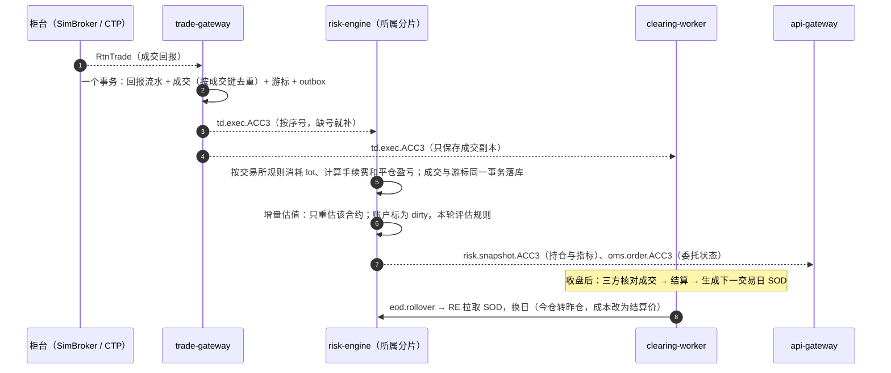
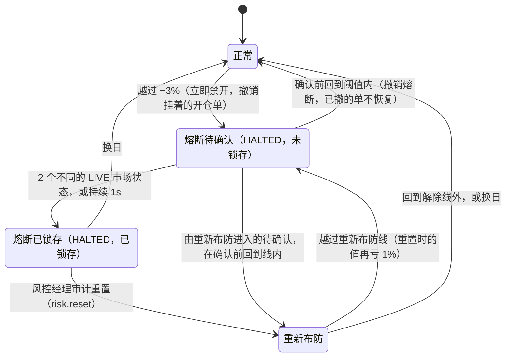

# futrisk 需求理解与设计决策

| 项 | 内容 |
|---|---|
| 文档编号 | FR-DOC-09 |
| 版本 | v0.2（按已实现的系统编写） |
| 状态 | 实现对齐 |
| 日期 | 2026-09-26 |
| 适用范围 | task.md 中留给设计者判断的部分："设计说明"的 6 问，以及需求中含义不确定的表述 |
| 对应标准 | GB/T 8567-2006 软件需求规格说明（SRS）与系统/子系统设计说明（SSDD）的补充：需求的理解、设计决策及其理由；决策的记录方式借鉴 MADR |
| 关联文档 | [README](README.md)（规范）· [01 整体架构](01-architecture.md) · [02 通信协议](02-communication-protocol.md) · [03 数据库设计](03-database-schema.md) · 其余文档见 README 的文档索引 |

> task.md 在"设计说明"中明确留出 6 处设计空间，并要求"像对待一个真实项目一样"交付一个可以上线的系统。本文逐条回答这 6 问，并说明需求中几处含义不确定的表述是怎样理解和处理的。回答依据的是**已经实现的系统**（01 v0.6 所描述的版本）：每个结论都给出代码、配置或测试中的出处；设计过但没有实现的部分明确标出，并对应到 01 第 11 章的技术债。
>
> 本文只做论证，不重复定义：主题、命令、消息字段、枚举和表以 [02](02-communication-protocol.md) 和 [03](03-database-schema.md) 为准，架构和机制的完整描述以 [01](01-architecture.md) 为准。01 §1.4 是本文的一页摘要。

## 目录
1. [总览：题目的设计空间与本系统的回答](#1-总览题目的设计空间与本系统的回答)
2. [对模糊需求的理解与处理](#2-对模糊需求的理解与处理)
3. [设计说明 1：行情数据的格式与更新频率](#3-设计说明-1行情数据的格式与更新频率)
4. [设计说明 2：风控指标的选择与阈值设定](#4-设计说明-2风控指标的选择与阈值设定)
5. [设计说明 3：持仓数据的来源与更新机制](#5-设计说明-3持仓数据的来源与更新机制)
6. [设计说明 4："熔断"的实现方式](#6-设计说明-4熔断的实现方式)
7. [设计说明 5：并发模型与性能考量](#7-设计说明-5并发模型与性能考量)
8. [设计说明 6：生产级风控系统还应具备的能力](#8-设计说明-6生产级风控系统还应具备的能力)
9. [决策索引](#9-决策索引)
- [附录 A 修订记录](#附录-a-修订记录)

---

## 1. 总览：题目的设计空间与本系统的回答

| task.md 的表述 | 本系统的回答（一句话） | 本文 | 01 中的依据 |
|---|---|---|---|
| 设计说明 1：行情数据的具体格式与更新频率 | 内部统一为 CTP 风格的 L1 快照 `Tick`；Feed A 每 500ms 推送、Feed B 每 1s 轮询、新浪默认每 1.5s 轮询；只有通过仲裁的 LIVE 行情进入风控 | §3 | 01 §8.13 |
| 设计说明 2：风控指标的选择与阈值设定 | 资金、持仓、合规三个维度共 11 条规则，外加行情质量的系统级禁开；阈值按日波动率、涨跌停幅度、产品合同常见的控制线推导，全部写在配置里 | §4 | 01 §8.14 |
| 设计说明 3：持仓数据的来源与更新机制 | 持仓只由柜台的成交回报推导（事件溯源），起点是清算生成的日初快照；本系统是影子账本，定时与柜台对账，以柜台为准 | §5 | 01 §8.1、§5.3.3 |
| 设计说明 4："熔断"动作的具体实现方式 | 首次越线立即禁开并撤销挂着的开仓单；确认后锁存，只允许减仓；只能由风控经理审计重置或换日解除；任何重启、热加载后都保持 | §6 | 01 §6.3、§8.14 |
| 设计说明 5：系统的并发模型与性能考量 | 按故障域拆成 6 个服务进程；风控核心是按账户分片的单写者，不加锁；给出延迟和吞吐目标，用基准测试测量 | §7 | 01 §5、§8.12、§10.2 |
| 设计说明 6：生产级风控系统还应具备的其他能力 | 已具备：事前风控不可绕过、失效即安全、崩溃即重启、幂等与对账、审计与权限、配置变更管控、备份恢复；尚缺：高可用、传输加密、双人复核、真实柜台接入等，均给出方案 | §8 | 01 §8.17、第 11 章 |
| 验收场景："单日浮亏达到初始资金的 3%，自动熔断，阻止继续开仓" | 按昨结起算的当日盯市总盈亏除以初始资金计算；到 −3% 时熔断，开仓被拒、挂着的开仓单被撤，平仓照常；多进程端到端测试自动验证 | §2.1、§6.6 | 01 §6.3 |
| "接入至少 2 个行情源" | 两路异构的模拟源同时在线并交叉校验；新浪是第三个、也是唯一真实的源（适配器和录制工具已实现） | §2.2 | 01 §8.13 |
| "模拟数据亦可，需说明设计理由" / "无需对接真实交易所" | 自建虚拟交易所（行情 + 撮合 + 仿 CTP 柜台），7×24 可演示、可复现、可注入故障；适配器边界与 CTP 对齐，换成真实柜台时核心不变 | §2.3、§2.4 | 01 §3、§8.13 |

---

## 2. 对模糊需求的理解与处理

### 2.1 "单日浮亏达到预设阈值（如初始资金的 3%）"
这句话有三处需要定义：什么是"单日浮亏"，"初始资金"指什么，"达到"是否包含等于。

**"单日浮亏"的三种可能口径**：

| 口径 | 计算方式 | 问题 | 本系统 |
|---|---|---|---|
| A. 按开仓价计算的持仓浮亏 | Σ(最新价 − 开仓价) × 乘数 × 手数 | 把前几天的盈亏混进"单日"；昨天赚了钱的持仓，今天亏损要先吃掉昨天的利润才会触发 | 不采用 |
| B. 按昨结算计算的持仓浮亏（纯浮亏） | Σ(最新价 − 昨结算或今日开仓价) × 乘数 × 手数 | 平掉亏损仓位之后浮亏"归零"，账户可以反复实现 −3% 的亏损而继续开仓，熔断被绕过；不含手续费 | 保留为可选口径 `floating_pnl_pct_init` |
| C. 昨结起算的当日盯市总盈亏 | 动态权益 − 静态权益 = 平仓盈亏 + 持仓盯市盈亏 − 手续费（静态权益已包含当日出入金） | 与期货公司结算单的逐日盯市口径一致（平仓盈亏 + 持仓盯市盈亏，再扣手续费）；平仓不能绕过；出入金不会被当成盈亏 | **默认口径** `daily_pnl_pct_init` |

决定：默认用口径 C（01 §8.14、ADR-008），配置中把规则的指标换成 `account.floating_pnl_pct_init` 即可切换到口径 B。两种口径的指标都在 02 §7.6 中定义。

- **"初始资金"**：取 `accounts.yaml` 中每个账户的 `initial_capital`（演示账户为 500 万~2000 万），不取当日的静态权益。这样阈值是一个固定金额（1000 万的账户为 30 万），不会因为账户前几天盈亏而漂移。按静态权益计算的同一指标（`daily_pnl_pct_sod`）也提供，供需要时配置。
- **"达到"**：规则的比较符是 `<=`，即当日盈亏 ≤ −3% 时越线，恰好等于也算达到。
- **验收用例对两种口径都成立**：内核级验收测试构造了"当日开仓、没有平仓"的账本，此时口径 B 与口径 C 只差当日手续费，两种口径各测一遍都触发熔断（`tests/unit/engine/test_engine_acceptance.py`）。

**"阻止该账户继续开仓"**：

| 需要确定的问题 | 本系统的处理 | 理由 |
|---|---|---|
| 已经挂在柜台上的开仓单算不算"继续开仓"？ | 算。熔断时立即撤销该账户所有挂着的开仓单，包括还在路由中和状态未知的 | 挂单成交同样增加风险敞口；不撤等于没有阻止 |
| 平仓是否也禁止？ | 不禁止。平仓单跳过账户限制、资金和 what-if 检查，只做可平量、涨跌停等基本校验 | 禁止平仓会让风险无法降低，违背熔断的目的 |
| 由谁、在什么时候解除？ | 风控经理带理由重置（需要 RISK_MANAGER 角色，写审计），或者换日 | 熔断是"需要人看一眼"的事件，不能随行情反弹自动解除 |
| 熔断能否被系统故障绕过？ | 不能：锁存状态逐次落盘，任何服务重启、配置热加载之后都保持（§6.5） | 验收要求"自动触发并阻止"，必须在故障下也成立 |

### 2.2 "接入至少 2 个行情源"
题目没有说两个源是否必须是真实的、是否必须独立。本系统的理解是：**行情最终都来自交易所，生产环境的冗余体现在分发链路上**（不同的前置、厂商和协议，故障相互独立），所以"两个源"的价值在于两条互为备份、可以互相校验的链路。

| 源 | 形态 | 在系统中的作用 | 状态 |
|---|---|---|---|
| Feed A（模拟，仿 CTP） | WebSocket 推送，500ms，带全局序号和 epoch，可续传、可重放 | 主实时源 | 已实现，默认启用 |
| Feed B（模拟，仿厂商接口） | REST 轮询，1s，字段格式不同，没有序号，不能重放 | 异构备份源，交叉校验 | 已实现，默认启用 |
| 新浪 hq.sinajs.cn | HTTP 轮询，默认 1.5s，GBK 文本，时间戳只到秒 | 唯一真实的源：真实 tick 录制（回测 C 层），真实行情部署中的第三个源 | 适配器与录制工具已实现；运行时默认关闭 |

Feed A 和 Feed B 的传输方式（推送与轮询）、数据格式、有没有序号和重放、故障注入点都不同，任何一路断开、延迟、乱序或者发来坏数据，另一路都能接上，并参与同成交量价格一致性的交叉校验（01 §8.13）。两者共用上游 sim-exchange，这相当于交易所本身出了问题，系统走"全部数据源中断"的路径：相关合约标为 STALE/UNKNOWN 并禁开。

演示时不启用新浪，因为模拟价格和真实价格不是同一个市场，交叉校验会不停报冲突。设想中"由 sim-exchange 转发新浪真实价格、三路源描述同一个市场"的 live 档没有实现（TD-12）。

### 2.3 模拟数据的设计理由
题目允许使用模拟数据，但要求说明理由。选择自建虚拟交易所（sim-exchange），理由如下：

| 需要 | 真实行情做不到的地方 | 虚拟交易所的做法 |
|---|---|---|
| 随时可演示 | 真实行情只在交易时段有数据；开发与交付期间的交易日很少（2026-09-25 中秋休市，10-01~10-07 国庆休市） | 7×24 运行；市场时钟由 supervisor 维护，可以跳到任意交易时段（01 §8.2） |
| 结果可复现 | 真实行情每次都不同 | 价格引擎每个交易日第 k 步的随机数只由（种子、交易日、k）决定 |
| 能验证容错 | 无法让真实行情源按需断线、跳号、乱序、发坏点 | 故障注入接口：断线（关闭或静默）、跳号、重复、乱序、延迟、停止更新、坏点、畸形数据、交易所重启、柜台断线、柜台强平（02 §9.5） |
| 能验证验收场景 | 无法让真实市场按需下跌 3% | 场景剧本：`breaker` 让黑色板块分三段下跌，使 ACC3 依次越过 −2%、−2.5%、−3%（`config/scenarios/breaker.yaml`） |
| 需要一个柜台 | 没有期货公司的交易通道 | 仿 CTP 语义的模拟柜台：报单、撤单、回报、查询、补回报，委托和成交落 `sim.db`，重启后序号不重复（02 §9.4） |

模拟数据尽量贴近真实：

- 以 `sim.yaml` 中配置的昨结算价为初值，按合约配置年化波动率、成交速率和持仓量；品种之间用 Cholesky 分解生成相关的几何布朗运动加跳跃（市场 0.2、板块内 0.6、同品种不同月份 0.95）；
- 价格落在 tick 网格上，受按交易日生效的涨跌停约束，封板时一侧没有报价；
- 维持真实行情的不变量：同一交易日内累计成交量、成交额只增不减，**最新价只随成交变动**；这正是 md-gateway 校验坏点的依据；
- 只在各品种自己的连续交易时段产生行情，交易日、夜盘归属、集合竞价与真实交易日历一致。

模拟的边界要说清楚：撮合按报价成交，没有订单簿（RK-05）；模拟价格不代表真实市场的统计特征。真实性由另外两条途径补充：回测用 2015 年以来的真实日线和新浪分钟线（10 文档）；真实 tick 计划在 2026-09-28~09-30 三个交易日录制（01 §8.13）。

### 2.4 "无需对接真实交易所"
不对接真实交易所，但所有外部接口都按真实系统的形态设计，换成真实柜台时只替换适配器：

| 边界 | 现在 | 生产 | 核心是否改动 |
|---|---|---|---|
| 行情 | Feed A 的字段对齐 CTP 的 `CThostFtdcDepthMarketDataField`；归一化后统一为 `Tick` | CTP 行情前置（或厂商行情）适配器 | 不改动：适配器只负责把记录变成 `Tick` |
| 交易 | `SimBrokerAdapter` 连接仿 CTP 的模拟柜台 | `CtpBrokerAdapter`（只预留了接口） | 不改动：trade-gateway 只依赖 `BrokerAdapter` 接口 |
| 柜台权威 | 模拟柜台持久化委托、成交、持仓 | 期货公司柜台 | 不改动：本系统本来就按"影子账本、以柜台为准"设计（§5.4） |
| 参数 | `products.yaml` 中的示例值（按 2026-09 的交易所公告核对） | 按交易所和期货公司公告维护 | 不改动：参数带生效日期（TD-04） |

接入真实柜台还需要做的工作列在 §8.2。

### 2.5 其他需要确定含义的表述

| task.md 的表述 | 本系统的理解 | 详见 |
|---|---|---|
| "实时或准实时" | 行情延迟（接收时刻 − 交易所时间）在 3s 以内才算实时（LIVE）；风控在收到 LIVE 行情的同一轮主循环内评估 | 01 §8.13 |
| "行情源中断后恢复时，能正确补全缺失数据" | 补全的数据写入录制文件、1 分钟 K 线和结算价输入；**补数永远不进风控**，因为它描述的是已经过去的市场 | §3.5 |
| "不产生重复或错误的风险信号" | 重复：同一市场状态不会发布两次，同一告警只产生一次（幂等的 `alert_key`）；错误：坏点要经过多道防线，风控还要多个不同的市场状态确认才会锁存熔断 | §3.5、§4.3 |
| "按账户维度和品种维度查询" | 可以按账户、品种、合约、交易所、板块过滤和分组，跨分片汇总；历史持仓从清算结果查询 | §5.5 |
| "多账户场景下的持仓汇总与独立核算" | 每个账户独立的资金账本和风控状态；汇总只做加总和公司层指标，不跨账户共用任何状态 | §5.6 |
| "限制下单" | 不锁存的部分限制：单笔上限系数、禁止在亏损品种加仓、敞口上限系数、按范围禁开 | 01 §8.14 |
| "每日收盘后完成逐日盯市" | 按市场时间 15:30（CFFEX 国债期货 15:15 收盘之后）自动启动；夜盘归属下一交易日；错过的交易日按顺序逐日补结算 | 01 §6.6 |
| "报表格式自行设计" | 自包含的 HTML 风控日报（图表内嵌）+ CSV + 每个账户一份 CTP 风格的文本结算单 | 01 §5.3.4 |
| "提交可执行文件" | Windows 一个文件夹的 exe（构建脚本带 17 项冒烟测试，包括中文路径），另附 docker compose | 01 §7.1、§7.2 |
| "像对待真实项目一样……可以上线的系统" | 按生产标准做失效即安全、幂等、审计、恢复、权限和部署；做不到的明确列为技术债并给出方案 | §8 |

---

## 3. 设计说明 1：行情数据的格式与更新频率

### 3.1 统一的内部格式
所有数据源在 md-gateway 中归一化为同一种 L1 快照 `Tick`（字段定义以 02 §7.1 为准），字段分为四组：

| 字段组 | 内容 | 设计理由 |
|---|---|---|
| 标识与时间 | 合约代码（交易所原始大小写）、交易所、交易日、自然日、交易所时间 `exch_ts_ns`、接收时间 `recv_ns`（市场时间） | 交易日由交易日历在交易所时间上**重算**，不信任数据源自报的交易日（CTP 登录时推送的旧 tick、DCE 夜盘 ActionDay 的惯例、新浪在非交易时段返回的旧数据都靠这一步挡住） |
| 价格与量 | 最新价、买一卖一价和量、开高低、累计成交量、成交额、持仓量、涨跌停价、昨结算、昨收 | 与 CTP 的深度行情字段一一对应，生产环境换成 CTP 时语义不变；累计成交量和成交额用于计算结算价（VWAP） |
| 来源与质量 | 数据源、源序号、标志位（集合竞价、涨停封板、跌停封板、秒级时间戳、水位重置） | 仲裁和下游消费需要知道这条数据从哪来、可信到什么程度 |
| 指纹 | 按规范化后的关键字段计算的 64 位哈希（不含时间戳） | 两个源描述同一个市场状态时指纹相同，用于跨源去重 |

内部格式选 CTP 风格，是因为生产环境的目标数据源就是 CTP：字段语义国内从业者都熟悉，将来接入时只需替换适配器。编码上，总线消息用 msgpack，价格用 float64，清算中的精确金额用十进制字符串（02 §4.3）。

### 3.2 各数据源的格式与频率

| 源 | 传输 | 格式 | 频率 | 序号与重放 | 定义 |
|---|---|---|---|---|---|
| Feed A | WebSocket | JSON，字段名与 CTP 相同 | 每 500ms 一个新状态（只在连续交易时段） | 全局序号 + epoch；支持续传、连接内重放、快照 | 02 §9.1 |
| Feed B | HTTP 轮询 | 厂商风格 JSON（价格为字符串、代码大写、毫秒时间戳） | 每 1s 轮询一次（连接超时 1s、读取超时 1.5s） | 没有；每次返回最新快照 | 02 §9.2 |
| 新浪 | HTTP 轮询 | GBK 文本，逗号分隔 | 默认每 1.5s | 没有；时间戳只到秒 | 02 §9.3 |

### 3.3 频率的取舍
- **500ms**：国内期货交易所通过 CTP 发布的 L1 快照约每秒 2 笔，Feed A 与之一致，演示中的行情节奏和数据量接近真实。
- **1s**：模拟厂商接口常见的限频；轮询源比推送源天然慢半拍，仲裁规则据此给轮询源"落后不超过 2 个轮询周期"的余量（01 §8.13）。
- **1.5s**：新浪没有 SLA，轮询太快有被限流的风险；它的时间戳只到秒，所以只有累计成交量增加时才能推进实时行情。
- **不追求更高频率**：风控判断的是账户层面的盈亏和敞口，每秒 2 次的行情已经足够；更高频率只会增加仲裁、估值和推送的负担。全市场 CTP L1 约每秒 1600 条，md-gateway 单核实测每秒 1.1~1.2 万条（§7.5），余量充足。

### 3.4 下游的数据形态与频率

| 数据 | 形态 | 频率 | 消费方 |
|---|---|---|---|
| `md.tick.{instrument_id}` | 只有 LIVE 状态（最新值流，丢了可以用快照追平） | 随行情 | risk-engine、api-gateway、策略 |
| `md.status` | 每个数据源的可信状态、每个合约的行情质量 | 1Hz 全量 | risk-engine（行情质量的唯一依据）、api-gateway |
| `md.event` | 数据源状态变化、质量变化、中断与恢复、缺口、数据完整性事件（事实流，不能丢） | 事件驱动 | api-gateway（仪表盘、通知）；risk-engine 订阅但目前只记日志（补数区间的影子评估未实现，TD-13）；clearing-worker 生成日报时用 `md.events` 查询 |
| `md.bar.1m.{instrument_id}` | 1 分钟 K 线（用累计量差分，缺口不丢量） | 每分钟 | 仪表盘 |
| `risk.snapshot.{account_id}` | 账户指标与规则状态 | 有变化时最多 2Hz，每个账户每秒至少一次保活 | coordinator、api-gateway |
| 指标样本 | 每个账户的指标 | 每秒一条写入 risk 库 | 日内曲线、日报 |
| 仪表盘 WS | 行情、账户、持仓 0.5s 一次；多账户对比、公司层、系统 1s 一次；风险事件立即推送 | — | 浏览器 |

### 3.5 中断恢复：补全缺失数据，而不产生重复或错误的风险信号
这是题目对行情接入唯一明确的容错要求。下表列出每一项风险是怎样挡住的，机制的完整描述见 01 §8.13 和 §6.4。

| 风险 | 机制 | 验证 |
|---|---|---|
| 中断期间的数据丢失 | Feed A 按序号续传和重放补洞；环形缓冲中已经没有的部分记为无法恢复的缺口；所有可信源都丢失时开一个时间窗缺口 | E2E（断开 Feed A 20s，缺口补齐）；`tests/unit/md_gateway/test_mdg_integration.py` |
| 补数触发风险信号 | 补回的数据不是 LIVE，只写录制、K 线和结算输入，**永远不进 risk-engine** | 同上；`tests/unit/md_gateway/test_mdg_arbiter.py` |
| 重复的行情 | 以累计成交量作跨源共享时钟：`order_key = (交易日, 累计成交量, 交易所时间)`，每个合约一个水位，只有更新的状态才能成为 LIVE；水位带最后一个 LIVE 状态的指纹持久化，重启后不会把旧状态再发一次 | E2E（LIVE 行情不回退、不重复）；`test_mdg_integration.py`（重启续传） |
| 重复的告警 | 告警状态机只在状态迁移时告警；`alert_key` 带 episode，告警表以它为唯一键；恢复后确定性地重新评估 | E2E（kill risk-engine 后告警不重复）；`tests/unit/engine/test_engine_properties.py` |
| 错误的行情（坏点） | 多道防线依次过滤：交易时段、涨跌停与网格；未来时间戳；同源单调、价格只随成交变动；成交量跳变隔离；稳健 σ 尖刺隔离；同成交量交叉比对（两个可信源冲突时暂停发布、等待裁决）；水位被离群状态毒化时回滚 | `tests/unit/md_gateway/test_mdg_validator.py`、`test_mdg_arbiter.py`、`test_mdg_resilience.py` |
| 错误的风险信号 | 行情质量不是 OK 时状态机保持不动；熔断要 2 个不同的 LIVE 市场状态或持续 1s 才锁存，单个坏点在确认前回到阈值内就撤销 | `tests/unit/engine/test_engine_acceptance.py`（坏点撤销、质量门控） |
| 行情"看起来在线"实际已停滞 | 行情质量 = LIVE 流是否跟得上市场：任何源出示了比水位新 5s 以上的新信息，就判为落后并计时降级（ADR-023） | `test_mdg_resilience.py` |

---

## 4. 设计说明 2：风控指标的选择与阈值设定

### 4.1 指标体系
题目要求至少覆盖资金维度（如账户净值、最大回撤、当日盈亏）和持仓维度（如单品种敞口、集中度）。本系统覆盖了题目举出的全部例子，并增加了合规和行情质量两个维度。指标名称和定义以 02 §7.6 为准，计算方法见 01 §8.14。

| 维度 | 题目举例 | 本系统的指标（规则 id） |
|---|---|---|
| 资金 | 当日盈亏 | 当日盈亏 ÷ 初始资金（`daily_loss`，验收口径） |
| 资金 | 最大回撤 | 日内回撤（`intraday_dd`）、距高水位回撤（`hwm_dd`），都按扣除出入金后的业绩权益计算 |
| 资金 | 账户净值 | 单位净值 = 业绩权益 ÷ 初始资金（`nav_floor`） |
| 资金 | — | 风险度 = 保证金 ÷ 权益（`risk_degree`） |
| 持仓 | 单品种敞口 | 单品种净名义敞口的使用率 = 净名义占权益比 ÷（3% ÷ 涨跌停幅度）（`product_exposure`） |
| 持仓 | 集中度 | 有效品种数 N = 1/HHI（`concentration`）；板块净名义占比（`sector_exposure`） |
| 持仓 | — | 杠杆 = 总名义 ÷ 权益（`leverage`）；涨跌停压力 = 所有持仓同时走一个不利涨跌停的亏损 ÷ 权益（`limit_stress`） |
| 合规 | — | 交易所对每日开仓手数、撤单次数、大额撤单、自成交的限制，按使用率告警（`compliance`），达到上限时由事前检查拒单；限仓和报单速率在事前检查中执行 |
| 行情质量 | — | 合约质量不是 OK 时禁开；账户超过 50% 的敞口为 UNKNOWN 时整个账户禁开 |

选择这些指标的原则：

1. **每个指标对应一种真实的亏损路径**：当日盈亏对应"今天亏太多"，回撤对应"利润回吐"和"累计亏损"，单品种和板块敞口对应"单一方向押注"，涨跌停压力对应"封板时跑不掉"，风险度对应"追保和强平"。
2. **能在事前检查中预估**：当日盈亏、风险度、单品种敞口和杠杆四条规则参与事前的 what-if，下单之前就预估"当前值 + 本单影响"，会越过禁开级别的委托直接拒绝，不必等成交后再补救。
3. **能增量计算**：一个 tick 只重估持有该合约的账户，指标按增量更新，满足实时性。

### 4.2 阈值与理由
完整的默认阈值表和理由见 01 §8.14，推导与回测验证见 04 和 10 文档。阈值的推导逻辑如下：

| 推导方法 | 适用规则 | 例子 |
|---|---|---|
| 按波动率折算 | 当日盈亏 | CTA 账户年化波动约 10%~15%，日波动 σ 约 0.6%~0.95%；−3% 相当于 3~5σ，正常波动很少触及；−2%、−2.5% 两级分别用于预警和减速；−5% 是极端情况，只生成减仓计划由人确认 |
| 按涨跌停幅度反推 | 单品种敞口、涨跌停压力 | 单品种上限 = 3% ÷ 涨跌停幅度，保证单个品种走一个不利的涨跌停，亏损也不超过权益的 3%，不会单独打穿熔断线：rb（涨跌停 5%）为 60%，IF（10%）为 30% |
| 对齐行业惯例 | 距高水位回撤、单位净值、风险度、杠杆 | 回撤 8% / 12% / 15% 对齐资管产品常见的回撤控制线；净值 0.90 / 0.85 对齐产品合同常见的预警线和止损线；风险度 35% / 50% / 70% 为节前保证金上调留出缓冲（DCE i、m 自 20260930 起按实际收取的公司费率计算，同样持仓的风险度上升 22.2% 和 37.5%）；杠杆 3 倍 / 4 倍 |
| 交易所规则 | 合规 | 交易所对开仓手数、撤单次数、自成交、限仓的规定是硬约束：80% 预警，100% 拒单 |

所有阈值都写在 `config/risk_rules.yaml` 中，可以按账户覆盖、热加载（01 §6.7），改动无需改代码。

### 4.3 动作分级与信号质量
每条规则有多个级别，级别的动作从轻到重分为告警（ALERT）、限制下单（RESTRICT）、熔断（CIRCUIT_BREAK）、减仓计划（LIQUIDATE）。为了既不漏报、也不误报，每个 `(规则, 级别, 范围)` 由一个告警状态机管理（01 §8.14）：

| 机制 | 作用 | 默认值 |
|---|---|---|
| 确认 | 越线后要看到足够多**不同的 LIVE 市场状态**（只数持仓合约的新行情）或持续足够时间才生效 | 熔断 2 个状态或 1s；其余级别立即生效 |
| 滞回 | 回到解除线外才解除，避免在阈值附近来回触发 | 阈值 × (1 − 0.2)；解除还要连续保持 3s |
| 冷却 | 告警解除后一段时间内不重复告警 | 60s，**只作用于告警级别**（ADR-022） |
| 锁存 | 熔断确认后不随指标恢复而解除 | 只有熔断和减仓级别可以锁存 |
| 质量门控 | 行情质量不是 OK 时状态机保持不动，计时器也不走 | — |
| episode | 同一交易日内同一级别第几次生效，写进 `alert_key`，保证幂等 | — |

### 4.4 实现中根据运行结果做的调整
这些调整都写在 `risk_rules.yaml` 中并附有理由（01 §8.14）：

| 调整 | 发现的问题 | 做法 |
|---|---|---|
| 按规则设置滞回 | 单位净值是 1 附近的水平量，默认的相对滞回 0.2 会把 0.90 的解除线放到 1.08，账户几乎不可能解除 | 净值规则用 0.02（解除线 0.918 / 0.867）；有效品种数用 0.1 |
| 集中度只在有一定仓位时评估 | 建仓初期、仓位很小的账户 N 很低，不代表集中度风险 | `min_gross_pct: 0.5`：总名义敞口不到权益的 50% 时视为不适用 |
| 集中度只按时间确认 | 多品种建仓时，最先成交的一两笔会让 N 在几秒内等于 1，按状态数确认会误报 | `confirm.states: 0`，持续 30s 才确认 |
| 集中度按投资授权覆盖 | 按授权只做三个黑色品种的 ACC3、只做两个股指的 ACC4、只做一组跨期套利的 ACC5，N 天然达不到 5，会整天告警 | 按授权设置下限（ACC3 2.0 / 1.5，ACC4 1.5 / 1.0，ACC5 1.0 / 1.0）；这些账户仍受板块、单品种和当日盈亏规则约束 |
| 冷却只作用于告警级别 | 对限制下单和熔断使用冷却，等于在冷却期内关掉限制（fail-open） | 限制类级别每次重新越线都立即生效 |

### 4.5 阈值的验证
- **逻辑正确性**：状态机、事前检查、验收场景都有单元测试和性质测试（01 附录 A）。
- **规则有效性**：回测用同一个风控内核回放 2015 年以来的真实日线和新浪分钟线，对同一份数据跑"不启用规则 / 只告警 / 禁开 / 减半 / 清仓"等配对实验，统计避免的损失、错过的反弹、真假阳性、回撤和 Calmar 的变化，并在历史压力窗口上检验（01 §8.16）。A 层结果依赖合成的日内路径，属于模型条件下的结论；定稿的数字和结论见 10 文档。

---

## 5. 设计说明 3：持仓数据的来源与更新机制

### 5.1 来源
持仓**只由成交推导**，不能直接修改（事件溯源）。本系统是期货公司柜台的影子账本：自己按成交维护持仓和资金，用来做实时风控；权威数据在柜台，定期对账，以柜台为准。

| 来源 | 进入方式 | 作用 |
|---|---|---|
| 柜台成交回报 | trade-gateway 先落库、再发布到每个账户一条的有序事实流 `td.exec.{account_id}` | 盘中持仓变化的唯一来源；柜台强平等外部成交同样进入（标记为外部来源） |
| 日初快照（SOD） | clearing-worker 结算后生成，经 `eod.rollover` 推送、`settle.sod_snapshot` 拉取 | 每个交易日的起点：资金 + 以昨结算为成本的持仓 lot |
| 首日建账 | `settle.seed_sod`（REST：`/settlement/seed-sod`，ADMIN），可以带初始持仓 | 系统第一次运行时的起点；演示用 `futrisk demo` 按 `accounts.yaml` 的初始资金建账（不带持仓） |
| 出入金 | `cash.move`（ADMIN），按 EOD 状态判定记入哪个交易日 | 改变资金，不改变持仓 |
| 成交导入 | `td.import_trades`（REST 成交导入，ADMIN） | 补录柜台导出的成交 |
| 柜台持仓查询 | `td.query.positions` | **只用于对账**，从不直接覆盖本地持仓 |

### 5.2 更新机制

*这张图回答：一笔成交怎样变成持仓和指标，以及持仓怎样跨交易日延续。*

要点：

- **按账户有序、不丢不重**：`td.exec` 是事实流，发布方先落库再发布，订阅方按序号检查，缺了就重放，重放不到就按领域查询（`td.query.trades`）补齐，补不齐的账户禁开（01 §8.5）。成交按 `(交易日, 交易所, 成交号, 方向)` 去重。
- **委托回报与成交在同一条流里**：两者分开发布时，终态回报可能先于成交到达；合并成一条有序流消除了这种乱序（ADR-014）。
- **跨交易日**：收盘后 clearing-worker 结算并生成下一交易日的 SOD；risk-engine 换日时用 SOD 替换持仓（今仓转昨仓，成本基准改为结算价），并把 SOD 与自己的日终持仓比较，不一致时记一条不阻塞开仓的对账异常。

### 5.3 持仓模型
`Position(账户, 合约, 方向)` 下挂 lot，每个 lot 区分今仓和昨仓：今仓的成本基准是开仓价，昨仓的成本基准是昨结算价；同时维护数量、今仓数量和成本的累计值，事前检查和成交处理的开销与 lot 数量无关。开平与计费按交易所规则配置（01 §8.15）：

- SHFE 必须显式指定平今或平昨，平今数量超过今仓时拒单；
- CFFEX 按"先平当日新开仓"判定平今手续费，lot 的消耗顺序也配置为先平今仓，两者一致；
- DCE 部分品种当日开当日平时两腿按日内费率收取，只有实际被消耗掉的今仓才算日内；
- 可平量扣除在途的平仓委托，所以两张平仓单不会平掉同一手。

### 5.4 对账："以柜台为准"

| 对账 | 时机 | 不一致时 |
|---|---|---|
| 盘中持仓对账 | 每 5 分钟用 `td.query.positions` 比较；跳过有挂单的合约和 5s 内刚有成交的账户，避免把在途的变化当成差异 | 连续两次不一致才判为对账异常，该账户禁开（平仓照常），同时自动补拉当日成交；再次比对一致即自动关闭异常、解除禁开，否则经 `risk.recon.resolve` 人工处理（02 §8.7） |
| 重启后的对账 | 预热阶段 | 对账通过之前只允许平仓 |
| EOD 三方核对 | 每日结算的第 3 步：clearing-worker 的成交副本、trade-gateway 的成交摘要、risk-engine 冻结时的摘要，逐账户比较笔数和哈希；出入金同样核对 | 补拉数据并重新冻结，最多 3 次；仍不一致则本次结算失败，下一交易日禁开（失效即安全） |
| SOD 与日终持仓 | 换日时 | 记不阻塞开仓的对账异常 |

### 5.5 查询
- **按账户和品种**：REST `/positions` 可以按账户、品种、合约、交易所、板块过滤，并按其中任一维度分组；数据来自 api-gateway 的读模型，跨分片汇总；另有 CLI `futrisk positions` 和仪表盘的账户页、多账户对比页（02 §9.6）。
- **按账户查询单个账户**：risk-engine 的 `risk.query.positions` 直接给出当前持仓，包括今仓、昨仓和可平量。
- **历史**：按交易日查询结算结果中的持仓明细、平仓明细和成交记录（clearing-worker 的结算结果）。

### 5.6 多账户汇总与独立核算
- **独立核算**：每个账户有独立的资金账本、持仓和风控状态，规则按账户评估，熔断按账户锁存。性质测试专门验证"其他账户的成交不影响本账户的任何结算结果"（`tests/property/test_clearing_properties.py`）。
- **汇总**：公司层的汇总只做加总（公司权益、保证金、跨账户的品种净敞口），不共享任何账户状态。账户按分片分布在多个 risk-engine 中，由分片 0（coordinator）订阅各分片的快照汇总；结算时还要检查"各账户合计等于公司汇总"（`FIRM_SUM`）。

---

## 6. 设计说明 4："熔断"的实现方式

### 6.1 触发条件
默认配置中，`daily_loss` 规则的 `halt` 级别：当日盈亏 ÷ 初始资金 ≤ −3% 时触发，动作为熔断，确认条件为 2 个不同的 LIVE 市场状态或持续 1s，锁存（`config/risk_rules.yaml`）。其他规则也可以把某个级别配置成熔断；风控经理也可以用 `risk.halt` 人工熔断一个账户。

### 6.2 状态与迁移

*这张图回答：一个账户的熔断从触发到解除要经过哪些状态，每一步的条件是什么。*

图中"熔断待确认"和"熔断已锁存"都是账户状态 HALTED，区别在于 `halted_latched`；"重新布防"时熔断已经解除，账户状态由其他生效的级别决定。这张图是账户视角的简化，状态机本身的定义见 01 §8.14。

**为什么要"先禁开、再确认、后锁存"**：
- 如果越线后等确认才禁开，确认期间（最长 1s）账户还能继续开仓，不符合"达到阈值即阻止"；
- 如果越线即锁存，单个坏点（例如一笔错误的行情）就能把账户锁死一整天，需要人工处理；
- 所以越线的那一刻就禁开（不放过真实的亏损），确认之后才锁存（不让单个坏点锁死账户）。确认计数的是**持仓合约**的不同 LIVE 市场状态，成交、出入金、快照行情都不计数，所以不会被非行情事件"凑满"确认。

### 6.3 生效动作

| 动作 | 实现 | 出处 |
|---|---|---|
| 拒绝新开仓 | 事前检查第 4 步：账户为 HALTED 的开仓单返回 `REJECT_ACCOUNT_HALTED`；事前检查之前先评估"脏"账户，所以越线之后的第一张单就会被拒 | 01 §5.3.1；02 §11.2 |
| 撤销挂着的开仓单 | 进入 HALTED 时，对所有挂着的开仓单（包括路由中、状态未知的）发 `route.cancel`；从没到达交易网关的委托由网关写墓碑，之后迟到的一律拒绝 | 01 §6.3、§5.3.3 |
| 撤单守护 | 熔断期间重新变为工作状态的开仓单（撤单被拒后回退、从柜台补建、重启恢复等）一律再撤 | 01 §8.14 |
| 撤单复核 | 撤单 5s 内（之后每次翻倍，最多 60s）没有结果就向交易网关复核，仍在工作的换新命令号重发；5 次后告警，重试继续 | 02 §8.3 |
| 只允许平仓 | 平仓单跳过账户限制、资金和 what-if 检查；可平量扣除在途平仓，SHFE 区分平今和平昨 | 01 §5.3.1 |
| 纵深防御 | 交易网关拒绝超过有效期（默认 2s）的路由，防止熔断之前通过风控、延迟到达的委托被报出；公司级 kill switch 在交易网关也执行一遍 | 01 §5.3.3 |
| 通知 | 锁存时产生一条 `ALERT_RAISED`（严重级别 CRITICAL）；通知按 `notify_key` 去重；渠道限流时 CRITICAL 通知排队等待发送，永远不会被抑制或合并 | 01 §5.3.5；02 §9.8 |

### 6.4 解除
- **人工重置**：风控经理通过 REST 或仪表盘提交 `risk.reset`，要求 RISK_MANAGER 角色和非空理由，写审计（含重置时的指标值）。状态机转为"重新布防"，重新布防线 = min(−3%, 重置时的值 − 1%)：亏损再扩大 1% 会以新的 episode 再次熔断，而且同样要经过待确认和确认。
- **换日**：新交易日开始时状态机归零，锁存默认解除（`reset_on_day_roll`）。
- **不会解除的情况**：指标回升不会自动解除；配置热加载删除或修改了规则，已锁存的级别仍保留原来的规则直到重置或换日；任何服务重启都不会解除。
- **公司级**：公司级规则的锁存目前没有人工解除命令，只能等换日（TD-14）。

### 6.5 跨重启保持
- 进入锁存的那个事务把状态机、告警、账户状态、审计和待发布的事实写在一起，并以 `synchronous=FULL` 逐次落盘（03 DB-03）。
- risk-engine 重启后从库中恢复状态机和锁存，HALTED 保持；恢复后的评估是确定性的，得到同样的 episode 和 `alert_key`，告警表以它为唯一键，所以不会重复告警（01 §6.5）。
- 如果提交失败，毒化闩保证进程不会带着"内存里已熔断、库里没有"的状态继续运行（01 §8.6）。
- 恢复期间（加载和预热阶段）开仓一律被拒，所以重启窗口不会成为绕过熔断的机会。

### 6.6 验收场景
task.md 的验收场景由三层测试覆盖：

| 层次 | 测试 | 覆盖内容 |
|---|---|---|
| 多进程端到端 | `tests/e2e/test_e2e_acceptance.py`：8 个真实进程，`futrisk demo --scenario breaker --headless` | ACC3（初始资金 1000 万）的多头在黑色板块三段下跌中依次越过 −2% 告警、−2.5% 限制下单、−3% 熔断，每级只告警一次；熔断后开仓单被拒（`REJECT_ACCOUNT_HALTED`）、平仓单成交；kill risk-engine-1 后由 supervisor 拉起，熔断保持，告警不重复 |
| 内核级 | `tests/unit/engine/test_engine_acceptance.py` | 两种口径都触发；单个坏状态在确认前回到阈值内时撤销熔断；只按时间确认；质量门控；熔断期间平仓照常；重置后重新布防；重启恢复后状态一致 |
| 回测 D 层 | `config/backtest/breaker_synthetic.yaml` | 合成剧本、正确结果已知：告警、限制下单、熔断各一次；限制期间加仓被拒；单个坏点不锁存 |

演示方式：`futrisk demo --scenario breaker`，在仪表盘的账户页观察 ACC3 的三级告警和熔断，在多账户对比页观察其他账户不受影响。

### 6.7 刻意不做的事
- **不自动强平**：熔断只禁开，不自动平仓。−5% 的减仓计划只生成、由风控经理确认，确认后手工下平仓单（TD-08）。自动强平在极端行情（封板、流动性枯竭）下可能以很差的价格成交，需要人的判断；回测中的"减半"和"清仓"两组模拟了自动执行的效果，结论见 10 文档。
- **不对熔断使用冷却**：冷却只用于告警级别，熔断每次重新越线都重新生效（ADR-022）。
- **kill switch 不撤单**：公司级 kill switch 只拒绝新的开仓单，不撤已挂的单；它是全公司范围的"急刹车"，撤单交给账户级熔断或人工操作。

---

## 7. 设计说明 5：并发模型与性能考量

### 7.1 进程划分：按故障域拆分，一致性域不拆
系统由 6 个内部服务和 2 个外部模拟进程组成（01 §5.1）。拆分的依据是故障域：

| 原则 | 做法 | 好处 |
|---|---|---|
| 故障隔离 | 行情解析、报表生成、仪表盘推送各在自己的进程中 | 任何一个崩溃或卡死都不会拖垮事前风控这条关键路径；supervisor 自动拉起 |
| 延迟隔离 | 每个服务一个进程，各占一个核 | 互不争抢 Python 的 GIL；仪表盘的 JSON 序列化、结算和回测的 CPU 负载不会进入风控进程 |
| **一致性域不拆** | 持仓、资金、风控状态、事前检查放在同一个单写者（risk-engine）里 | 事前检查读到的持仓和保证金与成交处理在同一个线程中顺序执行，不会出现"同一份保证金被两笔单子同时占用"；不需要分布式锁或事务补偿 |
| 横向扩展 | 按账户分片（演示为 2 个分片：ACC1~2 / ACC3~5），分片 0 兼任公司层汇总 | 每个分片是独立的单写者，扩展时加分片 |

没有采用更细的微服务拆分（持仓服务、风控服务、订单服务分开），原因就是上表第三行：那会把一个本来单线程就能保证的一致性问题，变成分布式竞态问题（ADR-002）。

### 7.2 服务内部的并发模型

| 服务 | 模型 | 为什么 |
|---|---|---|
| risk-engine、trade-gateway | 同步 `zmq.Poller` 单线程业务主循环 + 发布线程（含心跳）+ 写库线程 | 热路径上不引入 asyncio 调度，抖动最小；单线程改业务状态，不需要锁 |
| md-gateway、clearing-worker、api-gateway、supervisor | asyncio 单事件循环 + 写库线程；md-gateway 另有录制线程，clearing-worker 另有 `spawn` 进程池 | I/O 密集（WebSocket、HTTP、总线）；CPU 重活（结算、报表、回测）放进进程池，不阻塞事件循环和心跳 |
| sim-exchange、strategy-sim（外部） | asyncio；模拟柜台的 ROUTER 在独立 I/O 线程 | 外部模拟组件 |

具体规则（01 §8.12）：
- 每个库只有一个写库线程；业务线程提交后等待确认，关键写入确认之后才发布或路由；
- risk-engine 把一轮处理产生的全部写入合并成**一个**事务（成组提交），提交之后才发出路由、发布和回复；
- 对外请求（重放、快照、查询、日初快照）一律异步，不阻塞主循环，所以慢操作不会让心跳丢失、被误判为死掉；
- asyncio 服务的心跳由事件循环中的定时任务发送，事件循环中禁止阻塞操作；主循环卡顿之后，对端有一个心跳周期的宽限，不会被误判为下线。

### 7.3 背压与慢消费者

| 位置 | 做法 |
|---|---|
| 行情（最新值流） | risk-engine 每轮对每个合约只保留最新价（合并），每个账户每轮最多评估一次，追数时自然合并；PUB/SUB 的高水位满了就丢，由序号检查触发快照追平 |
| 事实流 | 发布方先落库再发布，订阅方发现跳号就重放，不会因为背压丢事实 |
| 命令 | ROUTER 积压超过 1000 条返回 `BUSY`（risk-engine 的下单命令返回 `RISK_BUSY`），客户端按指数退避重试，同一个幂等键 |
| 下单速率 | 每个账户一个令牌桶，每秒 20 张、突发 40 张 |
| 仪表盘 | 每个会话的发送队列有界：状态类数据只保留最新值，事件类数据积压过多时让客户端重新同步；超过 8MiB 或发送阻塞 10s 即断开 |

### 7.4 性能目标
设计目标（01 §1.2、§10.2）：

| 目标 | 数值 |
|---|---|
| 跨进程 tick → 规则判定（50 个账户 × 20 个合约，每秒 1000 个 tick） | p99 ≤ 3ms |
| 进程内事前检查 | p50 ≤ 50µs、p99 ≤ 250µs |
| 下单往返（客户端 → risk-engine → trade-gateway 受理） | p99 ≤ 2ms |
| 总线吞吐 | ≥ 10 万条/秒 |
| md-gateway 接入 | ≥ 1 万条/秒 |
| 回测回放 | ≥ 10 万 tick/秒 |
| risk-engine 冷启动恢复（1 万笔成交） | < 3s |

### 7.5 实测结果
代码冻结后在开发笔记本上用完整版（`v0.1-full`）的 `futrisk bench` 做了一次完整测量（精简版删除了基准工具，被测代码未变；AMD Ryzen 7 7735H、Windows 11、Python 3.12，其他程序约占 13% CPU），方法、全部数字和分析见 13：

| 项目 | 实测 | 目标 | 结论 |
|---|---|---|---|
| 总线吞吐 | 25.7 万条/秒，丢失 0 条 | ≥ 10 万条/秒 | 达标 |
| md-gateway 接入 | 1.44 万条/秒 | ≥ 1 万条/秒 | 达标 |
| 进程内事前检查（开仓单） | p50 31µs，p99 63µs | p50 ≤ 50µs，p99 ≤ 250µs | 达标 |
| risk-engine 冷启动恢复（1 万笔成交） | 1.75s（被硬杀后 1.77s） | < 3s | 达标 |
| 跨进程 tick → 规则判定（50 个账户 × 20 个合约，每秒 1000 条） | p50 0.71ms，p99 6.1ms | p99 ≤ 3ms | **未达标**（尾部） |
| 下单往返 | p50 1.2ms，p99 7.6ms | p99 ≤ 2ms | **未达标**（尾部） |
| 回测回放（带策略） | 9265 tick/秒 | ≥ 10 万 tick/秒 | **未达标**，差约 11 倍（TD-15） |

对这些结果的判断：
- **对风控本身够用**：演示负载约每秒 30~40 条行情，全市场 CTP L1 约每秒 1600 条，接入能力有近 10 倍余量；事前检查和冷启动都在预算内；下单往返和 tick → 判定的中位数都在 1ms 左右，对 CTA 策略（每分钟几张单）不构成瓶颈。
- **未达标的项**：两项延迟超标的都是尾部。tick → 判定的尾部来自单线程主循环中"等上一步做完"的排队，账户越多、持仓越多越明显，扩展办法是按账户分片；下单往返的尾部来自偶发的慢提交（Windows 文件系统）和测试环境中多个模拟服务共用一个进程（RK-12）。回测吞吐低约 11 倍，主要花在逐账户的估值、规则评估和策略步进上，影响的是多年期回测和参数扫描的耗时，不影响实盘。

### 7.6 与性能相关的取舍

| 取舍 | 选择 | 代价 |
|---|---|---|
| 语言 | Python 3.12 + 多进程（ADR-001） | 单核性能不如 C++；靠进程隔离、增量计算和基准测试控制；热点服务可以单独用 C++ 重写，消息契约与语言无关 |
| 数值 | 盘中估值和风控比率用 float64，清算账本用 Decimal（ADR-009） | 两种口径由对账检查兜底（盘中账本与结算结果比较） |
| 落盘 | 高频写入用 `synchronous=NORMAL`，锁存熔断、kill switch、出入金、EOD 等关键事务逐次落盘（ADR-018） | 断电时可能丢最后几条高频写入，靠柜台和 trade-gateway 补回；进程崩溃不丢 |
| checkpoint | WAL checkpoint 移到后台连接（01 §8.10） | 多一个连接；换来提交不再出现 3~10ms 的停顿 |
| 估值 | 按合约建持仓索引，一个 tick 只重估持有它的账户；what-if 用标量快路径 | 代码更复杂；有性质测试保证增量结果等于全量重建 |
| 时间 | 时间戳和延迟统计用 `perf_counter_ns` 推算（Windows 上 `time.time()` 精度约 15.6ms） | 需要定期与墙钟重新对齐 |

### 7.7 扩展路径
按以下顺序扩展（01 §8.12）：增加 risk-engine 分片 → md-gateway 按交易所拆成多个实例 → 热点服务用 C++ 重写 → api-gateway 开多副本（需要先把通知和配置协调拆给选主实例、库迁到 PostgreSQL，TD-05）。需要全公司的持久事件流时，加一个总线到 Kafka 的桥接服务做归档，热路径不变。

---

## 8. 设计说明 6：生产级风控系统还应具备的能力

### 8.1 本期已经具备的生产级能力
下表列出本期已经实现、并有测试或脚本证明的能力；逐项的状态也汇总在 01 §8.17。

| 能力 | 为什么生产系统需要 | 本系统的实现 | 证据 |
|---|---|---|---|
| 事前风控不可绕过 | 事后风控只能发现问题，不能阻止 | 所有委托必须经过 risk-engine 的 9 步事前检查；交易网关只接受 risk-engine 的路由 | 01 §5.2；总线白名单 |
| 失效即安全 | 任何环节失效时，默认状态必须是"不增加风险" | 风控、行情、成交流、结算、柜台对账任一环节不可用都转为禁开，平仓照常 | 01 §8.5 的故障矩阵；E2E |
| 崩溃即重启 | 带着可疑状态继续运行比停机更危险 | 提交失败后毒化进程；所有恢复建立在持久化状态和幂等键上 | 01 §8.6；`tests/unit/risk_engine/test_re_subprocess.py` |
| 不丢事实、不重复处理 | 成交和告警丢一条、重复一条都是事故 | 事务性 outbox、序号补齐、幂等键、以心跳为准判断发布方重启 | 01 §8.4；`tests/unit/bus/` |
| 以柜台为准的对账 | 影子账本必然会与柜台产生差异 | 盘中定时对持仓，EOD 三方核对成交和出入金，差异阻塞开仓直到处理 | §5.4 |
| 清算的正确性与可复核 | 结算错误直接导致资金差错 | 全程 Decimal；3 组手算黄金用例；交易所公式作第二道独立校验；每次结算 8 项对账检查，任一失败不换日 | 01 §8.15；`tests/golden/`、`tests/property/` |
| 审计与权限 | 人工干预必须可追溯 | 4 种角色；所有人工操作记录操作者、角色、原因和前后状态 | 01 §8.8 |
| 接口安全 | 管理接口是攻击面 | 请求体上限、认证失败限流、WS 限额、报表下载沙箱、key 只存哈希、home 身份校验 | 01 §8.8 |
| 配置变更管控 | 改错一个阈值可能让风控失效 | 不可变的配置版本、两阶段提交（要么全部生效要么全部回滚）、审计；热加载不会解除锁存 | 01 §6.7 |
| 备份与恢复 | 数据库损坏时要能恢复 | 每日 EOD 后 `VACUUM INTO` 备份；成交、委托等事实可以从柜台和 outbox 补回（RPO 为 0）；单个服务秒级自动重启 | 03 §8；E2E |
| 可观测性 | 值班需要知道系统是否健康 | 每秒心跳（状态、队列、速率、延迟、主循环滞后）、结构化日志、`status` / `doctor` 命令、服务拓扑页、webhook 通知 | 01 §8.7 |
| 可部署 | 能在干净的机器上装起来 | exe（17 项冒烟测试，含中文路径）和 docker compose | 01 §7.1、§7.2 |
| 性能基线 | 性能退化要能被发现 | 延迟和吞吐目标写进质量场景，完整版的 `futrisk bench` 记录机器和负载并判定是否达标，结果见 13 | 01 §8.12、§10.2 |

### 8.2 尚缺的能力与建议方案
以下能力本期没有实现或只实现了一部分。它们不影响机试要求的功能，但一个真正上线的风控系统需要具备。

| 能力 | 现状 | 不具备的风险 | 建议方案 | 对应 |
|---|---|---|---|---|
| 高可用 | 单机；服务崩溃秒级重启，主机故障需要人工处理 | 风控主机故障期间不能交易（失效即安全，但影响业务） | risk-engine "主备 + 租约"：备机订阅同样的事实流热备，租约到期接管分片 | TD-01 |
| 传输加密与身份认证 | 总线只绑定本机；调用方身份由连接方自报 | 同一主机上的恶意进程可以冒充 risk-engine 或 api-gateway | 启用 ZeroMQ CURVE 并把身份与密钥绑定；REST 走 HTTPS | TD-02 |
| 真实柜台与监管要求 | 只有模拟柜台；CTP 适配器只预留了接口 | 无法实盘 | 实现 CTP 行情和交易适配器，包括登录认证、流控、看穿式监管要求的终端信息采集；先在期货公司的仿真环境中联调 | 01 §8.17 |
| 双人复核 | 熔断重置、kill switch 关闭、结算价覆盖只需一人 | 误操作或越权 | 发起人提交、另一位 RISK_MANAGER 批准后才执行 | TD-06 |
| 按账户的访问控制 | 角色是全局的，没有"只能看、只能操作某些账户" | 交易员能看到其他团队的账户 | API key 增加账户范围，读模型和命令按范围过滤 | — |
| 监控告警平台 | 指标只在心跳和仪表盘中展示；通知靠 webhook | 无人值守时发现问题慢 | 导出指标到监控平台（如 Prometheus），接入公司的告警和值班体系 | TD-07 |
| 自动减仓 | 只生成减仓计划，人工确认后手工下单 | 极端行情下反应慢 | 按计划分批下 IOC 平仓单，走同一条事前检查，行情质量不是 OK 时暂停 | TD-08 |
| 配置即时生效 | 品种参数和交易日历在 risk-engine 中要重启才生效 | 忘记重启会用旧的保证金率 | 像 md-gateway 一样暂存、在换日时切换 | TD-09 |
| 大结果集 | 查询应答没有分页 | 委托很多的账户查询失败 | 游标分页 | TD-10 |
| 事后审计 | 只在补数区间内出现的越线没有记录 | 事后无法说明"断线期间是否本应触发" | 影子评估器回放补数区间，只写审计 | TD-13 |
| 公司层风控的持久化 | 公司层高水位只在内存中；公司级锁存只能等换日 | 重启后公司层回撤从当天重算 | 高水位落库；增加公司级重置命令 | TD-14 |
| 时钟同步监控 | 业务时间取交易所时间戳；本机时钟靠操作系统同步 | 本机时钟偏差会让行情被误判为延迟或来自未来 | 主机用 NTP/PTP 同步，并监控接收时间与交易所时间的偏差 | 01 §8.17 |
| 品种参数维护 | `products.yaml` 手工维护 | 公告调整（如节前保证金上调）被遗漏 | 自动从交易所和期货公司公告抓取参数，变更经审批后提交 | TD-04 |
| 更全面的压力测试 | 日报中有各板块 ±3% / ±5% 冲击；回测有历史压力窗口 | 缺少组合层面的 VaR 和情景分析 | 增加历史情景重放和组合 VaR / 预期亏损指标 | — |
| 合规报送与审计防篡改 | 审计记录只追加，但没有防篡改机制；没有监管报送 | 审计记录可被有库权限的人修改 | 审计记录做哈希链并定期归档；按需要生成监管报送所需的报表 | — |
| 交割与组合保证金 | 不做交割；DCE 组合保证金未实现 | 临近交割月和套利持仓的保证金偏高 | 按交易所规则实现 | TD-03 |
| 性能余量 | 回测吞吐低约 10 倍；负载下的下单往返尾延迟未达标 | 回测和参数扫描耗时长 | 标量快路径估值、向量化策略；在安静的机器上复测 | TD-15、RK-12 |

### 8.3 上线前的顺序建议
1. 先还清与"能否实盘"直接相关的项：CTP 适配器、传输加密与身份认证、双人复核、时钟同步监控；
2. 再做与"出事时能否兜住"相关的项：高可用、监控告警平台、自动减仓；
3. 部署、运维和生产差距的具体步骤见 08 文档。

---

## 9. 决策索引
本文的主要结论与 01 第 9 章的架构决策记录（ADR）对应如下：

| 决策 | ADR | 本文 |
|---|---|---|
| 按故障域拆成 6 个服务，一致性域不拆，按账户分片 | ADR-002 | §7.1 |
| 无 broker 的 ZeroMQ 总线，事实流先落库再发布 | ADR-003、ADR-005 | §7.3 |
| 同步内核 + 服务外壳，实盘与回测共用一个内核 | ADR-004 | §4.5、§7.2 |
| 以累计成交量作共享时钟，补数不进风控 | ADR-006 | §3.5 |
| 熔断：立即禁开并撤单，确认后锁存 | ADR-007 | §6.2、§6.3 |
| "单日浮亏"按昨结起算的当日盯市总盈亏计算 | ADR-008 | §2.1 |
| 清算用 Decimal，盘中用 float | ADR-009 | §7.6 |
| 两路异构模拟源 + 新浪 | ADR-011 | §2.2、§2.3 |
| 委托回报与成交合并为每个账户一条有序流 | ADR-014 | §5.2 |
| 高频写入用 `NORMAL`，关键事务逐次落盘 | ADR-018 | §6.5、§7.6 |
| 两个可信源冲突时暂停发布，不按优先级投票 | ADR-019 | §3.5 |
| 提交失败后毒化进程，崩溃即重启 | ADR-020 | §6.5、§8.1 |
| 冷却只作用于告警级别 | ADR-022 | §4.3、§6.7 |
| 行情质量 = LIVE 流是否跟得上市场 | ADR-023 | §3.5 |

---

## 附录 A 修订记录

| 版本 | 日期 | 说明 |
|---|---|---|
| v0.1 | 2026-09-25 | 初版：按已实现的系统（01 v0.6）逐条回答 task.md "设计说明"的 6 问；说明"单日浮亏"、"至少 2 个行情源"、模拟数据、不对接真实交易所等模糊需求的理解与处理；列出已具备和尚缺的生产级能力及建议方案；机械核对按 README §3.7 的规则运行（校验脚本目前只覆盖 README 和 01~03，本文的章节引用和标识符另行按同一规则核对） |
| v0.2 | 2026-09-26 | §7.5 改用代码冻结后一次完整 `futrisk bench` 的结果（总线、接入、事前检查、冷启动达标；tick → 判定和下单往返的 p99、回测回放吞吐未达标），并按结果重写判断 |
