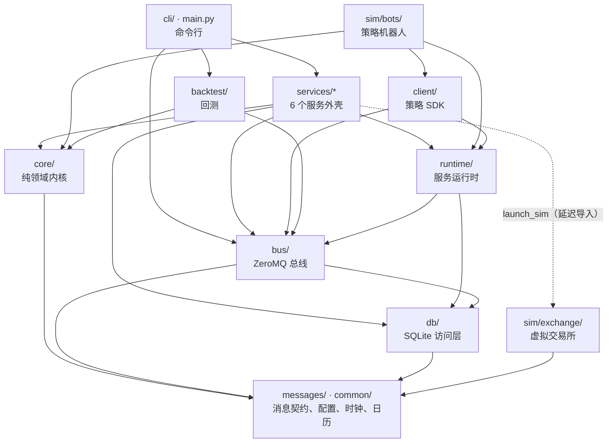

# futrisk 代码导读

| 项 | 内容 |
|---|---|
| 文档编号 | FR-DOC-12 |
| 版本 | v1.0 |
| 状态 | 实现对齐 |
| 日期 | 2026-10-08 |
| 适用范围 | `src/futrisk/` 下的全部代码、`web/` 仪表盘、`tests/` 测试 |
| 对应标准 | GB/T 8567-2006 软件设计说明（SDD）的补充 |
| 关联文档 | [README](README.md)（规范）· [01 架构](01-architecture.md) · [02 通信协议](02-communication-protocol.md) · [03 数据库](03-database-schema.md) · [07 使用说明](07-user-guide.md) · [`core/ENGINE.md`](../src/futrisk/core/ENGINE.md) · [`bus/README.md`](../src/futrisk/bus/README.md) · [`sim/README.md`](../src/futrisk/sim/README.md) · [`web/README.md`](../web/README.md) |

> 本文帮助第一次读代码的人找到入口：包的划分和依赖规则，一笔委托、一个 tick、一次 EOD 分别经过哪些文件和函数，测试怎么组织，编码有哪些约定。设计原理见 01，消息和表的定义见 02、03。代码位置写成 `文件:类.方法`，文件路径相对 `src/futrisk/`；同一格里的 `→` 表示调用顺序，没有写文件名的类和函数沿用同一格前面出现的文件。

## 目录
1. [从哪里开始读](#1-从哪里开始读)
2. [包结构](#2-包结构)
3. [分层与依赖规则](#3-分层与依赖规则)
4. [跟着一笔委托走](#4-跟着一笔委托走)
5. [跟着一个 tick 走](#5-跟着一个-tick-走)
6. [跟着一次 EOD 走](#6-跟着一次-eod-走)
7. [其他关键路径](#7-其他关键路径)
8. [测试布局](#8-测试布局)
9. [编码规范](#9-编码规范)
- [附录 A 修订记录](#附录-a-修订记录)

---

## 1. 从哪里开始读

| 顺序 | 读什么 | 为什么 |
|---|---|---|
| 1 | 01 §4、§5.1、§5.2 | 先知道有哪些服务、为什么这样拆 |
| 2 | `messages/topics.py`、`messages/enums.py`、`messages/orders.py`、`messages/risk.py`、`messages/md.py` | 服务之间只通过这些消息交流，是读懂其余代码的词汇表 |
| 3 | [`core/ENGINE.md`](../src/futrisk/core/ENGINE.md)，然后 `core/engine.py` 的 `EngineCore.handle`、`apply_mark`、`apply_exec`、`evaluate_dirty` | 风控内核：一切业务判断都在这里，纯同步、无 I/O |
| 4 | `core/pretrade.py:check_order`、`core/state_machine.py:LevelMachine`、`core/settlement.py:settle_day` | 事前检查、告警状态机、逐日盯市 |
| 5 | `services/risk_engine/service.py:RiskEngineService`（`step`、`execute`） | 服务外壳怎样把内核输出的 Effect 变成落库、路由和发布 |
| 6 | `services/md_gateway/__init__.py`（流水线一览），然后 `services/md_gateway/pipeline.py:MdPipeline`、`services/md_gateway/arbiter.py:Arbiter` | 多个行情源怎样变成每个合约一条 LIVE 行情流（§2.2、§5） |
| 7 | [`bus/README.md`](../src/futrisk/bus/README.md) 和 `runtime/` | 总线、运行时、心跳、幂等、热加载参与方的通用机制 |
| 8 | `tests/unit/engine/test_engine_acceptance.py`、`tests/golden/`、`tests/e2e/test_e2e_acceptance.py` | 验收场景的可执行描述 |

## 2. 包结构

### 2.1 Python 包

| 包 / 文件 | 职责 |
|---|---|
| `main.py` | CLI 入口：Typer 应用，按需加载 `cli/` 的命令（`futrisk svc` 只加载服务子命令，服务进程的启动和崩溃后的重启更快） |
| `cli/` | 命令行：`ops_cmd.py`（up、down、ps、logs、kill、status、demo）；`tools_cmd.py` 把 `trading_cmd.py`（positions、accounts、order、risk）、`eod_cmd.py`（settle、report）、`democtl_cmd.py`（fault、shock、scenario、clock）、`doctor_cmd.py`（doctor）注册为顶层命令；子命令组 `data_cmd.py`（record、sina-probe、summary）、`config_cmd.py`（validate、show、schema、commit）、`svc_cmd.py`、`backtest_cmd.py`（run、list、show）；`lifecycle.py` 是长时间录制的进程守护（单实例锁、防休眠、控制台关闭和 Ctrl-C 时先落盘）；`apiclient.py`、`toolkit.py` 为 REST 客户端和输出 |
| `common/` | 与业务无关的基础设施：`config/`（pydantic 配置模型、加载、哈希、不可变的版本快照）、`paths.py`（home 布局、home 身份）、`clock.py`（北京时间、`SystemClock`、`SimClock`、`MarketClock`）、`calendar.py`（交易日历与交易时段）、`decimals.py`（Decimal 与 ROUND_HALF_UP）、`ids.py`（UUIDv7、可注入的 `IdGen`）、`logging.py`（JSON 日志） |
| `messages/` | 消息契约：msgspec 结构（`md`、`orders`、`risk`、`eod`、`system`、`common`）、信封 `envelope.py`、主题 `topics.py`、枚举 `enums.py`、错误码 `codes.py`、`Msg` 基类与编解码和 `request_hash`（`base.py`） |
| `core/` | 纯领域内核：品种注册表 `instruments`、手续费 `fees`、保证金 `margin`、持仓 lot `lots`、日内账本 `ledger`、盈亏 `pnl`、指标 `metrics`、规则 `rules`、状态机 `state_machine`、规则评估 `evaluation`、动作 `actions`、限制 `restrictions`、事前检查 `pretrade`、委托 `orders`、告警 `alerts`、每个账户的运行时状态 `risk_account`、公司层 `firm`、EOD `eod`、结算价 `settle_price`、结算 `settlement`、清算用的 Decimal 上下文 `_num`、内核门面 `engine`（`EngineCore`）、`effects` |
| `bus/` | ZeroMQ 总线：端点 `endpoints`、PUB/SUB（`publisher`、`subscriber`）、DEALER/ROUTER 请求应答（`rpc_client`、`rpc_server`）、调用方白名单 `whitelist`、`ctl.*` 控制命令 `control`、心跳与对端存活 `heartbeat`、最新值流的快照追平 `lv` 与最新值缓存 `lvcache`、FACT 序号跟踪与重放 `fact`、进程化身识别 `incarnation`、进程内总线 `InprocBus`（`inproc`，回测和测试用） |
| `db/` | 每服务一库的 SQLite 访问层：`Database`（单写线程、读连接池、后台 checkpoint）、只进不退的迁移 `migrations`、各库共有的表 `common_tables`、事务性 outbox、命令幂等 `processed`、FACT 游标 `cursors`、`db_meta`（流 ID，`meta`）、逻辑列类型 `types` |
| `runtime/` | 服务运行时：同步 Poller 版（`sync_runtime`，risk-engine、trade-gateway）和 asyncio 版（`async_runtime`，其余服务）；两者共用的 `base`（配置、心跳、对端存活、`ctl.*`、配置两阶段提交的参与方）；参与方的实现 `config2pc`、市场时钟跟随 `clock_sync`、父进程看门狗 `parent`、GC 策略 `gcpolicy`、Selector 事件循环 `loop`、测试辅助 `testing` |
| `services/md_gateway/` | 行情网关：数据源、归一化、校验、仲裁、可信状态、行情质量、录制、结算价输入，模块见 §2.2 |
| `services/risk_engine/` | 风控服务外壳：主循环 `service.py:RiskEngineService`（执行 Effect、启动恢复、分片 0 兼任 coordinator 汇总公司层）、risk 库 `store` 与 `schema`、每日维护 `maintenance`、心跳统计 `stats` |
| `services/trade_gateway/` | 交易网关：业务核心 `core.py:TradeGatewayCore`（路由保护与墓碑、回报落库、断线补回报、撤单、kill switch、成交摘要与导入）、经纪商适配器 `broker/`（接口 `base.py:BrokerAdapter`、`sim.py:SimBrokerAdapter`、只有接口的 `ctp.py:CtpBrokerAdapter`、模拟柜台报文 `wire.py`）、服务外壳 `service`、td 库 `store` 与 `schema`、每日维护 |
| `services/clearing/` | 清算：EOD 调度 `scheduler`、结算流程 `saga`、日初快照推送 `pushes`、核对用的摘要 `digests`、结算价决定 `prices`、进程池 `pool` 与池中作业 `jobs`、成交与出入金副本 `copies`、EOD 警告与迟到事实 `eodwarn`、报表 `reports/`、回测作业 `backtests`、配置历史 `confighist`、`settle.*` 命令 `commands`、clearing 库 `store` 与 `schema`、每日维护 `maintenance`（其中的 checkpoint 与备份函数也被其他服务的维护复用，§3） |
| `services/api_gateway/` | 对外接口：FastAPI 应用 `app`、路由 `routes/`、鉴权与权限 `auth`、读模型 `readmodel` 与视图 `views`、读模型修复 `repair`、WebSocket `wshub`、命令转发 `router`、通知 `notifier`、配置两阶段提交协调者 `config2pc`、kill switch 管理 `killswitch`、时钟跳转 `clockjump`、依赖容器与 REST 幂等 `gateway`、REST 信封与错误码映射 `rest`、请求体 `models`、api 库 `store` 与 `schema`、服务外壳 `service` |
| `services/supervisor/` | 进程守护：`supervisor.py:Supervisor`（启动顺序、存活判定、有序停机）、子进程管理 `process`、重启策略 `policy`、市场时钟 `clock_keeper`、服务事件 `events`、拉起 sim-exchange 的 `launch_sim`、supervisor 库 `schema`、每日维护 |
| `sim/exchange/` | 虚拟交易所：主程序 `app`、价格引擎 `engine`、Feed A `feed_a`、Feed B `feed_b`、模拟柜台 `broker`（ROUTER 在独立 I/O 线程 `router_io`）、故障 `faults`、剧本 `scenario`、控制接口 `control`、sim 库 `store`（见 [`sim/README.md`](../src/futrisk/sim/README.md)） |
| `sim/bots/` | strategy-sim：五个演示账户的策略机器人（策略 `strategies`、目标仓位执行 `executor`、拒单处理 `gates`），基于 `client/` SDK |
| `client/` | 策略 SDK：`FutriskClient`（按账户找分片发 `order.*`、跟踪委托、订阅行情和回报）、分片路由 `routing`、客户端的委托簿 `orders` 与持仓 `positions` |
| `backtest/` | 回测：配置 `config`、实验方案 `arms`、日线数据加载（主力换月、DCE 估计）`data`、日内路径合成 `paths`、日线与合成剧本的数据源 `sources`、逐日回放 `replay`（同一个 `EngineCore` 和结算库）、进程内柜台 `broker`、目标仓位执行 `executor`、双均线策略 `strategies`、进程池运行与输出 `runner`、可复现清单 `manifest`、统计与剧本检查 `analysis`、HTML 报告 `report` |
| `web_static/dist/` | 构建好的仪表盘（`web/` 的构建产物），由 api-gateway 托管 |

### 2.2 md-gateway 的模块

2026-10-07 的精简把 md-gateway 改成一条直线流水线：数据源 → 归一化 → 校验 → 仲裁 → 发布与录制。原来独立的 `src/futrisk/marketdata` 包并入了这里（新浪、分片、归一化和轮询传输）。下表按数据流动的顺序排列：

| 模块 | 职责 |
|---|---|
| `sources.py` | 数据源。`FeedAWsSource`：Feed A 的 WebSocket 客户端，订阅时带续传点，心跳看门狗，断线后退避重连；`PollTransport`：定频、不重叠的 HTTP 轮询，慢的一次轮询跳过错过的时隙而不补发，Feed B、新浪和 `futrisk data record` 共用；`FeedBDecoder`：Feed B 应答 → 记录；`feed_b_source`、`sina_source` 组装两种轮询源 |
| `wire.py` | Feed A 帧和 Feed B 记录的类型化结构，用于快速解码；不合结构的帧走 `dict` 慢路径 |
| `sina.py` | 新浪：请求地址与请求头、GB18030 应答的解析（商品与中金所两种字段布局）、`SinaDecoder` |
| `seqtracker.py` | `SeqTracker`：Feed A 的序号跟踪，处理重复、乱序缓冲、缺口、连接内重放、续传和 epoch 变化 |
| `normalizer.py` | `Normalizer`：厂商记录 → 统一的 `Tick`：合约代码按交易所大小写，交易日按日历重算，修正 DCE 夜盘的 `ActionDay`，缺涨跌停价时按昨结算推算，置标志位，算指纹；`InstrumentMeta` 是每个合约的静态参数 |
| `sessions.py` | `SessionIndex`：交易日和交易时段查询的缓存（每个状态都要问一遍） |
| `model.py` | `Incoming`：收到的一条记录（归一化后的 `Tick`，或者带原因码的拒收）；`order_key` |
| `validator.py` | `Validator`：跳过此刻不在交易时段、仍是上一交易日、或者本时段还没更新过（交易所时间落在交易时段之外且不晚于收到时刻，如 CFFEX 09:25 集合竞价期间）的轮询记录和订阅快照，跳过的不录制，也不计入拒收率；拒收其余越时段的状态，以及越涨跌停、不在价格网格、时间戳在未来、同源不单调、价格不随成交变动的状态 |
| `arbiter.py` | `Arbiter`：每个合约一个水位（最后一个 LIVE 状态的 `order_key` 和指纹）；同成交量交叉校验（`VOTE` / `NO_VOTE`）、指纹去重，判定 LIVE、BACKFILL、DUPLICATE 或 REJECTED；判断 LIVE 流是否跟得上市场 |
| `pipeline.py` | `MdPipeline`：校验 → 仲裁 → 效果（发布、录制、`BAD_TICK` 与 `MD_INTEGRITY` 事件、拒收率统计、投票） |
| `trust.py` | `TrustManager`：数据源可信状态 EXCLUDED / PROBATION / TRUSTED，以及跨重启保持的人工排除 |
| `quality.py` | `QualityMonitor`：合约行情质量 OK / STALE / UNKNOWN，`MD_DOWN`、`MD_RECOVERED`、`MD_QUIET` 事件 |
| `events.py` | `EventLog`（构造 `md.event` 事实）、`GapBook`（缺口台账）、`RateLimiter`（信息类事件限流） |
| `recording.py` | `TickRecorder`：事件循环只把原始行交给录制线程，游标只在对应的行写进分片之后才持久化；`build_canonical` 在日终把 LIVE 和 BACKFILL 合成规范 tick 文件 |
| `shards.py` | Parquet 分片：Arrow 结构与行构造、防崩溃的 `ParquetShardWriter`（临时文件、fsync、原子改名，写失败时退避重试并改写备用目录）、读取函数 |
| `settle.py` | `compute_settle_input`：从规范 tick 计算结算价输入（全天 VWAP、最后一小时、逐小时分段、封板） |
| `commands.py` | `md.settle_inputs`、`md.events`、`md.sources`、`md.source.set` 的处理函数 |
| `store.py`、`schema.py` | md.db 的访问函数和表结构（03 §4.1） |
| `params.py` | `MdParams`：`feeds.yaml` 的仲裁参数加上实现常数 |
| `service.py` | `MdGatewayService`：把上面的部件接到 asyncio 运行时上：定时器、`md.status`、缺口、游标与水位的持久化、配置变更的否决、每日维护 |
| `stats.py`、`main.py` | 心跳中的延迟与速率统计；`futrisk svc md-gateway` 的入口 |

`futrisk data record`（`cli/data_cmd.py:record`）不接总线，直接复用这条流水线：`sina_source` 和 `SinaDecoder` 取数，`Normalizer`、`Validator`、`Arbiter`、`MdPipeline` 处理，`TickRecorder` 写分片；新浪是唯一的源，在其中始终视为可信（`cli/data_cmd.py:_Trusted`）。

### 2.3 仪表盘 `web/`

Vue 3 + TypeScript + Vite + Pinia + Element Plus + ECharts，构建产物输出到 `src/futrisk/web_static/dist`。完整说明见 [`web/README.md`](../web/README.md)。

| 目录 / 文件（`web/src/`） | 职责 |
|---|---|
| `main.ts`、`App.vue`、`router.ts` | 入口、页框（页头、设置、连接状态）和五个页面的路由（hash 模式） |
| `runtime.ts` | 把 REST 端点和 WebSocket 客户端接到真实的 api-gateway，或者接到浏览器内的模拟后端 |
| `api/` | `http.ts`（REST 客户端：信封、幂等键、错误码）、`ws.ts`（WebSocket 客户端：鉴权、订阅、seq 缺口与 resync、重连）、`endpoints.ts` |
| `realtime/` | `batcher.ts`（按主题和键合并帧，节流写入 store）、`dispatcher.ts`（帧 → store，resync → REST 补齐） |
| `stores/` | Pinia：settings、auth、connection、clock、accounts、events、market、system、firm、compare、eod |
| `views/` | 五个页面：总览、账户、多账户对比、行情与系统、报表 |
| `components/` | 表格、徽章、对话框、报表沙箱查看器等；`charts/` 下是 ECharts 图表 |
| `composables/`、`utils/` | 实时订阅与操作反馈；格式化、归一化（守卫）、风险与对比计算、标签 |
| `types/` | msgspec 结构的 TypeScript 镜像（字段名一致），以及 REST / WS 协议和视图的类型（`api.ts`） |
| `mock/` | 模拟后端：REST 路由、WS Hub、行情与熔断演示引擎；`wire.gen.ts`、`rules.gen.ts` 由 `web/scripts/gen_mock_schema.py` 从 Python 代码生成 |

测试在 `web/tests/`（§8）。精简后后端已删除的功能在前端只剩一处残留：报表页回测对话框（`views/ReportsPage.vue`）还列出已不存在的配置 `stress`、`sweep`、`minute`、`ticks`，选它们提交的回测会立即失败，现在只有 `default` 和 `breaker_synthetic`（08 §5.2）。已删除的行情功能（价格尖刺隔离、切换抖动告警、1 分钟 K 线）在前端的类型、标签和模拟数据已于 2026-10-08 删除。

仓库其他目录：`config/`（默认配置）、`data/hist/`（回测历史数据，来源见 `data/hist/SOURCES.md`）、`deploy/`（docker）、`packaging/`（PyInstaller）、`scripts/`（构建 exe、录制守护、历史数据获取、交易日历生成、文档工具）、`tests/`、`docs/`。

## 3. 分层与依赖规则

*这张图回答：包之间实际存在哪些 import 依赖（按 2026-10-08 的代码统计，包括函数内的延迟导入；箭头指向被依赖的一方；`messages/`、`common/` 被所有包使用，只画了几条代表）。*

| 层 | 包 | 规则 |
|---|---|---|
| 纯内核 | `core/` | 只依赖 `messages/` 和 `common/`；**没有 I/O**：不碰套接字、数据库、文件、线程，不读系统时钟，不用全局随机数。时间来自注入的 `Clock`，ID 来自注入的 `IdGen`。输入一个事件，返回一个有序的 `Effect` 列表（`core/effects.py`：`Persist`、`Route`、`CancelRoute`、`ResolveRoute`、`Request`、`Publish`、`ReplyTo`），相同输入得到相同输出 |
| 服务外壳 | `services/*` | 收消息、调内核、按顺序执行 Effect（先落库，再对外动作，再发布，最后回复，ENGINE.md §3）；只通过总线与其他服务交换数据，禁止读写别的服务的库 |
| 基础设施 | `bus/`、`db/`、`runtime/` | 与业务无关的可靠性机制：序号、快照与重放、outbox、幂等、心跳、热加载。服务作者只写业务回调（[`bus/README.md`](../src/futrisk/bus/README.md)） |
| 外部模拟与 SDK | `sim/`、`client/` | `sim/` 扮演交易所和交易员，`client/` 是策略接入的 SDK；它们只经对外协议（02 §9）和总线命令与系统交互。生产环境中 `sim/` 被 CTP 和真实策略替代，真实策略可以继续使用 `client/` |
| 复用内核 | `backtest/` | 用 `InprocBus` 和同一个 `EngineCore`、同一个结算库回放历史数据，不启动任何服务 |

图中值得注意的几处：

- 服务之间不导入彼此的业务代码。唯一的例外是 `services/clearing/maintenance.py` 中的 WAL checkpoint、`VACUUM INTO` 备份和备份清理函数，md-gateway、risk-engine 和 trade-gateway 的每日维护直接调用它们；
- `sim/exchange/` 只依赖 `messages/` 和 `common/`；`futrisk svc sim-exchange` 由 `services/supervisor/launch_sim.py` 在函数内导入它；
- `cli/data_cmd.py` 在模块顶层导入 md-gateway 的流水线部件（§2.2）；
- `common/config` 有少量模块导入 `messages/` 的枚举，`messages/` 也有一处延迟导入 `common/`，两者合在一起作为基础层。

包之间的依赖方向没有工具强制（没有 import-linter 一类的检查），靠评审维持；能机械检查的是确定性约束（ruff 的 banned-api 规则）和类型（`mypy --strict` 覆盖 `core/`、`messages/`、`bus/`），见 §9。

## 4. 跟着一笔委托走

以 `futrisk order place -a ACC3 -i rb2701 --side buy --offset open -q 1 --type market` 为例（时序图见 01 §6.2）：

| # | 步骤 | 位置 |
|---|---|---|
| 1 | CLI 生成 `client_order_id`（UUIDv7，同时作 `Idempotency-Key`），调用 `POST /api/v1/orders` | `cli/trading_cmd.py:order_place` → `cli/apiclient.py:new_idempotency_key` |
| 1′ | （机器人下单时）策略的目标仓位变成委托，直接发 `order.submit` 到所属分片，不经过 api-gateway | `sim/bots/executor.py:Executor.decide`（返回下单动作）→ `sim/bots/main.py` 执行动作 → `client/client.py:FutriskClient.submit`（分片由 `client/routing.py:ShardRouter` 决定） |
| 2 | api-gateway 校验 key 和角色（TRADER）、记审计，按账户找到分片，转发 `order.submit` | `services/api_gateway/routes/accounts.py` 中 `build` 注册的 `submit`（`POST /orders`）→ `services/api_gateway/router.py:CommandRouter.to_account` |
| 3 | 风控外壳在主循环中取出命令 | `services/risk_engine/service.py:RiskEngineService.step` → `_on_command` → `_dispatch` |
| 4 | 内核先评估这个账户（如果它是脏的），再走 9 步事前检查；第一个失败的检查即拒单 | `core/engine.py:EngineCore.handle` → `_cmd_order_submit` → `core/pretrade.py:check_order`（`_static`、`_system`、`_price`、`_account`、`_throttle`、`_position`、`_funds`、`_whatif`、`_self_trade`；`_account`、`_funds`、`_whatif` 只对开仓单执行） |
| 5 | 通过：委托意图以 `ROUTING` 状态落库，产生 `Route` 和 `ReplyTo`；被拒：以 `REJECTED` 落库并回复拒单码 | Effect 列表 → `RiskEngineService.execute` → `_commit`（一个事务，含 outbox）→ `_route`（`route.order`，在 `expire_ns` 前用同一个 `client_order_id` 重试）→ `_reply` |
| 6 | 交易网关只接受 `risk-engine-*` 身份的路由（调用方白名单 `bus/whitelist.py`，由运行时的 ROUTER 执行），拒绝过期路由，已判定丢失的委托有墓碑，落库后报单 | `services/trade_gateway/service.py:TradeGatewayService._route_order` → `services/trade_gateway/core.py:TradeGatewayCore.route_order` → `_submit` → `services/trade_gateway/broker/sim.py:SimBrokerAdapter` |
| 7 | 模拟柜台按对手价撮合；没有立即成交的挂单在后续行情中撮合 | `sim/exchange/broker.py:SimBroker._insert` → `_fill`；`SimBroker.on_market` |
| 8 | 委托回报和成交先写入 td.db 和 outbox，再发布到每账户一条的有序流 `td.exec.{account_id}` | `TradeGatewayCore.on_order` / `on_trade` → `_on_live_report` → `_apply_reports` → `_store_order` / `_store_trade` |
| 9 | 风控按 FACT 序号应用成交：更新 lot、账本、手续费，账户变脏，成交与订阅游标在同一事务中落库 | `RiskEngineService._apply_exec_env` → `EngineCore.apply_exec` → `core/lots.py:PositionBook`、`core/ledger.py:IntradayLedger`、`core/fees.py` |
| 10 | 委托状态发布到 `oms.order.{account_id}`，账户快照发布到 `risk.snapshot.{account_id}` | api-gateway `services/api_gateway/readmodel.py:ReadModel.apply` → `services/api_gateway/wshub.py:WsHub.on_change` → 浏览器 |
| 11 | clearing-worker 保存成交副本，供 EOD 核对 | `services/clearing/copies.py:LocalCopies` |

幂等要点：`client_order_id` 在全系统唯一，重复提交返回第一次的结果（`duplicate=true`）；路由过期后改用 `route.resolve` 确认，绝不换一个 ID 重发（01 §6.2、02 §8.3）。

## 5. 跟着一个 tick 走

以 rb2701 的一个行情状态为例（时序图见 01 §6.1）：

| # | 步骤 | 位置 |
|---|---|---|
| 1 | 价格引擎每 500ms（`sim.yaml` 的 `tick_interval_ms`）为处于连续交易时段的合约生成新状态（相关 GBM + 跳跃，按 tick 对齐，受涨跌停约束），先写 sim.db 再发布 | `sim/exchange/app.py:SimExchange._engine_loop` → `_round` → `sim/exchange/engine.py:PriceEngine.step` |
| 2 | 同一状态分别经 Feed A 推送（带 seq，可续传、可重放）、Feed B 轮询、模拟柜台撮合 | `sim/exchange/feed_a.py:FeedAServer.publish`、`sim/exchange/feed_b.py:FeedBService.publish`、`SimBroker.on_market` |
| 3 | Feed A：md-gateway 的 WebSocket 客户端收到帧，类型化解码后交给序号跟踪：重复的丢弃，超前的在乱序缓冲中等待，缺号就在连接内请求重放；按序交付的状态再归一化 | `services/md_gateway/sources.py:FeedAWsSource._on_frame` → `_dispatch` → `services/md_gateway/seqtracker.py:SeqTracker.on_tick` → `FeedAWsSource.deliver` → `_incoming` → `services/md_gateway/normalizer.py:Normalizer.feed_a_struct`（不合结构的帧走 `feed_a`） |
| 3′ | Feed B 与新浪：同一个定频轮询传输取回应答，由各自的解码器拆成记录并归一化 | `services/md_gateway/sources.py:PollTransport.run` → `poll_once` → `FeedBDecoder.decode`（`Normalizer.feed_b`）/ `services/md_gateway/sina.py:SinaDecoder.decode`（`SinaDecoder.to_tick` → `Normalizer.build`） |
| 4 | 归一化的结果是一条 `Incoming`：统一的 `Tick`（代码、价格、按日历重算的交易日、时间戳、标志位、指纹），或者带 02 §11.3 原因码的拒收；数据源把它交给服务 | `services/md_gateway/model.py:Incoming` → `services/md_gateway/service.py:MdGatewayService.on_incoming`（记入数据源的消息统计） |
| 5 | 流水线先校验（跳过或拒收），再仲裁：同成交量交叉校验、指纹去重、与水位 `order_key` 比较，判定 LIVE、BACKFILL、DUPLICATE 或 REJECTED | `services/md_gateway/pipeline.py:MdPipeline.process` → `services/md_gateway/validator.py:Validator.check` → `MdPipeline._classify` → `services/md_gateway/arbiter.py:Arbiter.classify` |
| 6 | LIVE 发布到 `md.tick.rb2701`；除被跳过的以外，每条记录都交给录制（原始分片带 `mode` 和拒收原因）；LIVE 和 BACKFILL 在日终合成规范 tick 文件，结算价输入从它计算，**补数永远不进风控**；拒收和交叉校验的结果计入数据源的拒收率和投票 | `MdGatewayService.publish_tick`；`MdGatewayService.record` → `services/md_gateway/recording.py:TickRecorder`（录制线程 → `services/md_gateway/shards.py:ParquetShardWriter`）；`services/md_gateway/trust.py:TrustManager.on_outcome`、`on_vote` |
| 7 | 每 100ms 评估数据源的可信状态和合约的行情质量，每秒发布一次 `md.status`；可信状态变化、质量变化、缺口、坏点作为事实发布到 `md.event` | `MdGatewayService._timer_loop` → `TrustManager.evaluate`、`services/md_gateway/quality.py:QualityMonitor.evaluate`；`MdGatewayService._each_second` → `MdGatewayService.status`；`services/md_gateway/events.py:EventLog.emit` |
| 8 | 风控外壳按合约只保留最新值（槽位），本轮循环统一应用；持有该合约或在该合约上有挂单的账户变脏；`md.status` 是行情质量的唯一依据 | `RiskEngineService._on_md` → `_apply_marks` → `EngineCore.apply_mark`；`EngineCore.apply_md_status` |
| 9 | 每轮对每个脏账户评估一次：增量估值 → 指标 → 规则 → 告警状态机 → 动作与限制 → 账户状态 | `EngineCore.evaluate_dirty` → `_evaluate` → `core/metrics.py:build_valuation` → `core/evaluation.py:evaluate_owner` → `core/state_machine.py:LevelMachine` → `core/actions.py`、`core/restrictions.py` → `_refresh_state` |
| 10 | 越线时：状态机迁移、告警和账户状态在一个事务中落库并写 outbox，发布 `risk.event`、`risk.state.{account_id}`；熔断时同时撤销开仓挂单 | `core/evaluation.py:persist_transitions`；`EngineCore._cancel_open_orders`；`RiskEngineService.execute` |
| 11 | 账户快照按 2Hz 节流发布（每个账户每秒至少一次保活），coordinator 汇总公司层 | `risk.snapshot.{account_id}`、`risk.firm`（`core/firm.py`） |
| 12 | api-gateway 更新读模型并推送给浏览器；高级别事件发 webhook | `ReadModel.apply` → `WsHub.on_change`；`services/api_gateway/notifier.py` |

行情质量由 md-gateway 的 `md.status` 决定：一个合约在连续交易时段内（开盘后有 30s 宽限）持续没有被"覆盖"——即 LIVE 流不再跟得上市场，或者没有可信源及时送达它——满 5s 为 STALE、满 30s 为 UNKNOWN；risk-engine 对不是 OK 的合约禁开，受影响的告警状态机按 04 §3.6 的口径保持不动（01 §8.13）。

## 6. 跟着一次 EOD 走

以交易日 20260928 为例（时序图见 01 §6.6，各步的消息流程见 02 §8.4）：

| # | 阶段 | 位置 |
|---|---|---|
| 1 | 市场时间过了 `app.yaml` 的 `eod_start_at`（默认 15:30），调度器为最新的日初快照日创建一次运行 | `services/clearing/scheduler.py:EodScheduler.tick` → `services/clearing/service.py:ClearingService._scheduled_run` → `services/clearing/saga.py:EodSaga.decide_run_tx`、`spawn` |
| 2 | BEGIN：固定日初快照版本和配置版本 | `EodSaga._drive` → `_advance` |
| 3 | FROZEN：各分片冻结当日，返回逐账户的成交和出入金摘要 | `EodSaga._step_freeze` → `eod.freeze` → `core/engine.py:EngineCore._cmd_eod_freeze`（`core/eod.py`） |
| 4 | TRADES_RECONCILED：成交三方核对（本地副本、trade-gateway 的 `td.digest`、风控冻结摘要），出入金两方核对（本地副本与风控冻结摘要的笔数和净额）；缺的用 `td.query.trades` 补齐 | `EodSaga._step_reconcile` → `_td_digest`、`_pull_trades`、`_pull_cash`（比较在 `services/clearing/digests.py`）；`TradeGatewayCore.digest` |
| 5 | PRICES_FIXED：向 md-gateway 取结算价输入（md-gateway 先把缓冲的原始行写盘、生成当日的规范 tick 文件，再计算 VWAP、逐小时分段、封板状态），按"人工覆盖 > 官方 > VWAP > 回退链"决定结算价 | `EodSaga._step_prices` → `md.settle_inputs` → `services/md_gateway/commands.py` 的 `settle_inputs` → `services/md_gateway/recording.py:build_canonical` → `services/md_gateway/settle.py:compute_settle_input`；`services/clearing/prices.py:decide_prices` → `core/settle_price.py:determine_settlement_price` |
| 6 | SETTLED：在进程池中逐日盯市、手续费、保证金（含单向大边）、资金、对账检查、下一交易日的日初快照，全程 Decimal，结果在一个事务中落库 | `EodSaga._step_settle` → `_settle_in_pool` → `core/settlement.py:settle_day`（`core/pnl.py`、`core/margin.py`、`core/fees.py`） |
| 7 | ROLLED：推送 `eod.rollover`，各分片取新快照、换日、按配置解除锁存，全部确认后记推送完成 | `EodSaga._step_roll` → `services/clearing/pushes.py:PushManager.push` → `EngineCore._cmd_eod_rollover` → `EngineCore.roll_day` |
| 8 | REPORTED：生成风控日报和结算单，登记报表索引；报表失败只记在这一步的 `detail.errors` 中（不发 WARN 事件），不阻止 DONE | `EodSaga._step_report` → `services/clearing/reports/gather.py:ReportService.generate`（收集数据、登记）→ 进程池中 `services/clearing/jobs.py:render_reports_job` → `services/clearing/reports/render.py`（分析 `reports/model.py`，图表 `reports/charts.py`，结算单 `reports/statement.py`，模板 `services/clearing/templates/risk_daily.html.j2`） |
| 9 | DONE：发布 `sys.eod`（DONE），各服务开始每日维护：checkpoint、备份、按保留期清理 | `EodSaga._step_done`；`services/clearing/maintenance.py`、`services/risk_engine/maintenance.py`、`services/trade_gateway/maintenance.py`、`MdGatewayService.maintenance`、`services/supervisor/maintenance.py` |

每一步都以 `(trading_day, version)` 为幂等键，clearing-worker 重启后从最近完成的一步继续；失败时发布 `sys.eod`（FAILED）。回测调用同一个 `settle_day`（`backtest/replay.py`）。

## 7. 其他关键路径

| 场景 | 入口 | 说明 |
|---|---|---|
| 熔断：越线、锁存、重置 | `core/state_machine.py:LevelMachine`；`core/engine.py:EngineCore._cmd_reset`、`_cmd_halt` | 首次越线立即禁开并撤单（PENDING），确认后锁存；`risk.reset` 转为 REARMED（01 §6.3、04 §8） |
| risk-engine 重启恢复 | `RiskEngineService.start` → 市场时钟就绪后 `_on_clock_ready` → `_restore`（`EngineCore.restore`、`post_restore`；库是空的时改走 `_request_sod` 取日初快照）→ `_enter_catchup` → `_enter_warmup` → `_enter_running` | 读 risk 库恢复状态机和锁存，补拉停机期间的成交，对账后进入 RUNNING（01 §6.5、ENGINE.md §8） |
| Feed A 中断与补数 | `services/md_gateway/sources.py:FeedAWsSource`（重连时带续传点 `resume`）、`services/md_gateway/seqtracker.py:SeqTracker`、`MdGatewayService.on_gap` → `services/md_gateway/events.py:GapBook` | 缺口在连接内重放或续传补回，补回的状态标为 BACKFILL；环形缓冲中已经没有的部分记为无法恢复；全部可信源都丢失时另开 `all:` 时间窗缺口（`MdGatewayService._check_all_gap`）（01 §6.4） |
| 配置热加载 | 协调者 `services/api_gateway/config2pc.py:ConfigCoordinator.reload`；参与方 `runtime/config2pc.py:ConfigParticipant`、`compute_effects` | 两阶段提交，先持久化决定（01 §6.7、02 §8.5）。md-gateway 只接受 `feeds.yaml` 仲裁参数的改动，数据源、`products.yaml` 和交易日历的改动在准备阶段被否决，整次提交随之放弃，只能停机后离线提交（`MdGatewayService._validate_config`；`futrisk config commit`） |
| 市场时钟跳转 | `services/api_gateway/clockjump.py`；`services/supervisor/clock_keeper.py`；`runtime/clock_sync.py` | 暂停 sim-exchange → 跳转 → 等全部服务确认 → 恢复（02 §8.8） |
| 进程守护 | `services/supervisor/supervisor.py:Supervisor`、`policy.py`、`process.py` | 启动顺序、存活判定、退避重启、有序停机（01 §5.3.6） |
| kill switch | `services/api_gateway/killswitch.py`；`EngineCore._cmd_kill_switch`；`TradeGatewayCore.kill_switch` | 扇出到各分片和交易网关，两层来源分开记录（01 §5.3.1） |
| 真实行情录制 | `cli/data_cmd.py:record` → `services/md_gateway/sources.py:sina_source`（`PollTransport` + `SinaDecoder`）→ `MdPipeline` → `TickRecorder`；`cli/lifecycle.py`；`scripts/record_forever.ps1` | 不接总线；只在所选品种的交易时段（前后留几分钟余量）轮询，其余时间休眠；分片写入 `<home>/ticks/raw/{trading_day}/sina/`，原始应答写入 `ticks/wire/`；此刻不在交易时段或已过期的新浪快照被跳过，不录制 |
| 回测 | `cli/backtest_cmd.py:run_cmd` → `backtest/config.py:load_backtest_config` → `backtest/runner.py:run_config` → `run_tasks`（`default` 每个方案一个 spawn 进程；配置的 `workers` 为 1 时在本进程内运行）→ `backtest/replay.py:Replay.run` → `backtest/analysis.py:analyze_arms` / `analyze_scenarios` → `backtest/report.py:render_report`；从仪表盘提交时 `services/clearing/backtests.py:BacktestManager` → `services/clearing/jobs.py:backtest_job` → `runner.run_job` | 方法与结果见 10 §2、§4 |

## 8. 测试布局

| 目录 | 内容 | 命令 |
|---|---|---|
| `tests/unit/<领域>/` | 单元和组件测试，按包划分：`core`、`engine`（`EngineCore`：验收、事前检查、状态机、委托、合规、指标、EOD、公司层、性质测试）、`bus`、`db`、`runtime`、`md_gateway`、`risk_engine`、`trade_gateway`、`clearing`、`api_gateway`、`supervisor`、`sim`、`bots`、`client`、`backtest`、`cli`；另有 `tests/unit/test_foundation.py` | `.venv\Scripts\python -m pytest tests/unit -m "not slow"`；去掉 `-m "not slow"` 同时运行多进程等慢测试；按目录分别运行更稳妥，项数、用时和建议见 06 §7.1、§9 |
| `tests/golden/` | 清算黄金用例：多日手算案例（`CASES.md` 给出每一步的手算过程），逐分比对 | `.venv\Scripts\python -m pytest tests/golden` |
| `tests/property/` | 清算性质测试（hypothesis，固定种子）：资金恒等式、逐日盯市累计 = 逐笔对冲累计、交易所公式 = 平仓 + 持仓等 | `.venv\Scripts\python -m pytest tests/property` |
| `tests/e2e/` | 端到端验收：`futrisk demo --scenario breaker --headless` 真实启动 supervisor 和它拉起的 8 个进程，依次验证熔断三级、熔断后开仓被拒平仓成交、kill risk-engine-1 后熔断保持且告警不重复、Feed A 中断时 Feed B 接续且补齐无重复、EOD 结算和报表 | `.venv\Scripts\python -m pytest -m e2e tests/e2e -v`（默认跳过，也可设 `FUTRISK_E2E=1`；用时见 06 §6） |
| `tests/fixtures/` | 新浪原始应答样本（`sina/`） | — |
| `web/tests/` | 仪表盘的 vitest 测试：WebSocket 协议、REST 客户端、归一化、store、与真实网关应答的契约（`web/tests/fixtures/gateway/`）、模拟后端 | 在 `web\` 下 `npm run test` |

- pytest 标记：`slow`（多进程、网络回环等耗时测试）、`e2e`（端到端，只在显式选择时运行）。`asyncio_mode = auto`。
- 服务测试通过 `runtime/testing.py`、`sim/exchange/testing.py` 使用随机回环端口和快速心跳。
- 内核测试用 `SimClock` 和顺序 ID 生成器，结果完全确定。
- `tests/unit/md_gateway/test_mdg_throughput.py` 是 md-gateway 接入速率的宽松回归检查（下限 1500 条/秒，只捕捉数量级的退化），不是性能基准（13 §1.3）。

## 9. 编码规范

| 约定 | 内容 | 检查方式 |
|---|---|---|
| lint 与格式 | ruff，规则集 `E`、`F`、`W`、`I`、`B`、`UP`、`SIM`、`TID`，行宽 110（E501 不检查） | `.venv\Scripts\ruff check src tests scripts` |
| 类型 | mypy；`core/`、`messages/`、`bus/` 为 strict 模式 | `.venv\Scripts\mypy src` |
| 禁用的 API | `time.time`、`time.monotonic`、`time.perf_counter`（及各自的 `_ns` 版本）等系统时钟，`datetime.now`、`date.today`，`random.*` 的全局函数，`uuid.uuid1/uuid4`：必须注入 `Clock`、带种子的随机数发生器和 `IdGen`，保证确定性。规则对 `core/`、`messages/`、`db/`、`runtime/`、`client/`、`backtest/` 生效；`common/`、`services/`、`sim/`、`bus/`、`cli/`、`main.py`、`scripts/`、`tests/` 豁免 | ruff `TID251`（banned-api 列表在 `pyproject.toml`） |
| 消息 | 每个负载是 `msgspec.Struct`，继承 `messages/base.py:Msg`（`kw_only=True`、`omit_defaults=True`），用 `@payload(v=N)` 注册类型名和版本；msgpack 按字段名编码，解码时忽略未知字段，所以加字段向后兼容；字段名 snake_case，枚举值 UPPER_SNAKE_CASE（README §3.3） | 契约测试 `tests/unit/bus`、`tests/unit/api_gateway` |
| 金额精度 | 清算账本（盈亏、手续费、保证金、权益）一律 `Decimal`，价格用 `Decimal(str(px))` 转换，金额按 ROUND_HALF_UP 量化到 0.01 元（`common/decimals.py`）；库中和消息中用十进制字符串 `DecStr`；盘中估值和风控比率用 float64（01 §8.3） | 黄金用例、性质测试 |
| 时间 | 时间戳为 UTC 纪元纳秒，字段名以 `_ns` 结尾；业务时间（交易日、时段、EOD）一律按北京时间计算；交易日是 `YYYYMMDD` 字符串（README §3.4） | — |
| 配置 | pydantic 模型，`extra="forbid"`、`frozen=True`；新增配置键要在 `scripts/gen_config_reference.py` 中写说明并重新生成 11 文档 | `futrisk config validate`；`gen_config_reference.py --check` |
| 注释 | 公共类和函数写英文 docstring，并注明对应的文档章节（如 `(02 §8.4)`）；公式、交易所细则、阈值等领域规则用中文注释 | 评审 |
| 错误处理 | 业务拒绝返回拒单码，不重试；可重试错误带同一个幂等键重试；未预期的异常记录后退出，由 supervisor 重启（崩溃即重启，01 §8.6） | — |
| 数据库 | 每个库只有一个写线程；关键事实与业务数据、outbox 在同一事务中提交；表结构变化写成只进不退、带校验和的迁移（03 §9），库里记录的校验和与代码不符、或者有代码不认识的版本时，服务拒绝启动。例外：2026-10-07 的 md-gateway 精简把 md.db 重新定为只有一个迁移的 v1，此前版本留下的 md.db 不能直接打开，需要删除后重建 | `tests/unit/db`、各服务的 schema 测试 |

提交前运行 ruff、mypy 和 pytest；文档按里程碑同步，运行 `python scripts/check_docs.py`（README §3.6）。

---

## 附录 A 修订记录

| 版本 | 日期 | 说明 |
|---|---|---|
| v0.1 | 2026-09-25 | 初版：阅读顺序、包结构、依赖分层（按实际 import 统计）、一笔委托 / 一个 tick / 一次 EOD 的逐步代码位置、其他关键路径、测试布局、编码规范 |
| v0.2 | 2026-09-26 | 范围精简（完整版保留为 git 标签 `v0.1-full`）：包结构删除 `bench/`；`backtest/` 按精简后的模块改写 |
| v1.0 | 2026-10-08 | 按代码重建（实现对齐），逐个核对文中的 `文件:类.方法`。1）md-gateway 按 2026-10-07 的改写重写：新增 §2.2 模块表；§5 的 tick 路径改为"数据源内先序号跟踪、再归一化，然后 `MdPipeline` 校验与仲裁"，并补上可信状态、行情质量和 `md.status` 一步；行情质量改按"覆盖"表述；2）包表补齐漏掉的模块（`cli/tools_cmd.py`、`cli/lifecycle.py`、`core/risk_account`、`core/_num`，清算的 `pushes`、`digests`、`jobs`、`eodwarn`、`commands`，api-gateway 的 `views`、`repair`、`rest`、`service` 等，`backtest/` 的 `arms`、`runner`、`manifest`）；新增 §2.3 仪表盘目录表，并列出前端残留的已删除功能；3）依赖图按实际 import 重画：补上服务到总线和数据库、SDK 到总线、机器人到运行时、CLI 到总线、supervisor 延迟导入 sim-exchange 几条边，写明服务之间唯一的代码依赖（清算的维护函数）和"依赖方向没有工具强制"；4）路径修正：下单路由是 `routes/accounts.py` 中 `build` 注册的 `submit`；重启恢复走 `_on_clock_ready` → `_restore`（`_request_sod` 只用于空库）；换日经 `pushes.py:PushManager.push`；报表经 `ReportService.generate` 和 `jobs.render_reports_job`；出入金在 EOD 是两方核对；banned-api 规则的适用范围改为 `core/`、`messages/`、`db/`、`runtime/`、`client/`、`backtest/`；5）§7 增加真实行情录制和回测两条路径，配置热加载写明 md-gateway 否决数据源、品种和日历的改动；6）测试表删去未经本次测量的项数与用时（改引 06），e2e 写明是 supervisor 加 8 个子进程；数据库约定写明 md.db 重新定基的例外。独立交叉复核（2026-10-08）：逐个解析文中的 `文件:类.方法`（180 个，全部存在），按 AST 重新统计包之间的 import（与图一致），改正 6 处：§2.2 校验器补上当天的代码改动（本时段还没更新过的旧快照跳过，不再拒收）；§2.3 前端只剩回测对话框一处残留（标签和模拟后端中的隔离原因码已于当天删除）；§5 第 8 步在该合约上有挂单的账户同样变脏；§5 行情质量说明中的"冻结"改为"保持不动"（README §3.1）；§6 第 8 步报表失败只记在 `detail.errors` 中、不发 WARN 事件（与 02 §8.4、05 一致）；§7 回测路径注明 `workers` 为 1 时在本进程内运行 |
