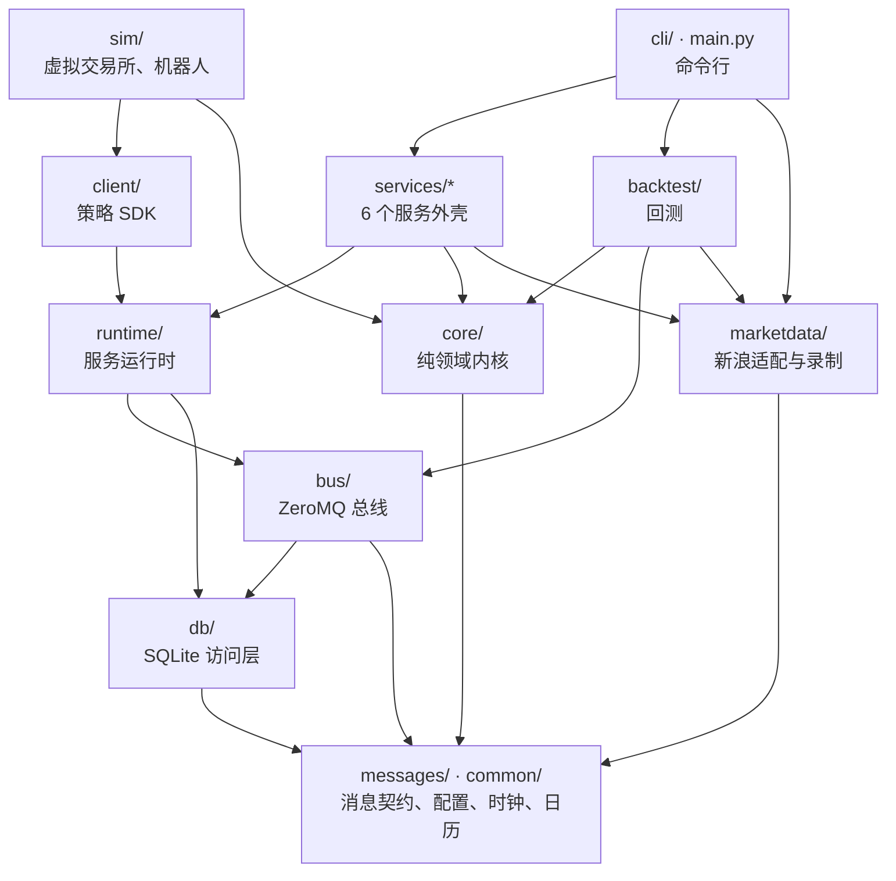

# futrisk 代码导读

| 项 | 内容 |
|---|---|
| 文档编号 | FR-DOC-12 |
| 版本 | v0.1（按已实现的系统编写） |
| 状态 | 实现对齐 |
| 日期 | 2026-09-25 |
| 适用范围 | `src/futrisk/` 下的全部代码、`web/` 仪表盘、`tests/` 测试 |
| 对应标准 | GB/T 8567-2006 软件设计说明（SDD）的补充 |
| 关联文档 | [README](README.md)（规范）· [01 架构](01-architecture.md) · [02 通信协议](02-communication-protocol.md) · [03 数据库](03-database-schema.md) · [07 使用说明](07-user-guide.md) · [`core/ENGINE.md`](../src/futrisk/core/ENGINE.md) · [`bus/README.md`](../src/futrisk/bus/README.md) · [`sim/README.md`](../src/futrisk/sim/README.md) · [`web/README.md`](../web/README.md) |

> 本文帮助第一次读代码的人找到入口：包的划分和依赖规则，一笔委托、一个 tick、一次 EOD 分别经过哪些文件和函数，测试怎么组织，编码有哪些约定。设计原理见 01，消息和表的定义见 02、03。代码位置写成 `文件:类.方法`，文件路径相对 `src/futrisk/`。

## 目录
1. [从哪里开始读](#1-从哪里开始读)
2. [包结构](#2-包结构)
3. [分层与依赖规则](#3-分层与依赖规则)
4. [跟着一笔委托走](#4-跟着一笔委托走)
5. [跟着一个 tick 走](#5-跟着一个-tick-走)
6. [跟着一次 EOD 走](#6-跟着一次-eod-走)
7. [其他关键路径](#7-其他关键路径)
8. [测试布局](#8-测试布局)
9. [编码规范](#9-编码规范)
- [附录 A 修订记录](#附录-a-修订记录)

---

## 1. 从哪里开始读

| 顺序 | 读什么 | 为什么 |
|---|---|---|
| 1 | 01 §4、§5.1、§5.2 | 先知道有哪些服务、为什么这样拆 |
| 2 | `messages/topics.py`、`messages/enums.py`、`messages/orders.py`、`messages/risk.py` | 服务之间只通过这些消息交流，是读懂其余代码的词汇表 |
| 3 | [`core/ENGINE.md`](../src/futrisk/core/ENGINE.md)，然后 `core/engine.py` 的 `EngineCore.handle`、`apply_mark`、`apply_exec`、`evaluate_dirty` | 风控内核：一切业务判断都在这里，纯同步、无 I/O |
| 4 | `core/pretrade.py:check_order`、`core/state_machine.py:LevelMachine`、`core/settlement.py:settle_day` | 事前检查、告警状态机、逐日盯市 |
| 5 | `services/risk_engine/service.py:RiskEngineService`（`step`、`execute`） | 服务外壳怎样把内核输出的 Effect 变成落库、路由和发布 |
| 6 | [`bus/README.md`](../src/futrisk/bus/README.md) 和 `runtime/` | 总线、运行时、心跳、幂等、热加载参与方的通用机制 |
| 7 | `tests/unit/engine/test_engine_acceptance.py`、`tests/golden/`、`tests/e2e/test_e2e_acceptance.py` | 验收场景的可执行描述 |

## 2. 包结构

| 包 / 文件 | 职责 |
|---|---|
| `main.py` | CLI 入口：Typer 应用，按需加载 `cli/` 的子命令（`futrisk svc` 只加载服务子命令，启动更快） |
| `cli/` | 命令行：`ops_cmd.py`（up、down、ps、status、logs、kill、demo）、`trading_cmd.py`（positions、accounts、order、risk）、`eod_cmd.py`（settle、report）、`democtl_cmd.py`（fault、shock、scenario、clock）、`doctor_cmd.py`、`data_cmd.py`、`config_cmd.py`、`svc_cmd.py`、`backtest_cmd.py`；`apiclient.py`、`toolkit.py` 为 REST 客户端和输出 |
| `common/` | 基础设施中与业务无关的部分：`config/`（pydantic 配置模型、加载、哈希、版本快照）、`paths.py`（home 布局、home 身份）、`clock.py`（北京时间、`SystemClock`、`SimClock`、市场时钟）、`calendar.py`（交易日历与交易时段）、`decimals.py`（Decimal 与 ROUND_HALF_UP）、`ids.py`（UUIDv7）、`logging.py`（JSON 日志） |
| `messages/` | 消息契约：msgspec 结构（`md`、`orders`、`risk`、`eod`、`system`、`common`）、信封 `envelope.py`、主题 `topics.py`、枚举 `enums.py`、错误码 `codes.py`、编解码与 `request_hash`（`base.py`） |
| `core/` | 纯领域内核：品种注册表 `instruments`、手续费 `fees`、保证金 `margin`、持仓 lot `lots`、日内账本 `ledger`、盈亏 `pnl`、指标 `metrics`、规则 `rules`、状态机 `state_machine`、规则评估 `evaluation`、动作 `actions`、限制 `restrictions`、事前检查 `pretrade`、委托 `orders`、告警 `alerts`、公司层 `firm`、EOD `eod`、结算价 `settle_price`、结算 `settlement`、内核门面 `engine`（`EngineCore`）、`effects` |
| `bus/` | ZeroMQ 总线：端点、PUB/SUB 发布订阅、DEALER/ROUTER 请求应答、心跳、最新值缓存、FACT 序号跟踪与重放、进程化身识别、白名单、进程内总线 `InprocBus`（回测和测试用） |
| `db/` | 每服务一库的 SQLite 访问层：`Database`（单写线程、读连接池、后台 checkpoint）、迁移、事务性 outbox、命令幂等、FACT 游标、`db_meta`（流 ID） |
| `runtime/` | 服务运行时：同步 Poller 版（`sync_runtime`，risk-engine、trade-gateway）和 asyncio 版（`async_runtime`，其余服务）；心跳、对端存活、配置两阶段提交的参与方 `config2pc`、市场时钟跟随、父进程看门狗、GC 策略 |
| `services/md_gateway/` | 行情网关：Feed A / Feed B / 新浪适配、归一化、序号跟踪、校验、仲裁、质量、录制、K 线、结算价输入 |
| `services/risk_engine/` | 风控服务外壳：主循环、执行 Effect、写 risk 库、启动恢复、每日维护 |
| `services/trade_gateway/` | 交易网关：经纪商适配器（`broker/sim.py`；`broker/ctp.py` 只有接口）、路由保护与墓碑、回报落库、断线补回报、kill switch、成交摘要与导入 |
| `services/clearing/` | 清算：EOD 调度 `scheduler`、结算流程 `saga`、结算价决定 `prices`、进程池 `pool`、成交与出入金副本 `copies`、报表 `reports/`、回测作业 `backtests`、配置历史 `confighist` |
| `services/api_gateway/` | 对外接口：FastAPI 应用 `app`、路由 `routes/`、鉴权与权限 `auth`、读模型 `readmodel`、WebSocket `wshub`、命令转发 `router`、通知 `notifier`、配置两阶段提交协调者 `config2pc`、kill switch 管理 `killswitch`、时钟跳转 `clockjump`、REST 幂等 `gateway` |
| `services/supervisor/` | 进程守护：启动顺序、存活判定、重启策略 `policy`、市场时钟 `clock_keeper`、拉起 sim-exchange 的 `launch_sim`、维护 |
| `marketdata/` | 新浪行情的请求、解析、轮询、录制和交易时段门控，md-gateway 和 `futrisk data` 共用；跨源指纹 |
| `sim/exchange/` | 虚拟交易所：价格引擎 `engine`、Feed A `feed_a`、Feed B `feed_b`、模拟柜台 `broker`、故障 `faults`、剧本 `scenario`、控制接口 `control`（见 [`sim/README.md`](../src/futrisk/sim/README.md)） |
| `sim/bots/` | strategy-sim：五个演示账户的策略机器人，基于 `client/` SDK |
| `client/` | 策略 SDK：`FutriskClient`（按账户找分片发 `order.*`、跟踪委托、订阅行情和回报） |
| `backtest/` | 回测：配置、历史数据分层、日内路径合成、逐日回放 `replay`（同一个 `EngineCore` 和结算库）、实验方案、统计分析、HTML 报告 |
| `web_static/dist/` | 构建好的仪表盘，由 api-gateway 托管 |

仓库其他目录：`web/`（Vue 3 仪表盘源码，见 [`web/README.md`](../web/README.md)）、`config/`（默认配置）、`data/hist/`（回测历史数据，来源见 `data/hist/SOURCES.md`）、`deploy/`（docker）、`packaging/`（PyInstaller）、`scripts/`（构建、录制、文档工具）、`tests/`、`docs/`。

## 3. 分层与依赖规则

*这张图回答：包之间允许的依赖方向（由各包实际的 import 统计得出；箭头指向被依赖的一方，`messages/`、`common/` 被所有包使用，只画了几条代表）。*

| 层 | 包 | 规则 |
|---|---|---|
| 纯内核 | `core/` | 只依赖 `messages/` 和 `common/`；**没有 I/O**：不碰套接字、数据库、文件、线程，不读系统时钟，不用全局随机数。时间来自注入的 `Clock`，ID 来自注入的 `IdGen`。输入一个事件，返回一个有序的 `Effect` 列表（`core/effects.py`：`Persist`、`Route`、`CancelRoute`、`ResolveRoute`、`Request`、`Publish`、`ReplyTo`），相同输入得到相同输出 |
| 服务外壳 | `services/*` | 收消息、调内核、按顺序执行 Effect（先落库，再对外动作，再发布，最后回复，ENGINE.md §3）；只通过总线与其他服务交换数据，禁止读写别的服务的库 |
| 基础设施 | `bus/`、`db/`、`runtime/` | 与业务无关的可靠性机制：序号、快照与重放、outbox、幂等、心跳、热加载。服务作者只写业务回调（[`bus/README.md`](../src/futrisk/bus/README.md)） |
| 外部模拟 | `sim/`、`client/` | 扮演交易所和交易员；只经对外协议（02 §9）和总线命令与系统交互，生产环境中被 CTP 和真实策略替代 |
| 复用内核 | `backtest/` | 用 `InprocBus` 和同一个 `EngineCore`、同一个结算库回放历史数据，不启动任何服务 |

依赖由 `ruff` 的 banned-api 规则和 `mypy --strict`（`core/`、`messages/`、`bus/`）机械检查（§9）。

## 4. 跟着一笔委托走

以 `futrisk order place -a ACC3 -i rb2701 --side buy --offset open -q 1 --type market` 为例（时序图见 01 §6.2）：

| # | 步骤 | 位置 |
|---|---|---|
| 1 | CLI 生成 `client_order_id`（UUIDv7，同时作 `Idempotency-Key`），调用 `POST /api/v1/orders` | `cli/trading_cmd.py:order_place` → `cli/apiclient.py` |
| 1' | （机器人下单时）策略的目标仓位变成委托，直接发 `order.submit` 到所属分片，不经过 api-gateway | `sim/bots/executor.py:Executor.decide` → `client/client.py:FutriskClient.submit`（分片由 `client/routing.py:ShardRouter` 决定） |
| 2 | api-gateway 校验 key 和角色（TRADER）、记审计，按账户找到分片，转发 `order.submit` | `services/api_gateway/routes/accounts.py:submit` → `services/api_gateway/router.py:CommandRouter.to_account` |
| 3 | 风控外壳在主循环中取出命令 | `services/risk_engine/service.py:RiskEngineService.step` → `_on_command` → `_dispatch` |
| 4 | 内核先评估这个账户（如果它是脏的），再走 9 步事前检查；第一个失败的检查即拒单 | `core/engine.py:EngineCore.handle` → `_cmd_order_submit` → `core/pretrade.py:check_order`（`_static`、`_system`、`_price`、`_account`、`_throttle`、`_position`、`_funds`、`_whatif`、`_self_trade`） |
| 5 | 通过：委托意图以 `ROUTING` 状态落库，产生 `Route` 和 `ReplyTo`；被拒：以 `REJECTED` 落库并回复拒单码 | Effect 列表 → `RiskEngineService.execute` → `_commit`（一个事务，含 outbox）→ `_route`（`route.order`，在 `expire_ns` 前用同一个 `client_order_id` 重试）→ `_reply` |
| 6 | 交易网关只接受 `risk-engine-*` 身份的路由，拒绝过期路由并写墓碑，落库后报单 | `services/trade_gateway/service.py:TradeGatewayService._route_order` → `services/trade_gateway/core.py:TradeGatewayCore.route_order` → `_submit` → `services/trade_gateway/broker/sim.py:SimBrokerAdapter` |
| 7 | 模拟柜台按对手价撮合；没有立即成交的挂单在后续行情中撮合 | `sim/exchange/broker.py:SimBroker._insert` → `_fill`；`SimBroker.on_market` |
| 8 | 委托回报和成交先写入 td.db 和 outbox，再发布到每账户一条的有序流 `td.exec.{account_id}` | `TradeGatewayCore.on_order` / `on_trade` → `_on_live_report` → `_apply_reports` → `_store_order` / `_store_trade` |
| 9 | 风控按 FACT 序号应用成交：更新 lot、账本、手续费，账户变脏，成交与订阅游标在同一事务中落库 | `RiskEngineService._apply_exec_env` → `EngineCore.apply_exec` → `core/lots.py:PositionBook`、`core/ledger.py:IntradayLedger`、`core/fees.py` |
| 10 | 委托状态发布到 `oms.order.{account_id}`，账户快照发布到 `risk.snapshot.{account_id}` | api-gateway `services/api_gateway/readmodel.py:ReadModel.apply` → `services/api_gateway/wshub.py:WsHub.on_change` → 浏览器 |
| 11 | clearing-worker 保存成交副本，供 EOD 三方核对 | `services/clearing/copies.py` |

幂等要点：`client_order_id` 在全系统唯一，重复提交返回第一次的结果（`duplicate=true`）；路由过期后改用 `route.resolve` 确认，绝不换一个 ID 重发（01 §6.2、02 §8.3）。

## 5. 跟着一个 tick 走

以 rb2701 的一个行情状态为例（时序图见 01 §6.1）：

| # | 步骤 | 位置 |
|---|---|---|
| 1 | 价格引擎每 500ms 为处于连续交易时段的合约生成新状态（相关 GBM + 跳跃，按 tick 对齐，受涨跌停约束） | `sim/exchange/app.py:SimExchange._engine_loop` → `_round` → `sim/exchange/engine.py:PriceEngine.step` |
| 2 | 同一状态分别经 Feed A 推送（带 seq，可续传重放）、Feed B 轮询、模拟柜台撮合 | `sim/exchange/feed_a.py:FeedAServer.publish`、`sim/exchange/feed_b.py:FeedBService.publish`、`SimBroker.on_market` |
| 3 | md-gateway 的数据源适配器收到帧 | `services/md_gateway/sources.py:FeedAWsSource._on_frame` / `FeedBRestSource.poll_once`（新浪：`marketdata/poller.py`） |
| 4 | 归一化为统一的 `Tick`（代码、价格、交易日、时间戳、指纹） | `services/md_gateway/service.py:MdGatewayService.on_incoming` → `services/md_gateway/normalizer.py:Normalizer.feed_a` / `feed_b` |
| 5 | 序号跟踪（仅 Feed A，发现跳号就请求重放）、校验（涨跌停、tick 网格、单调性、尖刺隔离）、仲裁（水位 `order_key`、可信状态、交叉校验）决定 LIVE 还是 BACKFILL | `services/md_gateway/pipeline.py:MdPipeline.process` → `seqtracker.py`、`validator.py:Validator.check`、`arbiter.py:Arbiter.classify` |
| 6 | LIVE 发布到 `md.tick.rb2701`；LIVE 和 BACKFILL 都写入录制、K 线和结算价输入，**补数永远不进风控** | `MdGatewayService.publish_tick`；`MdGatewayService.record` → `recording.py:TickRecorder`；`bars.py:BarBuilder.update` |
| 7 | 风控外壳按合约只保留最新值（槽位），本轮循环统一应用；持有该合约的账户变脏 | `RiskEngineService._on_md` → `_apply_marks` → `EngineCore.apply_mark` |
| 8 | 每轮对每个脏账户评估一次：增量估值 → 指标 → 规则 → 告警状态机 → 动作与限制 → 账户状态 | `EngineCore.evaluate_dirty` → `_evaluate` → `core/metrics.py:build_valuation` → `core/evaluation.py:evaluate_owner` → `core/state_machine.py:LevelMachine` → `core/actions.py`、`core/restrictions.py` → `_refresh_state` |
| 9 | 越线时：状态机迁移、告警和账户状态在一个事务中落库并写 outbox，发布 `risk.event`、`risk.state.{account_id}`；熔断时同时撤销开仓挂单 | `core/evaluation.py:persist_transitions`；`EngineCore._cancel_open_orders`；`RiskEngineService.execute` |
| 10 | 账户快照按 2Hz 节流发布，coordinator 汇总公司层 | `risk.snapshot.{account_id}`、`risk.firm`（`core/firm.py`） |
| 11 | api-gateway 更新读模型并推送给浏览器；高级别事件发 webhook | `ReadModel.apply` → `WsHub.on_change`；`services/api_gateway/notifier.py` |

行情质量由 md-gateway 的 `md.status` 决定：没有可信源满 5s 为 STALE、满 30s 为 UNKNOWN，这些合约禁开，相关状态机保持不动（01 §8.13、04 §3.6）。

## 6. 跟着一次 EOD 走

以交易日 20260928 为例（时序图见 01 §6.6，阶段见 07 §5.2）：

| # | 阶段 | 位置 |
|---|---|---|
| 1 | 市场时间过了 `eod_start_at`，调度器为最新的日初快照日创建一次运行 | `services/clearing/scheduler.py:EodScheduler.tick` → `services/clearing/service.py:ClearingService._scheduled_run` → `services/clearing/saga.py:EodSaga.decide_run_tx`、`spawn` |
| 2 | BEGIN：固定日初快照版本和配置版本 | `EodSaga._drive` → `_advance` |
| 3 | FROZEN：各分片冻结当日，返回逐账户的成交和出入金摘要 | `EodSaga._step_freeze` → `eod.freeze` → `core/engine.py:EngineCore._cmd_eod_freeze`（`core/eod.py`） |
| 4 | TRADES_RECONCILED：本地副本、trade-gateway 的 `td.digest`、风控摘要三方核对，缺的用 `td.query.trades` 补齐 | `EodSaga._step_reconcile` → `_td_digest`、`_pull_trades`、`_pull_cash`；`TradeGatewayCore.digest` |
| 5 | PRICES_FIXED：向 md-gateway 取结算价输入（从规范 tick 计算 VWAP、逐小时分段、封板状态），按"人工覆盖 > 官方 > VWAP > 回退链"决定结算价 | `EodSaga._step_prices` → `md.settle_inputs` → `services/md_gateway/settle.py:compute_settle_input`；`services/clearing/prices.py:decide_prices` → `core/settle_price.py:determine_settlement_price` |
| 6 | SETTLED：在进程池中逐日盯市、手续费、保证金（含单向大边）、资金、对账检查、下一交易日的日初快照，全程 Decimal，结果在一个事务中落库 | `EodSaga._step_settle` → `_settle_in_pool` → `core/settlement.py:settle_day`（`core/pnl.py`、`core/margin.py`、`core/fees.py`） |
| 7 | ROLLED：推送 `eod.rollover`，各分片取新快照、换日、按配置解除锁存，全部确认后记推送完成 | `EodSaga._step_roll` → `EngineCore._cmd_eod_rollover` → `EngineCore.roll_day` |
| 8 | REPORTED：进程池中生成风控日报和结算单，登记报表索引 | `EodSaga._step_report` → `services/clearing/reports/render.py`（数据收集 `reports/gather.py`，图表 `reports/charts.py`，结算单 `reports/statement.py`，模板 `services/clearing/templates/risk_daily.html.j2`） |
| 9 | DONE：发布 `sys.eod`（DONE），各服务开始每日维护：checkpoint、备份、按保留期清理 | `EodSaga._step_done`；`services/clearing/maintenance.py`、`services/risk_engine/maintenance.py`、`services/trade_gateway/maintenance.py`、`MdGatewayService.maintenance`、`services/supervisor/maintenance.py` |

每一步都以 `(trading_day, version)` 为幂等键，clearing-worker 重启后从最近完成的一步继续；失败时发布 `sys.eod`（FAILED）。回测调用同一个 `settle_day`（`backtest/replay.py`）。

## 7. 其他关键路径

| 场景 | 入口 | 说明 |
|---|---|---|
| 熔断：越线、锁存、重置 | `core/state_machine.py:LevelMachine`；`core/engine.py:EngineCore._cmd_reset`、`_cmd_halt` | 首次越线立即禁开并撤单（PENDING），确认后锁存；`risk.reset` 转为 REARMED（01 §6.3、04 §8） |
| risk-engine 重启恢复 | `RiskEngineService.start` → `_request_sod` → `_enter_catchup` → `_enter_warmup` → `_enter_running`；`EngineCore.restore`、`post_restore` | 读 risk 库恢复状态机和锁存，补拉停机期间的成交，对账后进入 RUNNING（01 §6.5、ENGINE.md §8） |
| Feed A 中断与补数 | `services/md_gateway/sources.py:FeedAWsSource`（续传 `resume`）、`seqtracker.py`、`MdGatewayService.on_gap` | 缺口按序号重放，标为 BACKFILL（01 §6.4） |
| 配置热加载 | 协调者 `services/api_gateway/config2pc.py:ConfigCoordinator.reload`；参与方 `runtime/config2pc.py:ConfigParticipant`、`compute_effects` | 两阶段提交，先持久化决定（01 §6.7、02 §8.5） |
| 市场时钟跳转 | `services/api_gateway/clockjump.py`；`services/supervisor/clock_keeper.py`；`runtime/clock_sync.py` | 暂停 sim-exchange → 跳转 → 等全部服务确认 → 恢复（02 §8.8） |
| 进程守护 | `services/supervisor/supervisor.py:Supervisor`、`policy.py`、`process.py` | 启动顺序、存活判定、退避重启、有序停机（01 §5.3.6） |
| kill switch | `services/api_gateway/killswitch.py`；`EngineCore._cmd_kill_switch`；`TradeGatewayCore.kill_switch` | 扇出到各分片和交易网关，两层来源分开记录（01 §5.3.1） |

## 8. 测试布局

| 目录 | 内容 | 命令 |
|---|---|---|
| `tests/unit/<领域>/` | 单元和组件测试，按包划分：`core`、`engine`（`EngineCore`：验收、事前检查、状态机、EOD、公司层、性质测试）、`bus`、`db`、`runtime`、`md_gateway`、`marketdata`、`risk_engine`、`trade_gateway`、`clearing`、`api_gateway`、`supervisor`、`sim`、`bots`、`client`、`backtest`、`cli` | `.venv\Scripts\python -m pytest tests/unit -m "not slow"`（约 1600 项，数分钟）；去掉 `-m "not slow"` 同时运行多进程等慢测试 |
| `tests/golden/` | 清算黄金用例：多日手算案例（`CASES.md` 给出每一步的手算过程），逐分比对 | `.venv\Scripts\python -m pytest tests/golden` |
| `tests/property/` | 清算性质测试（hypothesis，固定种子）：资金恒等式、逐日盯市累计 = 逐笔对冲累计、交易所公式 = 平仓 + 持仓等 | `.venv\Scripts\python -m pytest tests/property` |
| `tests/e2e/` | 端到端验收：真实启动 8 个进程，依次验证熔断三级、熔断后开仓被拒平仓成交、kill risk-engine-1 后熔断保持且告警不重复、Feed A 中断补齐且无重复、EOD 结算和报表 | `.venv\Scripts\python -m pytest -m e2e tests/e2e -v`（约 8~10 分钟；默认跳过，也可设 `FUTRISK_E2E=1`） |
| `tests/fixtures/` | 新浪原始应答样本等固定数据 | — |
| `web/tests/` | 仪表盘的 vitest 测试：WebSocket 协议、REST 客户端、归一化、store、与真实网关应答的契约 | 在 `web\` 下 `npm run test` |

- pytest 标记：`slow`（多进程、网络回环等耗时测试）、`e2e`（端到端，只在显式选择时运行）。`asyncio_mode = auto`。
- 服务测试使用随机回环端口和快速心跳（`runtime/testing.py`、`sim/exchange/testing.py`），可以与正在运行的系统并存。
- 内核测试用 `SimClock` 和顺序 ID 生成器，结果完全确定。

## 9. 编码规范

| 约定 | 内容 | 检查方式 |
|---|---|---|
| lint 与格式 | ruff，规则集 `E`、`F`、`W`、`I`、`B`、`UP`、`SIM`、`TID`，行宽 110 | `.venv\Scripts\ruff check src tests scripts` |
| 类型 | mypy；`core/`、`messages/`、`bus/` 为 strict 模式 | `.venv\Scripts\mypy src` |
| 内核禁用的 API | `time.time`、`time.monotonic`、`time.perf_counter` 等系统时钟，`datetime.now`、`date.today`，`random.*`，`uuid.uuid1/uuid4`：内核必须注入 `Clock`、随机数发生器和 `IdGen`，保证确定性。`common/`、`services/`、`sim/`、`bus/`、`cli/`、`main.py`、`scripts/`、`tests/` 豁免 | ruff `TID251`（banned-api 列表在 `pyproject.toml`） |
| 消息 | 每个负载是 `msgspec.Struct`，继承 `messages/base.py:Msg`（`kw_only=True`、`omit_defaults=True`），用 `@payload(v=N)` 注册类型名和版本；msgpack 按字段名编码，解码时忽略未知字段，所以加字段向后兼容；字段名 snake_case，枚举值 UPPER_SNAKE_CASE（README §3.3） | 契约测试 `tests/unit/bus`、`tests/unit/api_gateway` |
| 金额精度 | 清算账本（盈亏、手续费、保证金、权益）一律 `Decimal`，价格用 `Decimal(str(px))` 转换，金额按 ROUND_HALF_UP 量化到 0.01 元（`common/decimals.py`）；库中和消息中用十进制字符串 `DecStr`；盘中估值和风控比率用 float64（01 §8.3） | 黄金用例、性质测试 |
| 时间 | 时间戳为 UTC 纪元纳秒，字段名以 `_ns` 结尾；业务时间（交易日、时段、EOD）一律按北京时间计算；交易日是 `YYYYMMDD` 字符串（README §3.4） | — |
| 配置 | pydantic 模型，`extra="forbid"`、`frozen=True`；新增配置键要在 `scripts/gen_config_reference.py` 中写说明并重新生成 11 文档 | `futrisk config validate`；`gen_config_reference.py --check` |
| 注释 | 公共类和函数写英文 docstring，并注明对应的文档章节（如 `(02 §8.4)`）；公式、交易所细则、阈值等领域规则用中文注释 | 评审 |
| 错误处理 | 业务拒绝返回拒单码，不重试；可重试错误带同一个幂等键重试；未预期的异常记录后退出，由 supervisor 重启（崩溃即重启，01 §8.6） | — |
| 数据库 | 每个库只有一个写线程；关键事实与业务数据、outbox 在同一事务中提交；表结构变化写成只增不改的迁移（03 §9） | `tests/unit/db` |

提交前运行 ruff、mypy 和 pytest；文档按里程碑同步，运行 `python scripts/check_docs.py`（README §3.6）。

---

## 附录 A 修订记录

| 版本 | 日期 | 说明 |
|---|---|---|
| v0.1 | 2026-09-25 | 初版：阅读顺序、包结构、依赖分层（按实际 import 统计）、一笔委托 / 一个 tick / 一次 EOD 的逐步代码位置、其他关键路径、测试布局、编码规范 |
